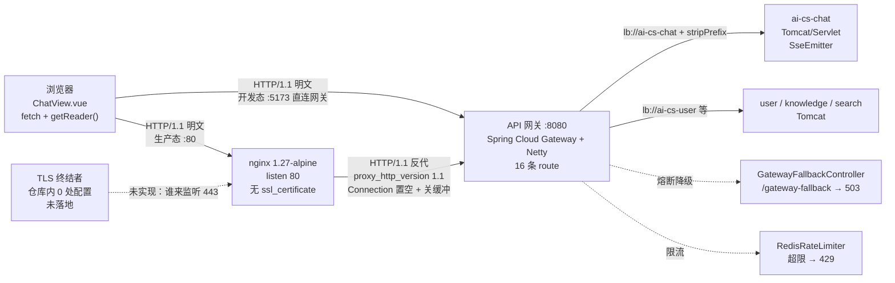
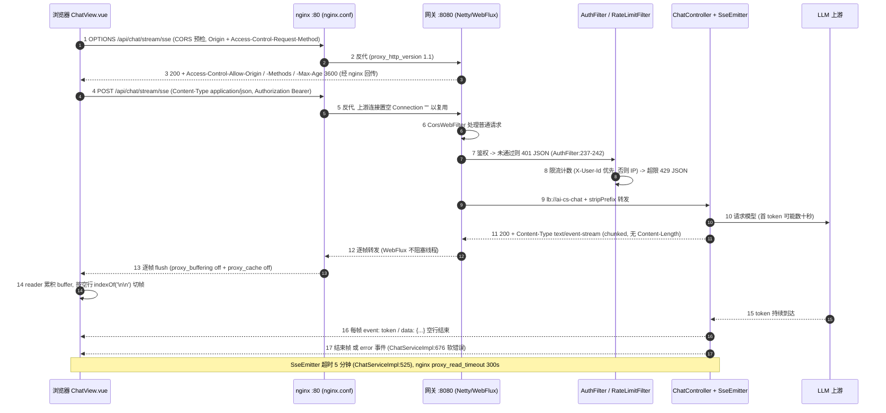

# HTTP 与 TLS：缓存与复用省下的是往返，TLS 省不掉的是首次握手

> **一句话结论**：HTTP 侧几乎所有优化（`Connection: keep-alive`、`Cache-Control`、HTTP/2 多路复用）减少的都是"往返次数或往返的串行度"，而 TLS 的首次建连无法压到 0（TLS 1.3 的 1-RTT 已是上限，0-RTT 只是把首请求塞进握手那一趟）——所以"并发慢"要动连接复用，"首屏慢"要动握手与预热，两者不能互相替代。
> **阅读前置**：先读 [04-TCP协议实战.md](./04-TCP协议实战.md)（RTT、三次握手、TIME_WAIT）；知道"一个 RTT"指一次往返，不需要 TLS 密码学基础。
> **证据基线**：A 级 0 条（本篇不引 JDK/Spring 源码）；B 级 17 个本仓文件（行号均按 `ReadAllLines` 当次核对）；C 级 5 个本机可复跑脚本 + 5 份输出快照，全部在 `learning-docs/tools/tmp/`；环境 node v24.16.0、JDK 17.0.19、分支 `master`。预计阅读 45~60 分钟。

---

## 0. 先看现象

三个症状，一个在客户端、一个在中间层、一个在部署层，看起来是三件事，其实是同一套机制在三个高度上的表现。

### 症状 1：一条连接上并发三个 1 秒的请求，墙钟变成 3 秒

```pwsh
cd D:\Projects\Persion\ai-customer-service
node learning-docs\tools\tmp\m15-05-h2-multiplex.mjs
```

真实输出（脚本 `learning-docs/tools/tmp/m15-05-h2-multiplex.mjs`，快照 `learning-docs/tools/tmp/m15-05-h2-multiplex.out.txt`）：

```text
=== A）HTTP/1.1，keepAlive，1 条连接上并发 3 个 1000ms 请求 ===
墙钟=3057.93ms  服务端 accept=1 条 TCP 连接
首个响应 proto=HTTP/1.1 headers={"content-type":"application/json; charset=utf-8","content-length":"26","date":"Fri, 27 Nov 2026 08:48:52 GMT","connection":"keep-alive","keep-alive":"timeout=5"}

=== B）HTTP/2（h2c 明文），1 条连接上并发 3 个 stream，每个 1000ms ===
墙钟=1191.01ms  服务端 accept=1 条 TCP 连接
首个响应 :status=200 headers={":status":200,"content-type":"application/json; charset=utf-8","content-length":"41","date":"Fri, 27 Nov 2026 08:48:55 GMT"}

=== 对比 ===
HTTP/1.1 单连接串行 = 3058ms
HTTP/2   单连接多路 = 1191ms
单连接上"3 个慢请求"被串行化多付的代价 = 1867ms（本机 loopback，无额外 RTT）
```

**怎么读**：两组用的是同一个 handler（固定 1000ms）、同一个端口、`accept=1` 说明**都只建了一条 TCP 连接**。差别只在协议：HTTP/1.1 的响应头里有 `connection: keep-alive`，HTTP/2 的响应头里**根本没有 `connection` 这个字段**——RFC 9113 明确禁止 HTTP/2 使用连接级头部，复用是协议内建的，不需要再谈"要不要 keep-alive"。
**注意**：这是 loopback，没有网络 RTT，那 1867ms 全是"排队"而不是"传输"。所以它证明的是**应用层队头阻塞**，不是网络慢。

### 症状 2：SSE 在本地推得好好的，过一层代理就变成"最后一帧才出来"或直接 504

```pwsh
cd D:\Projects\Persion\ai-customer-service
Select-String -Path ai-cs-frontend\nginx.conf -Pattern 'proxy_buffer|proxy_read_timeout|Connection' | ForEach-Object { "L{0}: {1}" -f $_.LineNumber,$_.Line.Trim() }
```

真实输出：

```text
L57: proxy_set_header   Connection        "";
L58: proxy_buffering    off;
L60: proxy_read_timeout 300s;   # 大模型首 token 可能很慢，默认 60s 会 504
```

**怎么读**：三行各自治一个病。`proxy_buffering off` 关掉 nginx 的响应缓冲（默认 `on`，会把上游的流攒成块再转发，SSE 就变成"憋一大段"）；`proxy_read_timeout 300s` 把默认 60s 抬到 5 分钟（LLM 首 token 可能几十秒 + 生成 1~2 分钟，60s 会直接把连接掐掉，前端看到的就是 504）；`Connection ""` 是给 nginx 上行的**逐跳头置空**，让 nginx 用 HTTP/1.1 长连接访问上游时不要给网关发 `Connection: close`（下一节 3.2 会讲清这个头到底在干什么）。
**误判风险**：504 是"nginx 等上游超时"，不是"后端报错"。把 504 当成业务 bug 去查 Java 日志，会一无所获——后端根本没收到那次响应。

### 症状 3：本机没有 443，仓库里也没有任何一行 TLS 配置

```pwsh
Get-NetTCPConnection -State Listen -ErrorAction SilentlyContinue |
  Where-Object { $_.LocalPort -in 80,443,8080 } |
  ForEach-Object { "LocalPort={0} OwningProcess={1} LocalAddr={2}" -f $_.LocalPort,$_.OwningProcess,$_.LocalAddress }
"total_443_lines=$((netstat -ano | Select-String -Pattern ':443\s').Count)  listening_443=$((netstat -ano | Select-String -Pattern ':443\s+\S+\s+LISTENING').Count)"
"tls_hits=$((Select-String -Path ai-cs-frontend\nginx.conf -Pattern 'ssl_certificate|listen\s+443|Strict-Transport-Security|return\s+301\s+https').Count)"
```

真实输出：

```text
LocalPort=8080 OwningProcess=40648 LocalAddr=::
total_443_lines=164  listening_443=0
tls_hits=0
```

**怎么读**：`:443` 有 164 行但 `LISTENING` 为 0——那些全是浏览器到外网的 `ESTABLISHED`/`TIME_WAIT`，本机**没有任何进程在 443 上提供服务**；80 端口压根没出现；唯一在听的是 8080，而它的属主是 `D:\DevTools\jdk\jdk1.8\jre\bin\java.exe`（PID 40648），**不是本项目网关**（本项目网关是 JDK 17 + Spring Cloud Gateway/Netty）。`tls_hits=0` 说明 `ai-cs-frontend/nginx.conf` 里没有 `ssl_certificate`、没有 `listen 443`、没有 HSTS、没有 301 跳转。
**误判风险**：`Test-NetConnection localhost -Port 8080` 通，只能证明"有个 Java 进程在听"，不能证明"网关起来了、路由通了"。本仓库的 `8080` 是最典型的"端口撞车"现场。

这些现象指向同一件事：**HTTP 的延迟几乎全部由"往返次数 × 是否复用 × 中间层是否缓冲"决定，而 TLS 只在建连那一刻收一次费，且这笔费用无法免除**。本仓库把前者的坑踩得比较全（`Connection ""`、`proxy_buffering off`、`proxy_read_timeout 300s`、gzip 白名单），却把后者的空白留在了部署侧——上线后 HTTPS 由谁终结，仓库里没有任何一处能回答（见 1.2 的证据边界表）。

---

## 1. 整体地图

### 1.1 一次前端请求要穿过几层



> **读图说明**：实线是**已经存在**的请求路径，虚线是**配置存在但只在异常时触发**的分支（熔断、限流）和**完全没实现**的层（TLS 终结）。看图要抓三个断点：①浏览器到 nginx 这一段是**明文** `<br/>` 注释写的 `listen 80`，全仓无 `ssl_certificate`；②nginx 到网关是 HTTP/1.1 反代（`proxy_http_version 1.1`），即使浏览器升级到 HTTP/2，**网关侧看到的仍然是 1.1**；③网关到业务服务走 `lb://` 负载均衡，业务侧全是 Tomcat（Servlet 模型，线程池 + 阻塞 IO），与网关的 Netty/Reactor 是两套模型。最右侧的 TLS 终结者是**画给读者看的空位**：本仓库既没有 Ingress，也没有 `server.ssl`，也没有 `listen 443`，上线时必须由外部（云 LB / 反代 / API Gateway）补上，否则整条链路就是明文。

### 1.2 组件 / 责任 / 参与方

| 层 | 组件（本仓真实路径） | 责任 | 关键参与方 |
| --- | --- | --- | --- |
| 静态资源 + 入口 | `ai-cs-frontend/nginx.conf`（74 行） | SPA 兜底、`index.html` 不缓存、`/assets/` 强缓存、gzip、`/api/` 反代 | 镜像 `ai-cs-frontend/Dockerfile:31` 的 `nginx:1.27-alpine` |
| 反代细节 | 同上 L49-62 | 逐跳头清理、关缓冲、抬超时、chunked 转发 | 上游 `upstream aics_gateway`（L8-12，`api-gateway:8080`） |
| 网关 | `ai-cs-gateway/src/main/resources/application.yml`（66 行，`port: 8080`） | 路由（16 条 `.route(`）、鉴权、限流、熔断降级、CORS、tracing | 前端、8 个业务服务、Redis |
| 鉴权 | `ai-cs-gateway/src/main/java/com/aics/gateway/filter/AuthFilter.java:237-242` | 未通过 → **401**（只发 401，不发 403） | JWT 白名单 L83-96、API Key L188-221 |
| 限流 | `ai-cs-gateway/src/main/java/com/aics/gateway/filter/RateLimitFilter.java:94-100` | 超限 → **429** + JSON body | `RedisRateLimiter` |
| 降级 | `ai-cs-gateway/src/main/java/com/aics/gateway/controller/GatewayFallbackController.java:20-24` | 熔断打开 → **503**（不是 500） | `RouteConfig.java:174-187` 的 `forward:/gateway-fallback` |
| CORS | `ai-cs-gateway/src/main/java/com/aics/gateway/config/CorsConfig.java:17-28` | 全局 `CorsWebFilter`，`*` origin + `allowCredentials` | 另有 `tools/nacos-config/ai-cs-gateway.yml:6-13` 的 `globalcors`（双写，见 6.6） |
| 业务流式接口 | `ai-cs-chat/src/main/java/com/aics/chat/controller/ChatController.java:167` | `produces = text/event-stream` + `SseEmitter` | `ChatServiceImpl.java:525` 的 5 分钟超时 |
| WebSocket | `ai-cs-notify/src/main/java/com/aics/notify/config/WebSocketConfig.java:26-30` | `/ws/notify` 灰度保留，新客户端走 STOMP | `AICS_ALLOWED_ORIGINS` 环境变量 |

### 1.3 证据边界：哪些能在本仓库核对，哪些是空白

| 能力 | 本仓状态 | 证据 / 缺口 |
| --- | --- | --- |
| HTTP/1.1 长连接反代 | ✅ 已配 | `ai-cs-frontend/nginx.conf:51` `proxy_http_version 1.1` + `:57` `Connection ""` |
| SSE 不缓冲 | ✅ 已配 | 同上 `:58` `proxy_buffering off`、`:59` `proxy_cache off`、`:60` `proxy_read_timeout 300s` |
| gzip | ⚠️ 配了但**不含** `text/event-stream` | `ai-cs-frontend/nginx.conf:23-28`，`gzip_types` 白名单里没有 `text/event-stream`（这是对的，见 3.10） |
| HTTP/2 / HTTP/3 | ❌ 未落地 | nginx 无 `listen 443 ssl` + `http2`，网关是 WebFlux 但也只在 8080 明文监听 |
| TLS 终结 | ❌ **空白** | 全仓 `ssl:` / `ssl_certificate` / `listen 443` 0 命中；无 Ingress、无云 LB 配置 |
| HSTS | ❌ 未落地 | 全仓 `Strict-Transport-Security` 0 命中 |
| mTLS / 服务间认证 | ❌ 未落地 | 服务间走 `lb://` 明文 HTTP；网关只做用户侧 JWT |
| 缓存头 | ✅ 已配 | `/assets/` `expires 1y` + `immutable`（`:33-35`）、`index.html` `no-store`（`:41-43`） |
| 429 语义 | ⚠️ 代码有、默认关 | `RateLimitFilter.java:94-100` 会发 429，但 `application.yml:36-49` 的限流 `enabled: false` 本地降级 |
| 502 / 504 语义 | ⚠️ 只处理了 500/502 | `RouteConfig.java:176-178` 只对 `INTERNAL_SERVER_ERROR`、`BAD_GATEWAY` 重试，**504 不在重试列表** |

---

## 2. 关键概念与关键要素

术语首现即解释；"位置"一栏给出本仓库或本机可核对的位置，方便边读边验证。

| 名称 | 位置 | 作用 | 关键参数 / 判读点 |
| --- | --- | --- | --- |
| RTT（round-trip time） | 网络链路 | 一次往返的时间，是本章所有算术的单位 | 本机 loopback ≈ 0.1~0.5ms（脚本里按 0.5ms 建模）；同城 20ms、跨城 50ms、跨国 150ms 是**假设值**，非实测 |
| 队头阻塞（HOL blocking） | HTTP/1.1 应用层 | 一条连接同一时刻只能有一个响应在传，后面的必须排队 | 症状 1：`3057.93ms` vs `1191.01ms`，两者都 `accept=1` |
| `Connection` 头 | 逐跳头（hop-by-hop） | 声明"这条连接在本次事务后是否保留" | nginx 上游置空（`nginx.conf:57`）；HTTP/2 **禁止**出现该头（症状 1 输出里 h2 无此字段） |
| `keep-alive` / 连接池 | 客户端与服务端之间 | 复用 TCP，省掉每请求的 TCP 握手 + TLS 握手 | 症状 2 的反面：冷连接 20 请求 `accept 20`、复用 `accept 1`（见 3.2） |
| `Content-Length` | 响应头 | 定长：客户端能算出"还剩多少字节" | 观测 1b：`content-length: 33`，`ms=3.02` |
| `Transfer-Encoding: chunked` | 响应头 | 分块：长度未知也能边算边发 | 观测 1a/1c：无 `Content-Length` 时 node 自动改用 chunked |
| `Cache-Control` | 响应头 | 客户端/代理能缓存多久、能不能复用旧副本 | `/assets/` 用 `public, immutable` 一年；`index.html` 用 `no-store` |
| `ETag` / `If-None-Match` | 响应头 / 请求头 | 内容指纹，命中回 **304** 无 body | 本仓 nginx 未显式配 `etag`（继承默认 `on`），但 SPA 用文件名哈希代替 |
| 401 vs 403 | 语义边界 | 401＝"没认证/认证失效"；403＝"认证了但没权限" | `AuthFilter.java:237-242` 只发 401；`ResultCode.java:18` 有 403 码但网关不产生 |
| 429 | 语义边界 | "你太快了，稍后重试" | `RateLimitFilter.java:94-100` 发 429；`ChatController.java:103` 发的是**业务码** 429，HTTP 仍是 200 |
| 502 vs 504 | 语义边界 | 502＝上游给了无效响应；504＝等上游超时 | `GatewayFallbackController.java:20-24` 是 **503**；nginx `proxy_read_timeout` 超时才是 504 |
| TLS 握手 | 建连阶段 | 协商版本/套件/证书，产出会话密钥 | TLS 1.2 完整 **2-RTT**，TLS 1.3 完整 **1-RTT**，0-RTT 复用 PSK |
| SNI（Server Name Indication） | ClientHello 扩展 | 一个 IP 上放多个证书时，告诉服务端"我要哪个域名" | 观测 3：带 `servername` 时服务端读到 `localhost`；只给 IP 时读到 `false` |
| 证书链 | 服务端下发的 `Certificate` 消息 | 叶子证书 → 中间 CA → 根 CA，客户端逐级验签 | 观测 1 输出 `chainLen=1`（自签，链上只有自己） |
| HSTS | 响应头 `Strict-Transport-Security` | 让浏览器以后**强制**用 HTTPS 访问该域，连 301 那跳都省掉 | 全仓 0 命中，未落地 |
| mTLS（双向 TLS） | 握手阶段 | 服务端也要求客户端出示证书，用于服务间认证 | 观测 4：`requestCert:true`，客户端不带证书时**客户端侧仍看到握手成功**（坑，见 6.4） |
| ALPN | TLS 扩展 | 在握手时协商"后面用 h2 还是 http/1.1" | 脚本服务端 `ALPN=[h2,http/1.1]`，观测输出 `alpn=h2` |
| 0-RTT / 早数据 | TLS 1.3 | 复用上次的 PSK，把首个请求塞进第一趟 | 模型结论：11 个往返（vs 复用 1.3 的 13 个），只省 2 趟 |
| SSE 分帧 | 应用层 | `event:`/`data:`/`id:`/`retry:` 四类字段，**空行**表示一帧结束 | `ai-cs-frontend/src/views/ChatView.vue:413` 用 `indexOf('\n\n')` 手工切帧 |

---

## 3. 原理与证据逐段精读

十段，按"报文结构 → 连接复用 → 并发模型 → 缓存 → 语义 → 握手 → 证书 → 加固 → 流式"的顺序推进。每段四层：**在干什么 → 为什么这么设计 → 换写法会怎样 → 常见坑**。

### 3.1 请求/响应结构与 Content-Length vs chunked

**在干什么**：一条 HTTP 消息 = 起始行 + 头部 + 一个空行 + body。在持久连接上，接收方必须能**自己判断 body 到哪里结束**，否则无法区分"这个响应的结尾"和"下一个响应的开头"。两种自描述方式：`Content-Length`（定长）和 `Transfer-Encoding: chunked`（分块，最后一块长度 0）。

```pwsh
cd D:\Projects\Persion\ai-customer-service
node learning-docs\tools\tmp\m15-05-http-roundtrip.mjs
```

真实输出（节选，完整快照见 `learning-docs/tools/tmp/m15-05-http-roundtrip.out.txt`）：

```text
=== 观测 1a：/ping（立刻返回，没设 Content-Length） ===
status=200 ms=16.32 bytes=27 socket.localPort=58794
headers={"content-type":"application/json; charset=utf-8","transfer-encoding":"chunked","connection":"close","cache-control":"no-store","date":"Fri, 27 Nov 2026 08:48:13 GMT"}
body={"ok":true,"route":"/ping"}

=== 观测 1b：/ping-fixed（立刻返回，显式 Content-Length） ===
status=200 ms=3.02 bytes=33 socket.localPort=58795
headers={"content-type":"application/json; charset=utf-8","content-length":"33","connection":"close","cache-control":"no-store","date":"Fri, 27 Nov 2026 08:48:13 GMT"}

=== 观测 1c：/stream（5 帧 × 100ms，无 Content-Length） ===
status=200 ms=543.67 bytes=140 socket.localPort=58796
headers={"content-type":"text/event-stream; charset=utf-8","transfer-encoding":"chunked","connection":"keep-alive","cache-control":"no-cache","date":"Fri, 27 Nov 2026 08:48:13 GMT"}
body=head event: token\ndata: {"i":1}\n\nevent: token\ndata: {"i":2}\n\neven
```

**怎么读**：同一个 node `http` 模块、同一个 `res.end(body)` 调用，只要**不显式设 `Content-Length`**，node 就自动改用 `transfer-encoding: chunked`（1a、1c）；显式设了就发定长（1b）。1a 的 `ms=16.32` 明显高于 1b 的 `3.02`，但那**不是** chunked 变慢——1a 是进程启动后的第一次请求，含 TSL/模块懒加载噪声，不能当性能结论。真正的信号是 1c：5 帧共 543.67ms（5×100ms + 开销），`bytes=140` 是**首 140 字节**，说明 chunked 让"还没算完就能先发"。

**为什么这么设计**：HTTP/1.0 靠"关连接"界定 body（看 1a/1b 里的 `connection: close`），那就必然一请求一连接，无法复用。HTTP/1.1 加了 chunked 这个自描述编码，才让"长度未知的响应"也能跑在持久连接上。**没有 chunked，就没有 SSE 和流式大模型输出**——这是本章所有流式能力的地基。

**换写法会怎样**：
- 如果对 SSE 响应硬设 `Content-Length`（或让框架算出总长），连接必须等全部 token 生成完才能结束 → 前端要么空等几十秒，要么直接拿不到流。`ChatController.java:167` 之所以写 `produces = MediaType.TEXT_EVENT_STREAM_VALUE` 并返回 `SseEmitter`，就是为了让 Spring 走 chunked 而不是定长序列化。
- 如果既没有 `Content-Length` 也没有 chunked，接收方只能读到 EOF 才认为响应结束 → 必须 `connection: close`，连接池直接失效（1a/1b 里的 `connection: close` 就是这个语义，因为这两个 handler 显式关掉了复用）。

**常见坑**：
1. `curl -I` 只看头不看 body 时，chunked 响应看不出内容对不对，容易误判"接口返回空"。要么加 `-v`，要么用 `curl -s -D -`。
2. 手写 HTTP 报文时忘记头部后的**空行**（`\r\n\r\n`），服务端会把 body 的第一行当头部解析，报 400 且日志里看不出原因。
3. chunk 的长度是**十六进制**，且每块后面跟 `\r\n`（数据后一个、块尾再一个）；少一个 `\r\n` 就会卡住直到超时。
4. `ai-cs-frontend/nginx.conf:61` 的 `chunked_transfer_encoding on;` 只管 nginx **往下游客户端**发不发 chunked，不改上游行为；上游是 HTTP/1.1 时它本来就是 chunked，这一行主要是防某些默认关掉的镜像。

### 3.2 keep-alive 与连接池：省下的是"每请求都握手"

**在干什么**：把"建连"从"每请求一次"降成"每连接一次"。一次建连的成本包括 TCP 三次握手（1 RTT）+ TLS 握手（TLS 1.2 是 2 RTT，1.3 是 1 RTT）+ 服务端 `accept` 所需的 fd、内存与一次上下文切换。

```pwsh
node learning-docs\tools\tmp\m15-05-http-roundtrip.mjs
```

真实输出（观测 2 与观测 3，同一份快照）：

```text
=== 观测 3：20 次 /ping，冷连接（每请求新建 TCP） ===
20 个请求 -> 服务端 accept 20 条 TCP 连接；耗时 平均=1.80ms 最小=1.21ms 最大=3.00ms

=== 观测 3：20 次 /ping，复用连接（keepAlive agent） ===
首个请求的响应头={"content-type":"application/json; charset=utf-8","transfer-encoding":"chunked","connection":"keep-alive","keep-alive":"timeout=5","cache-control":"no-store","date":"Fri, 27 Nov 2026 08:48:17 GMT"}   <- 注意 connection 与冷连接不一样
20 个请求 -> 服务端 accept 1 条 TCP 连接；客户端只用了 1 个本地端口 [58828]
耗时 平均=0.66ms 最小=0.28ms 最大=2.47ms
省下的绝对时间 = 1.144ms/请求（loopback 建立连接本来就便宜，所以这个差值很小）
```

**怎么读**：两个**独立**信号证明复用真的发生了——服务端 `connection` 事件只触发 1 次（`accept 1`），客户端 `socket.localPort` 只有一个值（`[58828]`）。只看耗时是不够的：`1.80ms → 0.66ms` 在 loopback 上只有 1.144ms 的绝对差，容易被人一句"噪声"否定；而 `accept 20 vs accept 1` 是**计数**，不受噪声影响。这是本机实测最该学的判读习惯：**先找计数证据，再看时间证据**。

**为什么这么设计**：loopback 建连几乎免费（1.144ms），但真实网络里建连成本是 RTT 量级。用 `learning-docs/tools/tmp/m15-05-tls-flights.mjs` 算同一套往返（纯模型，不是实测）：

```text
=== 结论 1：keep-alive 省下的是"每请求 N 次握手"这件事 ===
RTT=  0.5ms  不复用=     20.0ms  复用=     7.0ms  省 13.0ms
RTT=   20ms  不复用=    800.0ms  复用=   280.0ms  省 520.0ms
RTT=   50ms  不复用=   2000.0ms  复用=   700.0ms  省 1300.0ms
RTT=  150ms  不复用=   6000.0ms  复用=  2100.0ms  省 3900.0ms
```

模型假设写在脚本头部：每次新连接 + TLS 1.2 完整握手 = 4 个往返/请求，10 个请求共 40 趟；复用后只需首请求握手 = 14 趟。**RTT 是假设值，不是实测值**——本机无法伪造跨国延迟，所以这一组数字只能作为"量级推演"，写进文档时必须标注模型。

**换写法会怎样**：关掉 keep-alive（HTTP/1.0 语义，或客户端 agent 不设 `keepAlive`）后，每个请求都要重付 TCP + TLS；RTT 越大惩罚越线性。反过来，把连接池开得过大（`maxSockets` 无上限）会让服务端瞬间吃满 fd，`ai-cs-gateway/src/main/resources/application.yml` 里没有任何 `max-connections` / `keep-alive` 配置，也就是**吃 Tomcat/Netty 默认值**（见 6.2 的核对命令）。

**常见坑**：
1. **Node 的 `http` 默认不复用**：不传 `new http.Agent({ keepAlive: true })` 时每请求新建连接——观测 3 的冷连接组就是默认行为。前端 `fetch` 在浏览器里默认复用，但 node 脚本、定时任务、压测脚本常常忘了这一条。
2. **超时不匹配**：观测 3 里服务端宣告 `keep-alive: timeout=5`（node 默认 5s），而 `ai-cs-frontend/nginx.conf` 到上游的 `proxy_read_timeout` 是 300s。中间层保持的连接如果比上游自己的 idle 超时更长，就会出现"我以为是复用，其实对端已经关了"的**半开连接**，第一个请求吃到 `ECONNRESET` 然后重试——看起来像"偶发 502"。
3. **`Connection: close` 泄漏到上游**：`ai-cs-frontend/nginx.conf:57` 把 `Connection` 置成空串正是为了这个——nginx 默认会给上游发 `Connection: close`（HTTP/1.0 风格），置空后才会按 `proxy_http_version 1.1` 保持长连接。删掉这一行不会报错，只会让每个请求都新建到网关的连接。
4. **TLS 场景要单独测**：`keepAlive` 对 HTTPS 的收益远大于 HTTP（省的不只是 TCP 握手），但**恢复握手不一定拿得到对端证书**（3.7、6.3）。

### 3.3 HTTP/1.1 的应用层队头阻塞

**在干什么**：一条 HTTP/1.1 连接同一时刻只能有一个"在途"响应。请求可以连着发（pipelining），但响应必须**按请求顺序**返回，所以队首那个慢请求会把后面全堵住。

真实输出（观测 4，同一份快照）：

```text
=== 观测 4：一条 keepAlive 连接上并发 3 个 /slow 请求 ===
3 个 1000ms 请求、单连接串行 -> 墙钟 3032.92ms；accept 1 条连接

=== 观测 4：三条独立连接上并发同样 3 个 /slow 请求 ===
3 个 1000ms 请求、三连接并行 -> 墙钟 1010.13ms；accept 3 条连接
```

**怎么读**：两组都是"并发发起 3 个 1000ms 的请求"，唯一差别是连接数。单连接 `3032.92ms ≈ 3×1000`，三连接 `1010.13ms ≈ 1×1000`。**这就是队头阻塞的定义级证据**：不是网络慢（loopback 无 RTT），不是服务端慢（同样是 1000ms/个），而是"一条连接一次只能跑一个响应"。

**为什么这么设计**：HTTP/1.1 的响应没有流 ID，只能靠顺序来配对请求与响应。想让多个响应交错传输，就必须引入标识——那是 HTTP/2 干的事。pipelining 理论上能"连着发不等响应"，但因为中间层代理兼容性太差（响应必须严格有序，任一环节乱序就出错），浏览器实际全部禁用。

**换写法会怎样**：
- 靠"多开连接"绕过（浏览器每域 6 条连接）：能提升并发，但每条连接都要付一次握手，且 6 条以上会被浏览器截断；服务端 fd 压力线性上升。
- 靠"拆接口"绕过（把大响应拆成多次小请求）：请求数变多，每个都要一次完整往返，在 RTT 大的链路上反而更慢。
- 换 HTTP/2：见 3.4，同一连接上 3 个 stream 只要 `1191.01ms`。

**常见坑**：
1. **把"单连接并发"当成并行**：客户端库里 `Promise.all([...])` 看起来是并行，但如果连接池 `maxSockets: 1`，它只是在排队。判读方法就是数 `accept`：观测 4 里单连接那次 `accept 1`。
2. **长连接 + 慢接口 = 全局卡死**：本仓库的 `/api/chat/stream/sse`（`ai-cs-chat/src/main/java/com/aics/chat/controller/ChatController.java:167`）是分钟级的长响应，如果它和普通查询挤在同一条 HTTP/1.1 连接上，后续请求会被堵到流结束。这就是为什么 SSE 必须独立路径、且 nginx 对 `/api/` 单独 `proxy_buffering off`。
3. **误以为 nginx `worker_connections` 是并发上限**：它限制的是连接数，不是"一条连接上的并发请求数"；HTTP/1.1 下这两个数是一回事，HTTP/2 下完全不是。

### 3.4 HTTP/2 多路复用、流控与 HTTP/3 的 0-RTT

**在干什么**：HTTP/2 把消息切成二进制帧，给每个请求分配一个 `stream id`，同一条 TCP 连接上可以交错传输多个请求/响应；HTTP/3 把传输层换成 QUIC（基于 UDP），把"流"做进传输层，避免 TCP 重传把整条连接的所有流一起卡住。

真实输出（`learning-docs/tools/tmp/m15-05-h2-multiplex.out.txt`）：

```text
=== B）HTTP/2（h2c 明文），1 条连接上并发 3 个 stream，每个 1000ms ===
墙钟=1191.01ms  服务端 accept=1 条 TCP 连接
首个响应 :status=200 headers={":status":200,"content-type":"application/json; charset=utf-8","content-length":"41","date":"Fri, 27 Nov 2026 08:48:55 GMT"}
```

**怎么读**：`accept=1` 说明只建了一条 TCP；`1191.01ms` 说明 3 个 1000ms 的 handler **真的重叠执行**了。响应头的形态也变了：以 `:status` 伪头部开头（HTTP/2 用伪头部替代起始行），并且**没有 `connection` / `keep-alive`**。最后这点是最容易踩的观测判据——如果你在 h2 响应里看到 `connection: keep-alive`，那说明中间某层把它降级回 1.1 了。

**为什么这么设计**：h2 解决的是**应用层**队头阻塞（3.3），但 TCP 本身是有序字节流：一个包丢了，后续所有已到达的包都得在内核里等重传，所有 stream 一起卡——这叫**传输层队头阻塞**。QUIC 把每个 stream 的重传独立化，才是彻底解。h2 还顺带做了 HPACK 头部压缩（重复头部只发索引），这让"少发头部"不再有意义。

**换写法会怎样**：
- 本仓若给 nginx 加 `listen 443 ssl http2`：客户端到 nginx 变 h2，但 nginx 到网关仍是 `proxy_http_version 1.1`（`ai-cs-frontend/nginx.conf:51`），**网关侧看不到 h2 的收益**，只有"浏览器-nginx"这一段变好。
- 若直接上 HTTP/3：需要 UDP 443、`Alt-Svc` 宣告、且 nginx 1.27 才稳定支持 `listen 443 quic`；本仓 0 处配置，属于**未落地**（给不了实测数据）。
- 0-RTT 在这个对比里只省 2 趟往返（模型结论：复用 1.3 = 13 趟，0-RTT = 11 趟），代价是重放风险——只适合幂等 GET。

**常见坑**：
1. **h2c（明文）只在受控环境用**：浏览器不支持 h2c，脚本里能跑（本机就是 `node:http2` 的 h2c），但换成浏览器就必须 TLS + ALPN。
2. **nginx 版本语法差异**：1.25.1 之前写 `listen 443 ssl http2;`，之后推荐 `listen 443 ssl;` + 独立的 `http2 on;`；本仓镜像是 `nginx:1.27-alpine`（`ai-cs-frontend/Dockerfile:31`），新语法可用。写成旧语法不报错但会有 deprecated 警告。
3. **h2 下 `Connection` 头被丢弃**：任何依赖 `Connection: upgrade` 的机制（WebSocket 的 101 握手）在 h2 里走不通，需要 RFC 8441 的 extended CONNECT，很多网关还不支持 → 本仓的 `/ws/notify`（`ai-cs-notify/src/main/java/com/aics/notify/config/WebSocketConfig.java:29`）如果被放到 h2 后面会握手失败。
4. **别用"开 h2 就一定快"做结论**：h2 对**高并发小请求**收益明显，对**单个大响应**几乎无收益（数据量没变，只是分帧）。

### 3.5 缓存与条件请求：连请求都不发才是最优

**在干什么**：用响应头告诉客户端/代理"这份副本能留多久、什么时候必须回源验证"。`Cache-Control: public, immutable` + 一年 `expires` = 一年内**零请求**；`no-store` = 一个字节都不许留；`ETag` + `If-None-Match` = 回源但只传 304（省 body，不省往返）。

本仓真实配置（`ai-cs-frontend/nginx.conf`，行号按 `ReadAllLines`）：

```nginx
    # ---------- 带 hash 的静态资源：可以永久缓存 ----------
    location /assets/ {
        expires 1y;
        add_header Cache-Control "public, immutable";
        access_log off;
    }

    # ---------- index.html：绝对不能缓存 ----------
    location = /index.html {
        add_header Cache-Control "no-store, no-cache, must-revalidate";
        expires -1;
    }
```

**怎么读**：两条策略必须**成对**看。`/assets/` 里的文件名带内容哈希（Vite 产物），内容变了文件名就变，所以可以 `immutable`；`index.html` 是"指针文件"，文件名永远不变但内容每次发版都变，一旦被缓存，用户会拿旧 HTML 去引用**已被删除的旧 chunk**——`ai-cs-frontend/nginx.conf:5` 的注释原话就是"白屏"。文件里的注释已经把这个因果讲清楚了，这不是我推测。

**为什么这么设计**：唯一"免费"的延迟优化是**不发请求**。而"能缓存多久"本质是"内容与 URL 的绑定强度"：URL 随内容变（哈希文件名）→ 可永久缓存；URL 不随内容变（`/index.html`）→ 必须每次验证。"强缓存 + 条件请求"的分层，是为了让"确定没变"的资源零成本、"可能变了"的资源低成本。

**换写法会怎样**：
- 给 `index.html` 也设一年 `immutable` → 发版后旧 HTML 引用旧 chunk，404 白屏，且用户**刷新也没用**（强缓存不校验）。
- 给 `/assets/` 设 `no-cache` → 每次回源验证，JS/CSS 上百个请求每个都多一趟往返，首屏直接崩。
- 只设 `expires` 不设 `Cache-Control` → 现代浏览器优先看 `Cache-Control`，`expires` 在时钟不准时行为不确定（本机宿主时区是 China Standard Time、JVM 未设 `user.timezone`，时钟类判据要格外小心）。

**常见坑**：
1. **`no-cache` ≠ 不缓存**：它只是"用前必须验证"，比 `no-store` 弱得多。真要禁止留副本必须 `no-store`（本仓 `index.html` 两个都写了）。
2. **`add_header` 的继承陷阱**：nginx 里一旦某个 `location` 内出现 `add_header`，父级的 `add_header` **不再继承**。所以在 `location /assets/` 里加一个 `add_header`，会让 server 级的 HSTS / CORS 头在这个 location 里消失——这是"上了 HSTS 却有时没有"的经典原因（本仓目前 server 级没有 `add_header`，所以还没踩到这个，但一旦加 HSTS 就要注意）。
3. **gzip 与 `Cache-Control` 正交**：压缩不改变缓存语义，但 `Vary: Accept-Encoding` 必须存在，否则缓存会把 gzip 版本发给不支持的客户端。本仓 `ai-cs-frontend/nginx.conf:28` 有 `gzip_vary on;`。
4. **不要把业务数据的缓存策略写在前端 nginx**：`/api/` 里 `proxy_cache off`（`:59`）是对的，否则用户会看到别人的对话。

### 3.6 状态码的语义边界：401/403、429、502/504

**在干什么**：状态码是给**机器**读的契约——客户端重试策略、CDN 缓存策略、监控 SLO、告警规则全靠它分类。语义错了，代码不报错，但可观测性和重试逻辑全废。

本仓的真实落点：

| 状态码 | 谁产生（真实路径:行） | 语义 | 本仓判读要点 |
| --- | --- | --- | --- |
| 401 | `ai-cs-gateway/src/main/java/com/aics/gateway/filter/AuthFilter.java:237-242` | 没认证 / token 失效 | 手写 JSON body，**不是** Spring 默认错误页 |
| 403 | 网关**不产生**；`ai-cs-common/src/main/java/com/aics/common/result/ResultCode.java:18` 有码值 | 认证了但无权限 | 只看到 401 说明鉴权链在网关就断了，根本没到业务侧判权限 |
| 429 | `ai-cs-gateway/src/main/java/com/aics/gateway/filter/RateLimitFilter.java:94-100` | 限流 | 有 JSON body；但限流默认 `enabled: false`（`application.yml:36-49`），本地不触发 |
| 503 | `ai-cs-gateway/src/main/java/com/aics/gateway/controller/GatewayFallbackController.java:20-24` | 熔断降级 | `@ResponseStatus(SERVICE_UNAVAILABLE)`，**不是 500** |
| 502 | 上游给无效响应时由客户端/网关产生 | 坏网关 | `ai-cs-gateway/src/main/java/com/aics/gateway/config/RouteConfig.java:176-178` 对 502 会重试（仅 GET） |
| 504 | nginx 等上游超时 | 网关超时 | `ai-cs-frontend/nginx.conf:60` 把默认 60s 改成 300s，就是为了少出 504；**504 不在重试列表** |

```pwsh
cd D:\Projects\Persion\ai-customer-service
Select-String -Path ai-cs-gateway\src\main\java\com\aics\gateway\config\RouteConfig.java -Pattern 'setStatuses|setRetries|setMethods' | ForEach-Object { "L{0}: {1}" -f $_.LineNumber,$_.Line.Trim() }
```

真实输出：

```text
L176:         f.retry(c -> c.setRetries(2)
L177:                         .setMethods(HttpMethod.GET)
L178:                         .setStatuses(HttpStatus.INTERNAL_SERVER_ERROR, HttpStatus.BAD_GATEWAY))
```

**怎么读**：重试只覆盖 `GET` + `500` + `502`，**三次重试机会（`setRetries(2)` 表示共 3 次）**。这意味着：①`POST /api/chat/stream/sse` 永远不会被网关重试（正确，重试会重复计费）；②`504` 不会重试（因为 504 通常是"等太久"，重试只会更久——这个取舍是对的，但要有意识）；③`503` 是熔断降级**自己**返回的，重试它没有意义。

**为什么这么设计**：401 与 403 分开，是为了让前端能自动分流——401 该跳登录页，403 该弹"无权限"（不该清 token）。502 与 504 分开，是为了让运维能定位上游"死了"还是"慢了"。如果把"认证失败"和"无权限"都丢 403，前端就没法区分"该重新登录"还是"该找管理员"。

**换写法会怎样**：本仓有一个**真实的混合体**——`ai-cs-chat/src/main/java/com/aics/chat/controller/ChatController.java:103`：

```java
        return Result.fail(ResultCode.TOO_MANY_REQUESTS, "当前对话人数过多，请稍后再试");
```

这是 **HTTP 200 + body 里 `code: 429`**。它对前端友好（统一走 `Result` 解析），但对**中间层完全不透明**：网关不会限流、nginx 不会 429、监控看不到 429 曲线、客户端 SDK 不会自动 `Retry-After`。这不是 bug，是"统一响应体"与"HTTP 语义"的固有取舍——但两种 429 同时存在于一个系统里，排查时必须先分清"HTTP 429"还是"业务 429"（判读命令见 6.7）。

**常见坑**：
1. **401/403 混用**：本仓网关只发 401，所以"登录了但没权限"的请求也能走到业务侧，由业务侧用 `Result` 表达——此时 HTTP 仍是 200。查"为什么用户能访问别人的数据"时，别在网关找 403。
2. **拿 502 当 500 排查**：502 的故障点在"网关到上游"这一段（DNS、端口、上游重启、连接被重置），不在上游的业务逻辑里。
3. **429 不给 `Retry-After`**：`RateLimitFilter.java:94-100` 的 body 里只有 `code/message/data/timestamp`，没有 `Retry-After` 头 → 客户端只能瞎猜退避时间。
4. **504 是"代理层的判定"**：它可能意味着后端其实成功了、只是太慢。所以 504 后的重试要考虑幂等性（本仓只重试 GET，正好回避了这个问题）。

### 3.7 TLS 握手：TLS 1.2 的 2-RTT 与 TLS 1.3 的 1-RTT

**在干什么**：TLS 握手要完成四件事——协商协议版本与密码套件、验证服务端身份（证书链）、协商出双方共享的会话密钥、确认握手完整性。这些必须在**应用数据发出之前**做完，所以它是首请求延迟里"无法摊薄"的一部分。

```pwsh
cd D:\Projects\Persion\ai-customer-service
python learning-docs\tools\tmp\m15-05-tls-cert.py
node learning-docs\tools\tmp\m15-05-tls-handshake.mjs
```

真实输出（节选，快照 `learning-docs/tools/tmp/m15-05-tls-handshake.out.txt`）：

```text
=== 观测 1：TLS 1.3 ===
[1.3 完整握手]
    protocol=TLSv1.3 cipher=TLS_AES_256_GCM_SHA384 alpn=h2 sessionReused=false servername=localhost authorized=true
    cert: CN=localhost issuer=localhost selfSigned=true chainLen=1 valid_to=Dec 27 08:49:24 2026 GMT
    握手耗时(loopback，仅参照)=10.38ms
[1.3 复用 session]
    protocol=TLSv1.3 cipher=TLS_AES_256_GCM_SHA384 alpn=h2 sessionReused=false servername=localhost authorized=true
    握手耗时(loopback，仅参照)=6.38ms

=== 观测 2：把版本钉死到 TLS 1.2 ===
[1.2 完整握手]
    protocol=TLSv1.2 cipher=ECDHE-RSA-AES128-GCM-SHA256 alpn=h2 sessionReused=false servername=localhost authorized=true
    握手耗时(loopback，仅参照)=4.33ms
[1.2 复用 session]
    protocol=TLSv1.2 cipher=ECDHE-RSA-AES128-GCM-SHA256 alpn=h2 sessionReused=true servername=localhost authorized=true
    cert: CN=undefined issuer=undefined selfSigned=true chainLen=1 valid_to=undefined
    握手耗时(loopback，仅参照)=2.23ms
```

**怎么读**：三件事必须分开说，混在一起就会得到错误结论。
1. **版本**：`protocol=TLSv1.3` 用的是 `TLS_AES_256_GCM_SHA384`（1.3 的套件只描述 AEAD+散列，密钥交换统一是 (EC)DHE）；1.2 用的是 `ECDHE-RSA-AES128-GCM-SHA256`（密钥交换/认证/加密/散列四段式）——套件名的形状就把两代协议的差异写在脸上了。
2. **会话复用**：1.2 的复用**成功**了（`sessionReused=true`，`4.33ms → 2.23ms`）；1.3 的复用**没成功**（`sessionReused=false`），因为 TLS 1.3 的 PSK 来自服务端下发的 NewSessionTicket，而 node 的 `getSession()` 在 ticket 到达前拿到的是空壳。**所以"1.3 一定 1-RTT"是理论上限，工程上要等 ticket 才能 0-RTT/1-RTT 复用**。
3. **耗时数字只能用来看相对关系**：`10.38ms / 4.33ms / 2.23ms` 全是 loopback 上的握手计算耗时，与真实网络的 RTT 无关。真实链路里往返数才是主项，见下面的模型推演。

往返数模型（`learning-docs/tools/tmp/m15-05-tls-flights.mjs`，纯计算）：

```text
--- 假设 RTT = 50 ms ---
策略                                            总往返数     总耗时(ms)      相对最优
每次新连接 + TLS1.2 完整握手                             40      2000.0     3.64x
每次新连接 + TLS1.3 完整握手                             30      1500.0     2.73x
keep-alive 复用 + 仅首请求握手(1.2)                     14       700.0     1.27x
keep-alive 复用 + 仅首请求握手(1.3)                     13       650.0     1.18x
keep-alive 复用 + TLS1.3 0-RTT 早数据                11       550.0     1.00x
```

**为什么这么设计**：TLS 1.2 的完整握手是两趟——第一趟客户端发 ClientHello（含 SNI、支持的套件），服务端回 ServerHello + 证书 + ServerKeyExchange（这趟之后客户端才知道密钥材料）；第二趟客户端发 ClientKeyExchange + ChangeCipherSpec + Finished，服务端回 ChangeCipherSpec + Finished。TLS 1.3 把所有密钥交换参数压进 ClientHello 的 `key_share` 扩展，服务端一趟就能算完双方密钥，于是"两个半趟"合并成"一个往返"。

**换写法会怎样**：
- 想在 1.3 里再省一趟，只能上 0-RTT（用上次的 PSK 直接发早数据）。代价是**可重放**：早数据没有前向保密，攻击者可录下来重放，所以只能用于幂等 GET。模型里它把 13 趟压到 11 趟（省 2 趟 ≈ 100ms@50ms）。
- 想省掉 TLS 完全（内网明文）：本仓现在就是这样（服务间 `lb://` 明文 HTTP），省下的正是这 1~2 趟，但**代价是内网即信任边界**，一旦有 SSRF 或横向移动就全裸。

**常见坑**：
1. **把"握手耗时"当延迟**：本机 `10.38ms` 看着比 `4.33ms` 还大（1.3 反而更慢），因为它包含 node 首次建立 TLS 上下文、解析证书的开销。**单次 loopback 数字没有可比性**，要比就比往返数。
2. **以为 TLS 1.3 完全没有 RSA**：1.3 仍支持 RSA 签名（`rsa_pss_rsae_sha256`），只是废除了 RSA **密钥交换**（静态 RSA）。所以"1.3 不支持 RSA 证书"是错的，错的是"RSA 密钥传输"。
3. **0-RTT 与 `Early-Data: 1`**：nginx 收到 0-RTT 请求时会加 `Early-Data: 1` 头，应用层必须自行判断能否安全处理；忽略这个头就等于开放重放窗口。
4. **版本钉死会踩到降级告警**：脚本里 `maxVersion`/`minVersion` 钉成 1.2 是为了 A/B；生产里钉死会造成"不支持该版本的客户端直接失败"，且 TLS 1.0/1.1 已被 RFC 8996 正式废弃。

### 3.8 证书链与 SNI：一个 IP 上放多个站点

**在干什么**：服务端在握手中下发证书链（叶子 → 中间 CA → 根），客户端用本地信任锚逐级验签；SNI 让客户端在**握手第一趟**就告诉服务端"我要哪个域名"，服务端才能选对证书。

真实输出（`python learning-docs\tools\tmp\m15-05-tls-cert.py`）：

```text
cert subject: CN=localhost,O=ai-cs learning-docs,C=CN
cert sha256 : b86d0e4e0e32cdf76c18ed59bf24fc39cf1454fa9c26bbf3410123341a39c482
cert sigalg : sha256WithRSAEncryption
valid : 2026-11-27 -> 2026-12-27
```

以及握手探针里的 SNI 观测（同一份 `m15-05-tls-handshake.out.txt`）：

```text
=== 观测 3：SNI 有没有传上去 ===
[客户端带 servername=localhost]
    protocol=TLSv1.3 ... servername=localhost authorized=true
[客户端只给 IP，不发 servername]
    protocol=TLSv1.3 ... servername=false authorized=true
服务端 secureConnection 共 5 次，收到的 servername 序列 = [localhost, localhost, localhost, false, localhost]
```

**怎么读**：服务端用 `servername` 回调按域名选证书（SNI 路由），回调参数为 `false` 说明客户端没发 SNI。**只按 IP 访问时不发 SNI**——这就是"用 `https://1.2.3.4/` 打开报证书不匹配或落到默认站点"的根因，而不是证书配错了。`chainLen=1` 说明这份自签证书链上只有它自己（正常公网证书链长通常是 2~3：叶子 + 中间 CA，根证书不进链）。

**为什么这么设计**：TLS 握手发生在 HTTP 之前，此时还没有 `Host` 头，服务端无法从应用层知道"用户要哪个站"，所以必须把域名提前放进 ClientHello 的 SNI 扩展。而信任方面，客户端不可能内置所有服务端公钥，只能内置少量根 CA，由服务端把"我的证书 + 中间 CA"一起发下来，客户端逐级验签——这就是链式信任。

**换写法会怎样**：
- 不自签、改为信任所有证书（`rejectUnauthorized: false` / curl `-k`）：能让脚本跑通，但等于关掉认证，中间人可以随便冒充——**这是测试环境最常见的坏习惯**，且一旦进了生产配置就是"TLS 只剩加密，没有身份"。
- 服务端只发叶子证书不发中间证书：部分浏览器能靠 AIA（Authority Information Access）自动补齐，但 **Java `HttpClient`、`curl`、`openssl` 常常补齐失败**，表现为"浏览器正常、后端调不通"。这是"证书链不全"的经典症状（未本机实测，本机无公网证书可验）。

**常见坑**：
1. **SNI 缺失导致默认站点**：本仓库若以后在 nginx 上开多域名，`server_name _;`（`ai-cs-frontend/nginx.conf:16`）会成为默认 server，**没有任何 SNI 匹配的请求都落到它身上**——证书不匹配的报错往往指向这里。
2. **自签证书的有效期只有 30 天**（上面 `valid : 2026-11-27 -> 2026-12-27`），过期后 `authorized` 会变 `false`，脚本随即失败。把证据脚本留在仓库里，就要接受它会"过期失效"。
3. **通配符证书只盖一级**：`*.example.com` 不匹配 `a.b.example.com`。
4. **时钟偏移直接导致验证失败**：宿主时区是 China Standard Time，而 JVM 未设 `user.timezone`，跨时区容器里做证书校验测试时，先确认 `date` 与证书 `valid_to` 的时区口径一致。

### 3.9 HSTS 与 mTLS：把"第一次"也保护起来

**在干什么**：HSTS（`Strict-Transport-Security`）让浏览器记住"这个域名只能走 HTTPS"，之后即使用户输入 `http://`，浏览器也**在本地**就改写成 https，不发那次明文请求；mTLS 让服务端在握手时也要求客户端出示证书，用于服务间身份认证。

本仓状态：**两者都没落地**。核对命令与真实输出：

```pwsh
cd D:\Projects\Persion\ai-customer-service
"hsts_hits=$((Get-ChildItem -Recurse -Include *.conf,*.java,*.yml -File | Where-Object { $_.FullName -notmatch 'node_modules|target|learning-docs' } | Select-String -Pattern 'Strict-Transport-Security' | Measure-Object).Count)"
"mtls_hits=$((Get-ChildItem -Recurse -Include *.java,*.yml -File | Where-Object { $_.FullName -notmatch 'node_modules|target|learning-docs' } | Select-String -Pattern 'requestCert|clientAuth|mutual' | Measure-Object).Count)"
```

```text
hsts_hits=0
mtls_hits=0
```

mTLS 的机制在本机是可以演示的（`m15-05-tls-handshake.mjs` 的服务端用 `requestCert: true`）：

```text
=== 观测 4：服务端 requestCert:true（要求客户端出示证书） ===
[客户端不带证书]
    protocol=TLSv1.3 cipher=TLS_AES_256_GCM_SHA384 alpn=h2 sessionReused=false servername=localhost authorized=true
[客户端带证书]
    protocol=TLSv1.3 ... authorized=true
服务端侧记录到的 tlsClientError = [ERR_SSL_PEER_DID_NOT_RETURN_A_CERTIFICATE]
```

**怎么读**：**客户端侧两次都是 `authorized=true`**——如果只看客户端日志，会得出"mTLS 没生效"或"两次都成功"的错误结论。真相在**服务端侧**：`tlsClientError` 里出现 `ERR_SSL_PEER_DID_NOT_RETURN_A_CERTIFICATE`，说明第一次握手在服务端被记为失败。TLS 1.3 的客户端证书请求发生在握手靠后阶段，客户端可能已经认为握手完成（甚至能发出应用数据），随后才被服务端断开——**"假成功"是 mTLS 调试的头号陷阱**。

**为什么这么设计**：HSTS 解决的是"第一次访问"的降级窗口——只做 301 跳转的话，攻击者可以拦截第一次明文请求把用户引到 `http://` 钓鱼页；HSTS 让浏览器把这个"必须 https"的策略缓存在本地（`max-age`），`includeSubDomains` 覆盖子域，`preload` 把域名硬编码进浏览器内置列表（不可撤回，需谨慎）。mTLS 解决的是"服务端凭什么相信调用方"——JWT 证明"用户是谁"，mTLS 证明"调用方是哪个服务"。

**换写法会怎样**：
- 只做 301/308 跳转到 https：首跳仍是明文，且客户端可能根本不跟跳转。HSTS 只在**成功建立过一次 HTTPS 后**才生效（这也是为什么首次部署要用 `max-age` 小值试水）。
- 用共享密钥/内网白名单代替 mTLS：密钥会泄漏、IP 会变；mTLS 每连接验证且证书可轮换。代价是证书分发与轮换的运维成本——这也是本仓没做的现实原因（8 个 Java 服务 + 网关，没有证书管理设施）。

**常见坑**：
1. **HSTS 上了就难退**：`max-age` 一旦下发，浏览器在有效期内**拒绝**连接 http，回滚需等过期。上 `includeSubDomains`/`preload` 前必须确认所有子域都有 HTTPS。
2. **HSTS 头只在 HTTPS 响应里有效**：写在 80 端口的明文响应里浏览器会忽略（且可能报错）。
3. **`add_header` 在 location 里会截断继承**（同 3.5 坑 2）：HSTS 常配在 server 级，一旦某个 location 里也写了 `add_header`，该 location 就丢掉 HSTS。
4. **mTLS 下 `authorized` 不能只看客户端**（见上），服务端必须显式校验 `socket.authorized` 与 `getPeerCertificate().subject`，并配 `rejectUnauthorized: true`。

### 3.10 gzip、代理缓冲与 SSE：三种头文字上的"延迟放大器"

**在干什么**：`gzip` 压缩 body 省带宽；`proxy_buffering` 决定中间层是"攒够再转"还是"来一点转一点"。对普通 JSON 前者是收益，对流式响应前者是灾难、后者是必须关掉的。

本仓真实配置（`ai-cs-frontend/nginx.conf:23-28` 与 `:58`）：

```nginx
    gzip              on;
    gzip_min_length   1k;
    gzip_comp_level   5;
    gzip_types        text/plain text/css application/json application/javascript
                      application/x-javascript text/xml application/xml image/svg+xml;
    gzip_vary         on;

        proxy_buffering    off;
```

**怎么读**：`gzip_types` 是**白名单**，`text/event-stream` **不在里面**——这是正确的，不是漏配。原因：gzip 是流式压缩器，它需要攒够数据才能出块，而且压缩后的字节流不再是"一帧一帧"的边界，代理无法按帧 flush；把 SSE 加进白名单的典型后果是"token 不再逐个到达，而是每隔几 KB 才吐一次"（机制明确，本仓未实测——判读命令见 6.7）。`proxy_buffering off` 是另一道保险：即使不压缩，nginx 默认也会把上游响应攒进 `proxy_buffers` 再转发，对 SSE 同样致命。

**为什么这么设计**：nginx 的默认值是为"普通静态/JSON 响应"优化的——攒包能减少 write 系统调用、能算出 `Content-Length`、能让慢客户端不拖累上游。流式响应把这三个好处全变成坏处：攒包 = 延迟，算 `Content-Length` = 不可能，慢客户端必须被拖住（否则丢数据）反而不再是问题。

**换写法会怎样**：
- 把 `text/event-stream` 加进 `gzip_types`：首 token 延迟上升（压缩器等数据），且 `Content-Encoding: gzip` 会让某些客户端的 EventSource 解析出错。
- 删掉 `proxy_buffering off`：本地开发（前端 :5173 直连网关，不经 nginx）**完全正常**，一上 nginx 就变成"等半天然后一次性刷出全部内容"——这就是症状 2 在真实项目里最常见的复现路径：**本地不复现，只在部署后复现**。
- 在应用侧加 `X-Accel-Buffering: no` 响应头：效果等价于 nginx 的 `proxy_buffering off`，但粒度是"单响应"，不需要改 nginx 配置——Spring 里可以在 `SseEmitter` 的响应头里加。

**常见坑**：
1. **`gzip_min_length 1k`**：小于 1KB 的响应根本不压（`learning-docs/tools/tmp/m15-05-http-roundtrip.out.txt` 里 `bytes=27`、`bytes=33` 那种就不压），所以"我开了 gzip 却没效果"经常是这条。
2. **`gzip_static` 与 `gzip` 不同**：前者发预压缩好的 `.gz` 文件（不消耗 CPU），后者实时压。Vite 产物适合 `gzip_static`，本仓没配（属于可优化点，见 5.2）。
3. **HTTP/2 下 gzip 仍有用**：HPACK 只压缩头部，body 压缩与 h2 正交。
4. **`proxy_cache off` 与 `proxy_buffering off` 是两件事**：前者禁缓存（`ai-cs-frontend/nginx.conf:59`），后者禁缓冲（`:58`）。只关一个，SSE 照样出问题——如果是缓存导致的，症状是"两个用户看到同一份流"（更隐蔽）。

---

## 4. 一次完整执行时序

以本仓库最"重"的一条链路为例：前端 `ChatView.vue` 调 `POST /api/chat/stream/sse` 拿流式回答（`ai-cs-frontend/src/views/ChatView.vue:393-394` 用 `fetch` + `getReader()`，不是 `EventSource`，因为它需要 POST + 自定义头）。



> **读图说明**：这是一张"两条相邻的协议边界"图，不是业务流程图。要抓四组东西——①**步 1~3 是独立的一次往返**：因为请求是 `POST` + `Content-Type: application/json`（非简单请求），浏览器必须先发 `OPTIONS` 预检，所以"第一个 SSE 请求"其实是两次 HTTP 事务，`CorsConfig.java:24` 的 `setMaxAge(3600L)` 把这次预检在本机缓存一小时；②**步 5 的 `Connection ""`** 决定步 5~17 是不是共用一条到网关的 TCP；③**步 11~13 的三层配合**（`text/event-stream` + chunked + `proxy_buffering off`）缺一帧都流不出来；④**步 17 有两条正常结束路径**：正常完成，或在流内发一个 `event: error`（HTTP 状态已经是 200 了，错误只能靠帧内表达——这就是 3.6 讲的"200 里包错误"的必然结果）。

**每一步该怎么判读**：

| 步 | 观察点 | 命令 / 手法 | 判读结论 |
| --- | --- | --- | --- |
| 1~3 | 是否多了一次 OPTIONS | 浏览器 DevTools Network；或 `curl -i -X OPTIONS -H "Origin: http://localhost:5173" http://127.0.0.1:8080/api/chat/stream/sse` | 有预检但 3 没回 `Access-Control-Allow-Origin` → 前端报 CORS 错，且**后端日志里看不到这条请求**（预检不过网关不会转发到业务） |
| 4~5 | 上游连接是否复用 | 网关侧用 `netstat -ano` 过滤 `:8080` 后的连接数；或看响应头有没有 `keep-alive` | 每请求都新建连接 → 检查 `ai-cs-frontend/nginx.conf:57` 是否被删/被覆盖 |
| 7 | 401 的来源 | 响应体形如 `{"code":401,...}` 且 `Content-Type: application/json;charset=UTF-8` | 说明是 `AuthFilter` 手写的，不是 Spring 默认错误页；若拿到 HTML 错误页则说明请求根本没进网关 |
| 8 | 429 是"网关 429"还是"业务 429" | 看 HTTP 状态行：`HTTP/1.1 429` = 网关限流；`HTTP/1.1 200` + body `"code":429` = 业务侧 `ResultCode.TOO_MANY_REQUESTS` | 两者语义完全不同，告警规则要分开 |
| 10~11 | 首字节延迟 vs 总时长 | `curl -N -w '\nttfb=%{time_starttransfer}s total=%{time_total}s\n'` | `ttfb` 大 = LLM 首 token 慢；`ttfb` 小但 `total` 大 = 正常长流 |
| 13 | 帧是否真的逐帧到达 | `curl -N` 观察输出是否"一行行滚出来"而不是"卡住后一次性刷出" | 一次性刷出 → `proxy_buffering` 又被打开，或应用侧加了缓冲 |
| 17 | 结束与错误 | 流内出现 `event: error` 说明 HTTP 层无法表达失败 | 监控只看 HTTP 状态码会把这类失败算成"成功" |

---

## 5. 设计取舍

### 5.1 本仓已经做出的选择与代价

| 决策点 | 本仓选了什么 | 换来的好处 | 付出的代价 | 证据 |
| --- | --- | --- | --- | --- |
| 网关的 IO 模型 | Spring Cloud Gateway（WebFlux/Netty） | 转发长连接/流式响应不占线程，SSE 天然友好 | 不能用 Servlet 组件；`ai-cs-common` 必须排除 `spring-boot-starter-webmvc`，否则 MVC 自动配置和 WebFlux 打架 | `ai-cs-gateway/pom.xml:19-23` 与 `:43-53`（`<exclusions>` 里是 `spring-boot-starter-webmvc`） |
| 流式协议 | SSE（`text/event-stream` + `SseEmitter`） | 复用 HTTP 全部设施（鉴权、限流、代理、gzip 白名单） | 单向；HTTP/1.1 下独占一条连接；必须三层配合关缓冲 | `ai-cs-chat/src/main/java/com/aics/chat/controller/ChatController.java:167`；`ai-cs-chat/src/main/java/com/aics/chat/service/impl/ChatServiceImpl.java:525` |
| CORS 位置 | 只在网关一个 `CorsWebFilter` | 单点、无重复头（理论） | 与 Nacos `globalcors` 双写，存在重复头风险 | `ai-cs-gateway/src/main/java/com/aics/gateway/config/CorsConfig.java:17-28`；`tools/nacos-config/ai-cs-gateway.yml:6-13` |
| 限流 | `RedisRateLimiter` + 自定义 `RateLimitFilter`，**默认 `enabled: false`** | 本地/测试不被限流干扰 | 429 链路默认不被验证，上线要显式打开 | `ai-cs-gateway/src/main/resources/application.yml:36-49` |
| 重试策略 | 仅 `GET` + `500`/`502`，共 3 次 | 绝不重复提交写请求 | `504`、`POST` 无自动恢复 | `ai-cs-gateway/src/main/java/com/aics/gateway/config/RouteConfig.java:176-178` |
| 熔断降级 | `forward:/gateway-fallback` → **503** | 语义正确（可被客户端识别为"暂时不可用"） | 前端必须单独处理 503，否则表现为"页面空白" | `ai-cs-gateway/src/main/java/com/aics/gateway/controller/GatewayFallbackController.java:20-24` |
| 缓存策略 | 哈希资源 1 年 `immutable`，`index.html` `no-store` | 发版不白屏 + 静态资源零请求 | `index.html` 每次都要回源（可接受） | `ai-cs-frontend/nginx.conf:33-43` |
| TLS 终结 | **没做** | 部署简单，本地全明文 | 上线必须由外部补；HSTS/mTLS 全部缺失 | 全仓 `ssl_certificate` / `listen 443` / `Strict-Transport-Security` 0 命中 |
| 服务间通信 | `lb://` 明文 HTTP | 简单、调试方便 | 无 mTLS，内网即信任边界 | `RouteConfig.java` 各条 route 的 `lb://` URI |

### 5.2 可扩展点清单（按"性价比 / 风险"排序）

- **nginx 加 TLS 终结 + HSTS**：`listen 443 ssl;` + `http2 on;` + `add_header Strict-Transport-Security "max-age=31536000" always;` + 80 端口 `return 301 https://$host$request_uri;`。这是当前**最大的空白**（见 5.3）。
- **`gzip_static on;`**：Vite 产物预压缩，省 CPU 且对 `text/event-stream` 无影响（只影响静态文件）。
- **`X-Accel-Buffering: no` 写进 SSE 响应头**：让"不改 nginx 也能关缓冲"成为单响应级别的选择，降低部署耦合。
- **网关开响应压缩**：WebFlux 侧可用 `server.compression`（Netty 支持），但**必须排除 `text/event-stream`**，否则重演 3.10 的坑。
- **限流 `enabled: true` 并补 `Retry-After`**：`RateLimitFilter.java:94-100` 目前只有 body 没有 `Retry-After` 头。
- **CORS 双写收敛为单点**：删 `tools/nacos-config/ai-cs-gateway.yml:6-13` 的 `globalcors`，或在 `CorsConfig.java` 里注释说明"以代码为准"。
- **服务间 mTLS**：需要证书分发（SPIFFE/短命证书）与轮换机制，当前无任何基础设施，属于"知道怎么做但没做"。

### 5.3 当前最大的空白：上线后 HTTPS 由谁终结

这个问题在本仓库**没有任何一处能回答**，四个检查口径全部为空：

```pwsh
cd D:\Projects\Persion\ai-customer-service
"nginx_tls=$((Select-String -Path ai-cs-frontend\nginx.conf -Pattern 'ssl_certificate|listen\s+443|Strict-Transport-Security|return\s+301\s+https').Count)"
"gateway_ssl=$((Select-String -Path ai-cs-gateway\src\main\resources\application.yml -Pattern 'ssl|https').Count)"
"ingress=$(if (Test-Path deploy\k8s) { (Select-String -Path (Get-ChildItem -Recurse -Include *.yaml,*.yml -File deploy\k8s) -Pattern 'kind:\s*Ingress' | Measure-Object).Count } else { 'deploy-k8s-missing' })"
"hsts_repo=$((Get-ChildItem -Recurse -Include *.conf,*.java,*.yml,*.yaml -File | Where-Object { $_.FullName -notmatch 'node_modules|target|learning-docs' } | Select-String -Pattern 'Strict-Transport-Security' | Measure-Object).Count)"
```

真实输出：

```text
nginx_tls=0
gateway_ssl=0
ingress=0
hsts_repo=0
```

**判读**：`nginx_tls=0` → 前端入口只监听 80，没有 443、没有证书、没有 HSTS、没有 301 跳转；`gateway_ssl=0` → 网关也没配 `server.ssl`；`ingress=0` → `deploy/k8s` 下没有任何 Ingress 资源（转发到 443 的那些都不存在）；`hsts_repo=0` → 全仓没有一个地方下发 HSTS。

**所以现在的架构事实是**：浏览器 → nginx 是**明文 HTTP/1.1**；nginx → 网关是**明文 HTTP/1.1**；网关 → 业务服务是**明文 HTTP**。上生产时只有两条路：
1. **外部终结**（推荐）：云 LB / 硬件 LB / 独立 nginx 反代做 TLS，内部继续明文。此时 `X-Forwarded-Proto`（`ai-cs-frontend/nginx.conf:55` 已经在传）是全链路唯一能判断"原始请求是不是 HTTPS"的依据，后端生成绝对 URL（重定向、Cookie `Secure`）必须依赖它。
2. **入口自终结**：在 `ai-cs-frontend/nginx.conf` 加 `listen 443 ssl` + 证书挂载（`ai-cs-frontend/Dockerfile:34` 已经把 conf 拷到 `/etc/nginx/conf.d/default.conf`，证书需另挂卷），并加 80→443 跳转 + HSTS。

两条路都要注意：本仓 `ai-cs-gateway` 的 `AuthFilter` 只看 `Authorization` 头，**不检查请求是否走的 TLS**，所以"误配成 http 也能登录"这件事没有任何防线——这是 HSTS + `Secure` Cookie 才能兜住的。

---

## 6. 踩坑与调试手法

八条，每条都给可复跑的命令、判读列和误判风险。前四条是本机真实踩到的，后四条是"配置/环境"层面的判读方法（其中涉及未运行服务的部分明确标注未实测）。

### 6.1 行号漂移：`Get-Content` 与 `ReadAllLines` 对同一个文件数出不同行数

```pwsh
cd D:\Projects\Persion\ai-customer-service
$p = "ai-cs-frontend\nginx.conf"
$gc = (Get-Content $p).Count
$ral = [System.IO.File]::ReadAllLines((Resolve-Path $p)).Count
$raw = [System.IO.File]::ReadAllText((Resolve-Path $p))
"Get-Content_lines=$gc  ReadAllLines_lines=$ral  bytes=$([System.IO.File]::ReadAllBytes((Resolve-Path $p)).Length)"
"CRLF=$(([regex]::Matches($raw,"`r`n")).Count)  LF_only=$(([regex]::Matches($raw,"(?<!`r)`n")).Count)"
```

真实输出：

```text
Get-Content_lines=62  ReadAllLines_lines=74  bytes=3262
CRLF=0  LF_only=74
```

**判读**：同一份文件，`Get-Content` 数出 62 行、`ReadAllLines` 数出 74 行，而字节里只有 74 个 LF、0 个 CRLF——**74 才是真值**。所以本篇所有行号都以 `ReadAllLines`（本机）或 `read` 工具（模型侧）为准。
**误判风险**：极高。你在编辑器里看到 `listen 80;` 在第 15 行，用 `Get-Content` 加 `Select-Object -Skip 14` 去取，取到的可能是**另一行**；写文档时引用行号就会整体偏移。本仓 `07-字符编码与时区.md` 记录过同源问题（同一文件 `Get-Content` 计 83 行 vs `ReadAllLines` 计 123 行）。**凡是给行号，先用 `ReadAllLines` 复核。**

### 6.2 8080 端口有人听 ≠ 网关起来了

```pwsh
Get-NetTCPConnection -State Listen | Where-Object { $_.LocalPort -eq 8080 } |
  Select-Object LocalAddress,LocalPort,OwningProcess |
  ForEach-Object { $_ | Add-Member -NotePropertyName Proc -NotePropertyValue (Get-Process -Id $_.OwningProcess).Path -PassThru } |
  Format-List
```

真实输出（本机当次）：

```text
LocalAddress  : ::
LocalPort     : 8080
OwningProcess : 40648
Proc          : D:\DevTools\jdk\jdk1.8\jre\bin\java.exe
```

**判读**：属主是 **JDK 1.8** 的 `java.exe`，而本项目网关要求 JDK 17 且是 Spring Cloud Gateway——**这不是本项目网关**。所以"`curl http://localhost:8080/actuator/health` 有响应"完全不能证明网关在跑。
**误判风险**：高。用 `Test-NetConnection -Port 8080` 做健康检查，会把别的 Java 进程的端口当成网关；随后所有"网关行为异常"的排查都建立在错误前提上。正确姿势是同时看**进程路径**和**一个只有网关才会有的响应特征**（例如网关独有的 401 body 形状，或 `X-Application-Context` 之类的自定义头）。

### 6.3 TLS 会话恢复成功，但拿不到对端证书

```pwsh
node learning-docs\tools\tmp\m15-05-tls-handshake.mjs
```

真实输出（观测 2 的复用组）：

```text
[1.2 复用 session]
    protocol=TLSv1.2 cipher=ECDHE-RSA-AES128-GCM-SHA256 alpn=h2 sessionReused=true servername=localhost authorized=true
    cert: CN=undefined issuer=undefined selfSigned=true chainLen=1 valid_to=undefined
```

**判读**：`sessionReused=true` 表示确实用了恢复握手（`4.33ms → 2.23ms`），但 `getPeerCertificate()` 返回的字段全是 `undefined`——**恢复握手不重发证书**（服务端只在完整握手时下发）。`authorized=true` 表示复用的是**之前验证过的会话**，本次没有再验一遍。
**误判风险**：中高。如果你写了一个"每次请求都校验证书 CN"的探针，它会在复用连接上抛异常或打出 `CN=undefined`，你会误判成"证书丢了/配置错了"；反过来，如果你把 `authorized=true` 当作"这次也验证通过了"，就会漏掉"证书其实早就过期但会话还没失效"的窗口。**要验证书就必须强制完整握手**（node: 不复用 session；openssl: 每次新连接）。

### 6.4 mTLS 的"客户端假成功"

```pwsh
node learning-docs\tools\tmp\m15-05-tls-handshake.mjs
```

真实输出（观测 4）：

```text
[客户端不带证书]
    protocol=TLSv1.3 ... authorized=true
服务端侧记录到的 tlsClientError = [ERR_SSL_PEER_DID_NOT_RETURN_A_CERTIFICATE]
```

**判读**：客户端侧 `authorized=true`，**服务端侧却记了一条 `tlsClientError`**。TLS 1.3 里服务端请求客户端证书发生在握手尾部，客户端可能已经认为握手完成、甚至发出了应用数据，随后才被服务端关闭连接。判读 mTLS 必须**在服务端**看日志（`tlsClientError`、`secureConnection` 是否被调用），不能只看客户端。
**误判风险**：高。只看客户端会得出"mTLS 已生效"的结论，实际所有请求都被服务端静默拒绝；表现是"偶发连接被重置"，非常难查。

### 6.5 `resumeSession` 监听器里忘了调 callback，握手静默卡 3 秒

本机 A/B 实测（对比脚本用完即删，结论保留；复现方法：在 `m15-05-tls-handshake.mjs` 的服务端加 `server.on('resumeSession', (id, cb) => {...})`，一组调 `cb()`、一组不调）：

```text
mode=none  耗时=9ms     resumeSession事件=0   -> 握手完成
mode=cb    耗时=14ms    resumeSession事件=1   -> 握手完成
mode=nocb  耗时=3011ms  -> 超时：3000ms 内客户端没走到 secureConnect
服务端最终错误 = ERR_TLS_HANDSHAKE_TIMEOUT
```

**判读**：`resumeSession` 是一个"必须回调"的事件处理器（和 `SNICallback` 一样）。不调 `callback` 不会抛异常，握手会一直挂着直到客户端超时。
**误判风险**：极高。现象是"服务端起在那、端口通、但部分客户端握手超时"，日志里只有 `ERR_TLS_HANDSHAKE_TIMEOUT`，没有任何"你漏了 callback"的提示。**凡是在 TLS 事件里做异步决策的代码，都要写超时兜底 + 单测覆盖。**

### 6.6 CORS 双写：两处配置同时生效时的重复头风险

```pwsh
cd D:\Projects\Persion\ai-customer-service
Select-String -Path ai-cs-gateway\src\main\java\com\aics\gateway\config\CorsConfig.java,tools\nacos-config\ai-cs-gateway.yml -Pattern 'AllowedOrigin|allowed-origin|AllowCredentials|allow-credentials|MaxAge|max-age' |
  ForEach-Object { "{0}:{1}: {2}" -f (Split-Path $_.Path -Leaf),$_.LineNumber,$_.Line.Trim() }
```

真实输出：

```text
CorsConfig.java:20: config.setAllowedOriginPatterns(List.of("*"));
CorsConfig.java:23: config.setAllowCredentials(true);
CorsConfig.java:24: config.setMaxAge(3600L);
ai-cs-gateway.yml:9:             allowed-origin-patterns: "*"
ai-cs-gateway.yml:12:             allow-credentials: true
ai-cs-gateway.yml:13:             max-age: 3600
```

**判读**：同一个网关，**代码里一个 `CorsWebFilter` Bean**，**Nacos 下发的配置里一段 `spring.cloud.gateway.globalcors`**，两边参数完全一样（`*` + credentials + 3600s）。如果两套都生效，浏览器可能收到**两个 `Access-Control-Allow-Origin` 头**，报 `The 'Access-Control-Allow-Origin' header contains multiple values`——这是 CORS 最经典的"重复头"故障。
**误判风险**：中。因为网关**当前没有在本机运行**（见 6.2），这个风险**未本机实测**，不能写成"已复现"。验证方法是启动网关后发一条带 `Origin` 的请求，数响应头个数：

```pwsh
curl.exe -s -D - -o NUL -X OPTIONS -H "Origin: http://localhost:5173" -H "Access-Control-Request-Method: POST" http://127.0.0.1:8080/api/chat/stream/sse
```

判读：`Access-Control-Allow-Origin` 出现**一次**为正常；出现两次即为双写冲突，处理办法是删掉其中一处（建议以代码 `CorsConfig.java` 为准，因为它能写注释、能被单测覆盖）。

### 6.7 判断 SSE 是否被中间层缓冲/压缩

本地直连时流是"逐个到的"，本机实测（`learning-docs/tools/tmp/m15-05-http-roundtrip.out.txt` 观测 1c）：5 帧 × 100ms，共 `543.67ms`、`transfer-encoding: chunked`。部署后要判断"是不是 nginx 攒了"，用**每帧到达时间**而不是总时长：

```pwsh
# 判读命令（需 nginx + 网关 + chat 服务在跑；本机未跑，故未实测）
curl.exe -N -s -D - "http://127.0.0.1/api/chat/stream/sse" | ForEach-Object { "{0:HH:mm:ss.fff} {1}" -f (Get-Date),$_ }
```

判读三列：
1. **时间戳列**：如果几十行时间戳几乎相同、最后一次性刷出 → `proxy_buffering` 被打开了；
2. **响应头列**：出现 `Content-Encoding: gzip` → `text/event-stream` 被加进了 `gzip_types`（本仓没有，`ai-cs-frontend/nginx.conf:26-27` 的白名单不含它）；
3. **帧完整性**：`data:` 行被拆成两半 → 压缩或分帧被破坏。

**误判风险**：中。`curl` 自己的 stdout 缓冲也会造成"看起来一次性刷出"，非交互模式下更明显；所以必须用 `-N`（禁用 curl 缓冲），并**在服务端记录发送时间戳**做对照，才能区分"服务端慢"和"中间层攒"。

### 6.8 本机没有 openssl 时怎么读 TLS 握手

本机 `Get-Command openssl` 报 `CommandNotFoundException`（PATH 里没有 openssl），所以下面这条**只给判读方法、未在本机执行**：

```bash
# 在装有 openssl 的机器上（本机路径不存在，未实测）
openssl s_client -connect example.com:443 -servername example.com -tls1_3 -showcerts </dev/null
```

判读要点（按输出顺序）：`Protocol : TLSv1.3` / `Cipher : TLS_AES_256_GCM_SHA384` 确认版本与套件；`Server certificate` 段里的 `s:` 与 `i:` 分别是 subject/issuer，`Verify return code: 0 (ok)` 才算链验证通过；`ALPN protocol: h2` 说明协商到了 HTTP/2；出现 `Verification error: unable to get local issuer certificate` 通常是**服务端少发了中间证书**。

本机可用的等价手段（**已实测可用**）：
- `curl.exe -vI https://example.com`——看 `SSL connection using TLSv1.3 / ...` 与证书 CN；本机有 `C:\WINDOWS\system32\curl.exe`，但**本篇未联网实测**。
- `node learning-docs\tools\tmp\m15-05-tls-handshake.mjs`——完全离线、自签证书，能看版本/套件/ALPN/SNI/证书字段，是最可控的判读环境（本机已跑通，见 3.7）。
- `keytool -printcert -file learning-docs\tools\tmp\m15-05-localhost-cert.pem`（JDK 17 自带，本机 `D:\DevTools\jdk\jdk17.0.19`），能独立验证证书主体/有效期/签名算法。

**误判风险**：`curl -I` 只发 HEAD，某些服务端对 HEAD 返回不同状态码（403/405），会被误读成"HTTPS 不通"；判连通性用 `-I`，判内容用 GET。

---

## 7. 版本差异

| 旧写法 | 当前基线 | 变化点 | 迁移动作 |
| --- | --- | --- | --- |
| HTTP/1.0：`Connection: close`、靠关连接界定 body | HTTP/1.1：默认 `keep-alive`，`Content-Length` 或 chunked 自描述 | 复用成为默认，长度必须自描述 | 代理必须显式发 `proxy_http_version 1.1` 并对上游清 `Connection`（`ai-cs-frontend/nginx.conf:51,57`） |
| 手写 `Connection: keep-alive` 头 | HTTP/2 起**禁止**连接级头部 | h2 的复用是协议内建 | 代码里若手动加 `Connection`，在 h2 下会被丢弃或报错；判据是 h2 响应里不该出现该头 |
| 多开连接解决并发（浏览器每域 6 条） | HTTP/2 单连接多路复用（stream id） | 应用层 HOL 消除 | nginx 1.25.1+ 用 `listen 443 ssl;` + `http2 on;`（旧写法 `listen 443 ssl http2;` 已 deprecated） |
| TLS 1.0 / 1.1 | **已废弃**（RFC 8996，2021） | 不再允许协商 | 显式 `ssl_protocols TLSv1.2 TLSv1.3;`，并检查中间盒是否只支持旧版本 |
| TLS 1.2 完整握手 2-RTT | TLS 1.3 完整握手 **1-RTT** | 密钥交换压进 ClientHello 的 `key_share`，套件名简化为 `TLS_AEAD_HASH` | 服务端升级到支持 1.3 的版本；客户端库升级；旧设备可能只到 1.2，需保留 |
| 会话缓存（Session ID）/ Session Ticket | TLS 1.3 的 PSK + NewSessionTicket | 1.3 的复用依赖服务端先发 ticket | 想用 0-RTT 必须开 `ssl_early_data on;` 并处理 `Early-Data: 1` |
| 明文 301 跳转 https | HSTS（`Strict-Transport-Security`） | 浏览器本地强制 https，消灭首跳明文窗口 | `add_header ... always;` 加在 server 级，注意 location 里 `add_header` 会截断继承 |
| 无 429 语义（用 403/500 代替） | 429 Too Many Requests（RFC 6585） | 限流有了标准状态码 | 限流响应补 `Retry-After`；区分"HTTP 429"与"body 里 code=429" |
| 401 与 403 混用 | 401=未认证，403=已认证无权限 | 前端行为分流（登录 vs 提示） | 本仓网关只发 401，业务侧权限用 `Result` 表达，HTTP 仍是 200 |
| `EventSource` 只能 GET | `fetch` + `ReadableStream` 手写 SSE 解析 | 可以 POST + 自定义头 | 前端必须自己按空行切帧（`ai-cs-frontend/src/views/ChatView.vue:413`），并处理 `reader.cancel()` |
| HTTP/3 需额外部署 | nginx 1.27 支持 `listen 443 quic` + `Alt-Svc` | 传输层换 QUIC，消除 TCP 层 HOL | 本仓**未落地**，无实测数据；需 UDP 443 与客户端支持 |

---

## 8. 面试高频问与答

1. HTTP/1.1 的 keep-alive 到底省了什么？在 loopback 和跨国链路上为什么量级差两个数量级？
2. 为什么有了 `Content-Length` 还需要 `Transfer-Encoding: chunked`？两者同时出现时以谁为准？
3. HTTP/1.1 的队头阻塞和 HTTP/2 的队头阻塞是同一种东西吗？QUIC 解决的是哪一个？
4. HTTP/2 为什么禁止 `Connection`、`Keep-Alive` 这类头部？这对 WebSocket 升级有什么影响？
5. `Cache-Control: no-cache` 和 `no-store` 的区别？`index.html` 应该用哪个，为什么？
6. 401 和 403 分别该在什么时机返回？把 401 返回成 403 会造成什么工程后果？
7. 502 和 504 的故障点分别在哪一段？为什么 504 通常不该自动重试？
8. 一个接口返回 HTTP 200 + body `{"code":429}`，监控会漏掉什么？怎么补救？
9. TLS 1.2 完整握手为什么是 2-RTT，TLS 1.3 凭什么压到 1-RTT？
10. 0-RTT 的代价是什么？哪些请求可以用早数据？
11. SNI 解决什么问题？为什么用 IP 直接访问 HTTPS 经常报证书不匹配？
12. 服务端只发叶子证书、不发中间证书，为什么浏览器可能正常而后端调用失败？
13. HSTS 能防住什么攻击？为什么说它"上了就难退"？
14. mTLS 与 JWT 各自证明什么？为什么 mTLS 调试时"客户端看成功"不算成功？
15. 一个 Spring Cloud Gateway（WebFlux）网关 + Tomcat 业务服务的架构，SSE 需要几层配合才能不被缓冲？

---

## 9. 动手练习

每个练习都给验收标准，做完能自证"不是抄的"。

### 练习 1：把"复用 vs 不复用"的计数证据跑出来

```pwsh
cd D:\Projects\Persion\ai-customer-service
node learning-docs\tools\tmp\m15-05-http-roundtrip.mjs
```

**验收标准**：能指着输出说出①冷连接组 `accept` 是 20、复用组是 1；②复用组客户端只用了 1 个 `localPort`；③复用组首个响应里多出 `keep-alive: timeout=5`。三条都能定位到具体行。

### 练习 2：把队头阻塞从"理论"变成"数字"

```pwsh
node learning-docs\tools\tmp\m15-05-h2-multiplex.mjs
```

**验收标准**：解释为什么两组都是 `accept=1` 而墙钟差 1867ms；并说明为什么这个差值**不能**用来估算生产环境收益（loopback 无 RTT）。

### 练习 3：用自签证书跑一遍 TLS 1.2 vs 1.3

```pwsh
python learning-docs\tools\tmp\m15-05-tls-cert.py
node learning-docs\tools\tmp\m15-05-tls-handshake.mjs
```

**验收标准**：①说出 1.3 的套件名形状与 1.2 的区别；②指出"1.3 复用没成功（`sessionReused=false`）"并解释原因；③指出 1.2 复用成功后 `cert` 字段变成 `undefined` 的原因。

### 练习 4：手工核对一遍 nginx 的流式配置

```pwsh
$lines = [System.IO.File]::ReadAllLines((Resolve-Path ai-cs-frontend\nginx.conf))
for ($i=0; $i -lt $lines.Count; $i++) { if ($lines[$i] -match 'gzip_types|proxy_buffering|proxy_read_timeout|Connection') { "{0,3}| {1}" -f ($i+1),$lines[$i] } }
```

**验收标准**：能指出 `gzip_types` 白名单里**没有** `text/event-stream`（这是对的）、`proxy_buffering off` 在哪一行、`proxy_read_timeout` 从默认 60s 改成了多少、以及为什么 `Connection ""` 必须存在。

### 练习 5：补全"HTTPS 由谁终结"的答案

**任务**：在 `learning-docs/15-计算机基础/` 下新建一个笔记（不要改别人的文件），写出两种方案各自的 nginx 配置片段，并回答"`X-Forwarded-Proto` 在方案一里起什么作用"。
**验收标准**：配置片段包含 `listen 443 ssl;`、`ssl_certificate`、`ssl_protocols TLSv1.2 TLSv1.3;`、80 端口 `return 301`、以及 `add_header Strict-Transport-Security ... always;`；并说明 `always` 参数的作用（让 4xx/5xx 响应也带该头）。

### 练习 6：用纯计算模型做一次容量推演

```pwsh
node learning-docs\tools\tmp\m15-05-tls-flights.mjs
```

**验收标准**：改脚本里的 `N`（请求数）与 RTT 假设值各跑一次，解释"为什么 keep-alive 的收益随 N 增大而趋于某个上限"，并说明这个模型**故意忽略**了什么（服务端处理时间、丢包重传、并发窗口）。

---

## 小结

- **HTTP 的延迟 = 往返次数 × RTT + 排队 + 处理**。缓存（零请求）、keep-alive（一次握手多请求）、HTTP/2（一趟多响应）分别打掉其中一项，三者不可互相替代。
- **chunked 是流式的地基**：没有 `Transfer-Encoding: chunked`，SSE 和大模型 token 流都无法在持久连接上工作；代价是长度不可预知、不能算 `Content-Length`。
- **HTTP/1.1 的队头阻塞是应用层的**（响应必须有序），HTTP/2 用 stream 消除它，但 TCP 层的队头阻塞要靠 QUIC/HTTP/3——本仓两者都没上，属于纯 1.1 链路。
- **TLS 只在建连收货**：1.2 是 2-RTT、1.3 是 1-RTT、0-RTT 是"把首请求塞进第一趟"。它占单次请求的比例取决于接口本身多慢——`S=1000ms` 时 RTT 20ms 只占 7.27%，RTT 150ms 就占到 34.29%（模型推演，非实测）。
- **状态码是给机器读的契约**：本仓的 401（`AuthFilter.java:237-242`）、429（`RateLimitFilter.java:94-100`）、503（`GatewayFallbackController.java:20-24`）语义都对，但 `ChatController.java:103` 的"200 + code 429"会让中间层失明，两套 429 必须分开判读。
- **流式响应的三层配合**：`text/event-stream` + chunked + `proxy_buffering off`，任何一层被破坏，症状都是"本地正常、部署后异常"。
- **本仓最大的空白是 TLS 终结与 HSTS**：`nginx_tls=0`、`gateway_ssl=0`、`ingress=0`、`hsts_repo=0`，上线前必须由外部 LB 或在 `ai-cs-frontend/nginx.conf` 补上，否则全链路明文。
- **可操作归纳**：下次有人报"接口慢"，先分三问——请求数能不能减（缓存/合并）？连接能不能复用（keep-alive/连接池/HTTP2）？中间层有没有攒（`proxy_buffering`/gzip）？三问都否，才去看 TLS 与 RTT。命令就用 `node learning-docs\tools\tmp\m15-05-http-roundtrip.mjs` 与 `m15-05-tls-flights.mjs` 起手。

---

## 自测题

<details>
<summary>参考答案 1：keep-alive 省的是什么？为什么本机只省 1.144ms，跨国能省上千毫秒？</summary>

省的是**每请求的建连成本**：TCP 三次握手（1 RTT）+ TLS 握手（1.2 为 2 RTT，1.3 为 1 RTT）+ 服务端 `accept` 的 fd/内存/上下文切换。loopback 的 RTT 只有 0.1~0.5ms，所以本机实测只差 `1.80ms → 0.66ms`（省 1.144ms）。按 `m15-05-tls-flights.mjs` 的模型，10 个请求在 RTT=150ms 时：不复用 6000ms、复用 2100ms，省 3900ms。数量级差异来自 RTT 被乘了 N 次。判读时优先看**计数**（`accept` 数）而不是时间。
</details>

<details>
<summary>参考答案 2：有了 Content-Length 为什么还要 chunked？</summary>

`Content-Length` 要求发送前就知道总长度。流式场景（LLM token、日志尾随、大文件动态生成）根本算不出来，此时只能靠 chunked：每块自带长度（十六进制）、以长度 0 的块结束。这让"长度未知的响应"也能跑在持久连接上。若两者都没有，就只能靠关闭连接界定 body（HTTP/1.0 行为），连接无法复用。规范上 `Transfer-Encoding` 优先于 `Content-Length`，同时出现属于危险写法（请求走私的经典素材），应当避免。
</details>

<details>
<summary>参考答案 3：HTTP/1.1 的 HOL 与 HTTP/2 的 HOL 是一回事吗？</summary>

不是。HTTP/1.1 的队头阻塞在**应用层**：一条连接同一刻只能有一个在途响应，响应必须按请求顺序返回，队首慢请求堵住后面全部。HTTP/2 用 stream id 让多个响应交错，消除了应用层 HOL；但底层仍是单条 TCP 有序字节流，**一个包丢了，所有 stream 一起等重传**，这叫传输层 HOL。QUIC（HTTP/3）把重传按 stream 独立化，才彻底解决。本机证据：`m15-05-h2-multiplex.mjs` 里 HTTP/1.1 单连接 3057.93ms、HTTP/2 单连接 1191.01ms，两者都 `accept=1`。
</details>

<details>
<summary>参考答案 4：为什么 h2 禁止 Connection / Keep-Alive？对 WebSocket 有什么影响？</summary>

因为这些是**连接级（hop-by-hop）**头部，而 h2 的一条连接上跑多个独立 stream，"整条连接要不要保持"这个概念不适用；复用是协议内建的，所以 RFC 9113 直接规定不得出现（除 `TE: trailers` 等极少数例外），中间层必须剥离。对 WebSocket 的影响：HTTP/1.1 的升级靠 `Connection: Upgrade` + `Upgrade: websocket`，在 h2 下没有这个机制，需要 RFC 8441 的 extended CONNECT，支持度不一。本仓 `/ws/notify`（`ai-cs-notify/src/main/java/com/aics/notify/config/WebSocketConfig.java:29`）若被放到 h2 后面可能握手失败。判据：h2 响应里出现 `connection: keep-alive` 说明被降级回 1.1 了。
</details>

<details>
<summary>参考答案 5：no-cache 与 no-store 的区别？index.html 该用哪个？</summary>

`no-cache` = **可以存，但每次使用前必须回源验证**（会发条件请求，命中回 304）；`no-store` = **完全不许存**（连磁盘缓存都不写）。`index.html` 用 `no-store`（本仓 `ai-cs-frontend/nginx.conf:42` 写的是 `no-store, no-cache, must-revalidate`，把三层语义都写上了）。原因在 `ai-cs-frontend/nginx.conf:5` 的注释里：HTML 被缓存后仍引用旧的 chunk 文件名，而旧 chunk 已随发版删除，用户白屏且**普通刷新无效**（强缓存不校验）。
</details>

<details>
<summary>参考答案 6：401 与 403 何时用？混用会怎样？</summary>

401 = 没有有效凭证（未登录、token 过期、签名不对），语义含 `WWW-Authenticate`；403 = 身份已确认但无权限。混用会让前端无法自动分流：前端惯例是 401 清 token 跳登录、403 弹提示不清 token。混用的后果是"权限不足的用户被反复踢回登录页"或"过期 token 用户看到无权限提示"。本仓网关只发 401（`AuthFilter.java:237-242`），权限判断放在业务侧用 `Result`（HTTP 200 + `code`），因此"已登录无权限"在 HTTP 层看不到 403。
</details>

<details>
<summary>参考答案 7：502 与 504 的故障点在哪？为什么 504 不该自动重试？</summary>

502 = 网关/代理从上游收到**无效响应**（上游挂了、端口没人听、连接被重置、响应格式非法）；504 = 代理**等上游超时**（上游还活着但太慢，或连接被黑洞）。504 不该自动重试的理由：它本身就是"时间已经用掉了"，重试只会把总时间再翻倍，而且此时上游往往在过载，重试是雪上加霜。本仓的选择正是这样：`RouteConfig.java:176-178` 只对 `INTERNAL_SERVER_ERROR`(500) 与 `BAD_GATEWAY`(502) 重试，且仅 GET；熔断降级用的是 **503**（`GatewayFallbackController.java:20-24`）。
</details>

<details>
<summary>参考答案 8：HTTP 200 + body code=429，监控会漏什么？</summary>

漏掉的是**所有依赖状态码做分类的中间层能力**：网关/负载均衡的限流联动、CDN 与代理的缓存与重试策略、APM 的 4xx/5xx 比率与 SLO、客户端 SDK 的 `Retry-After` 自动退避、告警规则（如 429 突增）。本仓两套并存：`RateLimitFilter.java:94-100` 发真正的 HTTP 429，`ChatController.java:103` 返回 `Result.fail(ResultCode.TOO_MANY_REQUESTS, ...)` 即 HTTP 200 + `code:429`。补救办法：①监控同时解析业务 `code`；②关键路径改用真实状态码；③在网关层统计业务码（需自定义指标）。
</details>

<details>
<summary>参考答案 9：TLS 1.2 为什么 2-RTT，1.3 为什么能 1-RTT？</summary>

1.2 的密钥交换依赖服务端参数：第一趟 ClientHello（含 SNI、套件列表、客户端随机数），服务端回 ServerHello + 证书 + ServerKeyExchange（客户端这时才有算预主密钥所需的参数），第二趟客户端发 ClientKeyExchange + CCS + Finished，服务端回 CCS + Finished。两趟之后才能发应用数据。1.3 把密钥交换参数预置进 ClientHello 的 `key_share` 扩展（客户端直接猜一个组并给出公钥），服务端一趟就能算出双方密钥并回自己的 `key_share` + 证书 + Finished，客户端再发 Finished 后即可发数据——严格说是"1-RTT 后即可发应用数据"。套件名也随之简化：1.3 是 `TLS_AES_256_GCM_SHA384`（AEAD+散列），1.2 是 `ECDHE-RSA-AES128-GCM-SHA256`（密钥交换+认证+加密+散列）。
</details>

<details>
<summary>参考答案 10：0-RTT 的代价是什么？什么请求能用？</summary>

代价是**可重放且无前向保密**：早数据用上次的 PSK 加密，攻击者可以录制并在之后重放，服务端无法区分。所以只能用于**幂等**操作（GET 查询），不能用于下单、扣款、发消息。工程上还要处理 `Early-Data: 1` 请求头（表示这是 0-RTT 数据），必要时回 425 Too Early 让客户端重试。本机模型里它把复用 1.3 的 13 趟压到 11 趟（RTT=50ms 时 650ms → 550ms），收益有限而风险不小。
</details>

<details>
<summary>参考答案 11：SNI 解决什么问题？为什么用 IP 访问就会证书不匹配？</summary>

SNI 让客户端在**握手第一趟**的 ClientHello 里带上目标域名，服务端据此选择证书。没有它，服务端无法在 TLS 层区分同一 IP 上的多个站点（HTTP 的 `Host` 头在握手之后才出现）。用 IP 访问时客户端不发 SNI（域名不是合法主机名），服务端只能返回默认 server 的证书，于是域名不匹配。本机实测：带 `servername=localhost` 时服务端读到 `localhost`；只给 IP 时读到 `false`（`m15-05-tls-handshake.out.txt` 观测 3，序列 `[localhost, localhost, localhost, false, localhost]`）。本仓 `ai-cs-frontend/nginx.conf:16` 的 `server_name _;` 就是"默认 server"，所有没匹配上的请求都会落到它。
</details>

<details>
<summary>参考答案 12：只发叶子证书为什么浏览器正常、后端失败？</summary>

浏览器通常会顺着叶子证书里的 AIA（Authority Information Access）扩展去下载中间证书补齐链；而 Java `HttpClient`、`curl`、`openssl s_client` 默认不做这个补齐（或受代理/网络限制），于是报 `unable to get local issuer certificate`。修法是服务端把中间 CA 一起下发（nginx 的 `ssl_certificate` 文件里按"叶子+中间"顺序拼接）。注意根证书**不进**链（客户端本地已有）。本仓自签证书 `chainLen=1`（`m15-05-tls-handshake.out.txt`），因为它是自签的，链上只有自己；该结论是业界通用现象，本篇未做公网实测。
</details>

<details>
<summary>参考答案 13：HSTS 防什么？为什么"上了就难退"？</summary>

防的是**首跳明文降级**（SSL stripping）：只做 301 跳转时，攻击者可以拦下第一个 `http://` 请求把用户引到钓鱼页，或把 https 链接改写成 http。HSTS 让浏览器在本地记住"该域名只能 https"，之后连明文请求都不发。难退的原因：策略存在浏览器本地且按 `max-age` 生效，服务端回滚后**在有效期内浏览器仍拒绝 http**；加了 `includeSubDomains` 会波及所有子域，加了 `preload` 则被硬编码进浏览器内置列表，移除需走官方流程。正确做法是先给小 `max-age`（如 300）灰度，确认全站 HTTPS 后再逐步放大。本仓 0 命中，未落地。
</details>

<details>
<summary>参考答案 14：mTLS 与 JWT 各证明什么？为什么客户端"看成功"不算成功？</summary>

JWT 证明"这个用户是谁"（应用层身份，可跨服务传递），mTLS 证明"这个连接的对端是哪个服务"（传输层身份，不可伪造、不可重放）。两者互补：JWT 无法阻止有人拿合法 token 伪造来源，mTLS 无法表达业务权限。客户端"看成功"不算成功的原因：TLS 1.3 的服务端证书请求在握手尾部，客户端可能在收到请求前就已认为握手完成并发出应用数据，随后才被服务端断开；本机实测客户端 `authorized=true` 而服务端记录 `ERR_SSL_PEER_DID_NOT_RETURN_A_CERTIFICATE`。所以必须看服务端日志与显式校验 `socket.authorized`。
</details>

<details>
<summary>参考答案 15：SSE 要不被缓冲，需要哪几层配合？</summary>

四层：①应用层返回 `Content-Type: text/event-stream`（本仓 `ChatController.java:167` 的 `produces`），并**不设** `Content-Length`，让容器走 chunked；②代理层关缓冲（`ai-cs-frontend/nginx.conf:58` 的 `proxy_buffering off`，等价手段是应用侧回 `X-Accel-Buffering: no`）；③不要对 `text/event-stream` 开 gzip（本仓 `gzip_types` 白名单不含它），否则压缩器攒块会破坏逐帧到达；④超时要够长（`proxy_read_timeout 300s`，与 `SseEmitter` 的 5 分钟匹配）。另外 `proxy_cache off` 必须一起关，否则可能出现"两个用户拿到同一份流"。诊断用 `curl -N` 打时间戳，看是不是逐帧到达。
</details>

