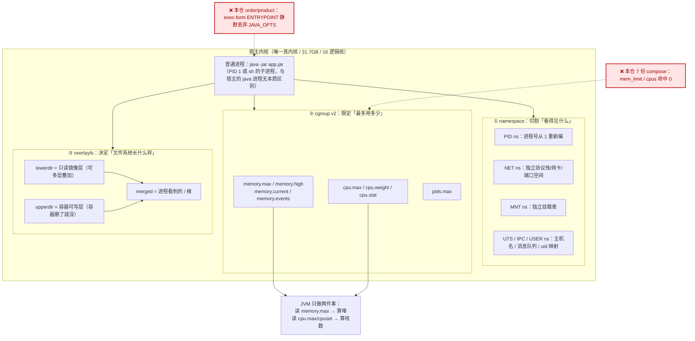
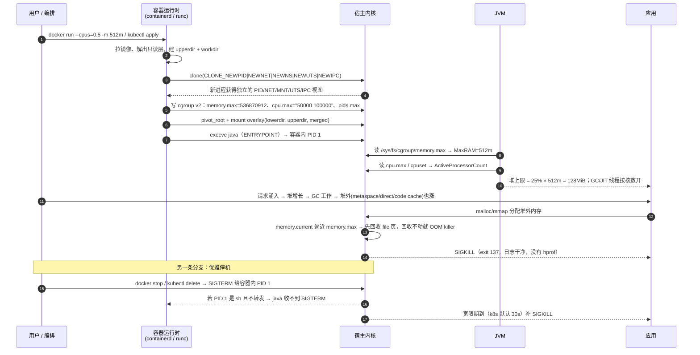

# 容器隔离原理：容器不是轻量虚拟机，只是「被 namespace 隔开、被 cgroup 限住」的普通进程

> **一句话结论**：容器里没有虚拟化的 CPU、没有自己的内核，只有三个可核对的事实——**namespace 决定它「看得见什么」，cgroup 决定它「最多能用多少」，overlayfs 决定它「文件系统长什么样」**；剩下的一切（启动快、隔离感、内存被杀）都是这三件事的推论。**把容器当虚拟机，就会把 JVM 的账算到错误的分母上。**
> **阅读前置**：读过本模块 [01-进程线程与调度.md](01-进程线程与调度.md)（知道进程/线程/fork/exec）与 [02-内存管理与虚拟内存.md](02-内存管理与虚拟内存.md)（知道 RSS/VSZ/堆外四件套/OOMKilled）；知道 `ENTRYPOINT`/`CMD` 是什么；能在 pwsh 里跑 `Get-CimInstance`、`Select-String`、`node`、`java -XX:+PrintFlagsFinal`。
> **证据基线**：Windows 11 家庭版（10.0.26200）+ JDK 17.0.19 Temurin（`java.home=D:\DevTools\jdk\jdk17.0.19`）+ Node 24.16.0 本机实跑输出，仓库 `master@d6f9c33`（2026-11-27）。**本机 `Get-Command docker,kubectl,helm` 三个都无结果（未安装），`wsl.exe` 存在但 `wsl -l -v` 60 秒无输出** —— 所以本篇涉及 cgroup 文件内容、`docker run`、`kubectl describe` 的部分一律写「未本机实测，给命令与判读方法」，不编造任何实测数字。预计阅读 50~65 分钟。

## 证据边界

| 主题 | 本仓状态 | 证据 | 本篇怎么处理 |
| --- | --- | --- | --- |
| namespace（六种视图切割） | ❌ 不可本机实测 | 本机是 Windows，无 `/proc/*/ns`、无 `unshare`/`lsns`；`wsl.exe` 挂起无发行版 | §3.1 讲机制 + 给 Linux 命令与判读方法，**标注未本机实测** |
| cgroup v2 控制器与文件 | ⚠️ 半落地（只有 k8s 侧有 `limits`） | B 级：`deploy/k8s/**` 20 个容器组的 `resources`；C 级：`node learning-docs/tools/tmp/m15-06-container-res-limits.mjs` 汇总 | §2、§3.2、§3.7、§5 |
| compose 侧资源限制 | ❌ 未落地 | B 级 + C 级脚本：`deploy/docker-compose/*.yml` + 仓库根 `docker-compose.yml` 共 **7 份、63 个 service、资源限制类字段命中 0** | §0、§3.8、§6.1 |
| 镜像分层与 overlayfs | ⚠️ 半落地（有多阶段构建，无分层观测手段） | B 级：`ai-cs-chat/Dockerfile` 两个 `FROM`；本机无 docker 无法 `docker history` | §3.3 讲机制 + 给命令，**不写镜像大小** |
| PID 1 与信号 | ⚠️ 半落地（7 个 sh -c、2 个 exec form，两种坑各踩一半） | B 级：10 个 Dockerfile 的 `ENTRYPOINT` 行（当次核对）；k8s 侧 `terminationGracePeriodSeconds` 命中 0 | §3.4、§6.2、§6.3 |
| JVM 容器感知（堆/核数） | ✅ 可本机实测（不需要容器） | C 级：`java -XX:MaxRAM=… -XX:+PrintFlagsFinal` 实跑 6 组 | §0、§3.5、§3.6、§6.5 |
| `docker` / `kubectl` / `helm` 实测 | ❌ 不可用 | C 级：`Get-Command` 无结果 | 只给命令 + 判读 + 误判风险 |
| A 级源码锚点 | ❌ 无可引文件 | `learning-docs/24-源码分析/assets/source/` 905 个 `.java.md` 全是 Spring/Spring AI 类，**没有 cgroup/namespace/JDK 容器感知的实现类** | 本篇 A 级 **0 条**，原因如上，不硬引 |

### 本篇命令与脚本索引（都能重跑）

| 脚本 / 命令 | 作用 | 正文引用处 |
| --- | --- | --- |
| `learning-docs/tools/tmp/m15-06-container-res-limits.mjs` | 解析 `deploy/k8s/**` 真值出「每服务资源限制现状表 + 合计」；扫 compose 的资源限制字段；用本机实测 JVM 常量算堆外账本；换算 `cpu.max`/`cpu.weight` | §0、§3.2、§3.5、§3.7、§3.8、§6.1 |
| `java -XX:+PrintFlagsFinal -version` | 看 JVM 自己算出来的堆/线程/缓存上限 | §0、§3.5、§6.5 |
| `java -XX:MaxRAM=512m -XX:+PrintFlagsFinal -version` | **在本机模拟「容器 limit=512Mi」**（`MaxRAM` 就是 UseContainerSupport 从 cgroup 读到的那个量） | §3.5、§6.5 |
| `Get-CimInstance Win32_OperatingSystem / Win32_Processor / Win32_ComputerSystem` | Windows 上取「/proc/meminfo + /proc/cpuinfo」的等价物 | §0、§3.2 |

## 0. 先看现象

### 现象 1：7 份 compose、63 个 service，资源限制字段一个都没有

```pwsh
cd D:\Projects\Persion\ai-customer-service\learning-docs\tools\tmp
node .\m15-06-container-res-limits.mjs   # 只看 §3 段输出
```

```text
=== §3 compose 资源限制字段命中数（deploy/docker-compose/*.yml + 仓库根 docker-compose.yml）===
docker-compose-all.yml                   services 项= 14  资源限制类字段命中=0
docker-compose-host1.yml                 services 项=  7  资源限制类字段命中=0
docker-compose-host2.yml                 services 项=  5  资源限制类字段命中=0
docker-compose-host3.yml                 services 项=  7  资源限制类字段命中=0
docker-compose-master-slave.yml          services 项= 12  资源限制类字段命中=0
docker-compose-observability.yml         services 项=  4  资源限制类字段命中=0
docker-compose.yml（仓库根）                  services 项= 14  资源限制类字段命中=0
合计：7 份 compose，63 个 service，资源限制类字段命中 0 个
```

脚本扫的字段是 `mem_limit`/`memswap_limit`/`cpus`/`cpu_shares`/`cpu_quota`/`pids_limit`/`stop_grace_period`/`deploy`/`cpuset`/`blkio_config`。**命中 0 意味着本地这套环境里没有任何一个容器被 cgroup 限住内存或 CPU** —— `docker-compose-all.yml` 里 `ai-chat-service` 写着 `JAVA_OPTS: "-Xms256m -Xmx512m"`，那只是 JVM 自愿把堆关小，不是容器层面的硬上限；JVM 的堆外（metaspace、direct、code cache、线程栈）完全没有天花板，谁先涨到宿主 31.7GB 谁就触发宿主的 OOM。

### 现象 2：同一个仓库，k8s 侧却有 limits；但 6 个服务的堆外账本是负的

```pwsh
node .\m15-06-container-res-limits.mjs   # §1 与 §4 段
```

```text
=== §1 deploy/k8s 每个容器组的资源限制现状（真值来自 deploy/k8s/**.yaml）===
清单文件                                req.cpu  lim.cpu   req.mem   lim.mem   -Xmx  堆/limit
services/ai-chat-service.yaml           200     1000     512Mi    1024Mi   512M      50%
services/api-gateway.yaml               100     500     256Mi    512Mi   256M      50%
services/knowledge-service.yaml         100     500     256Mi    512Mi   256M      50%
services/message-service.yaml           100     500     256Mi    512Mi   256M      50%
services/notify-service.yaml            100     500     256Mi    512Mi   256M      50%
services/product-service.yaml           250     500     256Mi    512Mi      -        -
services/search-service.yaml            100     500     256Mi    512Mi   256M      50%
services/user-service.yaml              100     500     256Mi    512Mi   256M      50%
...
合计（20 个容器组 / 20 个清单文件）：requests.cpu=3300m  limits.cpu=14500m  requests.memory=7040Mi  limits.memory=16896Mi

=== §4 JVM 堆外内存账本推演（常量：ReservedCodeCacheSize=240MiB 实测；线程栈按 x64 默认 1MiB 估）===
limit         -Xmx     线程数   codeCache       线程栈        留给堆外判读
512Mi         256M      30      240MiB     30MiB      -14MiB账本已为负，metaspace 一涨就 OOMKilled
1024Mi        512M      30      240MiB     30MiB      242MiB尚有余量
1024Mi       1024M      30      240MiB     30MiB     -270MiB账本已为负，metaspace 一涨就 OOMKilled
```

两件事同时成立：**整仓 k8s 侧 `limits.memory` 合计 16896Mi**（约 16.5GiB），而**堆/limit 比例清一色 50%**。50% 听起来很安全，直到你把「堆外的固定开销」按实测值算进去：仅 `ReservedCodeCacheSize` 一项的**默认上限就是 240MiB**（本机实测 `251658240` 字节，见现象 3），512Mi 的容器给 256m 堆，剩下的 256Mi 连 code cache 的上限都装不下——**账本在最坏情况下直接是负的（-14MiB），而这时 `heapUsed` 可能只有 200MiB/256MiB，GC 日志看起来一切正常**。

### 现象 3：本机 JVM「什么都没配」就自报 7.93GiB 堆，而输出里根本没有 Container 字样

```pwsh
Get-CimInstance Win32_OperatingSystem | Select-Object @{n='TotalGB';e={[math]::Round($_.TotalVisibleMemorySize/1MB,2)}} | Format-List
Get-CimInstance Win32_ComputerSystem  | Format-List TotalPhysicalMemory
Get-CimInstance Win32_Processor       | Format-List Name,NumberOfCores,NumberOfLogicalProcessors
java -XX:+PrintFlagsFinal -version 2>&1 | Select-String -Pattern 'MaxHeapSize|InitialHeapSize|MaxRAMPercentage|ReservedCodeCacheSize|MaxDirectMemorySize|MaxMetaspaceSize|ParallelGCThreads'
java -XX:+PrintFlagsFinal -version 2>&1 | Select-String -SimpleMatch 'Container'   # 故意找容器相关 flag
```

```text
TotalGB : 31.7

TotalPhysicalMemory : 34042929152

Name                      : 12th Gen Intel(R) Core(TM) i7-1260P
NumberOfCores             : 12
NumberOfLogicalProcessors : 16

   size_t InitialHeapSize                          = 532676608                                 {product} {ergonomic}
 uint64_t MaxDirectMemorySize                      = 0                                         {product} {default}
   size_t MaxHeapSize                              = 8514437120                                {product} {ergonomic}
   size_t MaxMetaspaceSize                         = 18446744073709551615                      {product} {default}
   double MaxRAMPercentage                         = 25.000000                                 {product} {default}
     uint ParallelGCThreads                        = 13                                        {product} {default}
    uintx ReservedCodeCacheSize                    = 251658240                              {pd product} {ergonomic}
   size_t SoftMaxHeapSize                          = 8514437120                             {manageable} {ergonomic}

（最后一条命令输出为空：554 行 flag 里没有任何一行含 Container）
```

`8514437120 / 1024³ = 7.93GiB`，正好是宿主 31.7GB 的 25%（`MaxRAMPercentage` 默认值）。**注意这不是「JVM 检测到容器」，恰恰相反：它读不到任何 cgroup 限制，于是退回去按宿主的物理内存算。** 而在容器里它做的是同一件事，只是分母换成了 `memory.max`——换分母的动作发生在 JVM 内部，内核并不会替你换算（§3.5 用 `-XX:MaxRAM=512m` 在本机把这件事复现出来）。

这些现象指向同一件事：**容器既不替你换算内存、也不替你算核数、更不会替你转发信号；它只是给你一套「视图形状 + 限额数字 + 文件系统层」，剩下的账要你自己按 cgroup 里的那个分母重算。**

## 1. 整体地图



**读图说明**：这张图只有三个方框有价值——`① namespace`、`② cgroup`、`③ overlayfs`。它们都由**宿主的同一个内核**实现，容器进程跑在宿主内核的用户态，没有 hypervisor、没有自己的内核镜像，所以「容器 = 轻量虚拟机」这个类比从第一层就错了。图上两条红色虚线是本仓库的真实缺口：`mem_limit/cpus` 命中 0 意味着 ② 那一框在本地根本没生效；`exec-form ENTRYPOINT` 意味着进程起来了但你调的 JVM 参数被丢掉。蓝色的判断节点是全篇的核心：**JVM 的堆和核数不是内核告诉它的，是它自己去读 ② 里的文件算出来的**——文件不存在或数值不对，JVM 不会报错，它只会安静地用宿主的数字。

| 组件 / 参与方 | 责任 | 在本仓库的落点 | 出了事谁负责 |
| --- | --- | --- | --- |
| 宿主内核（namespace 子系统） | 给进程一套独立的 PID/网络/挂载/主机名视图 | 无配置文件（内核行为） | 视角错乱（ps 看不到别人、localhost 不通） |
| 宿主内核（cgroup v2） | 按 `memory.max`/`cpu.max`/`pids.max` 记账并执行硬限 | `deploy/k8s/**` 的 `resources.limits`；compose 侧 **0 命中** | OOMKilled(137) / CPU throttling |
| 容器运行时（containerd / runc / docker） | 建 namespace、写 cgroup、切根、execve | 本机未安装 docker | 容器起不来 / PID 1 不正确 |
| overlayfs | 把镜像只读层与容器可写层合成一个根 | `ai-cs-chat/Dockerfile` 多阶段构建产出只读层 | 数据写进可写层，容器一删全丢 |
| JVM（`UseContainerSupport`，JDK 10+） | 读 cgroup 算 `MaxRAM`、算可用核数 | `JAVA_OPTS` 由 Dockerfile/compose/k8s 三处注入 | 堆按错的分母算 → 撑爆 limit |
| 编排层（K8s） | 把 `requests` 翻译成调度 + `cpu.shares`，把 `limits` 翻译成 `memory.max`/`cpu.max` | `deploy/k8s/services/*.yaml` 8 个 Java 服务 | requests 写小 → 节点超卖；limits 写小 → 自杀 |
| 应用（Spring Boot 进程） | 处理 SIGTERM、优雅停机、回收子进程 | 7 个 `sh -c` + 2 个 exec form，`terminationGracePeriodSeconds` 命中 0 | 优雅停机失效，被 SIGKILL |

## 2. 关键概念与关键要素

| 名称 | 位置（怎么看） | 作用 | 关键参数 / 判读口径 |
| --- | --- | --- | --- |
| PID namespace | 容器内 `cat /proc/1/cgroup`、`ps -ef`；宿主 `lsns -t pid` | 让容器有自己的进程号空间，容器内 1 号就是它以为的「init」 | 容器内看到 1 号进程 = 你的 ENTRYPOINT；宿主机上它有另一个真实 PID |
| NET namespace | `ip netns list`、容器内 `ip addr` | 独立协议栈、网卡、端口空间；**这是「容器 8080 和宿主 8080 不冲突」的唯一原因** | 每对 veth 一对、docker0/bridge（未本机实测） |
| MNT namespace | 容器内 `cat /proc/self/mountinfo` | 独立挂载表，`pivot_root` 换根后看不见宿主目录 | overlayfs 的合并点就在这 |
| UTS / IPC / USER | `hostname`、`ipcs`、`cat /proc/self/uid_map` | 主机名、System V IPC、uid 映射（rootless 的根基） | user ns 里 root 只在 ns 内是 root |
| cgroup v2 层级 | 容器内 `cat /sys/fs/cgroup/cgroup.controllers`、`stat -fc %T /sys/fs/cgroup`（`cgroup2fs` = v2） | **唯一一棵树**，所有控制器挂在同一树；v1 是每控制器一棵树 | v1 路径形如 `/sys/fs/cgroup/memory/…`；v2 是 `/sys/fs/cgroup/…/memory.max` |
| `memory.max` | `/sys/fs/cgroup/<path>/memory.max` | 内存硬上限，超了触发 cgroup OOM killer | 值是字节，`max` = 不限制；k8s 的 `limits.memory` 落这里 |
| `memory.current` | 同上 | 当前该 cgroup 的用量（含页缓存） | **不是 RSS**，含 file cache；判读要看 `memory.stat` |
| `memory.events` | 同上 | 记事件计数器：`oom`、`oom_kill`、`high`、`max` | `oom_kill 1` 就是「被 cgroup 杀过一次」的铁证 |
| `cpu.max` | `/sys/fs/cgroup/<path>/cpu.max` | 形如 `"50000 100000"` = 每 100ms 最多用 50ms CPU | k8s `limits.cpu: 500m` ⇒ `"50000 100000"`（脚本 §5 换算） |
| `cpu.weight` / `cpu.shares` | 同上 / v1 `cpu.shares` | 争抢时的**配比**，不是上限 | k8s `requests.cpu × 1024` = shares；v2 用 weight 表达 |
| `cpu.stat` | 同上 | `nr_periods` / `nr_throttled` / `throttled_usec` | `nr_throttled` 持续增长 = 正在被限流 |
| `pids.max` | 同上 | 进程/线程数上限 | 设小了会出现 `unable to create native thread` |
| overlayfs 四要素 | `mount \| grep overlay`：`lowerdir/upperdir/workdir/merged` | 把只读层叠成可写文件系统 | 写时复制；删文件是 whiteout，不释放镜像空间 |
| PID 1 与信号 | 容器内 `cat /proc/1/cmdline`、`ps -o pid,ppid,args -p 1` | PID 1 才收 `docker stop` 发的 SIGTERM，并负责回收孤儿进程 | PID 1 是 `sh` 而不是 `java` ⇒ SIGTERM 无人接、僵尸无人收 |
| `-XX:MaxRAMPercentage` | `java -XX:+PrintFlagsFinal` | 把「cgroup 给的可用内存」按百分比算成堆上限 | 默认 `25.0`；容器里 512Mi ⇒ 128MiB 堆（本机实测验证） |
| `-XX:ActiveProcessorCount` | 同上 | 覆盖 JVM 对核数的判断 | 容器 CPU 配额与宿主核数不一致时的止血阀 |

## 3. 原理与证据逐段精读

### 3.1 六种 namespace：切割的是「名字和视图」，不是资源

**在干什么**：`clone()` 时带上 `CLONE_NEWPID|CLONE_NEWNET|CLONE_NEWNS|CLONE_NEWUTS|CLONE_NEWIPC|CLONE_NEWUSER`，内核就给新进程一套全新的「名字空间」——同样的内核数据结构，但挂在不同的命名层级上。容器里的 `/proc` 只列出本 PID ns 的进程；`localhost` 只指向本 NET ns 的回环；`mount` 表是本 MNT ns 的；`hostname` 是本 UTS ns 的。`docker exec` 之所以能「进到容器里」，就是 `setns()` 加入目标进程的这几个 ns 再 fork 一个 shell。

| namespace | 隔离什么 | 不隔离什么 | 本仓库的观察点 |
| --- | --- | --- | --- |
| PID | 进程号空间（容器内 1 号是 ENTRYPOINT） | CPU 时间、内存（那是 cgroup 的事） | `ENTRYPOINT` 决定谁是 1 号（§3.4） |
| NET | 协议栈、网卡、端口空间、路由表 | 带宽（要 tc/cgroup 限） | 8 个 Java 服务各自 8083/8081… 端口不冲突即靠它 |
| MNT | 挂载表、根目录 | 磁盘容量与 IOPS | overlayfs 就挂在这层（§3.3） |
| UTS | 主机名、域名 | 一切资源 | 容器内 `hostname` 是 pod 名 / 容器 ID |
| IPC | System V 信号量/共享内存、POSIX mq | 进程内存 | RocketMQ/Redis 客户端不依赖它 |
| USER | uid/gid 映射（ns 内 root ≠ 宿主 root） | 其余五个 ns 需要它才能让普通用户创建 | rootless 容器的根基 |
| （另有）cgroup、time | cgroup 视图；时钟偏移（`CLOCK_MONOTONIC`/`BOOTTIME`） | — | `time` ns 会让容器内 `System.nanoTime()` 与宿主不同源 |

**为什么这么设计**：虚拟机的隔离单元是「一台假机器」，代价是要跑一个完整内核（内存、启动时间、补丁）；namespace 的隔离单元是「一组指向内核对象的指针」，创建成本就是几次 `clone()`——所以容器「启动快」不是因为它优化了什么，而是因为它**什么都没启动**。**换写法会怎样**：不用 namespace 而想隔离，只剩虚拟机或 `chroot`（后者只改根目录视图，进程仍共享 PID/NET，跑不了「独立 localhost」）。**常见坑**：以为 namespace 隔离了安全边界——它没有。同一个内核，一个内核漏洞就能穿透所有容器；真正的收敛靠 capabilities 裁剪、`seccomp`、`AppArmor/SELinux`、rootless，这四件本仓库全仓都没写。

```pwsh
# 本机是 Windows，先确认「拿不到 Linux 的 ns 视图」这件事本身（真实输出）
Get-Command wsl -ErrorAction SilentlyContinue | Select-Object -ExpandProperty Source
wsl -l -v        # 实测：60 秒内无任何输出（首次启动/无发行版都会这样），因此本篇所有 /proc/*/ns 均为「未本机实测」
```

```text
C:\WINDOWS\system32\wsl.exe
（wsl -l -v 挂起，未返回任何行）
```

Linux 上应使用的对照命令（**未本机实测**）：`lsns -t pid,net,mnt -o NS,PID,COMMAND` 看每个进程属于哪些 ns；`readlink /proc/self/ns/pid` 拿到 `pid:[4026531836]` 这种 inode 号，两个进程 inode 号相同即在同一个 ns 里。判读要点：`lsns` 里容器的 1 号进程必然出现在一个**只有它自己那棵子树**的 PID ns 中；如果两个「容器」共享同一个 `pid:` inode，它们其实没隔离。

### 3.2 cgroup：限额的载体，v1 分树、v2 一树

**在干什么**：cgroup 把进程分组，然后由内核在**资源分配路径上**检查这组的额度。内存分配走 `memory.max`（硬限）/`memory.high`（软限，超过会被压着回收但不杀）；CPU 走 `cpu.max`（配额/周期）与 `cpu.weight`（配比）；进程数走 `pids.max`。v1 的问题是**每个控制器一棵独立树**：`/sys/fs/cgroup/memory/`、`/sys/fs/cgroup/cpu/`、`/sys/fs/cgroup/pids/` 各自成树，同一个进程要在每棵树里各挂一次，于是出现「内存限制挂在 A 组、CPU 限制挂在 B 组，两组其实不是同一批进程」的经典错配。v2 改成**唯一一棵树**，控制器在 `cgroup.controllers` 里声明、在 `cgroup.subtree_control` 里逐级下放，进程只在一个 `cgroup.procs` 里挂一次。

```pwsh
# 本机跑：把 k8s 的 cpu 值换算成 cgroup 文件内容（换算，不是实测）
node .\m15-06-container-res-limits.mjs   # §5 段
```

```text
=== §5 k8s 的 cpu 值 → cgroup 文件内容（换算，不是实测）===
A 列：limits.cpu 落 cpu.max（v1 是 cfs_quota_us/cfs_period_us），period 固定 100000us=100ms
limits.cpu  cpu.max               含义
100m        "10000 100000"        每 100ms 最多用 10.0ms CPU 时间
500m        "50000 100000"        每 100ms 最多用 50.0ms CPU 时间
1000m       "100000 100000"       每 100ms 最多用 100.0ms CPU 时间

B 列：requests.cpu 落 cpu.shares（v1）/ cpu.weight（v2），只在争抢时决定配比
requests.cpu  cpu.shares  cpu.weight（v2 换算）
100m          102400      3907
500m          512000      19530
```

**为什么这么设计**：v2 的单树让「同一批进程」这个语义只有一个答案，也让「先加限、再移动进程」不再是竞态。**换写法会怎样**：v1 时代你在 `/sys/fs/cgroup/memory/docker/<cid>/memory.limit_in_bytes` 写值，v2 是 `/sys/fs/cgroup/<path>/memory.max`，文件名、层级、单位全变——照 v1 的命令去 v2 机器上排障，`cat` 出来的是「文件不存在」，很容易误判成「cgroup 没启用」。**常见坑**：①把 `memory.current` 当 RSS 看（它含页缓存，写日志会把它顶上去而 RSS 不动，见 [02-内存管理与虚拟内存.md](02-内存管理与虚拟内存.md) §3.6）；②以为 `requests` 是上限（它只参与调度与 `cpu.weight`，节点不忙时完全不限制）；③`memory.max` 的单位是**字节**，而 k8s 清单写 `512Mi`，中间那层换算是 kubelet 做的，你自己 `cat` 时看到的是 `536870912`。

宿主侧判读命令（Linux，**未本机实测**）：`stat -fc %T /sys/fs/cgroup`（`cgroup2fs` ⇒ v2）、`cat /sys/fs/cgroup/cgroup.controllers`（有哪些控制器）、`cat /sys/fs/cgroup/memory.max`、`cat /sys/fs/cgroup/cpu.stat | grep throttled`。判读口径：`nr_throttled` 一直在涨 = 你的容器正在被限流；`memory.events` 里 `oom_kill` ≥ 1 = 被 cgroup 杀过。

### 3.3 镜像分层与 unionfs：容器「启动快」的真正原因

**在干什么**：镜像是一叠**只读层**（每层是一次 `RUN`/`COPY` 的结果，层内容按内容寻址、可复用），容器启动时 overlayfs 把它们挂成 `lowerdir`，再叠一个空的 `upperdir`，`merged` 就是容器看到的 `/`。读命中 lower 直接读；写命中 lower 时先 copy-up 到 upper；删 lower 里的文件则在 upper 写一个 whiteout 标记。所以：**启动 = 挂个 overlay + `execve` 一个进程**，不是「解压一套 rootfs」。

```pwsh
# B 级：本仓的多阶段构建（行号用 UTF8 ReadAllLines 当次核对）
$l = [System.IO.File]::ReadAllLines((Join-Path $PWD 'ai-cs-chat\Dockerfile'), [System.Text.Encoding]::UTF8)
$l.Count; ($l | Select-String -Pattern 'FROM|COPY --from|EXPOSE|ENTRYPOINT')
```

```text
21
  L3: FROM maven:3.9-eclipse-temurin-17 AS builder
  L17: FROM eclipse-temurin:17-jre-jammy
  L19: COPY --from=builder /build/ai-cs-chat/target/*.jar app.jar
  L20: EXPOSE 8083
  L21: ENTRYPOINT ["sh", "-c", "java ${JAVA_OPTS:-} -jar app.jar"]
```

**为什么这么设计**：镜像层只读 + 内容寻址带来两个白拿的收益：**层可以在不同镜像/不同主机间复用**（本仓 8 个 Java 服务的最终阶段都是同一句 `FROM eclipse-temurin:17-jre-jammy`，共享同一层 JRE），以及**容器启动不需要拷贝文件**（overlay 只建元数据）。`ai-cs-chat/Dockerfile` 的 `builder` 阶段装了 Maven、跑了 `mvn dependency:go-offline`，但最终镜像只 `COPY --from=builder` 一个 jar——**Maven 与源码全留在 builder 层，不进运行时镜像**，这是多阶段构建的核心价值。**换写法会怎样**：单阶段构建会把 `~/.m2` 和源码打进运行镜像（体积变大、攻击面变大、每次改代码都要重装依赖，构建缓存全废）。**常见坑**：①往容器里写数据（日志、上传文件）——写在 `upperdir`，`docker rm` 即消失，必须挂 volume（本仓 `deploy/k8s/chroma.yaml` 有 PVC 10Gi，`mysql.yaml`/`minio.yaml` 也都有卷，属于做对的）；②以为「删文件能省空间」——whiteout 只是遮住 lower，镜像层数据还在；③在容器里 `apt install` 装调试工具，下次重启全丢（也把镜像变得不可复现）。

镜像分层在本机的可观测命令都依赖 docker（**未本机实测**，`Get-Command docker` 无结果）：`docker history --no-trunc <image>` 看每层大小与来源指令、`docker image inspect -f '{{.RootFS.Layers}}'` 列出层 digest、`docker exec <c> cat /proc/self/mountinfo | grep overlay` 看 `lowerdir=` 到底叠了几层。判读要点：`lowerdir` 里列出的目录**个数 = 镜像层数**；如果容器写入量持续增长而 `docker ps` 显示 `SIZE`（v2 已移除该列）看不出来，就用 `docker exec du -sh /` 与宿主的 `upperdir` 对账。

### 3.4 PID 1 与信号：本项目同一件事踩了两个相反的坑

**在干什么**：`docker stop` / k8s 删除 Pod 只发 **SIGTERM 给容器的 1 号进程**，然后等宽限期（k8s 默认 30s，docker 默认 10s），超时补一发 SIGKILL。所以「谁在 1 号位」决定了优雅停机能不能发生。同时 1 号进程还承担「回收孤儿进程」的职责（普通进程的子进程被重新挂到 1 号下，1 号必须 `wait()`，否则成僵尸）。

```pwsh
# B 级：10 个 Java 服务的 ENTRYPOINT 到底是哪种形式（当次核对，UTF8 读）
foreach ($p in 'ai-cs-order','ai-cs-product','ai-cs-chat') {
  $l = [System.IO.File]::ReadAllLines((Join-Path $PWD "$p\Dockerfile"), [System.Text.Encoding]::UTF8)
  "$p (共 $($l.Count) 行) -> " + (($l | Select-String -Pattern '^ENTRYPOINT' | ForEach-Object { "L$($_.LineNumber): $($_.Line)" }) -join ' ')
}
```

```text
ai-cs-order (共 21 行) -> L21: ENTRYPOINT ["java", "-jar", "app.jar"]
ai-cs-product (共 11 行) -> L11: ENTRYPOINT ["java", "-jar", "app.jar"]
ai-cs-chat (共 21 行) -> L21: ENTRYPOINT ["sh", "-c", "java ${JAVA_OPTS:-} -jar app.jar"]
```

两种写法各有致命点，恰好本仓库各占一半：

| 写法 | 谁在 1 号位 | `JAVA_OPTS` 环境变量 | SIGTERM | 本仓用它的服务 |
| --- | --- | --- | --- | --- |
| `ENTRYPOINT ["sh","-c","java ${JAVA_OPTS:-} -jar app.jar"]` | 可能是 `sh`（取决于 sh 是否把单条命令 exec 掉，**必须进容器看 `/proc/1/cmdline` 才能确定**） | ✅ shell 会展开 | ⚠️ 若 1 号是 `sh`，dash/busybox 默认**不转发** SIGTERM，java 收不到 → 宽限期后 SIGKILL | chat / gateway / user / knowledge / search / message / notify（7 个） |
| `ENTRYPOINT ["java","-jar","app.jar"]`（exec form） | `java` 自己 | ❌ **没有 shell，`${JAVA_OPTS}` 不会被展开，环境变量被静默丢弃** | ✅ JVM 默认注册 SIGTERM 处理器，shutdown hook 会跑 | order（L21）/ product（L11） |

**为什么这么设计**：exec form 是推荐写法（PID 1 = 你的进程，信号直达）；shell form 的初衷是「要展开环境变量/拼多个命令」。想要两者兼得，正解是 `sh -c "exec java $JAVA_OPTS -jar app.jar"`——`exec` 让 shell 把自身替换成 java，PID 1 就是 java，同时变量也展开了。**换写法会怎样**：order/product 现在这种 exec form + 依赖 `JAVA_OPTS` 的组合是**最坏组合**——你在 `deploy/docker-compose/docker-compose-all.yml` 或 k8s 里给它设 `JAVA_OPTS`，容器里 `env` 能看到这个变量，但 JVM 永远读不到，堆还是按默认 25% 算。**常见坑**：①以为「环境变量设了就等于生效」（不会，`env` 有值 ≠ 命令行有值）；②不知道 `JAVA_TOOL_OPTIONS`/`JDK_JAVA_OPTIONS` 是 JVM **自己**读的，与 ENTRYPOINT 形式无关——这是 exec-form 服务唯一不改 Dockerfile 的修法（本机实测见 §6.2）；③PID 1 是 sh 时僵尸进程堆积，`pids.max` 到了就报 `unable to create native thread`。

### 3.5 容器内存的三层视角：JVM 堆 / 容器 limit / 宿主

**在干什么**：一次内存分配要过三道账。JVM 内部按 `-Xmx`（或 `MaxRAMPercentage × MaxRAM`）管堆；容器按 `memory.max` 管「这个 cgroup 的总用量」；宿主按自己的可用内存管「所有进程之和」。三层是**包含关系**不是并列关系：`堆 ⊂ (堆 + 堆外) = 容器用量 ⊂ 宿主总量`。JVM 的 `MaxRAM` 就是它从 cgroup 读到的那个上限，读不到就用宿主内存。

```pwsh
# 本机实测：用 -XX:MaxRAM 模拟「容器 limit」，看堆怎么跟着变（MaxRAM 就是 UseContainerSupport 从 cgroup 读的量）
java -XX:+PrintFlagsFinal -version 2>&1 | Select-String -Pattern 'MaxHeapSize'
java -XX:MaxRAM=512m -XX:+PrintFlagsFinal -version 2>&1 | Select-String -Pattern 'MaxRAM |MaxHeapSize|InitialHeapSize'
java -XX:MaxRAM=1g   -XX:+PrintFlagsFinal -version 2>&1 | Select-String -Pattern 'MaxHeapSize'
java -Xms256m -Xmx256m -XX:+PrintFlagsFinal -version 2>&1 | Select-String -Pattern 'MaxHeapSize|MaxRAM '
```

```text
# ① 裸机（无任何限制）
   size_t MaxHeapSize                              = 8514437120                                {product} {ergonomic}
   size_t SoftMaxHeapSize                          = 8514437120                             {manageable} {ergonomic}

# ② -XX:MaxRAM=512m（模拟容器 limit=512Mi）
   size_t InitialHeapSize                          = 8388608                                   {product} {ergonomic}
   size_t MaxHeapSize                              = 134217728                                 {product} {ergonomic}
 uint64_t MaxRAM                                   = 536870912                              {pd product} {command line}
   size_t SoftMaxHeapSize                          = 134217728                              {manageable} {ergonomic}

# ③ -XX:MaxRAM=1g
   size_t MaxHeapSize                              = 268435456                                 {product} {ergonomic}
   size_t SoftMaxHeapSize                          = 268435456                              {manageable} {ergonomic}

# ④ -Xms256m -Xmx256m（本项目 compose 的口径）
   size_t MaxHeapSize                              = 268435456                                 {product} {command line}
 uint64_t MaxRAM                                   = 137438953472                           {pd product} {default}
   size_t SoftMaxHeapSize                          = 268435456                              {manageable} {ergonomic}
```

四组输出给了三个结论，全部本机实测（`# ①~④` 的分组行与空行是我加的分隔，其余逐字来自命令输出）：**①同样的 `MaxRAMPercentage=25`，分母从 31.7GB 换成 512Mi，堆就从 7.93GiB 掉到 128MiB** —— 这就是容器里发生的事，内核一句话没说，JVM 自己换的分母；**②显式 `-Xmx256m` 时 `MaxRAM` 仍打印默认 137438953472（128GiB）**，说明 `-Xmx` 只是覆盖结果、没有覆盖「JVM 以为的内存总量」；**③`InitialHeapSize` 是「最大堆的 1/64」，`MaxRAM=512m` 时只有 8MiB** —— 容器里启动初期堆很小，是设计，不是内存泄漏。

**为什么这么设计**：让 JVM 无需感知编排系统就能「自动适配」，代价是**必须有人把真实上限写进 cgroup**。**换写法会怎样**：显式 `-Xmx` 最稳（分母不参与计算，改 limit 不会悄悄改堆），百分比最省事（一份镜像适配不同 limit），两者混用就会出现「`-Xmx256m` + `MaxRAMPercentage=75`」这种自相矛盾的配置。**常见坑**：①`-Xmx` 直接写成 `limits.memory` 的值（堆外无处安身，必被 OOMKilled，脚本 §4 的 `1024Mi/1024M` 那行算出 -270MiB）；②只看 JVM 自报的 `maxHeap` 就认为「容器内存够用」——宿主的 RSS 才是容器账本上真实的数字（对照 [02-内存管理与虚拟内存.md](02-内存管理与虚拟内存.md) 的 NMT 实测：`-Xmx512m` 的 JVM 堆外已提交 181MB）。

### 3.6 「堆没满但被 OOMKilled」是怎么发生的

**在干什么**：cgroup OOM killer 看的是**这个 cgroup 的总内存用量**（含页缓存），不是 `heapUsed`。堆外有四项不归堆管：**Metaspace**（默认无上限，本机实测 `MaxMetaspaceSize=18446744073709551615`）、**Direct buffer**（本机实测 `MaxDirectMemorySize=0`，语义是「默认等于最大堆」）、**Code cache**（本机实测默认上限 240MiB）、**线程栈**（x64 默认 1MiB/线程，且每条线程还要额外内核栈）。再加上 GC 自身的辅助结构。所以「堆用了 200MiB / 上限 256MiB，进程却 exit 137」在算术上完全正常。

```text
# 脚本 §4 的账本（常量来自本机 java -XX:+PrintFlagsFinal 实测；这是最坏情况上界算术，不是实测）
limit=512Mi  -Xmx=256M  线程=30  codeCache=240MiB  线程栈=30MiB   →  留给 metaspace/direct = -14MiB
limit=512Mi  -Xmx=256M  线程=60  codeCache=240MiB  线程栈=60MiB   →  留给 metaspace/direct = -44MiB
limit=1024Mi -Xmx=512M  线程=30  codeCache=240MiB  线程栈=30MiB   →  留给 metaspace/direct = 242MiB
```

**为什么这么设计**：堆外这些东西要么是 JVM 内部的元数据（不能放堆里，否则 GC 无法移动/回收），要么是 native 分配（direct buffer 直接向 OS 要，绕过 GC）。**换写法会怎样**：如果 limit 只卡堆，堆外就会无声膨胀，最后要么被容器杀（`exit 137`），要么被宿主 OOM killer 杀（杀掉的可能不是元凶）。**常见坑**：①把 `exit 137` 当内存泄漏查堆（方向全错，先看是不是 1 号进程被 SIGKILL）；②`memory.current` 里含页缓存，写日志会顶高它而 RSS 不动（`memory.stat` 里的 `file` 才是缓存部分，可回收）；③容器里跑 `jcmd GC.heap_info` 看到堆空着就结案——正确做法是 `jcmd VM.native_memory summary` 把 `Total committed − Java Heap` 算出来，再和 limit 对账。

Linux 侧取证命令（**未本机实测，本机无 docker/kubectl**）：`kubectl describe pod <pod>` 看 `Last State: Terminated, Reason: OOMKilled, Exit Code: 137`；`cat /sys/fs/cgroup/<path>/memory.events` 看 `oom_kill` 计数；`cat /sys/fs/cgroup/<path>/memory.current` 与 `memory.max` 比大小；宿主 `dmesg -T | grep -i "killed process"` 看是谁被杀。判读要点：`137 = 128 + 9`，9 就是 SIGKILL，**进程没有机会写异常栈/hprof，所以「日志干净」是符合预期的**，不要因为日志干净就排除 OOM。

### 3.7 CPU 限流（throttling）与 JVM 的核数感知

**在干什么**：`cpu.max = "50000 100000"` 的含义是「每 100ms 周期内最多消耗 50ms CPU 时间」。一个线程满跑：用掉 50ms 就被**掐断**，等到下一个周期才能继续——所以 500m 的容器里单线程的吞吐大约是一半，而**延迟曲线会出现 100ms 量级的台阶**（不是均匀变慢）。同时 JVM 通过 `cpu.max`/`cpuset` 算「我有几个核」，用来定 GC 线程数、JIT 编译线程数、ForkJoinPool 并行度。

```pwsh
# 本机实测：同样的堆，只改 JVM 认为的核数，看谁变了
java -XX:+PrintFlagsFinal -version 2>&1 | Select-String -Pattern 'ActiveProcessorCount|ParallelGCThreads|ConcGCThreads|CICompilerCount|MaxHeapSize'
java -XX:ActiveProcessorCount=1 -XX:+PrintFlagsFinal -version 2>&1 | Select-String -Pattern 'ActiveProcessorCount|ParallelGCThreads|ConcGCThreads|CICompilerCount|MaxHeapSize'
```

```text
# 裸机（16 逻辑核）
      int ActiveProcessorCount                     = -1                                        {product} {default}
     intx CICompilerCount                          = 12                                        {product} {ergonomic}
     uint ConcGCThreads                            = 3                                         {product} {ergonomic}
   size_t MaxHeapSize                              = 8514437120                                {product} {ergonomic}
     uint ParallelGCThreads                        = 13                                        {product} {default}

# -XX:ActiveProcessorCount=1
      int ActiveProcessorCount                     = 1                                         {product} {command line}
     intx CICompilerCount                          = 2                                         {product} {ergonomic}
     uint ConcGCThreads                            = 0                                         {product} {default}
   size_t MaxHeapSize                              = 8512339968                                {product} {ergonomic}
     uint ParallelGCThreads                        = 0                                         {product} {default}
```

两组输出对照出三件事（`# 裸机` / `# -XX:…` 两行是我加的分隔，其余逐字来自命令输出；为省行数省掉了 `CICompilerCountPerCPU` 与 `SoftMaxHeapSize` 两行）：**①核数只影响线程，不影响堆**（`MaxHeapSize` 从 8514437120 到 8512339968，只差 2MB，属于 ergonomics 的抖动，不是数量级变化）；**②核数从 16 降到 1，`CICompilerCount` 从 12 掉到 2，GC 线程数打印为 0**（0 表示「启动阶段不写死，按最终核数在 GC 初始化时再算」，是 JVM 的正常表达）；**③内存 limit 改了，`ParallelGCThreads` 仍是 13**（见 §3.5 的 `-XX:MaxRAM=512m` 输出）——**两条正交的账，别用一个参数去修另一个**。

**为什么这么设计**：GC/JIT 线程数按核数开，是为了在独占机器上吃满并行度。**换写法会怎样**：容器 CPU 配额远小于宿主核数时，JVM 会按宿主核数开一堆 GC/JIT 线程去抢一个很窄的配额，结果线程互相争抢 + 频繁被 throttle，`cpu.stat` 里 `nr_throttled` 飙升。**常见坑**：①以为「设了 `limits.cpu: 500m` 就等于 JVM 看到 1 核」——很多 JDK 版本会把不足 1 核按 1 核的下限处理，但取整细节随版本变化，**落地时一律以实测为准**（容器里 `java -XX:+PrintFlagsFinal -version | grep ActiveProcessorCount` 看实际值，或加 `-Xlog:os+container=trace`）；②用 `requests.cpu` 当上限——它只翻译成 `cpu.weight`，空闲节点上完全不起限流作用（§3.2 B 列）；③压测时只看平均 CPU 使用率，不看 `throttled_usec`。

Linux 侧命令（**未本机实测**）：`cat /sys/fs/cgroup/<path>/cpu.stat`（看 `nr_throttled`、`throttled_usec` 是否持续增长）、`cat /sys/fs/cgroup/<path>/cpu.max`、容器内 `grep -c processor /proc/cpuinfo` 与 `java -XX:+PrintFlagsFinal -version | grep ActiveProcessorCount` 对照。判读口径：`nr_periods` 与 `nr_throttled` 同步增长 = 限流是常态，此时加线程没用，要么抬 limit，要么给 JVM 显式 `-XX:ActiveProcessorCount`。

### 3.8 本项目落点：三处真实配置，三种真实缺口

**在干什么**：把上面的机制对到本仓库的真实文件上，只有三件事值得记。

**① compose 侧完全没有 cgroup 限制**（§0 现象 1，7 份/63 个 service/0 命中）。`deploy/docker-compose/docker-compose-all.yml` 里各服务只有 `JAVA_OPTS: "-Xms256m -Xmx512m"` 这类**自愿约束**，容器本身没有 `mem_limit`、没有 `cpus`、没有 `stop_grace_period`。后果：本地跑 14 个容器时，任何一个堆外膨胀都会去抢宿主内存；`docker stop` 用默认 10 秒宽限期。

**② k8s 侧有 limits，但比例偏紧、且基础设施与服务混在一张账上**：20 个容器组 `limits.memory` 合计 16896Mi、`requests.memory` 合计 7040Mi（超卖比约 2.4:1，调度器按 7040Mi 找节点，实际可能要用到 16896Mi）；8 个 Java 服务里 6 个是 `256m 堆 / 512Mi limit`（gateway / knowledge / message / notify / search / user），`ai-chat-service` 是 `512m / 1Gi`，`product-service` 连 `JAVA_OPTS` 都没配。

**③ 两个 exec-form ENTRYPOINT 服务**（`ai-cs-order\Dockerfile` L21、`ai-cs-product\Dockerfile` L11）把 `JAVA_OPTS` 静默丢弃；而 `deploy/k8s/services/product-service.yaml` 里**连 `JAVA_OPTS` 都没设**（其他 7 个服务都设了），61~67 行只给了 `memory: 256Mi → 512Mi`——所以 product 在 k8s 里实际堆上限由 `MaxRAMPercentage` 决定：512Mi × 25% ≈ 128MiB（本机 §3.5 实测同一算术），**不是任何人显式选择的**。

顺带纠正一个容易传错的点：`deploy/k8s/chroma.yaml` 的 `limits.memory: 1Gi` 与 JVM 无关——`chromadb/chroma:0.5.20` 是 Python/Rust 实现，不吃 `MaxRAMPercentage`；本仓真正用 Go 的是 `deploy/k8s/minio.yaml` 的 `minio/minio:latest`。**「给非 JVM 容器套 JVM 的内存算术」是这一类文档最容易犯的错。**

## 4. 一次完整执行时序



**读图说明**：时序图有两条独立的死亡路径，这是本篇最该记住的分叉。**上分支死在「内存」**：第 7 步 `execve` 之后，JVM 在第 8~9 步自己去读 cgroup 文件，第 10 步算出 128MiB 堆——**这一步没有任何人会检查「128MiB 堆 + 240MiB code cache 上限 > 512Mi」**；第 12~14 步堆外涨到顶，内核直接 SIGKILL，应用层什么都看不到。**下分支死在「信号」**：第 15 步 SIGTERM 只发给 1 号进程，第 16 步是关键岔口——1 号是 `sh` 就断链，宽限期后 17 步 SIGKILL。注意两边都以 SIGKILL 收尾，但**根因完全不同**：一个是 cgroup 的 `memory.max`，一个是信号拓扑。

| 步骤 | 判读该看什么 | 出现什么说明出问题了 |
| --- | --- | --- |
| 3~4 namespace | `lsns`、容器内 `ps -ef` 的进程数 | 容器内能看到宿主一堆进程 ⇒ ns 没建成 |
| 5 写 cgroup | `cat memory.max`、`cat cpu.max` | 打印 `max`/`"max 100000"` ⇒ 根本没设限制 |
| 7 execve / PID 1 | 容器内 `cat /proc/1/cmdline` | 显示 `sh` 而非 `java` ⇒ SIGTERM 链路断了 |
| 8~10 JVM 感知 | `java -XX:+PrintFlagsFinal -version \| grep -E 'MaxHeapSize\|ActiveProcessorCount'` | 堆 ≈ 宿主 25%（如 7.93G）⇒ 没读到 cgroup |
| 12~13 内存爬升 | `memory.current` 与 `memory.max` 的比值、`memory.stat` 的 `file` 占比 | `file` 占比高且能回收 ⇒ 是页缓存不是泄漏 |
| 14 OOMKilled | `memory.events` 的 `oom_kill`、`kubectl describe` 的 `Reason: OOMKilled` | `oom_kill ≥ 1` ⇒ cgroup 杀的，不是 JVM 抛的 |
| 16~17 SIGTERM | `nr_periods` 无关；看 `docker events` 的 `kill` 信号与容器存活时长 | 存活时长 ≈ 宽限期整 ⇒ 说明 SIGTERM 没人接 |

## 5. 设计取舍

| 决策点 | 选 A 的收益 | 选 A 的代价 | 本项目现状 |
| --- | --- | --- | --- |
| 容器 vs 虚拟机做隔离单元 | 秒级启动、共享内核、密度高 | 共享内核 ⇒ 安全边界弱，靠 capabilities/seccomp/AppArmor 补 | 选了容器；后四件全仓 0 命中 |
| 只读镜像层 + 可写 upperdir | 层复用、启动不拷贝 | 容器内写的数据随容器消失，必须 volume | ✅ chroma/mysql/minio 都有 PVC |
| exec form ENTRYPOINT | PID 1 = 业务进程，信号直达 | 不能展开环境变量（本仓 order/product 中招） | 2 个 exec form / 7 个 sh -c |
| shell form ENTRYPOINT | 能展开 `JAVA_OPTS`、能拼命令 | PID 1 变成 shell，信号与僵尸都成问题 | 7 个服务用这种，未加 `exec` |
| 显式 `-Xmx` | 堆可预测，改 limit 不影响堆 | 换机型/换 limit 要重调，一份镜像不能自适应 | 9 个 k8s 工作负载写了 `-Xmx`，11 个没写 |
| `MaxRAMPercentage` 百分比 | 一份镜像适配不同 limit | 上限随 limit 漂移，难审计 | product 事实上是这条路（没人显式选） |
| 用 requests 当上限 | 提高装箱率 | 节点空闲时完全不起限，容量算不准 | 8 个服务的 requests.cpu 只有 100m~250m |
| k8s limits 卡内存 | 有硬边界，OOM 是「受控失败」 | limit 偏紧 ⇒ 频繁 137，重启风暴 | 7 个服务只剩 256Mi 给全部堆外 |

**可扩展点清单**（按性价比排序，都能落到本仓具体文件）：

1. `deploy/docker-compose/docker-compose-all.yml` 给每个 service 补 `mem_limit` 与 `cpus`（本地才有意义，至少让「堆外溢出」变成容器内 137 而不是拖垮宿主）。
2. `ai-cs-order/Dockerfile` L21、`ai-cs-product/Dockerfile` L11 改成 `["sh","-c","exec java ${JAVA_OPTS:-} -jar app.jar"]`，或保留 exec form 但改用 `JAVA_TOOL_OPTIONS` 注入。
3. 7 个 `sh -c` 写法补 `exec`，让 java 稳定坐在 PID 1 位置。
4. k8s 服务清单补 `terminationGracePeriodSeconds` 与 `preStop`（当前全仓 0 命中），否则优雅停机没时间窗可用。
5. 给 6 个 `256m/512Mi` 服务统一加 `-XX:MaxMetaspaceSize=128m -XX:MaxDirectMemorySize=64m -XX:ReservedCodeCacheSize=128M`，把「堆外无上限」变成可控。
6. 把 `learning-docs/tools/tmp/m15-06-container-res-limits.mjs` 的 §4 账本接进 CI：任何 `limit − Xmx < 300Mi` 的新增清单直接拦。
7. `deploy/k8s/services/product-service.yaml` 的 namespace 是 `aics`，其余服务是 `ai-customer-service`——顺手对齐，否则 `kubectl get pods -n` 总会漏一个。

## 6. 踩坑与调试手法

### 6.1 坑：以为「`JAVA_OPTS` 写了就等于限制住了」

```pwsh
cd D:\Projects\Persion\ai-customer-service\learning-docs\tools\tmp
node .\m15-06-container-res-limits.mjs | Select-String -Pattern '命中|合计：'
```

```text
docker-compose-all.yml                   services 项= 14  资源限制类字段命中=0
合计：7 份 compose，63 个 service，资源限制类字段命中 0 个
```

| 判读 | 结论 |
| --- | --- |
| 资源限制类字段 0 命中 | 容器层面**没有任何** cgroup 硬限，`JAVA_OPTS` 只是 JVM 自我约束 |
| `JAVA_OPTS` 有值但无 `mem_limit` | 堆外（metaspace/direct/code cache/线程栈）可无限增长，最终吃宿主的 OOM |

**误判风险**：本机 31.7GB 内存、只跑 2~3 个 Java 进程时，没有 limit **完全看不出问题**——`Get-Process java` 显示工作集 546.8MB（本机实测 PID 40648，占着 8080 端口，90 线程），一切正常。问题只在「同时起 14 个容器 + 大文件上传/日志堆积」时出现，那时你已经在排一个「找不到内存泄漏」的内存问题。

### 6.2 坑：exec form ENTRYPOINT 静默丢弃 `JAVA_OPTS`（Maven/Spring 的噩梦）

```pwsh
# 1) 先确认 Dockerfile 用的是哪种形式（UTF8 读，行号才可信）
$l = [System.IO.File]::ReadAllLines((Join-Path $PWD 'ai-cs-order\Dockerfile'), [System.Text.Encoding]::UTF8)
"L21: " + $l[20]
# 2) 再验证：exec form 下唯一还能进 JVM 的通道是 JAVA_TOOL_OPTIONS（JVM 自己读，不经过 shell）
$env:JAVA_TOOL_OPTIONS='-Xmx128m'
java -XX:+PrintFlagsFinal -version 2>&1 | Select-String -Pattern 'Picked up|MaxHeapSize'
Remove-Item Env:JAVA_TOOL_OPTIONS
```

```text
L21: ENTRYPOINT ["java", "-jar", "app.jar"]

Picked up JAVA_TOOL_OPTIONS: -Xmx128m
   size_t MaxHeapSize                              = 134217728                                 {product} {command line}
```

| 判读 | 结论 |
| --- | --- |
| `Picked up JAVA_TOOL_OPTIONS:` + `MaxHeapSize=134217728` | `JAVA_TOOL_OPTIONS` 生效（128MiB），与 ENTRYPOINT 形式无关 |
| 容器内 `env | grep JAVA_OPTS` 有值，但 `jcmd VM.flags` 看不到对应值 | `JAVA_OPTS` 被丢——它只是个普通环境变量，没有任何程序去展开它 |

**误判风险**：`JAVA_OPTS` 在 k8s 里设了、`kubectl exec env` 也打印出来了，于是「看起来配好了」。真正的验证只有一条：进容器跑 `jcmd 1 VM.flags`（或 `java -XX:+PrintFlagsFinal -version`）看 `MaxHeapSize` 是不是你写的值。另外 `JAVA_TOOL_OPTIONS` 会被**所有** JVM 进程读到（包括 `jcmd`/`jstack` 自己），排障时要意识到这一点。

### 6.3 坑：`docker stop` 等满宽限期——SIGTERM 没人接

```pwsh
# 本仓现状：没有任何优雅停机配置（真实命中数）
(Select-String -Path deploy\k8s\*.yaml,deploy\k8s\services\*.yaml -Pattern 'terminationGracePeriodSeconds|lifecycle|preStop').Count
(Select-String -Path deploy\docker-compose\*.yml -Pattern 'stop_grace_period').Count
```

```text
0
0
```

| 判读 | 结论 |
| --- | --- |
| k8s 侧 0 命中 | 用默认 30s 宽限期；`preStop` 不存在，摘流与停机没有时序配合 |
| compose 侧 0 命中 | 用默认 10s 宽限期；PID 1 若是 sh 则这 10s 白等 |

容器内取证（**未本机实测**）：`docker exec <c> ps -o pid,ppid,args -p 1` 或 `cat /proc/1/cmdline`；`docker stop <c>` 后用 `docker events --filter container=<c>` 看 `kill signal=15` 与 `die` 的时间差。**误判风险**：应用「日志里没有 shutdown 日志」不代表没收到 SIGTERM——JVM 收到 SIGTERM 后执行 shutdown hook 时，日志框架可能已经先关了；判断依据是时序（存活时长）而不是日志。

### 6.4 坑：用 `Get-Content` 核对行号，中文乱码 + 行号漂移

```pwsh
$p = Join-Path $PWD 'ai-cs-chat\Dockerfile'
"Get-Content 计行数      : " + (Get-Content $p | Measure-Object -Line).Lines
"ReadAllLines(UTF8) 行数 : " + ([System.IO.File]::ReadAllLines($p,[System.Text.Encoding]::UTF8)).Count
"Get-Content 里 ENTRYPOINT 在第 " + ((Get-Content $p | Select-String 'ENTRYPOINT').LineNumber) + " 行"
"UTF8 里 ENTRYPOINT 在第     " + ((([System.IO.File]::ReadAllLines($p,[System.Text.Encoding]::UTF8)) | Select-String 'ENTRYPOINT').LineNumber) + " 行"
```

```text
Get-Content 计行数      : 18
ReadAllLines(UTF8) 行数 : 21
Get-Content 里 ENTRYPOINT 在第 19 行
UTF8 里 ENTRYPOINT 在第     21 行
```

| 判读 | 结论 |
| --- | --- |
| 两种读法行数不同（18 vs 21，**少**了 3 行） | 文件是无 BOM 的 UTF-8，`Get-Content` 按 GBK 解码，中文注释的双字节序列把后面的换行字节当尾字节吃掉 → 行被合并 |
| ENTRYPOINT 行号 19 vs 21 | 差 2 行，直接导致「文档里的行号对不上代码」 |

**误判风险**：`Get-Content` 不报错、输出看起来「有内容」，所以人不会怀疑；但注释里的中文全成乱码，行号系统性偏小。**本篇所有 Dockerfile 行号都用 `[System.IO.File]::ReadAllLines($p,[System.Text.Encoding]::UTF8)` 核对过**（本仓历史事故里 83 vs 123 行的漂移也是同一个根因）。

### 6.5 坑：用「宿主内存」当分母调 JVM 参数

```pwsh
java -XX:MaxRAM=512m -XX:+PrintFlagsFinal -version 2>&1 | Select-String -Pattern 'MaxHeapSize'
java -XX:MaxRAM=1g -XX:MaxRAMPercentage=75.0 -XX:+PrintFlagsFinal -version 2>&1 | Select-String -Pattern 'MaxHeapSize|MaxRAMPercentage'
```

```text
# java -XX:MaxRAM=512m …（第一条命令）
   size_t MaxHeapSize                              = 134217728                                 {product} {ergonomic}
   size_t SoftMaxHeapSize                          = 134217728                              {manageable} {ergonomic}

# java -XX:MaxRAM=1g -XX:MaxRAMPercentage=75.0 …（第二条命令）
   size_t MaxHeapSize                              = 805306368                                 {product} {ergonomic}
   double MaxRAMPercentage                         = 75.000000                                 {product} {command line}
   size_t SoftMaxHeapSize                          = 805306368                              {manageable} {ergonomic}
```

| 判读 | 结论 |
| --- | --- |
| `MaxRAM=1g` + 75% ⇒ 768MiB（`#` 两行是我加的分隔） | 百分比是「相对 cgroup 上限」算的，limit 一改堆就变 |
| 裸机上 `MaxHeapSize=8514437120`（7.93GiB） | 没有 limit 时 JVM 拿宿主 31.7GB 当分母 |

**误判风险**：在笔记本上压测得出的「堆够用」结论，搬到 limit=512Mi 的容器里完全不成立；反过来，按容器 limit 调的 `-Xmx` 在本地裸跑时会显得「浪费内存」。**调参必须声明分母**：写 `-Xmx` 就与分母无关，写百分比就必须同时说明 limit。

### 6.6 坑：把 `requests` 当上限

```pwsh
node .\m15-06-container-res-limits.mjs | Select-String -Pattern 'services/ai-chat|合计（20'
```

```text
services/ai-chat-service.yaml           200     1000     512Mi    1024Mi   512M      50%
合计（20 个容器组 / 20 个清单文件）：requests.cpu=3300m  limits.cpu=14500m  requests.memory=7040Mi  limits.memory=16896Mi
```

| 判读 | 结论 |
| --- | --- |
| requests 3300m / limits 14500m | 超卖比 4.4:1（CPU）、2.4:1（内存）；调度器只按 requests 找节点 |
| requests 写 100m 的服务在实际满载时 | 能吃到 500m（limit），requests 不限制它 |

**误判风险**：容量规划时用 requests 求和得出「16 核机器能放 5 套」，实际 limits 求和已经 14.5 核——一旦全量压测同时到达，节点会被 throttle/OOM 打到重启。反之，`kubectl describe node` 显示 `Allocated resources` 只算 requests，看起来「很空」，这也是同一枚硬币的两面。

### 6.7 坑：容器给了 500m，JVM 仍按 16 核开线程

```pwsh
java -XX:ActiveProcessorCount=1 -XX:+PrintFlagsFinal -version 2>&1 | Select-String -Pattern 'ActiveProcessorCount|CICompilerCount|ParallelGCThreads|MaxHeapSize'
```

```text
      int ActiveProcessorCount                     = 1                                         {product} {command line}
     intx CICompilerCount                          = 2                                         {product} {ergonomic}
   size_t MaxHeapSize                              = 8512339968                                {product} {ergonomic}
     uint ParallelGCThreads                        = 0                                         {product} {default}
```

| 判读 | 结论 |
| --- | --- |
| 强制 1 核后 `CICompilerCount 12 → 2` | JIT 编译线程数按核数开，容器里会被宿主核数放大 |
| `MaxHeapSize` 几乎不变 | 核数与堆是两条正交的账，`ActiveProcessorCount` 不治内存问题 |

容器内取证（**未本机实测**）：`grep -c processor /proc/cpuinfo` 与 `java -XX:+PrintFlagsFinal -version | grep ActiveProcessorCount` 对照；若 JVM 看到的是宿主核数、而 `cpu.max` 只给了 0.5 核，加 `-XX:ActiveProcessorCount=1`（或 `-XX:ParallelGCThreads=2`）止血。**误判风险**：`/proc/cpuinfo` 在容器里默认可能仍显示宿主 CPU 数（取决于 lxcfs 是否挂载），所以「/proc/cpuinfo 显示 16」不能直接证明「JVM 也看到 16」——以 `PrintFlagsFinal` 的实际值为准。

## 7. 版本差异

| 主题 | 旧写法 | 当前基线 | 变化点 | 迁移动作 |
| --- | --- | --- | --- | --- |
| cgroup | v1：`/sys/fs/cgroup/memory/memory.limit_in_bytes`、`cpu.cfs_quota_us` | v2：`/sys/fs/cgroup/…/memory.max`、`cpu.max`、单一层级树 | 文件名、目录结构、控制器挂载方式全变 | 排障脚本里的路径全部改；`stat -fc %T /sys/fs/cgroup` 先判版本 |
| JVM 容器感知 | JDK 8 早期：盲按宿主内存算堆 | JDK 10+ `UseContainerSupport`（8u191 回移），读 cgroup | 默认开启，`MaxRAMPercentage` 默认 25 | 老镜像显式写 `-Xmx`；新镜像确认 `MaxHeapSize` 不是宿主 25% |
| compose 资源限制 | v2 的 `mem_limit`/`cpus` | v3/Compose Spec 推荐 `deploy.resources.limits`（`docker compose` 也认 `mem_limit`） | 两套字段并存，`docker-compose` v1 不认 `deploy` | 本仓全都没写，任选一套即可，但**别只写在注释里** |
| 多阶段构建 | 单 `FROM` + 装依赖 + 拷源码 | `FROM … AS builder` + `FROM jre` + `COPY --from=builder` | 运行镜像只留 jar | 本仓 8 个 Java 服务已用（如 `ai-cs-chat/Dockerfile` L3/L17/L19）；`ai-cs-product/Dockerfile` 只有 11 行、单阶段 `eclipse-temurin:21-jre-alpine` |
| 运行时基镜像 | 各服务 `eclipse-temurin:17-jre-jammy` | `ai-cs-product/Dockerfile` L1 是 `eclipse-temurin:21-jre-alpine` | 21 vs 17、alpine vs jammy 混用 | 统一 JDK 与 libc；alpine 用 musl，JVM 行为与 glibc 有别，排障工具也不同 |
| PID 1 / init | 不管，直接跑 | `docker run --init`（tini）或 `sh -c "exec …"`；k8s 用 `shareProcessNamespace` 谨慎开 | 需要显式选一个 | 7 个 `sh -c` 补 `exec`，或加 `--init` |
| K8s 运行时 | dockershim（1.24 移除） | containerd / CRI-O | `docker ps` 在节点上看不到容器 | 改用 `crictl ps` / `nerdctl` |

## 8. 面试高频问与答

1. 容器为什么不是「轻量虚拟机」？它到底共享了什么、隔离了什么？
2. 六种 namespace 各自隔离什么？哪一个 namespace 是「端口不冲突」的原因？
3. 为什么说 namespace 不构成安全边界？容器安全还要补哪几层？
4. cgroup v1 和 v2 的层级差异是什么？v2 为什么改成单树？
5. `memory.max`、`memory.high`、`memory.current` 三者分别是什么口径？为什么 `memory.current` ≠ RSS？
6. `cpu.max = "50000 100000"` 具体是什么意思？throttling 为什么表现为「尾延迟台阶」而不是「均匀变慢」？
7. k8s 的 `requests` 和 `limits` 分别落到 cgroup 的哪个文件？为什么 requests 不能当上限用？
8. 镜像分层为什么让容器启动快？overlayfs 的 COW、whiteout 各是什么？为什么删文件不省空间？
9. 多阶段构建解决了什么问题？为什么最终镜像里不该有 Maven 和源码？
10. 容器里的 1 号进程有什么特殊？为什么 `docker stop` 有时要等满宽限期？
11. `ENTRYPOINT ["java","-jar","app.jar"]` 与 `["sh","-c","java $JAVA_OPTS -jar app.jar"]` 各有什么坑？怎么两全？
12. JVM 是怎么知道自己在容器里的？如果读不到 cgroup 会发生什么？
13. 「堆只用了 200MiB，容器却 exit 137」怎么解释？排查顺序是什么？
14. 容器给了 `limits.cpu: 500m`，JVM 会认为有几个核？核数与堆是不是同一本账？
15. `-Xmx` 与 `-XX:MaxRAMPercentage` 该怎么选？两者同时存在谁赢？

## 9. 动手练习

1. **复现「换了分母，堆就变」**：在本机依次跑 `java -XX:+PrintFlagsFinal -version`、`java -XX:MaxRAM=512m …`、`java -XX:MaxRAM=1g -XX:MaxRAMPercentage=75 …`，把三次 `MaxHeapSize` 记成表。
   **验收**：三次结果分别是 ≈7.93GiB、134217728、805306368，并能解释每个数字的分母与百分比。
2. **给 compose 补上硬限**：在 `deploy/docker-compose/docker-compose-all.yml` 里给任一 Java 服务加 `mem_limit: 512m`、`cpus: 1.0`、`stop_grace_period: 20s`（本机无 docker，改完只需 `node tools\check-doc.mjs` 不报错 + 用 `Select-String` 自证命中数从 0 变 3）。
   **验收**：`Select-String -Path deploy\docker-compose\*.yml -Pattern 'mem_limit|cpus:|stop_grace_period'` 命中数 ≥3，且能说明这三行分别对应 §3.2 的哪个 cgroup 文件。
3. **算一次堆外账本**：用脚本 §4 的常量，给 `api-gateway` 的 `256m/512Mi` 算出「最坏情况还剩多少给 metaspace」，再给出一个你认为安全的配置（堆 + code cache + metaspace + direct + 线程栈）。
   **验收**：能说出「512Mi 容器里 `-Xmx` 不该超过多少」，并给出 `-XX:MaxMetaspaceSize`/`-XX:MaxDirectMemorySize`/`-XX:ReservedCodeCacheSize` 三个显式值。
4. **两种 ENTRYPOINT 的信号实验**：在任意 Linux 环境（本机没有 docker，可用同事机器或云主机）分别用 exec form 与 `sh -c`（不加 `exec`）起一个会打印 shutdown hook 的 Java 进程，`docker stop` 计时。
   **验收**：能量出两者存活时长差异（exec form ≈ 立即退出，`sh -c` ≈ 宽限期整），并解释 SIGTERM 去了哪。
5. **给 exec-form 服务找回堆上限**：不给 `ai-cs-order/Dockerfile` 改 ENTRYPOINT，只用环境变量让它读到 `-Xmx`。
   **验收**：说出为什么 `JAVA_OPTS` 不行、`JAVA_TOOL_OPTIONS` 行（本机 §6.2 已验证 `Picked up JAVA_TOOL_OPTIONS`），并写出 k8s 清单里该加的那个 env 名。
6. **核数感知实验**：容器内先 `java -XX:+PrintFlagsFinal -version | grep ActiveProcessorCount`，再加 `-XX:ActiveProcessorCount=1` 重跑，对比 `ParallelGCThreads` 与 `CICompilerCount`。
   **验收**：能复现「核数变→GC/JIT 线程变，堆不变」，并说明为什么 `limits.cpu` 与 `-Xmx` 必须分开调。
7. **建一条 CI 门禁**：把脚本 §4 的逻辑改成「任一清单 `limit − Xmx < 300Mi` 即 exit 1」。
   **验收**：在 `deploy/k8s/services` 上跑一次能报出 6 个违规（api-gateway/knowledge/message/notify/search/user），并说明为什么这 6 个是「勉强但无缓冲」而不是「立刻崩」。

## 小结

- **容器 = namespace（视图）+ cgroup（额度）+ overlayfs（文件系统）**，跑在宿主内核上，没有自己的内核——「轻量虚拟机」这个类比从第一层就错了。
- namespace 只切割「看得见什么」，**一个字节的内存和一点 CPU 都不限制**；NET namespace 才是「容器端口和宿主端口不冲突」的唯一原因。
- cgroup v2 是**唯一一棵树**，v1 是每控制器一棵树；`memory.max` 是硬限（字节），`memory.current` 含页缓存所以 ≠ RSS，`memory.events` 里的 `oom_kill` 才是「被杀过」的铁证。
- `cpu.max = "50000 100000"` 是「每 100ms 最多 50ms」，超了就掐断到下一周期，所以限流表现为**尾延迟台阶**；`requests.cpu` 只落 `cpu.weight`，空闲节点上不限制任何东西。
- 镜像分层只读 + 内容寻址让**启动不需要拷贝文件**，多阶段构建让 Maven/源码留在 builder 层；容器内写的数据落在 upperdir，删容器即消失，必须 volume。
- **SIGTERM 只发给 1 号进程**：本仓 7 个服务用 `sh -c`（可能不转发）、2 个用 exec form（能收信号但**静默丢弃 `JAVA_OPTS`**），而 `terminationGracePeriodSeconds`/`preStop` 全仓 0 命中。
- **JVM 的堆和核数都是它自己读 cgroup 算的**：本机实测同一句 `MaxRAMPercentage=25`，分母从 31.7GB 换成 512Mi，堆就从 7.93GiB 变成 128MiB；核数变了只影响 GC/JIT 线程（`CICompilerCount 12→2`），不影响堆。
- **本仓最该先动的一件事**：k8s 侧 6 个服务是「`256m` 堆 + `512Mi` limit」，按本机实测的 `ReservedCodeCacheSize=240MiB` 算，堆外账本最坏情况是 **-14MiB**；要么抬 limit，要么给 metaspace/direct/code cache 三个显式上限，同时把 `mem_limit` 从 0 命中变成每个 compose 服务都有。

## 自测题

<details>
<summary>1. 为什么说「容器不是轻量虚拟机」？它到底共享了什么？</summary>
参考答案：容器的进程跑在**宿主同一个内核**上，没有 hypervisor、没有独立内核镜像。它共享内核（调度器、内存管理、网络协议栈、文件系统、驱动）与宿主资源池，只通过 namespace 切割「名字与视图」、通过 cgroup 限定「额度」、通过 overlayfs 决定「根目录长什么样」。虚拟机隔离的是「整台假机器」，容器隔离的是「一组指向内核对象的指针」。所以容器启动快不是优化出来的，而是因为它没有启动任何东西。
</details>

<details>
<summary>2. 六种 namespace 各隔离什么？哪个是「端口不冲突」的原因？</summary>
参考答案：PID（进程号空间，容器内 1 号是 ENTRYPOINT）、NET（协议栈/网卡/端口空间/路由）、MNT（挂载表与根目录）、UTS（主机名与域名）、IPC（System V 信号量/共享内存、POSIX 消息队列）、USER（uid/gid 映射，rootless 的根基）。另有 cgroup 与 time 两个较新的 ns。**端口不冲突靠 NET namespace**——每个容器一套独立协议栈和端口空间，容器内 8080 与宿主 8080 是两个不同对象。
</details>

<details>
<summary>3. namespace 为什么不算安全边界？还要补哪几层？</summary>
参考答案：因为所有容器共享同一个内核，任何一个内核漏洞（提权、竞态）都可能穿透所有容器；namespace 只是「看不见」，不是「碰不到」。真正的收敛要叠加：capabilities 裁剪（去掉 CAP_SYS_ADMIN 等）、seccomp 过滤系统调用、AppArmor/SELinux 强制访问控制、user namespace + rootless 运行（ns 内 root ≠ 宿主 root）。本仓库这四件全仓 0 命中。
</details>

<details>
<summary>4. cgroup v1 与 v2 的层级差异是什么？v2 为什么改成单树？</summary>
参考答案：v1 每个控制器一棵独立树（`/sys/fs/cgroup/memory/`、`/sys/fs/cgroup/cpu/`…），同一进程要在每棵树各挂一次，于是容易出现「内存限在 A 组、CPU 限在 B 组」的错配；v2 只有一棵树，控制器通过 `cgroup.controllers`/`cgroup.subtree_control` 逐级下放，进程只在一个 `cgroup.procs` 里挂一次。改成单树是为了让「同一批进程」这个语义只有唯一答案，并消除跨树移动的竞态。文件也从 `memory.limit_in_bytes`/`cpu.cfs_quota_us` 变成 `memory.max`/`cpu.max`。
</details>

<details>
<summary>5. `memory.max`、`memory.high`、`memory.current` 分别是什么口径？为什么 `memory.current` ≠ RSS？</summary>
参考答案：`memory.max` 是硬上限（字节，`max` 表示不限），超了触发 cgroup OOM killer；`memory.high` 是软上限，超过后被「压着回收」但不杀进程；`memory.current` 是当前该 cgroup 的用量。`memory.current` 含**页缓存**（`memory.stat` 里的 `file` 类，可回收），而 RSS 只算进程驻留的匿名/映射页，所以「写日志 → `memory.current` 涨、RSS 不动」是正常的，不要当成内存泄漏。
</details>

<details>
<summary>6. `cpu.max = "50000 100000"` 什么意思？为什么限流表现为「尾延迟台阶」？</summary>
参考答案：`quota=50000us / period=100000us`，即每 100ms 周期内最多消耗 50ms CPU 时间（等价 `limits.cpu: 500m`）。CFS 是**按周期发放配额**：用超了就被踢出运行队列，等到下一个 100ms 周期才能继续。所以不是「均匀慢一半」，而是「跑 50ms、停 50ms」，尾延迟会出现 100ms 量级的台阶，`cpu.stat` 里 `nr_throttled`/`throttled_usec` 会持续增长。判断依据要看这两个计数器，不能只看平均 CPU 使用率。
</details>

<details>
<summary>7. k8s 的 requests 与 limits 分别落到 cgroup 哪个文件？为什么 requests 不能当上限？</summary>
参考答案：`limits.memory → memory.max`、`limits.cpu → cpu.max`；`requests.cpu → cpu.shares`（v1）/`cpu.weight`（v2，`requests.cpu × 1024 = shares`），`requests.memory` 只参与调度、不落任何限额文件。所以 requests 只决定两件事：调度器把 Pod 放到哪个节点、节点争抢 CPU 时的配比；**节点不忙时它完全不限制任何东西**。本仓 20 个容器组 requests.cpu 合计 3300m、limits.cpu 合计 14500m，超卖 4.4 倍，用 requests 求和做容量规划会严重高估可承载量。
</details>

<details>
<summary>8. 镜像分层为什么让容器启动快？overlayfs 的 COW 与 whiteout 是什么？</summary>
参考答案：镜像是一叠**只读层**（内容寻址、可跨镜像复用），容器启动时 overlayfs 把层挂成 `lowerdir`、加一个空 `upperdir`、合成 `merged` 作为根——启动只是「建元数据 + `execve` 一个进程」，不需要解压或拷贝 rootfs。COW（写时复制）指修改 lower 层里的文件时先把该文件复制到 upper 再改；whiteout 指删除 lower 层文件时在 upper 写一个特殊标记遮住它。所以「删文件不省空间」——镜像层的数据还在，`docker history` 里的层大小不变。
</details>

<details>
<summary>9. 多阶段构建解决什么问题？为什么最终镜像不该有 Maven 和源码？</summary>
参考答案：多阶段构建把「编译环境」与「运行环境」分成两个 `FROM`：builder 阶段装 Maven/JDK、拉依赖、打包，最终阶段只 `COPY --from=builder` 那个 jar。收益是运行镜像体积更小、攻击面更小、且改代码时不需要在运行镜像里重装依赖（层缓存更有效）。本仓 `ai-cs-chat/Dockerfile` L3 是 `maven:3.9-eclipse-temurin-17 AS builder`、L17 是 `eclipse-temurin:17-jre-jammy`、L19 才是 `COPY --from=builder /build/ai-cs-chat/target/*.jar app.jar`——Maven 与源码都不进最终镜像。
</details>

<details>
<summary>10. 容器里的 1 号进程有什么特殊？为什么 `docker stop` 有时要等满宽限期？</summary>
参考答案：两个特殊职责：①接收 `docker stop`/Pod 删除时**只发给 1 号进程**的 SIGTERM；②回收孤儿进程（普通进程的子进程会被挂到 1 号下，必须 `wait()` 否则成僵尸）。如果 1 号是 `sh`（例如 `ENTRYPOINT ["sh","-c","java …"]` 且 sh 没有把 java exec 掉），dash/busybox 默认不转发 SIGTERM，java 收不到 → 宽限期（docker 10s / k8s 30s）白等，最后 SIGKILL。本仓 `terminationGracePeriodSeconds`/`preStop` 全仓 0 命中，等于把这件事完全交给默认值。
</details>

<details>
<summary>11. `ENTRYPOINT ["java","-jar","app.jar"]` 与 `["sh","-c","java $JAVA_OPTS -jar app.jar"]` 各有什么坑？怎么两全？</summary>
参考答案：exec form 的坑是**没有 shell，`${JAVA_OPTS}` 不会被展开**，环境变量被静默丢弃（本仓 `ai-cs-order\Dockerfile` L21、`ai-cs-product\Dockerfile` L11 就是这样）；好处是 java 直接坐在 PID 1，SIGTERM 直达。`sh -c` 的坑是 PID 1 可能是 sh，信号与僵尸都成问题；好处是能展开环境变量。两全的写法是 `ENTRYPOINT ["sh","-c","exec java ${JAVA_OPTS:-} -jar app.jar"]`——`exec` 让 shell 把自身替换成 java，PID 1 是 java，变量也展开了。不改 Dockerfile 的替代方案是改用 `JAVA_TOOL_OPTIONS`（JVM 自己读，不经过 shell，本机实测会打印 `Picked up JAVA_TOOL_OPTIONS`）。
</details>

<details>
<summary>12. JVM 怎么知道自己在容器里？读不到 cgroup 会怎样？</summary>
参考答案：JDK 10+ 的 `UseContainerSupport`（8u191 回移）在启动时读 cgroup：内存读 `memory.max`（v1 是 `memory.limit_in_bytes`）得到 `MaxRAM`，核数读 `cpu.max`/`cpuset`。然后 `MaxHeapSize = MaxRAMPercentage × MaxRAM`（默认 25%）。读不到（无 cgroup、内核不支持、被 `-XX:-UseContainerSupport` 关掉）就退回用**宿主物理内存**——本机实测裸跑 `MaxHeapSize=8514437120`，正好是 31.7GB 的 25%。此时容器 limit=512Mi 而堆要 7.93GiB，第一波流量就会被 OOMKilled，且日志里通常什么都看不到。
</details>

<details>
<summary>13. 「堆只用了 200MiB，容器却 exit 137」怎么解释？排查顺序是什么？</summary>
参考答案：cgroup OOM killer 看的是 cgroup 总用量，不是 `heapUsed`。堆外四项不归堆管：Metaspace（本机实测 `MaxMetaspaceSize` 无上限）、Direct buffer（实测 `MaxDirectMemorySize=0` ⇒ 默认等于最大堆）、Code cache（实测默认上限 240MiB）、线程栈（x64 默认 1MiB/线程）+ GC 辅助结构。按脚本账本：`512Mi limit + 256m 堆 + 30 线程` 留给堆外的是 **-14MiB**，最坏情况下必然被杀。排查顺序：①先确认 `Reason: OOMKilled` / `exit 137`（137=128+9=SIGKILL）；②`cat memory.events` 看 `oom_kill`；③`memory.current` vs `memory.max`；④`jcmd VM.native_memory summary` 算 `Total committed − Java Heap`；⑤再决定抬 limit 还是给堆外设上限。
</details>

<details>
<summary>14. 容器给了 `limits.cpu: 500m`，JVM 会认为有几个核？核数与堆是同一本账吗？</summary>
参考答案：JVM 读 `cpu.max` 得到 0.5 核，很多版本对不足 1 核按 1 核的下限处理，但取整细节随版本演进，**落地一律以 `java -XX:+PrintFlagsFinal -version | grep ActiveProcessorCount` 实测为准**。核数与堆是**两条正交的账**：本机实测 `-XX:ActiveProcessorCount=1` 让 `CICompilerCount` 从 12 掉到 2、GC 线程数打印为 0，而 `MaxHeapSize` 从 8514437120 只变到 8512339968（同一量级）；反过来 `-XX:MaxRAM=512m` 让堆掉到 128MiB，而 `ParallelGCThreads` 仍是 13。所以「内存不够」加 `ActiveProcessorCount` 没用，「被 throttle」加 `-Xmx` 也没用。
</details>

<details>
<summary>15. `-Xmx` 与 `-XX:MaxRAMPercentage` 该怎么选？同时存在谁赢？</summary>
参考答案：显式 `-Xmx` 胜——本机实测在 `-Xms256m -Xmx256m` 下 `MaxHeapSize=268435456 {command line}`，且 `MaxRAM` 仍打印默认的 137438953472（128GiB），说明 `-Xmx` 只覆盖结果、不覆盖 JVM 认为的总量。选型：**堆要可预测、要审计** ⇒ 写 `-Xmx`（改 limit 不会悄悄改堆）；**一份镜像要适配多种 limit** ⇒ 用 `MaxRAMPercentage`（但必须同时写清 limit，否则分母不明）。本仓 `deploy/k8s` 的 9 个 JVM 工作负载写了 `-Xmx`，11 个没写——product 就是「没人显式选，实际由 25% × 512Mi ≈ 128MiB 决定」的例子。
</details>
