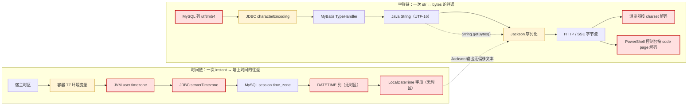
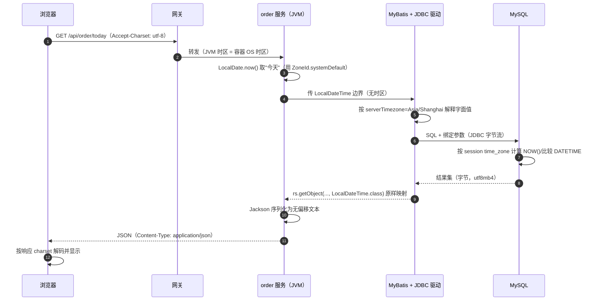

# 字符编码与时区：乱码与时间错位怎么毁掉统计口径

> **一句话结论**：乱码和时区错位几乎从不报错——它们的典型症状是"行号对不上、报表少一天、对账差 8 小时"，根因都在同一条链上：字符与字节、墙上时间与绝对时刻，在某个系统边界被**隐式解释**了一次，而解释它的人不是写代码的人。
> **阅读前置**：会写 Java / SQL，用 PowerShell 读过文件；不需要先背 Unicode 码表，本篇从字节讲起。
> **证据基线**：Windows PowerShell 5.1.26100（code page 936）+ JDK 17.0.19（Temurin）+ node v24.16.0，宿主时区 China Standard Time；B 级证据取自本仓 `master` 分支当次读取的行号；C 级命令均可原样复跑。预计阅读 40 分钟。

## 证据边界

先交代哪些能核、哪些不能核——本篇所有 ❌ 项只给"命令 + 判读方法"，不给结论性数字。

| 主题 | 本仓/本机状态 | 证据 | 本篇怎么处理 |
| --- | --- | --- | --- |
| 同一文件两种读法行数不同 | ✅ 真实存在 | `specs\005-after-sales-agent\plan.md`：83 vs 123 | §0/§3.3 实测复现 |
| Windows 默认字符集 | ✅ 实测 GBK / CP936 | `[System.Text.Encoding]::Default` | §0/§3.3 |
| JVM 默认字符集 | ✅ 实测 GBK | `ch07-tz-probe.java` §[1] | §3.4 |
| JVM 默认时区 | ✅ 实测 Asia/Shanghai（`user.timezone` 未设） | 同上 §[2] | §3.6 |
| 容器内 JVM 时区 | ❌ 未本机实测（本机无 docker） | `ai-cs-chat/Dockerfile:21` 无 `-Duser.timezone` | §3.6/§6.5 只给命令与判读 |
| MySQL `session time_zone` | ❌ 未本机实测（本机无 mysql 客户端） | `deploy/mysql/mysql.cnf` 全文无 `time_zone` | §3.7/§6.4 只给 SQL 与判读 |
| 全库时区敏感列 | ✅ 0 个 `TIMESTAMP`，42 个 `DATETIME` | `deploy/mysql/init.sql` | §3.7 |
| Jackson 时间序列化 | ✅ 本机用 m2 里的 jar 跑通 | `ch07-jackson-probe.java` | §3.5/§6.6 |
| MyBatis 时间类型处理器 | ✅ A 级源码在库里 | `LocalDateTimeTypeHandler.java.md` | §3.5 |

## 0. 先看现象

### 现象一：同一份文件，两种读法两个行数

```pwsh
$f = 'specs\005-after-sales-agent\plan.md'
@(Get-Content -LiteralPath $f).Count
@(Get-Content -LiteralPath $f -Encoding UTF8).Count
[System.IO.File]::ReadAllLines($f).Count
```

```text
83
123
123
```

一份 9683 字节、纯 UTF-8、纯 LF 的 Markdown，`Get-Content` 说它 83 行，`ReadAllLines` 说它 123 行。文件没坏，`0x0A` 也没丢——**是默认解码器把 40 个换行字节当成汉字的后半个字节吞掉了**。

这不是个例：`learning-docs` 下 1331 个 `.md`（不含 `tools/`）里有 **289 个**两种读法行数不一致（21.7%）。同一处内容被不同人记成 152 / 166 / 151 / 144 四种行号，就是这么来的。

### 现象二：同一份 UTF-8 文件，默认读出来是"繁体乱码"

```pwsh
Get-Content deploy\mysql\slave.cnf | Select-Object -First 2
Get-Content deploy\mysql\slave.cnf -Encoding UTF8 | Select-Object -First 2
```

```text
# MySQL 浠庡簱閰嶇疆锛堜粠搴? server-id=2锛屼粠搴?闇€鍙﹂厤 server-id=3锛?
[mysqld]
# MySQL 从库配置（从库1 server-id=2，从库2需另配 server-id=3）
[mysqld]
```

注意第一行末尾那个 `锛?`：`?` 的位置原本是换行——这也是 §现象一 的同一个根因在作怪。乱码本身不致命，致命的是**它把行与行粘在一起**，于是任何"按行号定位"的运维动作全部错位。

### 现象三：同一个时刻，两种口径不是"同一天"

```pwsh
node learning-docs\tools\tmp\ch07-tz-intl.mjs
```

```text
[2] 同一时刻在四个时区的本地读法
    Asia/Shanghai      → 2026-11-28 01:30
    UTC                → 2026-11-27 17:30
    America/New_York   → 2026-11-27 12:30
    Europe/Berlin      → 2026-11-27 18:30
[3] 「同一天」的定义随口径变化：按 UTC 归日 vs 按东八区归日
    按 UTC 归日      = [["2026-11-27",3],["2026-11-28",1]]
    按 Asia/Shanghai = [["2026-11-27",1],["2026-11-28",3]]
```

同样的 4 条记录，按 UTC 归日是"27 号 3 条"，按东八区归日是"28 号 3 条"。**两边都不算错，但报表对不上。**

> 这些现象指向同一件事：**编码与时区是"隐式契约"**——你以为写下的是一行文本 / 一个时间点，实际落盘的是字节 / 墙上时间；等到跨越工具、进程、容器、数据库、序列化框架的边界时，每一层都按自己的默认值重新解释一遍，而所有默认值都不一样。

## 1. 整体地图



> **读图说明**：图上只有两条链，但坑有九个。带红框的七个点都是"会用自己的默认值解释一次"的地方：MySQL 列字符集、浏览器/控制台的解码器、JVM 时区、JDBC 的 `serverTimezone`、以及两个"天生不带时区"的类型（`DATETIME` 列与 `LocalDateTime` 字段）。黄色两个点（`characterEncoding`、容器 `TZ`、Jackson）是"可以配但没人配"的地方——本仓正是这种状态。看这张图要问三个问题：①我的数据在哪两个框之间跨了边界？②跨界那一步的默认值是谁定的？③默认值是显式写下来的，还是"机器上碰巧是"？

| 组件 | 位置 | 负责什么 | 角色 | 参与方 |
| --- | --- | --- | --- | --- |
| MySQL 字符集 | `deploy/mysql/mysql.cnf:10-11` | 决定列/库的默认字符集与排序规则 | 数据落盘的最终解释者 | DBA / 部署脚本作者 |
| JDBC URL | `tools/nacos-config/*.yml`、`ai-cs-mq/src/main/resources/application.yml:27` | 声明 `characterEncoding` 与 `serverTimezone` | 唯一一处"显式"契约 | 服务作者 |
| MyBatis `LocalDateTimeTypeHandler` | `mybatis:3.6.0`（A 级源码） | 把 `LocalDateTime` 原样交给驱动 | **不做任何换算**的传递者 | 框架（不可见） |
| Jackson | Spring Boot 自动配置 | 把 `LocalDateTime` 写成无偏移文本 | 静默丢时区的地方 | 框架（不可见） |
| JVM 时区 | 宿主 / 容器 → `user.timezone` | `LocalDateTime.now()` 的取值口径 | 隐式默认值 | 镜像构建者 |
| PowerShell 控制台 | 宿主机（code page 936） | 显示与读取文本 | 最容易骗人的"现场" | 运维 / 排查者 |
| 审计与统计 | 各服务报表 SQL | 把行/天聚合成指标 | **受害者** | 业务方 |

## 2. 关键概念与关键要素

| 名称 | 位置 | 作用 | 关键参数 / 取值 |
| --- | --- | --- | --- |
| 字符集（Charset/字符集） | 概念 | "字符 → 编号"的映射表，Unicode 是其中最通用的一张 | 码点 `U+8BA2` |
| 编码（Encoding） | 概念 | "编号 → 字节"的规则，同一个字符集可以有多种编码 | UTF-8 / UTF-16 / UTF-32 |
| GBK / CP936 | Windows | 中文双字节编码，Windows 简体中文环境的 ANSI 代码页 | code page 936，`[System.Text.Encoding]::Default` |
| BOM | 文件头 | `EF BB BF` 三个字节，标识"这是 UTF-8" | 有/无，会影响脚本与解析器 |
| `Charset.defaultCharset()` | Java 运行期 | JVM 缺省的字符集 | 本机实测 `GBK` |
| `file.encoding` | Java 启动参数 | JDK 17 下等于平台默认；JDK 18+ 默认 `UTF-8` | 本机实测 `GBK` |
| `native.encoding` | Java 运行期 | 操作系统的原生编码，**不受** `-Dfile.encoding` 影响 | 实测 `GBK`（改参后仍 `GBK`） |
| `Intl.DateTimeFormat().resolvedOptions().timeZone` | node | node 认定的本地时区 | 实测 `Asia/Shanghai` |
| `user.timezone` | JVM | 显式指定的 JVM 时区；未设则为 `null` | 本机实测 `null` |
| `ZoneId.systemDefault()` | Java | 实际生效的时区（`user.timezone` 为空时回落到 OS） | 实测 `Asia/Shanghai` |
| `Instant` | Java | 绝对时刻（epoch 秒/纳秒），**天生带时区语义** | `2026-11-27T01:00:00Z` |
| `LocalDateTime` | Java | 墙上时间，**不带时区**，无法单独还原绝对时刻 | `2026-11-27T09:00` |
| `OffsetDateTime` | Java | 墙上时间 + 偏移（`+08:00`），可自证 | `2026-11-27T09:00+08:00` |
| `ZonedDateTime` | Java | 墙上时间 + 地区规则（含夏令时） | `...+08:00[Asia/Shanghai]` |
| `DATETIME` | MySQL | 存"墙上时间"字面值，**不随时区换算** | `DATETIME NOT NULL DEFAULT CURRENT_TIMESTAMP` |
| `TIMESTAMP` | MySQL | 存 UTC 秒数，进出按 `session time_zone` 换算 | 本仓 0 个 |
| `serverTimezone` / `connectionTimeZone` | JDBC URL | 告诉驱动"服务器认为自己是哪个时区" | 实测全部为 `Asia/Shanghai` |
| `time_zone` | MySQL 会话变量 | `TIMESTAMP` 与 `NOW()` 的换算口径 | 本机 cnf 未配置（继承 `SYSTEM`） |

## 3. 原理与证据逐段精读

### 3.1 字符集与编码是两件事

**在干什么。** `Unicode` 只做一件事：给每个字符分配一个编号（码点）。"订"是 `U+8BA2`，"😊"是 `U+1F60A`。至于这个编号怎么写进文件，是编码的事——UTF-8 用 1~4 个字节，UTF-16 用 2 或 4 个字节，GBK 用 1~2 个字节。**乱码的本质不是"字符集选错了"，而是"写的时候用一种编码，读的时候用了另一种"**。

```pwsh
node learning-docs\tools\tmp\ch07-bom-scan.mjs
```

```text
[1] 示例字符：码点 → UTF-8 字节
    A  U+41     utf8 = 41           字节数 = 1
    订  U+8BA2   utf8 = E8 AE A2     字节数 = 3
    单  U+5355   utf8 = E5 8D 95     字节数 = 3
    😊  U+1F60A  utf8 = F0 9F 98 8A  字节数 = 4
    "订单😊" 的 js length（UTF-16 码元数）= 4 ，按码点展开后 = 3
    BOM 的 UTF-8 字节 = EF BB BF
```

UTF-8 的变长规则（首字节决定长度，这是"自同步"的基础）：

| 码点范围 | 字节数 | 首字节模式 | 实例 |
| --- | --- | --- | --- |
| U+0000–U+007F | 1 | `0xxxxxxx` | `A` = `41` |
| U+0080–U+07FF | 2 | `110xxxxx 10xxxxxx` | `©` = `C2 A9` |
| U+0800–U+FFFF | 3 | `1110xxxx 10xxxxxx 10xxxxxx` | `订` = `E8 AE A2` |
| U+10000–U+10FFFF | 4 | `11110xxx 10xxxxxx ×3` | `😊` = `F0 9F 98 8A` |

**为什么这么设计。** 三条性质各自解决一个工程问题：①**ASCII 兼容**——纯英文文档在 UTF-8 下字节与 ASCII 完全一致，所以老系统不必全改；②**自同步**——任一字节的最高位不是 `10` 就是某个字符的首字节，从任意位置起读都能在最多 3 字节内重新对齐，丢一个字节不会污染整个文件；③**无字节序**——字节序列本身就是顺序，不需要 `FF FE` / `FE FF` 之类的大小端标记（UTF-16/UTF-32 需要，这正是 BOM 的原罪之源）。

**换写法会怎样。** 若把上面三条任一打破：用 UTF-16 存日志 → 每行翻倍且要处理大小端；用 GBK 存中文 → 与 emoji 不兼容（`😊` 在 GBK 里根本没有码位，只能变成 `?` 或直接报错）；用 UTF-8 但按"按字符截断"处理 → 截到代理对中间就产生非法字节序列。

**常见坑。** `String.length()` 返回的是 UTF-16 **码元**数，不是字符数——`"订单😊".length()` 是 4，`codePointCount` 是 3。按 `length()` 做 `substring` 切出一个 emoji 的前半截，会得到孤立代理项（`D83D`），再转 UTF-8 变成 `3F`（`?`），这就是"用户昵称最后少一个字/多个问号"的来源。§6.3 有实测。

### 3.2 BOM 的三重害处，以及它唯一的好处

**在干什么。** BOM 是文件开头三个字节 `EF BB BF`（对应码点 `U+FEFF`，零宽不换行空格）。它本来是 UTF-16/32 用来标大小端的遗留物，UTF-8 完全不需要它。

三种害处：

1. **污染内容**：不认 BOM 的解析器会把 `\uFEFF` 当正文第一个字符。JSON 解析器会在这里直接报错；Markdown 的第一行 `# 标题` 变成 `\uFEFF# 标题`，于是"首行标题"识别的正则全部失配。
2. **破坏拼接与哈希**：多文件合并时 BOM 出现在文件中间，产生不可见字符；同一份内容的文件加不加 BOM，SHA-256 完全不同（缓存/去重/签名全部失效）。
3. **工具链不一致**：有的工具（旧版 Excel、Windows 记事本、部分编辑器）**必须**有 BOM 才认 UTF-8；有的（多数 Unix 工具、JSON、YAML、Git 钩子）见到 BOM 就出问题。同一仓库里两派并存，就会出现"我这里正常，你那里乱码"。

而它唯一的好处，在本仓恰好是硬需求：

```pwsh
node learning-docs\tools\tmp\ch07-bom-scan.mjs
```

```text
[2] 仓库内 UTF-8 BOM 分布（跳过 .git / node_modules / target / .venv / .idea）
    扫描文件数 = 2410，带 BOM = 34，其中 .md = 31
    .ps1 共 35 个，带 BOM = 3 个
      BOM   deploy/scripts/check-local.ps1
      BOM   deploy/testdata/seed-redbox-data.ps1
      noBOM  tools/env.ps1
      noBOM  deploy/scripts/increase-product-stock.ps1
```

**为什么这么设计（Windows PowerShell 的历史包袱）。** Windows PowerShell 5.1 在**解析脚本源文件**时，若文件无 BOM，会按 ANSI 代码页（本机 = CP936）解码；有 BOM 才按 UTF-8。所以对 `.ps1` 来说，BOM 不是害处而是"声明"。本仓 3 个带 BOM 的脚本恰好是中文最多的几个，这说明作者踩过坑；而 `tools/env.ps1`（189 个非 ASCII 字节）等 32 个脚本没有 BOM——同一仓库两套约定，就是下一颗雷。

**换写法会怎样。** 统一"所有文本文件 UTF-8 无 BOM"是现代标准做法，但必须同时满足两个条件：①运行环境不低于 PowerShell 7（默认 UTF-8）；②或者所有 `.ps1` 里的非 ASCII 只出现在注释里。本仓用 5.1，两个条件都不满足。

**常见坑。** 只看 `Get-Content` 显示正常就以为没事——显示正常可能是因为 `-Encoding UTF8` 被加上过，也可能是文件恰好带 BOM；真正的判定必须看**字节**（§6.2）。

### 3.3 Windows 默认编码：83 vs 123 的机理

**在干什么。** `Get-Content` 不带 `-Encoding` 时，Windows PowerShell 5.1 用 ANSI 代码页解码文件字节，本机是 CP936：

```pwsh
[System.Text.Encoding]::Default
chcp
(Get-TimeZone).Id
(Get-Culture).Name
```

```text
BodyName          : gb2312
EncodingName      : 简体中文(GB2312)
WebName           : gb2312
WindowsCodePage   : 936
CodePage          : 936
Active code page: 936
China Standard Time
zh-CN
```

于是同一份 UTF-8 字节被当成 GBK 双字节流：`订` 的 `E8 AE A2` 被读成 `瀹` + 一个"半截"。问题在于**GBK 的前导字节是 `0x81–0xFE`，宽松解码器看到前导字节就直接吃掉下一个字节，不校验它是不是合法尾字节**。UTF-8 汉字的第 3 个字节（`A2`、`95`…）正好落在 GBK 前导字节区间，紧跟其后的 `0x0A`（换行）就被当作尾字节吞了。

```pwsh
node learning-docs\tools\tmp\ch07-encoding-lines.mjs specs\005-after-sales-agent\plan.md
```

```text
文件            = specs\005-after-sales-agent\plan.md
字节数          = 9683
字节层 0x0A 数  = 123
字节层 0x0D 数  = 0
[utf-8] 段数 = 124，字符数 = 6809
[utf-8] 首行 = # 实施计划：智能客服 Agent 编排与人工转接
[gbk] 段数 = 124，字符数 = 7620
[gbk] 首行 = # 瀹炴柦璁″垝锛氭櫤鑳藉鏈� Agent 缂栨帓涓庝汉宸ヨ浆鎺�
GBK 前导字节紧跟 0x0A 的字节对数（上界）= 67
宽松双字节模拟解码：可见换行 = 83，被吞换行 = 40
```

最后一行是关键：**按"见前导字节就吃两个字节"的规则模拟一遍，可见换行数正好是 83**，与 `Get-Content` 的结果一字不差；被吞掉的 40 个换行就是 123−83。

**为什么这么设计。** 宽松解码是 1990 年代的兼容性妥协：宁可吞错也不抛异常，保证"任何字节流都能显示出点什么"。代价是**错误不可见**——如果它抛异常，这个坑根本活不过一天。

**换写法会怎样。** 三个对照实验说明"错的是读法，不是文件"：

| 读法 | 行数 | 结论 |
| --- | --- | --- |
| `Get-Content`（默认 CP936） | 83 | 吞换行 |
| `Get-Content -Encoding UTF8` | 123 | 正确 |
| `[System.IO.File]::ReadAllLines()` | 123 | 正确（.NET 默认按 UTF-8 读） |
| node `TextDecoder('utf-8')` | 124 段（=123 换行） | 正确 |
| node `TextDecoder('gbk')` | 124 段（=123 换行） | **不吞**——WHATWG 的 gbk 解码器校验尾字节 |
| Java `new String(bytes, "GBK")` | 123 行 | **不吞**——JVM 的 GBK 解码器替换而非吞并 |

**同一份坏输入，不同运行时的行为不同**，这是这个坑最毒的地方：用 node 或 Java 验证"没问题"，用 PowerShell 一跑就错位，双方各拿一份"证据"。

**常见坑。** ①把 `Get-Content` 的行号当"权威行号"写进文档/工单（本项目已出现同一处内容被记成 152 / 166 / 151 / 144 四种行号）；②用 `Select-String` 定位后直接 `Get-Content | Select-Object -Skip N` 取上下文，错位后取到的是**别的段落**，人却以为看到了原文；③`-TotalCount / -Tail` 也走同一条解码路径，同样会偏。

### 3.4 Java 的默认字符集：`file.encoding` 与源文件编码

**在干什么。** JVM 启动时会决定一个"缺省字符集"，凡是不显式指定编码的 API（`new FileReader`、`new String(bytes)`、`FileWriter`、`PrintStream`）都用它。JDK 17 的取值来自操作系统 ANSI 代码页：

```pwsh
java learning-docs\tools\tmp\ch07-tz-probe.java specs\005-after-sales-agent\plan.md
```

```text
[1] 运行期字符集相关属性
    Charset.defaultCharset()      = GBK
    System.getProperty(file.encoding)   = GBK
    System.getProperty(native.encoding) = GBK
    System.getProperty(sun.jnu.encoding)= GBK
```

也可以不写代码直接看：

```pwsh
java -XshowSettings:properties -version 2>&1 | Select-String -Pattern 'file.encoding|native.encoding|sun.jnu|user.timezone'
```

```text
    file.encoding = GBK
    native.encoding = GBK
    sun.jnu.encoding = GBK
```

注意输出里**没有** `user.timezone` 这一行——它不存在（下一节解释这意味着什么）。

**为什么这么设计。** JDK 18 的 JEP 400 才把默认字符集统一成 UTF-8；JDK 17 及之前，"缺省字符集 = 平台字符集"是为了兼容 1990 年代的本地化程序。这就是"同一份代码在同事机器上正常、在 CI 容器里乱码"的机制性原因。

**换写法会怎样。** 两种改法，效果不同：

```pwsh
java --% -Dfile.encoding=UTF-8 -Dsun.stdout.encoding=UTF-8 learning-docs\tools\tmp\ch07-tz-probe.java
```

```text
[1] 运行期字符集相关属性
    Charset.defaultCharset()      = UTF-8
    System.getProperty(file.encoding)   = UTF-8
    System.getProperty(native.encoding) = GBK
    System.getProperty(sun.jnu.encoding)= GBK
```

`-Dfile.encoding=UTF-8` 只改"Java 内部认为的默认字符集"，改不了 `native.encoding`/`sun.jnu.encoding`（操作系统层面的文件名、控制台交互仍按 GBK）。也就是说**参数改一半，坑还在另一半**。

**常见坑（本机实测，两个连环坑）。**

第一坑：PowerShell 5.1 会拆掉 `-D` 参数。直接写会得到：

```text
错误: 找不到或无法加载主类 .encoding=UTF-8
原因: java.lang.ClassNotFoundException: /encoding=UTF-8
```

必须用 `--%`（停止 PowerShell 解析命令行）或把参数整体加引号。

第二坑：**JDK 17 单文件运行（`java Foo.java`）会用 `file.encoding` 去解码源文件**。所以源码里写的中文/emoji 字面量会被按 GBK 解读——同一个源文件，加不加参数得到两个不同的字符串：

| 运行方式 | `msg.length()` | `codePointCount` | `getBytes(UTF_8).length` | `substring(2,3)` 的码点 |
| --- | --- | --- | --- | --- |
| 默认（`file.encoding=GBK`） | **5** | 5 | 15 | `5D1F`（一个汉字） |
| `-Dfile.encoding=UTF-8` | **4** | **3** | **10** | `D83D`（孤立高代理） |

源码里的 `"订单😊"` 应该是 4 个码元、3 个码点、10 个字节；GBK 下变成 5/5/15——**再多一行 `substring` 就切出半个字符**。而 `-Dfile.encoding=UTF-8` 之后，`substring(2,3)` 切出的是孤立代理 `D83D`，转 UTF-8 得 `3F`（`?`）——这是"按码元截断"和"编码不一致"两个坑的合体。

第三个副作用：默认运行时连**标准输出**都是乱码。JDK 按 GBK 写 stdout，而管道/日志采集按 UTF-8 读，于是"程序算对了、日志里全是问号"。这不是程序 bug，是边界 bug。

### 3.5 Java 时间类型的语义，与序列化时的静默丢时区

**在干什么。** `java.time` 把"时刻"拆成四种语义，选错一个就永久丢掉信息：

| 类型 | 语义 | `toString()` 长什么样 | 能否单独还原绝对时刻 |
| --- | --- | --- | --- |
| `Instant` | 绝对时刻（UTC 时间轴上的点） | `2026-11-27T01:00:00Z` | ✅ |
| `OffsetDateTime` | 绝对时刻 + 偏移（无地区规则） | `2026-11-27T09:00+08:00` | ✅ |
| `ZonedDateTime` | 绝对时刻 + 地区规则（含夏令时） | `2026-11-27T09:00+08:00[Asia/Shanghai]` | ✅ |
| `LocalDateTime` / `LocalDate` | **墙上时间**，不含任何时区信息 | `2026-11-27T09:00` / `2026-11-27` | ❌ |

项目里 66 个时间字段全是 `LocalDateTime`（`ai-cs-chat` 13 / `ai-cs-order` 18 / `ai-cs-message` 29 / `ai-cs-user` 2 / `ai-cs-knowledge` 4），例如 `ai-cs-order/src/main/java/com/aics/order/entity/Coupon.java:29`（`expireTime`）、`ai-cs-order/src/main/java/com/aics/order/entity/Order.java:39`（`payTime`）、`ai-cs-chat/src/main/java/com/aics/chat/entity/Order.java:55`（`createTime`）。

**为什么这么设计。** 因为 MyBatis 到驱动这一层根本不做换算：

```java (src: LocalDateTimeTypeHandler.java.md#L31-L50)
  @Override
  public void setNonNullParameter(PreparedStatement ps, int i, LocalDateTime parameter, JdbcType jdbcType)
      throws SQLException {
    ps.setObject(i, parameter);
  }

  @Override
  public LocalDateTime getNullableResult(ResultSet rs, String columnName) throws SQLException {
    return rs.getObject(columnName, LocalDateTime.class);
  }
```

见 [[源码:LocalDateTimeTypeHandler.java.md#L31-L50]]：写入是 `ps.setObject(i, parameter)`，读出是 `rs.getObject(columnName, LocalDateTime.class)`——**原样交给驱动、原样取回**。它不报错、不警告、不换算。也就是说"丢时区"不是某段代码的 bug，而是这条链**设计上就不携带时区**：谁想加，必须自己显式加。

序列化这一步同理。项目里全仓 `application*.yml` 与 `tools/nacos-config/*.yml` 没有 `jackson` / `time-zone` / `date-format` 配置，`@JsonFormat` 在 `ai-cs-common`、`ai-cs-chat`、`ai-cs-order`、`ai-cs-message` 里 0 处——时间字段直接走 Spring Boot 默认的 Jackson 行为。本机用 m2 里的 jar 直接验证（命令见 §6.6）：

```text
[1] 默认 Jackson（Spring Boot 行为：JavaTimeModule + 关闭时间戳）序列化结果
    {"orderNo":"A20261127001","payTime":"2026-11-27T09:00:00","paidAt":"2026-11-27T01:00:00Z","zonedPayTime":"2026-11-27T09:00:00+08:00","bizDate":"2026-11-27","remark":"订单已支付😊"}
[3] 反序列化回来：哪些字段保住了绝对时刻，哪些只保住了“墙上时间”
    payTime       = 2026-11-27T09:00   （LocalDateTime，无偏移）
    paidAt        = 2026-11-27T01:00:00Z   （Instant，绝对时刻）
    zonedPayTime  = 2026-11-27T01:00Z   （带偏移与地区）
[4] LocalDateTime 的 JSON 文本在“按 UTC 解读”的消费方手里会变成什么
    JSON 文本 = 2026-11-27T09:00
    消费方按 UTC 解读      → 2026-11-27T09:00:00Z
    生产方按 Asia/Shanghai → 2026-11-27T01:00:00Z
    两者相差秒数 = -28800
```

三个可直接引用的结论：①`LocalDateTime` 输出成 `"2026-11-27T09:00:00"`，**没有偏移**，消费方无从判断这是哪个时区的 9 点；②同一个"9 点"，按 UTC 解读与按东八区解读相差 28800 秒（8 小时）；③注意 `[3]` 那行 `zonedPayTime = 2026-11-27T01:00Z`——JSON 里明明写着 `+08:00`，Jackson 反序列化成 `ZonedDateTime` 时会转成 UTC 并把地区规则丢掉（`[Asia/Shanghai]` 没了）。所以"我用了 `ZonedDateTime` 就安全了"也是错的，跨系统仍要靠 `OffsetDateTime`/`Instant` + 显式格式化。

**换写法会怎样。** 分三档：①最小改动——只要求前端/下游展示，`LocalDateTime` + 全局 `spring.jackson.time-zone` + `date-format` 就够，但**仍然丢时区**；②正确做法——对外 API 用 `Instant` 或 `OffsetDateTime`（`ISO_OFFSET_DATE_TIME`），内部报表再按目标时区渲染；③彻底做法——存储层直接存 UTC（见 §5）。

**常见坑。** ①`LocalDateTime` 里塞"用户本地时间"，然后在另一个时区的服务里做 `between` 比较——差 8 小时而且不报错；②用 `@JsonFormat(pattern="yyyy-MM-dd HH:mm:ss")` 掩盖问题，格式化后偏移彻底不可见；③把 `ZonedDateTime` 当银弹，忽略反序列化丢地区（上面 `[3]`）。

**跨语言边界同理，只是"转义"代替了"乱码"。** 本仓 AI 对话流由 Python 服务经 SSE 推给前端，`ai-cs-py-chat/app/api/chat.py:41` 和 `:45` 都写成 `json.dumps(..., ensure_ascii=False)`。Python 默认 `ensure_ascii=True`，会把"订单已支付😊"输出成 `\u8ba2\u5355...` 这样的转义序列：**它不是乱码，但一个汉字从 3 个 UTF-8 字节变成 6 个 ASCII 字节**，于是字节数翻倍、`grep 订单` 搜不到、日志里全是 `\u`。也就是说同一条数据在 Java（Jackson 默认输出 UTF-8 原文）、Python（默认转义）、MySQL（utf8mb4）三处的"线格式"各不相同，而真正把编码钉死的只有显式写出来的那几处（`:50` 的 `media_type="text/event-stream"` 甚至没带 `charset=`，浏览器的 EventSource 按规范恒按 UTF-8 解码——它靠的是规范默认值，不是代码意图）。

### 3.6 时区的三层：宿主、JVM、数据库会话

**在干什么。** "现在是几点"这个概念在链路上被三次解释：

| 层 | 取值来源 | 本仓状态 | 证据 |
| --- | --- | --- | --- |
| 宿主 OS | `TZ` / 系统时区设置 | China Standard Time | `(Get-TimeZone).Id` |
| 容器 | 镜像 `ENV TZ` 或 compose `TZ:` | **只有 MySQL 有**，Java 服务没有 | `deploy/docker-compose/docker-compose-all.yml:17` |
| JVM | `-Duser.timezone`，未设则读 OS | **未设**（`null`） | `ch07-tz-probe.java` §[2] |
| MySQL 会话 | `time_zone` 变量，未设则 `SYSTEM` | **未配置** | `deploy/mysql/mysql.cnf` 全文无 `time_zone` |

```text
[2] 运行期时区相关属性
    user.timezone                 = null
    TimeZone.getDefault().getID() = Asia/Shanghai
    ZoneId.systemDefault()        = Asia/Shanghai
    LocalDateTime.now()           = 2026-11-27T16:46:33.416852400
    ZonedDateTime.now()           = 2026-11-27T16:46:33+08:00[Asia/Shanghai]
    OffsetDateTime.now()          = 2026-11-27T16:46:33+08:00
    Instant.now()                 = 2026-11-27T08:46:33Z
```

**为什么这么设计。** `user.timezone` 为空不是"BUG"，而是"我不指定，跟随操作系统"。这在单机环境很省事，在多环境就致命：CI 机器、容器、同事的笔记本可能各不相同，而**代码里没有任何一处写死了这个事实**。本仓 `deploy/docker-compose/docker-compose-master-slave.yml:17` 给 MySQL 设了 `TZ: Asia/Shanghai`，7 处 `TZ` 全部落在 MySQL 服务上；Java 服务的 `JAVA_OPTS` 只有 `-Xms256m -Xmx512m`（如 `deploy/docker-compose/docker-compose-all.yml:175`、`:193`），没有 `-Duser.timezone`；`ai-cs-chat/Dockerfile:21` 的入口是 `java ${JAVA_OPTS:-} -jar app.jar`，也没有 `ENV TZ`。

**换写法会怎样。** 未指定时，容器内 JVM 时区取决于基础镜像的 `/etc/localtime`——`eclipse-temurin:17-jre-jammy`（`ai-cs-chat/Dockerfile:17`）基于 Ubuntu，默认是 **UTC**。所以很可能出现：**同一份代码本机跑是东八区、容器里跑是 UTC**，`LocalDateTime.now()` 差 8 小时，写进 `DATETIME` 列的值也差 8 小时。这一段**本机无 docker，未实测**，验证命令见 §6.5。

**常见坑。** ①把"容器里是 UTC"或"容器里是东八区"当成已知事实写进文档（旧文档就曾这样写"JVM 默认时区是 UTC"——**那是错的**：本机 JDK 17 实测默认是 `Asia/Shanghai`，只因为宿主是 CST；`user.timezone` 为空不代表取值是 UTC）；②只给 MySQL 配 `TZ` 就以为整条链都对齐了；③在 `JAVA_OPTS` 里加 `-Duser.timezone=Asia/Shanghai` 却不改数据库侧，变成"两边各按各的换算"。

### 3.7 MySQL：`DATETIME` 与 `TIMESTAMP`，以及本仓为何全押在 `DATETIME`

**在干什么。** 两种时间列语义完全不同：

| 维度 | `DATETIME` | `TIMESTAMP` |
| --- | --- | --- |
| 存储内容 | 字面值 `2026-11-27 09:00:00` | UTC 秒数（内部） |
| 时区换算 | **不做**，写进去什么读出来什么 | 写入按 `session time_zone` 换算成 UTC，读时再换算回来 |
| 取值范围 | 1000–9999 年 | 1970–2038 年 |
| 默认值 | 可用 `CURRENT_TIMESTAMP` | 可用 `CURRENT_TIMESTAMP` |
| 跨时区迁移 | 值不变，含义变 | 值随会话变，绝对时刻不变 |

本仓的实际情况：`deploy/mysql/init.sql` 里 `DATETIME` 出现 42 次、`CURRENT_TIMESTAMP` 出现 60 次、`^\s+\w+\s+TIMESTAMP` 形式的列声明 **0 次**——全库没有一列 `TIMESTAMP`。典型定义（`deploy/mysql/init.sql:313`）：

```sql
create_time     DATETIME        NOT NULL DEFAULT CURRENT_TIMESTAMP COMMENT '创建时间',
```

配合索引（`deploy/mysql/init.sql:317`）`KEY idx_create_time (create_time)`，以及 `deploy/mysql/init.sql:318` 的 `ENGINE=InnoDB DEFAULT CHARSET=utf8mb4 COLLATE=utf8mb4_unicode_ci`。

**为什么这么设计。** `DATETIME` 的好处是"所见即所得"、无 2038 问题；代价是**它把一个绝对时刻降级成了字符串**。于是"这个 9 点是哪个时区的 9 点"这个问题，答案只能来自链路上唯一的显式声明——JDBC URL：

```text
jdbc:mysql://${MYSQL_HOST:123.60.31.79}:3306/mq_db?useUnicode=true&characterEncoding=utf-8&useSSL=false&serverTimezone=Asia/Shanghai&allowPublicKeyRetrieval=true
```

这一行来自 `ai-cs-mq/src/main/resources/application.yml:27`；`tools/nacos-config/` 下各服务的 JDBC URL 也全部带 `serverTimezone=Asia/Shanghai`（如 `ai-cs-chat.yml` 的 5 个数据源）。

**换写法会怎样。** 假设某天有人把 `serverTimezone` 从 `Asia/Shanghai` 改成 `UTC`（或漏配），驱动就会按另一个时区解释 `LocalDateTime`：

```text
[3] 同一个 LocalDateTime 在两种 serverTimezone 解释下的绝对时刻
    字面值 2026-11-27T09:00 按 Asia/Shanghai 解释 -> 2026-11-27T01:00:00Z
    字面值 2026-11-27T09:00 按 UTC          解释 -> 2026-11-27T09:00:00Z
    两者相差小时数 = -8
```

**数据库里的字节一个都没变**，但业务含义整体平移 8 小时。这就是"改了配置没改代码，报表开始差 8 小时"的完整机制。

**常见坑。** ①`characterEncoding=utf-8` 写成 `utf8`/`UTF8`/`utf-8` 都能用，但写成 `UTF-8`（大写）在某些驱动版本上会被忽略，于是回退到服务器默认——字符集声明"看起来写了其实没生效"；②`serverTimezone` 只影响 `DATETIME/TIMESTAMP` 的解释，**不影响 `VARCHAR` 的字符集**，不要把两件事混在一起排查；③`CURRENT_TIMESTAMP` 的取值来自 **MySQL 服务器**的 `time_zone`（未配置时为 `SYSTEM`），与 JVM 时区无关——所以"Java 侧改对了、`create_time` 还是差 8 小时"非常常见。

### 3.8 跨时区排序与"同一天"的定义

**在干什么。** "今天的订单"这句话包含两个未定义项：时区、闭开区间。两者都靠默认值填，于是不同系统填出不同答案。

```pwsh
node learning-docs\tools\tmp\ch07-tz-intl.mjs
```

```text
[4] LocalDateTime 字符串排序 ≠ 绝对时刻排序（两条记录来自不同时区写入方）
    A: local=2026-11-27T09:00 (Asia/Shanghai) → 2026-11-27T01:00:00.000Z
    B: local=2026-11-27T08:00 (America/New_York) → 2026-11-27T13:00:00.000Z
    按 local 字符串排序 = B , A
    按绝对时刻排序     = A , B
    两种口径是否一致   = 不一致（排序结果被时区翻转）
```

两条记录，A 的"墙上时间"更晚（09:00 > 08:00），但绝对时刻更早（01:00Z < 13:00Z）。**按 `LocalDateTime` 排序与按 `Instant` 排序，结果是相反的**。任何"最近 N 条"、"时间线回放"、审计流水，只要时间字段是 `LocalDateTime` 且写入方跨时区，顺序就是错的——而且错得很自然，看不出来。

「同一天」同理：§0 现象三里 4 条记录，按 UTC 是 `27 号 3 条`，按东八区是 `28 号 3 条`。本项目里 `LocalDateTime.now()` 产生的时间（`ModelUsageQuotaVO.periodStart` 等配额周期字段，见 `ai-cs-chat/src/main/java/com/aics/chat/dto/ModelUsageQuotaVO.java:42`）如果被不同时区的实例写入，"这一天"会横跨 8 小时，配额统计与结算对账必然对不上。

**为什么这么设计。** 因为 `LocalDateTime` 就是"给人类看的墙上时间"，非常适合"营业日""排班表"这类**本地日历概念**；但它不适合"事件发生的绝对顺序"。选型的关键不是"哪个更先进"，而是**这个字段回答的是哪类问题**。

**换写法会怎样。** 三条可操作的判据：①需要排序、比较先后、算时长 → 必须存绝对时刻（`Instant`/UTC）；②需要"按某个时区的自然日聚合" → 存绝对时刻 + **显式记录聚合口径**（如报表参数 `timezone=Asia/Shanghai`）；③只需要"票面/单据上的日期" → `LocalDate` 正合适，且**不要**再拿它做跨日计算。

**常见坑。** ①"今天"用 `LocalDate.now()`（JVM 时区）而不是 `LocalDate.now(zoneId)`，容器时区一换，边界就漂；②SQL 里 `WHERE create_time >= CURDATE()`——`CURDATE()` 是 MySQL 服务器时区，与 JVM 不是一个口径；③区间写成 `<=` 而非 `<` 次日零点，跨日重叠统计，重复计数。

## 4. 一次完整执行时序

场景：用户在页面上查"今天我的订单"，数据从 MySQL 经 Java 服务返回前端。把编码与时区两条链叠在这条请求上。



> **读图说明**：这张图里只有第 4、6、7、10 步涉及"解释"，其余都是搬运。读图要抓住三处对齐关系：①第 3 步的"今天"用的是 **JVM 时区**；②第 6、7 步的比较基准是 **JDBC + MySQL 会话时区**；③第 10 步输出的文本**不再携带任何时区信息**，谁来解读谁自己补默认值。这三次解释分别由三个不同的人配置（镜像构建者、服务作者、DBA），任何一处不一致都会产生"少一天/差 8 小时/顺序错乱"，而请求本身会 200 成功。

**每一步该怎么判读**：

| 步 | 判据 | 正常长什么样 | 异常长什么样 | 该看哪里 |
| --- | --- | --- | --- | --- |
| 2 | JVM 时区 | `ZoneId.systemDefault()` = 期望时区 | 容器里是 `UTC`，本机是 `Asia/Shanghai` | `-Duser.timezone` / 镜像 `ENV TZ` |
| 3 | "今天"的边界 | 边界字面值 = 期望自然日 00:00 | 边界偏移 8 小时，"今天"变"昨天/明天" | `LocalDate.now()` vs `LocalDate.now(zone)` |
| 5 | 驱动解释 | `serverTimezone` 与业务时区一致 | URL 漏配或写成 `UTC` | JDBC URL 全文（含 Nacos 覆盖） |
| 6 | MySQL 会话 | `@@session.time_zone` 符合预期 | `SYSTEM` 且容器 TZ 与业务不同 | `SELECT @@session.time_zone` |
| 7 | 存储值 | `DATETIME` 字面值 = 业务期望的墙上时间 | 值差 8 小时，且"看起来很正常" | 直接 `SELECT` 该行对比 |
| 9 | 映射 | `LocalDateTime` 与列值一致 | 一致（这一层不做换算，出错必在上下游） | `LocalDateTimeTypeHandler`（A 级） |
| 10 | 序列化 | 带偏移（`+08:00` / `Z`） | 只有 `2026-11-27T09:00:00`，无偏移 | 响应 JSON 原文 |
| 11 | 前端渲染 | 显示与用户预期一致 | 差 8 小时 / 日期少一天 | 浏览器 `Intl` 时区、响应 `Content-Type` |

## 5. 设计取舍

| 决策点 | 选项 A | 选项 B | 本仓现状 | 代价 / 收益 |
| --- | --- | --- | --- | --- |
| 时间存储语义 | 存 UTC（`Instant`/`DATETIME` 里存 UTC 值） | 存当地墙上时间（`LocalDateTime`/`DATETIME`） | ⚠️ 事实是 B（42 个 `DATETIME` + 66 个 `LocalDateTime`），但没写明口径 | A 便于跨时区聚合与排序，但"取当天数据"要换算；B 直观，但隐式依赖 serverTimezone |
| MySQL 时间列类型 | `TIMESTAMP`（UTC 秒数） | `DATETIME`（字面值） | ✅ B（0 个 `TIMESTAMP`） | B 无 2038 问题但要自己保证口径；A 让数据库承担换算，代价是会话依赖 |
| 时区声明位置 | 代码/配置显式写死（`-Duser.timezone`、`ENV TZ`、`time_zone`） | 跟随平台默认值 | ⚠️ 只有 JDBC URL 与 MySQL 容器 `TZ` 是显式的，JVM 侧无 | 显式化成本极低、收益极大；隐式默认值在换机器时爆炸 |
| 对外时间格式 | 带偏移（`ISO_OFFSET_DATE_TIME` / `Instant`） | 无偏移字符串 | ❌ B（`@JsonFormat` 0 处、无 jackson 配置） | A 让下游无需猜；B 简单但不可自证 |
| 文本编码声明 | 所有 IO 显式指定 `UTF-8` | 依赖平台默认 | ⚠️ JDBC URL 写了 `characterEncoding=utf-8`；脚本与工具链未统一 | 显式化几乎零成本 |
| `.ps1` 是否带 BOM | 统一带 BOM（PS 5.1 友好） | 统一无 BOM（现代标准） | ❌ 两派并存（3 个带、32 个不带） | 统一任一方都好过现在 |
| 数据库字符集 | `utf8mb4` | `utf8`（= `utf8mb3`，3 字节） | ✅ A（`deploy/mysql/mysql.cnf:10`） | A 支持 emoji 与生僻字，代价是索引长度按 4 字节算 |

可扩展点清单（**均未落地，按优先级排序**）：

1. **给所有 Java 服务显式钉死时区**：在 `Dockerfile` 加 `ENV TZ=Asia/Shanghai`，或在 `JAVA_OPTS` 追加 `-Duser.timezone=Asia/Shanghai`——当前 `ai-cs-chat/Dockerfile:21` 与 compose 的 `JAVA_OPTS` 都没有。（未落地）
2. **MySQL 侧显式写 `time_zone`**：在 `deploy/mysql/mysql.cnf` 增 `default-time-zone='+08:00'`，别再靠 `TZ` 环境变量 + `SYSTEM` 继承。（未落地）
3. **对外 API 时间字段改为带偏移**：全局配 `spring.jackson.serialization.write-dates-as-timestamps=false` + 关键 DTO 用 `OffsetDateTime`；逐步替换 `LocalDateTime` 出参。（未落地）
4. **统一文本 IO 编码**：Java 侧所有 `FileReader/FileWriter/PrintStream` 换成显式 `StandardCharsets.UTF_8`；`jvm` 启动参数加 `-Dfile.encoding=UTF-8`。（未落地）
5. **`.ps1` BOM 约定落成检查项**：在 CI 或 `tools/` 里加一条"含非 ASCII 的 `.ps1` 必须带 BOM"的校验。（未落地）
6. **报表口径显式化**：所有按天聚合的接口增加 `timezone` 参数并写进审计日志。（未落地）
7. **行号漂移防护**：文档/工单引用行号时附带"读取方式"（`ReadAllLines` / `-Encoding UTF8`），或在项目里统一一个读取工具函数。（未落地）

## 6. 踩坑与调试手法

### 6.1 判定"行号为什么会漂"

```pwsh
$f = 'specs\005-after-sales-agent\plan.md'
@(Get-Content -LiteralPath $f).Count
@(Get-Content -LiteralPath $f -Encoding UTF8).Count
[System.IO.File]::ReadAllLines($f).Count
node learning-docs\tools\tmp\ch07-encoding-lines.mjs $f
```

```text
83
123
123
…（脚本输出）
宽松双字节模拟解码：可见换行 = 83，被吞换行 = 40
```

| 判读项 | 含义 |
| --- | --- |
| 默认读 < `-Encoding UTF8` 读 | 文件是 UTF-8 但被按 ANSI 解码 |
| 两者相等但内容仍乱码 | 文件本身是 GBK 编码（真需要转码） |
| `ReadAllLines` 与 `-Encoding UTF8` 一致 | 文件无 BOM 且是合法 UTF-8 |
| 脚本模拟值 = `Get-Content` 值 | 确认是"吞换行"，不是缺换行 |

**误判风险**：`Get-Content` 默认读在**纯 ASCII 文件**上也与其它读法一致（没有多字节字符就无从吞并），所以"我随手试了一个文件没问题"不能作为结论；必须挑**含中文**的目标文件。另外 `-TotalCount 1` 这类取首行的命令不受影响，用它验证会得出"没事"。

### 6.2 看字节，不看显示

```pwsh
$b = [System.IO.File]::ReadAllBytes('deploy\mysql\slave.cnf')
"filesize = {0}，前三字节 = {1}" -f $b.Length, ($b[0..2] -join ',')
[System.Text.Encoding]::UTF8.GetString($b).Split("`n")[0]
[System.Text.Encoding]::GetEncoding(936).GetString($b).Split("`n")[0]
```

```text
filesize = 913，前三字节 = 35,32,77
# MySQL 从库配置（从库1 server-id=2，从库2需另配 server-id=3）
# MySQL 浠庡簱閰嶇疆锛堜粠搴? server-id=2锛屼粠搴?闇€鍙﹂厤 server-id=3锛?
```

| 判读项 | 结论 |
| --- | --- |
| 前三字节 = `239,187,191` | 有 UTF-8 BOM |
| 前三字节正常但 UTF-8 解出中文 | 是无 BOM 的 UTF-8 文件 |
| UTF-8 解出中文、GBK 解出乱码 | 文件确实是 UTF-8，是**读法**错了 |

**误判风险**：中文 Windows 下"乱码"有两种截然相反的原因——**文件是 UTF-8 但你用 GBK 读**（改读法即可），和**文件是 GBK 但你的工具按 UTF-8 读**（要转码，改读法无效）。只看乱码样子分不清，必须用两种解码各解一遍对比。另外注意：**不要**用 `Get-Content | Set-Content` 做"转码"，在 PS 5.1 下这一步会把内容再按 ANSI 解一次，越转越糊。

### 6.3 emoji 与"少一个字"

```pwsh
node -e "const s='订单😊'; console.log(s.length, [...s].length, Buffer.from(s,'utf8').length)"
```

```text
4 3 10
```

```text
[6] Java String 是 UTF-16：码元数 != 码点数
    msg.length()                            = 4
    msg.codePointCount(0, length())         = 3
    msg.getBytes(UTF_8).length              = 10
    msg.substring(2, 3) 的码点              = D83D
    substring(2,3) 再转 UTF-8 的字节         = 3F
```

| 判读项 | 含义 |
| --- | --- |
| `length` > 码点数 | 字符串含增补平面字符（emoji 等） |
| 截断后码点落在 `D800–DFFF` | 切在代理对中间，得到非法字符 |
| 转 UTF-8 得 `3F`（`?`） | 非法字符被替换，**数据已损坏** |

**误判风险**：MySQL 的 `utf8mb4` 能存 emoji，但**前端 `maxlength` 与后端 `length()` 的口径不同**（一个按码点、一个按 UTF-16 码元），于是"校验通过但入库超长"或反之。数据库报 `ERROR 1366 (HY000): Incorrect string value: '\xF0\x9F\x98\x8A'` 时，多半是**列**还是 `utf8mb3`（本仓 `deploy/mysql/mysql.cnf:10` 已是 `utf8mb4`，但新建表若漏写 `DEFAULT CHARSET` 会继承库默认，跨库迁移时要复核）。

### 6.4 查 MySQL 的时区与字符集口径

本机无 mysql 客户端，**未本机实测**；以下 SQL 在容器或客户端执行后按下表判读：

```sql
SELECT @@global.time_zone, @@session.time_zone, @@system_time_zone;
SELECT NOW(), UTC_TIMESTAMP(), TIMEDIFF(NOW(), UTC_TIMESTAMP());
SELECT @@character_set_server, @@collation_server, @@character_set_connection;
SHOW CREATE TABLE chat_message;
```

| 判读项 | 正常 | 异常 |
| --- | --- | --- |
| `@@session.time_zone` | `+08:00`（或显式值） | `SYSTEM`（口径跟随容器 OS，易变） |
| `TIMEDIFF(NOW(), UTC_TIMESTAMP())` | `08:00:00` | `00:00:00`（说明服务器在 UTC） |
| `character_set_server` | `utf8mb4` | `utf8mb3`/`latin1` |
| `SHOW CREATE TABLE` 末尾 | `DEFAULT CHARSET=utf8mb4` | 缺省或 `utf8` |

**误判风险**：`@@system_time_zone` 显示的是 OS 时区缩写，容器里可能是 `UTC` 也可能是 `CST`（而 `CST` 在 MySQL 里可能被解释成中国标准时间或美国中部时间，有歧义）；**不要**用它反推 `session time_zone`。另外 `connectionTimeZone` 与旧参数 `serverTimezone` 在 Connector/J 8.0.23+ 并存，只改一个可能不生效（§7）。

### 6.5 查容器内 JVM 的实际时区（未本机实测）

本机无 docker，下面是标准做法，输出需按表判读：

```pwsh
# 1) 进容器看 OS 时区与 JVM 属性
docker exec aics-order sh -c 'date; echo $TZ; cat /etc/timezone 2>/dev/null; ls -l /etc/localtime'
docker exec aics-order sh -c 'jcmd 1 VM.system_properties | Select-String -Pattern "user.timezone|file.encoding"'

# 2) 在跑着的进程上直接问（jcmd 已确认本机 JDK 自带）
jcmd <pid> VM.system_properties
jinfo -sysprops <pid>
```

| 判读项 | 正常 | 异常 |
| --- | --- | --- |
| `date` 输出偏移 | `+0800` | `+0000`（UTC 镜像默认） |
| `echo $TZ` | `Asia/Shanghai` | 空（未设） |
| `user.timezone` | 出现在属性列表里 | **不出现**（= 未设，走 OS） |
| OS 时区与 `ZoneId.systemDefault()` | 一致 | 不一致（有人加了 `-Duser.timezone`） |

**误判风险**：`jcmd` 需要在容器内有 JDK/JRE 且与目标进程同用户，`eclipse-temurin:17-jre-jammy` 只带 JRE，`jcmd` 可能不可用——此时退化为"写一个 `/health/tz` 端点打印 `ZoneId.systemDefault()`"，或直接在容器里跑 `java -XshowSettings:properties -version`。另外**不要**用宿主的 `Get-TimeZone` 推断容器时区（本机实测宿主是 `China Standard Time`，容器很可能是 UTC）。

### 6.6 验证序列化到底输出了什么

```pwsh
$m = "$env:USERPROFILE\.m2\repository\com\fasterxml\jackson"
$env:CPJ = "$m\core\jackson-databind\2.15.4\jackson-databind-2.15.4.jar;$m\core\jackson-core\2.15.4\jackson-core-2.15.4.jar;$m\core\jackson-annotations\2.15.4\jackson-annotations-2.15.4.jar;$m\datatype\jackson-datatype-jsr310\2.15.4\jackson-datatype-jsr310-2.15.4.jar"
$env:JAVA_TOOL_OPTIONS = '-Dfile.encoding=UTF-8 -Dsun.stdout.encoding=UTF-8'
java -cp "$env:CPJ" learning-docs\tools\tmp\ch07-jackson-probe.java
```

```text
[1] 默认 Jackson（Spring Boot 行为：JavaTimeModule + 关闭时间戳）序列化结果
    {"orderNo":"A20261127001","payTime":"2026-11-27T09:00:00","paidAt":"2026-11-27T01:00:00Z",...}
[4] LocalDateTime 的 JSON 文本在“按 UTC 解读”的消费方手里会变成什么
    两者相差秒数 = -28800
```

| 判读项 | 含义 |
| --- | --- |
| 输出 `2026-11-27T09:00:00` | `LocalDateTime`，**无偏移**，下游必须自己补默认 |
| 输出 `...Z` 或 `...+08:00` | 绝对时刻，可自证 |
| 输出一串数字 | `WRITE_DATES_AS_TIMESTAMPS` 没关，前端会显示 1764... |

**误判风险**：①`Picked up JAVA_TOOL_OPTIONS: ...` 只是 stderr 提示，PowerShell 会把它当错误、命令退出码变 1，但程序其实跑成功了——别据此判断失败；②m2 里 `jackson-annotations` 未必有与 databind 相同的版本（本机缺 `2.21.8` 的 annotations，用同版本组合会报 `NoClassDefFoundError: JsonSerializeAs`），**四个 jar 必须版本一致**；③Spring Boot 的默认配置与你手搓的 `ObjectMapper` 可能不同（Boot 会注册更多模块），最终仍要以服务真实响应为准。

### 6.7 PowerShell 源文件编码：无 BOM 的 UTF-8 脚本会被按 GBK 解析

```pwsh
$tmp = 'D:\Projects\Persion\ai-customer-service\learning-docs\tools\tmp'
powershell -NoProfile -ExecutionPolicy Bypass -File "$tmp\ch07-nobom.ps1"
powershell -NoProfile -ExecutionPolicy Bypass -File "$tmp\ch07-withbom.ps1"
```

```text
（无 BOM，stderr）
+ Write-Output "璁㈠崟鍙?No.20261127"
+                               ~
The string is missing the terminator: ".
    + CategoryInfo          : ParserError

（带 BOM，stdout）
登录失败: 订单 100 元
订单号=No.20261127
```

两个文件内容**逐字节相同的 UTF-8**，唯一差别是开头 3 个字节。无 BOM 那个不仅显示乱码，还因为乱码吃掉了引号，**直接 ParserError 跑不起来**。

| 判读项 | 含义 |
| --- | --- |
| 前三字节 `239,187,191` | 带 BOM，PS 5.1 按 UTF-8 解析 |
| 报 `The string is missing the terminator` 且行内是乱码 | 无 BOM + 中文，解析期按 ANSI 解码 |
| 无报错但输出乱码 | 无 BOM，且中文只落在注释里（解析侥幸通过） |

**误判风险**：①用 `[System.Management.Automation.Language.Parser]::ParseFile()` 检查**不会**给出与 `powershell -File` 一致的结论——两者解码路径不同，本机实测同一个文件 `ParseFile` 报 1 个错误、`powershell -File` 也报错，但**另一个同源文件 `ParseFile` 报 0 个错误、运行时字符串仍是乱码**，"解析通过"不等于"字符串正确"；②本仓 `tools/env.ps1`、`tools/env.local.ps1`、`tools/start-infra.ps1`、`tools/start-services.ps1`、`deploy/scripts/increase-product-stock.ps1` 都是"无 BOM + 含中文"，`increase-product-stock.ps1:19` 还有中文字符串字面量（`throw "登录失败: ..."`）——即"报错信息本身会变成乱码"，排障时等于没有信息。

## 7. 版本差异

| 主题 | 旧写法 | 当前基线 | 变化点 | 迁移动作 |
| --- | --- | --- | --- | --- |
| JVM 默认字符集 | JDK 17 及以前：`file.encoding` = 平台 ANSI 代码页 | JDK 18+（JEP 400）：默认 UTF-8 | 依赖平台默认的代码在升级后才"突然正常"或"突然不对" | 升级前先 `-Dfile.encoding=UTF-8` 试点；仍要显式传编码 |
| MySQL 字符集 | `utf8`（实为 `utf8mb3`，3 字节） | `utf8mb4`（4 字节，支持 emoji） | `utf8` 是别名，不代表通用 UTF-8 | 库/表/连接三层都写 `utf8mb4`；已建表需 `ALTER` 复核 |
| 排序规则 | `utf8mb4_general_ci` / `utf8mb4_unicode_ci` | `utf8mb4_0900_ai_ci`（MySQL 8 默认） | `ai_ci` 重音/大小写不敏感，排序结果不同 | 现有库显式写 `utf8mb4_unicode_ci`（本仓 `deploy/mysql/mysql.cnf:11` 就是它）以免漂移 |
| Connector/J 时区参数 | `serverTimezone=...` | 8.0.23+ 引入 `connectionTimeZone`（另有 `forceConnectionTimeZoneToSession`） | 新旧参数并存，语义更细 | 升级驱动后核对生效参数，本仓在 `ai-cs-mq/src/main/resources/application.yml:27` 仍用旧名 |
| Java 时间 API | `java.util.Date` + `SimpleDateFormat`（非线程安全） | `java.time`（不可变、线程安全） | `Date` 无时区语义且可变 | 新代码禁用 `Date`；老代码转换要显式带 `ZoneId` |
| JSON 时间格式 | 毫秒时间戳（`WRITE_DATES_AS_TIMESTAMPS` 默认开） | ISO-8601 文本（Spring Boot 默认关闭时间戳） | 同一字段前后端解析方式变了 | 明确约定并写进接口文档 |
| Windows PowerShell | 5.1：默认 ANSI、无 BOM 按 ANSI 解析 | PowerShell 7+：默认 UTF-8 | 同一脚本在两个版本下行为不同 | 脚本统一带 BOM，或在 7+ 下运行 |
| 文件读取 API | `Get-Content`（默认按 ANSI） | `Get-Content -Encoding UTF8` / `[IO.File]::ReadAllLines` | 行数都可能不同 | 全部显式 `-Encoding` |
| 旧文档表述 | 旧文档曾这样写："项目 Java 服务容器没有设置 TZ，所以 JVM 时区是 UTC" | 本机实测：`user.timezone=null` 时 `ZoneId.systemDefault()` = `Asia/Shanghai` | **"未设置"不等于"UTC"**，取值取决于 OS | 文档改为"未显式设置，取值随容器 OS；判读命令见 §6.5" |

## 8. 面试高频问与答

1. 字符集和编码有什么区别？分别举例。
2. 为什么 UTF-8 既兼容 ASCII 又能自同步？自同步解决什么实际问题？
3. BOM 是什么？在哪些场景下必须加，哪些场景下必须去？
4. 同一份 UTF-8 文件，为什么 `Get-Content` 和 `ReadAllLines` 数出的行数不一样？
5. GBK 双字节解码在什么情况下会"吞掉"换行字节？
6. Java 的 `String.length()` 为什么对 emoji 返回 2 而不是 1？怎么正确处理？
7. `file.encoding`、`native.encoding`、`sun.jnu.encoding` 各自影响什么？
8. `LocalDateTime`、`Instant`、`OffsetDateTime`、`ZonedDateTime` 的语义差异，各自适合什么字段？
9. `LocalDateTime` 序列化成 JSON 之后，下游为什么无法还原绝对时刻？怎么改？
10. MySQL 的 `DATETIME` 和 `TIMESTAMP` 存储与换算上的差别？2038 问题指什么？
11. `serverTimezone`（`connectionTimeZone`）配错会发生什么？数据本身会变吗？
12. `user.timezone` 未设置时 JVM 的时区从哪里来？容器里为什么常是 UTC？
13. 如何定义"今天新增订单数"？需要显式约定哪几件事？
14. 跨时区排序应该按什么字段排？为什么按 `LocalDateTime` 排会错？
15. 给你一个"报表差 8 小时"的线上问题，你的排查顺序是什么？

## 9. 动手练习

1. **复现行号漂移**：用 §6.1 的命令在任意含中文的 `.md` 上复现行数不一致，再用 `ch07-encoding-lines.mjs` 解释被吞的换行数。
   *验收标准*：能说出"被吞换行数 = 默认读行数差"，并给出你文件的具体两个数字。

2. **写一个只读探针**：改造 `ch07-tz-probe.java`，让它额外打印 `ZoneId.getAvailableZoneIds().size()` 与 `TimeZone.getDefault().getDisplayName()`，在 `-Duser.timezone=UTC` 与不设两种情况下各跑一次。
   *验收标准*：两次输出的 `ZoneId.systemDefault()` 不同、`Instant.now()` 不变，能解释原因。

3. **BOM 体检**：用 `ch07-bom-scan.mjs` 的思路扫描你负责的目录，列出"无 BOM 且含非 ASCII 的 `.ps1`"。
   *验收标准*：给出一张表（文件、非 ASCII 字节数、是否带 BOM）与一句结论。

4. **时区口径对照**：把 §3.8 的 node 脚本改成"给定时区 + 给定时段"计数（如 `Asia/Shanghai` 与 `UTC` 各数一次），做到两只口径都打印。
   *验收标准*：同一批数据两组计数结果，能指出差在哪几条上、为什么。

5. **MySQL 侧取证**：在容器里执行 §6.4 的四条 SQL，贴出输出并判定本仓 MySQL 的实际口径。
   *验收标准*：能明确回答"`chat_message.create_time` 里的值是哪一层的墙上时间"。

6. **给一条真实仓库改进**：挑 §5 可扩展点清单里的第 1 或第 2 条，写出补丁（`Dockerfile` 加 `ENV TZ` 或 `mysql.cnf` 加 `default-time-zone`），说明影响面与回滚方式。
   *验收标准*：补丁能通过 `check-doc` 之外的常规构建校验；能列出"哪几个模块受影响、如何验证时区已对齐"。

## 小结

- 乱码的根因几乎总是**写读编码不一致**，而不是"文件坏了"；判定必须看**字节**，不能看显示。
- Windows 默认编码是 CP936；宽松双字节解码会把 UTF-8 汉字的尾字节当 GBK 前导字节，**连换行一起吞**，于是行号漂移（本机实测 83 vs 123，模拟精确复现 83）。
- 同一份坏输入在不同运行时表现不同（PowerShell 吞、node 与 Java 不吞），所以"我用 node 验过没问题"不能作为结论。
- JDK 17 的默认字符集是平台编码（本机 GBK）；JDK 18+ 才是 UTF-8。`-Dfile.encoding` 改不了 `native.encoding`。
- `Instant`/`OffsetDateTime`/`ZonedDateTime` 携带绝对时刻，`LocalDateTime`/`LocalDate` 只有墙上时间；`LocalDateTimeTypeHandler` 与 Jackson 都不会替你补时区。
- 时区分三层：宿主/容器 OS → JVM（`user.timezone`，本机 `null`）→ MySQL 会话（`time_zone`，本仓未配）。**"未设置"不等于"UTC"**，取值随 OS。
- 本仓现状：全库 0 个 `TIMESTAMP`、42 个 `DATETIME`、66 个 `LocalDateTime` 字段、`serverTimezone=Asia/Shanghai` 是唯一显式契约、容器 `TZ` 只给了 MySQL；跨时区时"统计口径/排序/对账"三处会一起错。
- 下次动时间字段前，先跑一条判读命令：`java -XshowSettings:properties -version | Select-String 'file.encoding|user.timezone'` 与 `node -e "console.log(Intl.DateTimeFormat().resolvedOptions().timeZone)"`——把"我这台机器"的默认值写进设计文档，而不是留在运气里。

## 自测题

**Q1. Unicode 与 UTF-8 是什么关系？**
<details><summary>参考答案</summary>

Unicode 是字符集（字符 → 码点，如"订" = `U+8BA2`），UTF-8 是它的一种编码（码点 → 字节，`订` = `E8 AE A2`）。同一字符集可以有多种编码（UTF-8/UTF-16/UTF-32），因此"我们统一用 Unicode"这句话本身没有落地含义，必须落到具体编码。
</details>

**Q2. 为什么 UTF-8 里"丢一个字节不会毁掉整个文件"？**
<details><summary>参考答案</summary>

因为它的续字节都以 `10` 开头，首字节是 `0xxxxxxx`/`110xxxxx`/`1110xxxx`/`11110xxx`。从任意位置起读，最多 3 个字节就能重新对齐到下一个首字节，这就是"自同步"。GBK 没有这个问题域划分（前导字节与尾字节范围重叠），错一个字节后可能连续错下去。
</details>

**Q3. 本机为什么 `Get-Content` 数出 83 行，`ReadAllLines` 数出 123 行？**
<details><summary>参考答案</summary>

`Get-Content` 在 Windows PowerShell 5.1 下默认按 ANSI（本机 CP936）解码；`ReadAllLines` 按 UTF-8。UTF-8 汉字的第 3 个字节（如 `A2`）落在 GBK 前导字节区间 `0x81–0xFE`，宽松解码器把紧随的 `0x0A` 当尾字节吞掉，40 个换行消失 → 123−40 = 83。`ch07-encoding-lines.mjs` 的模拟解码精确复现了 83。
</details>

**Q4. 为什么"用 node 验证过没问题"不能证明文件没问题？**
<details><summary>参考答案</summary>

因为 node 的 `TextDecoder('gbk')` 是 WHATWG 实现、会校验尾字节合法性，不会吞 `0x0A`；JVM 的 GBK 解码器也是替换而非吞并。本机实测：UTF-8 / gbk 两种解码在 node 下都是 124 段（123 换行），Java 下都是 123 行，只有 PowerShell/.NET 的 CP936 解码给出 83。判定要以**目标运行时**的行为为准。
</details>

**Q5. BOM 有哪三种害处？什么情况下必须保留？**
<details><summary>参考答案</summary>

害处：①污染内容（`\uFEFF` 成为首个字符，JSON/Markdown 解析受影响）；②破坏拼接与哈希（同内容不同 SHA）；③工具链不一致（有派必须有、有派必须无）。必须保留的场景：Windows PowerShell 5.1 解析含非 ASCII 的 `.ps1`——本机实测无 BOM 的 UTF-8 脚本直接 `ParserError: The string is missing the terminator`。
</details>

**Q6. `file.encoding`、`native.encoding`、`sun.jnu.encoding` 分别管什么？**
<details><summary>参考答案</summary>

`file.encoding` 决定 JVM 的默认字符集（`Charset.defaultCharset()`、无参 `new String(bytes)`、单文件源码解码）。`native.encoding` 是操作系统的原生编码，`sun.jnu.encoding` 用于文件名与命令行交互。本机加 `-Dfile.encoding=UTF-8` 后：`file.encoding=UTF-8` 而 `native.encoding` 仍是 `GBK`——所以只改参数不改工具链，坑还在。
</details>

**Q7. `LocalDateTime` 和 `Instant` 在跨系统传递时差在哪？**
<details><summary>参考答案</summary>

`Instant` 是时间轴上的点，序列化为 `2026-11-27T01:00:00Z`，任何消费方都能还原同一时刻。`LocalDateTime` 只有墙上时间，序列化为 `2026-11-27T09:00:00`，消费方无法判断时区；按 UTC 解读与按东八区解读相差 28800 秒（实测 `-28800`）。
</details>

**Q8. 为什么 `LocalDateTimeTypeHandler` 会导致"丢时区"？**
<details><summary>参考答案</summary>

见 [[源码:LocalDateTimeTypeHandler.java.md#L31-L50]]：写入是 `ps.setObject(i, parameter)`，读出是 `rs.getObject(columnName, LocalDateTime.class)`，原样交给驱动、原样取回，不做任何换算。所以时区语义完全由 JDBC URL 的 `serverTimezone` 与 MySQL 会话 `time_zone` 决定，框架层不会有任何补救或告警。
</details>

**Q9. MySQL 里 `DATETIME` 与 `TIMESTAMP` 的关键差别？**
<details><summary>参考答案</summary>

`DATETIME` 存字面值、不换算、范围 1000–9999；`TIMESTAMP` 内部存 UTC、进出按 `session time_zone` 换算、上限 2038。前者跨时区迁移时"值不变含义变"，后者"值随会话变、绝对时刻不变"。本仓 `deploy/mysql/init.sql` 有 42 个 `DATETIME`、0 个 `TIMESTAMP`，时间口径全靠 `serverTimezone=Asia/Shanghai` 撑着。
</details>

**Q10. `serverTimezone` 配错会发生什么？数据本身会变吗？**
<details><summary>参考答案</summary>

不会。库里的字节不变，变的是"这个字面值代表哪个绝对时刻"。实测：`2026-11-27T09:00` 按 `Asia/Shanghai` 解释是 `01:00Z`，按 `UTC` 解释是 `09:00Z`，差 8 小时。表现是报表/对账整体平移，而 SQL 与代码都没有改动痕迹。
</details>

**Q11. `user.timezone` 为 `null` 意味着什么？容器里为什么常见 UTC？**
<details><summary>参考答案</summary>

意味着"不显式指定，跟随操作系统"，不等于 UTC。本机实测 `user.timezone=null` 但 `ZoneId.systemDefault()=Asia/Shanghai`（宿主是 `China Standard Time`）。容器里常见 UTC 是因为基础镜像（如 `eclipse-temurin:17-jre-jammy`）的 `/etc/localtime` 是 UTC，而本仓 Java 服务既没有 `ENV TZ` 也没有 `-Duser.timezone`（`ai-cs-chat/Dockerfile:21`）。该结论本机无 docker，未实测，验证命令见 §6.5。
</details>

**Q12. 统计"今天新增订单"要显式约定哪几件事？**
<details><summary>参考答案</summary>

①时区（哪一个"今天"）；②区间与开闭（`>= 00:00` 且 `< 次日 00:00`）；③数据来源的时间列语义（`DATETIME` 字面值是哪个时区的墙上时间）；④聚合发生在哪一层（JVM 的 `LocalDate.now()` 还是 MySQL 的 `CURDATE()`，两者口径不同）；⑤是否记录本次统计所用的时区到审计日志。
</details>

**Q13. 按 `LocalDateTime` 排序会错在哪里？**
<details><summary>参考答案</summary>

`LocalDateTime` 代表墙上时间，跨时区写入时它与真实先后无关。实测：A = 上海 09:00（`01:00Z`）、B = 纽约 08:00（`13:00Z`），按字符串排是 `B, A`，按绝对时刻排是 `A, B`——顺序被时区翻转，而且不会报任何错。
</details>

**Q14. `substring` 切 emoji 会得到什么？为什么？**
<details><summary>参考答案</summary>

Java 的 `String` 是 UTF-16，`"订单😊"` 的 `length()` 是 4（`😊` 占两个码元），`codePointCount` 是 3。`substring(2,3)` 只取到高代理 `D83D`，是孤立代理项；转 UTF-8 时无法编码，被替换成 `3F`（`?`）。正确做法是按码点操作（`codePoints()`、`offsetByCodePoints`）或直接校验代理对。
</details>

**Q15. 线上"报表差 8 小时"，你的排查顺序？**
<details><summary>参考答案</summary>

①固定在**数据层**取证：直接 `SELECT` 一行，看 `DATETIME` 值与业务期望是否一致（先分清是"存的错"还是"读的错"）；②查 MySQL 会话：`SELECT @@session.time_zone, NOW(), UTC_TIMESTAMP()`（§6.4）；③查驱动：JDBC URL 里的 `serverTimezone`/`connectionTimeZone`，注意 Nacos 覆盖（本仓 `tools/nacos-config/` 与模块内 `application.yml` 两处都有 URL）；④查 JVM：`-XshowSettings:properties` 看 `user.timezone`、`jcmd <pid> VM.system_properties`（§6.5）；⑤查聚合口径：是 `LocalDate.now()` 还是 `CURDATE()`，统计区间开闭是否正确（§3.8）；⑥最后才怀疑序列化（响应 JSON 里有没有偏移）。
</details>
