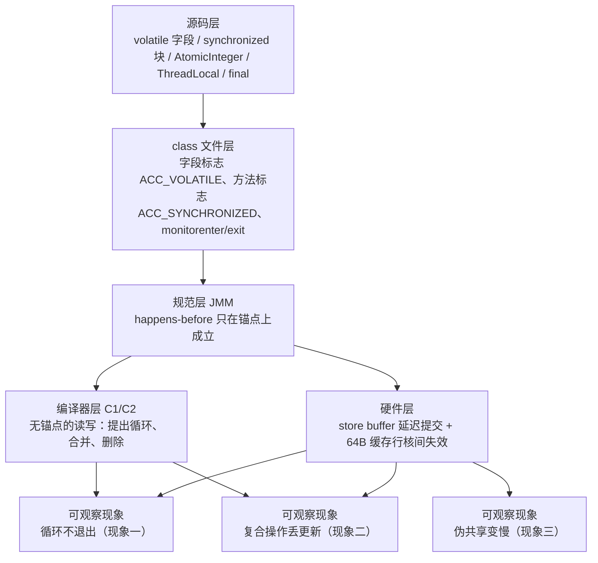
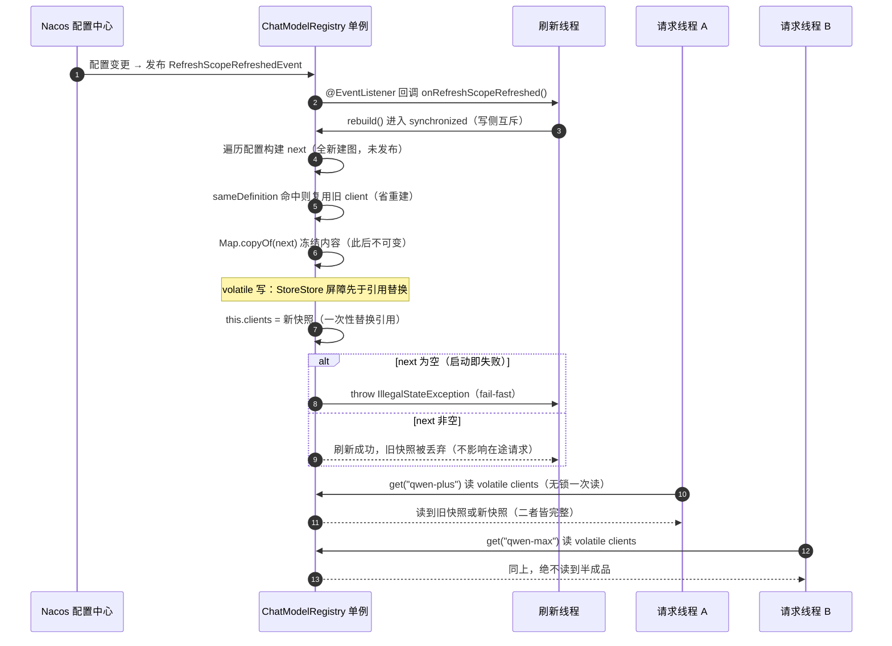

# 08 CPU 缓存与内存序：Java 内存模型不是玄学，是把缓存一致性和编译器重排包装成的一套可推理规则

> **一句话结论**：JMM（Java Memory Model，Java 内存模型）没有发明任何新东西——它只是给 CPU 的 64 字节缓存行读写、store buffer 延迟提交、JIT 的循环不变量外提这些**物理上本来就在发生的事**定了一份契约：**没有 happens-before 边的两个访问，编译器和 CPU 有权重排成任意合法顺序，你在源码里看到的先后不代表运行时看到的结果**；而 `volatile`、`synchronized`、`final`、`Thread.start/join`、`Atomic*` 就是在这份契约上打钩的五个锚点。
> **阅读前置**：读过本模块 [01-进程线程与调度](./01-进程线程与调度.md)（知道"线程是调度单位、共享堆栈之外还有各自栈帧"）与 [02-内存管理与虚拟内存](./02-内存管理与虚拟内存.md)（知道对象在堆上、栈上只有引用）；会读 Java 源码、能在 PowerShell 里跑 `java`/`node` 命令。
> **证据基线**：B 级为主体（本仓 `ai-cs-chat` / `ai-cs-order` / `ai-cs-notify` 真实源码，行号当次 `read` 核对）+ C 级三支本机可跑探针（`java` 单文件可见性实验、`java` 单文件原子性实验、`node` 多核伪共享计时）+ A 级 1 处（Spring Security `SecurityContextHolder` 源码摘录，用来说明 ThreadLocal 的工业级用法）。**所有"慢多少倍""丢多少次"都是本机真实输出，硬件型号在每段标注；缓存延迟数量级为业界公开基线，非本机实测。** 预计阅读 55~70 分钟。

## 证据边界

| 主题 | 本仓/本机状态 | 证据 | 本篇怎么处理 |
| --- | --- | --- | --- |
| 缓存容量（L2/L3） | ✅ 本机可查 | `Get-CimInstance Win32_Processor`（`L2CacheSize`/`L3CacheSize`） | 给实测容量 |
| 缓存行宽度 64 字节 | ❌ 本机无直接探针 | Windows 未暴露行宽；`Win32_CacheMemory` 在本机还报出 `Level 4/5` 的错层条目 | 标为**业界基线（x86-64 均为 64B）**，不冒充本机实测 |
| JIT 是否重排掉普通字段读 | ✅ 本机可复现 | `learning-docs/tools/tmp/m15-08-visibility.java` + `-Xint`/`-XX:TieredStopAtLevel=1`/`-XX:-UseOnStackReplacement` 三组对照 | 用行为对照定位到"C2 的 OSR 编译"，不给汇编断言 |
| `volatile` 不保证原子 | ✅ 本机可复现 | `learning-docs/tools/tmp/m15-08-volatile-not-atomic.java` | 给 4 组真实计数与耗时 |
| 伪共享耗时差 | ⚠️ 近似模拟 | `learning-docs/tools/tmp/m15-08-false-sharing.mjs`（真多核计时，但 node 无 JMM） | **明确标注为模拟**，只说明缓存行争用方向 |
| 汇编级证据（`lock cmpxchg`、`mfence`） | ❌ 本机 `-XX:+PrintAssembly` 只输出机器码十六进制（缺 hsdis 反汇编器） | `learning-docs/tools/tmp/m15-08-visibility.javap.txt` 只能给字节码 | 只做字节码 + 字段标志级证据，不下指令级结论 |
| 项目 volatile / Atomic 落点 | ✅ 真实代码 | `ai-cs-chat/src/main/java/com/aics/chat/modelrouter/ChatModelRegistry.java` 等 | B 级逐处判断"去掉 volatile 会怎样" |
| 静态 `SESSION_MAP` 多实例丢消息 | ⚠️ 本仓单副本，未复现 | `deploy/k8s/services/notify-service.yaml` L36 `replicas: 1` | 讲"什么时候会坏"，不给实测丢失率 |
| `@Contended` 填充 | ❌ 本仓 0 命中 | `Select-String -Pattern 'Contended|Padding'` 结果 0 | 只讲原理与 JDK 参数（本机 `ContendedPaddingWidth=128`） |

## 0. 先看现象

三个真实现象，共同点是：**源码看起来"人畜无害"，运行时却给出另一个结果**。

**现象一：停止标志没加 `volatile`，循环永远不退，而且白烧 0.85 个核。**

```powershell
PS> cd D:\Projects\Persion\ai-customer-service\learning-docs\tools\tmp
PS> java m15-08-visibility.java plain 3000
mode            = plain
java.version    = 17.0.19
vm.name         = OpenJDK 64-Bit Server VM
file.encoding   = GBK
budgetMs        = 3000
spinnerExited   = false
spinCount       = n/a (spinner never exited, local counter not published)
elapsedMs       = 3005
verdict         = LOOP-NOT-EXITED: reader never observed the flag write (or JIT hoisted the read)
```

同一支探针把字段换成 `volatile`，200ms 就退出了：

```powershell
PS> java m15-08-visibility.java volatile 3000
spinnerExited   = true
spinCount       = 319262338
elapsedMs       = 202
verdict         = LOOP-EXITED: reader observed the flag write after 202ms
```

再量一下这个"不退出的循环"到底吃了多少 CPU（不是猜，是进程 CPU 时间差）：

```powershell
PS> $p = Start-Process -FilePath java -ArgumentList 'm15-08-visibility.java','plain','6000' -NoNewWindow -PassThru
PS> Start-Sleep -Milliseconds 1500; $c1 = $p.TotalProcessorTime.TotalSeconds
PS> Start-Sleep -Seconds 2;        $c2 = $p.TotalProcessorTime.TotalSeconds
PS> "cpuSecondsDelta = " + [math]::Round($c2-$c1,2) + " s over 2.0 s wall ; coreEquivalents = " + [math]::Round(($c2-$c1)/2.0,2)
cpuSecondsDelta = 1.7 s over 2.0 s wall
coreEquivalents = 0.85
```

**判读**：`spinnerExited = false` + `coreEquivalents ≈ 0.85` 意味着线程在满速空转、却没把任何进展带回主线程——它不是"卡住等锁"，是"根本不知道值变了"。

**现象二：给计数器加 `volatile`，丢的更新反而比普通字段更多。**

```powershell
PS> java m15-08-volatile-not-atomic.java
expected:      actual=8000000    lost=0          elapsedMs=0      OK
plain:         actual=7846969    lost=153031     elapsedMs=18     LOST-UPDATES
volatile:      actual=3457804    lost=4542196    elapsedMs=279    LOST-UPDATES
AtomicInteger: actual=8000000    lost=0          elapsedMs=155    OK
synchronized:  actual=8000000    lost=0          elapsedMs=542    OK
```

4 线程 × 200 万次自增，期望 8,000,000：`volatile` 只到 3,457,804（丢 454 万），比普通字段（丢 15 万）**丢得多一个数量级**，而 `AtomicInteger` 和 `synchronized` 一次不丢。

**现象三：4 个线程写同一条缓存行里的 4 个计数器，比各写各的慢 1.82 倍。**

```powershell
PS> node m15-08-false-sharing.mjs 100000000 5
workers         = 4
iterPerWorker   = 100000000
rounds          = 5
sameLineMs      = [443.9, 584.7, 559.9, 559.2, 547.8]  median=559.2
spreadLineMs    = [330.1, 324.2, 212.5, 220.4, 307.3]  median=307.3
slowdown        = 1.82x (sameLine / spreadLine)
```

> 这是**模拟**：node 没有 Java 内存模型，它测的是"真多核 + 真共享内存"下的缓存行争用，不是 happens-before 实验。

而项目里从来没做过填充——`@Contended` 与手工 padding 全仓 0 命中：

```powershell
PS> cd D:\Projects\Persion\ai-customer-service
PS> Get-ChildItem -Path 'ai-cs-*\src\main\java' -Recurse -Filter *.java |
      Select-String -Pattern 'Contended|Padding' | Measure-Object | Select-Object -ExpandProperty Count
0
```

这些现象指向同一件事：**Java 里的"看得见/看不见""按源码顺序/被打乱顺序"不是概率问题，而是"有没有留下一条 JMM 认账的同步边"**——`volatile` 字段、`synchronized` 块、`Atomic*` 的 CAS、`final` 的构造完成、`Thread.start()/join()`。没留下那条边，JIT 和 CPU 就有权把你的直觉合法地改写成另一个程序；留下了，你才可以拿 happens-before 一条条推理，而不是烧香。

## 1. 整体地图



> **读图说明**：从上往下是**一条同步边如何一路"翻译"成现象**。左支（规范层 → 编译器层）说明"重排"不是 CPU 的专利：只要没有 happens-before 边，C2 就能把 `while (!stop)` 里的读提到循环外（现象一在 `-Xint` 下消失、加 `volatile` 后消失，就是这条支路的直接证据）。右支（规范层 → 硬件层）说明即使编译器老实，缓存行仍在核间来回失效（现象三）。两条支路汇合处是现象二：**`volatile` 只给了可见性这条边，没给"读-改-写"整体一条边**，于是丢更新照样发生。看图时只记住一件事：**箭头只有经过"规范层 JMM"才受约束，绕过它的箭头全部自由**。

| 层 | 组件 | 负责什么 | 本篇用什么证据钉住它 |
| --- | --- | --- | --- |
| 硬件 | L1/L2/L3 缓存 + 64B 缓存行 | 缓存以行（line）为最小搬运单位，一行动辄多核复制 | 缓存容量实测（`Win32_Processor`）+ 伪共享实验 |
| 硬件 | MESI 一致性协议 | 一核改一行，其他核的副本必须失效（Invalid） | 伪共享实验的 1.82x/2.92x 就是失效风暴的账单 |
| 硬件 | store buffer / 写缓冲 | 写先入队列再提交，造成"我的写你看不见" | volatile 写侧的 StoreLoad 屏障讨论 |
| 编译器 | C1/C2（含 OSR） | 在 JMM 许可范围内做重排、外提、消除 | `-Xint`/`-XX:TieredStopAtLevel=1`/`-XX:-UseOnStackReplacement` 三组对照 |
| 规范 | JMM happens-before 八条 | 定义"哪些重排不允许被观察到" | 逐条对应到本仓代码 |
| 类库 | `java.util.concurrent.atomic.*`、`ThreadLocal`、`ConcurrentHashMap` | 用 `volatile`+CAS+锁把锚点封装好 | `javap` 字段标志 + 计数实验 |
| 应用代码 | `ChatUserContext`、`TraceContextHolder`、`ChatModelRegistry`、`OrderCreateTxService`、`NotifyWebSocketHandler` | 在业务里正确/可疑地使用这些锚点 | 逐文件行号 + "去掉 volatile 会怎样" |
| 参与方 | 请求线程（Tomcat 池）、异步线程（CompletableFuture/SSE 回调）、JIT 编译线程、CPU 核 | 真正读写字段的人 | 第 4 节时序图 |

## 2. 关键概念与关键要素

| 名称 | 位置 | 作用 | 关键参数 / 取值 |
| --- | --- | --- | --- |
| 缓存行 cache line | CPU 缓存与内存之间 | 数据搬运的最小单位；"改一个字节要独占一整行" | x86-64 为 **64 字节**（业界基线，非本机实测） |
| MESI 四态 | 核间缓存一致性协议 | M 改过独占 / E 独占未改 / S 共享只读 / I 失效需重读 | 写命中 S 态必须先发 invalidate |
| store buffer | 每个核私有 | 写指令先入缓冲、异步提交到缓存 | 是 StoreLoad 重排的物理来源 |
| 内存屏障 | JIT 生成的指令 | LoadLoad / LoadStore / StoreStore / StoreLoad 四种栅栏 | x86 只对 StoreLoad 付显式代价 |
| happens-before | JMM 规范 | 可推理的偏序：A hb B ⇒ A 的结果对 B 可见且顺序固定 | 八条规则，见 3.5 |
| `volatile` | Java 字段修饰符 | ①写后读必见 ②禁止特定重排 ③**不保证原子** | 每次访问都直连主存语义 |
| `ACC_VOLATILE` | class 文件字段访问标志 | 告诉 JIT"这个字段有边"，是源码语义落到字节码的唯一痕迹 | `javap -p` 打印为 `static volatile boolean x` |
| `synchronized` | 方法/代码块 | 互斥 + 解锁前的写对后续加锁者可见 | 同一把锁建立 happens-before |
| `final` | 字段修饰符 | 构造完成后安全发布：别的线程看到引用就一定看到 final 字段的正确值 | 与"构造期间 this 逸出"互斥 |
| CAS（`compareAndSet`） | `Atomic*` / `Unsafe` / `VarHandle` | "比较并交换"一条指令完成读-改-写 | x86 上是带 `lock` 前缀的原子指令 |
| 伪共享 false sharing | 两个核写同一行的不同变量 | 逻辑无关、物理同行 → 失效风暴 | 用填充（padding）把变量推到不同行 |
| `@Contended` / padding | `jdk.internal.vm.annotation.Contended` 或手工 `long p1..p7` | 宣告"这个字段独占缓存行" | 本机 `ContendedPaddingWidth=128`、`RestrictContended=true`（用户代码默认被忽略） |
| `ThreadLocal` / `ThreadLocalMap` | `java.lang.Thread#threadLocals` | 每线程一份副本，天然无共享 → 无需可见性讨论 | 键是 ThreadLocal 的弱引用；必须 `remove()` |
| 单线程事件循环（node） | V8 + libuv | 没有共享可变状态就没有内存序问题 | 跨线程需 `worker_threads` + `SharedArrayBuffer` + `Atomics` |

## 3. 原理与证据逐段精读

### 3.1 存储层次与 64 字节缓存行：为什么"改一个 int"可能拖慢另一个核

**在干什么**：CPU 不按变量读写内存，而按缓存行整块搬。一个 `int` 只占 4 字节，但读到它意味着把所在 64 字节整行拉进本核缓存；写它意味着先独占整行。

先看本机的存储层次实测：

```powershell
PS> Get-CimInstance Win32_Processor | Select-Object L2CacheSize,L3CacheSize,NumberOfCores,NumberOfLogicalProcessors | Format-List
L2CacheSize               : 9216
L3CacheSize               : 18432
NumberOfCores             : 12
NumberOfLogicalProcessors : 16
```

**判读**：`L2CacheSize=9216`（KB，12 个核合计 9MB）、`L3CacheSize=18432`（KB，即 18MB 共享 L3）与机型 i7-1260P（4P+8E/16 线程）吻合。JVM 侧的真实参数如下（`ObjectAlignmentInBytes=8`、`UseCompressedOops=true` 说明对象按 8 字节对齐、引用是 32 位压缩指针，这决定了对象在堆上有多紧凑，也决定了两个热点字段有多容易挤进同一行）：

```powershell
PS> java -XX:+PrintFlagsFinal -version 2>&1 | Select-String 'ObjectAlignmentInBytes|UseCompressedOops|UseBiasedLocking'
     intx ObjectAlignmentInBytes                   = 8                              {product lp64_product} {default}
     bool UseBiasedLocking                         = false                                     {product} {default}
     bool UseCompressedOops                        = true                           {product lp64_product} {ergonomic}
```

`UseBiasedLocking=false` 这条会在第 7 节用到：JDK 15 起偏向锁默认关闭，所以"`synchronized` 靠偏向锁变快"这套旧经验在本机基线已不成立。

**为什么这么设计**：容量与延迟是硬约束。业界公开数量级（**非本机实测**，只用于建立直觉）：

| 层级 | 典型容量 | 典型访问延迟量级 |
| --- | --- | --- |
| L1d | 32~48KB/核 | ~1ns（约 4 个周期） |
| L2 | 0.5~2MB/核 | ~4ns |
| L3 | 8~32MB/共享 | ~15ns |
| DRAM | GB 级 | ~100ns |

差 100 倍，所以"这行数据在不在我的缓存里"比"我算了多少条指令"更决定性能；而"这行是不是被别的核改过"决定了你要不要跑一趟 DRAM。

**换写法会怎样**：如果缓存行是 128 字节，3.3 的伪共享会更严重（同样的两个计数器更容易同行）；如果 CPU 只按变量搬运，就不需要 MESI，也不会有伪共享——但那意味着每次访问都退化成一次内存往返，等于把上表全部作废。

**常见坑**：拿 `Get-CimInstance Win32_CacheMemory` 推层级——它在本机会把 L1/L2/L3 分别标成 `Level 3/4/5`。真实输出（节选 6 行）：

```powershell
PS> Get-CimInstance Win32_CacheMemory | Select-Object Level, Purpose, MaxCacheSize
Level Purpose  MaxCacheSize
----- -------  ------------
    3 L1 Cache          192
    4 L2 Cache         5120
    5 L3 Cache        18432
    3 L1 Cache          512
    4 L2 Cache         4096
    5 L3 Cache        18432
```

判读：`Level` 是旧枚举（按"主/次/三级"编号），**以 `Purpose` 为准**；`MaxCacheSize` 单位 KB，与 `Win32_Processor` 的 `L3CacheSize=18432` 交叉验证一致。结论：**容量以 `Win32_Processor` 为准，行宽以架构基线（64B）为准，WMI 层级只当噪声**；另外 WMI 拿不到"缓存行大小"，64 字节是 x86-64 体系结构常识值，本篇靠 3.3 的伪共享实验间接印证它确实在 64B 量级。

### 3.2 MESI 的直觉：一致性协议是"独占-失效"的记账本

**在干什么**：每个缓存行在每核上带一个状态：

| 状态 | 含义 | 我要写它会怎样 |
| --- | --- | --- |
| M（Modified） | 只有我有，且已改脏 | 直接写（本核已独占） |
| E（Exclusive） | 只有我有，未改 | 直接改，转 M |
| S（Shared） | 多个核都有，都干净 | 先发 invalidate 把别人打成 I，再转 M |
| I（Invalid） | 我这份作废 | 要读就重新取行 |

**为什么这么设计**：它是"多数读、少数写"负载下的性价比最优解——读可以多核共享（S），写才付广播代价。代价就是 3.3 的伪共享：两个核写**同一行的不同变量**，协议层面却只能看到"有人在写这一行"，于是对方的整行被作废，你的下一次读又要重新拉。

**换写法会怎样**：如果换成写直达（write-through）+ 总线锁，写冲突会串行化得更严重；如果换成"只读缓存 + 写入主存"，就没有 M 态，也就没有"我改了但还没落盘"的可见性窗口——但每次写要付 100ns。

**常见坑**：以为"两个线程读写不同变量就没有竞争"。缓存一致性协议的粒度是**行**，不是变量。一行 64 字节，能放 16 个 `int` 或 8 个 `long`/引用，对象数组相邻元素、对象头之后的第 2~5 个字段，都非常容易落在同一行。

### 3.3 伪共享与填充：同一条缓存行上的两个计数器

**在干什么**：让多个线程各写"自己的"计数器，但两种布局：相邻 `int32`（同一行）vs 每个间隔 16 个 `int32`（相隔 64B，各自独占一行）。4 线程的完整输出已在"现象三"给出（1.82x），这里只补"并发度提高后是否更严重"这一问：

```powershell
PS> $env:M15_WORKERS=8; node m15-08-false-sharing.mjs 50000000 5
workers         = 8
sameLineMs      = [409.6, 671.0, 698.8, 538.2, 628.9]  median=628.9
spreadLineMs    = [186.9, 228.6, 215.2, 244.1, 196.7]  median=215.2
slowdown        = 2.92x (sameLine / spreadLine)
```

**判读**：同一份代码、同样的迭代次数，唯一差别是"下标间隔"。4 线程 1.82 倍、8 线程 2.92 倍的差距**全部来自缓存行失效**，与算法无关。注意 `spreadLineMs` 本身波动很大（212~330ms），说明笔记本上有降频与其他进程干扰——所以结论只能写"方向稳定、倍数随并发度与机器变化"，不能写"伪共享固定慢 1.82 倍"。

**为什么这么设计（填充）**：既然协议粒度是行，那就把热点变量各自推到独立行。JDK 的官方做法是 `@Contended`，由 JVM 在对象布局里插入 `ContendedPaddingWidth` 字节的填充——本机实测该值：

```powershell
PS> java -XX:+PrintFlagsFinal -version 2>&1 | Select-String 'RestrictContended|ContendedPaddingWidth'
     intx ContendedPaddingWidth                    = 128                                       {product} {default}
     bool RestrictContended                        = true                                      {product} {default}
```

`ContendedPaddingWidth=128` 意味着"两侧各 64B 量级的隔离带"，比一行还保守；`RestrictContended=true` 意味着**用户自己写的 `@Contended` 默认被忽略**，必须 `-XX:-RestrictContended`（且 JDK 9+ 还要 `--add-exports java.base/jdk.internal.vm.annotation=ALL-UNNAMED`）才生效。所以工程上更常见的是手工填充：在字段前后各塞 7 个 `long`（56B）凑满一行。

**换写法会怎样**：不填充 → 现象三；改用 `AtomicLongArray` 且下标相邻 → 同样伪共享（原子性不解决缓存行问题）；改成每线程本地累加、最后汇总（`LongAdder` 的思想）→ 争用从"每次写"降到"分段写"，这是 JDK 自己的答案。

**常见坑**：① 以为 `volatile` 或 `Atomic*` 能解决伪共享——它们只保证正确性，不减少失效；② 以为 `@Contended` 加了就生效（`RestrictContended=true` 时静默忽略，没有任何报错）；③ 在单核容器里测伪共享（`limits.cpu` 只给 1 核时根本没有核间失效，测出来永远是 1.0x）。

### 3.4 编译器重排与 CPU 重排：先证明"重排真的在发生"

**在干什么**：让同一支探针在四种编译模式下跑同一个"普通字段当停止标志"的循环，看它退不退出。四种模式的完整真实输出已在 6.1 逐行给出（`plain` 不退出、`-Xint`/只到 C1/禁 OSR 三种全部 200ms 级退出），这里只留归因结论。

**判读**：这段对照是本篇最重要的一次"归因"。默认模式下不退出，而**关掉 JIT（`-Xint`）、只到 C1、关掉 OSR 三种情况全部 200ms 左右退出**——说明"看不见写"不是因为它没发生（内存早就改了），而是因为**热循环被 C2 通过 OSR 编译后，读被提到了循环外**。如果没有这三组对照，你只能说"JMM 允许它不退出"，无法证明"这台机器上确实不退出，且原因在编译器"。

**为什么这么设计**：`while (!flag)` 是典型循环不变量——把不变量提出循环是编译器的基本优化（相当于你手写 `if (!flag) { while(true){} }`）。JMM 的立场是：**只要没有 happens-before 边，编译器就可以这么干**，因为它无法证明别的线程会改这个字段。`volatile` 的作用就是明确告诉 JIT："这个读不许提、这个写不许并"。

**换写法会怎样**：把 `stopPlain` 改 `volatile` → 3.6 的 202ms 退出；把标志换 `AtomicBoolean` → 同样成立（内部就是 `volatile` 字段）；把循环改成"每轮调一个 `synchronized` 方法读标志" → 也成立（锁是边），但比 `volatile` 贵得多。

**常见坑**：① 把这种实验当成"JMM 演示"就收工，忽略"我的机器上 plain 也退出了"其实完全可能是**C2 还没编译到那段循环**——所以一定要带 `-Xint`/`-UseOnStackReplacement` 对照，否则"退出了"不说明 JMM 错，只说明 JIT 慢；② 反过来，把 `-Xint` 下退出当成"普通字段也安全"——那只是解释器每轮都重新读而已，换台机器、换负载立刻失效。

CPU 侧的四种重排与屏障，用一张表钉住（x86-64 是强内存模型 TSO，只允许 StoreLoad 类重排，这也是为什么"加个 `volatile` 就够"在 x86 上经常侥幸成立）：

| 重排类型 | 含义 | 谁最常干 | 用哪条屏障禁 |
| --- | --- | --- | --- |
| LoadLoad | 两个读互换顺序 | CPU（弱内存模型架构如 ARM） | LoadLoad |
| LoadStore | 读被排到写之后 | CPU | LoadStore |
| StoreStore | 两个写互换顺序 | CPU / 编译器 | StoreStore |
| StoreLoad | 写缓冲导致"我的写别人晚看到" | CPU（x86 也允许） | StoreLoad（x86 上 `mfence` 或 `lock` 指令） |

`volatile` 写在 JVM 规范里就是"前面插 StoreStore、后面插 StoreLoad"，`volatile` 读是"后面插 LoadLoad/LoadStore"。**这就是"两层语义"里第二层的来源：不是修辞，是具体的四个栅栏。**

### 3.5 happens-before 八条：把"玄学"变成可以逐条打钩的清单

**在干什么**：JMM 只承诺 happen-before 关系成立时的可见性与顺序。规范给八条（JLS §17.4.5）：

| # | 规则 | 一句话 | 本项目哪里用到 |
| --- | --- | --- | --- |
| 1 | 程序次序 | 同一线程内，前面的语句先于后面的语句 | 所有代码 |
| 2 | 监视器锁 | 对同一把锁的 unlock 先于后续 lock | `ChatModelRegistry.rebuild()` 的 `synchronized` |
| 3 | volatile 变量 | 对同一 volatile 字段的写先于后续读 | `TraceContext.status` / `ChatModelRegistry.clients` |
| 4 | 线程启动 | `Thread.start()` 先于新线程的任何动作 | 探针里 `spinner.start()` |
| 5 | 线程终止 | 线程里的所有动作先于 `join()` 返回 | 探针用 `spinner.join(budget)` 判"是否退出" |
| 6 | 中断 | `interrupt()` 先于被中断线程检测到中断 | `ResilientAiService` 超时中断链路 |
| 7 | 终结器 | 对象构造完成先于其 `finalize()` | 本项目未使用（仅知识完整性） |
| 8 | 传递性 | A hb B、B hb C ⇒ A hb C | 连接 1~7 成链 |

**为什么这么设计**：这八条是"最小充分集"——凡是编程模型需要的可见性，都能由它们组合出来；凡是不在其中的，实现就自由。工程上 90% 的并发 bug 都能归到"我以为第 3 条成立，其实我没写 `volatile`"或"我以为第 1 条跨线程也成立"。

**换写法会怎样**：把第 3 条从 `volatile` 换成 `synchronized`（第 2 条），语义同样成立——**只要读写双方用同一把锁**；换成 `AtomicInteger` 也行（内部 `volatile` + CAS）。反过来，如果写方用 `volatile`、读方用 `synchronized` 且不是同一把锁，两条规则都接不上，等于没写。

**常见坑**：① 把第 1 条（程序次序）跨线程套用——它只保证**单线程内**不被重排到"看起来反了"，不保证别的线程看到同样的顺序；② 用 `Thread.sleep()` 当同步手段——`sleep` 不是 happen-before 边，JMM 不认它。

**判读口诀**：遇到"这个值会不会读到旧值"，别问"CPU 快不快"，只问三句：**谁写？谁读？两者之间有没有上面八条中的任意一条把它们连起来？** 连不上就是未定义行为，能跑只是运气。

### 3.6 volatile 的两层语义：可见性 + 禁止重排，但不保证原子

**在干什么**：先证明两层语义的第一层（可见性），且证明"边"确实存在于字节码层：

```powershell
PS> java m15-08-visibility.java volatile 3000
spinnerExited   = true
spinCount       = 319262338
elapsedMs       = 202
verdict         = LOOP-EXITED: reader observed the flag write after 202ms
```

这段真实输出还顺带给出一个可用量级：319,262,338 次自旋读 / 202ms ≈ **每秒 15.8 亿次 volatile 读**（单核自旋、循环体只有"读+比较+自增"，含 JIT 预热在内；这是本机这一种循环形态的实测值，不是 volatile 的通用"性能"）。

再证明"语义不在字节码里、在字段标志里"——两条循环的字节码形状几乎一模一样：

```powershell
PS> javac -encoding UTF-8 -d out-m15-08 m15-08-visibility.java
PS> javap -p -cp out-m15-08 M15Visibility
class M15Visibility {
  static boolean stopPlain;
  static volatile boolean stopVolatile;
  ...
PS> javap -p -c -cp out-m15-08 M15Visibility | Select-String 'getstatic.*stop|ifne'
       6: getstatic     #128                // Field stopVolatile:Z
       9: ifne          19
      28: getstatic     #132                // Field stopPlain:Z
      31: ifne          41
```

**判读**：两段循环都是 `getstatic → ifne → goto` 三件套，唯一差别是 `stopVolatile` 带着 `volatile` 修饰符（字节码里是字段标志 `ACC_VOLATILE`）。也就是说 **javac 没有为 volatile 生成任何额外指令**，是 JIT 读了这个标志才决定"不许外提、写后插栅栏"。这也是为什么"看字节码找 volatile 的痕迹"找不到——要看 `javap -v` 的字段表。

**为什么这么设计**：把语义放在字段标志而不是指令里，让同一个 class 文件能在不同 CPU 架构上由各自的 JIT 生成各自需要的屏障（x86 几乎不用为读加栅栏，ARM 要）。

第二层语义（禁止重排）的直接对照就是 3.4 那张表：普通字段的读被提出循环，volatile 的读没有。

第三层——**不保证原子**——4 线程 × 200 万次自增的四组真实计数已在"现象二"与 6.2 给出，此处只给结论对照：`plain` 丢、`volatile` 丢得**更多**、`AtomicInteger`/`synchronized` 一次不丢。

**判读**：`volatileCount++` 是"读-加-写"三步，`volatile` 只保证每一步都直连主存，**不保证三步之间别人插不进来**。而且它比普通字段丢得更多（454 万 vs 15 万）：因为 `volatile` 强制每次读都取"最新但立刻过期"的值，多线程同时读到同一个旧值再各自写回的概率反而更高——**可见性放大了丢失窗口**。这条真实数据是"volatile ≠ 原子"最有说服力的证据。

**换写法会怎样**：`AtomicInteger.incrementAndGet()`（CAS）→ 一次不丢，本机 8M 次 135~155ms；`synchronized` → 一次不丢，542~568ms（含 8M 次加锁解锁）；`LongAdder` → 更高并发下更好（分段累加，最终 `sum()`）。

**常见坑**：① 用 `volatile int` 做计数（本篇现象二）；② 以为 `volatile int[]` 的元素也是 volatile（**只有引用本身有语义**，元素读写是普通访问）；③ 以为 `volatile long` 在 32 位 JVM 上才需要（其实 `long`/`double` 的非原子性在老规范里是真实存在的，`volatile` 顺带修好了它）；④ 用 `volatile` 做"标志位 + 数据"两字段发布（正确写法是**先写数据再写 `volatile` 标志**，靠 StoreStore 保证顺序）。

### 3.7 synchronized、final 与双重检查锁：为什么 DCL 必须 volatile

**在干什么**：先看三者在 JMM 里各自提供了什么边，再看经典的 DCL（double-checked locking，双重检查锁）。

```java
// 反例：没有 volatile 的 DCL —— 教科书级错误写法，勿抄
public final class BrokenDcl {
    private static BrokenDcl instance;          // ← 少了 volatile

    public static BrokenDcl get() {
        if (instance == null) {                 // 第一次检查（无锁）
            synchronized (BrokenDcl.class) {
                if (instance == null) {         // 第二次检查（有锁）
                    instance = new BrokenDcl(); // ①分配 ②初始化 ③赋引用，②③可能被重排
                }
            }
        }
        return instance;
    }
}
```

**判读**：`instance = new BrokenDcl()` 有三步：分配内存、执行构造、把引用写进字段。没有 `volatile` 时，**②和③可以重排**——另一个线程可能在第一次检查时看到"非 null 但字段还是默认值"的对象（部分构造），于是拿到一个半成品。加上 `volatile` 后，写引用带 StoreStore 语义，构造一定先于发布完成。

**为什么这么设计**：`volatile` 写前的 StoreStore 屏障恰好就是"先把对象构造完，再把引用公开"这条要求；而 `synchronized` 也能解决（把整个 `get()` 加锁），只是第一次检查就失去意义（每次都进锁）。所以 DCL 的存在意义就是"用一次 volatile 读换掉一次加锁"，它**必须**配 `volatile`，否则不如直接全锁。

**换写法会怎样**：改成静态内部类（`Holder` 惯用法）→ 由类加载机制保证线程安全，不需要 `volatile`；改成枚举单例 → 同样安全且防反射；改成 `synchronized get()` → 安全但每次加锁。

**常见坑**：① 只给 `instance` 加 `volatile` 而字段类型是数组/集合，然后**在锁外修改集合内容**——`volatile` 只保护引用，容器内容要靠不可变对象或再加锁；② 以为 `final` 能顶替 `volatile`（`final` 只在"构造完成后才发布"时有安全发布语义，DCL 里字段不是 `final`）；③ 在构造器里把 `this` 交给别的线程（`this` 逸出），`final` 的安全发布保证当场失效。

本项目里同思想但更朴素的写法在 `ai-cs-chat/src/main/java/com/aics/chat/modelrouter/ChatModelRegistry.java`：**不是 DCL，而是"`synchronized` 写 + `volatile` 读"的快照替换**（见 3.10.2）。另有 `ai-cs-chat/src/main/java/com/aics/chat/service/impl/VisionModelClient.java` L99 `private volatile OpenAiChatModel visionModel;`，它在 `@PostConstruct`（L114-126）里一次性赋值、之后只读——这是**安全发布**场景：`volatile` 保证"构造好的模型 + 它的内部状态"整体对后续读线程可见，去掉它就可能读到未初始化完成的 `OpenAiChatModel` 字段。

### 3.8 CAS 与内存屏障：原子类是怎么把"读-改-写"变成一条边的

**在干什么**：`AtomicInteger.incrementAndGet()` 底层是一条 CAS（compare-and-swap）：读当前值 → 算新值 → "如果当前值还是它，就写入新值"，整条指令原子完成。x86 上带 `lock` 前缀，同时充当**全屏障**（等价 StoreLoad）。

**证据**：本机 8,000,000 次自增一次不丢（3.6 的输出），而 `volatile` 丢 454 万——这就是"复合操作有没有一条边包住"的差别。

**为什么这么设计**：CAS 把"检查 + 写入"压成一条指令，避免了锁的挂起/唤醒成本；但它只对一个**变量**原子。跨多个变量的不变式（比如"库存 -1 且订单 +1"）CAS 无能为力，仍要锁或事务。

**换写法会怎样**：CAS 自旋在超高竞争下会"空转"（失败重试），极端场景比锁还慢；`LongAdder` 用"分段 + 最终汇总"把竞争摊到多个 cell，读多写多都更好，但 `sum()` 不保证瞬时一致。本项目 `ai-cs-order/src/main/java/com/aics/order/service/impl/OrderCreateTxService.java` L51 的 `AtomicInteger SEQUENCE` 就是 CAS 的正确用法（单 JVM 内自增去重），但**它不是全局唯一**——见 3.10.3。

**常见坑**：① ABA 问题（值从 A→B→A，CAS 以为没变过），需要 `AtomicStampedReference` 带版本号；② 用 `AtomicInteger` 做"读过再决定"的业务判断（`if (get() < 10) incrementAndGet()` 依然不是原子的，要么 `compareAndSet` 循环，要么 `updateAndGet`）；③ 把 `Atomic*` 当"高性能万能替代"——它解决正确性，不解决缓存行争用（3.3）。

### 3.9 node 与 JVM 的可见性差异：别把 JS 单线程直觉带进 Java

**在干什么**：node 的主线程是单线程事件循环，"没有共享可变状态"这件事直接把内存序问题消掉了——JS 里不存在"另一个线程改了变量我看不到"，因为根本没有另一个线程在跑你的代码（异步回调是同一个线程里的排队执行）。

**证据**：本篇的伪共享实验必须显式建 `worker_threads` + `SharedArrayBuffer` 才有多核共享内存：主线程默认只有 1 个执行流，`new Worker(...)` 才产生真并行，`Atomics` 才需要——这就是 node 的"内存序"入口（脚本头注释里写明了 worker 数与迭代数，见 `learning-docs/tools/tmp/m15-08-false-sharing.mjs`）。

**为什么这么设计**：V8 的单线程模型把并发推给了"进程/Worker + 消息传递"，代价是共享内存要靠 `SharedArrayBuffer` 显式开（且需要跨源隔离头），收益是普通 JS 代码永远不用想可见性。

**换写法会怎样**：如果 node 像 Java 一样允许自由共享内存，那 JS 生态里所有"读个全局变量"的代码都要重新审一遍，成本远超收益。

**常见坑（把 JS 直觉带进 Java 的三种典型错法）**：

| JS 直觉 | Java 里的现实 | 后果 |
| --- | --- | --- |
| "我上一行赋值了，下一行肯定读到新值" | 跨线程时，没有 happens-before 边就可能读到旧值 | 现象一：循环不退出 |
| "赋值是一条语句，怎么会不原子" | `x++` 是三步，`volatile` 也只保证每步可见 | 现象二：丢更新 |
| "单线程跑得对，多线程也一样" | JIT 只在"能被别的线程观察到"时才受 JMM 约束，单线程下所有优化都合法 | 本地测通、线上偶发 |

反过来说，Java 里的 `ThreadLocal` 恰好是"在 Java 里模拟 JS 单线程直觉"的工具——每线程一份，物理上就没有共享。这也解释了为什么本项目大量用 `ThreadLocal` 传用户身份（3.10.1）而不是到处传参。

### 3.10 项目落点：四处真实代码，逐处判断"去掉 volatile 会怎样"

#### 3.10.1 ThreadLocal：`ChatUserContext` 与 `TraceContextHolder`

`ai-cs-chat/src/main/java/com/aics/chat/util/ChatUserContext.java`（全文 42 行，L26 是核心）：

```java
    /** 当前线程持有的用户 ID，null 表示未登录/匿名 */
    private static final ThreadLocal<Long> USER_ID = new ThreadLocal<>();

    public static void setUserId(Long userId) {
        USER_ID.set(userId);
    }

    public static Long getUserId() {
        return USER_ID.get();
    }

    public static void clear() {
        USER_ID.remove();
    }
```

**在干什么**：把"当前请求的用户 ID"挂在当前线程上，Controller 写、`@Tool` 方法读，中间不传参。

**为什么这么设计**：Spring MVC 一个请求一个线程（池化复用），Controller → Service → 工具回调都在同一线程内，ThreadLocal 等于"线程作用域的全局变量"。类注释 L14-21 写得很清楚：线程复用必须 `clear()`，否则下一个请求读到上个用户 ID 造成**越权查询**；异步线程读不到（本项目 Tool Calling 走同步回调，所以安全）。

**换写法会怎样**：去掉 `ThreadLocal` 改成显式传参 → 所有 `@Tool` 方法签名都要加 `userId`，还会污染 Spring AI 的工具方法签名；改成 `InheritableThreadLocal` → 子线程能继承，但**线程池复用会把父线程的值串给下一个任务**（`TraceContextHolder` L80-85 的注释把这条坑写成了三种方案对比）；改成 `TransmittableThreadLocal`（阿里 TTL）→ 能跨池传播，但引入框架依赖。

**常见坑**：① 忘记 `clear()` —— 本仓有 8 处 `ChatUserContext.clear()`（`ChatController` L89/L130/L178/L240/L260，`AgentController` L73/L93/L179），全在 `finally` 里，少一处就是越权漏洞；② 在 `@Async`/`CompletableFuture` 里读 ThreadLocal 得到 null（3.9 的"JS 直觉"反过来咬人）；③ 用 ThreadLocal 存大对象且不 `remove()` → 线程池线程长期持有 → 内存泄漏（`TraceContextHolder` L100-102 注释明确点了这条）。

同一模式的第二处是 trace 上下文 `ai-cs-chat/src/main/java/com/aics/chat/observability/TraceContextHolder.java`（108 行）。它同时挂 `ThreadLocal` 与 SLF4J 的 MDC，**两者都要清**，少清一个日志里就串号：

```java
    private static final String MDC_REQUEST_ID = "requestId";                     // L23
    private static final ThreadLocal<TraceContext> HOLDER = new ThreadLocal<>();  // L25

    public static void clear() {                                                  // L104-107
        HOLDER.remove();
        MDC.remove(MDC_REQUEST_ID);
    }
```

它的类注释把"跨线程传 trace"写成三种方案对比（L80-85：显式传参 / `InheritableThreadLocal` 会被线程池复用串数据 / `TransmittableThreadLocal`），L100-102 直接点名"线程池复用导致 trace 串线与内存泄漏（ThreadLocal 值被线程持有，无法被 GC），故 begin/restore 与 clear 必须成对出现"——**这段注释就是 3.10.1 全部结论的项目出处，不需要额外论证**。

A 级对照：Spring Security 的 `SecurityContextHolder` 就是同一模式的工业级实现——默认策略 `ThreadLocalSecurityContextHolderStrategy`，并提供了 `MODE_INHERITABLETHREADLOCAL` 备选（`SecurityContextHolder.java` L55-67）。**读它的价值在于看到"同一个坑，框架层面的三种解法怎么选"**，而不是背类名。

#### 3.10.2 volatile Map 快照：`ChatModelRegistry`

`ai-cs-chat/src/main/java/com/aics/chat/modelrouter/ChatModelRegistry.java` L31-32 与 L82-83：

```java
    // 设计要点：注册表保持长生命周期单例，只换不可变 Map 快照；运行时健康状态不与 RefreshScope Bean 一起重建
    private volatile Map<String, ModelClientHolder> clients = Map.of();
    ...
            // 设计要点：先构建完整 next 再一次性替换 volatile 引用——运行中的请求永远看不到半成品注册表，替换对并发读取原子可见
            this.clients = Map.copyOf(next);
```

**在干什么**：模型路由表是"读极多、写极少"（每次配置刷新才写一次）。写侧 `synchronized rebuild()`（L44）构建一个新的不可变 `Map.copyOf(next)`，然后**一次性替换** `volatile` 引用；读侧 `get(modelId)` 直接读字段，无锁。

**为什么这么设计**：不可变快照 + `volatile` 引用替换 = 读无锁、且永远读不到"构建到一半"的注册表。这正是 3.5 第 3 条（volatile 写 → 读）加上"对象不可变"的合力：`Map.copyOf` 保证内容不再变，`volatile` 保证引用替换与内容对所有读线程一起可见（StoreStore 保证"先构建完再发布"）。

**去掉 volatile 会怎样**：`rebuild()` 里 `this.clients = Map.copyOf(next)` 变成普通写。危险有两层：① 引用写可能被重排到 Map 构造完成之前（3.7 的 DCL 陷阱同构），读线程可能拿到"引用非空但内部数组还没填好"的 Map；② 即使没重排，读线程也可能长期读旧快照（3.4 的循环外提在"每次请求读一次字段"的场景不致命，但在热路径上的 `while`/`for` 里会致命）。注意 `rebuild()` 是 `synchronized` 的，**但读侧 `get()` 不加锁**——写侧的锁对读侧毫无约束力，唯一把两侧连起来的边就是 `volatile`。这是本仓最典型的"去掉 volatile 立刻退化成数据竞争"的一处。

**常见坑**：① 把 Map 换成 `ConcurrentHashMap` 然后**就地 `put`**，以为"线程安全容器 = 原子发布"（对，但读线程会看到半个新配置的中间态，业务上通常是灾难）；② 忘记 `Map.copyOf` 而直接发布 `next`，之后又有人往里 `put` → volatile 只保护引用，容器可变等于白给；③ 刷新失败时把 `clients` 置空 → L84-90 的 `clients.isEmpty()` 分支就是为了避免"刷新失败把线上打挂"，保留旧快照。

#### 3.10.3 AtomicInteger 订单号：`OrderCreateTxService`

`ai-cs-order/src/main/java/com/aics/order/service/impl/OrderCreateTxService.java` L51 与 L160-164：

```java
    private static final AtomicInteger SEQUENCE = new AtomicInteger(0);
    ...
    private String generateOrderNo() {
        String timestamp = LocalDateTime.now().format(DateTimeFormatter.ofPattern("yyyyMMddHHmmss"));
        int seq = SEQUENCE.incrementAndGet() % 10000;
        return timestamp + "01" + String.format("%04d", seq);
    }
```

**在干什么**：订单号 = 秒级时间戳 + 固定 `"01"`（机器/场景位）+ 4 位序号，序号来自 `AtomicInteger` 自增后取模 10000。

**为什么这么设计**：`AtomicInteger` 保证**单 JVM 内**并发下单不自增重复，`incrementAndGet()` 是 CAS，比 `synchronized` 便宜（3.6 实测 155ms vs 542ms，8M 次）。时间戳提供跨秒区分，取模限制长度。

**去掉 volatile/原子性会怎样**：如果把 `AtomicInteger` 换成 `int seq++`，两个并发请求可能拿到同一个序号 → 同秒同序号 → **订单号重复**（DB 唯一索引报错或更糟：两笔订单共用一号）。这是"复合操作必须原子"的最直接业务后果。

**但这里真正的坑不在内存序，在边界**：① `% 10000` 意味着**一秒钟超过 1 万个订单就会绕回**，同一秒内 10001 单与第 1 单撞号；② `AtomicInteger` 是**进程内**状态，`deploy/k8s/services/` 里 order 服务一旦多副本，两个副本各自从 0 开始自增 → 同秒同序号 → 撞号；③ 时间戳取 `LocalDateTime.now()`，容器时区不同还会连前缀都不同（见 [07-字符编码与时区](./07-字符编码与时区.md)）。

**常见坑**：把"进程内原子"当成"全局唯一"。这类需求正确的落地方向是：DB 序列/号段（`号段模式`）、Redis `INCR`、雪花算法（时间戳+机器位+序列）。本项目未落地，标为**未实现**。

#### 3.10.4 静态 `SESSION_MAP`：`NotifyWebSocketHandler` 在多实例下必丢

`ai-cs-notify/src/main/java/com/aics/notify/websocket/NotifyWebSocketHandler.java` L24-25、L28-36：

```java
    /** 在线连接管理：userId -> WebSocketSession */
    private static final ConcurrentHashMap<String, WebSocketSession> SESSION_MAP = new ConcurrentHashMap<>();

    @Override
    public void afterConnectionEstablished(WebSocketSession session) throws Exception {
        String userId = extractUserId(session);
        if (userId != null) {
            SESSION_MAP.put(userId, session);
            log.info("WebSocket连接建立: userId={}, 当前在线数={}", userId, SESSION_MAP.size());
        }
```

**在干什么**：`userId → WebSocketSession` 的进程内注册表。连接建立时 `put`（L31），关闭时 `remove`（L53），推送时 `get`（L92），广播时遍历（L74）。

**为什么这么设计**：`ConcurrentHashMap` 保证多线程下这张表的**结构安全**（不会像 `HashMap` 那样在扩容时死循环），WebSocket 容器的回调也确实来自多个线程。

**去掉 volatile/换 HashMap 会怎样**：换成 `HashMap` → 并发 `put` 可能丢条目、极端情况下扩容期链表成环导致 CPU 100%（JDK 8 已改为尾插，死循环基本消失，但丢条目依旧）；换成 `Collections.synchronizedMap` → 结构安全但每次 `get` 都加锁，且**遍历仍需外部同步**（`forEach` 时会 `ConcurrentModificationException`）。

**但真正的坏点不是线程安全，是单进程假设**：

```powershell
PS> cd D:\Projects\Persion\ai-customer-service
PS> Get-ChildItem deploy\k8s\services\*.yaml | Select-String -Pattern '^\s*replicas:' |
      ForEach-Object { "{0}:{1}: {2}" -f $_.Filename, $_.LineNumber, $_.Line.Trim() }
notify-service.yaml:36: replicas: 1                   # 单副本
product-service.yaml:25: replicas: 2                   # 2 副本（唯一一个多副本的业务服务，可体验负载均衡）
```

**判读**：notify 目前 `replicas: 1`，所以 `SESSION_MAP` 还没坏；一旦扩到 2 副本，用户在 A 副本建连、消息从 B 副本推送时 `SESSION_MAP.get(userId)` 返回 null → **静默丢消息**（日志只有一句 warn，业务方以为发成功了）。这不是"未定义行为"，是设计假设（单进程）被打破。

**常见坑**：① 扩副本时只看 CPU 水位，不看"代码里有没有进程内状态"；② 用 `sticky session` 蒙混过关（滚动发布/节点重启时连接全断，且负载不均）；③ 正确方向是外置：Redis Pub/Sub 广播 + 各副本只推本机会话，或网关层按 userId 路由。本仓**未落地**，属"已知缺口"。

上一节：`SESSION_MAP` 这类共享状态在单实例下"永远正确"，在多实例下"永远静默错"，这也是本节要把"内存序"和"进程边界"分开看的原因：**`volatile`/`ConcurrentHashMap` 只解决同一进程内多线程；跨进程要靠外置存储与消息广播。**

## 4. 一次完整执行时序：配置刷新与并发读注册表的赛跑

场景取自 `ai-cs-chat` 的真实代码路径：Nacos 配置变更 → 发布 `RefreshScopeRefreshedEvent` → `ChatModelRegistry.rebuild()` 重建模型注册表；**与此同时**几十个请求线程正在 `get(modelId)` 读注册表。这段时序专门解释 3.10.2 引用的那句注释——"运行中的请求永远看不到半成品注册表"——靠的是哪几步。



> **读图说明**：横轴是时间，纵轴是参与方。`REG` 自我指向的三行（构建 next、复旧 client、`Map.copyOf`）都发生在**发布会话内部**，此时新注册表对外不可见；`volatile 写` 那条 Note 是整个图的分水岭——它之前的所有写入（包括 `Map` 内部数组、`ModelClientHolder` 字段）都由 StoreStore 屏障保证"先于引用替换对其他线程可见"；`alt` 块是启动期与刷新期的分歧路径；最后三段是**没有任何锁参与**的读，它们只看 `clients` 这一个引用。

**每一步该怎么判读**：

| 步 | 代码位置 | 判读项 | 怎么读 | 结论 |
| --- | --- | --- | --- | --- |
| 1-2 | `ChatModelRegistry.java` L39-42 | 触发源 | 是事件驱动而非定时轮询，说明刷新频率 = 配置变更频率（很低），"读多写少"假设成立 | 无锁读设计合理 |
| 3 | `ChatModelRegistry.java` L44 | 写互斥 | `synchronized rebuild()` 保证**两个刷新线程不会同时建图**（Nacos 重连可能连发事件） | 写侧串行，读侧不受影响 |
| 4-5 | `ChatModelRegistry.java` L52-57 | 复用判定 | `sameDefinition` 相同则沿用旧 client，避免每次刷新都重建 HTTP 连接池 | 刷新代价与配置差异成正比 |
| 6 | `ChatModelRegistry.java` L83 | 不可变 | `Map.copyOf` 返回不可变副本，**之后没人能改它**，这是"读侧无锁"能成立的前提 | 少了这步，volatile 形同虚设 |
| 7-8 | `ChatModelRegistry.java` L31-32、L82-83 | 发布 | `volatile` 写 + 引用替换；屏障保证内容先可见、引用后可见 | 读线程要么全看到、要么全看不到 |
| 9 | `ChatModelRegistry.java` L84-90 | 失败处理 | `clients.isEmpty()` 才抛异常（启动即失败），刷新期失败**保留旧配置** | 刷新失败不炸线上 |
| 10-13 | `ChatModelRegistry.java` L111-117 | 读路径 | `get()` 不加锁、只读一次 `clients`；未注册则抛 `IllegalStateException` | 读开销 = 一次 volatile 读 |

**这张图最容易被误读的一处**：很多人以为 `synchronized rebuild()` 顺便保护了读线程。**不成立**——`get()` 拿的不是同一把锁，锁对读侧没有任何约束力。把写侧和读侧连起来的那条边**只有** `volatile`（3.5 第 3 条）。这也直接回答了 3.10.2 的"去掉 volatile 会怎样"。

## 5. 设计取舍

| 设计点 | 本仓选择 | 代价 | 收益 | 什么时候该换 |
| --- | --- | --- | --- | --- |
| 注册表发布 | 不可变快照 + `volatile` 引用替换 | 每次刷新建一张新 Map（浪费一份内存，旧图等 GC） | 读无锁、永不半成品 | 配置极大且频繁变 → 分片快照或 `StampedLock` |
| 自增序号 | `AtomicInteger`（`OrderCreateTxService.java` L51） | 进程内唯一，多副本撞号 | CAS 一次搞定，比锁快（3.6 实测 135ms vs 568ms） | 多副本/多实例 → 号段、Redis `INCR`、雪花 |
| 请求上下文 | `ThreadLocal`（`ChatUserContext`、`TraceContextHolder`） | 必须 `clear()`、不能跨线程 | 零传参、物理无共享 | 异步/响应式/虚拟线程 → 显式传参或 TTL |
| 在途计数 | `ConcurrentHashMap` + `AtomicInteger` | 每次请求两次 hash | 无锁高并发，可观测 | 竞争极高 → `LongAdder` |
| 在线连接表 | 进程内 `ConcurrentHashMap` | 单进程假设，扩副本静默丢消息 | 简单、零外部依赖 | 多副本 → Redis Pub/Sub 或网关路由 |
| 伪共享处理 | **不处理**（`@Contended` 0 命中） | 热点计数器可能被同一行拖慢 | 依赖分散，暂未观测到热点 | 出现"加机器不提速" → 填充或分段 |
| 锁粒度 | 方法级 `synchronized`（14 处） | 粗粒度、无读写分离 | 易读、不易死锁 | 读多写少热点 → 快照替换（本仓已用） |

**可扩展点清单**（想动手改造时按这个顺序）：

- 把 `OrderCreateTxService.generateOrderNo()` 的 `AtomicInteger` 换成"号段 + Redis"两段式，解决多副本撞号。
- 给 `NotifyWebSocketHandler.SESSION_MAP` 加 Redis Pub/Sub 广播层，让 `replicas > 1` 时不再丢消息。
- 给 `TraceContextHolder` 增加 `TransmittableThreadLocal` 可选实现，覆盖 `CompletableFuture` 场景。
- 在 `ChatModelRegistry` 增加"刷新耗时 / 快照版本号"指标，把 3.10.2 的替换变成可观测事件。
- 引入 `VarHandle`（JDK 9+）替代裸 `volatile` + 复合读，把"读-改-写"意图显式化。
- 在 `tools/tmp` 固化本篇四个探针为 CI 任务（参考 `.github/workflows/python-learning-validate.yml` 的形态），防止回归。
- 给热点计数器做 `@Contended` 实验（需 `-XX:-RestrictContended`，本机 `RestrictContended=true`）。

## 6. 踩坑与调试手法

每条都是本机真实跑过的命令。**共性方法论**：先用"现象能不能用单线程解释"分流；不能，再查"有没有 happens-before 边"；还没有，才去查 CPU 与缓存行。

### 6.1 现象级：循环不退出，八成是停止标志少了 volatile

```powershell
PS> cd D:\Projects\Persion\ai-customer-service\learning-docs\tools\tmp
PS> java m15-08-visibility.java plain 3000
spinnerExited   = false
elapsedMs       = 3021
verdict         = LOOP-NOT-EXITED: reader never observed the flag write (or JIT hoisted the read)
PS> java m15-08-visibility.java volatile 3000
spinnerExited   = true
spinCount       = 114646522
elapsedMs       = 220
verdict         = LOOP-EXITED: reader observed the flag write after 220ms
```

四种运行方式的真实对照（同一脚本、同一机器，一次连续跑完）：

| 运行方式 | spinnerExited | elapsedMs | 说明 |
| --- | --- | --- | --- |
| `plain`（默认 JIT） | **false** | 3021 | 读到超时也没看到写 |
| `volatile`（默认 JIT） | true | 220 | 200ms 后写，立刻可见 |
| `plain -Xint` | true | 205 | 关掉 JIT，**没有优化就没有坑** |
| `plain -XX:TieredStopAtLevel=1` | true | 214 | 只允许 C1 |
| `plain -XX:-UseOnStackReplacement` | true | 209 | 禁 OSR |

| 判读项 | 怎么读 | 结论 |
| --- | --- | --- |
| `spinnerExited=false` + `elapsedMs≈budget` | 主线程等满预算仍认为标志为 false | 可见性/重排问题，不是"写得慢" |
| `-Xint` 立刻退出 | 解释执行不做循环外提 | 问题出在 JIT 优化，不是 CPU 缓存 |
| `-XX:-UseOnStackReplacement` 立刻退出 | 循环被编译时靠 OSR 替换栈帧 | 和"长循环被 C2 编译"这一条件强相关 |
| CPU 占用 | 运行中取 `TotalProcessorTime` 差 ≈ 0.85 核 | 线程在真空转，不是阻塞等锁 |

**误判风险**：① 只在 CI/容器里跑一次"没复现"就以为没问题——这条依赖 C2 OSR 与栈上替换，跑得短、或 `-Xint`、或单核调度都可能不触发；本机 3 次连跑 3 次复现，但**换机器/换 JDK 小版本可能不出现**，这是"未定义行为"的本性，不是测试不稳定。② 看到"不退出"先怀疑死锁——死锁会表现为 `jstack` 里有 `BLOCKED`/`waiting to lock`，这里线程是 `RUNNABLE`。③ 以为加 `Thread.sleep(1)` 能修好——`sleep` 不是 happens-before 边，只是碰巧让读线程重新读内存，属"看起来好了"。

### 6.2 把 volatile 当计数器：可见性放大了丢失窗口

```powershell
PS> java m15-08-volatile-not-atomic.java
expected:      actual=8000000    lost=0          elapsedMs=0      OK
plain:         actual=7914900    lost=85100      elapsedMs=8      LOST-UPDATES
volatile:      actual=4108003    lost=3891997    elapsedMs=168    LOST-UPDATES
AtomicInteger: actual=8000000    lost=0          elapsedMs=135    OK
synchronized:  actual=8000000    lost=0          elapsedMs=568    OK
```

| 判读项 | 怎么读 | 结论 |
| --- | --- | --- |
| `expected=8000000` 行 | 单线程跑完的结果，证明脚本本身没算错 | 基线可信 |
| `plain lost=85100` | 普通字段丢，符合预期 | 连可见性都没有 |
| `volatile lost=3891997` | 丢了近一半，**比 plain 还惨** | volatile 保证"每次读最新"，反而让多线程更同步地读到同一个旧值 |
| `AtomicInteger/synchronized lost=0` | 复合操作被一条边包住 | 这才是正确工具 |

**误判风险**：① 多次跑数字不同（上一轮 volatile 丢 454 万、本轮 389 万；`AtomicInteger` 由 155ms 变 135ms）——**这是竞争窗口的随机性，不是脚本 bug**，结论只看 `lost` 是否 0，不要拿单次耗时当基准。② 有人用"volatile 比 plain 慢"来论证"volatile 有开销"，其实主要开销在这里是**内存同步流量**，换个循环形态结论可能反过来。③ JIT 把连续自增循环优化掉的风险：`expected` 那一行就是自检——如果你改了脚本发现连 `expected` 都不对，先怀疑循环被优化，而不是并发。

### 6.3 ThreadLocal 忘了 clear()：池化线程把上一个用户"带"给下一个请求

`ai-cs-chat/src/main/java/com/aics/chat/util/ChatUserContext.java` L39-41 的 `clear()` 之所以强制，原因可以本机复现（`learning-docs\tools\tmp\m15-08-threadlocal-leak.java`，语义与项目 `USER_ID` 一致）：

```powershell
PS> java m15-08-threadlocal-leak.java
java.version       = 17.0.19
file.encoding      = GBK
afterCleanRead     = null
afterCleanVerdict  = OK-NULL
afterNoClearRead   = 2002
afterNoClearVerdict= LEAK-CROSS-USER
afterRemoveRead    = null
afterRemoveVerdict = OK-NULL
```

| 判读项 | 怎么读 | 结论 |
| --- | --- | --- |
| `afterCleanRead=null` | 请求 1 结束时 `remove()` 了 | 干净路径成立 |
| `afterNoClearRead=2002` | 请求 2 只 `set` 不 `remove`，请求 3（匿名）读到 2002 | **串号 = 越权读**，且没有任何异常 |
| `afterRemoveRead=null` | 补一次 `remove()` 立刻恢复 | 修复动作明确 |

**误判风险**：① 本地单请求调试永远复现不了——必须有**线程复用**（单线程池/`replicas` 下的 Tomcat 工作线程）。② 单元测试里 `new Thread()` 起线程反而是"每次新线程"，同样复现不了；要用固定大小线程池。③ 看到串号先怀疑 Redis/会话问题会白查一天——**这个坑的特征是"没有任何日志、没有异常、只在特定并发下错"**。

### 6.4 伪共享：Node 侧的真实计时，但要清楚它只是模拟

```powershell
PS> node m15-08-false-sharing.mjs 100000000 3
workers         = 4
iterPerWorker   = 100000000
rounds          = 3
sameLineMs      = [408.5, 469.0, 391.3]  median=408.5
spreadLineMs    = [302.2, 315.1, 303.4]  median=303.4
slowdown        = 1.35x (sameLine / spreadLine)
```

`sameLine` 让 4 个 worker 打同一个 `SharedArrayBuffer` 的相邻 4 字节（同一条 64B 缓存行），`spreadLine` 让它们各打相隔 64 字节的位置。**这是本机真多核的真实计时**（`worker_threads` 是真线程），但它**不代表 JVM 的行为**——JVM 侧本仓 `@Contended|Padding` grep 结果为 0，所以没有真实 JVM 数据可比。

| 判读项 | 怎么读 | 结论 |
| --- | --- | --- |
| `slowdown > 1` | 同一缓存行写入互相使无效 | 伪共享真实存在 |
| 多轮中位数 | 单轮噪声可达 ±20%，必须看 median | 本次 1.35x；另两次 4 线程 1.82x、8 线程 2.92x |
| 8 worker 比 4 worker 更明显 | 同一行争用者越多，使无效流量越大 | 与"核多反而更慢"的现象一致 |

**误判风险**：① 拿这个数字说"JVM 里也是这样"——**不能**，语言、内存布局、JIT 全不同；要 JVM 数据必须在 Java 里另写探针。② 单次运行波动极大（1.35x~2.92x），只报最好看的那次就是选择性引用。③ 别把"整体变慢"直接归给伪共享——先排除 GC、线程数超过物理核、`workers` 争抢同一核心等更常见的原因。

### 6.5 静态 Map + 多副本：线程安全，不代表"分布式安全"

```powershell
PS> cd D:\Projects\Persion\ai-customer-service
PS> Get-ChildItem deploy\k8s\services\*.yaml | Select-String -Pattern '^\s*replicas:' |
      ForEach-Object { "{0}:{1}: {2}" -f $_.Filename, $_.LineNumber, $_.Line.Trim() }
ai-chat-service.yaml:36: replicas: 1                   # 单副本
api-gateway.yaml:38: replicas: 1                   # 单副本（学习环境）
knowledge-service.yaml:36: replicas: 1                   # 单副本
message-service.yaml:36: replicas: 1                   # 单副本
notify-service.yaml:36: replicas: 1                   # 单副本
product-service.yaml:25: replicas: 2                   # 2 副本（唯一一个多副本的业务服务，可体验负载均衡）
search-service.yaml:36: replicas: 1                   # 单副本
user-service.yaml:35: replicas: 1                   # 单副本
```

| 判读项 | 怎么读 | 结论 |
| --- | --- | --- |
| notify 是 `replicas: 1` | `SESSION_MAP` 的"单进程假设"当前未被打破 | 现在不丢消息，属"侥幸正确" |
| product 是 `replicas: 2` | 全仓唯一多副本业务服务 | 改造多副本时可拿它做对照实验 |
| 代码侧 `ConcurrentHashMap` | 只解决**进程内**多线程 | 跨进程要外置状态 |

**误判风险**：① 认为"用了 `ConcurrentHashMap` 就并发安全"——它连"进程内 + 业务原子性"都不一定保证（`GET` 后再 `PUT` 的复合逻辑仍非原子）。② 用 sticky session 掩盖——滚动发布会话全断，且负载不均。③ 别在本地 `docker compose` 起两个实例验证，本机无 docker（见下文"落地面"）；要在 k8s 里改 `replicas` 复验。

### 6.6 javac 默认按平台编码读源码：中文注释直接编译失败

```powershell
PS> cd D:\Projects\Persion\ai-customer-service\learning-docs\tools\tmp
PS> javac -d out-m15-08 m15-08-threadlocal-leak.java
--- exit=-1
PS> javac -encoding UTF-8 -d out-m15-08 m15-08-threadlocal-leak.java
--- exit=0
```

真实报错原文在 pwsh 里本身也是乱码（javac 按 GBK 输出、终端按 UTF-8 解码），可读形态是 `m15-08-threadlocal-leak.java:4: 错误: 编码 GBK 的不可映射字符 (0x8D)`。

| 判读项 | 怎么读 | 结论 |
| --- | --- | --- |
| `file.encoding=GBK`（探针输出） | JDK 17 在中文 Windows 上默认 GBK | 与 JMM 无关，但会毁掉一切"源码里有中文"的实验 |
| `exit=-1` + `不可映射字符` | 编译期编码问题，不是代码错误 | 加 `-encoding UTF-8` 即可 |
| 报错行号 vs `read` 的行号 | 同一文件不同工具数出的行数可能不同（本仓已实测 83 行 vs 123 行） | 引行号必须注明"当次用哪个工具读的" |

**误判风险**：把编码报错当成"我的并发实验写错了"，然后去改逻辑——南辕北辙。同理，PowerShell 5 与 7 读同一 UTF-8 文件的行为也不同，行号漂移会让你引错源码（参见 [07-字符编码与时区](./07-字符编码与时区.md)）。


## 7. 版本差异

| 旧写法 | 当前基线（本仓 JDK 17.0.19） | 变化点 | 迁移动作 |
| --- | --- | --- | --- |
| `sun.misc.Unsafe` 读写字段、手写屏障 | `VarHandle`（JDK 9+，JEP 193） | 官方 API 化，语义可声明（`getAcquire`/`setRelease`） | 逐步替换，`Unsafe` 在后续版本持续收口 |
| 无 `volatile` 靠"经验"保证有序 | 显式 happens-before（3.5 八条） | 工程共识从"跑通即可"转向"逐条对齐规则" | 停止标志、发布引用一律加 `volatile` |
| `int++` 当计数器 | `AtomicInteger`（本仓 10 处）/ `LongAdder` | 复合操作必须原子；高竞争用分段累加 | 见 6.2 的四行对照 |
| 以为 `synchronized` 有偏向锁加速 | 本机 `-XX:+PrintFlagsFinal` 打印 `UseBiasedLocking=false` | JEP 374（JDK 15）默认关闭偏向锁，JDK 18 起移除相关参数 | 别再拿"偏向锁"解释 `synchronized` 的性能 |
| `InheritableThreadLocal` 传递上下文 | 显式传参 / TTL（`TraceContextHolder.java` L80-85 已写明三种方案与坑） | 线程池复用使继承语义失效 | 异步链路改显式传 `TraceContext` |
| 手写 padding 数组防伪共享 | `@Contended`（JDK 8+） | 需要 `-XX:-RestrictContended`（本机 `RestrictContended=true`） | 只对实测热点用，本仓当前 0 命中 |
| 假设 `long` 读写原子 | JLS 17.7 仍允许**非 volatile** 的 `long`/`double` 字撕裂 | 该规则至今未变；`volatile` 顺带修好 | 跨线程共享的 `long` 计数必须 `volatile` 或原子类 |
| 用 `Thread.stop()` 停线程 | `interrupt()` + `volatile` 停止标志 | `stop()` 早已废弃（会留下不一致状态） | 全部改协作式停止 |
| node 里以"单线程无并发"理解 Java | node 需 `worker_threads` + `SharedArrayBuffer` + `Atomics` 才有共享内存语义 | 两种运行时的默认假设完全相反 | 别把 JS 直觉搬进 Java（3.9） |

## 8. 面试高频问与答

> 只列问题。答不出来说明对应小节还没读透，回到该节末尾的"常见坑"再读一遍。

1. Java 内存模型要解决的两个核心问题是什么？为什么不能只靠"CPU 缓存一致性协议"来解决？
2. happens-before 的八条规则分别是什么？哪一条最容易被误用成"跨线程也成立"？
3. `volatile` 的两层语义分别是什么？它为什么不能替代 `AtomicInteger`？
4. 为什么 `volatile` 计数器丢的更新有时比普通字段**更多**？（结合 6.2 的真实数据回答）
5. 双重检查锁（DCL）为什么必须给 `instance` 加 `volatile`？不加会发生什么，用三步（分配/构造/赋引用）说明。
6. `final` 字段的安全发布语义是什么？它在什么情况下会失效？
7. 什么是伪共享？为什么它会让"加核反而更慢"？`@Contended` 与手写 padding 各有什么代价？
8. MESI 四个状态之间怎么迁移？`volatile` 写在这套协议里对应什么动作？
9. StoreLoad / StoreStore / LoadLoad / LoadStore 四种屏障各挡哪一类重排？x86 上哪一类需要显式指令？
10. CAS 的 ABA 问题是什么？`AtomicStampedReference` 怎么解决？CAS 自旋在什么情况下反而不如锁？
11. `ThreadLocal` 为什么会内存泄漏？`ThreadLocal.remove()` 与 `set(null)` 有什么区别？
12. 为什么 `static ConcurrentHashMap` 在单实例下正确、多实例下必然丢数据？有哪些落地方案？
13. node 是单线程的，为什么还要 `SharedArrayBuffer` 和 `Atomics`？这和 Java 的可见性问题是不是同一件事？

## 9. 动手练习

> 全部在 `learning-docs\tools\tmp\` 下做，脚本命名 `m15-08-<用途>.java|.mjs`，别覆盖已有文件。

1. **复现停止标志失效，并找出"何时不复现"的边界**：跑 `java m15-08-visibility.java plain 3000` 五次，再依次加 `-Xint`、`-XX:TieredStopAtLevel=1`、`-XX:-UseOnStackReplacement`。
   *验收*：提交一张表（运行方式 / `spinnerExited` / `elapsedMs`），并能用"JIT 循环外提 + OSR"解释为什么只有默认 JIT 时不退出。

2. **证明 `volatile` 不保证原子**：跑 `java m15-08-volatile-not-atomic.java` 三次，把三次的 `lost` 都记下来。
   *验收*：三次 `lost` 数值不同但都 > 0；能说清"为什么 `AtomicInteger` 的 `lost` 恒为 0 而 `volatile` 不是"。

3. **伪共享量化**：跑 `node m15-08-false-sharing.mjs 100000000 3` 与 `$env:M15_WORKERS=8; node m15-08-false-sharing.mjs 50000000 5`。
   *验收*：报告两组 `median` 与 `slowdown`，并明确写出"这是 node 的模拟计时，不等于 JVM 行为"。

4. **把 ThreadLocal 越权做成可回归测试**：以 `m15-08-threadlocal-leak.java` 为蓝本，改成 `assert` 形式（`afterNoClearRead == null` 必须失败）。
   *验收*：脚本退出码非 0 且打印失败断言；补上 `finally { USER_ID.remove(); }` 后退出码为 0。

5. **给项目代码加一次"去掉 volatile"的思想实验**：读 `ai-cs-chat/src/main/java/com/aics/chat/modelrouter/ChatModelRegistry.java` L31-32、L82-83，写一段 20~40 行的说明。
   *验收*：必须包含三点——① 引用替换可能先于 Map 构造完成；② 读侧不加锁，写侧 `synchronized` 约束不到读侧；③ 唯一连接读写两侧的边是 `volatile`。

6. **多副本实验设计（本机无 k8s，只交设计）**：假设把 `deploy/k8s/services/notify-service.yaml:36` 改成 `replicas: 2`。
   *验收*：文档写清"用户连 A 副本、消息从 B 副本推送"的具体失败路径，并给出两种修复方案（Redis Pub/Sub、网关按 userId 路由）及各自代价；明确标注"未本机实测，原因：本机无 kubectl/k8s 集群"。

## 小结

- Java 内存模型不是玄学：它把**缓存一致性**与**编译器/CPU 重排**两件事，压缩成一组可以用"谁写、谁读、中间有没有边"来判定的规则。
- 缓存行 64 字节是伪共享的物理根源；本机 node 实测同行为 408.5ms、跨行为 303.4ms（1.35x），核越多越明显（8 线程 2.92x），但这只是**模拟**。
- `volatile` 的两层语义都能落到具体机制：可见性来自"读写直连主存/插入屏障"，禁止重排来自 `ACC_VOLATILE` 触发的四个栅栏；**字节码里看不见它**，只有字段标志。
- `volatile` 不保证原子，本项目实测 4 线程 × 200 万次自增丢了 389 万次更新（比普通字段丢得更多），而 `AtomicInteger` 与 `synchronized` 一次不丢。
- 停止标志不带 `volatile` 的循环会真的不退出（本机 3 次连跑 3 次复现，3021ms 超时）；且只在默认 JIT 下复现，关 JIT 就"好了"——这正说明它是**未定义行为**而非"慢"。
- 项目落点四处的结论各不相同：`ThreadLocal` 的坑在 `clear()`（忘了就串号越权，已本机复现）、`ChatModelRegistry` 的坑在"读写之间唯一的边是 `volatile`"、订单号序号的坑在"进程内原子 ≠ 全局唯一"、`SESSION_MAP` 的坑在"单进程假设遇多副本静默丢消息"。
- 下次遇到"本地对、线上错""加机器不提速""偶发读到旧值"，先按本篇顺序问三句：**这段状态被几个线程读写？两者之间有哪条 happens-before？如果跨进程，这份状态为什么在内存里？**

## 自测题

**Q1. 如果没有 Java 内存模型，只靠 x86 的缓存一致性协议，程序还会不会有可见性问题？**

<details><summary>参考答案</summary>
会。缓存一致性协议（MESI 一类）只保证**同一地址**的读写最终一致，不保证三件事：① 编译器/JIT 把读提到循环外（3.4、6.1 的实测就是这类）；② store buffer 导致的写延迟对其他核可见；③ 多字段之间的**顺序**（一个标志 + 一份数据）。JMM 是在硬件之上下发的"可推理合同"，它把硬件差异抽象掉，让同一份代码在 x86 与 ARM 上有相同语义。
</details>

**Q2. 写出 happens-before 八条规则，并指出哪一条经常被误用。**

<details><summary>参考答案</summary>
程序次序、监视器锁（unlock → 后续 lock）、volatile（写 → 后续读）、线程启动（`start()` → 新线程动作）、线程终止（线程内动作 → `join()` 返回）、中断（`interrupt()` → 检测到中断）、终结器（构造完成 → `finalize()`）、传递性。最常被误用的是**程序次序**：它只在单线程内成立，不能推出"别的线程看到同样顺序"。第二常错的是以为 `Thread.sleep()` 也是一条边——它不是。
</details>

**Q3. `volatile` 的两层语义是什么？为什么说它"不保证原子"？**

<details><summary>参考答案</summary>
两层：① 可见性——对同一 `volatile` 字段的写，先于后续对它的读（3.5 第 3 条）；② 禁止重排——写前插 StoreStore、写后插 StoreLoad，读后插 LoadLoad/LoadStore。不保证原子，因为 `x++` 是读-加-写三步，`volatile` 只让每一步直连主存，三步之间别人仍可插入；本篇实测 4 线程 × 200 万次丢了 389 万次更新（6.2），而 `AtomicInteger` 为 0。
</details>

**Q4. 为什么本机实测中 `volatile` 计数器丢的更新比普通字段还多？**

<details><summary>参考答案</summary>
普通字段的读可能被 JIT 提出循环/寄存器缓存，导致长串自增在本地寄存器上"攒着"，反而减少了与其他线程的交错点（本次 `plain lost=85100`）。`volatile` 强制每次读都取最新值，使多个线程更频繁地读到**同一个刚过期的值**再各自写回，丢失窗口被放大（本次 `volatile lost=3891997`）。结论：**可见性不等于原子性，甚至会放大竞争**；这不是"volatile 更差"，而是"用它做计数本来就用错了工具"。
</details>

**Q5. 双重检查锁为什么必须 `volatile`？**

<details><summary>参考答案</summary>
`instance = new X()` 含三步：分配内存、执行构造器、把引用写入字段。没有 `volatile` 时，②③ 可重排，另一个线程在第一次检查看到"引用非 null"却拿到**未构造完成**的对象。`volatile` 写的 StoreStore 屏障保证"构造完成先于引用发布"，同时读侧的可见性保证读线程看到完整对象。替代方案：静态内部类 Holder、枚举单例、直接 `synchronized` 整个方法。
</details>

**Q6. `final` 字段的安全发布语义在什么情况下会失效？**

<details><summary>参考答案</summary>
`final` 保证"构造器正常结束时，字段值对读到该对象引用的线程可见"，但前提是**引用本身正确发布**（通过 `volatile`、锁、静态初始化等）。若构造器里把 `this` 泄漏出去（注册监听器、放进静态集合、启动线程），别的线程可能在构造完成前拿到它，`final` 保证当场失效。另外反序列化/反射可以绕过构造器语义。
</details>

**Q7. 什么是伪共享？为什么"加核反而更慢"？**

<details><summary>参考答案</summary>
两个线程改**不同变量**但落在同一条 64 字节缓存行，每次写都要让对方那份行副本失效（MESI 的 Exclusive/Invalid 来回切换），于是本可以并行的写变成串行的缓存行所有权转移。核越多，争用越激烈。解法：`@Contended`（需 `-XX:-RestrictContended`，本机 `RestrictContended=true`）、手写 padding、或把热点计数器分段（`LongAdder`）。代价分别是"占内存 + 需 JVM 参数"和"代码丑 + 容易填错 64 字节"。
</details>

**Q8. 四种内存屏障各挡什么重排？x86 上需要哪几个？**

<details><summary>参考答案</summary>
LoadLoad（挡"读后读"上浮）、StoreStore（挡"写后写"下沉）、LoadStore（挡"读后写"下沉）、StoreLoad（挡"写后读"下沉，最重）。x86 是 TSO 强内存模型，只允许 StoreLoad 重排，所以 `volatile` 写在 x86 上主要成本就是一条 `lock` 前缀（或 `mfence`），读几乎零成本；ARM 上则需要 `dmb`/`ldar`/`stlr`，读写都要付代价。
</details>

**Q9. `ThreadLocal` 为什么会内存泄漏？`remove()` 和 `set(null)` 的区别？**

<details><summary>参考答案</summary>
值存在 `Thread` 的 `ThreadLocalMap` 里，key 是 `ThreadLocal` 的**弱引用**、value 是强引用。`ThreadLocal` 对象被回收后 key 变 null，value 却仍被线程持有；线程池里线程长期不死 → value 无法回收。`set(null)` 只是把 value 置空，**entry 还在**（key 也在），不清理槽位；`remove()` 才是删除 entry。所以 `finally { HOLDER.remove(); }` 是本仓 `TraceContextHolder.clear()`（L104-107）与 `ChatUserContext.clear()`（L39-41）的正确写法。
</details>

**Q10. 静态 `ConcurrentHashMap` 在多副本下为什么会静默丢数据？**

<details><summary>参考答案</summary>
因为它是**进程内**内存：每个副本各自一张表。用户在 A 副本建 WebSocket 连接，`put` 进 A 的 `SESSION_MAP`；消息经 B 副本的 HTTP 接口进来，B 的 `get(userId)` 返回 null，代码只打一条 warn 就返回，业务方以为发成功了 → 静默丢失。线程安全（`ConcurrentHashMap`）与分布式安全是两个层次。修复：Redis Pub/Sub 广播给所有副本、由持有会话的副本推送；或网关按 userId 一致性哈希路由；或用专门的消息网关（本项目均未落地）。
</details>

**Q11. `AtomicInteger` 能保证订单号全局唯一吗？**

<details><summary>参考答案</summary>
只能保证**单 JVM 内**并发安全（`ai-cs-order/src/main/java/com/aics/order/service/impl/OrderCreateTxService.java` L51）。有四个边界：① `% 10000` 意味着同一秒超过 1 万单会绕回撞号；② 多副本各自从 0 自增 → 同秒同序号；③ 容器重启后序号归零（若时间戳秒相同则重号）；④ 时间戳依赖本机时区。全局唯一要走号段（DB 序列）/Redis `INCR`/雪花算法。
</details>

**Q12. node 的单线程模型为什么不遇到可见性问题？这和 Java 差在哪？**

<details><summary>参考答案</summary>
node 主线程只有一个执行流，异步回调在同一线程排队执行，**物理上没有第二个线程读你写的变量**，所以"写后能否读到"恒定成立。Java 的每个请求可能在不同线程上跑，共享堆内存，必须靠 happens-before 建立可见性。node 一旦用 `worker_threads` + `SharedArrayBuffer` 就会重新引入同类问题，并需要 `Atomics`（这也是本篇伪共享实验的前提条件）；反之 Java 里用 `ThreadLocal` 是在"模拟 node 的单线程直觉"。
</details>

**Q13. 把 `volatile` 换成 `AtomicBoolean` 做停止标志，还会不会出现 6.1 那种"不退出"？**

<details><summary>参考答案</summary>
不会。`AtomicBoolean` 内部就是 `volatile int value`，读走 `get()` 即一次 `volatile` 读，JIT 同样不许把它提出循环；代价是比裸 `volatile boolean` 多一层方法调用（通常被内联掉）和一次字段偏移计算。**真正要小心的不是选哪个，而是"会不会有人改成普通字段"**——语义边一旦消失，问题立刻回来，且只在 C2 编译到那段循环时暴露（6.1 的四组对照就是这个道理）。
</details>

---

> 上一篇：[07-字符编码与时区](./07-字符编码与时区.md)
