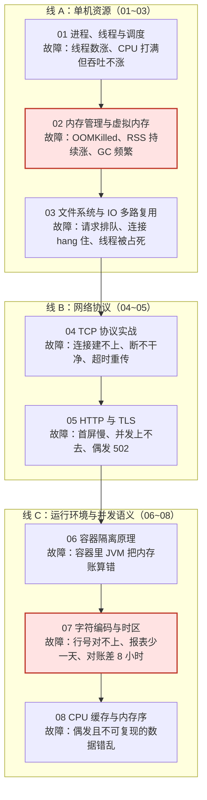

# 15 计算机基础：把线上现象归因到具体机制

> **一句话结论**：这 8 篇不是操作系统教材的重讲，而是一张「现象 → 机制 → 一条可取证命令」的对照表；基础知识的全部价值在于，当 SSE 流卡住 5 分钟、Pod 被 OOMKilled、对账结果差 8 小时时，你能说出是内核的哪一层在做什么，并且当场把它验掉。
>
> **阅读前置**：会用 PowerShell / node / java 跑单文件脚本；读过 [01-Java基础](../01-Java基础/README.md) 的 JVM 内存与线程部分。不要求 Linux 运维经验——Linux 专有命令本篇一律标注「未本机实测」，只给命令与判读方法。
>
> **证据基线**：Windows 11（os.version 10.0）/ Windows PowerShell 5.1.26100 / node v24.16.0 / JDK 17.0.19 Temurin / 16 逻辑核 / 31.7 GiB 物理内存。所有命令行输出均为本机当次真跑，可复现脚本在 `learning-docs/tools/tmp/`。预计阅读 25 分钟。

## 证据边界

先把「哪些能当场演示、哪些只能给命令」摆清楚，避免把方法论读成实测值。

| 主题 | 本机 / 本仓状态 | 证据 | 本篇怎么处理 |
|---|---|---|---|
| 主机资源与 JVM 参数 | 可直接测 | C 级：`java learning-docs\tools\tmp\m15-readme-env.java` | 第 4 节给真实输出 |
| 字符编码引起的行号漂移 | 可直接测 | C 级：`node learning-docs\tools\tmp\m15-readme-drift.mjs` | 第 4.4 节给真实输出 |
| TCP 连接状态分布 | 可直接测（宿主进程的网络） | C 级：`Get-NetTCPConnection` 分组计数 | 第 4.5 节给真实输出 |
| TLS 握手与连接复用 | 可用 curl 对外网测 | C 级：`curl.exe -w` 的 `time_appconnect` / `num_connects` | 第 4.5 节给真实输出 |
| namespace / cgroup 隔离行为 | **未本机实测**：本机无 docker、kubectl、helm | `(Get-Command docker,kubectl,helm -ErrorAction SilentlyContinue).Count` 为 0 | 06 篇只给清单核对 + Linux 命令与判读 |
| 生产吞吐 / 延迟 / QPS | **无压测环境、Prometheus 未运行** | 配置存在（`deploy/observability/prometheus.yml`、`deploy/docker-compose/docker-compose-observability.yml` 第 21 行 `image: prom/prometheus:v2.51.0`），但本机无 docker 起不来 | 全篇不写任何吞吐与延迟数值 |
| 伪共享、CPU 缓存行竞争 | **只能模拟，不能直测** | 本机无 `perf`、无硬件性能计数器接口 | 08 篇标注为「逻辑推演 + volatile 语义探针」 |

---

## 1. 这个模块为什么存在

基础知识的价值不在「知道页表是什么」，而在**把线上现象归因到具体机制**：同一个错误结论（"是不是 Spring 的 bug"）和同一个正确结论（"Servlet 线程被 SSE 长连接占死"），中间差的不是记忆量，而是能不能把现象落到内核/运行时的一个可观测量上。

下面三个疑问是本模块的入口。每个疑问都给出「不懂机制时的结论」与「懂机制后的结论」——差别就在于后者能落到行号、配置项和一条命令。

### 1.1 三个典型疑问

**疑问一：`ai-cs-chat` 的 SSE 流偶尔整段卡死近 5 分钟才断，是 Spring 的 bug 吗？**

| 归因方式 | 得到的结论 | 后果 |
|---|---|---|
| 不懂机制 | "Spring MVC 的 SseEmitter 有 bug / 网络抖了" | 升级依赖、重试、加重试次数，问题照旧 |
| 懂机制 | 超时是**代码里写死的那一个数**，且 SSE 在 Servlet 栈上要占住一个 worker 线程到流结束 | 直接去看那个常量、看线程池容量、看客户端是否在断流后不关连接 |

证据就在仓库里：`ai-cs-chat/src/main/java/com/aics/chat/service/impl/ChatServiceImpl.java` 第 156 行 `SSE_EMITTER_TIMEOUT = 5 * 60 * 1000L`，第 525 行 `new SseEmitter(SSE_EMITTER_TIMEOUT)`；入口在 `ai-cs-chat/src/main/java/com/aics/chat/controller/ChatController.java` 第 168 行。机制归属：01 篇（线程与调度）+ 03 篇（阻塞 IO 与多路复用）。

**疑问二：`ai-chat` 的容器内存 limit 是 1Gi、堆只用了 600M，Pod 却被 OOMKilled，是 limit 设小了吗？**

| 归因方式 | 得到的结论 | 后果 |
|---|---|---|
| 不懂机制 | "堆没满就不该被杀，肯定是 K8s 的 bug" | 反复调大 limit，下一次仍被杀 |
| 懂机制 | 被限制的是**进程 RSS**（堆 + Metaspace + 每线程栈 + DirectByteBuffer + 页缓存），不是堆，分母错了结论必错 | 去比对 `-Xmx` 与 limit 的比例、去数线程数、去看 DirectByteBuffer |

本仓现状可以直接核对：`deploy/k8s/services/ai-chat-service.yaml` 第 94~99 行是 `requests.memory: "512Mi"` 与 `limits.memory: "1Gi"`；而 7 份 compose 文件里 `mem_limit`、`resources:`、`stop_grace_period` 的正则命中数全部为 0——**compose 侧根本没有内存边界**。机制归属：02 篇（虚拟内存与 RSS）+ 06 篇（namespace 与 cgroup）。

**疑问三：报表按天汇总，跨月总数对不上，偶尔差一天、偶尔差 8 小时。**

| 归因方式 | 得到的结论 | 后果 |
|---|---|---|
| 不懂机制 | "SQL 写错了 / 前端格式化错了" | 改 SQL、改前端，换个环境再错一次 |
| 懂机制 | 字符与字节、墙上时间与绝对时刻在某个边界被**隐式解释**了一次；这类错不抛异常 | 去查每一跳的编码声明与时区来源，而不是查业务逻辑 |

本机就能复现同一族问题：`file.encoding = GBK`（Windows 下 JDK 17 的默认值），同一份 UTF-8 中文文件被 ANSI 口径读一次，行号就会上漂 155 行（第 4.4 节有实测）。机制归属：07 篇（字符编码与时区）。

### 1.2 读者画像

| 你是谁 | 已经会 | 缺什么 | 建议从哪篇进 |
|---|---|---|---|
| 写过 Spring Boot、没碰过内核 | 注解、依赖注入、会用日志 | 现象与内核对象的对应关系 | 03 篇（IO 多路复用），再回 01 篇 |
| 会看 JVM 监控但不信指标 | JVM 基础参数、GC 日志 | RSS 与堆的区别、页缓存归属 | 02 篇 + 06 篇连着读 |
| 排查过线上但靠猜 | 抓包、看日志、重启 | 从计数器反推机制，而不是试错 | 04 篇（TCP 状态机）+ 05 篇 |

### 1.3 本模块不解决什么

- 不教 Spring 用法、不给调优参数模板（参数模板在 [12-性能工程](../12-性能工程/README.md)）。
- 不复述教材结论，凡写机制必带一条可执行命令或一个仓库内行号。
- 不承诺"读完就会调优"：本模块的产出是**归因能力**，不是调优清单。

---

## 2. 模块地图

两条阅读线、三类线上故障：01~03 是单机资源（进程/内存/IO），04~05 是网络协议（TCP/HTTP+TLS），06~08 是运行环境与并发语义（容器/编码/内存序）。红色节点是本项目最常踩的两个坑。



> **读图说明**：三个子图对应三条阅读线，箭头是「读完上一篇的机制，才读得懂下一篇的默认值」。线 A 内部是自下而上堆叠的：调度决定谁拿到 CPU（01），内存决定进程能拿多少（02），IO 决定线程拿到 CPU 后是干活还是干等（03）——所以 03 是线 A 的出口，也是通向线 B 的入口（一次 read 要不要押上整个线程，等价于一个 socket 能不能复用）。线 B 内 04 管"连接在不在"，05 管"连接上用了几次往返"。线 C 的三篇是**不报错的那一类**：容器隔断了视野（06）、编码与时区隐式解释了一次（07）、内存序让重排合法化（08），它们的共同症状是"偶发、无异常、换个环境不复现"，红色标出的 02 与 07 是本项目已经真实踩到的两个（OOMKilled 归因错误、行号漂移 155 行）。

### 2.1 每条线对应的故障类型

| 线 | 篇目 | 典型故障现象 | 首个要看的量 |
|---|---|---|---|
| A 单机资源 | 01 / 02 / 03 | 线程数涨但吞吐不动；容器被杀但堆不满；请求排队而 CPU 空闲 | 可运行队列长度、RSS、连接数与线程占用 |
| B 网络协议 | 04 / 05 | 建连慢/建不上；TIME_WAIT/CLOSE_WAIT 堆积；首屏慢而并发正常 | 连接状态分布、重传计数、TLS 握手耗时 |
| C 环境与语义 | 06 / 07 / 08 | 容器里参数算错；行号漂移、报表差 8 小时；偶发数据错乱 | 容器 limit 与 JVM 口径、`file.encoding`/时区来源、happens-before 边 |

### 2.2 推荐顺序

1. **有明确故障**：先按现象查 2.1 表定位到线，只读那 1~2 篇（排障路线见第 5.1 节）。
2. **无明确故障、想补底子**：01 → 02 → 03 → 04 → 05 顺读，再用 06~08 收口（补课路线见第 5.2 节）。
3. **只读一篇的话**：读 03。它同时连通了线程（01）、内存映射（02）、网络（04）三件事，是投入产出比最高的一篇。

---

## 3. 每篇一句话摘要

| 篇 | 解决什么问题（一句话结论） | 本项目对应现象 | 证据类型 |
|---|---|---|---|
| [01-进程线程与调度.md](01-进程线程与调度.md) | 进程与线程的工程差异只有两条——地址空间分不分享、切换代价付不付得起；判据是**可运行队列长度**，不是线程总数 | 本机 `Processor Queue Length` 两次实测 79/62/55 与 0/0/0（16 核）；`InstanceInFlightRegistry` 用 `AtomicInteger` 记在途请求 | C + B |
| [02-内存管理与虚拟内存.md](02-内存管理与虚拟内存.md) | 每个进程都不真独占内存，是页表 + 缺页 + 换页撑起的假象；看不懂这三笔账就会把 RSS 当内存、把 VSZ 当泄漏、把 OOMKilled 当泄漏 | `limits.memory: "1Gi"` 与 JVM 堆上限是两套账；本机 MaxHeapSize 实测 7.93 GiB | B + C |
| [03-文件系统与IO多路复用.md](03-文件系统与IO多路复用.md) | IO 的差别不在读得快不快，而在一次读要不要把整个线程押上去等；select/poll/epoll、Netty EventLoop 都是同一问题的答案 | SSE 长连接占住 Servlet worker；`SseEmitter` 超时 5 分钟 | B + A |
| [04-TCP协议实战.md](04-TCP协议实战.md) | 网络问题收敛到三件事：建连慢（握手/accept 队列）、断不干净（CLOSE_WAIT/TIME_WAIT/半开）、拥塞重传；判断靠**状态分布 + 计数器** | 本机实测 TimeWait 623 / CloseWait 48 / Established 163；`redis.conf` 的 `tcp-keepalive 300` 与 `timeout 0` | C + B |
| [05-HTTP与TLS.md](05-HTTP与TLS.md) | HTTP 优化减的是往返次数与串行度；TLS 首次握手压不到 0（1.3 的 1-RTT 是下限），0-RTT 只是把首请求塞进握手 | curl 实测同一连接复用后 `num_connects=0`，总耗时从 1.68s 降到 0.22s | C |
| [06-容器隔离原理-namespace与cgroup.md](06-容器隔离原理-namespace与cgroup.md) | 容器不是轻量虚拟机：namespace 决定看得见什么，cgroup 决定最多用多少，overlayfs 决定文件系统长相 | k8s 20 个清单里 livenessProbe 20 / readinessProbe 20 / startupProbe 0；compose 7 份 `mem_limit` 全为 0 | B |
| [07-字符编码与时区.md](07-字符编码与时区.md) | 乱码与时区错位几乎从不报错，症状是行号对不上、报表少一天、对账差 8 小时；根因是边界上被隐式解释了一次 | 同一文件 `ReadAllLines` 885 行 vs ANSI 口径 730 行（漂移 155 行）；`file.encoding=GBK` | C + B |
| [08-CPU缓存与内存序.md](08-CPU缓存与内存序.md) | JMM 是把 64 字节缓存行、store buffer 延迟提交、JIT 重排包装成契约；无 happens-before 边的两个访问可以被重排 | `InstanceInFlightRegistry` 用 `computeIfAbsent + incrementAndGet + updateAndGet` 而不是 `count++` | B |

---

## 4. 本项目真实环境基线

第 3 节的每条结论都挂在这个基线上。下表全部是本机当次真跑，命令可直接复制。

| 项 | 实测值 | 取证命令 | 怎么读 |
|---|---|---|---|
| 操作系统 | Windows 11 / os.version 10.0 / amd64 | `java learning-docs\tools\tmp\m15-readme-env.java` | `os.name` / `os.version` |
| 逻辑核数 | 16 | 同上 | `availableProcessors`；ForkJoinPool 并行度为 15（少 1 个主线程） |
| 物理内存 | 31.7 GiB | 同上 | `TotalPhysicalMemory(GiB)` |
| node | v24.16.0 | `node -v` | 前端与脚本的运行时口径 |
| JDK | Temurin 17.0.19 | `java -version` | 与 pom 的 JDK 17 基线一致 |
| JVM 堆上限 | 8514437120 字节 = 7.93 GiB | 同上 java 探针 | `Runtime.maxMemory()` 即 `-XX:MaxHeapSize` 生效值 |
| `user.timezone` | `null` | 同上 java 探针 | 未显式设置，默认值来自宿主 |
| 宿主时区 | China Standard Time / `Asia/Shanghai` | `Get-TimeZone` | JVM 与宿主一致，但**没有一处代码把它写死** |
| 字符编码 | `file.encoding=GBK`、`native.encoding=GBK` | 同上 java 探针 | 中文行号漂移的根因 |
| 容器内存边界 | compose 7 份 `mem_limit` 命中 0 | 见 4.3 | 容器层**没有**内存上限 |
| docker / kubectl / helm | 三个都查不到（返回 0 个命令） | `(Get-Command docker,kubectl,helm -ErrorAction SilentlyContinue).Count` | 容器行为无法本机实测 |

### 4.1 主机与运行时

```powershell
node -v
java -version
(Get-CimInstance Win32_ComputerSystem).NumberOfLogicalProcessors
Get-TimeZone | Select-Object Id, DisplayName | Format-List
```

```text
v24.16.0
openjdk version "17.0.19" 2026-04-21
OpenJDK Runtime Environment Temurin-17.0.19+10 (build 17.0.19+10)
OpenJDK 64-Bit Server VM Temurin-17.0.19+10 (build 17.0.19+10, mixed mode, sharing)
16

Id          : China Standard Time
DisplayName : (UTC+08:00) Beijing, Chongqing, Hong Kong, Urumqi
```

判读：`16` 是**逻辑核**，不是物理核——它决定 JVM 的 GC 线程、ForkJoinPool 并行度、Netty EventLoop 数量（默认 `2 × 核数`），也决定你评估"线程池开多大"时的分母。误判风险：这只是宿主核数，容器里 `availableProcessors()` 会被 cgroup 配额改写，本机无 docker，无法演示这一改写。

再补一个"线程数不等于核数"的可测反例——可运行队列长度：

```powershell
(Get-Counter '\System\Processor Queue Length' -SampleInterval 1 -MaxSamples 3).CounterSamples |
  Select-Object -ExpandProperty CookedValue
```

```text
# 运行 A（本机正在跑编译与文档校验）
79
62
55
# 运行 B（几分钟后同一台机器空闲时）
0
0
0
```

判读：16 核上队列 79 意味着每核排着近 5 个可运行线程——此时讨论"线程池开多大"没有意义，应该先看是谁在抢 CPU；队列 0 则说明没有排队。两次结果的差异本身就是结论：**单点采样不可用，判据是同时段的趋势与 CPU 利用率的对照**。误判风险：这是全机口径（含 IDE、浏览器、本 agent 运行时），不能归因到某一个微服务。

### 4.2 JVM 口径

```powershell
java learning-docs\tools\tmp\m15-readme-env.java
```

```text
os.name                = Windows 11
java.version           = 17.0.19
java.vendor            = Eclipse Adoptium
availableProcessors    = 16
commonPoolParallelism  = 15
MaxHeapSize(bytes)     = 8514437120
MaxHeapSize(MiB)       = 8120
MaxHeapSize(GiB)       = 7.93
user.timezone(property)= null
TimeZone.getDefault()  = Asia/Shanghai
file.encoding          = GBK
native.encoding        = GBK
TotalPhysicalMemory(GiB)= 31.7
```

判读四点：

1. `MaxHeapSize` 是**堆上限**，不含 Metaspace、线程栈、DirectByteBuffer、代码缓存。把它当"进程最多占多少内存"就是 02 篇要纠正的那个分母错误。
2. `commonPoolParallelism = 15`：并行流与 `CompletableFuture` 默认走公共池，池子是"核数 - 1"，所以 `parallelStream()` 最多只有 15 个线程在跑——这就是"我用了并行流但没变快"的第一个原因。
3. `user.timezone(property) = null` 说明时区**没被显式设置**，`Asia/Shanghai` 来自宿主。一旦换个 TZ 的宿主或容器镜像，同一段代码的行为就变了——这正是 07 篇的核心。
4. `file.encoding = GBK` 是 JDK 17 在中文 Windows 上的默认值（JDK 18 起默认 UTF-8）。用它读 UTF-8 文件，行号就会漂。

### 4.3 容器内存边界

```powershell
# 7 份 compose 里有没有内存边界？命中数应当为 0
$files = Get-ChildItem -Recurse -Filter 'docker-compose*.yml' -Depth 2
foreach ($f in $files) {
  $hits = (Select-String -Path $f.FullName -Pattern 'mem_limit|resources:|stop_grace_period').Count
  "{0} -> {1}" -f $f.Name, $hits
}
```

```text
docker-compose.yml -> 0
docker-compose-all.yml -> 0
docker-compose-host1.yml -> 0
docker-compose-host2.yml -> 0
docker-compose-host3.yml -> 0
docker-compose-master-slave.yml -> 0
docker-compose-observability.yml -> 0
```

判读：compose 侧**只给了 JVM 堆参数、没给容器边界**。例如 `deploy/docker-compose/docker-compose-all.yml` 第 175 行 `JAVA_OPTS: "-Xms256m -Xmx512m"`——但容器本身对内存不设限，所以"堆 512m"在 compose 下根本不会触发内存类故障，故障要等上了 k8s 才出现（`limits.memory: "1Gi"`）。误判风险：不要在 compose 里做 OOM 复现，那里没有边界；k8s 有边界但本机无 kubectl，只能读清单不能验证行为。

### 4.4 字符编码：行号漂移实测

```powershell
node learning-docs\tools\tmp\m15-readme-drift.mjs ai-cs-chat\pom.xml pom.xml learning-docs\15-计算机基础\07-字符编码与时区.md
```

```text
文件                                            真实行数  风险行数  宽松解码行数  被吞换行  漂移
--------------------------------------------------------------------------------------------
ai-cs-chat\pom.xml                               276         0           276         0       0
pom.xml                                          413         0           413         0       0
learning-docs\15-计算机基础\07-字符编码与时区.md             885       211           730       155     155
--------------------------------------------------------------------------------------------
读法：真实行数与宽松解码行数之差 = 你看到的行号会往上漂多少行；
      风险行数 = 行尾是多字节字符（UTF-8 末字节落在 0x81~0xFE）的行，它们制造了吞换行。
```

判读（数字为写作时实测，文件改动后重跑即可对齐）：`07-字符编码与时区.md` 有 211 行的行尾是多字节字符，被 ANSI(CP936) 口径读一遍，其中 155 个换行被当成双字节字符的尾字节吞掉，于是同一份文件从 885 行变成 730 行——**你在编辑器里看到第 500 行，PowerShell 报第 350 行附近**。两个纯 ASCII 的 pom 文件漂移为 0，说明这是"行尾字节落在 0x81~0xFE"的专属问题，不是"中文就乱"。本文自身也有同样的问题（`Get-Content` 与 `ReadAllLines` 数出来的行数不一样），所以引本文的行号时请用 UTF-8 口径。

误判风险：用 `Get-Content` 数行数得到的行号不可用于报 bug；行号一律以 UTF-8 口径（node / `[System.IO.File]::ReadAllLines()`）为准。附带一条：`(Get-Content X | Measure-Object -Line).Lines` 又是第三种口径（不数空行），三个数字会在同一份文件上给出三个答案。

### 4.5 网络：连接状态与握手成本

```powershell
Get-NetTCPConnection | Group-Object State | Sort-Object Count -Descending | Select-Object Name, Count
curl.exe -sS -o NUL -o NUL -w "num_connects=%{num_connects} connect=%{time_connect} appconnect=%{time_appconnect} total=%{time_total}`n" --max-time 15 https://example.com https://example.com
```

```text
TimeWait      623
Bound         185
Established   163
Listen         53
CloseWait      48
FinWait2       33
SynSent         3
FinWait1        1

num_connects=1 connect=0.285538 appconnect=0.545267 total=1.678932
num_connects=0 connect=0.000000 appconnect=0.000000 total=0.217513
```

判读：`TimeWait` 远多于 `Established` 是主动关闭方的正常代价（每次短连接留一个 2MSL 状态），只有当端口或四元组耗尽才成问题；`CloseWait` 才是"应用层没关连接"的信号。第二段 curl：同一个命令行里两个 URL，curl 复用同一条连接，第二个请求 `num_connects=0`、握手耗时为 0，总耗时从 1.68s 降到 0.22s——**这就是 keep-alive 省掉的东西**。

误判风险：这些状态来自本机所有桌面进程（浏览器、IDE、本 agent 运行时），不是容器里的服务，不能归因给某个微服务；握手耗时的绝对值受网络状况影响，只能看 `appconnect - connect` 的差值，不能拿单次值当指标。同一台机器连测三次就能看到这个抖动：

```powershell
1..3 | ForEach-Object {
  curl.exe -sS -o NUL -w "dns=%{time_namelookup} connect=%{time_connect} appconnect=%{time_appconnect} total=%{time_total}`n" --max-time 10 https://example.com
}
```

```text
dns=0.024054 connect=0.234707 appconnect=1.687383 total=1.904987
dns=0.018899 connect=0.221996 appconnect=0.450929 total=1.495608
dns=0.047691 connect=0.260009 appconnect=0.499346 total=0.698068
```

判读：三次 `curl.exe` 是三个独立进程，**每次都完整握手**（没有复用可言）。TCP 建连（`connect`）稳定在 0.22~0.26s，但 TLS 握手（`appconnect - connect`）分别是 1.45s、0.23s、0.24s，差 6 倍——所以"TLS 很慢"这个结论不能由单次采样支撑。真要说复用省了多少，得看上面那条 `num_connects=0` 的同进程多请求命令。

---

## 5. 两条路线

### 5.1 排障视角：2 天

目标是**带着一个真实现象进、带着一个已验证的归因出**。每段都要求落一条命令输出。

| 时间 | 读什么 | 动手做什么 | 产出 |
|---|---|---|---|
| 第 1 天上午 | 02 篇 3.1~3.3（页表/缺页/换页） | 跑 `java learning-docs\tools\tmp\m15-readme-env.java`，把 MaxHeapSize 与 k8s limit 换算一遍 | 一句话说清"被杀的是 RSS 不是堆" |
| 第 1 天下午 | 03 篇（select/poll/epoll、EventLoop） | 读 `ai-cs-chat/src/main/java/com/aics/chat/service/impl/ChatServiceImpl.java` 第 513~560 行，数清一次 SSE 流占几个线程 | 一张"一次流式请求的线程占用"图 |
| 第 2 天上午 | 04 篇（状态机、accept 队列） | 跑 4.5 节的三条命令，记录状态分布与握手差值 | 一份与本机现象对照的状态表 |
| 第 2 天下午 | 07 篇（编码与时区） | 跑 `node learning-docs\tools\tmp\m15-readme-drift.mjs` 扫自己常读的三个文件 | 一份"行号口径"约定 |

### 5.2 系统补课：2 周

目标是**建立可按层检索的机制索引**，不追进度，追"每一层都有一个可测的量"。

| 天 | 主题 | 当天唯一的验收标准 |
|---|---|---|
| D1 | 01 进程与线程 | 能解释 `Processor Queue Length` 与线程总数的区别 |
| D2 | 01 调度与切换 | 能算出线程栈 1MB × 200 线程的主机内存账 |
| D3 | 02 虚拟内存 | 能解释 VSZ 与 RSS 的差都花在哪 |
| D4 | 02 缺页与 OOM | 能说出 cgroup v2 `memory.max` 计入哪些项 |
| D5 | 03 五种 IO 模型 | 能画出阻塞读与非阻塞读的线程时间线 |
| D6 | 03 epoll 与 Netty | 能解释 LT 与 ET 的触发差别 |
| D7 | 复盘 + 前 6 天串联 | 用一条命令解释一次真实慢请求 |
| D8 | 04 TCP 三次握手 | 能读出 accept 队列溢出在计数器上的样子 |
| D9 | 04 挥手与 TIME_WAIT | 能解释为什么 TIME_WAIT 在主动关闭方 |
| D10 | 04 拥塞与重传 | 能区分"丢包"与"应用层超时" |
| D11 | 05 HTTP 语义 | 能解释 keep-alive 与 HTTP/2 多路复用的差别 |
| D12 | 05 TLS 握手 | 能解释 1-RTT 与 0-RTT 的边界 |
| D13 | 06 容器隔离 | 能说出 namespace 与 cgroup 各管控什么 |
| D14 | 07 + 08 | 能给出"编码边界"检查表与五个 happens-before 锚点 |

---

## 6. 依赖关系

| 关系 | 目标模块 | 为什么 |
|---|---|---|
| 前置 | 无 | 本模块是最底层，不从任何模块继承术语 |
| 相关 | [01-Java基础](../01-Java基础/README.md) | 线程模型、JVM 内存布局在本模块被当作"运行时侧的解释" |
| 相关 | [12-性能工程](../12-性能工程/README.md) | 本模块给机制，那边给压测与调参方法 |
| 相关 | [13-稳定性工程](../13-稳定性工程/README.md) | 超时、熔断、降级的默认值都来自本模块的机制约束；建议对照 [04-高可用架构模式](../13-稳定性工程/04-高可用架构模式.md) |
| 相关 | [16-云原生与GitOps](../16-云原生与GitOps/README.md) | 06 篇的 namespace/cgroup 在那边变成 YAML 与流水线 |
| 上游入口 | [00-学习路线总览](../00-学习路线总览/README.md) | 全仓阅读顺序的总表 |

---

## 7. 检查点清单

读完一章就过一遍，每条都能用命令自证。达不到就回读对应篇。

- [ ] 能说出本机逻辑核数，并解释它为什么决定 GC 线程数与 EventLoop 数量（验证：第 4.1 节命令，期望 `16`）。
- [ ] 能解释 `MaxHeapSize=7.93 GiB` 与"进程最多占多少内存"不是一回事（验证：第 4.2 节命令）。
- [ ] 能指出本项目哪一侧给了容器内存边界、哪一侧没给（验证：第 4.3 节命令，期望 7 个 0）。
- [ ] 能复现行号漂移，并说明为什么另外两个文件漂移为 0（验证：第 4.4 节命令，期望 `885 / 211 / 730 / 155`）。
- [ ] 能区分 TIME_WAIT 与 CLOSE_WAIT 的成因（验证：第 4.5 节命令，看两类计数）。
- [ ] 能用 curl 证明连接复用省掉了握手（验证：第 4.5 节第二条命令，期望第二个请求 `num_connects=0`）。
- [ ] 能说出 SSE 一次流式请求占住几个线程、超时写在哪一行（验证：读 `ChatServiceImpl.java` 第 156、525 行）。
- [ ] 能解释 `InstanceInFlightRegistry` 为什么不用 `count++`（验证：读 `ai-cs-gateway/src/main/java/com/aics/gateway/loadbalancer/InstanceInFlightRegistry.java` 第 31、40、47 行）。

---

## 8. 诚实清单

这一节存在的目的是防止把"方法论"读成"实测结果"。

| 本篇声称 | 实际情况 | 你能怎么自己补 |
|---|---|---|
| 容器内存边界行为 | 本机无 docker / kubectl / helm（`Get-Command` 查三个名字返回 0 个命令），cgroup 生效、OOMKilled 现场**均未本机实测** | 在有 docker 的机器上跑 `docker run --memory=256m` 观察退出码 137 |
| namespace 隔离现场 | 只用清单与文档核对，未启动任何容器 | `docker run --rm -it --pid=host` 与默认对比 `ps` |
| TLS 握手内部步骤 | 本机查不到 openssl，握手只通过 curl 的耗时**间接**观测 | 用 `curl -v` 看证书链，或用 Wireshark 看 ClientHello |
| 伪共享、缓存行竞争 | 本机查不到 `perf`，无硬件性能计数器接口，**只能逻辑推演**，不提供自测数值 | 在 Linux 上用 `perf c2c` |
| 吞吐 / 延迟 / QPS | 配置有（`deploy/observability/prometheus.yml` 按 `/actuator/prometheus` 抓取），但本机无 docker、Prometheus 未运行，**没有任何抓取到的指标**；也无压测环境 | 起 observability compose 后看 `/actuator/prometheus`，方法见 [12-性能工程](../12-性能工程/README.md) |
| 端口与连接数是否耗尽 | 第 4.5 节的数字来自本机桌面进程，不来自容器内微服务 | 在容器内重跑同一命令并区分进程 |
| JVM 与容器的时间基准 | 宿主为 China Standard Time、JVM 未设 `user.timezone`，但**容器镜像的 TZ 未核对**（无 docker 无法验证） | 进容器跑 `date` 与 `java -XshowSettings:properties -version` |

---

**下一步**：按第 5 节任选一条路线开始；第一篇从 [01-进程线程与调度.md](01-进程线程与调度.md) 进，读完回到本节第 7 条检查点自测。
