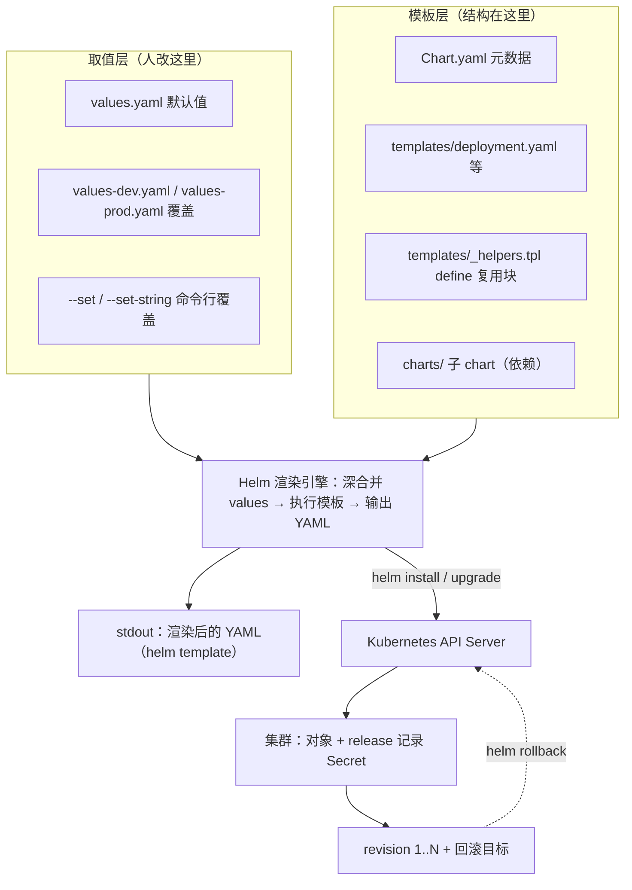
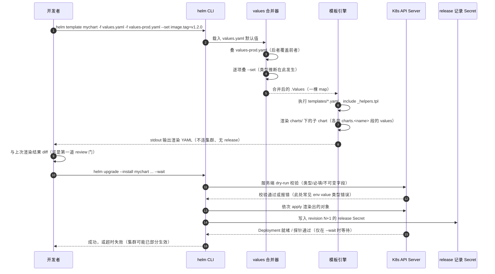

# Helm 从零到参数化

> **一句话结论**：Helm 的全部价值是把「同一套清单结构 × 多组环境取值」拆成模板与 values 两个文件；它的全部风险是参数化一旦过度，渲染出来的 YAML 就没有人能 review——本仓库当前处于「还没引入 Helm，但已经有 8 份结构重复的服务清单」的临界点。
> **阅读前置**：读过 `deploy/k8s/services/api-gateway.yaml` 这类清单；知道 Deployment / Service / 探针 / resources 各自是什么；不要求用过 Helm。
> **证据基线**：本机 **没有安装 helm / kubectl / kustomize**（`Get-Command` 全部返回空），所以所有 helm 命令都是「给命令 + 给判读方法，未本机实测」；能实测的是对现有 20 份清单的字段普查（C 级，pwsh 脚本）与渲染等价性比对（C 级，node 脚本）。预计阅读 45~60 分钟。

## 证据边界

| 主题 | 本仓状态 | 证据 | 本篇怎么处理 |
|------|----------|------|--------------|
| 自建 Helm chart | ❌ 0 个 | 全仓 `Get-ChildItem -Filter Chart.yaml` 只命中 1 个第三方 vendored 目录 | 状态如实标注为「未落地」，落地方案按设计稿写 |
| 第三方 chart（vendored） | ✅ 1 个 | `tools\seata\seata\script\server\helm\seata-server\Chart.yaml` | 只作为「一个真实 chart 长什么样」的参照物，不代表本项目在维护 |
| 裸 YAML 清单 | ✅ 20 份 / 1962 行 / 47 资源 | pwsh 普查脚本实测 | 作为参数化候选清单的一手数据 |
| helm / kubectl / kustomize 命令输出 | ❌ 本机不可执行 | `Get-Command helm` → 空 | 一律写「未本机实测，给命令与判读方法」 |
| 渲染等价性验收 | ⚠️ 用 node 复现 | `learning-docs/tools/tmp/helm16-render-sim.mjs` | 说明这是我写的模拟器，不是 Helm 本体输出 |
| 未落地能力（Helm/Kustomize/ArgoCD） | ❌ 未落地 | 全仓 0 命中 | 只写「方案 + 验收标准」，不写成已实现 |

## 0. 先看现象

### 症状 1：8 份服务清单是同一套结构抄了 8 遍，只有取值不同

把 `deploy/k8s` 下 20 份清单的「可变字段」全量普查一遍（脚本：`learning-docs/tools/tmp/helm16-field-census.ps1`，用缩进状态机逐行扫描，因为本机既没有 helm 也没有 yaml 库）：

```powershell
cd D:\Projects\Persion\ai-customer-service
& .\learning-docs\tools\tmp\helm16-field-census.ps1
```

```text
=== 表B：字段聚合（覆盖文件数 / 不同取值数） ===
image      覆盖 18 个文件  不同取值 18 个
tag        覆盖 18 个文件  不同取值 10 个  →  0.5.20 | 8.12.0 | latest | 8.0,8.0 | v2.3.2 | 5-community | 7 | 5.1.4,5.1.4
replicas   覆盖 18 个文件  不同取值  4 个  →  1 | 1,2 | 1,1 | 2
namespace  覆盖 19 个文件  不同取值  2 个  →  ai-customer-service | aics
svcType    覆盖 14 个文件  不同取值  2 个  →  ClusterIP | NodePort
cpuReq     覆盖 18 个文件  不同取值  5 个  →  100m | 500m | 250m | 200m | 100m,200m
memReq     覆盖 18 个文件  不同取值  5 个  →  256Mi | 1Gi | 512Mi | 128Mi | 256Mi,512Mi
cpuLim     覆盖 18 个文件  不同取值  5 个  →  500m | 2000m | 1000m | 1 | 500m,1000m
memLim     覆盖 18 个文件  不同取值  4 个  →  1Gi | 2Gi | 512Mi | 512Mi,1Gi
envItems   覆盖 16 个文件  不同取值  9 个  →  4 | 2 | 9 | 1 | 13 | 3 | 11 | 5
```

**怎么读**：`image` 覆盖 18 个文件、18 种取值——这一列没有复用价值，它就是「每个服务自己的名字」。但 `svcType` 只有 2 种、`namespace` 只有 2 种、`replicas` 只有 2 个真值、`cpuReq` 只有 5 种——这些列**结构完全一致、取值只有几种**。这正是一个 chart 的判据：**结构重复、取值枚举化**。

### 症状 2：想把 `latest` 换成固定版本，要动 8 个文件

```powershell
cd D:\Projects\Persion\ai-customer-service
Select-String -Path deploy\k8s\services\*.yaml -Pattern '^\s+image:' | ForEach-Object { "{0}:{1}  {2}" -f $_.Filename, $_.LineNumber, $_.Line.Trim() }
```

```text
ai-chat-service.yaml:47  image: 192.168.56.12:5000/aics/ai-chat-service:latest
api-gateway.yaml:49  image: 192.168.56.12:5000/aics/api-gateway:latest
knowledge-service.yaml:47  image: 192.168.56.12:5000/aics/knowledge-service:latest
message-service.yaml:47  image: 192.168.56.12:5000/aics/message-service:latest
notify-service.yaml:47  image: 192.168.56.12:5000/aics/notify-service:latest
product-service.yaml:36  image: aics/ai-cs-product:latest    # ⚠️ 无私仓前缀；其他服务都是
search-service.yaml:47  image: 192.168.56.12:5000/aics/search-service:latest
user-service.yaml:46  image: 192.168.56.12:5000/aics/user-service:latest
```

**怎么读**：8 个文件、8 行 `image:`，全部 `:latest`（浮动 tag），7 个带私有仓库前缀 `192.168.56.12:5000`，1 个（product-service）没有前缀、镜像名还叫 `ai-cs-product` 而不是 `product-service`。要做「灰度发版时把某个服务的 tag 钉到 v1.2.0」，现在必须**逐文件改、逐个提交、没有一处能一眼看完当前所有服务的版本矩阵**。

### 症状 3：连「20 份清单有多少行」这件事，两个命令给出两个答案

```powershell
cd D:\Projects\Persion\ai-customer-service
$f = Get-ChildItem deploy\k8s -Recurse -File -Filter *.yaml
"文件数: {0}" -f $f.Count
"ReadAllLines 行数合计: {0}" -f (($f | ForEach-Object { [System.IO.File]::ReadAllLines($_.FullName).Count }) | Measure-Object -Sum).Sum
"Get-Content 行数合计: {0}" -f (($f | ForEach-Object { (Get-Content $_.FullName).Count }) | Measure-Object -Sum).Sum
```

```text
文件数: 20
ReadAllLines 行数合计: 1962
Get-Content 行数合计: 1741
```

**怎么读**：差了 221 行。这不是清单有问题，是 PowerShell 5.1 的 `Get-Content` 默认按系统代码页（gb2312/GBK）解码 UTF-8 文件，行尾中文的字节会被 GBK 双字节对吃掉后面的换行符。**这条坑在 §6 第一条给出完整机理与复现**——它对本篇至关重要：所有「行号」结论都必须标口径，否则你会在错误的位置 review 渲染结果。

**这些现象指向同一件事**：清单的**结构**是重复的、**取值**是分散的、**注释**是唯一的现场文档（306/1962 = 15.6% 是注释行）。Helm 把结构和取值分到模板与 values 两层，收益正来自这份重复；代价是渲染产物会丢掉全部注释，所以纪律必须从「读渲染出来的 YAML」前移到「review values 的 diff + 用 `helm template` 比对渲染结果」。

## 1. 整体地图



> **读图说明**：最关键的一条箭头是「取值层 → 渲染引擎」与「模板层 → 渲染引擎」的**合流**——Helm 只做一件事：把右边这堆取值合并成一个大 map，然后拿模板去填。看错「OUT1 和 OUT2 是同一条路」这一点会得出错误结论：`helm template` 只写 stdout、**不碰集群、不产生 release**，而 `helm install` 才会把渲染结果提交并额外写一个 release 记录 Secret。所以「先 `helm template` 看渲染结果」是零风险的，而「先 `helm install --dry-run`」会走服务端校验但不落盘，两者用途不同。

| 组件 | 责任 | 参与方 | 本仓现状 |
|------|------|--------|----------|
| `Chart.yaml` | chart 身份：name / version / appVersion / dependencies | 本仓开发者 | ❌ 自建 0 个；仅 `tools\seata\seata\script\server\helm\seata-server\Chart.yaml` 为第三方发行包自带 |
| `values.yaml` | 默认取值，模板里 `{{ .Values.x }}` 的来源 | 本仓开发者 | ❌ 无 |
| `values-<env>.yaml` | 按环境覆盖（dev / prod），只写差异项 | 运维 / SRE | ❌ 无；等价物是 6 份 `deploy\docker-compose\` 与 20 份 k8s 清单各自写死 |
| `templates/*.yaml` | 产物结构（Deployment / Service / ConfigMap） | 本仓开发者 | ⚠️ 等价物是 `deploy/k8s/services/api-gateway.yaml` 这类 8 份手抄清单 |
| `templates/_helpers.tpl` | `define` 定义可复用片段，`include` 调用 | 本仓开发者 | ❌ 无 |
| `charts/` 子 chart | 依赖的第三方 chart（如 redis / mysql） | 上游 + 本仓 | ❌ 无；中间件全部手写裸 YAML（`deploy/k8s/redis.yaml`、`deploy/k8s/mysql.yaml`） |
| Release / Revision | 一次安装 = 一个 release，每次升级 +1 revision | Helm（存在集群里） | ❌ 无（因为没装 Helm），当前靠 `kubectl apply` 无版本记录 |
| 渲染引擎 | 合并 values、执行模板、输出 | Helm 二进制 | ⚠️ 本机无 helm；本篇用 node 模拟器演示可测部分 |

## 2. 关键概念与关键要素

| 名称 | 位置 | 作用 | 关键参数 / 判据 |
|------|------|------|------------------|
| Chart | 一个目录 | Helm 的打包单位，本质是「模板 + 默认 values + 元数据」 | `Chart.yaml` 的 `name` / `version`；`helm lint` 第一个检查对象 |
| Chart.yaml | chart 根 | 声明 chart 身份与依赖 | `apiVersion`（v1 老 / v2 需 Helm 3）、`version`（chart 自身版本）、`appVersion`（镜像版本，与 version 无关） |
| values.yaml | chart 根 | 默认取值 | 层级越深越容易被 `--set` 打穿；列表是整体替换不是合并 |
| values overlay | `-f values-prod.yaml` | 只写与默认值的差异 | 多个 `-f` 时**后者覆盖前者**，顺序即优先级 |
| `--set` | 命令行 | 临时覆盖单个值 | 有类型推断（数字/布尔/null），是 §3.3 所有坑的来源 |
| `--set-string` | 命令行 | 强制当字符串 | env value、密码、带前导 0 的编号必须用它 |
| templates/ | chart 子目录 | 产物模板（Go template 语法） | 文件名不以 `_` 开头才输出；`_helpers.tpl` 这类下划线文件只做定义 |
| `define` / `include` | `_helpers.tpl` | 定义 / 调用可复用片段 | `include` 返回字符串，可管道给 `nindent`；`template` 只输出不返回 |
| `.Values` / `.Release` / `.Chart` | 模板上下文 | 分别取 values、release 元数据、chart 元数据 | `.Release.Name` 参与资源命名，改名会导致资源重建 |
| 子 chart（subchart） | `charts/<name>/` | 依赖打包，独立渲染 | 父 values 用 `charts/<name>:` 命名空间传值；`global:` 对所有子 chart 可见 |
| umbrella chart | 父 chart 无模板 | 只做「一组子 chart 的组合」 | 适合「一套平台 = 中间件 + 业务服务」，与微服务架构天然契合 |
| Hook | 模板文件 + `helm.sh/hook` 注解 | 在渲染/升级的特定阶段执行 | `pre-install` / `post-install` / `pre-upgrade` / `post-upgrade` / `test`；失败会阻塞整个 release |
| Release / Revision | 集群内 Secret | 记录「这个 release 的第几次安装长什么样」 | `helm history <release>`；`helm rollback <release> <revision>` |
| `helm template` | 命令 | 只渲染、不连集群 | 渲染纪律的核心：diff 的对象应该是它的输出 |
| Kustomize | 独立工具 | 用 patch 叠加而不是模板填空 | 与 Helm 是**取舍**关系，不是替代关系（见 §5.1） |

## 3. 原理与证据逐段精读

### 3.1 渲染流水线：三层 values 深合并，然后才执行模板

**在干什么**：Helm 拿到 chart 后并不立刻执行模板，而是先把「默认 values → 若干个 `-f` overlay（后盖前）→ `--set` 逐项」合并成一份最终的 values map，再把这份 map 作为 `.Values` 交给模板。顺序是**合并完再渲染**，不是「边渲染边查值」。

用 node 复现这一步（脚本：`learning-docs/tools/tmp/helm16-render-sim.mjs`，`deepMerge` + `parseSet` 即按 Helm 公开语义写的模拟）：

```powershell
cd D:\Projects\Persion\ai-customer-service
node learning-docs\tools\tmp\helm16-render-sim.mjs
```

```text
=== D2：values 层级覆盖（默认 < 环境 overlay < --set） ===
image.registry               = "192.168.56.12:5000/aics"    ← values.yaml 默认值
image.tag                    = "v1.0.0"                     ← values-prod.yaml 赢
service.replicas             = 3                            ← --set 赢
service.nodePort             = null                         ← values.yaml 默认值
env.JAVA_OPTS                = "-Xms512m -Xmx512m"          ← --set 赢
env.NACOS_ADDR               = "nacos:8848"                 ← values.yaml 默认值
env.OPENAI_MODEL             = null                         ← --set 赢
```

**为什么这么设计**：如果让模板自己去「发现」某个值该取哪个环境，模板里就会长出 `if .Values.env == "prod"` 这种分支，最后模板比清单还难读。把优先级收敛成「一份合并好的 map」，模板就只剩填空，`if` 只用于结构差异（比如 NodePort 只在 gateway 出现）。

**换写法会怎样**：如果不用 overlay 而用 `--set` 传全部环境差异，一次 `helm upgrade` 的命令行会变成几十行，且**没有留痕**——三个月后没人知道生产是拿什么命令装上去的。反过来，如果只留 values.yaml 一份，环境差异就得靠人改默认值，默认值就此失去意义。

**常见坑**：
- **列表是整体替换**。`values.yaml` 里 `env` 是 13 项列表，overlay 里只写 1 项，合并结果不是「13 项里改 1 项」而是「变成 1 项」。所以 env 必须做成 map（`env: {NACOS_ADDR: ...}`）+ 模板里 `range`，才能在 overlay 里只覆盖一项。本仓 `deploy/k8s/services/ai-chat-service.yaml` 有 13 项 env 列表——直接抄进 values 会踩这个坑。
- **`-f` 的顺序是语义**。`-f values.yaml -f values-prod.yaml` 与反过来是两个结果，CI 里拼参数时极易写错。
- **空值不等于删除**：`--set env.OPENAI_MODEL=` 得到的是 `null`，模板里会渲染成 `<no value>` 或空串，取决于写法；想让某个键「消失」得靠模板里的 `if`，不能靠 values。

### 3.2 参数化的边界：哪些字段该进 values，哪些不该

**在干什么**：参数化不是「把所有字段都变成变量」。判据是：**这个字段会因为环境/发版而不同吗？** 会，就进 values；不会，就写死在模板或直接不暴露。

**为什么这么设计**：每多一个 values 键，就多一处可能被 `--set` 打穿的口子，也多一处 review 负担。values 是「契约」，不是「逃生舱」。

**换写法会怎样**：把 `containerPort`、`protocol`、`selector` 的 label 键名全部暴露成 values，模板里就会充满 `{{ .Values.container.port }}` 这类变量，读者无法在模板里看出「这是一个 8080 的 HTTP 服务」，只能跳去 values 反查——这就是「参数化过度，渲染结果没人看得懂」。

**常见坑**：把 `metadata.name` 暴露成 values 是最常见的过度设计。它一旦可配，`.Release.Name`、Service 的 `selector`、Deployment 的 label 三者就可能不再自洽，而这些本来是模板该统一保证的。

下面是本仓的真实候选清单（数据来自 §0 的普查表 B，覆盖文件数与取值种数都是实测）：

| 字段 | 实测分布 | 该进 values 吗 | 理由 |
|------|----------|----------------|------|
| `image`（含 registry+name+tag） | 18 文件 / 18 种取值 | ✅ 拆成 `registry` + `repository` + `tag` 三段 | 每服务一个仓库名，但 registry 与 tag 是全局的（7/8 带同一前缀、8/8 都用 `latest`） |
| `imagePullPolicy` | 7 个文件写 `IfNotPresent`，1 个没写 | ✅ 进 `global` | 环境相关（本机 kind 集群与真集群取值不同） |
| `replicas` | 18 文件 / 真值只有 1 与 2 | ✅ 进 values | 典型的环境相关项 |
| `namespace` | 19 文件 / 2 种取值（`ai-customer-service` 与 `aics`） | ✅ 进 values，但**顺便当修正项** | `aics` 只出现在 product-service，且 `deploy/k8s/namespace.yaml` 只建了 `ai-customer-service` |
| `Service.type` / `nodePort` | 14 文件 / 2 种；`nodePort` 仅 api-gateway 的 `30080` | ✅ 进 values | 只有入口服务需要 NodePort |
| `resources.requests/limits` | 18 文件 / cpu 5 种、memory 4~5 种 | ✅ 进 values | 与节点规格、JVM 堆强相关（本仓 `JAVA_OPTS` 的 `-Xms/-Xmx` 与 memory limit 存在手工对齐关系） |
| `env` 条目 | 16 文件 / 合计 83 项 / 每文件 1~13 项 | ✅ 但必须做成 map 不是 list | 见 §3.1「列表整体替换」 |
| 探针类型（tcpSocket / httpGet） | 服务类 7 份用 tcpSocket，product-service 与中间件用 httpGet | ⚠️ 部分进 values（path/port 可配），类型不该配 | 探针类型是「这个服务有没有 actuator」的结构事实，不该成为环境变量 |
| `kind`（Deployment vs StatefulSet） | Deployment 13 / StatefulSet 7 | ❌ 不进 values | 有状态与否决定用不用 `volumeClaimTemplates`，是结构差异，硬配会让模板长出两套分支 |
| 容器名 / label 键名 / port 名 | product-service 是唯一没写 `port.name` 的 | ❌ 写死在模板里 | 让模板保证一致性，不一致的清单才会在渲染时立即暴露 |
| `metadata.name` | 8 服务名与文件名 7 对 1 不对（`ai-cs-product` vs `product-service`） | ❌ 不进 values，改为「从 values 的 key 派生」 | 见 §3.4，用 `define` 统一派生可消除这类漂移 |

### 3.3 `--set` 的类型推断：env value 为什么必须 `| quote`

**在干什么**：`--set` 收到的永远是一串字符串，Helm 会先做类型推断：纯整数 → number、`true/false` → boolean、`null` → nil、其余 → string。推断结果直接进 values，模板拿到的就是一个 JS/Go 意义上的数字。

**为什么这么设计**：`--set service.replicas=3` 如果传成字符串 `"3"`，模板 `{{ .Values.service.replicas }}` 渲染出来是 `replicas: "3"`，k8s 会因为类型不符拒绝——推断是为了让最常见的整数场景「开箱就对」。

**换写法会怎样**：同一套推断用在 `env` 上是灾难，因为 **k8s 的 env `value` 必须是字符串**。实测 8 份服务清单里有 15 处 env 值写成带引号的字符串（端口 `"3306"`、`"6379"`、空串 `""`），一旦走 `--set` 或模板里忘了 `| quote`，它们就会变成数字/null：

```text
=== D3：--set 的类型推断与切分坑（每条给推断结果 + 后果） ===
--set service.replicas=3                 → 值=[3] 类型=service.replicas=number                    // k8s 要 int，正好
--set env.MYSQL_PORT=3306                → 值=[3306] 类型=env.MYSQL_PORT=number                    // env value 要字符串，塞进数字 → 提交被拒
--set-string env.MYSQL_PORT=3306         → 值=["3306"] 类型=env.MYSQL_PORT=string(强制)            // 强制字符串，安全
--set env.PASSWORD=0123                  → 值=[123] 类型=env.PASSWORD=number                       // 前导 0 丢失，密码变 123
--set env.PASSWORD=null                  → 值=[null] 类型=env.PASSWORD=null(键被置空)              // 键被置空，等于删掉这个 env
--set env.JAVA_OPTS=-Xms256m -Xmx256m    → 值=["-Xms256m -Xmx256m"] 类型=env.JAVA_OPTS=string      // 空格没转义 → shell 先切成两个参数
--set name=a,b                           → 值=["a",null] 类型=name=string b=null                   // 键名里的逗号被当分隔符，多出一个 b 键
--set env.EMPTY=                         → 值=[null] 类型=env.EMPTY=null                           // 空值 → null，不是空字符串
```

**怎么读这张表**：前三行是「同一条命令的不同写法」，`3306` 与 `--set-string` 的差别就是「推断」与「不推断」；`0123 → 123` 与 `null → 键被置空` 是两类静默损坏——**命令成功、渲染成功、apply 才炸或者悄悄变了行为**；`JAVA_OPTS` 那两行说明空格必须转义（`\ `），否则 shell 先把 `-Xmx256m` 切成了另一个参数，Helm 根本收不到。

这与 Spring 的 Binder 是同一个设计问题。Spring 在绑定属性时，会在结果出来之后**显式做一次转换**，转换失败就抛：

```text
  369 | 	@Contract("_, _, _, _, _, true -> null")
  370 | 	private <T> @Nullable T handleBindResult(ConfigurationPropertyName name, Bindable<T> target, BindHandler handler,
  371 | 			Context context, @Nullable Object result, boolean create) throws Exception {
  372 | 		if (result != null) {
  373 | 			result = handler.onSuccess(name, target, context, result);
  374 | 			result = context.getConverter().convert(result, target);
  375 | 		}
```

（src: Binder.java.md#L369-L374）

Spring 有 `Converters` 与 target type（`Bindable<T>`）作为类型契约，转换不上去还能报错；Helm 这一侧**没有 target type**——values 就是一堆 JSON 标量，类型契约全靠模板作者自己用 `| quote`、`| int`、`| toString` 显式表达。这是 Helm 与「有类型的配置绑定」之间最本质的差距，也是 `--set` 事故的根因。

**常见坑**：
- `| quote` 漏写是 silent failure 的头号来源。渲染出来的 YAML 看起来「差不多」，只是 `value: 3306` 少了两个引号。
- `--set-string` 不是万能的：它把 `"true"` 也变成字符串，如果模板里拿它当布尔用（`{{ if .Values.x }}`），非空字符串恒真。
- 键名带点（`env.NACOS.SERVER`）会被当成嵌套路径，写 `env.NACOS\.SERVER` 或改用 values 文件。

### 3.4 `define` / `include`：把「8 份清单里重复的那 3 段」收成一处

**在干什么**：`_helpers.tpl` 里用 `define "名字"` 定义一段可复用文本，模板里用 `include "名字" . | nindent N` 调用。最典型的复用对象是「名字派生」「通用 label」「镜像引用」三段。

**为什么这么设计**：chart 里所有文件共享同一个模板命名空间，`define` 就是那个命名空间的函数定义。没有它，8 个服务的 deployment.yaml 会各自写一遍 label 拼装逻辑——这正是现在 8 份手抄清单的状态。

**换写法会怎样**：用 `template` 而不是 `include`，就无法把结果管道给 `nindent`，缩进只能靠模板里手工对齐；用两个独立的 `define` 拼 label 而不带 `selectorLabels` 与 `labels` 的区分，就会出现「改了 label 但 selector 没改」——k8s 不允许 Deployment 的 `spec.selector` 变更，这类改动会直接报错或重建 Pod。

**常见坑**：
- `include` 之后的缩进必须靠 `nindent`/`indent`，直接写 `{{ include ... }}` 会把多行内容全部顶到行首。
- `define` 名全局唯一，两个 `_helpers.tpl` 里同名会后者覆盖前者（子 chart 也一样），排查时表现为「渲染出来的是另一段文字」。
- 名字里带 `{{ .Release.Name }}` 派生的资源名一旦改 chart release 名，所有资源都要重建——这不是 Helm 的 bug，是设计后果。

### 3.5 依赖：subchart 与 umbrella chart

**在干什么**：chart 可以依赖别的 chart（`Chart.yaml` 的 `dependencies:` 或 `charts/` 目录），渲染时父子各渲染一份，父 values 通过 `charts.<子chart名>:` 命名空间给子 chart 传值。

**为什么这么设计**：中间件（redis / mysql / nacos）的 chart 全世界都在用，没必要自己写；业务服务则需要自己的模板。umbrella chart 就是「一套平台 = 一组子 chart」的写法，和本仓「8 个 Java 服务 + 5 个中间件」的形态完全同构。

**换写法会怎样**：把中间件和业务服务塞进同一个 chart 的 `templates/`（不分父子），用一个巨大的 values 平铺所有字段，结果是 values 里 200 个键谁也不敢删——这就是「参数化过度」的终局。

**常见坑**：
- `Chart.yaml` 的 `apiVersion: v1` 与 `v2` 对应 Helm 2 / Helm 3 的依赖机制，vendored 的 `tools\seata\seata\script\server\helm\seata-server\Chart.yaml` 就是 `apiVersion: v1`——**直接拿它当模板抄会得到 Helm 3 不认的依赖声明**。
- 子 chart 的 values 不会自动继承父的 `global`，只有显式写在 `global:` 下才对所有子 chart 可见。
- 本仓 20 份清单里有 7 个 StatefulSet——`deploy/k8s/mysql.yaml` 里 2 个（`volumeClaimTemplates` 在 L189 与 L273），其余 `deploy/k8s/chroma.yaml`（L69）、`deploy/k8s/elasticsearch.yaml`（L90）、`deploy/k8s/minio.yaml`（L88）、`deploy/k8s/neo4j.yaml`（L76）、`deploy/k8s/redis.yaml`（L149）各 1 个；合计 7 个 StatefulSet、7 处 `volumeClaimTemplates`（注意 `deploy/k8s/rocketmq.yaml` 用的是 2 个 Deployment 而不是 StatefulSet，别按名字想当然）。它们都带 `volumeClaimTemplates`——**StatefulSet 的存储模板在滚动升级时不可变**，Helm 改它会被 API Server 拒绝，必须人工删 PVC 重建。这一条在「一次升级失败」的现场极常见。

### 3.6 hook 与升级顺序

**在干什么**：带 `helm.sh/hook: pre-upgrade` 注解的资源只在升级前跑（典型用途：数据库迁移 Job、备份 Job）；`post-install` 用于安装后初始化；`test` 用于 `helm test` 的连通性验证。

**为什么这么设计**：有一些动作必须在「新镜像起来之前」完成（建表、灌数据），而 k8s 原生没有「执行顺序」的概念，Helm 用 hook 在客户端侧补上这一步。

**换写法会怎样**：不用 hook、改用 initContainer 做迁移，好处是幂等性和失败重试由 k8s 保证；坏处是每个副本都会跑一遍迁移。而 hook 的坏处是**失败即阻塞整个 release**：一个 `post-install` Job 卡住，整个 release 停在 `pending-install`，后续所有 `helm upgrade` 都会被拒。

**常见坑**：
- hook 资源默认不会被 `helm uninstall` 删除，需要 `helm.sh/hook-delete-policy`。
- `--wait` 与 hook 一起用时，等待超时会把「已成功的部分」也标成失败，`helm list` 显示 `failed` 但集群里资源是好的——判读时必须以 `kubectl rollout status` 为准。
- hook Job 的名字必须每次不同（用 `.Release.Revision` 派生），否则第二次升级会因为同名 Job 已存在而失败。

### 3.7 渲染结果必须可 review：`helm template` 的纪律

**在干什么**：任何 `helm install/upgrade` 之前，先跑 `helm template` 把渲染结果落成文件，和「上一次的渲染结果」做 diff。

**为什么这么设计**：Helm 的 review 对象应该只有两个层次——**values 的语义 diff**（改了什么取值）和**渲染产物的结构 diff**（改了什么字段）。跳过前者就只能读几百行 YAML；跳过后者则完全不知道模板有没有多渲染/少渲染。

**换写法会怎样**：如果只把渲染产物提交到仓库（gitops 的「渲染后入库」流派），好处是 review 时看到的就是真实 YAML、可以 `kubectl diff`；坏处是仓库里同时有模板和产物两份真相，容易漂移。两种流派都成立，但**不能两个都不做**。

**常见坑（本仓实测）**：渲染产物**没有注释**。20 份清单共 1962 行、其中 306 行是注释（15.6%），而这些注释里藏着最关键的现场知识：

```powershell
cd D:\Projects\Persion\ai-customer-service
node learning-docs\tools\tmp\helm16-render-sim.mjs | Select-String -Pattern '原文件注释行'
```

```text
原文件注释行 13 行 → 渲染产物注释行 0 行
```

`deploy/k8s/services/api-gateway.yaml` 第 7 行的注释写的是「对外访问：http://<任一节点IP>:30080（NodePort 方式）」；`deploy/k8s/services/ai-chat-service.yaml` 第 60-61 行有一整段告警「本目录 Service 叫 mysql-master/mysql-slave，没有 mysql」（L58 是 `- name: MYSQL_HOST`、L59 是 `value: "mysql"`，警告就挂在它下面）。这些**在渲染产物里全部消失**。所以纪律是：注释留在模板里（模板注释 `{{/* */}}` 也不会输出）或留在 values 的说明里，而 review 的第一步是看 values diff。

## 4. 一次完整执行时序



> **读图说明**：最关键的箭头是第 9 步「Dev 自己 diff」——它不是 Helm 的功能，是纪律；跳过这一步，后面所有步骤都是盲飞。最容易被看错的是第 10 步与第 12 步之间：**dry-run 校验通过不代表能成功**（`--wait` 期间探针失败、PVC 不可变、hook 卡住都在这一步之后才暴露），所以「`helm upgrade` 返回 0」与「服务真的能用」之间还有一段距离。

| 步 | 判据 | 正常长什么样 | 异常长什么样 | 该看哪里 |
|----|------|--------------|--------------|----------|
| 1-4 values 合并 | 合并后的值是不是你想要的 | `--set` 的那一项确实在最外层 | 改 overlay 却没生效 | `helm template --debug` 输出的 values dump（未本机实测） |
| 5-7 模板执行 | 模板语法 + 必填值 | 输出完整、无 `<no value>` | `nil pointer evaluating interface {}` 或 `<no value>` 字样 | 渲染产物里搜 `<no value>`；定位到具体模板行 |
| 8 输出 | 资源数量与种类 | 与预期清单条目数一致 | 少渲染了某个文件（文件名 `_` 开头）或多了 tests/ 里的 Pod | 数 `^kind:` 出现次数 |
| 9 diff | 与上次渲染的差异 | 差异只在改动的那几个字段 | 整段缩进变化（说明模板被动过） | `diff -u old.yaml new.yaml` |
| 10 dry-run | 类型与不可变字段 | 通过 | `cannot unmarshal number into Go struct field ...value of type string` | 报错里的字段名，回到 values 找那个值 |
| 11 应用 | 对象创建/更新 | `configured` / `created` | `field is immutable`（StatefulSet 存储/Deployment selector） | `kubectl rollout status`、`kubectl describe` |
| 12 release 记录 | revision 递增 | `history` 里 N+1 且 `deployed` | `pending-install` / `failed` | `helm history`、`helm status`（未本机实测） |
| 13 就绪 | 探针通过 | `READY n/n` | `CrashLoopBackOff`、`Readiness probe failed` | `kubectl get pods`、`kubectl logs` |

## 5. 设计取舍

### 5.1 Helm 与 Kustomize：不是替代关系

| 维度 | Helm | Kustomize | 本仓适配度 |
|------|------|-----------|------------|
| 参数化方式 | 模板填空（Go template） | 声明式 patch 叠加（strategic merge / JSON6902） | 结构重复度高（8 份同构清单）→ Helm 更省 |
| 产物可读性 | 模板可读、渲染产物丢注释 | base 就是合法 YAML，patch 小 | Helm 需要额外纪律（§3.7） |
| 类型安全 | 无 target type，靠 `quote`/`int` 手写 | 值写在 YAML 里，类型由 YAML 本身保证 | Kustomize 在「env 必须字符串」这类问题上天然安全 |
| 第三方生态 | 巨大（中间件 chart 现成） | 需要自己维护 base | 本仓 12 份中间件清单 → Helm 的生态优势明显 |
| 版本与回滚 | 内置 release / revision / rollback | 无（靠 git） | 本仓现在 `kubectl apply` 无任何版本记录 |
| 条件分支 | `if` 表达结构差异（如 NodePort 只在 gateway） | overlay 表达，不引入逻辑 | 本仓 gateway 是唯一 NodePort，两种都能表达 |
| 学习与调试成本 | 模板语法 + values 语义 + hook | 只有 patch 语义 | 团队已会 YAML，Helm 的额外成本主要在这一层 |
| 与 GitOps 结合 | ArgoCD 原生支持（渲染后比对） | ArgoCD 同样原生支持 | 本仓 ArgoCD 未落地（全仓 0 命中） |

**结论**：本仓的痛点是「8 份结构同构的服务清单 + 12 份中间件清单 + 无版本记录」，Helm 的收益（模板复用 + 中间件生态 + revision）大于它的成本（模板语法 + 渲染丢注释）。Kustomize 更适合「base 只有一份、差异靠 patch」的场景；两者也可以混用（Helm 渲染 + Kustomize 打环境补丁），但那会引入两套覆盖语义，本篇不建议在落地初期混用。

### 5.2 最小落地方案：把 20 份清单收成 1 个 chart

目录骨架（**设计稿，尚未创建**；本仓当前无此目录）：

```text
deploy/helm/aics/                     ← 新建（本仓尚不存在）
├── Chart.yaml                        ← name: aics / version: 0.1.0 / appVersion: 1.0.0
├── values.yaml                       ← 默认值：registry、tag、8 个服务的 port/env/resources 骨架
├── values-dev.yaml                   ← 差异项：replicas=1、tag=latest、nodePort 段
├── values-prod.yaml                  ← 差异项：replicas=2、tag 固定、resources 上调
└── templates/
    ├── _helpers.tpl                  ← define aics.name / aics.labels / aics.selectorLabels / aics.image
    ├── namespace.yaml                ← 对应现有 deploy/k8s/namespace.yaml（15 行）
    ├── service.yaml                  ← range 8 个服务，按 .type 决定是否输出 nodePort
    ├── deployment.yaml               ← range 8 个服务；env 用 map + range，阈值类资源用 quote
    └── middleware/                   ← 12 份中间件清单按需逐个搬（先搬无状态，再搬 StatefulSet）
```

分环境 values 的写法要点（**结构示意，非本仓现有文件**）：

```yaml
# values.yaml —— 默认值，dev 可直接用；只放"结构 + 合理默认"
global:
  registry: 192.168.56.12:5000/aics
  tag: latest
  imagePullPolicy: IfNotPresent
  namespace: ai-customer-service
services:
  api-gateway:
    port: 8080
    type: NodePort
    nodePort: 30080
    replicas: 1
    env:
      NACOS_ADDR: "nacos:8848"
      NACOS_NAMESPACE: ""
      JAVA_OPTS: "-Xms256m -Xmx256m"
    resources:
      requests: { cpu: 100m, memory: 256Mi }
      limits:   { cpu: 500m, memory: 512Mi }
```

```yaml
# values-prod.yaml —— 只写差异；列表改成 map 的关键理由在 §3.1
global:
  tag: v1.0.0
services:
  api-gateway:
    replicas: 2
```

**验收标准（硬指标，可量化）**：`helm template` 的渲染结果与现有 YAML **字段级等价**。等价性判定不看文本、看「关心字段的取值集合」——本篇用 node 模拟器实现了这个比对器并真跑过：

```text
=== D5：等价性验收 —— 渲染回去逐字段比对（这是 helm template 的验收标准） ===
ai-chat-service.yaml           带引号渲染   0 处差异   不写引号渲染   3 处差异
api-gateway.yaml               带引号渲染   0 处差异   不写引号渲染   1 处差异
knowledge-service.yaml         带引号渲染   0 处差异   不写引号渲染   2 处差异
message-service.yaml           带引号渲染   0 处差异   不写引号渲染   3 处差异
notify-service.yaml            带引号渲染   0 处差异   不写引号渲染   1 处差异
product-service.yaml           带引号渲染   2 处差异   不写引号渲染   2 处差异
search-service.yaml            带引号渲染   0 处差异   不写引号渲染   1 处差异
user-service.yaml              带引号渲染   0 处差异   不写引号渲染   2 处差异
合计：带引号 2 处，不带引号 15 处
```

**怎么读这三列**：`带引号渲染 0 处差异` 的 7 个文件证明「这 8 份清单确实能被同一套模板参数化，且参数化后逐字段等价」；`不写引号渲染 15 处` 证明「同一条流水线，只要模板里漏了 `| quote`，就凭空多出 15 处类型差异」；`product-service 2 处` 是唯一一个参数化**不能**自动等价的文件：

```text
product-service.yaml  Deployment/product-service.spec.template.spec.containers[0].ports[0].name  原文=不存在  渲染="<no value>"  (渲染多出来)
product-service.yaml  Service/product-service.spec.ports[0].name  原文=不存在  渲染="<no value>"  (渲染多出来)
```

**这不是模板写错了**，而是「统一模板会强迫你给 8 份清单定一套 schema，第 8 份不符合的地方立刻暴露」。该文件还有 4 项独立漂移（下节实测），所以落地方案必须包含「有意修正项」清单——这正是参数化真正的产出物。

### 5.3 schema 漂移实测：8 份服务清单里，7 份同构、1 份自成一套

```text
=== D6：8 份服务清单的 schema 漂移（统一模板会强迫你在这里做决定） ===
文件                             镜像名                  registry pullPolicy port.name namespace            env字面值 envSecretRef
ai-chat-service.yaml           ai-chat-service      有        有          有         ai-customer-service  10       3
api-gateway.yaml               api-gateway          有        有          有         ai-customer-service  3        0
knowledge-service.yaml         knowledge-service    有        有          有         ai-customer-service  11       0
message-service.yaml           message-service      有        有          有         ai-customer-service  11       0
notify-service.yaml            notify-service       有        有          有         ai-customer-service  4        0
product-service.yaml           ai-cs-product        无        无          无         aics                 3        2
search-service.yaml            search-service       有        有          有         ai-customer-service  4        0
user-service.yaml              user-service         有        有          有         ai-customer-service  8        0
```

**怎么读**：`product-service` 一行在 5 个维度上与其余 7 份不同（镜像名 `ai-cs-product`、无 registry 前缀、无 `imagePullPolicy`、`Service` 端口无 `name`、namespace 是 `aics`）。用 `Select-String` 单独验一遍 namespace 这一项：

```powershell
cd D:\Projects\Persion\ai-customer-service
Select-String -Path deploy\k8s\services\*.yaml -Pattern '^\s+namespace:' | ForEach-Object { "{0}:{1}  {2}" -f $_.Filename, $_.LineNumber, $_.Line.Trim() }
```

```text
ai-chat-service.yaml:15  namespace: ai-customer-service
ai-chat-service.yaml:32  namespace: ai-customer-service
api-gateway.yaml:15  namespace: ai-customer-service
api-gateway.yaml:34  namespace: ai-customer-service
knowledge-service.yaml:15  namespace: ai-customer-service
knowledge-service.yaml:32  namespace: ai-customer-service
message-service.yaml:15  namespace: ai-customer-service
message-service.yaml:32  namespace: ai-customer-service
notify-service.yaml:15  namespace: ai-customer-service
notify-service.yaml:32  namespace: ai-customer-service
product-service.yaml:20  namespace: aics               # ⚠️ 与其他服务（ai-customer-service）不一致；若未创建
product-service.yaml:86  namespace: aics               # ⚠️ 与 Deployment 的 namespace 必须一致才选得到 Pod
search-service.yaml:15  namespace: ai-customer-service
search-service.yaml:32  namespace: ai-customer-service
user-service.yaml:14  namespace: ai-customer-service
user-service.yaml:31  namespace: ai-customer-service
```

**怎么读**：8 份文件共 16 行——**每份都是两次**（Service 的 `metadata.namespace` 与 Deployment 的 `metadata.namespace` 各写一遍），前 7 份两处行号相差 17~19 行、product-service 相差 66 行（它把 Deployment 写在了 Service 前面）。这正是 Helm 该收掉的东西：模板里写一次 `namespace: {{ .Values.namespace }}`，就不会出现「Service 改了这个、Deployment 忘了改」的半改状态；product-service 恰好是反例——它的两处都写成 `aics`，且行尾还留着 `⚠️` 警告，说明作者知道不对但没解决。

而 `deploy/k8s/namespace.yaml` 只创建了 `ai-customer-service`——**product-service 的清单指向一个不存在的 namespace，`kubectl apply` 会直接失败**。参数化的收益在这里变得具体：这类漂移在「8 份手抄文件」里只能靠人眼上下翻，在 chart 里则变成「values 里少写一个字段」的结构性缺失。

### 5.4 可扩展点清单

- **values 类型契约**：加 `values.schema.json`，用 JSON Schema 声明「`tag` 必须是字符串且非空、`replicas` 必须是整数 ≥1」，让 `helm lint` 在 CI 阶段拦住 `--set` 的类型事故（本仓尚未落地）。
- **渲染产物入库 + CI diff**：每次 PR 跑 `helm template` 并把结果与主干比对，任何非预期的字段变化必须显式 approve（需要先有 helm，本仓 CI 目前只有 `python-learning-validate` 一条流水线）。
- **chart 测试**：`templates/tests/` 下放连通性 Pod，`helm test` 在部署后验证；`tools\seata\seata\script\server\helm\seata-server\tests\test-connection.yaml` 是现成的样子可参照（第三方资产，不是本仓维护）。
- **子 chart 化中间件**：`deploy/k8s/redis.yaml`（157 行）、`deploy/k8s/mysql.yaml`（281 行）这类可以整段替换成上游 chart，values 只留 `auth`、`resources`、`persistence` 段。
- **hook 化迁移**：把「数据库建表」做成 `pre-upgrade` Job（`deploy/k8s/mysql.yaml` 现在用 ConfigMap 挂初始化 SQL，靠容器首次启动执行，这在滚动升级时不具幂等性）。
- **与准入策略结合**：渲染产物不含 `PodDisruptionBudget`、`strategy`、`terminationGracePeriodSeconds`（本仓 20 份清单里这三项实测均为 0 处），可以在模板里统一注入，让「所有服务都有一致的优雅停机配置」由模板保证而非人记性。

## 6. 踩坑与调试手法

### 坑 1：`Get-Content` 数出来的行数比真实行数少，且不报错

```powershell
cd D:\Projects\Persion\ai-customer-service
$p = 'deploy\k8s\chroma.yaml'
$bytes = [System.IO.File]::ReadAllBytes($p)
"CR=$((($bytes | Where-Object { $_ -eq 13 }).Count))  LF=$((($bytes | Where-Object { $_ -eq 10 }).Count))"
"ReadAllLines : $([System.IO.File]::ReadAllLines($p).Count)"
"Get-Content  : $((Get-Content $p).Count)"
"Get-Content -Encoding UTF8 : $((Get-Content $p -Encoding UTF8).Count)"
([System.Text.Encoding]::Default.WebName)
```

```text
CR=0  LF=77
ReadAllLines : 77
Get-Content  : 59
Get-Content -Encoding UTF8 : 77
gb2312
```

**判读表**：

| 观察 | 含义 | 正确动作 |
|------|------|----------|
| `LF=77` 但 `Get-Content` = 59 | 文件确实是 77 行；默认解码把 18 个换行吞了 | 一律加 `-Encoding UTF8`，或直接用 `[System.IO.File]::ReadAllLines` |
| 默认编码是 `gb2312` | 本机 PowerShell 5.1 的系统代码页 | 不要假设 UTF-8 默认 |
| 行号对不上（贴出 152/166 vs 151/144） | 同一份文件两种口径 | 引用行号前先声明「按 ReadAllLines 计」 |

**机理（实测复现）**：行尾中文的 UTF-8 字节被 GBK 按双字节对解码，当行尾字符的字节数为偶数时，最后一个双字节对会把后面的 `0A`（换行）当成自己的 trail byte 吃掉：

```powershell
cd D:\Projects\Persion\ai-customer-service
$p = 'deploy\k8s\chroma.yaml'
$lines = [System.IO.File]::ReadAllLines($p, [System.Text.Encoding]::UTF8)
$raw = [System.Text.Encoding]::UTF8.GetBytes($lines[1] + "`n")
$tail = $raw[($raw.Length-6)..($raw.Length-1)]
"行尾 6 字节: " + (($tail | ForEach-Object { '{0:X2}' -f $_ }) -join ' ')
"GBK 解码: " + ([System.Text.Encoding]::GetEncoding(936).GetString($tail) -replace "`n",'<LF>')
"GBK 解出字符数: " + [System.Text.Encoding]::GetEncoding(936).GetString($tail).Length
```

```text
行尾 6 字节: AD 98 E5 82 A8 0A
GBK 解码: 瓨鍌?
GBK 解出字符数: 3
```

6 个字节解出 3 个字符——`A8 0A` 被当成了一个 GBK 字符，换行符就这么没了。

**误判风险**：以为「文件丢了 18 行」而去改清单；或者拿 `Get-Content` 的行号去 `read` 工具定位，改错行。本篇所有行号均以 `ReadAllLines`/`read` 为准。

### 坑 2：`--set` 把 env 的字符串值变成数字

```powershell
cd D:\Projects\Persion\ai-customer-service
node learning-docs\tools\tmp\helm16-render-sim.mjs | Select-String -Pattern '对--set|MYSQL_PORT|PASSWORD'
```

```text
--set env.MYSQL_PORT=3306                → 值=[3306] 类型=env.MYSQL_PORT=number       // env value 要字符串，塞进数字 → 提交被拒
--set-string env.MYSQL_PORT=3306         → 值=["3306"] 类型=env.MYSQL_PORT=string(强制)
--set env.PASSWORD=0123                  → 值=[123] 类型=env.PASSWORD=number          // 前导 0 丢失
```

**判读**：`值=[3306]` 里没有引号就是数字。真实事故的表现是 `helm upgrade` 之后 API Server 报 `cannot unmarshal number into Go struct field EnvVar.spec.template.spec.containers.env.value of type string`。

**误判风险**：以为是自己模板写错了结构而去改 YAML；实际是值类型问题，改 values 类型或加 `| quote`/`--set-string` 即可。

### 坑 3：`--set` 的逗号与空值静默改变语义

```text
--set name=a,b                           → 值=["a",null] 类型=name=string b=null      // 逗号被当分隔符，多出一个 b 键
--set env.EMPTY=                         → 值=[null] 类型=env.EMPTY=null                // 空值 → null，不是空字符串
--set env.PASSWORD=null                  → 值=[null] 类型=env.PASSWORD=null(键被置空)   // 等于删掉这个 env
```

**判读**：`--set` 的逗号是**条目分隔符**，值里要写逗号必须 `\,`；`=` 后面什么都不写得到 null 而不是空串。空串必须写成 `env.EMPTY=""`——但 shell 会把引号吃掉，所以正确做法是写进 values 文件。

**误判风险**：以为「设成空就是空字符串」，结果模板 `{{ if .Values.env.EMPTY }}` 判 false，一段配置被整块跳过，且渲染无报错。

### 坑 4：拿渲染产物当唯一 review 对象，丢掉注释里的现场知识

```powershell
cd D:\Projects\Persion\ai-customer-service
$rows = Get-ChildItem deploy\k8s -Recurse -File -Filter *.yaml | ForEach-Object {
  $l = [System.IO.File]::ReadAllLines($_.FullName)
  [pscustomobject]@{ file=$_.Name; comment=($l | Where-Object { $_ -match '^\s*#' }).Count; total=$l.Count }
}
"注释行合计 {0} / 总行数 {1} = {2:P1}" -f ($rows.comment|Measure-Object -Sum).Sum, ($rows.total|Measure-Object -Sum).Sum, (($rows.comment|Measure-Object -Sum).Sum / ($rows.total|Measure-Object -Sum).Sum)
```

```text
注释行合计 306 / 总行数 1962 = 15.6%
```

**判读**：15.6% 的行是注释，而 Helm 渲染产物里注释行为 0（见 §3.7）。`deploy/k8s/services/ai-chat-service.yaml` 第 58-61 行的告警「本目录 Service 叫 mysql-master/mysql-slave，没有 mysql」、`deploy/k8s/services/product-service.yaml` 头部 4 条「直接 apply 大概率跑不起来」的自陈，**全部不会出现在渲染结果里**。

**误判风险**：review 时只读 `helm template` 输出，得出「结构一致、可以上线」的结论，而漏掉「这个 Service 名根本不存在」这类只有注释写着的坑。

### 坑 5：以为 `helm upgrade` 返回 0 就等于服务可用

**命令（未本机实测，本机无 helm/kubectl）**：

```bash
CHART=deploy/helm/aics     # 该目录尚未创建，见 §5.2 骨架
helm upgrade --install aics "$CHART" -n ai-customer-service -f "$CHART/values-prod.yaml" --wait --timeout 5m
kubectl -n ai-customer-service get pods -l app=api-gateway
kubectl -n ai-customer-service rollout status deploy/api-gateway --timeout=120s
```

**判读表**：

| 现象 | 含义 | 该看哪里 |
|------|------|----------|
| `STATUS: deployed` + `READY 0/1` | 对象已提交，Pod 没就绪 | `kubectl describe pod` 的 Events、探针失败原因 |
| `Error: UPGRADE FAILED: timed out waiting for the condition` | `--wait` 超时；集群里可能已部分生效 | `kubectl get all`、`helm history`，不要直接回滚 |
| `field is immutable` | StatefulSet 的 `volumeClaimTemplates` 或 Deployment 的 `selector` 被改 | 这两项不可原地改，需删重建 |
| `pending-install` 卡住不结束 | 某个 hook Job 失败 | `kubectl get jobs -n <ns>`、`kubectl logs job/<name>` |

**误判风险**：把「Helm 报失败」当成「什么都没做」——`--wait` 超时时对象可能已经建了几个。回滚前必须先看 `helm history` 与集群实际状态，否则 `helm rollback` 会在一半状态上再叠一层。

### 坑 6：把 vendored 的 `apiVersion: v1` chart 当成本仓模板抄

```powershell
cd D:\Projects\Persion\ai-customer-service
Get-Content tools\seata\seata\script\server\helm\seata-server\Chart.yaml
Get-ChildItem tools\seata\seata\script\server\helm\seata-server -Recurse -File | ForEach-Object { $_.FullName.Replace((Get-Location).Path + '\','') }
```

```text
apiVersion: v1
appVersion: "1.0"
description: Seata Server
name: seata-server
version: 1.0.0
...
tools\seata\seata\script\server\helm\seata-server\.helmignore
tools\seata\seata\script\server\helm\seata-server\Chart.yaml
tools\seata\seata\script\server\helm\seata-server\NOTES.txt
tools\seata\seata\script\server\helm\seata-server\templates\_helpers.tpl
tools\seata\seata\script\server\helm\seata-server\templates\deployment.yaml
tools\seata\seata\script\server\helm\seata-server\templates\service.yaml
tools\seata\seata\script\server\helm\seata-server\tests\test-connection.yaml
```

**判读**：这是 Seata 发行包自带的 chart（`apiVersion: v1` 是 Helm 2 时代的写法，Helm 3 仍能读单 chart 但不支持 v1 的 `requirements.yaml` 依赖声明）。它可以当「一个真实 chart 的目录长什么样」的参照（`Chart.yaml` + `templates/` + `NOTES.txt` + `tests/` + `.helmignore`），但**不能当本仓模板范文**。

**误判风险**：照抄 `apiVersion: v1` + `requirements.yaml` 的写法，在 Helm 3 下依赖不生效且不报错（依赖段被忽略），表现为「子 chart 根本没渲染」。

### 坑 7：本机没有 helm，别把「模拟器输出」当成 Helm 输出

```powershell
cd D:\Projects\Persion\ai-customer-service
foreach ($c in 'helm','kubectl','kustomize') {
  $x = Get-Command $c -ErrorAction SilentlyContinue
  if ($x) { "  {0} -> {1}" -f $c, $x.Source } else { "  {0} -> 未安装" -f $c }
}
```

```text
  helm -> 未安装
  kubectl -> 未安装
  kustomize -> 未安装
```

**判读**：本篇 D2/D3/D5/D6 四张表来自 `learning-docs/tools/tmp/helm16-render-sim.mjs`，它按 Helm 公开语义复现了「values 深合并」「`--set` 类型推断」「模板填空」「逐字段比对」四步，但**它不是 Helm**：不解析 Go template、不处理 `include`/`nindent`、不做子 chart 作用域。所以它能证明「这 8 份清单结构上可被同一套模板表达」（D5 的 7 个 0 差异），不能证明「真实 `helm template` 的输出与它逐字节相同」。

**误判风险**：把「模拟器 0 差异」当成「Helm 落地已验证」。真正的验收必须在装了 helm 的机器上跑 `helm template` 并与现有 YAML 做 diff；本篇给的是**方法**与**判据**，不是通过结论。

## 7. 版本差异

| 维度 | 旧稿写法 | 当前基线（本次核） | 变化点 | 迁移动作 |
|------|----------|--------------------|--------|----------|
| 清单规模 | 「8 份手写 manifest 621 行」 | **20 份 / 1962 行（ReadAllLines）/ 47 个资源** | 旧数字作废 | 引用行数必须标口径（`Get-Content` 只有 1741） |
| 资源类型分布 | 未统计 | Service 21 / Deployment 13 / StatefulSet 7 / ConfigMap 3 / Secret 2 / Namespace 1 | 新增可核对事实 | 参数化时先处理 Deployment+Service（13+21），StatefulSet 单独议（存储模板不可变） |
| Helm 命中 | 「全仓 0 命中」 | 自建 chart **0**；vendored 第三方 chart **1**（`tools\seata\...\seata-server\Chart.yaml`）；`deploy/` 下 helm 字样 **0** 处 | 旧结论不准确 | 表述改为「无自建 chart，仅第三方发行包自带 1 个」 |
| 证据级别 | 概念讲解 + 通用命令 | C 级：2 个可复现脚本（普查 + 渲染等价性），真实输出贴表 | 新增 | 所有数字必须能由脚本重跑出来 |
| `--set` 类型坑 | 一句话提示「注意类型」 | 10 条实测推断结果表 + 与 k8s env 字符串要求的冲突验证 | 细化 | 从「注意事项」升级为「验收检查项」 |
| 等价性验收 | 无 | 8 份清单逐字段比对：7 份 0 差异、1 份 2 处、不写引号 15 处 | 新增 | 落地时把「0 差异」作为合并门槛 |
| 服务清单数量 | 「8 个服务」 | `deploy/k8s/services` 实为 **8 份**，但同时缺 `order-service` 清单（8 个 Java 业务服务只有 7 份有清单 + gateway） | 需订正表述 | 落地 chart 时显式列出「有清单/无清单」的服务 |
| 问答与练习 | 8 问 + 5 练习 | 12 问 + 6 练习 + 12 道自测 | 扩充 | — |

旧稿里那句「8 份手写 manifest 621 行」是最需要警惕的一类错误：它不是笔误，而是**统计口径不明**（可能只数了 `services` 目录、也可能用了 `Get-Content` 的行数）。本篇因此把每个数字的口径写在它旁边。

## 8. 面试高频问与答

1. Helm 的 Chart / values / release 三者分别是什么，各自存在哪里？
2. `helm template` 和 `helm install --dry-run` 有什么区别？分别适合什么场景？
3. values 的覆盖优先级是怎样的？多个 `-f` 同时出现时谁赢？
4. 为什么 values 里的列表不能像 map 那样深合并？这会导致什么设计约束？
5. `--set` 的类型推断规则是什么？哪些场景必须用 `--set-string`？
6. `define` / `include` / `template` 三者的区别？为什么 `include` 常配 `nindent`？
7. 什么是 subchart 和 umbrella chart？父 values 怎么给子 chart 传值？`global` 有什么特殊性？
8. Helm hook 有哪几类？hook 失败会对 release 造成什么状态？
9. `helm rollback` 与 `kubectl rollout undo` 的语义差别是什么？
10. Helm 与 Kustomize 的核心差异是什么？什么场景你会选哪个？
11. 渲染产物丢注释这件事，对 review 流程有什么具体要求？
12. 如何证明「参数化重构没有改变集群行为」？给出可执行的验收方法。
13. StatefulSet 的 `volumeClaimTemplates` 为什么在升级时这么麻烦？Helm 能绕过吗？
14. `.Release.Name` 参与资源命名有什么长期后果？

## 9. 动手练习

**练习 1：给现有 8 份服务清单做一次参数化普查**

用 pwsh 提取每份清单的 `image` / `replicas` / `namespace` / `resources` / `env` 条目数，输出一张表。

*验收标准*：表里能看出「哪些字段是全局一致、哪些是每服务独有」；8 份服务清单的 `env` 条目数合计为 **59**（13+3+11+11+4+5+4+8，全仓含 `env` 的 16 份清单合计才是 83，两者别混）；文件数为 **8**、行数合计（`ReadAllLines` 口径）为 **729**。

**练习 2：写出 `_helpers.tpl` 的 4 个 define**

至少包含 `aics.name`（名字派生）、`aics.labels`、`aics.selectorLabels`、`aics.image`（拼 registry/repository/tag）。

*验收标准*：`selectorLabels` 与 `labels` 是两个不同 define（后者在前者基础上加 `version`/`appVersion`）；`aics.image` 的输出在 `registry` 为空时不出现前导 `/`。

**练习 3：写 `values.yaml` 与两份 overlay，并证明「只改一个值」**

要求 `values-prod.yaml` 只写与默认值的差异，且能通过 `--set` 在命令行覆盖 `replicas`。

*验收标准*：三个层次的覆盖结果能被打印成一张「`= 值 ← 谁赢`」的表（可参照 `learning-docs/tools/tmp/helm16-render-sim.mjs` 的 D2 段）；`values-prod.yaml` 行数不超过 `values.yaml` 的 1/3。

**练习 4：把渲染结果与现有 YAML 做字段级等价性比对**

用任何语言实现「按 `kind/name` 分组 → 展平成 `path=value` → 逐项比对」的比对器，对 8 份清单跑一遍。

*验收标准*：7 份输出 `0 处差异`；`product-service.yaml` 报出 `ports[0].name` 缺失 2 处，并能解释这是「模板统一 schema」而不是模板 bug。**不允许**把「文本相同」当等价标准（缩进/引号/顺序都会变）。

**练习 5：复现 GBK 吞换行的坑**

对 `deploy/k8s/chroma.yaml` 分别用 `Get-Content`、`Get-Content -Encoding UTF8`、`[System.IO.File]::ReadAllLines` 数行数，并打印行尾 6 字节的 GBK 解码结果。

*验收标准*：得到 `59 / 77 / 77` 三个数字，并能用「`A8 0A` 合成一个 GBK 字符」解释 18 行的缺口；能说明为什么后续引用行号必须标注口径。

**练习 6：给 chart 加一条 CI 门槛**

设计一条流水线步骤：渲染 → 与主干渲染结果 diff → 有差异时要求 approve。

*验收标准*：写成可读的步骤描述 + 判据（diff 为空才允许合并），并明确标注「本仓 CI 目前只有 `python-learning-validate` 一条流水线，此步骤尚未落地」，不许写成已实现。

## 小结

- Helm 只做一件事：**把 values 合并成一份 map，再拿模板去填**；`helm template` 是纯本地渲染，不碰集群、不产生 release。
- 参数化的判据是「这个字段会因环境/发版而不同吗」，不是「这个字段能不能变成变量」；把 `metadata.name`、`kind`、port 名暴露成 values 是过度设计。
- **列表不会深合并**，只会整体替换——所以 env 必须做成 map，否则 overlay 一写就把 13 项覆盖成 1 项。
- `--set` 有类型推断：`3306` 变数字、`0123` 变 123、`null` 变空、逗号变分隔符；env value 类一律 `--set-string` 或写进 values 文件。
- 渲染产物**丢掉全部注释**（本仓 306/1962 = 15.6%），所以 review 的第一对象是 values 的 diff，第二步才是 `helm template` 输出的结构 diff。
- 本仓现状：自建 chart **0**、裸 YAML **20 份 / 1962 行 / 47 资源**、`helm`/`kubectl`/`kustomize` 全部未安装——落地方案与验收标准都是**设计稿**。
- 下一步最省力的一步：先把 `deploy/k8s/services` 的 8 份清单按 §5.2 的骨架抽成 1 个 chart，用 §5.2 的逐字段比对器证明「7 份 0 差异」，再把 product-service 的 5 项 schema 漂移**当作有意修正项**逐个提交。

## 自测题

**1. Chart、values、release 三件套各自是什么、存在哪里？**

<details>
<summary>参考答案</summary>

Chart 是一个目录（模板 + 默认 values + `Chart.yaml` 元数据），存在仓库里；values 是取值的层级结构，来自 `values.yaml`、`-f` overlay、`--set`，最终合并成一份内存中的 map；release 是「一次安装的实例记录」，存在集群里的 Secret 中，带递增的 revision，用于 `helm history` 与 `helm rollback`。三者关系是：同一份 chart 用不同 values 安装出多个 release。

</details>

**2. `helm template` 与 `helm install --dry-run` 的区别？**

<details>
<summary>参考答案</summary>

`helm template` 完全在本地渲染，输出 YAML 到 stdout，不连集群（也不需要 kubeconfig），没有 release 记录；`helm install --dry-run` 会走服务端校验（字段类型、必填、不可变字段），能看到 API Server 是否会拒，但不落盘。前者适合 review 与 CI diff，后者适合「确认集群会接受这份清单」。两者都不等于部署成功。

</details>

**3. values 的覆盖优先级与多个 `-f` 的顺序？**

<details>
<summary>参考答案</summary>

优先级从低到高：chart 内置 `values.yaml` → 各 `-f` 文件按命令行出现顺序依次覆盖（**后者赢**）→ `--set` / `--set-string` 逐项覆盖（最高）。合并是深合并（map 逐键递归），但遇到列表时整体替换。

</details>

**4. 为什么 values 的列表不能深合并？带来什么设计约束？**

<details>
<summary>参考答案</summary>

因为列表没有稳定的键可以对齐（k8s 的 env 列表在 YAML 层没有「按 name 合并」的语义，Helm 也不做启发式推断），所以只能整体替换。约束是：凡是需要在 overlay 里「只改一项」的集合，都必须建模成 map（`env: {KEY: value}`）并在模板里 `range`，否则一次 overlay 会把整个列表替换掉。

</details>

**5. `--set` 的类型推断规则？哪些场景必须 `--set-string`？**

<details>
<summary>参考答案</summary>

纯整数 → number，`true`/`false` → boolean，`null` → nil，其余 → string（本机模拟器实测：`3`→number、`0123`→123、`null`→键被置空、空值→null）。必须用 `--set-string` 的场景：k8s 的 env `value`（要求字符串）、带前导 0 的编号/密码、看起来像数字但必须保留原文的字符串（如版本号 `1.10` 会被当浮点）。

</details>

**6. `define`、`include`、`template` 的区别？**

<details>
<summary>参考答案</summary>

`define` 在模板命名空间里注册一段可复用文本；`template` 直接把它输出到当前位置、没有返回值，不能管道；`include` 把渲染结果当**字符串**返回，因此可以 `| nindent 4` 或 `| trim`。缩进是多行片段的死穴，所以实践中几乎总是用 `include` + `nindent`。

</details>

**7. subchart 与 umbrella chart 是什么？父 values 怎么传值？**

<details>
<summary>参考答案</summary>

subchart 是被依赖的 chart（放在 `charts/` 或 `Chart.yaml` 的 `dependencies` 里），父子各自渲染；父 values 用 `charts.<子chart名>:` 命名空间给子 chart 传值；`global:` 下的键对所有子 chart 可见。umbrella chart 是父 chart 自己不含模板、只做组合的形态，适合「一套平台 = 一组子 chart」。

</details>

**8. Helm hook 有哪几类？失败会怎样？**

<details>
<summary>参考答案</summary>

`pre-install`、`post-install`、`pre-delete`、`post-delete`、`pre-upgrade`、`post-upgrade`、`pre-rollback`、`post-rollback`、`test`。hook 失败会阻塞整个 release（停在 `pending-install`/`pending-upgrade`），后续 upgrade 会被拒；hook 资源默认不在 `helm uninstall` 时删除，需要 `helm.sh/hook-delete-policy`。

</details>

**9. `helm rollback` 与 `kubectl rollout undo` 的语义差别？**

<details>
<summary>参考答案</summary>

`kubectl rollout undo` 只回滚**一个** Deployment/StatefulSet 的 Pod 模板版本（`revisionHistoryLimit` 内的那一份），不动 Service/ConfigMap/Secret；`helm rollback` 是把「第 N 个 release 的整份渲染结果」重新 apply 一遍，覆盖 chart 管理的所有对象，但**不会**回滚 hook 产生的资源与 PVC 数据。

</details>

**10. Helm 与 Kustomize 的核心差异？怎么选？**

<details>
<summary>参考答案</summary>

Helm 是模板填空（可带逻辑、有 release/revision、生态大），Kustomize 是声明式 patch 叠加（base 本身是合法 YAML、无模板语法、无状态记录）。选型看两点：结构重复度（重复高 → Helm 省事）与产物可读性要求（要求 review 就是最终 YAML → Kustomize 或「Helm 渲染后入库」）。本仓 8 份同构服务清单 + 12 份中间件清单，Helm 的收益更大。

</details>

**11. 渲染产物丢注释，对 review 流程有什么具体要求？**

<details>
<summary>参考答案</summary>

要求把 review 拆成两步：先看 values 的语义 diff（改了什么取值、影响哪些服务），再看 `helm template` 输出的结构 diff（字段有没有多/少）。注释里的现场知识必须转移到模板注释、values 的 `#` 说明或独立的运维文档里——本仓 15.6% 的注释行（306/1962）在渲染后归零，其中就有「Service 实际叫 mysql-master」这类关键告警。

</details>

**12. 如何证明参数化重构没有改变集群行为？**

<details>
<summary>参考答案</summary>

不看文本相同，看字段等价：按 `kind/name` 分组，把 YAML 展平成 `path=value` 集合，然后逐项比对（含类型）。本篇用 node 实现并实跑：8 份清单中 7 份 `0 处差异`，product-service 报 2 处（`ports[0].name` 缺失）；同一套渲染只要漏掉 `| quote` 就冒出 15 处类型差异。真实验收还需在装 helm 的机器上跑 `helm template` 并做同样比对。

</details>

**13. StatefulSet 的 `volumeClaimTemplates` 为什么升级时麻烦？**

<details>
<summary>参考答案</summary>

因为该字段（以及 Deployment 的 `spec.selector`）在 API Server 侧是**不可变**的，`kubectl apply`/`helm upgrade` 一改就报 `field is immutable`。Helm 无法绕过——它只能重新 apply，绕不过服务端校验。实际做法是删除 StatefulSet（保留 PVC）后重建，或用 `--force`（对 StatefulSet 风险较高）。本仓 7 个 StatefulSet 都带 `volumeClaimTemplates`。

</details>

**14. `.Release.Name` 参与资源命名有什么长期后果？**

<details>
<summary>参考答案</summary>

资源名与 release 名绑定，一旦改 release 名（或在不同 namespace 用不同 release 名），渲染出的对象名全变，结果是「旧对象不会自动删除，新对象全量重建」——对有状态服务等于数据迁移事故。所以要么名字与 release 解耦（用 `aics.name` 这类固定派生），要么把 release 名当作不可变契约写进运维规范。

</details>
