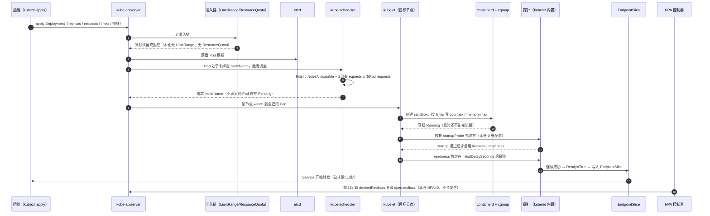

# K8s 资源治理与弹性伸缩：requests 定调度、limits 定生死、HPA 定水位

> **一句话结论**：本仓 `deploy/k8s` 的 20 个工作负载只做完"写 requests/limits"这一步——Σrequests = 3300m / 7040Mi，Σlimits = 14500m / 16896Mi（CPU 超卖 **4.39×**、内存超卖 **2.40×**），而 `HorizontalPodAutoscaler`、`PodDisruptionBudget`、`ResourceQuota`、`LimitRange`、`strategy:`、`terminationGracePeriodSeconds`、`startupProbe` 在 20 个清单里**全部 0 命中**，且 18/20 个工作负载是单副本：资源"声明"有了，资源"治理"没有。
> **阅读前置**：会读 YAML 缩进；知道 Pod / Deployment / StatefulSet 的分工；跑过一次 `kubectl apply`。cgroup、CFS 限流、QoS 这些名词本篇首次出现时就地解释。配套：[07-运维部署/02-Kubernetes入门](../07-运维部署/02-Kubernetes入门.md) 讲对象模型，[07-运维部署/06-优雅停机与零丢失滚动更新](../07-运维部署/06-优雅停机与零丢失滚动更新.md) 讲 Pod 终止时序，[04-K8s网络模型与Service](./04-K8s网络模型与Service.md) 讲 EndpointSlice 何时摘流。
> **证据基线**：B 级 = `deploy/k8s` 全部 20 个清单（1962 行，当次用 `ReadAllLines` 逐份核过行号）+ 8 个 Dockerfile；C 级 = `learning-docs/tools/tmp/m16-02-*` 三个脚本在本机的真实输出（node 审计、PowerShell 独立复算、JVM 堆探针）；A 级 = **0**（`24-源码分析/assets/source/` 的 905 份摘录里搜不到 kubelet / scheduler / cgroup 源码；本机 `kubectl`、`docker`、`helm` 全部 not found，集群侧一律标"未本机实测，给命令与判读方法"）。预计阅读 40～50 分钟。

---

## 0. 先看现象

三个症状，全部用本机真实命令采出来，不是转述。

### 现象一：数一遍"弹性"相关字段，全是 0

```text
PS> cd D:\Projects\Persion\ai-customer-service
PS> (Get-ChildItem deploy\k8s -Recurse -Filter *.yaml | Measure-Object).Count
20

PS> $hits = Get-ChildItem deploy\k8s -Recurse -Filter *.yaml |
               Select-String -Encoding utf8 -Pattern 'HorizontalPodAutoscaler|PodDisruptionBudget|ResourceQuota|LimitRange|startupProbe|terminationGracePeriodSeconds|strategy:'
PS> ($hits | Measure-Object).Count
0
```

怎么读：第二条命令把七个"治理类"关键字一次搜完，命中数 = 0。注意 `-Encoding utf8` 不是装饰——本仓清单里有中文注释，不指定编码会在 Windows PowerShell 5.1 上把行读乱（§6 第一条给完整实证）。

### 现象二：replicas 的分布是 18 个 1、2 个 2

```text
PS> Get-ChildItem deploy\k8s -Recurse -Filter *.yaml |
      Select-String -Encoding utf8 -Pattern '^\s+replicas:\s*(\d+)' |
      ForEach-Object { $_.Matches[0].Groups[1].Value } | Group-Object | Select-Object Name,Count

Name Count
---- -----
1       18
2        2
```

怎么读：`replicas:` 在清单里一共出现 20 次（= 20 个工作负载，其中 8 个业务服务 + 12 个中间件），18 个取值是 1，只有两处是 2——`mysql-slave`（`deploy/k8s/mysql.yaml:210`）与 `product-service`（`deploy/k8s/services/product-service.yaml:25`）。**19/20 这个说法是错的**，真实的单副本比例是 18/20。

### 现象三：CPU 超卖 4.39×、内存超卖 2.40×，单台 4C/8Gi 直接装不下

```text
PS> node learning-docs\tools\tmp\m16-02-k8s-res-audit.mjs
（节选：表 3 与表 6，完整输出见同目录 m16-02-k8s-res-audit.out.txt）

| 口径                        | CPU    | 内存    |
| Σ requests（每工作负载 1 份） | 3300m  | 7040Mi  |
| Σ limits（每工作负载 1 份）   | 14500m | 16896Mi |
| Σ requests × replicas       | 3800m  | 7808Mi  |
| Σ limits × replicas         | 16000m | 18432Mi |
| 超卖倍数 limits/requests     | 4.39×  | 2.40×   |

| 集群形态                    | 可分配 CPU | 可分配内存 | requests 占用 | 装得下吗（按 requests） |
| 单节点 4C / 8Gi             | 4000m      | 7372Mi     | 3800m/7808Mi  | **不能**（内存少 436Mi） |
| 单节点 8C / 16Gi            | 8000m      | 14745Mi    | 3800m/7808Mi  | 能                      |
```

怎么读：`Σ requests × replicas` 才是"真正要调度上去的量"（3800m / 7808Mi，因为 product 与 mysql-slave 各多一个 Pod）。把它和机型比：云端通用型 4C/8Gi 的内存可分配约 8Gi×0.9 = 7372Mi，比 7808Mi 少 436Mi——这不是"可能不够"，是**一定有一个 Pod 起不来**（Pending）。超卖倍数 4.39× 说明 limits 加起来是 requests 的 4 倍多：调度器按小的那个算账，节点内存按大的那个崩溃。

**这些现象指向同一件事：这批清单把 K8s 的资源治理当成"填两个数字"，而没有当成"三份合同"——requests 是跟调度器签的调度合同，limits 是跟内核签的生死合同，HPA/PDB 是跟故障签的兜底合同。三份合同里只签了第一份的一半，所以集群能跑起来，但没有任何一条路径能保证它在压力下、在滚动更新时、在节点维护时还活着。**

---

## 1. 整体地图

```mermaid
flowchart TD
    subgraph REPO["本仓库 deploy/k8s：20 个清单 / 1962 行"]
        SVC["8 个业务服务清单<br/>deploy/k8s/services/*.yaml<br/>Σrequests 1050m / 2304Mi"]
        MID["12 个中间件清单<br/>deploy/k8s/*.yaml<br/>Σrequests 2250m / 4736Mi"]
    end

    subgraph CP["控制面（集群里，不在本仓）"]
        ADM["准入链<br/>LimitRange 补默认 / ResourceQuota 拦总量"]
        SCH["kube-scheduler<br/>只认 requests"]
        HPA["HPA 控制器<br/>要靠 metrics-server"]
        EVC["驱逐管理器 / PDB<br/>只管自愿中断"]
    end

    subgraph NODE["节点上"]
        KL["kubelet<br/>把 limits 翻译成 cgroup 参数"]
        RT["containerd / runc"]
        CG["cgroup：cpu.max / memory.max"]
    end

    SVC -->|"kubectl apply"| ADM
    MID -->|"kubectl apply"| ADM
    ADM --> SCH
    SCH -->|"NodeAllocatable − Σ已有requests ≥ 本Pod requests"| KL
    KL --> RT --> CG
    CG -->|"CPU 打满→CFS 限流，进程不死"| KL
    CG -->|"内存打满→cgroup OOM Killer，容器 exit 137"| KL
    HPA -.->|"改 replicas（本仓 0 个 HPA，未落地）"| SVC
    EVC -.->|"drain 时挡一挡（本仓 0 个 PDB）"| SCH
```



> **读图说明**：图分三层，**左边是本仓能核对的东西**（20 个清单，requests 合计 1050m+2250m=3300m），中间和右边是集群行为（本机无集群，只能给命令与判读方法）。三条实线是"apply 之后必然发生的链路"：清单 → 准入 → 调度 → kubelet → cgroup，任何一个环节都能把 Pod 卡死，而卡死的位置不同、报错完全不同（Pending / CrashLoop / OOMKilled / Running 但不接流量）。两条虚线是本仓**完全缺失**的环节：HPA（水位）与 PDB（自愿中断保护），虚线画出来是为了让你记住"这两条链路现在不存在"，而不是"存在但没配好"。

| 组件 / 参与方 | 责任 | 读哪份输入 | 本仓对应物 | 本机能核对吗 |
|---|---|---|---|---|
| kube-scheduler | 选节点、绑定 `nodeName` | Pod 的 **requests**（+ 亲和/污点/拓扑） | 20 个工作负载都写了 requests | 只能静态核对清单，调度结果未实测 |
| 准入链（LimitRange / ResourceQuota） | 补默认值 / 拒绝超配额对象 | LimitRange、ResourceQuota | **0 命中** | 是（`Select-String` 计数为 0） |
| kubelet | 起容器、配 cgroup、跑探针、算 Pod 状态 | Pod 的 **limits**、probe 配置 | 20 个 limits + 20 对探针 | 只能静态核对 |
| cgroup（v1/v2） | CPU 限流、内存 OOM 的**执行者** | kubelet 写入的 `cpu.max` / `memory.max` | 由 limits 折算 | 否（Windows 宿主无 cgroup，见 §3.2 探针） |
| HPA 控制器 | 按指标算 desiredReplicas 并改 `spec.replicas` | metrics-server / 自定义指标 | **0 命中** | 是（计数为 0），扩缩容未实测 |
| VPA | 按历史用量反推 requests | VPA CRD + recommender | **0 命中** | 是（计数为 0） |
| 驱逐管理器 + PDB | 节点压力时按 QoS 排序驱逐；drain 时按 PDB 控制并发 | QoS 档、PDB | **0 命中** | 是（计数为 0），驱逐未实测 |
| 运维 / GitOps | 提交清单、发布 | 全部 YAML | 20 个清单（无 Helm/ArgoCD） | 是 |

### 1.1 声明层全景：20 个工作负载的 replicas / requests / limits / 探针

下面这张表是**逐份真读清单**得到的（不是抽样、不是假设），出处是 `learning-docs/tools/tmp/m16-02-k8s-res-audit.mjs` 的输出快照，并与 `learning-docs/tools/tmp/m16-02-k8s-res-scan.ps1`（纯 PowerShell 独立实现）交叉验证一致。`cpu 倍数` / `mem 倍数` 指**同一个工作负载内部** limits ÷ requests，不是跨服务比较——它衡量"这个服务被允许超出自己承诺多少倍"。

| # | 工作负载 | kind | replicas 声明位置 | 副本 | requests | limits | cpu 倍数 | mem 倍数 | 探针（liveness / readiness） |
|---|---|---|---|---|---|---|---|---|---|
| 1 | chroma | StatefulSet | `deploy/k8s/chroma.yaml:33` | 1 | 100m / 256Mi | 500m / 1024Mi | 5.00× | 4.00× | httpGet `/api/v1/heartbeat`:8000 / 同 |
| 2 | elasticsearch | StatefulSet | `deploy/k8s/elasticsearch.yaml:40` | 1 | 500m / 1024Mi | 2000m / 2048Mi | 4.00× | 2.00× | httpGet `/_cluster/health`:9200 / 同 |
| 3 | minio | StatefulSet | `deploy/k8s/minio.yaml:39` | 1 | 100m / 256Mi | 500m / 512Mi | 5.00× | 2.00× | httpGet `/minio/health/live` / `/minio/health/ready` |
| 4 | mysql-master | StatefulSet | `deploy/k8s/mysql.yaml:126` | 1 | 250m / 512Mi | 1000m / 1024Mi | 4.00× | 2.00× | exec / exec |
| 5 | mysql-slave | StatefulSet | `deploy/k8s/mysql.yaml:210` | **2** | 250m / 512Mi | 1000m / 1024Mi | 4.00× | 2.00× | exec / exec |
| 6 | nacos | Deployment | `deploy/k8s/nacos.yaml:40` | 1 | 200m / 256Mi | 1000m / 1024Mi | 5.00× | 4.00× | httpGet `/nacos/v1/console/health/readiness`:8848 / 同 |
| 7 | neo4j | StatefulSet | `deploy/k8s/neo4j.yaml:34` | 1 | 250m / 512Mi | 1000m / 2048Mi | 4.00× | 4.00× | tcpSocket 7687 / httpGet `/:7474` |
| 8 | redis | StatefulSet | `deploy/k8s/redis.yaml:101` | 1 | 100m / 128Mi | 500m / 512Mi | 5.00× | 4.00× | exec / exec |
| 9 | rocketmq-namesrv | Deployment | `deploy/k8s/rocketmq.yaml:37` | 1 | 100m / 256Mi | 500m / 512Mi | 5.00× | 2.00× | tcpSocket 9876 / tcpSocket 9876 |
| 10 | rocketmq-broker | Deployment | `deploy/k8s/rocketmq.yaml:103` | 1 | 200m / 512Mi | 1000m / 1024Mi | 5.00× | 2.00× | tcpSocket 10911 / tcpSocket 10911 |
| 11 | sentinel-dashboard | Deployment | `deploy/k8s/sentinel-dashboard.yaml:32` | 1 | 100m / 256Mi | 500m / 512Mi | 5.00× | 2.00× | httpGet `/:8858` / 同 |
| 12 | ai-chat-service | Deployment | `deploy/k8s/services/ai-chat-service.yaml:36` | 1 | 200m / 512Mi | 1000m / 1024Mi | 5.00× | 2.00× | tcpSocket 8083 / tcpSocket 8083 |
| 13 | api-gateway | Deployment | `deploy/k8s/services/api-gateway.yaml:38` | 1 | 100m / 256Mi | 500m / 512Mi | 5.00× | 2.00× | tcpSocket 8080 / tcpSocket 8080 |
| 14 | knowledge-service | Deployment | `deploy/k8s/services/knowledge-service.yaml:36` | 1 | 100m / 256Mi | 500m / 512Mi | 5.00× | 2.00× | tcpSocket 8082 / tcpSocket 8082 |
| 15 | message-service | Deployment | `deploy/k8s/services/message-service.yaml:36` | 1 | 100m / 256Mi | 500m / 512Mi | 5.00× | 2.00× | tcpSocket 8085 / tcpSocket 8085 |
| 16 | notify-service | Deployment | `deploy/k8s/services/notify-service.yaml:36` | 1 | 100m / 256Mi | 500m / 512Mi | 5.00× | 2.00× | tcpSocket 8086 / tcpSocket 8086 |
| 17 | product-service | Deployment | `deploy/k8s/services/product-service.yaml:25` | **2** | 250m / 256Mi | 500m / 512Mi | 2.00× | 2.00× | httpGet `/actuator/health`:8088 / 同 |
| 18 | search-service | Deployment | `deploy/k8s/services/search-service.yaml:36` | 1 | 100m / 256Mi | 500m / 512Mi | 5.00× | 2.00× | tcpSocket 8084 / tcpSocket 8084 |
| 19 | user-service | Deployment | `deploy/k8s/services/user-service.yaml:35` | 1 | 100m / 256Mi | 500m / 512Mi | 5.00× | 2.00× | tcpSocket 8081 / tcpSocket 8081 |
| 20 | xxl-job-admin | Deployment | `deploy/k8s/xxl-job.yaml:32` | 1 | 100m / 256Mi | 500m / 1024Mi | 5.00× | 4.00× | httpGet `/xxl-job-admin/`:8080 / 同 |

> 共同点先记住三条：① **20/20 都写了 requests 与 limits**（没有人漏）；② **20/20 都没有 `startupProbe`**，全部靠 `initialDelaySeconds` 硬编码（Spring 服务统一 60s / 30s）；③ **20/20 的 requests 都小于 limits**，所以全部落在 Burstable，没有一个 Guaranteed。

### 1.2 逐行点评：每一行的"这意味着什么"

| # | 工作负载 | 点评（基于上表的真实数字） |
|---|---|---|
| 1 | chroma | 向量库给 100m/256Mi 的 requests，是全仓最"薄"的档位之一；chroma 用 RWO 的 local-path PVC，单副本重建时必须回到同一节点才能挂上盘。 |
| 2 | elasticsearch | liveness 的 `timeoutSeconds` 设到 10s（全仓最大，其余多为 5s 或缺省 1s），说明这份清单被真正调过；在显式写了 `-Xmx` 的 JVM 组件里，它也是唯一把堆压到 limit 25% 的（其余都是 50%），给堆外留得最宽。 |
| 3 | minio | CPU 5× 余量对对象存储意义不大（瓶颈在磁盘与网络），但内存 2× 意味着大文件分片上传时可能撞 512Mi。 |
| 4 | mysql-master | liveness 与 readiness 用的是**不同**的 exec 命令（不是简单复制），这点比 7 个 Spring 服务的 `tcpSocket` 讲究；但单副本 = 主库无冗余。 |
| 5 | mysql-slave | 唯一 2 副本的中间件，可它的"多副本"救不了写路径——业务写的还是 master。 |
| 6 | nacos | 200m/256Mi 的 requests 承担注册与配置推送，服务批量重启时最先在这里打满 CPU；`JVM_XMX=512m` 只占 limit 50%。 |
| 7 | neo4j | 内存 limit 2Gi 但 requests 只有 512Mi（4× 差异），而图查询恰恰最吃内存——这一行的 Pod 在节点内存紧张时最可能被先驱逐。 |
| 8 | redis | 内存 requests 128Mi 是全仓最小，limit 512Mi；但 ConfigMap 里写了 `maxmemory 256mb` + `maxmemory-policy allkeys-lru`（`deploy/k8s/redis.yaml:42`、`:44`，`:128` 的注释还提醒"limits.memory 要大于 maxmemory+开销"），所以它会先按 LRU 自淘汰、不会撞 cgroup 的 512Mi，K8s 的 limit 在这里只是防呆。**这是全仓唯一一个"应用层内存上限 < 容器 limit"的例子**，值得抄。 |
| 9 | rocketmq-namesrv | 用 `tcpSocket 9876` 判活：名字服务"端口在听"不等于路由信息可用，注册异常时探针照样全绿。 |
| 10 | rocketmq-broker | 单副本 broker = 消息在集群里只有一份；broker 自身支持 DLedger 多副本，但这份清单没有配。 |
| 11 | sentinel-dashboard | `readinessProbe`（L52-57）写在 `livenessProbe`（L58-63）**之前**，顺序与其余 19 份相反——纯风格问题，但 review 时容易看漏其中一个。 |
| 12 | ai-chat-service | 全仓最大档（1000m/1Gi limit）配 `-Xmx512m`（堆占 50%）；它是唯一跑 LLM 调用链的服务，却用 `tcpSocket` 判就绪、60s 硬编码延迟。 |
| 13 | api-gateway | **全站入口却用最小档**（100m/256Mi requests）且单副本：网关重启 = 全站不可用，而它在调度眼里只值 0.1 核。 |
| 14 | knowledge-service | 文档解析/向量化是 CPU 密集任务，100m 的 requests 意味着它一旦跑批就长期在 requests 之上，属 Burstable 内部的弱势方。 |
| 15 | message-service | RocketMQ 的消费侧，单副本重启期间消息堆积，恢复后是否重复消费取决于业务幂等（资源治理管不到这一层，但滚动更新的中断会把它放大）。 |
| 16 | notify-service | WebSocket 长连接服务，单副本 + 无 `preStop` + 无 `terminationGracePeriodSeconds`：重启时所有在线连接直接断，客户端要靠重连兜。 |
| 17 | product-service | 全仓**唯一的多副本 + 唯一的 httpGet 探针**，本是治理样本；但它落在 `aics` 命名空间、镜像无私有仓库前缀、引用了不存在的 Secret（`deploy/k8s/services/product-service.yaml:5-12` 的自白），"能跑起来"这件事反而最不确定。 |
| 18 | search-service | ES 查询层给 100m requests 偏乐观：全文检索是 CPU 与堆双密集，5× 的 CPU 余量意味着限流概率高。 |
| 19 | user-service | 登录/鉴权链路上的单副本：它挂掉时网关能连上但每个请求都 401/500，属于"看起来在服务、实际全错"的典型。 |
| 20 | xxl-job-admin | 调度中心单副本 + `memory limit 1Gi` 却没有任何堆参数（走 JDK 默认 25% ≈ 256Mi 堆），堆与 limit 之间留了 768Mi 的未知区。 |

**读图之后再记住一句话**：这四层里唯一"本机可以百分之百证实"的是**声明层**（清单写了什么、合计多少、倍数多少）；行为层（调度、限流、驱逐、扩缩）本机没有集群，只能给命令 + 判读口径。本篇后面每一节都会明确标出自己在哪一层。

---

## 2. 关键概念与关键要素

| 名称 | 位置（本仓真实去处） | 作用 | 关键参数 / 判读点 |
|---|---|---|---|
| `resources.requests` | 20 个工作负载都有，例：`deploy/k8s/services/ai-chat-service.yaml:93-96` | 给**调度器**看的"我要这么多"，也是 HPA 百分比的分母、CPU 权重的基准 | cpu / memory 两个维度；`requests` 之和决定"这个节点还能不能再塞一个 Pod" |
| `resources.limits` | 同上，例：`deploy/k8s/services/ai-chat-service.yaml:97-99` | 给**内核**看的硬墙：CPU 到顶被限流（不死），内存到顶被 OOMKill（会死） | `memory` 超了不留情面；`cpu` 超了只是慢 |
| 资源单位 | 全仓格式统一 | `100m` = 0.1 核；`1` = 1 核；`256Mi` = 256×1024² 字节（`M`/`G` 是十进制，`Mi`/`Gi` 是二进制） | 把 `m` 当毫核、`Mi` 当 1024² 就不会算错 |
| QoS 类 | 由 requests/limits 的**关系**自动推出，不写在 YAML 里 | 决定节点内存压力时的**驱逐顺序** | Guaranteed / Burstable / BestEffort 三档；本仓 20 个全是 Burstable |
| `livenessProbe` | 20 处，例：`deploy/k8s/services/ai-chat-service.yaml:100-105` | 失败 → kubelet **重启容器** | `initialDelaySeconds` / `periodSeconds` / `timeoutSeconds` / `failureThreshold` |
| `readinessProbe` | 20 处，例：`deploy/k8s/services/ai-chat-service.yaml:106-111` | 失败 → **摘出 EndpointSlice**（不重启） | 决定"什么时候开始接流量"，是零中断发布的真正开关 |
| `startupProbe` | **0 处** | 慢启动保护：startup 成功前不跑 liveness，避免启动期被误杀 | `failureThreshold × periodSeconds` = 允许的启动时长上限 |
| `LimitRange` | **0 处** | 命名空间级：给没写 resources 的容器**注入默认值**，也能设 min/max 与 limit/request 比值 | 没有它 → 忘写就是 BestEffort（本仓没忘写，但新加的清单会） |
| `ResourceQuota` | **0 处** | 命名空间级：限制 Σrequests / Σlimits / Pod 数 / 对象数 | 没有它 → 谁都能 apply 一个 requests 64Gi 的 Pod，把节点全占死 |
| `HorizontalPodAutoscaler` | **0 处** | 按指标改 `spec.replicas`（水位自动扩缩） | 指标来源：resource（metrics-server 的 CPU/内存）、custom（Prometheus Adapter）、external；**CPU 利用率以 requests 为分母** |
| VPA | **0 处** | 按历史用量推荐/改写 requests（三组件：recommender / updater / admission） | 模式 `Off`（只给建议）/ `Initial`（只在新 Pod 生效）/ `Recreate`（重建 Pod 生效）；与 HPA 同指标会打架 |
| `PodDisruptionBudget` | **0 处** | 限制**自愿中断**的并发（drain、eviction API） | `minAvailable` / `maxUnavailable`；对节点宕机、OOM 这类非自愿中断无效 |
| `strategy` / `updateStrategy` | **0 处**（全部走默认） | Deployment 默认 `RollingUpdate`：`maxSurge=25%`、`maxUnavailable=25%` | 副本 = 1 时两个百分比各自取整后是 `1` 和 `0`（§3.6 给算术） |
| `terminationGracePeriodSeconds` | **0 处**（默认 30s） | SIGTERM 之后给进程多久自行退出 | 没有 `preStop` 时，摘流与 SIGTERM 几乎同时发生 → 在途请求丢 |
| `JAVA_OPTS` 等堆参数 | 7 个服务清单 + 4 个中间件，见 §3.4 表 | 决定 JVM 堆上限，与内存 limit 是**两套独立预算** | `-Xmx` 显式指定 vs `-XX:MaxRAMPercentage`（JDK 17 默认 25%） |

---

## 3. 原理与证据逐段精读

### 3.1 requests 是"调度合同"，不是"限速器"

**在干什么**：`requests` 只在**调度那一刻**生效。kube-scheduler 对每个节点算一次 `NodeAllocatable − Σ(已绑定 Pod 的 requests)`，只有剩余量 ≥ 新 Pod 的 requests 才把 Pod 绑上去（还要过亲和/污点/拓扑）。绑完之后，requests 就不再限制任何东西——节点上真正跑多少，由 limits 和内核说了算。

**为什么这么设计**：集群要做"超卖"（overcommit）。如果按峰值预留，成本会高到没人用；按"典型用量"（requests）预留、按"峰值上限"（limits）兜底，是**把过载风险换成资源利用率**的经典交易。所以 K8s 故意让 requests 和 limits 可以不等。

**换写法会怎样**：
- 三个都不写 → BestEffort，调度器当它是 0，节点会被塞爆，内存压力时它第一个死。
- 只写 limits 不写 requests（老 K8s 常见）→ 准入会把 requests 默认成等于 limits（K8s 的 `defaultRequest` 行为），等于放弃超卖；本仓没犯这个错，20/20 都显式写了 requests。
- requests 写得过大（比如照抄 limits）→ 装不下就是 Pending，而且是你自己算出来的 Pending（本仓 4C/8Gi 就差 436Mi 那个例子）。

**常见坑**：把 requests 当"配额"用，以为超了会被杀——不会；也把 requests 当"够用就行"随手写 100m，结果是 CPU 密集服务在 4 核节点上只能抢到 1/4 的权重（CPU 的调度权重按 requests 比例分配），表现成"同机其他服务一忙，我就慢"，而监控里 CPU 用量远没到 limit。

### 3.2 limits 是"生死合同"：CPU 可压缩、内存不可压缩

**在干什么**：kubelet 把 limits 翻译成 cgroup 参数。CPU 侧写的是 **quota/period**（CFS 带宽控制，一个周期默认 100ms，`cpu.max = quota period`），一个周期内用完配额，本周期剩下的时间就被**限流（throttle）**，下一个周期恢复；内存侧写 `memory.max`，超了由**内核 cgroup OOM Killer** 直接杀进程，kubelet 看到的结局是容器 `exit code 137`、`reason: OOMKilled`。

**为什么这么设计**：CPU 是**可压缩资源**——让它慢一点，程序还能跑；内存是**不可压缩资源**——不能"慢一点地借"，只能杀。这不是 K8s 的选择，是操作系统内存模型的必然结果，K8s 只是把它映射成了两套语义。

**换写法会怎样**：把内存 limit 设得比堆还小（比如 `-Xmx1g` 配 `limits.memory: 512Mi`），JVM 会先申请、后被杀，日志里可能连一句 `OutOfMemoryError` 都没有——因为杀它的是内核，不是 JVM；反过来，内存 limit 给得过大（比如 4Gi），单 Pod 就能在节点上吃到 NotReady，牵连整机。

**常见坑**：只看 JVM 堆。本机实测（C 级，脚本 `learning-docs/tools/tmp/m16-02-heap-headroom.java` + `m16-02-heap-headroom.ps1`）用 `-Xms256m -Xmx256m` 跑一个把堆填到 85% 的探针：

```text
--- JVM self report ---
  maxHeapMi        = 256
  cores            = 16
  javaVersion      = 17.0.19
  containerSupport = cgroup detection: (none)
  heldMi           = 107
  usedAfterFillMi  = 217
  committedMi      = 256      (JVM 向 OS 要了多少)

--- RSS sampling ---
  samples              = 24
  peak WorkingSet64    = 212.3 MiB
  peak / 256Mi heap    = 0.83x
```

怎么读：`maxHeapMi = 256` 证明 `-Xmx` 被精确执行；`committedMi = 256` 是 JVM 向系统实际要到的虚拟内存量；`peak WorkingSet64 = 212.3 MiB` 是 Windows 口径的常驻内存，它**小于堆上限**——因为 `containerSupport` 是 `(none)`（Windows 宿主没有 cgroup），且 WorkingSet 只统计常驻页。**误判风险**：不要把 0.83× 当成"堆外开销为负"，它只说明"在 Windows 上量不准"；反过来，也不要以为 Linux 容器里 RSS ≈ 堆。要在容器里量，可用的命令（**未本机实测**，本机无集群）：

```bash
# 1) 容器内看 cgroup 记账的真实用量（cgroup v2 路径）
kubectl exec -n ai-customer-service deploy/ai-chat-service -- cat /sys/fs/cgroup/memory.current
# 2) 对比 limit
kubectl exec -n ai-customer-service deploy/ai-chat-service -- cat /sys/fs/cgroup/memory.max
# 3) 集群视角
kubectl top pod -n ai-customer-service --containers
# 4) 被杀的证据（137 才是 OOMKill 的指纹）
kubectl describe pod -n ai-customer-service -l app=ai-chat-service | Select-String 'Last State|Reason|Exit Code|OOMKilled'
```

判读列：`memory.current` 逼近 `memory.max` 就是"要 OOM 了"；`Exit Code: 137` + `Reason: OOMKilled` = 内核杀的；如果容器里日志有 `java.lang.OutOfMemoryError` 而 exit code 是 1，是**堆内**OOM（另一回事）。

### 3.3 QoS 三档与驱逐顺序：本仓 20 个全是 Burstable

**在干什么**：QoS（Quality of Service）不是写在 YAML 里的字段，是**由 requests/limits 的关系自动推导**的标签，决定三件事：节点内存压力时谁先被驱逐、OOM 打分时谁先死、CPU 在节点争抢时的相对权重。

| QoS | 判定规则 | 驱逐顺序 | 本仓数量 |
|---|---|---|---|
| Guaranteed | 每个容器都写了 requests 和 limits，且 **cpu、memory 两项都 requests == limits** | 最后被驱逐 | **0** |
| Burstable | 写了 requests，但至少一项 requests < limits（或只写了一部分） | 中间层；同为 Burstable 时，**用量超出 requests 越多越先死** | **20** |
| BestEffort | 完全没写 requests 也没写 limits | 最先被驱逐 | **0** |

**为什么这么设计**：节点内存不够时，必须有人死，否则整台机器都会 NotReady（牵连所有人）。规则是"谁的要求最少、超支最多，谁先走"——这在工程上等价于"按承诺兑现，不按占便宜优先"。

**换写法会怎样**：想让核心链路（网关、chat）优先活着，就得往 Guaranteed 靠：`requests == limits` 并且两项都写。代价是彻底放弃超卖——本仓 22 个 Pod 的 Σrequests 是 3800m/7808Mi，如果全部转 Guaranteed（等于按 limits 预留 16000m/18432Mi），单台 4C/8Gi 连一个都跑不满，需要 3 台 8C/32Gi 才舒服。**这是取舍，不是"升级"**。

**常见坑**：以为"我写了 requests 就是 Burstable 里比较安全的那个"——不对，Burstable 内部排序看的是 `usage − requests` 的差值，一个 requests 写 100m、实际常年吃 900m 的 Pod，比一个 requests 写 500m、实际吃 600m 的 Pod 更容易被驱逐。本仓最典型的是 `ai-chat-service`（requests 200m/512Mi，limits 1000m/1Gi，`deploy/k8s/services/ai-chat-service.yaml:93-99`）：CPU 5×、内存 2× 的余量意味着它完全可能长期跑在 requests 之上，**在驱逐排序里是弱势方**。

### 3.4 堆预算和 limit 是两套账：谁在决定堆大小

**在干什么**：JVM 的堆上限有三个来源，优先级从高到低：命令行 `-Xmx` > `-XX:MaxRAMPercentage`（按"可用内存"的百分比）> 默认值（约物理内存的 1/4）。而"可用内存"在容器里应该是 cgroup limit，在裸机上却是整机内存——这个差别是容器化 Java 最经典的坑。

**本仓的堆设置全景**（B 级，全部 `ReadAllLines` 核对过行号）：

| 工作负载 | 堆设置 | 声明位置 | 内存 limit | 堆 ÷ limit |
|---|---|---|---|---|
| ai-chat-service | 512Mi（`JAVA_OPTS`） | `deploy/k8s/services/ai-chat-service.yaml:91-92` | 1024Mi | 50% |
| api-gateway | 256Mi（`JAVA_OPTS`） | `deploy/k8s/services/api-gateway.yaml:61-62` | 512Mi | 50% |
| knowledge-service | 256Mi（`JAVA_OPTS`） | `deploy/k8s/services/knowledge-service.yaml:76-77` | 512Mi | 50% |
| message-service | 256Mi（`JAVA_OPTS`） | `deploy/k8s/services/message-service.yaml:75-76` | 512Mi | 50% |
| notify-service | 256Mi（`JAVA_OPTS`） | `deploy/k8s/services/notify-service.yaml:60-61` | 512Mi | 50% |
| search-service | 256Mi（`JAVA_OPTS`） | `deploy/k8s/services/search-service.yaml:61-62` | 512Mi | 50% |
| user-service | 256Mi（`JAVA_OPTS`） | `deploy/k8s/services/user-service.yaml:69-70` | 512Mi | 50% |
| elasticsearch | 512Mi（`ES_JAVA_OPTS`） | `deploy/k8s/elasticsearch.yaml:64-65` | 2048Mi | 25% |
| nacos | 512Mi（`JVM_XMX`） | `deploy/k8s/nacos.yaml:72-75` | 1024Mi | 50% |
| rocketmq-namesrv | 256Mi（`JAVA_OPT_EXT`） | `deploy/k8s/rocketmq.yaml:54-55` | 512Mi | 50% |
| rocketmq-broker | 512Mi（`JAVA_OPT_EXT`） | `deploy/k8s/rocketmq.yaml:123-124` | 1024Mi | 50% |
| neo4j | 未设（走默认百分比） | — | 2048Mi | 约 25% |
| sentinel-dashboard | 未设（`JAVA_OPTS` 里只有 `-D` 参数） | `deploy/k8s/sentinel-dashboard.yaml:47-51` | 512Mi | 约 25% |
| xxl-job-admin | 未设（`PARAMS` 来自 Secret） | `deploy/k8s/xxl-job.yaml:47-51` | 1024Mi | 约 25% |
| product-service | 未设（清单里根本没有堆 env） | — | 512Mi | 约 25% |
| chroma / minio / mysql-master / mysql-slave / redis | 非 JVM | — | 512Mi～1024Mi | — |

**为什么这么设计（以及本仓为什么写成这样）**：`JAVA_OPTS` 能生效，前提是镜像的 `ENTRYPOINT` 里做了变量展开。本仓 21 行的 `ai-cs-chat/Dockerfile` 第 21 行是 `ENTRYPOINT ["sh", "-c", "java ${JAVA_OPTS:-} -jar app.jar"]`——所以清单里的 `JAVA_OPTS` 有效；而 `ai-cs-product/Dockerfile`（11 行）第 11 行是 `ENTRYPOINT ["java", "-jar", "app.jar"]`，`ai-cs-order/Dockerfile`（21 行）第 21 行同样是硬编码 `java -jar`——**这两个镜像根本不读 `JAVA_OPTS`**，所以 `product-service` 清单里不写堆参数不是遗漏，是"写了也没用"。这就是"清单 + 镜像 + JVM 三层耦合"的现实样本。

**换写法会怎样**：用 `-XX:MaxRAMPercentage=50` 代替写死 `-Xmx256m`，堆就会跟着 limit 变——改 limit 不用改堆。本机实测默认值是 25%：

```text
PS> java -XX:+PrintFlagsFinal -version 2>&1 | Select-String 'MaxRAMPercentage|MaxHeapSize'
double MaxRAMPercentage  = 25.000000   {product} {default}
size_t MaxHeapSize       = 8514437120  {ergonomic}     ← 没给 -Xmx 时

PS> java -Xmx256m -XX:+PrintFlagsFinal -version 2>&1 | Select-String 'MaxHeapSize'
size_t MaxHeapSize       = 268435456   {product} {command line}   ← 给了就按给的
```

怎么读：本机物理内存 31.7 GiB（`Get-CimInstance Win32_ComputerSystem` 实测），25% ≈ 7.93 GiB = 8514437120 字节——**没有 `-Xmx` 时 JVM 按整机内存算堆**。**误判风险**：在容器里如果 JVM 感知不到 cgroup（镜像太老、或显式关了 `-XX:-UseContainerSupport`），`-XX:MaxRAMPercentage` 同样会按**宿主**内存算，于是 memory limit 512Mi 的 Pod 里 JVM 会去要 7.93GiB 的堆——一启动就 OOMKilled。所以"用 MaxRAMPercentage 代替 -Xmx"成立的前提是 JVM 版本认得 cgroup（Java 8u191+/10+ 默认开启），并且要在容器里用 `java -XX:+PrintFlagsFinal -version | grep MaxHeapSize` 亲自验一遍。

**常见坑**：把 50% 当金科玉律。堆只占进程内存的一部分，还有元空间（Metaspace）、线程栈（每线程 1MB 左右）、直接内存（Netty/NIO）、JIT 代码缓存、GC 自身开销。堆 = limit 的 50% 是"给堆外留一半"的粗配比，真正的判据只有一个：**RSS 峰值（容器内 `memory.current`）+ 余量 ≤ limit**。本仓 ES 是 25%、其余 50%，说明当年是"凭经验分配"而不是"量过"。

### 3.5 HPA 决定水位：requests 是分母，没 requests 就没有水位

**在干什么**：HPA 控制器每 `--horizontal-pod-autoscaler-sync-period`（kube-controller-manager 默认 15s）读一次指标，算期望副本数，改 Deployment 的 `spec.replicas`：

```text
desiredReplicas = ceil( currentReplicas × currentMetricValue / desiredMetricValue )
```

CPU 场景下 `currentMetricValue` 是"平均 CPU 用量 ÷ requests.cpu"，`desiredMetricValue` 就是你写的 `averageUtilization`（比如 70%）。**分母是 requests，不是 limits。**

**为什么这么设计**：requests 是"这个 Pod 正常该占多少"，用它做分母，水位才有物理意义（"我这个服务被压到了设计容量的 1.8 倍"）；如果用 limits，超卖越大越难触发扩容，等于自欺欺人。

**换写法会怎样（真实算术）**：假设 `api-gateway` 的 requests.cpu = 100m（本仓真实值，`deploy/k8s/services/api-gateway.yaml`），HPA 目标 70%，当前 2 副本、实测平均 180m：

```text
利用率 = 180m / 100m = 1.80  →  1.80 / 0.70 = 2.571  →  ceil(2 × 2.571) = 6 副本
```

也就是说 100m 的 requests 让"180m 的平均用量"被算成 180% 水位，HPA 会跳到 6 副本——如果 requests 写的是 200m，同样的 180m 只有 90% 水位，一个副本都不扩。**requests 写得越小，HPA 越激进**，这是调 HPA 时最常见的"扩缩容抖动"根因。

**常见坑**：HPA 配了但从不生效。检查顺序是：① `kubectl get hpa` 的 TARGETS 列显示 `<unknown>` → metrics-server 没装或拉不到指标；② TARGETS 显示 `0%/70%` 或 `undefined` → 容器没写 requests（分母为 0，CPU 利用率算不出来）；③ 目标 Deployment 的 `spec.replicas` 手动改过 → HPA 会再改回来，别跟它抢。**本仓现状：HPA 0 个**，所以上面这些全都没有发生——不是"跑得很好"，是"根本没有水位机制"，现在的容量是人工按 20 个清单里那 22 个 Pod 写死的。

### 3.6 PDB 与滚动更新：单副本的真实中断点

**在干什么**：这里要分清两种中断。
- **自愿中断（voluntary）**：运维发起的——`kubectl drain`、`kubectl delete pod`、集群自动缩容、升级。**PDB 只管这一类**。
- **非自愿中断（involuntary）**：节点宕机、内核 panic、OOMKill、硬件故障。PDB 管不了，只能靠多副本 + 反亲和 + 拓扑打散。

**滚动更新的算术（本仓 `strategy:` 0 命中，全部走默认）**：Deployment 默认 `RollingUpdate`，`maxSurge=25%`、`maxUnavailable=25%`。两个百分比的取整方向**相反**：surge 向上取整，unavailable 向下取整。副本 = 1 时：

```text
maxSurge      = ceil (1 × 25%) = 1   → 允许临时多 1 个 Pod
maxUnavailable= floor(1 × 25%) = 0   → 不允许多 0 个不可用
```

所以"单副本 + 默认策略"在**理想情况**下不会中断：先起新 Pod、等它 Ready、再删旧 Pod。真正会让单副本服务断掉的，是下面四条（都不是"默认策略必然断"，而是"没人管就一定断"）：

1. **节点 drain 时没有 PDB**：驱逐 API 直接删 Pod，断流窗口 ≈ 优雅终止 + 重新调度 + 容器启动 + JVM 预热。本仓 PDB 0 个 → 这个窗口完全裸露。
2. **`maxUnavailable` 被改成 1（或显式 `strategy: Recreate`）**：本仓没写 strategy，一旦有人为了"省资源"加上 `Recreate`，就是先杀后起，必断。
3. **没有 `terminationGracePeriodSeconds` 与 `preStop`**：Pod 被删时，摘 EndpointSlice 与发 SIGTERM 几乎同时发生，网关还没来得及更新后端列表，在途请求就打到已经关掉的连接上。本仓两者都是 0 命中，只有默认 30s 窗口 + 应用自己的 shutdown hook 在撑。
4. **`readinessProbe` 用 `tcpSocket`**：本仓 7 个业务服务里有 6 个用的是 `tcpSocket`（例：`deploy/k8s/services/ai-chat-service.yaml:106-111`），它只证明"端口在 listen"，Spring 上下文还没就绪也能通过 → 新 Pod 提前被判 Ready，滚动更新时"新 Pod 已经在服务了但其实还不能干活"。唯一用 `httpGet /actuator/health` 的是 `product-service`（`deploy/k8s/services/product-service.yaml:68-73`）。

**为什么这么设计**：PDB 的作用是把"运维想一次干掉几个"变成"集群被允许一次干掉几个"，它算的是 `当前可用副本 − minAvailable`（或 `maxUnavailable`）。这里有个反直觉的算术：**1 副本 + `minAvailable: 1` → 允许中断数 = 0 → drain 会永远卡住**（要么加 `--force` 绕过，要么把副本加到 2）。所以"加个 PDB 就安全了"是错的，PDB 必须和多副本一起加。

**换写法会怎样**：给关键服务配 2 副本 + `PDB minAvailable: 1`，才有意义（允许一次干掉 1 个，还剩 1 个接流）；1 副本 + `maxUnavailable: 1` 的 PDB 等于没有（允许数 = 1 = 全部）。**常见坑**：只加 PDB 不加副本 → drain 卡住，运维习惯性加 `--force`，于是 PDB 形同虚设，事故反而更隐蔽。

### 3.7 LimitRange / ResourceQuota 缺失：为什么后面每条路都是裸奔

**在干什么**：这两个是**命名空间级**的守门人，都在准入链上工作：
- `LimitRange`：容器没写 resources 时**注入默认值**（`default` / `defaultRequest`），还能设 `min` / `max` / `maxLimitRequestRatio`（后者可以强制 requests 与 limits 的比值，间接逼出 Guaranteed）。
- `ResourceQuota`：限制整个命名空间的 `Σ requests.cpu` / `Σ requests.memory` / `Σ limits.*` / `count/pods` 等。注意一个细节：**一旦配额里写了 `requests.cpu`，所有 Pod 都必须声明 `requests.cpu`，否则被拒绝**。

**为什么这么设计**：K8s 是多租户系统，"命名空间"是租户边界，而资源边界必须显式声明——否则一个命名空间能把整台机器吃满。这是"默认不信任"的设计哲学。

**换写法会怎样**：加上 `ResourceQuota` 以后，本仓的 `Σrequests = 3300m / 7040Mi` 就从"一句统计"变成"一道闸门"：谁再 apply 一个 4C/16Gi 的 Pod，直接被 API Server 拒掉，而不是等到节点 OOM 才发现。加上 `LimitRange` 以后，新清单忘写 resources 不会静默变成 BestEffort。

**常见坑**：把 `resources:` 的**出现次数**当成工作负载数。本仓这条命令的输出是 27，而工作负载是 20——多出来的 7 次是 7 个 `volumeClaimTemplates` 里的 `requests.storage`（存储申请只有下限、没有上限，语义完全不同）：

```text
PS> (Get-ChildItem deploy\k8s -Recurse -Filter *.yaml | Select-String -Encoding utf8 -Pattern 'resources:').Count
27
PS> (Get-ChildItem deploy\k8s -Recurse -Filter *.yaml | Select-String -Encoding utf8 -Pattern 'limits:').Count
20
```

怎么读：`requests:` 也是 27、`limits:` 只有 20，差的 7 就是 PVC（chroma、elasticsearch、minio、mysql-master、mysql-slave、neo4j、redis 各一个 volumeClaimTemplates）。**误判风险**：把 PVC 的 storage 当成容器资源一起求和，会得到"requests 里有 7 个奇怪的内存单位"这种脏数据；正确做法是解析时先判断块里有没有 `storage:`（本篇的 node 脚本就是这么区分 20 与 7 的）。

---

## 4. 一次完整执行时序



> **读图说明**：这张图是"一个 Pod 从 YAML 到接流量"的完整生命周期，**1~5 步决定它能不能跑（调度层），6~10 步决定它能不能接流量（健康层），11 步决定它会不会被自动扩缩（水位层）**。图里所有 `-->` 标注了"失败时停在哪"：第 5 步不满足就 Pending（看 `kubectl describe pod` 的 Events），第 7 步 cgroup 写入失败就 CrashLoop/OOMKilled（看 `kubectl describe pod` 的 Last State），第 10 步没 Ready 就永远不进 EndpointSlice（看 `kubectl get endpointslices`）。本仓 20 个清单对应到这张图，只覆盖到第 10 步，第 11 步整条链路不存在。

**每一步该怎么判读**（集群侧命令**未本机实测**——本机 `kubectl` not found，这里给的是命令 + 判读口径）：

| 步 | 关注点 | 命令 | 判读 |
|---|---|---|---|
| 2 | 准入被拒 | `kubectl apply -f deploy/k8s/services/api-gateway.yaml --dry-run=server` | 有 ResourceQuota 时这里才会报 `exceeded quota`；本仓一定通过 |
| 5 | 调度失败 | `kubectl get pod -o wide`（`STATUS=Pending`）→ `kubectl describe pod <name>` 末尾 Events | `Insufficient cpu/memory` = requests 加起来超过节点可分配（本仓 4C/8Gi 必现） |
| 6~7 | cgroup 生效 | `kubectl exec <pod> -- cat /sys/fs/cgroup/cpu.max`、`... memory.max` | 输出应与清单 limits 一致（`100000 100000` 表示 1 核；`1073741824` ≈ 1Gi） |
| 8 | 启动被误杀 | `kubectl get pod`（`RESTARTS` 递增）→ `kubectl describe pod` 看 `Last State` | 启动慢 + 无 startupProbe + liveness `initialDelaySeconds` 太小 ⇒ 启动期被杀，无限重启 |
| 10 | 就绪与摘流 | `kubectl get endpointslices -n ai-customer-service`、`kubectl get pod -l app=ai-chat-service -w` | Pod `Running 1/1` 之后才出现在 EndpointSlice 的 endpoints 里；`tcpSocket` 会让"端口先就绪、应用后就绪"的服务提前上线 |
| 11 | 扩缩容 | `kubectl get hpa -A`、`kubectl top pod -n ai-customer-service` | 本仓 `get hpa` 应为空（0 个对象），`top` 需要 metrics-server |

---

## 5. 设计取舍

| 维度 | 选项 A | 选项 B | 本仓现状 | 代价 / 影响 |
|---|---|---|---|---|
| 超卖力度 | requests 远小于 limits（本仓 4.39×/2.40×） | requests == limits（Guaranteed） | A，且极端 | 资源利用率高，但驱逐、OOM、性能抖动风险全部转移给运行时 |
| QoS 目标 | 全部 Burstable（省资源） | 核心链路 Guaranteed + 边缘 Burstable | 20/20 Burstable | 节点内存压力时没有任何一个 Pod 有"免疫特权" |
| 堆与 limit 的关系 | 写死 `-Xmx`（本仓 50%） | 用 `-XX:MaxRAMPercentage` 跟随 limit | 混用：7 个服务写死，4 个不设 | 写死的堆不会随 limit 变；不设的堆依赖 JVM 认 cgroup |
| 探针口径 | `tcpSocket`/`exec`（只证端口/命令） | `httpGet /actuator/health`（证应用健康） | 6/7 业务服务用 tcpSocket | 就绪语义弱 → 滚动更新与摘流不可靠 |
| 副本数 | 1（省资源，适合单机学习） | ≥2 + 反亲和（可容忍节点故障） | 18/20 是 1 | 任何一次自愿/非自愿中断都是"服务不可用"而不是"性能下降" |
| 更新策略 | 默认 RollingUpdate（本仓未声明） | 显式 `maxSurge/maxUnavailable` + `preStop` + 长 grace | 未声明（`strategy:` 0 命中） | 行为依赖 K8s 默认值，改版/换人后不可预期 |
| 弹性 | 人工改 replicas（本仓） | HPA（CPU/内存/QPS）+ KEDA/VPA | 0 | 没有水位机制，容量=清单里写死的数 |
| 中断保护 | 无 PDB（本仓） | PDB + 多副本 | 0 | drain/升级时没有"至少留几个"的约束 |
| 命名空间治理 | 无 LimitRange/ResourceQuota（本仓） | 两者都上，配 `maxLimitRequestRatio` | 0 | 任何清单都能把命名空间吃满；还多出一个 `aics` 命名空间分裂（product-service） |

### 5.1 按服务类型划档的决策表（"requests 到底该填多少"的可操作答案）

下表是**方法**而不是实测值：每一档给的是"用什么量去算"，具体数字必须用 `kubectl top pod` 观测两周后按 P95 校正。列 `本仓现状` 一栏才是真实数据。

| 服务类型 | requests 用什么量定 | limits 怎么定 | JVM 堆 | 副本 / 弹性 | 本仓现状 |
|---|---|---|---|---|---|
| 无状态 API 网关 | 稳态 CPU 的 P95，且不低于 250m（网关被限流是全站雪崩） | requests × 2 | `-XX:MaxRAMPercentage=50` | 2 副本 + HPA（CPU 60%） | `api-gateway` 100m/256Mi、1 副本、无 HPA |
| AI/LLM 编排 | 只算本机 CPU（等模型返回时不耗 CPU），按"请求并发 × 单请求 CPU 时间"估 | 堆 + 直接内存 + Netty 堆外，通常 requests × 2 | 显式 `-Xmx` ≤ limit 50% | 2 副本 + HPA（指标用并发/队列深度，不是 CPU） | `ai-chat-service` 200m/512Mi、1 副本、`-Xmx512m` |
| 业务 CRUD | 稳态 CPU P95，最小 100m | requests × 2~5 | `-Xmx` = limit 50% | 2 副本 + HPA（CPU 70%） | 5 个服务统一 100m/256Mi、1 副本 |
| 批处理/文档解析 | 按**峰值**算（批跑期间持续吃满，requests 定低了会长期超卖） | ×2 | 同业务 | 队列驱动扩缩（KEDA），不是 CPU HPA | `knowledge-service` 100m/256Mi、1 副本 |
| 有状态中间件 | requests ≈ 稳态 RSS（定小了会在节点压力时被优先驱逐） | 内存 limit 必须 > 堆 + 页缓存 | ES/Neo4j 需配 `-Xmx` 或 `dbms.memory.*` | 不做 HPA（加副本 ≠ 扩容），走垂直 | 全部单副本（`mysql-slave` 2），`neo4j` 内存 requests/limits 差 4× |
| 长连接服务（WebSocket） | CPU 低，内存按"连接数 × 每连接缓冲"估 | ×2 + 长 `terminationGracePeriodSeconds` | 同业务 | 2 副本 + HPA（按连接数） | `notify-service` 100m/256Mi、1 副本、无 `preStop` |
| 定时任务调度中心 | 100m 够（绝大多数时间空闲） | 内存给足（线程栈 + 连接池） | 显式 `-Xmx`，别走默认 25% | 单副本主备 | `xxl-job-admin` 100m/**1024Mi** 却没有任何堆参数 |

**这张表最该看的一列是最后一列**：七种完全不同的负载类型，在本仓被填成了同一个模板。用一条命令就能证明它不是"按类型算出来的"：

```powershell
# 统计 20 份清单里所有 cpu 取值（requests 与 limits 混在一起，共 40 个）
$files = Get-ChildItem deploy\k8s -Recurse -Filter *.yaml
$vals = foreach ($f in $files) {
    $t = [System.IO.File]::ReadAllLines($f.FullName)
    for ($i = 0; $i -lt $t.Count; $i++) {
        if ($t[$i] -match '^\s+cpu:\s*"?([0-9]+m|[0-9]+)"?') { $matches[1] }
    }
}
"cpu values total: $($vals.Count)"
$vals | Group-Object | Sort-Object Count -Descending | ForEach-Object { "{0} x{1}" -f $_.Name, $_.Count }
```

真实输出（本机 PowerShell 5.1，`deploy\k8s` 下递归 20 份 yaml）：

```text
cpu values total: 40
500m x14
100m x12
1000m x5
250m x4
200m x3
1 x1
2000m x1
```

**怎么读**：40 个数值（20 requests + 20 limits）只落在 **7 个取值**上。拆开看更刺眼：requests 侧只有 4 种（100m×12、200m×3、250m×4、500m×1），**12/20 是 100m**；limits 侧只有 4 种（500m×13、1000m×5、2000m×1、`"1"`×1）。一个 4 核以上的机器上同时跑 MySQL、Elasticsearch、Redis、Nacos、网关和 8 个业务服务，requests 却只有 4 个档位——这不是测算，是模板复制。
**误判风险**：`cpu: "1"`（`deploy/k8s/neo4j.yaml`）被我的正则归到 `1` 而不是 `1000m`，同一个值有两种写法；若你的统计脚本只匹配 `[0-9]+m` 会**漏掉 neo4j 的 limit**，把 `Σlimits` 少算 1000m（14500m 变 13500m）。换算口径：`1` = `1000m`。

**可扩展点清单**（按"性价比 / 落地成本"排序，前三条纯静态即可完成）：

1. `deploy/k8s/services/product-service.yaml`：`namespace: aics` → `ai-customer-service`，与其余 19 个对齐（否则 ResourceQuota / PDB / 网络策略都分不到一起）。
2. 在 `deploy/k8s` 下新建 `limits-namespace.yaml`：`LimitRange`（`defaultRequest` 100m/256Mi、`default` 500m/512Mi、`maxLimitRequestRatio` 4）——直接把"忘写 resources"变成不可能。
3. 在 `deploy/k8s` 下新建 `quota-namespace.yaml`：`ResourceQuota` 把 `Σrequests` 锁在 3300m/7040Mi 附近（先观测再加 30%），把超卖从"清单自觉"变成"准入强制"。
4. 关键链路（`api-gateway`、`ai-chat-service`）副本 1 → 2，并配 `topologySpreadConstraints`（当前 0 命中）或 `podAntiAffinity`（0 命中），避免两个副本落同一节点。
5. 在 `deploy/k8s` 下新建 `pdb.yaml`：`PDB minAvailable: 1`（只能配在 ≥2 副本的服务上，见 §3.6 的算术）。
6. 所有 Deployment 显式声明 `strategy.rollingUpdate.maxSurge: 1 / maxUnavailable: 0` + `terminationGracePeriodSeconds: 45` + `preStop: sleep 10`（把"摘流先于 SIGTERM"做实）。
7. 6 个 `tcpSocket` 服务改 `httpGet /actuator/health/readiness`（`product-service` 已有先例），并加 `startupProbe` 覆盖 JVM 启动窗口。
8. 上 metrics-server + `HPA autoscaling/v2`（只对 `api-gateway`、`ai-chat-service` 先行），观测两周再谈 VPA/KEDA。
9. 把 `JAVA_OPTS` 的 `-Xmx` 改 `-XX:MaxRAMPercentage=50`（同时给 `ai-cs-product/Dockerfile` 补上 `${JAVA_OPTS:-}` 展开点）。

---

## 6. 踩坑与调试手法

### 坑 1：Windows 上按行号引用清单，行号会漂 12 行

```text
PS> $f='deploy\k8s\services\ai-chat-service.yaml'
PS> (Get-Content $f).Count
99
PS> (Get-Content $f -Encoding utf8).Count
111
PS> ([System.IO.File]::ReadAllLines((Resolve-Path $f))).Count
111

PS> (Get-Content $f)[33]
  replicas: 1                   # 鍗曞壇鏈?  selector:
PS> (Get-Content $f -Encoding utf8)[35]
  replicas: 1                   # 单副本
```

| 判读项 | 值 | 含义 |
|---|---|---|
| `Get-Content` 默认编码的元素数 | 99 | 文件真实 111 行，少了 12 个元素 |
| `-Encoding utf8` / `ReadAllLines` | 111 | 真实行数，两者一致 |
| `[33]` 的内容 | 两行被并成一行 | GBK 误解码把 CRLF 吃掉了，**数组下标不再等于行号** |

**误判风险**：`Select-String -Encoding utf8` 的 `LineNumber` 其实是准的（两种读法都给 36），所以"能搜到行号"不等于"数组下标对"；一旦你写的是 `(Get-Content $f)[35]` 这种按下标取值，就会定位到错误的行，进而得出"这份清单没有 replicas"之类的假结论。**铁律：任何按行号引用清单的脚本，一律用 `[System.IO.File]::ReadAllLines()` 或 `Get-Content -Encoding utf8`。**

### 坑 2：`resources:` 数出 27，就以为有 27 个工作负载

```text
PS> (Get-ChildItem deploy\k8s -Recurse -Filter *.yaml | Select-String -Encoding utf8 -Pattern 'resources:').Count
27
PS> (Get-ChildItem deploy\k8s -Recurse -Filter *.yaml | Select-String -Encoding utf8 -Pattern 'replicas:').Count
20
```

| 判读项 | 值 | 含义 |
|---|---|---|
| `resources:` | 27 | 20 个容器块 + 7 个 PVC 的 `requests.storage` |
| `limits:` | 20 | 只有容器有 limits；存储没有上限 |
| `replicas:` | 20 | 工作负载真实数量 |

**误判风险**：把 storage 混进内存求和，会算出"7040Mi + 一堆 Gi"的怪数；以为"27 个工作负载里有 7 个没写 limits"也会得出相反的结论。正确姿势：解析时看块里有没有 `storage:` 键（node 脚本 `m16-02-k8s-res-audit.mjs` 就是这么分流 20 / 7 的）。

### 坑 3：单副本 + `kubectl rollout restart`，以为"默认策略保证不中断"

```bash
# 观察滚动更新过程中同时存在几个 Pod（未本机实测：本机无 kubectl）
kubectl get pods -n ai-customer-service -l app=api-gateway -w
kubectl rollout status deploy/api-gateway -n ai-customer-service
kubectl get deploy api-gateway -n ai-customer-service -o jsonpath='{.spec.strategy.rollingUpdate}{"\n"}'
```

| 判读项 | 期望 | 含义 |
|---|---|---|
| `-w` 输出里是否出现过 2 个 Pod 同时 Running | 应出现 | `maxSurge=ceil(1×25%)=1` 允许临时多 1 个 |
| `jsonpath` 输出 | `<no value>` | `strategy` 未声明，全走默认 → 行为依赖 K8s 版本默认值 |
| `AVAILABLE` 是否掉到 0 | 不应掉 | 掉了就是真的中断了 |

**误判风险**：看到"滚动更新期间 curl 没报错"就认为"滚动更新不中断"——你的 curl 可能命中的是旧 Pod，或者中断窗口只有 1~2 秒没被你撞上；**验证零中断要在压测下看错误率**，不是单发请求。真正的断点不在滚动更新，而在 §3.6 列的那四条（drain 无 PDB、grace/preStop 缺失、tcpSocket readiness、被改成 Recreate）。

### 坑 4：Pod 一直 Pending，直接归因"集群资源不够"

```bash
kubectl describe pod -n ai-customer-service <pod> | Select-String -Pattern 'Events:|Insufficient|didn't match|nodeAffinity|unbound' -Context 0,3
kubectl describe node <node> | Select-String -Pattern 'Allocated resources' -Context 0,12
```

| 判读项 | 常见输出 | 归因 |
|---|---|---|
| `Insufficient cpu` / `Insufficient memory` | 0/3 nodes available | requests 之和 > 节点可分配（本仓 4C/8Gi 差 436Mi，必然出现） |
| `node(s) didn't match Pod's node affinity` | 0/3 | 亲和/污点问题，不是资源 |
| `pod has unbound immediate PersistentVolumeClaims` | — | storageClass 不存在或容量不足（本仓用 `local-path`，属**未本机实测**项） |

**误判风险**：只看 `kubectl top nodes` 发现"节点才用了 30% 内存"就断定"资源够"——调度看的是 **requests 的账**，不是实际用量；`top` 显示空闲但 requests 已满的节点照样调度不上。反过来，"节点内存 95%"也不一定会立刻驱逐，驱逐看的是 QoS 排序和 `usage − requests`。

### 坑 5：把 CPU 限流当成"应用变慢"，去查代码

```bash
# cgroup v2 的限流记账（未本机实测：本机无集群、Windows 宿主无 cgroup）
kubectl exec -n ai-customer-service deploy/ai-chat-service -- cat /sys/fs/cgroup/cpu.stat
kubectl exec -n ai-customer-service deploy/ai-chat-service -- cat /sys/fs/cgroup/cpu.max
```

| 判读项 | 阈值/现象 | 含义 |
|---|---|---|
| `nr_throttled` | 持续增长 | 容器被 CFS 限流过 |
| `throttled_usec` | 占 `usage_usec` 的比例高（>10% 就值得看） | 时间大量花在"等着被放行" |
| `cpu.max` | `100000 100000` = 1 核 | 与清单 limits.cpu 对应 |

**误判风险**：限流的表现和"GC 慢"、"下游超时"、"连接池不够"几乎一样（都是 P99 上升、吞吐掉）。先看 `cpu.stat` 再改代码，能省掉一半的无效排查。另外 `cpu.max` 显示的是 cgroup v2 的两段式（quota period），老集群是 cgroup v1 的 `cpu.cfs_quota_us` / `cpu.cfs_period_us`，路径不同，看不到不代表没限流。

### 坑 6：内存 OOMKilled 与 JVM `OutOfMemoryError` 混为一谈

```bash
kubectl get pod -n ai-customer-service -l app=ai-chat-service -o jsonpath='{range .items[*]}{.metadata.name}{"\t"}{.status.containerStatuses[*].lastState.terminated.exitCode}{"\t"}{.status.containerStatuses[*].lastState.terminated.reason}{"\n"}{end}'
kubectl logs -n ai-customer-service <pod> --previous | Select-String 'OutOfMemoryError|Killed'
```

| 判读项 | 值 | 归因 |
|---|---|---|
| `exitCode=137` + `reason=OOMKilled` | 有 | **内核**杀的：容器 RSS 超过 `memory.max`，JVM 连异常都来不及抛 |
| `exitCode=1` + 日志有 `java.lang.OutOfMemoryError` | 有 | **堆内**OOM：`-Xmx` 太小或内存泄漏 |
| 两者同时出现 | 有 | 先撞堆（`-Xmx` < limit 时不该发生），说明堆外吃掉了预留 |

**误判风险**：看到 137 就调大 `-Xmx`——错。137 说明的是"整个进程的内存（堆+堆外）超了 limit"，加 `-Xmx` 只会更快撞墙；正确的动作是二选一：加内存 limit，或者减堆/减堆外。本机实测证明 `-Xmx` 是被精确执行的（`MaxHeapSize = 268435456 {command line}`），所以堆内与堆外必须分开算账。

### 坑 7：探针配了，但"就绪"不等于"能干活"

```bash
kubectl get pod -n ai-customer-service -l app=knowledge-service -o jsonpath='{.items[*].status.conditions[?(@.type=="Ready")].status}{"\n"}'
kubectl get endpointslices -n ai-customer-service -o wide
kubectl describe pod -n ai-customer-service <pod> | Select-String 'Readiness|liveness' -Context 0,4
```

| 判读项 | 现象 | 含义 |
|---|---|---|
| Pod `Ready=True` 但 `/actuator/health` 返回 503 | 有 | `tcpSocket` 只证明端口在听，Spring 上下文可能还没好 |
| Pod 在 EndpointSlice 里但请求 5xx | 有 | 提前接流（同理） |
| `RESTARTS` 反复 +1 且间隔固定 | 有 | liveness 在启动期就失败（没有 startupProbe 兜住慢启动） |

**误判风险**：把"liveness 探针通过"当成"服务可用"——liveness 只管"进程该不该重启"，readiness 才管"要不要给我流量"；改错探针会让故障从"不接流量"变成"无限重启"（更糟）。

---

## 7. 版本差异

| 项 | 旧写法 | 当前基线（本仓 / 现代 K8s） | 变化点 | 迁移动作 |
|---|---|---|---|---|
| 只写 limits | 早期清单常见"只写 limits，requests 由准入默认成 limits" | 本仓 20/20 显式写 requests，且 requests < limits | 语义从"隐式预留 = limit"变成"显式超卖" | 无需迁移；新清单继续显式写两项 |
| 弹性 API | `autoscaling/v1`（只支持 CPU 百分比）；`v2beta1/v2beta2` | `autoscaling/v2`（resource / containerResource / pods / object / external 全套指标） | v1 无法表达内存与自定义指标；beta 版 API 在 v1.25/v1.26 前后被移除（本机无集群，未能核实具体版本，按官方 CHANGELOG 核对） | 新写 HPA 一律 `autoscaling/v2`；本仓 HPA=0，无历史包袱 |
| PDB API | `policy/v1beta1` | `policy/v1`（`policy/v1beta1` 已在 v1.25 移除） | 老集群的 PDB 清单直接 apply 到新集群会报 `no matches for kind` | 本仓 PDB=0，新增时直接写 `policy/v1` |
| Pod 安全 | `PodSecurityPolicy`（PSP） | PSA（命名空间 label：`pod-security.kubernetes.io/enforce`） | PSP 在 v1.25 移除 | 本仓无 PSP；若要限制特权容器，用命名空间 label |
| 慢启动保护 | 靠把 liveness 的 `initialDelaySeconds` 调很大（本仓 60s） | `startupProbe`（v1.16 起 GA） | `initialDelaySeconds` 是"全体延后"，startupProbe 是"只在启动期放宽"，后者不牺牲稳态的检测频率 | 本仓 startupProbe=0；给 7 个 Spring 服务补 `startupProbe`，再把 liveness 的 `initialDelaySeconds` 调回 5~10s |
| 就绪判据 | `tcpSocket` / `exec`（本仓 6/7 业务服务） | `httpGet` 到 actuator 的 `/health/readiness`（`product-service` 已是这种写法） | 探针从"端口/命令"升级到"应用语义" | 改 6 个清单 + 引入 `spring-boot-starter-actuator`（`product-service.yaml:69-70` 的注释已经提醒过这个依赖） |
| JVM 内存参数 | `-Xmx` 写死（本仓 7 个服务 + 3 个中间件） | `-XX:MaxRAMPercentage` / `-XX:InitialRAMPercentage`（JDK 10+；8u191+ 有容器感知） | 堆随 limit 变，改规格不用改清单 | 同时要保证镜像 `ENTRYPOINT` 展开 `JAVA_OPTS`（`ai-cs-product/Dockerfile`、`ai-cs-order/Dockerfile` 目前不展开） |
| 纵向扩缩 | 手改 requests 后重建 Pod | VPA（本仓 0）+ 原地扩缩（KEP-1287，较新版本才可用，属实验/分阶段特性） | 原地改 resources 不用重建，但受特性门控与运行时支持限制 | 本仓先不做；量到稳定用量后再考虑 VPA `Off` 模式只取建议 |
| 镜像与资源的关系 | `:latest`（本仓 `deploy/k8s/services/ai-chat-service.yaml:47` 等多为 latest） | 固定 tag / digest | 滚动更新时"新旧 Pod 跑的是不是同一个构建"无法证明，资源对比失去意义 | 见 [06-镜像构建优化与安全扫描](./06-镜像构建优化与安全扫描.md) |

> 说明：本表里带 K8s 版本号的条目（v1.16 / v1.25 / v1.26 / KEP-1287）来自官方发布说明，**本机无 kubectl、无集群，无法核实实际集群版本**；本仓可核对的只有"清单里写了什么"这一列。验证集群版本用：`kubectl version --output=yaml`（未本机实测）。

---

## 8. 面试高频问与答

> 只列问题（答案在"自测题"里折叠给出，先自己答一遍再看）。

1. requests 和 limits 分别在什么时刻生效？是谁在执行它们？
2. 为什么说 CPU 是"可压缩资源"、内存是"不可压缩资源"？这个差别在 K8s 里具体表现成什么两种结局？
3. QoS 三档的判定规则是什么？为什么"1 副本 + PDB minAvailable:1"会让 drain 永远卡住？
4. 节点内存压力时，kubelet 驱逐 Pod 的排序规则是什么？同为 Burstable 时谁先死？
5. 容器 `exit code 137` 与 JVM `OutOfMemoryError` 有什么区别？排查路径分别是什么？
6. HPA 算 CPU 利用率时分母是什么？为什么"requests 写得越小，HPA 越激进"？
7. HPA 的 `TARGETS` 列显示 `<unknown>` 与显示 `0%/70%`，分别是什么原因？
8. VPA 的三种模式（Off / Initial / Recreate）各适合什么场景？为什么 VPA 和 HPA 同时盯 CPU 会打架？
9. `LimitRange` 和 `ResourceQuota` 分别解决什么问题？为什么配额里写了 `requests.cpu` 之后，没写 requests 的 Pod 会被拒绝？
10. 单副本 Deployment 用默认滚动更新策略，会不会中断？真正会让它断的是哪些配置缺失？
11. `startupProbe` 解决了 `initialDelaySeconds` 的什么缺陷？三者的执行顺序是什么？
12. requests/limits 应该怎么定？说一个"从观测到定值"的可复现流程，并说明为什么不能直接照抄别人的数字。

---

## 9. 动手练习

### 练习 1：把本仓的资源账自己算一遍

用 `learning-docs/tools/tmp/m16-02-k8s-res-scan.ps1`（纯 PowerShell 实现）和 `m16-02-k8s-res-audit.mjs`（node 实现）各算一次，比对结果。

```powershell
cd D:\Projects\Persion\ai-customer-service
.\learning-docs\tools\tmp\m16-02-k8s-res-scan.ps1
node learning-docs\tools\tmp\m16-02-k8s-res-audit.mjs
```

*验收标准*：两个脚本给出的 `Σrequests / Σlimits / 超卖倍数 / replicas 分布` 四项完全一致；你能解释 `resources:` 为什么是 27 而不是 20。

### 练习 2：写出"为什么 4C/8Gi 装不下"的完整算式

*验收标准*：写清 ①Σrequests × replicas = 3800m/7808Mi（列出 22 个 Pod 的来源）；②4C/8Gi 的可分配内存取 `8Gi × 0.9 = 7372Mi` 的理由；③差值 436Mi；④如果换 8C/16Gi，先被卡住的是 CPU 还是内存，并给出"2.01 GiB/核"这个比例是怎么来的。

### 练习 3：给关键链路补一套最小治理清单

新建（不要改别人的文件）三份清单 `limits-namespace.yaml`、`quota-namespace.yaml`、`pdb.yaml`，统一放在 `deploy/k8s` 下、落到 `ai-customer-service` 命名空间。

*验收标准*：三份清单都能通过 `kubectl apply --dry-run=server`（**未本机实测**，本机无 kubectl，可用 YAML 语法自检 + 人工核对 API 字段代替）；PDB 的 `minAvailable` 与目标服务的副本数自洽（≥2 副本才配 `minAvailable: 1`）；`ResourceQuota` 的 `requests.cpu` 不小于当前 Σ（3300m）。

### 练习 4：把 `tcpSocket` 探针改成应用级探针

以 `ai-chat-service` 为例，改成 `httpGet /actuator/health/readiness`，并补 `startupProbe`。

*验收标准*：清单里同时存在 `startupProbe` + `readinessProbe` + `livenessProbe` 三种，且 `livenessProbe.initialDelaySeconds` 从 60 降到 ≤10；能说明"为什么这样可以缩短发布时的摘流窗口"。

### 练习 5：验证 JVM 堆是否跟随 limit

用 `learning-docs/tools/tmp/m16-02-heap-headroom.ps1` 做两组对照：`-Xmx256m` 与 `-XX:MaxRAMPercentage=50`，各跑一次。

*验收标准*：能贴出两次 `maxHeapMi` 的真实差异；能解释为什么本机（Windows、无 cgroup）的 `containerSupport = (none)` 让第二组结果"按整机内存 31.7 GiB 折算"而不是"按 512Mi limit 折算"；并写出在 Linux 容器里复验的命令。

### 练习 6：算一次 HPA 的期望副本数并判断抖动

给定：`api-gateway` requests.cpu 100m、HPA `averageUtilization: 70`、当前 2 副本、实测平均 180m。

*验收标准*：算出 `ceil(2 × (180/100) / 0.70) = 6`；再算出"如果把 requests 改成 200m，同样的 180m 用量会得到几个副本"（答：90% 水位 → 不扩）；说明这个差值说明了什么风险。

---

## 小结

- **一条主线**：requests 决定**调度**（能不能上去）、limits 决定**生死**（超了是变慢还是被杀）、HPA 决定**水位**（压力上来时要不要加人）。三者分别对应调度器、内核、控制器三个执行者，谁也替不了谁。
- **本仓真实画像**：20 个工作负载 / 22 个 Pod，Σrequests 3300m·7040Mi、Σlimits 14500m·16896Mi，超卖 **4.39×（CPU）/ 2.40×（内存）**；QoS 20 个全是 Burstable，Guaranteed 与 BestEffort 各 0。
- **治理层全空**：`HorizontalPodAutoscaler`、`PodDisruptionBudget`、`ResourceQuota`、`LimitRange`、`VPA`、`strategy:`、`terminationGracePeriodSeconds`、`preStop`、`startupProbe`、拓扑打散、反亲和、优先级**全部 0 命中**——所以"弹性伸缩"这四个字在本仓目前只有前半段（写了资源声明），没有后半段（自动扩缩与中断保护）。
- **单副本是最大的结构性风险**：18/20 是 `replicas: 1`；"默认 RollingUpdate 对 1 副本仍能先起后杀"是理论，而 drain 无 PDB、grace/preStop 缺失、`tcpSocket` readiness 假就绪这三条现实会把理论上的零中断变成实际上的必中断。
- **堆和 limit 是两套账**：`-Xmx` 被精确执行（本机实测 `MaxHeapSize = 268435456 {command line}`），但进程内存 = 堆 + 元空间 + 线程栈 + 直接内存 + 代码缓存；不写 `-Xmx` 时 JDK 按 **25%×物理内存** 算堆（本机 31.7 GiB → 7.93 GiB），容器里必须有 cgroup 感知才安全。
- **两套独立实现互证**是这类"统计型结论"唯一可信的做法：node 脚本与 PowerShell 脚本各自解析一遍清单，四项关键数字完全一致，才敢往文档里写。
- **可操作归纳**：先把 `product-service` 的 `namespace: aics` 改成 `ai-customer-service`（1 行，立刻让配额/PDB 能覆盖它），再补 `LimitRange` + `ResourceQuota`（2 个文件，纯静态、不需要集群就能写对），最后才谈副本、PDB、HPA——顺序反过来做，你会发现每加一项都要重新算一遍全仓的账。

---

## 自测题

**1. requests 与 limits 分别在什么时刻生效，执行者是谁？**

<details><summary>参考答案</summary>

requests 只在**调度时刻**生效，执行者是 kube-scheduler：它按 `NodeAllocatable − Σ(已绑定 Pod 的 requests)` 判断节点装不装得下。limits 在**运行时刻**持续生效，执行者是 kubelet（写 cgroup）+ 内核：CPU 用 CFS 带宽控制限流，内存用 `memory.max` 触发 cgroup OOM Killer。本仓 20 个工作负载两者都写了（表见 §3.4 与 §1），但治理字段（HPA/PDB/Quota）全为 0。
</details>

**2. 为什么 CPU 可压缩、内存不可压缩？各自超限的结局是什么？**

<details><summary>参考答案</summary>

CPU 是时间片资源，可以"这个周期少给你 80ms、下个周期再补"，所以超限的结局是**限流（throttled）**：P99 变高、吞吐下降，但进程活着。内存不能"少借一点"，超了只有一个结局：**被杀**。容器侧表现为 `exit code 137` + `reason: OOMKilled`，节点侧还可能引发驱逐甚至 NotReady。可用 `cpu.stat` 的 `nr_throttled` / `throttled_usec` 与 `memory.current` vs `memory.max` 分别观测（命令见 §6 坑 5、坑 6，未本机实测）。
</details>

**3. QoS 三档怎么判定？本仓是什么情况？**

<details><summary>参考答案</summary>

Guaranteed：每个容器的 cpu 与 memory 都写了 requests 且 requests == limits；BestEffort：两项都没写；其余为 Burstable。本仓 20 个工作负载全部是 Burstable（Guaranteed 0、BestEffort 0），因为每个都有 requests 且普遍 requests < limits（CPU 倍数 2×~5×、内存 2×~4×）。
</details>

**4. 节点内存压力时驱逐顺序是什么？同为 Burstable 谁先死？**

<details><summary>参考答案</summary>

顺序是 BestEffort → Burstable → Guaranteed。Burstable 内部按"用量超出 requests 的程度"排序，超得越多越先被驱逐；本仓 `ai-chat-service`（requests 200m/512Mi、limits 1000m/1Gi）这类 5× 余量的服务在压力下是弱势方。注意驱逐看的是 requests 的账，不是节点 `top` 显示的空闲量。
</details>

**5. 为什么"1 副本 + PDB minAvailable:1"会让 drain 卡住？**

<details><summary>参考答案</summary>

PDB 允许的中断数 = 当前可用副本 − minAvailable = 1 − 1 = 0，驱逐 API 会直接拒绝（`Cannot evict pod as it would violate the pod's disruption budget`），drain 无限重试。要么把副本加到 ≥2，要么用 `maxUnavailable: 1`，要么 `--force` 绕过（但那等于放弃 PDB 保护）。本仓 PDB=0，所以现在是"没有约束、直接断"。
</details>

**6. HPA 算 CPU 利用率的分母是什么？为什么 requests 越小越激进？**

<details><summary>参考答案</summary>

分母是同容器组的 `requests.cpu` 平均值，不是 limits，也不是节点容量。公式 `desired = ceil(currentReplicas × currentMetric / desiredMetric)`；同样 180m 的实测用量，requests=100m 时水位 180%、目标 70% → 扩到 6 副本；requests=200m 时水位 90% → 不扩。所以 requests 定小了会导致频繁扩容（抖动），定大了会导致扩不动。
</details>

**7. HPA 的 TARGETS 显示 `<unknown>` 与显示 `0%/70%` 分别什么原因？**

<details><summary>参考答案</summary>

`<unknown>`：拿不到指标——metrics-server 没装/没就绪，或 `kubectl top` 也不通。`0%/70%`：指标拿到了但用量是 0（服务空闲），可以正常工作；如果长期显示 `undefined` 或 `0%/70%` 不动且不扩缩，检查分母 requests 是否为 0。本仓 HPA 对象为 0，`kubectl get hpa -A` 会直接是空列表。
</details>

**8. VPA 三种模式各适合什么场景？为什么 VPA + HPA 同盯 CPU 会打架？**

<details><summary>参考答案</summary>

`Off`：只出建议（`kubectl describe vpa` 的 Recommendation），最安全，适合先观测。`Initial`：只在新创建的 Pod 上生效，不打扰存量。`Recreate`：会驱逐重建 Pod 来改 requests，风险最大。冲突在于：HPA 靠 requests 做分母算扩缩，VPA 却在改 requests——分母被不断挪动，HPA 会反复重算甚至抖到 min/max 边界，所以实践中同指标二者只留一个。
</details>

**9. LimitRange 与 ResourceQuota 各解决什么？为什么配额含 `requests.cpu` 时没写 requests 的 Pod 会被拒？**

<details><summary>参考答案</summary>

LimitRange 是"默认值 + 上下限"注入器（`default` / `defaultRequest` / `min` / `max` / `maxLimitRequestRatio`）；ResourceQuota 是命名空间总量闸门（`Σrequests.*` / `Σlimits.*` / `count/pods` 等）。配额声明了 `requests.cpu` 后，控制面必须能对每个 Pod 的 requests 记账，未声明就无法记账，因此直接拒绝（`must specify requests.cpu`）。本仓两者都是 0 命中，所以忘写 resources 只会静默变成 BestEffort。
</details>

**10. 单副本 Deployment 用默认滚动更新会不会中断？真正让单副本断的是哪些缺失？**

<details><summary>参考答案</summary>

默认 `maxSurge=ceil(1×25%)=1`、`maxUnavailable=floor(1×25%)=0`，理论上先起新 Pod 再删旧 Pod，不中断。真正导致中断的是：①节点 drain 时无 PDB；②策略被显式改成 `Recreate` 或 `maxUnavailable: 1`；③没有 `terminationGracePeriodSeconds`/`preStop`，摘流与 SIGTERM 同时发生；④`tcpSocket` readiness 让新 Pod 假就绪提前接流。本仓四条全中（`strategy:`/grace/preStop/PDB 均 0，6/7 服务用 tcpSocket）。
</details>

**11. startupProbe 解决了 initialDelaySeconds 的什么缺陷？三者执行顺序？**

<details><summary>参考答案</summary>

`initialDelaySeconds` 是"稳态也要一起延后"的粗暴手段：为了让慢启动不误杀，只能把 liveness 的延迟调到 60s，代价是**稳态下的故障发现也慢 60s**。`startupProbe` 把"启动期"单独切出来：startup 成功前不跑 liveness/readiness，成功后 liveness 就能用 5~10s 的紧节奏。执行顺序：startupProbe → livenessProbe / readinessProbe。本仓 startupProbe 为 0，7 个 Spring 服务全靠 60s 硬编码延迟。
</details>

**12. requests/limits 应该怎么定？给出可复现流程。**

<details><summary>参考答案</summary>

①先按经验给初始值（如无历史数据，requests = 观测 P50、limits = P99×1.2）；②跑一到两周，用 `kubectl top pod --containers` 与容器内 `memory.current` 采样；③把 requests 定到"稳定期的 P90 左右"、limits 定到"峰值 + 30% 余量"；④用 `cpu.stat` 的限流比例和 OOMKilled 次数反向校验；⑤改一次只改一类（内存或 CPU），观察一周再改下一类。绝不能照抄别人的数字——本仓的 20 个清单就是"照经验写"的产物：ES 堆占 limit 25%、业务服务占 50%、product-service 一个堆参数都没有（因为它的 Dockerfile 不展开 `JAVA_OPTS`），三种口径并存说明这批数字没有共同的观测依据。
</details>
