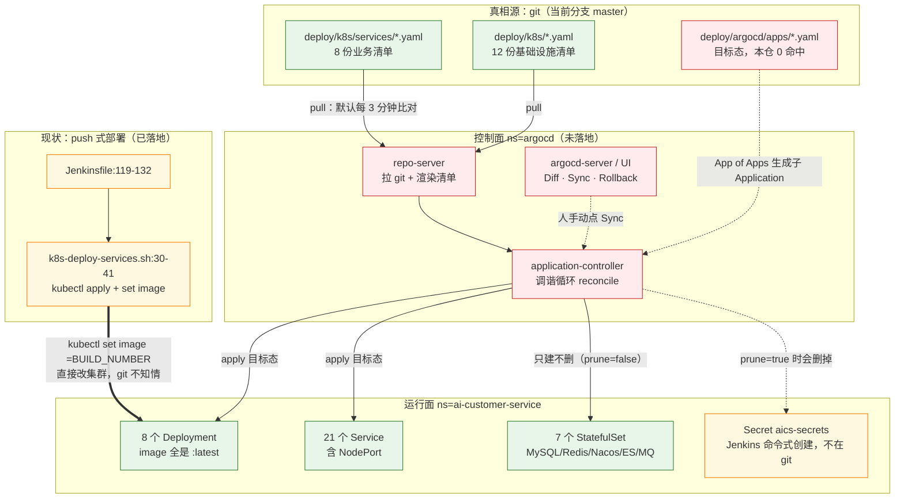
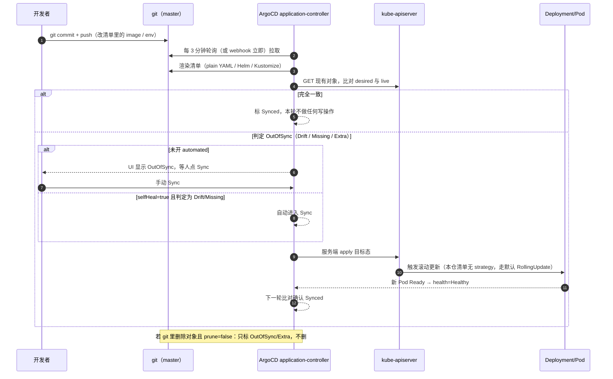

# GitOps 与 ArgoCD：把"集群状态只能由 Git 变更驱动"变成纪律

> **一句话结论**：GitOps 的价值不在装一个 ArgoCD，而在于承认一条纪律——**集群状态只能由 Git 变更驱动**；没有这条纪律，ArgoCD 只是给 `kubectl apply` 套了一层 UI，集群照样是谁最后动手谁说了算。
> **阅读前置**：先熟 Deployment / Service / Namespace 的 apply 语义与探针写法（见 [07-运维部署/02-Kubernetes入门](../07-运维部署/02-Kubernetes入门.md)），以及本模块 [01-Helm从零到参数化](./01-Helm从零到参数化.md)（清单参数化）与 [07-多环境配置与漂移治理](./07-多环境配置与漂移治理.md)（漂移的四类成因）。本篇不重复清单逐行精读，只回答"谁来 apply、apply 之后谁负责收敛、收敛不了怎么办"。
> **证据基线**：A 级 0 处——`learning-docs/24-源码分析/assets/source/` 的 905 份 Spring/JDK 摘录里没有任何 ArgoCD 相关类，据实标注、不硬引；B 级 16 处（本仓真实文件，行号用 `ReadAllLines` 当次核对，不用 `Get-Content` 计行，原因见 §6.3）；C 级 9 处（本机 node 24.16.0 / Windows PowerShell 5.1 实跑，脚本在 `learning-docs/tools/tmp/`）。本机 `kubectl`、`argocd`、`helm`、`docker` **全部未安装**（`Get-Command` 实测为空），凡涉及集群侧动作一律"给命令 + 判读方法 + 未本机实测"。预计阅读 35 分钟。

## 证据边界

| 主题 | 本仓状态 | 证据级别 | 本篇怎么处理 |
|------|----------|----------|--------------|
| ArgoCD 控制面（controller / repo-server / UI） | 未落地：`deploy/` 与 `.github/`、`tools/` 共 135 个交付面文件里 `argoproj`/`argocd` 命中 0 | C（命令 + 真实输出） | 只讲对象模型与判定规则，任何"装好之后的样子"都标未实测 |
| Application / AppProject 清单 | 未落地，仓库无 `deploy/argocd/` | C（自写骨架 + node 结构自检） | 给一份可提交的最小骨架，并用脚本证明结构自洽，但明确"结构自洽 ≠ 能同步成功" |
| 漂移检测与自愈 | 未落地，无集群可观测 | C（状态机模拟） | 用纯计算推演 `selfHeal`/`prune` 各自管什么，数值全部标注为教学参数 |
| 现有部署链路 | **已落地**：Jenkins 八 stage push 式部署 | B（`Jenkinsfile` + 两个部署脚本 + 清单） | 逐行指出三个断点：push 式、无状态收敛、无漂移检测 |
| 密文管理 | 半落地：Secret 由 Jenkins 命令式创建；清单里 5 处明文密码 | B（`Jenkinsfile:79-84`、`ai-chat-service.yaml:77`） | 指出它会和 `prune` 直接打架，给 SealedSecret / ExternalSecret 两条迁移路线 |
| 环境分层 | 未落地：`deploy/k8s/` 是单层目录，无 dev/prod 分层 | B（目录扫描） | 只给方案与取舍，不假装已有 |
| Ingress / HPA / PDB | 全仓 0 命中 | B（清单扫描） | 在"可扩展点"里列为前置条件，不写成已实现 |

## 0. 先看现象

### 现象一：交付面上 GitOps 关键字零命中

```powershell
PS> cd D:\Projects\Persion\ai-customer-service
PS> $deliver = Get-ChildItem -Recurse -File -Path deploy,.github,tools -Include *.yaml,*.yml,*.sh,*.ps1
PS> @($deliver).Count
PS> @($deliver | Select-String -Pattern 'argoproj|argocd|fluxcd|ApplicationSet|SealedSecret|ExternalSecret').Count
```

```text
135
0
```

`135` 是交付面文件总数，`0` 是 GitOps 工具关键字命中数。**注意扫描范围**：只扫 `deploy`、`.github`、`tools` 三个交付面目录，故意不扫 `learning-docs`——因为学习文里提到 ArgoCD 的地方（本模块 README、01/02/04/07 篇的互链、`18-银行金融开发` 篇）都是**文字描述**，不是可执行配置。把两者混在一次 grep 里，就会得出"已经用上了"的错误结论（这个坑在 §6.1 展开）。

### 现象二：部署链路是把镜像名"塞"进集群，git 从头到尾不知情

```powershell
PS> $jl = [System.IO.File]::ReadAllLines((Resolve-Path Jenkinsfile))
PS> for ($i=0; $i -lt $jl.Count; $i++) { if ($jl[$i] -match 'stage\(') { "{0,4}: {1}" -f ($i+1), $jl[$i].Trim() } }
```

```text
  32: stage('拉取代码') {
  39: stage('环境检查') {
  50: stage('Maven 测试') {
  69: stage('写入 Kubernetes Secret') {
  89: stage('部署基础设施') {
 104: stage('构建并推送镜像') {
 119: stage('部署业务服务') {
 134: stage('部署验证') {
```

八个 stage 里，最后两个才是"改集群"的动作，而它落到脚本里是这样两行：

```powershell
PS> $ds = [System.IO.File]::ReadAllLines((Resolve-Path 'deploy\scripts\k8s-deploy-services.sh'))
PS> $ds[29..41] | ForEach-Object -Begin {$i=29} -Process { $i++; "{0,4}: {1}" -f $i, $_ }
```

```text
  30: kubectl apply -f deploy/k8s/namespace.yaml
  31: kubectl apply -f deploy/k8s/services/
  32:
  33: for service in ${SERVICES}; do
  34:   deployment="$(deployment_name "${service}")"
  35:   container="$(container_name "${service}")"
  36:   image="$(image_name "${service}")"
  37:   full_image="${REGISTRY}/aics/${image}:${VERSION}"
  38:
  39:   echo "Deploying ${deployment} with image ${full_image}"
  40:   kubectl set image "deployment/${deployment}" "${container}=${full_image}" -n "${NAMESPACE}"
  41:   kubectl rollout status "deployment/${deployment}" -n "${NAMESPACE}" --timeout=300s
  42: done
```

读这两段就能定位断点：`deploy/scripts/k8s-deploy-services.sh:40` 的 `kubectl set image` 把镜像改成 `${REGISTRY}/aics/<name>:${VERSION}`（默认 `VERSION=dev`，见同文件 L5，CI 里注入 `IMAGE_VERSION`），而 git 里 `deploy/k8s/services/ai-chat-service.yaml:47` 永远写着 `192.168.56.12:5000/aics/ai-chat-service:latest`。**每部署一次，集群就比 git 多走一步，而且这一步没有记录在任何清单里。**

### 现象三：同一批清单互相矛盾，却没有任何机制在对账

```powershell
PS> node learning-docs\tools\tmp\m16-03-argocd-lint.mjs
```

```text
清单规模 : 20 个文件 / 1982 行
image 行 : 20  →  :latest 9 / 完全无 tag 0 / 固定 tag 11
namespace: ai-customer-service=44  aics=2
kind     : ConfigMap=3  Deployment=13  Namespace=1  Secret=2  Service=21  StatefulSet=7
探针     : livenessProbe=20 readinessProbe=20 startupProbe=0
滚动策略 : strategy:=0  terminationGracePeriodSeconds=0
```

（脚本完整输出见 §3.6 与 §6.2，路径 `learning-docs/tools/tmp/m16-03-argocd-lint.mjs`。）

`aics=2` 是 `deploy/k8s/services/product-service.yaml` 的 `namespace: aics`（L20），其余 19 份清单写的是 `ai-customer-service`；9 处 `:latest` 意味着**git 无法回答"集群上跑的是哪个版本"**；`startupProbe=0`、`strategy:=0` 意味着清单本身也没有为"被自动滚动更新"做好准备。

这些现象指向同一件事：**集群状态由"最后一次谁跑了 kubectl"决定，而不是由 Git 决定**——所以先别急着装工具，先补纪律。

## 1. 整体地图



> **读图说明**：绿色是本仓已有、能逐行核对的东西（git 里的清单 + 集群里的对象）；红色整块是**完全未落地**的 ArgoCD 控制面，本篇所有关于它的描述都是"按官方对象模型应该长这样"；橙色三个是要特别当心的接缝。看三条关系就够：① `M1/M2 → REPO` 是 pull 方向，ArgoCD 主动去拉 git，集群侧不需要任何人持有 CI 凭证；② `SH ==> D1` 是**当前真正在跑的**路径，也是唯一一条能让集群与 git 脱钩的路径；③ `APP -.-> SEC` 是被大多数人忽略的雷：`aics-secrets` 由 `Jenkinsfile:79-84` 命令式创建，只在集群里存在，一旦 `prune=true`，ArgoCD 会认为它"Git 里没有、集群里多余"，直接删掉，`ai-chat-service.yaml:77` 的 `secretKeyRef` 立刻 Unresolved。

| 组件 | 位置 | 负责什么 | 本仓角色 | 参与方 |
|------|------|----------|----------|--------|
| git 仓库 | 本机 `/` + `origin/master` | 存"期望的集群长什么样" | **真相源**（但清单里是 `:latest`，真相被打了折） | 开发者、评审者 |
| `application-controller` | ArgoCD 自身 namespace（未落地） | 跑 reconcile 循环：拉清单、比 live、按策略写回 | 目标态的执行者 | 平台/运维 |
| `repo-server` | 同上 | 把 git 内容渲染成 K8s 清单（plain YAML / Helm / Kustomize） | 目标态的生成者 | 平台 |
| `Application` | `deploy/argocd/apps/*.yaml`（提案） | 声明"哪个 git 路径 → 哪个集群 namespace" | 一条"交付契约" | 服务负责人 |
| `AppProject` | `deploy/argocd/projects/*.yaml`（提案） | 限定可用 repo 与 destination，权限边界 | 防止越权同步 | 平台 |
| Jenkins | `Jenkinsfile`（171 行，8 stage） | 编译、测试、打镜像、推私库、apply 清单 | **当前唯一的部署者**（push） | 开发者 |
| `k8s-deploy-services.sh` | `deploy/scripts/` | 把镜像 tag 塞进 Deployment | 现状的执行细节 | Jenkins |
| `aics-secrets` | 集群内 namespace | 存 `openai-api-key` 等 3 个 key | git 外的隐性状态 | Jenkins、AI 服务 |

## 2. 关键概念与关键要素

先把术语钉死，后面才不绕。**期望态（desired state）**是 git 里那份清单描述的状态；**实况（live state）**是 API Server 里现在真实的对象；**漂移（drift）**是两者不一致；**调谐（reconcile）**是"不断比对并把实况往期望态拉"的循环；**GitOps** 就是让"改期望态"成为唯一合法的变道方式，且这个循环持续运转。**pull 模型**下是集群内的 agent 主动拉 git；**push 模型**下是 CI 拿着 kubeconfig 往集群里推。

| 名称 | 位置 | 作用 | 关键参数 |
|------|------|------|----------|
| 四原则（声明式/版本化/自动生效/持续调谐） | 概念 | 判断"是不是真 GitOps"的四道闸门 | 缺任何一条都退化成"用 git 存了份 yaml" |
| `Application` | `deploy/argocd/apps/*.yaml` | 一条交付契约：git 路径 ↔ namespace | `source.repoURL/targetRevision/path`、`destination.server/namespace` |
| `AppProject` | `deploy/argocd/projects/*.yaml`（提案，见 §3.6） | 权限边界：哪些 repo 能进、哪些 namespace 能出 | `sourceRepos`、`destinations`、`clusterResourceWhitelist` |
| `syncPolicy.automated` | `Application.spec` | 关掉它 = 只报 OutOfSync 不动手（默认） | 有/无此块 |
| `syncPolicy.automated.prune` | 同上 | 是否删除"git 里没有、集群里多余"的对象 | `true` / `false`（默认 false） |
| `syncPolicy.automated.selfHeal` | 同上 | 是否把"集群被手改"的对象拉回 git | `true` / `false`（默认 false） |
| `syncOptions` | 同上 | 同步细节开关 | `CreateNamespace=true`、`ServerSideApply=true` |
| `directory.recurse` / `exclude` | `source.directory` | 目录是否递归、排除哪些文件 | 本仓 8 份清单在 `services/` 子目录，必踩（§6.2） |
| Health（健康态） | ArgoCD UI / `status.health` | 对象是否真的跑起来了，与 Sync 状态**正交** | `Healthy`/`Progressing`/`Degraded`/`Missing` |
| Sync 状态 | ArgoCD UI | 实况是否等于期望态 | `Synced`/`OutOfSync`/`Unknown` |
| `SealedSecret` / `ExternalSecret` | 清单（未落地） | 让密文也能进 git | 前者靠 kubeseal，后者靠外部 vault |
| `ApplicationSet` | 清单（未落地） | 由模板批量生成 Application（多环境/多集群） | 全仓 0 命中 |
| App of Apps | 模式 | 用根 Application 管理 `apps/` 下的子 Application | 见 §5 |

两个容易混的点先说清：**Synced ≠ Healthy**（同步成功只代表 YAML 写进去了，Pod 可能还在 CrashLoopBackOff）；**`selfHeal` 管"被手改"，`prune` 管"被多出来"**，它们不是一回事，混着开会出事故（§3.4 有模拟输出证明）。

## 3. 原理与证据逐段精读

### 3.1 声明式：`kubectl apply` 已经是声明式了，为什么还不够

**在干什么。** 声明式的意思是"只描述终态，不描述步骤"：你写 `replicas: 2`，系统负责让实际数量等于 2，而不是让你执行两条 `docker run`。本仓清单已经是声明式的（`deploy/k8s/services/api-gateway.yaml:38` 写 `replicas: 1`），命令也是 `kubectl apply`（`deploy/scripts/k8s-deploy-services.sh:30-31`），看起来条件齐了。

**为什么这么设计。** 声明式是 GitOps 四原则的第一条，因为它把"差异计算"外包给了系统：只要有一份终态描述，任何时刻都能算出"还差什么"。这正是自动化和自动修复的前提——**没有终态描述，就只能靠人记住上一次做了什么**。

**换写法会怎样。** 如果继续用命令式（`kubectl scale`、`kubectl create secret`、`kubectl set image`），每一步都只有"执行过"这一个痕迹，没有"应当是什么"的持久记录。本仓就同时存在这两种写法：清单是声明式的，但 `Jenkinsfile:79-84` 用 `kubectl create secret generic aics-secrets ... | kubectl apply -f -` 命令式创建 Secret，`k8s-deploy-services.sh:40` 用 `kubectl set image` 命令式改镜像。结果一模一样：**集群里有几样东西，git 里查不到**。

**常见坑。** 把"用了 apply"当成"声明式到位"。判据不是命令，而是**这条信息有没有唯一真相源**：`aics-secrets` 的 3 个 key（`openai-api-key`/`openai-base-url`/`openai-model`）在 git 里只有 `name: aics-secrets` 这个引用（`deploy/k8s/services/ai-chat-service.yaml:77`），值本身只存在于 Jenkins 参数和集群对象里——这就是声明式的缺口。

### 3.2 版本化：git 里那个 `:latest` 让"真相源"打了折

**在干什么。** 版本化要求：任何时刻，git 的某个 commit 能唯一确定"集群该跑哪个镜像、哪版配置"。本仓的实际情况是反例：`deploy/scripts/k8s-build-push.sh:37-39` 每次构建**推两个 tag**——`${VERSION}` 和 `:latest`；而 8 份清单引用的都是 `:latest`（`deploy/k8s/services/api-gateway.yaml:49` 等，行号集中在 L46~L49）。

**为什么这么设计。** `:latest` + `IfNotPresent`（`api-gateway.yaml:52`）是"本地学习环境图省事"的典型组合：不用改清单就能换镜像，kubelet 也不会每次去拉。代价是把"版本"这个维度从 git 里删掉了。

**换写法会怎样。** 一旦引入 GitOps，`kubectl set image` 这条既有路径会和 reconcile 直接冲突：CI 把集群改成 `:BUILD_NUMBER`，ArgoCD 下一轮比对发现"git 说要 `:latest`，实况是 `:2024xxxx`"，于是标 OutOfSync；如果开了 `selfHeal`，它会把镜像**拉回 `:latest`**——也就是回滚到某个不可知的旧版本。**这不是 ArgoCD 的 bug，是 `:latest` 的必然结果。**

**常见坑。** 以为"CI 回写 tag 就行"。旧稿提过用 `sed` 把新 tag 写回清单、或上 ArgoCD Image Updater——两条路都成立，但都要先满足一个前提：**清单里的 image 是可变字段且 git 是唯一写入口**。本仓现在是"CI 推双 tag + 清单写 `:latest`"，任何回写都会被下一次构建覆盖。正确顺序是先改成"只推 `${VERSION}` 并让它进 git"，再谈自动回写。

### 3.3 push 与 pull：差的不是方向，是信任边界

**在干什么。** push 把"谁能改集群"的权力交给 CI：CI 持有 kubeconfig，构建完直接 `kubectl apply`。pull 把权力收回集群内：ArgoCD 自己拉 git，CI 只需要推镜像，**不需要也不能**碰集群凭证。

**为什么这么设计。** 安全含义是这条原则的全部理由：push 模型下，任何能改 Jenkinsfile 的人等于能改生产集群（`Jenkinsfile:129` 一行 `sh` 就能加任意 `kubectl` 命令）；pull 模型把攻击面收敛到"能推 git 的人 + ArgoCD 自身的权限"，而后者被 `AppProject` 限定在特定 repo 与 namespace。附带好处还有两条：集群外不需要开 6443 入站；CI 挂了不影响集群自我修复。

**换写法会怎样。** 沿用 push 模型，就永远买不到"漂移可发现"这个能力——因为**执行者不是常驻进程**。`Jenkinsfile` 的 8 个 stage（L32/39/50/69/89/104/119/134）跑完就退出，没有人会在第 9 个 stage 之后的任意时刻再去比对一次"集群还是不是 git 说的样子"。下面这张表把三个断点钉在具体行号上：

| 断点 | 证据（完整路径 + 行号） | 后果 |
|------|--------------------------|------|
| ① push 式部署 | `Jenkinsfile:119-132`（`stage('部署业务服务')` → 调 `deploy/scripts/k8s-deploy-services.sh`，实际动集群在 L30-41）；`Jenkinsfile-k8s:121-134` 同一 stage 的整体后移 2 行 | 集群变更的触发者是 CI 的构建号，不是 git 的 commit |
| ② 无状态收敛 | `deploy/scripts/k8s-deploy-services.sh:40` `kubectl set image`；清单侧 `deploy/k8s/services/api-gateway.yaml:49` 固定写 `:latest` | 部署后集群与 git 必然不一致，且这个不一致没有记录 |
| ③ 无漂移检测 | 全仓无 ArgoCD/Flux（`deploy`+`.github`+`tools` 共 135 个文件，命中 0）；`Jenkinsfile:134-148` 的"部署验证"（`kubectl get nodes/pods/svc` 各一次，L141-146）只在流水线内跑一次 | 有人手动 `kubectl scale`/改镜像，没人会发现，直到下次部署把它盖掉 |

两个 Jenkinsfile 的差异本身就说明了 push 模型的脆弱：`Jenkinsfile` 171 行、`Jenkinsfile-k8s` 173 行，8 个 stage 的位置整体差 0~2 行（`部署基础设施` 89 vs 91、`构建并推送镜像` 104 vs 106、`部署业务服务` 119 vs 121），差别只在参数与镜像源（`Jenkinsfile-k8s` 用 `password(name: 'OPENAI_API_KEY', ...)`、`OPENAI_BASE_URL` 默认 `https://api.minimaxi.com/v1`、maven 镜像换成 `docker.m.daocloud.io/library/maven:3.9-eclipse-temurin-17`）。**两份"同构但不同步"的流水线，正是没有单一真相源的典型症状。**

**常见坑。** 以为 pull 模型就不用管凭证了。`AppProject.destinations` 写不写，决定了"某个 Application 能不能往别的 namespace 里灌对象"；本仓一旦有 8 个服务 3 个 namespace，这条白名单就是唯一防线（详见 §3.6）。

### 3.4 持续调谐：`selfHeal` 管"被手改"，`prune` 管"被多出来"

**在干什么。** reconcile 是一个无限循环：拉清单 → 与实况比对 → 分类（一致 / 漂移 / 缺失 / 多余）→ 按策略处置。关键在于**这四类差异由两个不同开关负责**，搞混就是事故。

**为什么这么设计。** 因为"改回来"和"删掉"的风险等级完全不同：前者最坏是重启一个 Pod，后者最坏是删掉一个 PVC 或一个不在 git 里的 Secret。所以 ArgoCD 把 `selfHeal`（拉回期望态）和 `prune`（删除多余对象）拆成两个独立开关，默认全关。

**换写法会怎样。** 下面这段纯计算把所有分支都跑了一遍（脚本 `learning-docs/tools/tmp/m16-03-reconcile-sim.mjs`，**状态机推演，不是集群实测**）：

```powershell
PS> node learning-docs\tools\tmp\m16-03-reconcile-sim.mjs
```

```text
== 阶段一：manual（automated 未开）（prune=false selfHeal=false）==
tick | 事件                          | git 期望      | cluster 实况  | 判定              | ArgoCD 动作
1    | git 提交 v2（img=def456）         | img=def456 x1 | img=abc123 x1 | OutOfSync/Drift   | 只标 OutOfSync，不改集群（automated 未开）
2    | 有人 kubectl set image :latest  | img=def456 x1 | img=latest x1 | OutOfSync/Drift   | 只标 OutOfSync，不改集群（automated 未开）
3    | 有人 kubectl delete deployment  | img=def456 x1 | (对象不存在)       | OutOfSync/Missing | 只标 OutOfSync，不改集群（automated 未开）

== 阶段二：selfHeal=true / prune=false（prune=false selfHeal=true）==
4    | 再次 reconcile（selfHeal 生效）     | img=def456 x1 | (对象不存在)       | OutOfSync/Missing | 重建对象（selfHeal 管，与 prune 无关）
5    | 有人 kubectl scale --replicas=3 | img=def456 x1 | img=def456 x3 | OutOfSync/Drift   | 把 live 拉回 git（Pod 重建）
6    | git 把该对象删掉（期望下线）              | (对象不存在)       | img=def456 x1 | OutOfSync/Extra   | 只标 OutOfSync，不删（prune=false）

== 阶段三：selfHeal=true / prune=true（prune=true selfHeal=true）==
8    | 再次 reconcile（prune=true）      | (对象不存在)       | img=def456 x1 | OutOfSync/Extra   | 删除对象（prune=true）
```

**读这张表只需看三行**：tick 4 证明"对象被误删"由 `selfHeal` 负责，与 `prune` 无关；tick 6 证明"git 删了但集群还在"在 `prune=false` 时**只会报 OutOfSync，不会动手**；tick 8 才真的删。所以"先开 `selfHeal`、后开 `prune`"不是保守，而是**让删除动作单独观察一个迭代周期**。

**常见坑。** 把 `prune=true` 当成"能自动清理垃圾"。`Jenkins` 创建的 `aics-secrets`、`kubectl exec` 手工打的 ConfigMap、HPA 动态改出来的 `replicas`、甚至 StatefulSet 控制器自己维护的字段，都会被判成"多余"或"漂移"。开启前必须先把**所有隐性状态搬进 git**（§3.8）。

### 3.5 漂移自愈的边界：什么时候**不该**自动修

**在干什么。** 自愈的本质是"无条件相信 git"。所以边界问题就变成：**什么时候 git 不该有最终解释权**。

**为什么这么设计。** 因为有些状态天然不属于 git：有状态组件的数据安全窗口、正在做的事故处置、外部控制器拥有的字段、以及"git 还没跟上现实"的那几个小时（比如线上已经在热修止血）。

**换写法会怎样。** 给四类对象硬开 `selfHeal`，等于把人的救援权也自动化了：

| 场景 | 自动修会发生什么 | 建议口径 |
|------|------------------|----------|
| 有状态组件（本仓 7 个 StatefulSet：MySQL/Redis/Nacos/ES/RocketMQ） | 把 `kubectl scale`/手工参数改动立刻拉回，可能与正在进行的数据恢复冲突 | `syncPolicy` 留空 = 手动同步，只吃告警 |
| 事故热修（临时改 `JAVA_OPTS`、临时扩副本） | 改完几分钟内被拉回，热修失效且没人知道原因 | 热修也要走 git（哪怕先提交再回滚），或临时禁用该 Application 的自动同步 |
| 外部控制器拥有字段（HPA 改 `replicas`、VPA 改 `resources`） | ArgoCD 与控制器互相覆盖，`replicas` 来回抖 | 对 `replicas` 加 `ignoreDifferences`，或干脆不用 HPA 管同一字段 |
| 集群特有对象（`Jenkinsfile:79-84` 创建的 `aics-secrets`、临时调试 ConfigMap） | `prune=true` 时直接删除，Pod 起不来 | 先搬进 git（SealedSecret / ExternalSecret），再开 `prune` |
| 首次同步到还不存在的 namespace | 同步失败：namespace not found | `syncOptions: CreateNamespace=true`（本仓 `deploy/k8s/namespace.yaml` 虽存在，但顺序不保证） |

**常见坑。** 只盯 `syncPolicy`，忘了**探针**。`startupProbe=0`（本仓 20 份清单实测）意味着 JVM 冷启动慢的服务在 `selfHeal` 触发的重建里更容易被 `livenessProbe` 判死，形成重启循环——自愈反而放大故障。开自愈前先补 `startupProbe`，这是本模块 [02-K8s资源治理与弹性伸缩](./02-K8s资源治理与弹性伸缩.md) 已经讲过但本仓尚未落地的部分。

### 3.6 Application / AppProject / health：对象模型就是权限模型

**在干什么。** `Application` 是"git 路径 → namespace"的绑定；`AppProject` 是这个绑定的许可范围；`health` 是"写进去了但跑没跑起来"的独立判断。

**为什么这么设计。** 因为 GitOps 把写集群的权力交给了自动化，就必须有"自动化能写到哪儿"的边界。`AppProject` 就是这道边界的声明式表达：`sourceRepos` 限制来源仓库，`destinations` 限制目标 namespace，`clusterResourceWhitelist` 限制集群级对象（本仓只有 `Namespace` 需要）。

**换写法会怎样。** 不写 `AppProject`（全部用默认 `default` project），任何一个 Application 都能指向任意 repo、任意 namespace——**这等于把 CI 里那份 kubeconfig 的权限平移给了 ArgoCD**，只是换了个持证人。下面这份骨架是本篇给的最小可提交版本，路径在 `learning-docs/tools/tmp/m16-03-argocd/`（镜像 `deploy/argocd/` 的目录结构，**真实仓库尚无此目录**）：

```text
deploy/argocd/
├── bootstrap/root-app.yaml        # App of Apps 的根，只管 apps/
├── projects/aics.yaml             # 权限边界
└── apps/
    ├── aics-platform.yaml         # 基础设施 12 份清单（手动同步）
    └── aics-services.yaml         # 业务 8 份清单（selfHeal，不 prune）
```

用脚本对这份骨架做结构自检（**结构自检 ≠ 能同步成功**，本机无 argocd/kubectl，未实测）：

```powershell
PS> node learning-docs\tools\tmp\m16-03-argocd-lint.mjs
```

```text
扫描到 4 个 YAML：Application 3 个 / AppProject 1 个
DROP_EXCLUDE 模式 = 关

[aics-platform]  learning-docs/tools/tmp/m16-03-argocd/deploy/argocd/apps/aics-platform.yaml
   project : aics   destination: https://kubernetes.default.svc / ai-customer-service
   source  : master @ deploy/k8s  (recurse=true, exclude="services/*")
   path    : REPO   → 命中 12 个清单
   policy  : manual（无 automated，只报 OutOfSync 不改集群）   retry.limit=-

[aics-services]  learning-docs/tools/tmp/m16-03-argocd/deploy/argocd/apps/aics-services.yaml
   project : aics   destination: https://kubernetes.default.svc / ai-customer-service
   source  : master @ deploy/k8s/services  (recurse=false, exclude=无)
   path    : REPO   → 命中 8 个清单
   policy  : automated(prune=false selfHeal=true)   retry.limit=3

[aics-root]  learning-docs/tools/tmp/m16-03-argocd/deploy/argocd/bootstrap/root-app.yaml
   project : aics   destination: https://kubernetes.default.svc / argocd
   source  : master @ deploy/argocd/apps  (recurse=false, exclude=无)
   path    : PROPOSAL-ONLY   → 命中 2 个清单
   policy  : manual（无 automated，只报 OutOfSync 不改集群）   retry.limit=-

覆盖矩阵：22 个清单，无重叠 ✓
...
Application 覆盖范围: 真实清单 20/20 个；未被纳管 0 个
结论：errors=0  warnings=1  info=2
  WARN    浮动 tag 9 处：pull 模型下 git 无法唯一确定集群跑的是哪个镜像，回滚也无从重放
```

三个细节值得逐条读：① `path: PROPOSAL-ONLY` 不是脚本 bug，而是"`deploy/argocd/apps` 还没提交"的客观体现——这条输出正是 ArgoCD 最常见的 `ComparisonError` 来源，脚本帮你提前看；② `覆盖 20/20` 说明骨架摊到的清单范围是完整的，多环境分层时这个数字必须继续等于总数；③ 唯一的 WARN 打在镜像 tag 上，说明**清单结构再漂亮，` :latest` 不改，GitOps 仍然不可回滚**。

**常见坑。** 只配 `Application` 不配 `AppProject`，或者 `AppProject.destinations` 写得太宽（`namespace: "*"`）。另外别忘了 `health`：它和 `Sync` 状态正交，`Synced + Degraded` 才是真实世界最常见的一行——YAML 完全一致，Pod 却在 CrashLoopBackOff。

### 3.7 环境分层：分支、目录、多仓库三选一

**在干什么。** 多环境（dev/staging/prod）意味着同一批服务要多份"略有差异"的期望态。三种组织方式：**按分支**（`dev`/`prod` 各一条 branch）、**按目录**（`overlays/dev`、`overlays/prod` 或 `envs/prod/`）、**按仓库**（配置仓库与代码仓库分离，甚至每环境一仓）。

**为什么这么设计。** 判据其实是"**变更的评审单位是什么**"。按分支时，环境差异藏在两次合并之间，`git diff dev..prod` 才是真相，评审成本最高；按目录时，一次提交能同时改两个环境的同一处，评审者看得见差异；多仓库时隔离最彻底，但跨仓变更无法原子提交。

**换写法会怎样。** 本仓现在是**单目录、无分层**：`deploy/k8s/` 12 份基础设施 + `deploy/k8s/services/` 8 份业务，一套清单对一套环境。想区分环境只有两条路：复制目录（立刻产生漂移，正是 [07-多环境配置与漂移治理](./07-多环境配置与漂移治理.md) 立案的那种）或用 Helm/Kustomize 参数化（本仓 `kustomization.yaml` 0 命中，唯一 `Chart.yaml` 在 `tools/seata/seata/script/server/helm/seata-server/Chart.yaml`，是 Seata 制品自带的，不属本项目）。

**常见坑。** 按分支做环境，然后发现"紧急修复要先 cherry-pick 到 prod 分支"。行业里更常见的收敛方案是：**代码仓库按分支管版本，配置/清单按目录管环境**，再用一个 `ApplicationSet` 或 App of Apps 把 `envs/*` 批量映射成 Application。

### 3.8 密文管理：SealedSecret / ExternalSecret，以及本仓那个会被 `prune` 删掉的 Secret

**在干什么。** GitOps 要求"一切进 git"，但密码不能明文进 git。三种主流解法：**SealedSecret**（用集群公钥加密，密文可安全提交，只有该集群能解）、**ExternalSecret**（git 里只放"去哪里取"，值是运行时从 Vault/AWS SM 拉）、**SOPS**（git 里放加密文件，靠 KMS 解）。

**为什么这么设计。** 核心区别是"**密文的解密权在哪**"：SealedSecret 绑集群、ExternalSecret 绑外部系统、SOPS 绑 KMS 密钥。共同点是——**git 里必须存在一个可追踪的对象**，否则 GitOps 的"唯一真相源"就漏了一块。

**换写法会怎样。** 本仓现在正是漏洞形态：`Jenkinsfile:79-84` 用 `kubectl create secret generic aics-secrets --from-literal=openai-api-key="$OPENAI_API_KEY" ...` 创建 Secret，`deploy/k8s/services/ai-chat-service.yaml:77` 用 `secretKeyRef: name: aics-secrets` 消费它。于是：

| 事实 | 证据 | GitOps 下会发生什么 |
|------|------|---------------------|
| Secret 不在 git 里 | `deploy/k8s/` 下 2 个 `kind: Secret`，其中 1 个是 `middleware-secrets.example.yaml` 模板，`aics-secrets` 无对应文件 | `prune=true` 时被判 Extra → 删除 |
| 3 个 key 由 CI 参数决定 | `Jenkinsfile:11-24`（`OPENAI_API_KEY`/`OPENAI_BASE_URL`/`OPENAI_MODEL`）+ L81-83 | 同一 commit 在不同参数下产生不同集群状态 |
| 清单里仍有 5 处明文密码 | `deploy/k8s/services/ai-chat-service.yaml:69`、`knowledge-service.yaml:69`、`knowledge-service.yaml:75`、`message-service.yaml:68`、`user-service.yaml:68`（注释自称"生产应改用 secretKeyRef"） | 这些**会**进 git，属于"合规上不接受、技术上却已发生"的反向问题 |

**常见坑。** 只解决"密文不进 git"，忘了"隐性状态进 git"。前者是安全需求，后者是**可收敛性需求**——只要集群里有 git 不知道的对象，`prune` 就永远不敢开，GitOps 就永远停在"只读可视化"阶段。所以迁移顺序应该是：先把 `aics-secrets` 改成 SealedSecret/ExternalSecret 提交进 git，再开 `prune`。

### 3.9 回滚：`git revert` 而不是 `kubectl rollout undo`

**在干什么。** `kubectl rollout undo` 回滚的是**集群里某个 Deployment 的 revision**；`git revert` 回滚的是**期望态**，然后由 reconcile 把集群带过去。

**为什么这么设计。** 因为 revision 历史存在集群里（`ReplicaSet` 的注解），**换集群就没了**；而 git 历史跟着仓库走，谁都能查、能复现、能 diff。本仓的 git 历史是现成教材：

```powershell
PS> git rev-list --count HEAD
PS> git log --oneline -3
```

```text
252
d6f9c33 docs(learning): 按 24-源码分析 范式重写 learning-docs 十二个模块 + 落地写作规范与校验器
f46af4a docs(learning): 新增24源码分析中文精读教程
fedea62 docs: 同步Spring AI 2.1实施文档与验证边界
```

**换写法会怎样。** 用 `rollout undo` 回滚，在 pull 模型下是**自相矛盾**的动作：你把集群改回旧版本，ArgoCD 下一轮发现"git 说要新版本、实况是旧版本"，`selfHeal` 一开就把它推回去——回滚在几分钟内被自动撤销，且没人知道为什么。反过来，`git revert` 产生一条新 commit（历史只增不改），ArgoCD 同步后集群自然回到旧版本，**并且这次回滚本身也是可审计、可再回滚的**。

**常见坑。** 以为回滚只是"改个镜像 tag"。清单里还有 ConfigMap、环境变量、探针参数；`rollout undo` 只回滚 Pod 模板，配置类对象不会跟着回。`git revert` 一次覆盖全部变更，这才是"回滚"该有的粒度。

### 3.10 与 CI 的分工：CI 造制品，GitOps 收敛状态

**在干什么。** CI 的职责边界：编译、测试、构建镜像、推私库、把"新版本号"变成一次 git 变更（改清单或改 values）。GitOps 的职责：把 git 的变更收敛到集群，并持续保证不漂。

**为什么这么设计。** 因为两者的执行模型不同：CI 是**有始有终的批处理**，GitOps 是**永不结束的循环**。"部署成功"在 CI 里是退出码 0，在 GitOps 里是"下一轮比对仍然 Synced"——后者才是可持续的判据。

**换写法会怎样。** 本仓的 CI 实际上**不覆盖交付面**：`.github/workflows/` 只有一个文件 `python-learning-validate.yml`（120 行），触发条件是 `push: branches: [main, develop]`（L6-7）+ `paths: learning-docs/22-Python速成/**, ai-cs-py-recommend/**`（L9-10）。也就是说：8 个 Java 服务一个都不进 CI，而且**分支过滤器写的是 `main`/`develop`，本仓实际主干是 `master`**（`git branch -a` 实测），这条路根本不会触发。

**常见坑。** 把"CI 里跑了一次部署"当成"CD 有了"。判据很简单：**流水线结束后 5 分钟，如果有人手动改了集群，有没有东西把它记下来？** 本仓答案是"没有"（§3.3 断点③）。

## 4. 一次完整执行时序



> **读图说明**：这是一轮典型 reconcile 的时序，横轴从左到右是时间，不是组件顺序。三段读：① 第 2~4 步是"只读段"，ArgoCD 只做拉取与比对，**任何一轮都至少走这三步**；② 第 5~6 步是分岔口——一致就结束（第 5 步是**成功路径**，注意它什么也不写），不一致才进入第 7 步之后；③ 第 8~14 步是"写入段"，其中"谁按下 Sync"由 `syncPolicy` 决定（人 vs 控制器），而"能不能写"由 `AppProject` 决定。最后那条 Note 是 `prune=false` 的行为：图上有差异，但**没有箭头指向删除**。

| 步 | 判据 | 正常长什么样 | 异常长什么样 | 该看哪里 |
|----|------|--------------|--------------|----------|
| 1-2 | 拉取是否成功 | `Synced` 或 `OutOfSync`，`status.source` 有 commit sha | `ComparisonError` / `path does not exist` | Application 的 `Conditions`；先核 `spec.source.path` 是否存在（§3.6 的 PROPOSAL-ONLY 就是这条） |
| 3 | 渲染是否成功 | 与 `kubectl apply --dry-run=server` 等价可解析 | Helm values 缺 key、Kustomize 找不到 base | `repo-server` 日志 |
| 4 | 比对是否完成 | 出现明确的 Sync 状态 | 长时间 `Unknown`：`Application` 选错 cluster 或 API 不可达 | `destination.server` |
| 5 | 一致 | 无任何写操作 | 一直 OutOfSync 但 diff 为空 → 多半是 `ignoreDifferences` 缺失（控制器自有字段） | UI 的 Diff 面板 |
| 7-9 | 谁触发同步 | 手动：点 Sync 才动；自动：到点自己动 | 以为开了自动化实际没开（`syncPolicy` 层级缩进错） | `spec.syncPolicy` 缩进（§2 参数表） |
| 10-12 | 写入是否成功 | `rollout status` 推进，Pod 逐个 Ready | `CreateNamespace` 缺失报 namespace not found；`prune` 删掉隐性对象 | `syncOptions`、事件流 |
| 13-14 | 是否真健康 | `Synced + Healthy` | `Synced + Degraded`：YAML 一致但 Pod 起不来（探针/镜像/密钥） | Pod events、`secretKeyRef` 指向的 Secret 是否存在 |
| 收尾 | 是否稳定 | 下一轮仍 `Synced` | `Synced → OutOfSync` 反复抖动：两个 Application 管同一对象（§6.2）或控制器在改同一字段 | 覆盖矩阵、`Application` 列表 |

## 5. 设计取舍

| 决策点 | 选项 A | 选项 B | 本仓现状 | 代价与收益 |
|--------|--------|--------|----------|------------|
| 同步方式 | 手动 Sync（只可视化） | `automated` 自愈 | 未落地；建议先 A | A：零误删风险，但要人盯；B：省人但要求清单完备 |
| 删除策略 | `prune=false` | `prune=true` | 未落地；建议先 false | false 会积累"git 已删、集群还在"的残留；true 要求隐性状态全部进 git |
| 环境策略 | 目录分层（`envs/dev|prod`） | 分支 / 多仓库 | 单目录无分层 | 目录分层评审成本最低，但需要 Kustomize/Helm 参数化（本仓两者 0 命中） |
| 清单渲染 | plain YAML | Helm / Kustomize | plain YAML（`deploy/k8s/`） | plain 无额外工具，但环境差异只能靠复制；Helm 已在 [01](./01-Helm从零到参数化.md) 讲 |
| 密文 | SealedSecret（绑集群） | ExternalSecret（绑外部 KMS/Vault） | 命令式 `kubectl create secret`（`Jenkinsfile:79-84`） | SealedSecret 落地最快；ESO 更适合已有 vault 的团队 |
| 回滚 | `git revert` | `kubectl rollout undo` | 现状靠 Jenkins 重建 | revert 可审计、跨集群可复现；undo 与 `selfHeal` 冲突 |
| Application 组织 | 每个服务一个 Application | 按层（platform / services） | 提案取"按层"（2 个 + 1 个根） | 按层同步粒度粗但对象少；按服务更细，代价是 8~11 个对象要维护 |
| 与 Jenkins 关系 | 双轨（Jenkins 继续发布镜像） | 全量迁到 ArgoCD | Jenkins 独揽 | 双轨过渡成本低，但要立刻禁掉 `kubectl set image`（§3.2） |

**可扩展点清单（以下全部未落地，本仓 0 命中，列出来是为了让你知道"下一层台阶"在哪）**：

1. **`ApplicationSet`**：把 `envs/*` 或 8 个服务批量生成 Application，替代手写 11 份 yaml。
2. **`ignoreDifferences`**：处理 HPA/VPA 与控制器自有字段，避免"永久 OutOfSync"。
3. **`syncWindows`**：生产环境禁止业务高峰自动同步（节假日封网）。
4. **ArgoCD Image Updater / CI 回写 tag**：`deploy/scripts/k8s-build-push.sh:37-39` 的双 tag 改成单 tag 后，才有自动回写的意义。
5. **`Ingress` + `PDB` 前置**：本仓 Ingress 0、PDB 0（详见 [04-K8s网络模型与Service](./04-K8s网络模型与Service.md)、[02-K8s资源治理与弹性伸缩](./02-K8s资源治理与弹性伸缩.md)）；没有 PDB 时 `prune` 与滚动更新都可能造成同时不可用。
6. **PR 预览环境**（每分支一套临时 namespace）：需要 `ApplicationSet` + `prune=true` + 自动清理，风险最高，最后做。
7. **通知集成**（Degraded / SyncFailed 告警）：没有它，`automated` 等于"默默改集群"。
8. **多集群 destination**：`AppProject.destinations` 扩展为多个 cluster，需先把 cluster 注册进 ArgoCD。

## 6. 踩坑与调试手法

### 6.1 用宽正则找 Application，命中 12 处全是 Spring Boot 启动类

```powershell
PS> $h = Get-ChildItem -Recurse -File -Include *.java | Where-Object { $_.FullName -notmatch '\\target\\' } | Select-String -Pattern 'class\s+\w+Application\s*\{?\s*$'
PS> @($h).Count
PS> $h | Select-Object -First 3 | ForEach-Object { "{0}:{1}" -f $_.Path.Replace((Get-Location).Path+'\',''), $_.LineNumber }
```

```text
12
ai-cs-chat\src\main\java\com\aics\chat\ChatApplication.java:18
ai-cs-gateway\src\main\java\com\aics\gateway\GatewayApplication.java:14
ai-cs-knowledge\src\main\java\com\aics\knowledge\KnowledgeApplication.java:27
```

**判读列**：12 = 12 个 `XxxApplication` 启动类（`ChatApplication`/`GatewayApplication`/…/`UserApplication`），与 ArgoCD 的 `kind: Application` **毫无关系**。想在 YAML 里找 ArgoCD 的 Application，必须带上下文：`Select-String -Pattern 'kind:\s*Application'` 或直接锚定 `argoproj.io/v1alpha1`。**误判风险**：搜 `Application` 得到一堆命中，就以为"项目里已经有 ArgoCD 对象"——本次调研中确实一度得出"命中 4 处"的错误结论，复核后是 0。判据永远是**关键字 + 上下文 + 文件类型**三者同时成立。

### 6.2 `path: deploy/k8s` 是递归的，会把 `services/` 一起吃进去 → 两个 Application 抢同一批对象

```powershell
PS> node learning-docs\tools\tmp\m16-03-argocd-lint.mjs --drop-exclude
```

```text
结论：errors=0  warnings=9  info=2
  WARN    双写：deploy/k8s/services/ai-chat-service.yaml 同时被 [aics-platform + aics-services] 管理 —— ArgoCD 会互相把对方的改动当成漂移，来回抖动
  WARN    双写：deploy/k8s/services/api-gateway.yaml 同时被 [aics-platform + aics-services] 管理 —— ArgoCD 会互相把对方的改动当成漂移，来回抖动
  ...（共 8 份 services 清单）
  WARN    浮动 tag 9 处：pull 模型下 git 无法唯一确定集群跑的是哪个镜像，回滚也无从重放
```

**判读列**：`--drop-exclude` 只是把 `directory.exclude: "services/*"` 这一行关掉，警告就从 1 条涨到 9 条，多出的 8 条全部是"同一份清单被两个 Application 管理"。**正常版**（不带参数）输出 `覆盖矩阵：22 个清单，无重叠 ✓`，说明 `exclude` 生效。**误判风险**：这类双写不会报错，只会表现为"Deployment 莫名被改回去""Sync 一直 OutOfSync 但 diff 是空的"——很容易被归因为"ArgoCD 有 bug"或"kubectl 缓存"。debug 顺序固定为：先算覆盖矩阵，再看 diff。

### 6.3 `Get-Content` 计行比真实少 2~9 行，所有行号全漂

```powershell
PS> @(Get-Content Jenkinsfile).Count
PS> [System.IO.File]::ReadAllLines((Resolve-Path Jenkinsfile)).Count
PS> @(Get-Content deploy\k8s\namespace.yaml).Count
PS> [System.IO.File]::ReadAllLines((Resolve-Path deploy\k8s\namespace.yaml)).Count
```

```text
169
171
11
15
```

**判读列**：同一文件两个数字不同——`ReadAllLines` 是字节级切分后的真实行数（171 / 15），`Get-Content` 少算 2 行和 4 行。原因：本机 shell 是 **Windows PowerShell 5.1.26100.9818**（不是 PS7），`Get-Content` 默认按 ANSI(936) 解码 UTF-8 无 BOM 文件，中文双字节配对会吃掉紧随的换行符，连行内容都会粘连：`kind: Namespace  # … metadata:` 两行被并成一行。加 `-Encoding UTF8` 后恢复为 15 行、中文正常。**误判风险**：拿 `Get-Content` 数出来的行号去引用清单（旧稿把 image 写成 `ai-chat-service.yaml:37`，实际 L47；把 namespace 写成 `product-service.yaml:5`，实际 L20），review 的人一按行号跳过去就找不到，结论直接被质疑。**本条规则：核对行号一律用 `ReadAllLines` 或 `Get-Content -Encoding UTF8`。**

### 6.4 浮动 tag 让"回滚"没有落点

```powershell
PS> Get-ChildItem deploy\k8s -Recurse -File -Include *.yaml | Select-String -Pattern 'image:' | ForEach-Object { "{0}:{1}: {2}" -f $_.Path.Replace((Get-Location).Path+'\',''), $_.LineNumber, $_.Line.Trim() } | Select-Object -First 4
```

```text
deploy\k8s\services\ai-chat-service.yaml:47: image: 192.168.56.12:5000/aics/ai-chat-service:latest
deploy\k8s\services\api-gateway.yaml:49: image: 192.168.56.12:5000/aics/api-gateway:latest
deploy\k8s\services\knowledge-service.yaml:47: image: 192.168.56.12:5000/aics/knowledge-service:latest
deploy\k8s\services\message-service.yaml:47: image: 192.168.56.12:5000/aics/message-service:latest
```

**判读列**：`scripts/m16-03-argocd-lint.mjs` 统计的 20 行 `image:` 里有 9 行是 `:latest`（8 份 services 清单 L36~L49 各自的 image 行 + `product-service.yaml:36` 的 `aics/ai-cs-product:latest`）。**git 里没有版本号，回滚就没有落点**：`git revert` 回到上一个 commit，清单还是 `:latest`，集群拉到的可能仍是新镜像。**误判风险**：看到 `imagePullPolicy: IfNotPresent`（`api-gateway.yaml:52`）以为"不会乱更新"——它只影响拉取策略，不影响 Deployment 重建时按 `:latest` 解析到哪个 digest。

### 6.5 手动创建的 `aics-secrets` 会被 `prune` 删掉

```powershell
PS> $jl = [System.IO.File]::ReadAllLines((Resolve-Path Jenkinsfile))
PS> $jl[78..83]
PS> Get-ChildItem deploy\k8s -Recurse -File -Include *.yaml | Select-String -Pattern 'name: aics-secrets'
```

```text
kubectl create secret generic aics-secrets \
  -n "$NAMESPACE" \
  --from-literal=openai-api-key="$OPENAI_API_KEY" \
  --from-literal=openai-base-url="$OPENAI_BASE_URL" \
  --from-literal=openai-model="$OPENAI_MODEL" \
  --dry-run=client -o yaml | kubectl apply -f -

deploy\k8s\services\ai-chat-service.yaml:77: name: aics-secrets       # Secret 名（需提前创建，见部署文档）
deploy\k8s\services\ai-chat-service.yaml:82: name: aics-secrets
deploy\k8s\services\ai-chat-service.yaml:88: name: aics-secrets
```

**判读列**：左侧证明 `aics-secrets` 由 CI 命令式创建（`Jenkinsfile:79-84`），右侧证明清单只在 L77/L82/L88 **引用**它、从未定义它（`deploy/k8s/` 下 2 个 `kind: Secret` 里没有它）。三段推理：不在 git → `prune=true` 判 Extra → 删掉后 `ai-chat-service` 的 `OPENAI_API_KEY`（非 optional，L74-78）解析失败、Pod 起不来。**误判风险**：`deploy/k8s/middleware-secrets.example.yaml` 看起来像"密文已进 git"，实际是 `.example` 模板（`neo4j-secret` / `xxl-job-admin-config` 两个示例），不含 `aics-secrets`，也不含真实值。

### 6.6 namespace 漂移：`aics` 与 `ai-customer-service` 共存，且 apply 不会提醒你

```powershell
PS> Get-ChildItem deploy\k8s -Recurse -File -Include *.yaml | Select-String -Pattern '^\s*namespace:\s*(\S+)' | ForEach-Object { $_.Matches[0].Groups[1].Value } | Sort-Object | Group-Object | ForEach-Object { "{0,3}  {1}" -f $_.Count, $_.Name }
```

```text
  2  aics
 44  ai-customer-service
```

**判读列**：`aics` 那 2 处都在 `deploy/k8s/services/product-service.yaml`（L20 Deployment、L86 Service）。后果是 `kubectl apply -f deploy/k8s/services/`（`k8s-deploy-services.sh:31`）会把 product-service 装进另一个 namespace，而 L33-42 的 `kubectl set image ... -n "$NAMESPACE"` 循环里**根本没有 product-service**（模块清单默认 7 个，见 `k8s-deploy-services.sh:7`），所以它的镜像永远不会被更新。**误判风险**：① 别用 `Group-Object Line` 直接分组——多份清单的 `namespace:` 行尾带注释（例如 `namespace: aics  # ⚠️ 与其他服务不一致`），会被分成 4 组而不是 2 组，看着像"三种 namespace 混用"；必须先正则抽出值再分组。② `kubectl apply` 成功返回 `created`，看起来一切正常；真正的问题要等到"product-service 没在 `ai-customer-service` 里"或"它的镜像还是旧的"才暴露。

## 7. 版本差异

| 旧写法 | 当前基线 | 变化点 | 迁移动作 |
|--------|----------|--------|----------|
| `Jenkinsfile:119-132` 指"部署业务服务" | 仍准确；但文件真实行数是 **171**（`ReadAllLines`），不是流传的 169 | 计行工具不同导致 2 行差（§6.3） | 引用行号统一用 `ReadAllLines`/`-Encoding UTF8` |
| 旧稿 `ai-chat-service.yaml:37` 标 image | image 实际在 **L47** | 旧稿行号错 10 行 | 按 L47 引用；同批 8 份清单 image 集中在 L36~L49（`product-service.yaml` 例外，在 L36） |
| 旧稿 `product-service.yaml:5` 标 namespace | namespace 实际在 **L20**（Deployment）/ L86（Service） | 旧稿行号错 15 行 | 按 L20/L86 引用 |
| 旧稿"namespace 与 8 份清单一致" | 实际 19 份写 `ai-customer-service`，`product-service.yaml` 写 `aics` | 事实性错误 | 改为"7 份一致，product-service 例外"，并当漂移立案 |
| `kubectl set image` 作为常规发布手段 | GitOps 下应与 reconcile 冲突（§3.2） | 从"能用"变成"必须停用" | 迁到"CI 只推镜像 + git 改 image 字段" |
| `kubectl create secret` 建 `aics-secrets` | 与 `prune` 直接冲突（§6.5） | 隐性状态必须搬进 git | SealedSecret 或 ExternalSecret |
| Secret 明文写在清单（5 处） | 同上现象的镜像问题 | 合规风险 | `secretKeyRef` + 密文方案 |
| 旧稿"CI 回写 tag / ArgoCD Image Updater"两句就够 | 前置条件是"清单里 tag 可复现"，本仓 9 处 `:latest` 未解 | 顺序反了 | 先改单 tag 进 git，再谈自动回写 |
| `.github/workflows` 覆盖 Java 服务 | 实际只有 `python-learning-validate.yml`（120 行），且分支过滤器 `main`/`develop`（L6-7）≠ 实际 `master` | CI 与主干分支不一致 | 先修触发条件，再谈 CI/GitOps 分工 |
| ArgoCD 版本 `argoproj.io/v1alpha1` | 仍是唯一稳定 API 版本（无 `v1`） | 无需编造版本号 | 保持 `v1alpha1` |

## 8. 面试高频问与答

1. GitOps 的四条原则分别解决什么问题？少一条会退化成什么？
2. 你们线上是 push 还是 pull？凭证在谁手里？换成 pull 之后攻击面变了多少？
3. `selfHeal` 和 `prune` 各管什么？为什么默认都是关的？
4. 什么情况下你会**禁止**自动同步？举三个你们真实遇到过的场景。
5. `Synced` 和 `Healthy` 有什么区别？举一个 `Synced + Degraded` 的例子。
6. 一个 Application 一直 OutOfSync 但 diff 是空的，你会按什么顺序排查？
7. 环境分层你会选分支、目录还是多仓库？为什么？如果团队要求"一次提交同时改 dev 和 prod"呢？
8. 密码怎么进 git？SealedSecret、ExternalSecret、SOPS 的信任边界分别在哪？
9. 回滚用 `git revert` 还是 `kubectl rollout undo`？在开了 `selfHeal` 的集群上，第二种会发生什么？
10. 为什么 `:latest` 是 GitOps 的天敌？`IfNotPresent` 能救吗？
11. CI 和 GitOps 的分界线划在哪？"部署成功"的判据在两者里有什么不同？
12. App of Apps 和 `ApplicationSet` 怎么选？各自维护成本在哪？
13. 集群里有对象不在 git 里，开了 `prune` 会怎样？你怎么在上线前发现这类对象？
14. ArgoCD 自身的权限怎么收？`AppProject` 能挡住哪类越权、挡不住哪类？
15. 你们从 push 迁到 GitOps 的过渡方案是什么？双轨期最大的风险点在哪？

## 9. 动手练习

1. **画出你所在项目的覆盖矩阵**。用 §6.2 的脚本（或自己写）列出"清单文件 → 哪个 Application 管"，确认没有一份清单被两个 Application 管。*验收标准*：能输出一张表，行数等于 `deploy/k8s/**/*.yaml` 的文件数，且每行只有一个 owner。

2. **给 `aics-secrets` 设计一条进 git 的路径**。写出 SealedSecret 与 ExternalSecret 两版清单（可以只写结构），并说明本地无 kubeseal/vault 时如何验证结构。*验收标准*：两版清单都能被 §3.6 的 linter 解析通过；文档里明确写出"未实测加密解密"。

3. **把 8 份 services 清单的 `:latest` 改成一个具体 tag**（先在分支上试，不要直接改 master），然后用脚本重新统计浮动 tag 数。*验收标准*：`image 行 : 20 → :latest 0`，并说明这样改之后 `kubectl set image` 为什么必须停用。

4. **用 `m16-03-reconcile-sim.mjs` 做实验**：把 tick 4 的 `selfHeal` 关掉、tick 8 的 `prune` 打开，观察哪一行结论先变。*验收标准*：能手写补出"selfHeal=false + prune=true"这一组合的输出，并解释它为什么最危险。

5. **补一份最小 Application 骨架并跑自检**。在 `deploy/argocd/`（或你 fork 的镜像目录）里放 1 个 AppProject + 2 个 Application，覆盖 20 份清单。*验收标准*：`node .../m16-03-argocd-lint.mjs` 输出 `errors=0` 且 `覆盖范围: 真实清单 20/20`。

6. **定位三个断点**。从 `Jenkinsfile` 出发，找到"改集群"的每一行，判断它属于 push/无收敛/无漂移哪一类。*验收标准*：能给出至少 3 组"文件 + 行号 + 断点类型"（对照 §3.3 表格，但不能只抄，要自己核一遍行号）。

7. **写一份迁移计划**（一页纸）：从"Jenkins 独揽"到"只读 GitOps"，列出 5 个步骤、每步的验收信号、以及哪一步之后才允许开 `prune`。*验收标准*：计划里出现"先补 `startupProbe`/先搬密文/先关 `kubectl set image`"中的至少两项前置条件。

## 小结

- **GitOps 是纪律，不是工具**：判据是"集群状态是否只能由 Git 变更驱动"，装了 ArgoCD 但还在 `kubectl set image`，纪律等于没有。
- 四原则里最容易漏的是**版本化**：本仓 20 行 `image:` 中 9 行是 `:latest`，git 无法回答"集群在跑哪个版本"，回滚没有落点。
- **push 与 pull 的差别核心是凭证位置**：push 把改集群的权力交给 CI（`Jenkinsfile:129` 一行 `sh` 即可），pull 把它收回集群内并由 `AppProject` 限定边界。
- **`selfHeal` 与 `prune` 必须拆开上线**：前者管"被手改"、后者管"被多出来"；先开前者、观察一个周期、再开后者。
- 自动修复的边界由"**谁拥有这份状态**"决定：有状态组件、事故热修、外部控制器字段、隐性对象，四类都不该被无条件拉回。
- **隐性状态是 `prune` 的唯一前置障碍**：`Jenkinsfile:79-84` 创建的 `aics-secrets` 不在 git，开 `prune` 就会被删。
- 回滚走 `git revert`：`kubectl rollout undo` 在 `selfHeal` 下会被自动撤销，且不留审计痕迹。
- **下一步最划算的一件事**：用 `learning-docs/tools/tmp/m16-03-argocd-lint.mjs` 跑出本仓的覆盖矩阵，并先落地 `deploy/argocd/` 的只读骨架（`selfHeal=false`、`prune=false`）——这一步不改任何集群，却能立刻让"git 与集群差多少"变成可计算的问题。

## 自测题

**1. 用一句话说清 GitOps 与"用 git 存 yaml + Jenkins 部署"的区别。**

<details>
<summary>参考答案</summary>

区别在**谁负责收敛**。后者只是在 git 里放了一份清单，实际变更由一次性进程（CI）推下去，推完就没人管集群是否还等于清单；GitOps 要求有一个常驻的 reconcile 循环持续比对"期望态 vs 实况"，并且**任何合法的变更都必须先改 git**。判据是那句：集群状态只能由 Git 变更驱动。

</details>

**2. 本仓有 8 个 Deployment 全用 `:latest`，为什么说这让"回滚"失效？**

<details>
<summary>参考答案</summary>

因为 git 里的镜像名不含版本信息（`deploy/k8s/services/api-gateway.yaml:49` 等，`:latest`），`git revert` 回到上一个 commit 时清单内容不变，集群仍可能拉到新镜像；同时 `imagePullPolicy: IfNotPresent` 只影响拉取时机，不改变 `:latest` 解析结果。回滚需要一个**可复现的落点**，而 tag 是唯一的落点。

</details>

**3. `selfHeal` 和 `prune` 各自的触发条件是什么？**

<details>
<summary>参考答案</summary>

`selfHeal` 处理"git 里有、集群里被改坏或被删掉"（Drift / Missing），把实况拉回期望态；`prune` 处理"git 里没有、集群里多出来"（Extra），执行删除。两者默认都关，因为风险等级不同：前者最坏重启 Pod，后者最坏删掉数据或密钥。

</details>

**4. tick 4 在模拟里"重建了被删掉的 Deployment"，这属于 `prune` 的作用吗？**

<details>
<summary>参考答案</summary>

不属于。`prune` 只负责删除多余对象；重建"git 有、集群缺"的对象是 `selfHeal`/自动同步的职责。`m16-03-reconcile-sim.mjs` 的 tick 4 就是在 `prune=false` 下发生重建的，正好证明两者独立。

</details>

**5. 为什么"有状态组件不要开 `selfHeal`"？**

<details>
<summary>参考答案</summary>

因为有状态组件的"实况偏差"可能来自正在进行的恢复/迁移操作（例如人工扩副本做数据修复、手工调参数排障），自动拉回会打断这些操作，并把故障现场抹掉。本仓 7 个 StatefulSet（MySQL/Redis/Nacos/ES/RocketMQ）应保留手动同步、只吃漂移告警。

</details>

**6. `Synced` 但 `Degraded` 是什么情况？举一个本仓可能出现的例子。**

<details>
<summary>参考答案</summary>

YAML 与集群对象完全一致（Sync 成功），但 Pod 没真正跑起来。本仓典型例子：`deploy/k8s/services/ai-chat-service.yaml:77` 引用的 `aics-secrets` 不存在（例如被 `prune` 删掉，或 CI 未跑过），`OPENAI_API_KEY` 非 optional，容器启动失败 → `Synced + Degraded`。

</details>

**7. 一个 Application 长期 OutOfSync 但 diff 显示为空，最可能的原因是什么？**

<details>
<summary>参考答案</summary>

两个高频原因：① 两个 Application 管同一份清单互相覆盖（§6.2 的双写）；② 集群里有控制器（HPA/VPA 或 StatefulSet 控制器）在改 ArgoCD 也管的字段，需要用 `ignoreDifferences` 排除。排查顺序：先算覆盖矩阵，再加 `ignoreDifferences`。

</details>

**8. `AppProject` 能挡住什么、挡不住什么？**

<details>
<summary>参考答案</summary>

能挡：Application 指向白名单外的 repo（`sourceRepos`）、同步到白名单外的 namespace 或集群（`destinations`）、创建未被允许的集群级资源（`clusterResourceWhitelist`）。挡不住：Application 里的清单内容本身能创建什么（例如清单里写一个 `ClusterRole` 而白名单允许了）、以及能改 git 的人本身（那是代码评审与仓库权限的事）。

</details>

**9. 为什么 `kubectl rollout undo` 在开了 `selfHeal` 的集群上是自相矛盾的动作？**

<details>
<summary>参考答案</summary>

因为它改的是集群实况，而期望态（git）没变。下一次 reconcile 会发现"实况 ≠ 期望态"，`selfHeal` 把它推回 git 版本——回滚被自动撤销，而且撤销过程没有审计记录。正确做法是 `git revert` 产生一条新 commit，让期望态本身回退。

</details>

**10. 环境分层为什么多数团队不用"分支"？**

<details>
<summary>参考答案</summary>

因为分支模型下环境差异只能通过 `git diff dev..prod` 看到，日常评审看不到；跨环境的同一改动要在分支间 cherry-pick，容易漏。目录分层（`envs/dev|prod`）让一次提交同时体现两个环境的差异，评审即可见，代价是需要 Kustomize/Helm 之类的参数化工具。

</details>

**11. 本仓的 `aics-secrets` 为什么是 GitOps 落地的阻塞项？给出修复顺序。**

<details>
<summary>参考答案</summary>

它由 `Jenkinsfile:79-84` 命令式创建，只在集群里存在（`deploy/k8s/` 无对应 `kind: Secret`），一旦开 `prune` 就被判 Extra 删除，导致 `ai-chat-service.yaml:77` 的引用失效。顺序：① 选定 SealedSecret 或 ExternalSecret 并提交进 git；② 确认集群上的 Secret 由 git 管理（`Synced`）；③ 才允许开 `prune`。

</details>

**12. 为什么本篇的 A 级证据是 0 处？这是缺陷还是结论？**

<details>
<summary>参考答案</summary>

是结论。`learning-docs/24-源码分析/assets/source/` 收录的是 Spring/JDK/Spring AI 的源码摘录（905 份），里面没有 ArgoCD 的 Go 代码，所以拿不出 A 级引用。据实标注 0 处，改用 B 级（本仓清单与流水线）与 C 级（本机实跑脚本）支撑结论，比硬凑一条"源码锚点"更可信。

</details>
