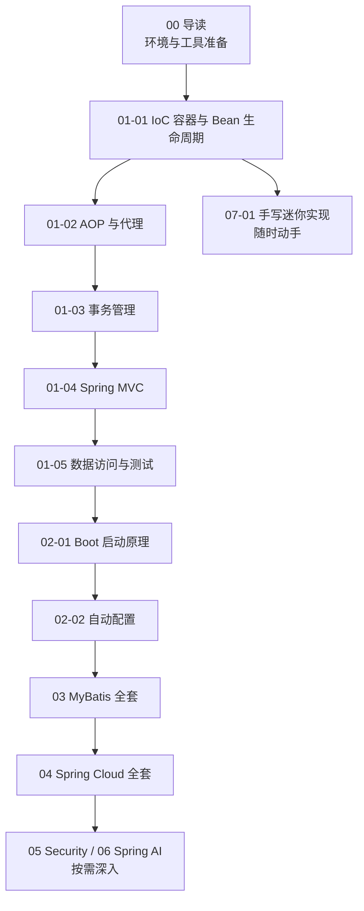

# 00 导读与学习路线：从"会用注解"到"读得懂源码"

> 目标：给**第一次读 Spring 系框架源码**的 Java 开发者一条不迷路的路线。
> 读完后你应该能做到六件事：
> 1. 说清 `new AnnotationConfigApplicationContext(AppConfig.class)` 到底做了什么；
> 2. 说清 Spring Boot 的"自动配置"由哪几个类接力完成；
> 3. 画出 MyBatis 一条 SQL 从 Mapper 接口到 `ResultSet` 封装的完整调用链；
> 4. 说清 Spring Cloud 的注册、调用、熔断、网关各自的核心类；
> 5. 说清 `@Transactional` 为什么会在 `this.xxx()` 调用时失效；
> 6. 遇到"配置没生效""Bean 找不到"这类问题时，知道去哪一层打断点。

> 阅读前置：能写 `@Service`/`@Autowired`/`@RestController`，知道 Maven 坐标是什么。
> 不需要读过任何框架源码——那正是这份文档要带你做的第一件事。

---

## 0 这套文档怎么组织

七个目录，按"依赖顺序"排好了。**不要跳着读**，后面的每章都假设你读过了前面的。

| 目录 | 内容 | 建议投入 | 读完的标志 |
| --- | --- | --- | --- |
| [01-Spring框架](../01-Spring框架/README.md) | IoC 与 Bean 生命周期、AOP 与代理、事务、Spring MVC、数据访问与测试 | 40% | 能画出 `refresh()` 十二步，能解释代理是怎么套上去的 |
| [02-SpringBoot](../02-SpringBoot/README.md) | 启动原理、自动配置、内嵌容器、配置绑定、Actuator、AOT | 20% | 能自己写一个 starter 并解释它为什么生效 |
| [03-MyBatis](../03-MyBatis/README.md) | 初始化与配置解析、SqlSession 与执行器、动态 SQL、结果映射与插件、Spring 集成 | 15% | 能说清 Mapper 接口为什么不用写实现类 |
| [04-SpringCloud](../04-SpringCloud/README.md) | Nacos 注册发现、负载均衡与 OpenFeign、Gateway、配置中心、熔断限流、分布式事务、链路追踪 | 15% | 能说清一次"服务间调用"经过哪些组件 |
| [05-SpringSecurity](../05-SpringSecurity/README.md) | 过滤器链与认证、授权与方法级安全 | 5% | 能说清 `SecurityFilterChain` 里每个过滤器的职责 |
| [06-SpringAI](../06-SpringAI/README.md) | ChatClient 与模型抽象、工具调用与 RAG、MCP 与 Agent | 5% | 能说清一次 `ChatClient.prompt().call()` 的拦截链 |
| [07-源码方法论与附录](../07-源码方法论与附录/README.md) | 手写迷你实现、源码阅读方法论、断点清单 | 随读随查 | 能独立用断点定位一个陌生框架的入口 |

### 0.1 推荐阅读顺序



> 读图说明：主线是 `IoC → AOP → 事务 → MVC → Boot → MyBatis → Cloud`。
> 这条主线不是巧合——**事务是 AOP 的一个应用，MVC 是 IoC 的一个消费者，Boot 是 IoC 的启动器，MyBatis-Spring 是 IoC 的一个 Bean 工厂，Cloud 的每个组件都是 Boot 自动配置**。
> 左侧虚线旁挂的 `07-01 手写迷你实现` 建议在读完 IoC 后就开始跟着敲：自己写一遍 100 行的容器，比读 1000 行 Spring 源码更快建立直觉。

### 0.2 每篇文章的固定结构

本目录所有文章都遵循同一结构（`_templates/写作规范.md` 是权威定义），这样你可以按需跳读：

| 小节 | 作用 | 赶时间时 |
| --- | --- | --- |
| 0 先看现象 | 一个能跑的最小例子 + 你观察到的疑问 | 必读 |
| 1 整体地图 | Mermaid 图 + **读图说明** | 必读 |
| 2 关键类逐个拆 | 每个类的职责、字段、设计意图 | 必读 |
| 3 源码逐段精读 | 真实源码块 + 四层讲解（在干什么／为什么这么写／不这样会怎样／常见坑） | 精读区 |
| 4 一次完整执行时序 | 时序图把第 3 节串起来 | 复习时看 |
| 5 设计模式与取舍 | 这个设计换来了什么、牺牲了什么 | 面试前看 |
| 6 踩坑与调试手法 | 断点打哪、日志看什么 | 遇问题时查 |
| 7 ⚠️ 版本差异 | 你这版和别人文章那版哪里不一样 | 抄别人结论前必看 |
| 8 面试高频问与答 | 10 问 | 面试前看 |
| 9 动手练习 | 带验收标准的练习 | 想真会就做 |
| 小结 / 自测题 | 自测题带 `<details>` 答案 | 复习时做 |

---

## 1 版本基线（读源码前必须先记住）

源码是**按版本**存在的。同一个类，Boot 3 和 Boot 4 可能在不同的 jar 里，行号更是完全对不上。
本目录所有源码摘录都来自下表版本，行号只在这个版本下有效。

| 技术 | 本目录基线版本 | 读源码前必须知道的事 |
| --- | --- | --- |
| Spring Framework | `7.1.0` | 需要 JDK 17+；`refresh()` 用显式 `ReentrantLock` 而非 `synchronized`；`ApplicationStartup`/`StartupStep` 早在 5.3 就有了 |
| Spring Boot | `4.2.0` | servlet 容器、web-server、health 等已从 `spring-boot` 拆成**独立模块**（`spring-boot-tomcat`、`spring-boot-web-server`、`spring-boot-health`），`list-jar` 找不到类时先怀疑"它在别的 jar 里" |
| Spring Cloud | 各子项目 `5.1.0` | 对应 release train `2026.0.0`（依据该 BOM 的 `<properties>`：`spring-cloud-commons.version=5.1.0`、`spring-boot.version=4.2.0`）。Gateway 制品名为 `spring-cloud-gateway-server-webflux` |
| Spring Security | `7.2.0` | 方法级安全（`@EnableMethodSecurity`、`AuthorizationManager` 系列拦截器）在 **`spring-security-core`** 的 `org.springframework.security.authorization.method.*`；**不存在** `spring-security-authorization` 这个制品（7.2.0 在 Maven Central 为 404） |
| MyBatis | `3.6.0` | 核心执行链与 3.5 一致；`ScriptingLanguageDriver`、动态 SQL 的 `SqlNode` 树结构可直接对照 |
| MyBatis Spring | `3.0.5` | `mybatis-spring`，负责 `SqlSessionFactoryBean`、`MapperFactoryBean`、`SqlSessionTemplate` |
| MyBatis Spring Boot Starter | `4.1.0` | 面向 Boot 4（与上面 `mybatis-spring:3.0.5` 配套） |
| Spring AI | `2.1.0` | `ChatClient` + `Advisor` 链 + ToolCallback；MCP 协议实现独立于主仓库 |

> ⚠️ 网上大量文章讲的是 Spring Boot 2.x/3.x。在那些文章里 `ServletWebServerApplicationContext` 在 `spring-boot` jar 里，在 Boot 4 里它搬去了 `spring-boot-web-server`。
> **看到旧结论，请以各篇「⚠️ 版本差异」小节为准**；如果某篇没写版本差异，说明作者默认你就在基线版本上。

---

## 2 环境准备（30 分钟搞定）

### 2.1 JDK 与 IDE

1. **JDK 21**（Spring Framework 7 最低 17，但 21 才有完整的虚拟线程调试体验）。
2. **IDEA**：Maven 导入后，在 `External Libraries` 里对 `spring-context-7.1.0.jar` 右键 `Download Sources`，之后就能在源码上下断点。
   > 关键：断点必须打在**和你 Maven 里同一版本**的 sources 上，否则行号对不上。

### 2.2 本目录自带的两个工具

先 `cd learning-docs/24-源码分析`，然后：

```bash
# 工具 1：看某个 jar 里到底有哪些类（找类在哪个模块，最常用的命令）
node tools/list-jar.mjs org.springframework:spring-context:7.1.0 AbstractApplicationContext

# 工具 2：把某个类的原文抓进 assets/source/（正文的 src 代码块依赖它）
node tools/fetch-source.mjs --from maven \
  --gav org.springframework:spring-context:7.1.0 \
  --path org/springframework/context/support/AbstractApplicationContext.java \
  --out assets/source/AbstractApplicationContext.java.md

# 工具 3：校验整个文档树（链接失效、锚点越界、代码块与原文不一致）
node tools/check-doc.mjs
```

两个工具都只依赖 Node（本机 v24 即可），不需要 Java、不需要联网 Maven 之外的东西。
下载的 jar 会缓存在 `.source-cache/`（已被 `.gitignore` 忽略），重复调用不会重复下载。

> 为什么要有 `fetch-source.mjs`？因为**从网页复制源码是最容易出错的一步**：可能复制错版本、可能漏掉被折叠的行、可能把全角空格吃成半角。
> 机械抓取 + 逐行比对，才能保证"你看到的行号 = 真实行号"。

---

## 3 源码引用格式（全目录统一约定）

### 3.1 两种引用写法

**写法一：正文锚点**——只想指出"这个事实在哪"，不贴代码：

- `DefaultListableBeanFactory#preInstantiateSingletons` 负责预实例化所有非懒加载单例 [[源码:DefaultListableBeanFactory.java#L起-L止]]

**写法二：代码块标注**——要贴出源码本身：

~~~markdown
```java (src: AbstractApplicationContext.java#L581-L585)
	@Override
	public void refresh() throws BeansException, IllegalStateException {
		this.startupShutdownLock.lock();
		try {
			this.startupShutdownThread = Thread.currentThread();
```
~~~

### 3.2 三条硬规则

| 规则 | 为什么 | 违反的后果 |
| --- | --- | --- |
| 代码块内容必须与 `assets/source/` 里的原文**逐字符一致**（只允许忽略行尾空白） | 否则读者无法核对，等于编造 | `check-doc.mjs` 报错 |
| 讲解写在代码块**外面** | 块内加注释会破坏"逐字符一致" | 校验失败 |
| 省略部分只能写**单独一行** `...` | 让校验器知道"这里跳过了几行，跳到哪由下一次匹配决定" | 校验失败或误判 |

### 3.3 一个真实的例子

`AbstractApplicationContext#refresh()` 在 `spring-context:7.1.0` 中的真实位置是 [[源码:AbstractApplicationContext.java#L581-L585]]：
`L581` 是 `@Override`，`L582` 是方法签名，`L583` 加锁，`L584` 进入 `try`，`L585` 记录当前线程。

而第 1 步 `prepareRefresh()` 的调用在 [[源码:AbstractApplicationContext.java#L590-L590]]，它的方法体在 [[源码:AbstractApplicationContext.java#L668-L703]]。

> 注意 `#L590-L590` 这种"起止同行"的写法：只引用一行时也必须写完整区间，不能只写 `#L590`——因为校验器按 `L起-L止` 解析。

---

## 4 怎么读才不迷路（方法论速记）

这五条是本目录 `07-源码方法论与附录` 的浓缩版，先记住，后面每篇都在用。

1. **先看调用链，再看实现。**
   从 `main()` 或外部入口出发，只画两条线："谁调用我"和"我调用谁"。
   不要一上来就点开 `AbstractApplicationContext` 从第一行读——那是 1000+ 行的类。

2. **抓"分水岭"方法。**
   每个框架都有 1-2 个模板方法，读完它等于拿到了地图：

   | 框架 | 分水岭方法 | 位置 |
   | --- | --- | --- |
   | Spring IoC | `AbstractApplicationContext#refresh` | [[源码:AbstractApplicationContext.java#L581-L585]] |
   | Spring MVC | `DispatcherServlet#doDispatch` | `spring-webmvc:7.1.0` |
   | Spring Boot | `SpringApplication#run` | [[源码:SpringApplication.java#L292-L328]] |
   | 事务 | `TransactionAspectSupport#invokeWithinTransaction` | `spring-tx:7.1.0` |
   | MyBatis | `DefaultSqlSession#selectList` | `mybatis:3.6.0` |

3. **带着问题断点。**
   "`@Autowired` 到底在哪一步注入？"→ 断点 `AutowiredAnnotationBeanPostProcessor#postProcessProperties`。
   "配置为什么没生效？"→ 断点 `ConfigDataEnvironmentPostProcessor`，看 `PropertySources` 顺序。
   没有问题就单步，等于大海捞针。

4. **看注释别只看代码。**
   Spring 的 Javadoc 经常直接写"为什么这样设计"。比如 `refresh()` 上面那行注释就是阶段名清单。

5. **每读一个组件，问三个问题。**
   它解决什么问题？不用它会怎样？扩展点在哪（哪个接口/哪个注解）？

详细的断点清单（按框架速查）见 [02-源码阅读方法论](../07-源码方法论与附录/02-源码阅读方法论/README.md)。

---

## 5 学习检查点

读完整个目录后，逐条打勾。打不上勾的，就是该回去重读的那章。

- [ ] 能用一张时序图讲完 `new AnnotationConfigApplicationContext(AppConfig.class)`，并说清 `refresh()` 十二步各自的作用。
- [ ] 能解释 `BeanFactory` 与 `ApplicationContext`、`FactoryBean` 与 `BeanFactory` 的区别。
- [ ] 能说清 JDK 动态代理和 CGLIB 的选用规则，以及"为什么 JDK 代理下 `@Autowired` 字段能注入、但自调用会失效"。
- [ ] 能说出 `@Transactional` 的拦截器入口是哪个类，以及它在哪种调用方式下不生效。
- [ ] 能说出 `@SpringBootApplication` 三个注解分别做了什么，`AutoConfiguration.imports` 在 Boot 4 中如何被读到。
- [ ] 能画出 MyBatis 一次查询的 6 层调用链，并指出插件（`Interceptor`）能拦哪四个点。
- [ ] 能解释 Nacos 服务注册与拉取的 RPC 流程，OpenFeign 如何把接口变成 HTTP 调用。
- [ ] 能说清 `SecurityFilterChain` 中认证、授权、异常处理三个过滤器的作用顺序。

## 小结

- 本目录按"框架分层"组织，主线是 **IoC → AOP → 事务 → MVC → Boot → MyBatis → Cloud**，后面的每一层都建立在前一层之上。
- 版本基线是 Spring `7.1.0` / Boot `4.2.0` / Cloud 子项目 `5.1.0`（train `2026.0.0`）/ Security `7.2.0` / MyBatis `3.6.0` / Spring AI `2.1.0`；**行号只对这些版本有效**。
- 一切源码引用都可追溯：`fetch-source.mjs` 抓原文入库 → 正文用锚点或 `(src: 文件#L起-L止)` 引用 → `check-doc.mjs` 逐行校验。
- 读源码的方法论只有一句：**先拿地图（分水岭方法），再带问题下钻（断点），最后回填（写下来）**。

## 自测题

1. 为什么读 Spring 源码建议先读 `AbstractApplicationContext#refresh()`，而不是从 `@Component` 注解的定义开始读？
2. 你在 Boot 4 里用 `list-jar` 在 `spring-boot:4.2.0` 中找不到 `ServletWebServerApplicationContext`，最可能的原因是什么？下一步该查哪个 jar？
3. `[[源码:文件#L起-L止]]` 和 `(src: 文件#L起-L止)` 这两种写法分别解决什么问题？如果直接贴一段网上复制的代码，会带来哪些风险？
4. 如果只想搞清楚"Mapper 接口为什么不需要实现类"，应该优先读 `03-MyBatis` 的哪几篇？为什么？
5. "先看调用链再看实现"带来什么好处？请举一个你会用到的分水岭方法，并说明它能帮你回答什么问题。
6. 本目录为什么要求"讲解必须写在代码块外面"？如果写在里面，校验器会怎么报？
7. 代码块里出现单独一行 `...` 的语义是什么？校验器如何处理它？
8. 同样是 `spring-cloud-commons`，"5.1.0" 这个数字描述的是子项目版本还是 release train？怎么用一份 Maven 文件证明你的判断？
9. 你手上有 Boot 3.2 和 Boot 4.2 两个工程，直接套用本目录的行号会发生什么？正确做法是什么？
10. 如果给你一个完全陌生的框架，让你在 30 分钟内找到"请求进来后第一个被执行的方法"，你会怎么做？

<details><summary>参考答案要点</summary>

1. `refresh()` 是容器生命周期的总调度，读它能一次建立"准备环境 → 加载图纸 → 准备工厂 → 后置处理器 → 实例化单例 → 收尾发事件"的全局坐标。从注解定义读起容易陷在注解元数据的细节里，看不到组件之间怎么协作。
2. 因为 Boot 4 把 servlet 容器相关类拆到了独立模块。下一步用 `node tools/list-jar.mjs org.springframework.boot:spring-boot-web-server:4.2.0 ServletWeb` 查（该类在 `org.springframework.boot.web.server.servlet.context` 包下）。
3. 锚点解决"事实可追溯"（读者可以按行号去核对原文），代码块标注解决"原文可逐行比对"（防止抄错、防止编造）。直接贴网上代码的风险：版本不一致、行号错误、被折叠或省略的行被当成完整方法、全角/半角字符被替换。
4. 优先读 `03-MyBatis/02-SqlSession与执行器/01-sqlsession-与-mapper-代理.md` 和 `03-MyBatis/05-Spring集成与Boot自动配置/` 里讲 `MapperFactoryBean`、`MapperScannerConfigurer`、`SqlSessionTemplate` 的部分。因为"接口没有实现类还能调用"这件事，一半答案在 MyBatis 的 `MapperProxy`（JDK 动态代理），另一半在 Spring 的 `FactoryBean`（决定 `getBean` 返回什么）。
5. 先建立"谁调用谁"的结构，钻实现时就不会被细节淹没。例如 `SpringApplication#run` 能回答"我的 `CommandLineRunner` 在启动流程的哪个位置被执行、失败会不会中断启动"。
6. 因为"逐字符一致"是校验规则。写在块里的讲解会与原文产生差异，`check-doc.mjs` 会报"代码块与 `assets/source` 原文不一致"。
7. 语义是"这里省略了若干行，后面接着引用同一文件的下一段"。校验器会把 `...` 之后的内容当作新的匹配起点，在原文里向后寻找连续的逐行匹配位置继续比对。
8. 是**子项目版本**。证据：`spring-cloud-dependencies:2026.0.0` 的 pom 里 `<spring-cloud-commons.version>5.1.0</spring-cloud-commons.version>` 且 `<spring-boot.version>4.2.0</spring-boot.version>`——一个 train（BOM）管住所有子项目版本，所以 5.1.0 属于 2026.0.0 这一 train。
9. 行号会全部错位（类的行数、方法位置都变了），读者按锚点核对会失败。正确做法：用 `fetch-source.mjs --gav <你的版本>` 重新抓一份原文，在自己的版本上重新定位行号，而不是套用别人的。
10. 用"入口 + 断点"法：先看框架对外暴露的入口（`main`、Servlet、`@Bean` 注解处理器等），在其中打一个断点并触发一次最小用例，然后看调用栈里最深的那一帧就是"第一个被执行的框架方法"；再往上找它的调用者，画出 3-5 层调用链。

</details>
