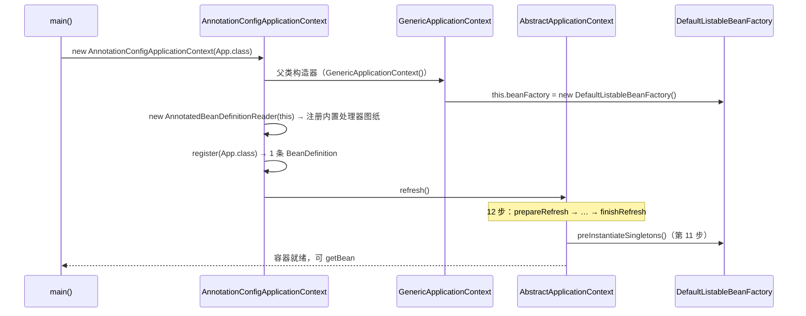
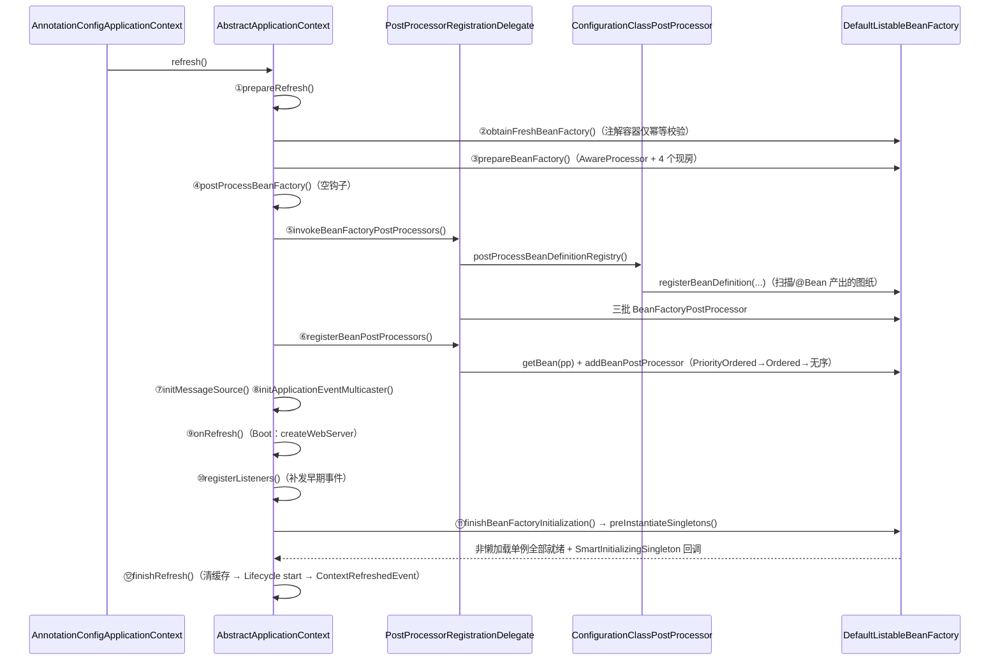

# Spring Framework 源码精读 01：IoC 容器的启动流程（`refresh()` 十二步全解）

> 一句话结论：`AnnotationConfigApplicationContext` 的构造器只负责"登记图纸 + 装配工具箱"，真正把图纸变成对象、把事件机制与生命周期机制接通的是 `AbstractApplicationContext#refresh()`（本基线位于 `AbstractApplicationContext.java` L581-L662）里的十二步。
> 阅读前置：Java 反射与注解基础；用过 `@Configuration`、`@Component`、`@Autowired`。
> 预计阅读：50 分钟 ｜ 源码基线：`org.springframework:spring-context:7.1.0`
> 同目录延伸阅读：[02-bean-创建全流程-getbean与createbean.md](02-bean-创建全流程-getbean与createbean.md)、[03-循环依赖与三级缓存.md](03-循环依赖与三级缓存.md)、[04-依赖注入-autowired与beanpostprocessor.md](04-依赖注入-autowired与beanpostprocessor.md)、[05-配置类解析-configurationclasspostprocessor.md](05-配置类解析-configurationclasspostprocessor.md)、[README.md](README.md)

---

## 0. 先看现象

写一个**什么都不含**的配置类，只为了让 `AnnotationConfigApplicationContext` 有个入口：

```java
class App { }

try (var ctx = new AnnotationConfigApplicationContext(App.class)) {
    System.out.println(ctx.getBeanFactory().getBeanDefinitionCount()); // "图纸"的数量
    System.out.println(ctx.getBeanFactory().getSingletonCount());      // "已交付的房子"的数量
}
```

你会观察到两个反直觉的结果：

1. `getBeanDefinitionCount()` 很小——只有一个 `App` 相关的图纸，加上容器自己提前注册的几个基础设施图纸（内置 `BeanPostProcessor`/`BeanFactoryPostProcessor` 等）。
2. `getSingletonCount()` **明显比图纸数多**，`getSingletonNames()` 里能直接看到 `environment`、`systemProperties`、`systemEnvironment`、`applicationStartup`、`messageSource`、`applicationEventMulticaster`、`lifecycleProcessor` 这些名字。

第 2 点是非常经典的误读现场：**`environment` 这一批根本不是 `BeanDefinition`，而是被 `registerSingleton(...)` 直接塞进单例仓库的"现成对象"**。原文里"容器里已有多条 BeanDefinition（environment、systemProperties…）"的说法是错的，代码看这里：

```java (src: AbstractApplicationContext.java#L764-L775)
		if (!beanFactory.containsLocalBean(ENVIRONMENT_BEAN_NAME)) {
			beanFactory.registerSingleton(ENVIRONMENT_BEAN_NAME, getEnvironment());
		}
...
		if (!beanFactory.containsLocalBean(APPLICATION_STARTUP_BEAN_NAME)) {
			beanFactory.registerSingleton(APPLICATION_STARTUP_BEAN_NAME, getApplicationStartup());
		}
```

> 生活化类比：`BeanDefinition`（图纸）与单例对象（已交付的房子）是两个抽屉。`registerSingleton` 是"直接交付一套现房，连图纸都不留"，所以你在 `getBeanDefinitionNames()` 里永远找不到它们，但在 `getSingletonNames()` 里一定有。

那这些现房是**什么时候**交的？答案分散在四处：第 3 步 `prepareBeanFactory`（`environment` 三兄弟 + `applicationStartup`）、第 7 步 `initMessageSource`（`messageSource`）、第 8 步 `initApplicationEventMulticaster`（`applicationEventMulticaster`）、第 12 步里的 `initLifecycleProcessor`（`lifecycleProcessor`）。本文就沿着 `refresh()` 一路走完。

## 1. 整体地图



> 读图说明：三个箭头是全文主线。①`GAC->>BF`：`beanFactory` 是 `GenericApplicationContext` 的字段，**不是** `AbstractApplicationContext` 的字段；②`Ctx->>Ctx: register(...)` 只登记图纸；③`AC->>BF: preInstantiateSingletons()` 才是"施工"。箭头顺序就是排查启动问题的顺序。

十二步清单（顺序即 `refresh()` 的调用顺序，行号为本基线真实位置）：

| # | 方法 | 真实位置 | 一句话作用 |
| --- | --- | --- | --- |
| 1 | `prepareRefresh()` | L668-L703 | 置 `startupDate`/`active`，校验必需属性，准备早期事件集合 |
| 2 | `obtainFreshBeanFactory()` | L720-L723 | 调 `refreshBeanFactory()` 拿工厂（注解容器里几乎什么都不做） |
| 3 | `prepareBeanFactory(beanFactory)` | L730-L776 | 配 ClassLoader、SpEL、`ApplicationContextAwareProcessor`、可解析依赖、四个现房 |
| 4 | `postProcessBeanFactory(beanFactory)` | L787-L788 | 空钩子，供子类改工厂（Web 容器在这里注册作用域等） |
| 5 | `invokeBeanFactoryPostProcessors(beanFactory)` | L795-L805 | 执行 `BeanFactoryPostProcessor`：解析 `@Configuration`、补全图纸 |
| 6 | `registerBeanPostProcessors(beanFactory)` | L812-L814 | 实例化并排队所有 `BeanPostProcessor` |
| 7 | `initMessageSource()` | L821-L846 | 国际化组件，没有就塞个空实现当现房 |
| 8 | `initApplicationEventMulticaster()` | L854-L871 | 事件广播器，没有就塞 `SimpleApplicationEventMulticaster` |
| 9 | `onRefresh()` | L907-L909（调用点 L615-L616） | 空钩子，Boot 在这里创建内嵌 Tomcat |
| 10 | `registerListeners()` | L915-L936 | 注册监听器、补发早期事件 |
| 11 | `finishBeanFactoryInitialization(beanFactory)` | L942-L996 | **预实例化所有非懒加载单例** |
| 12 | `finishRefresh()` | L1003-L1018 | 清缓存 → 起 `LifecycleProcessor` → 发 `ContextRefreshedEvent` |

> 生活化类比：`refresh()` 是"交房流程"。1-4 步是场地准备（通水通电），5 步是补齐并确认图纸，6 步是装好质检流水线，7-8 步是装公告板和广播系统，9-10 步是接入外部设施，11 步才真正盖房子，12 步剪彩并在小区群里发通知。

## 2. 关键类逐个拆

### 2.1 `AbstractApplicationContext`：模板方法的"总调度台"

它的职责不是存 Bean，而是**固定流程 + 开钩子**。先把字段看全，注意这里**没有** `beanFactory` 字段：

```java (src: AbstractApplicationContext.java#L202-L242)
	/** BeanFactoryPostProcessors to apply on refresh. */
	private final List<BeanFactoryPostProcessor> beanFactoryPostProcessors = new ArrayList<>();

	/** System time in milliseconds when this context started. */
	private long startupDate;

	/** Flag that indicates whether this context is currently active. */
	private final AtomicBoolean active = new AtomicBoolean();

	/** Flag that indicates whether this context has been closed already. */
	private final AtomicBoolean closed = new AtomicBoolean();

	/** Synchronization lock for "refresh" and "close". */
	private final Lock startupShutdownLock = new ReentrantLock();

	/** Currently active startup/shutdown thread. */
	private volatile @Nullable Thread startupShutdownThread;

	/** Reference to the JVM shutdown hook, if registered. */
	private @Nullable Thread shutdownHook;

	/** ResourcePatternResolver used by this context. */
	private final ResourcePatternResolver resourcePatternResolver;

	/** LifecycleProcessor for managing the lifecycle of beans within this context. */
	private @Nullable LifecycleProcessor lifecycleProcessor;

	/** MessageSource we delegate our implementation of this interface to. */
	private @Nullable MessageSource messageSource;

	/** Helper class used in event publishing. */
	private @Nullable ApplicationEventMulticaster applicationEventMulticaster;

	/** Application startup metrics. */
	private ApplicationStartup applicationStartup = ApplicationStartup.DEFAULT;

	/** Statically specified listeners. */
	private final Set<ApplicationListener<?>> applicationListeners = new LinkedHashSet<>();

	/** Local listeners registered before refresh. */
	private @Nullable Set<ApplicationListener<?>> earlyApplicationListeners;
```

- **在干什么**：只存"上下文自己的服务对象"——事件广播器、国际化、生命周期处理器、启动观测器、监听器集合，以及并发控制用的 `startupShutdownLock`/`startupShutdownThread`。
- **为什么这么写**：`refresh()` 里每一步都要拿到 `ConfigurableListableBeanFactory`，但它在**子类**手里。所以 `AbstractApplicationContext` 把 `getBeanFactory()` 声明成抽象方法（L1656），强制子类提供，而不是自己存一份字段。
- **不这样会怎样**：如果父类也存一个 `beanFactory` 字段，就会出现"父类字段 vs 子类字段"两份状态，`getBean` 走哪份不可预期——典型的多头状态 bug。
- **常见坑**：看源码时把"父类有 `getBeanFactory()` 方法"误读成"父类有 `beanFactory` 字段"，于是把 `prepareBeanFactory` 的参数当成字段，讲课时就会说错。

### 2.2 `GenericApplicationContext`：真正**持有**工厂的那一层

```java (src: GenericApplicationContext.java#L114-L120)
	private final DefaultListableBeanFactory beanFactory;

	private @Nullable ResourceLoader resourceLoader;

	private boolean customClassLoader = false;

	private final AtomicBoolean refreshed = new AtomicBoolean();
```

```java (src: GenericApplicationContext.java#L128-L130)
	public GenericApplicationContext() {
		this.beanFactory = new DefaultListableBeanFactory();
	}
```

- **在干什么**：`GenericApplicationContext` 在构造时就 `new` 一个 `DefaultListableBeanFactory`，并用 `refreshed` 原子标记保证"只允许刷新一次"。
- **为什么这么写**：注解驱动容器不需要"解析配置文本 → 新建工厂"的过程（那是 XML 容器的活），所以它一次建好工厂，`refreshBeanFactory()` 只做幂等校验：

```java (src: GenericApplicationContext.java#L295-L302)
	@Override
	protected final void refreshBeanFactory() throws IllegalStateException {
		if (!this.refreshed.compareAndSet(false, true)) {
			throw new IllegalStateException(
					"GenericApplicationContext does not support multiple refresh attempts: just call 'refresh' once");
		}
		this.beanFactory.setSerializationId(getId());
	}
```

- **不这样会怎样**：允许重复 `refresh()` 就会把已有单例、已注册的监听器状态全部搅乱（半初始化状态最危险），所以这里直接 fail-fast。
- **常见坑**：`refresh()` 之后再手工 `ctx.refresh()` 必抛 `IllegalStateException`，这不是 bug，是设计。

### 2.3 `DefaultListableBeanFactory`：真正的"容器内脏"

- **职责**：持有 `beanDefinitionMap`（图纸目录）、`singletonObjects` 等三级缓存（成品与半成品仓库）、`beanPostProcessors`（质检流水线）、`resolvableDependencies`（可注入的"特殊插座"），以及依赖解析逻辑。
- **生活化类比**：`ApplicationContext` 是**物业公司**（报修、公告、缴费窗口），`DefaultListableBeanFactory` 是**施工队仓库**（图纸柜 + 成品库 + 质检线）。物业公司自己不搬砖，所有砖都在仓库里。
- **注意**：Bean 的实例化与依赖注入 90% 发生在 `DefaultListableBeanFactory` 及其父类 `AbstractAutowireCapableBeanFactory`，`refresh()` 只是按顺序"拍调度指令"。

### 2.4 `PostProcessorRegistrationDelegate`：后置处理器排队的"专职调度员"

`refresh()` 的第 5、6 步各自只有 1-3 行，真正的排序逻辑都委托给这个类。它内部有两段非常著名的"宁可写丑也不改"的代码，注释直接写明"不要为了少写循环而重构"——因为处理器**实例化的先后顺序**会影响它们能否被其它处理器加工。

### 2.5 `ApplicationStartup`：启动观测的"行车记录仪"

```java (src: ApplicationStartup.java#L19-L28)
/**
 * Instruments the application startup phase using {@link StartupStep steps}.
 * <p>The core container and its infrastructure components can use the {@code ApplicationStartup}
 * to mark steps during the application startup and collect data about the execution context
 * or their processing time.
 *
 * @author Brian Clozel
 * @since 5.3
 */
public interface ApplicationStartup {
```

- **在干什么**：提供 `start(name)` 打点，`StartupStep#end()` 收尾，形成一棵启动耗时树。
- **关键事实**：`@since 5.3`——它是 **Spring Framework 5.3** 引入的，不是 6 起。6.x 之后只是生态（Boot 的 `BufferingApplicationStartup`、Actuator 端点）接入更完整。
- **生活化类比**：快递面单上的各个扫描点。`DEFAULT` 实现是"空扫描"（零开销），要看数据必须换成会记录的实现。

### 2.6 `ConfigurableApplicationContext`：那些"魔法名字"的出处

`prepareBeanFactory` 里出现的 `ENVIRONMENT_BEAN_NAME` 等常量，都在这个接口里定义，值就是字符串字面量：

```java (src: ConfigurableApplicationContext.java#L85-L108)
	/**
	 * Name of the {@link org.springframework.core.env.Environment Environment}
	 * bean in the factory: {@value}.
	 * @since 3.1
	 */
	String ENVIRONMENT_BEAN_NAME = "environment";

	/**
	 * Name of the JVM System properties bean in the factory: {@value}.
	 * @see java.lang.System#getProperties()
	 */
	String SYSTEM_PROPERTIES_BEAN_NAME = "systemProperties";

	/**
	 * Name of the Operating System environment bean in the factory: {@value}.
	 * @see java.lang.System#getenv()
	 */
	String SYSTEM_ENVIRONMENT_BEAN_NAME = "systemEnvironment";

	/**
	 * Name of the {@link ApplicationStartup} bean in the factory: {@value}.
	 * @since 5.3
	 */
	String APPLICATION_STARTUP_BEAN_NAME = "applicationStartup";
```

> 生活化类比：这是"插座面板上印的编号"。业务代码写 `@Autowired Environment env` 能注入成功，就是因为它按**类型**在单例仓库里找到了 `environment` 这个现房。

## 3. 源码逐段精读

### 3.1 `refresh()` 骨架：一把锁、两个线程变量、十二步

```java (src: AbstractApplicationContext.java#L581-L662)
	@Override
	public void refresh() throws BeansException, IllegalStateException {
		this.startupShutdownLock.lock();
		try {
			this.startupShutdownThread = Thread.currentThread();

			StartupStep contextRefresh = this.applicationStartup.start("spring.context.refresh");

			// Prepare this context for refreshing.
			prepareRefresh();

			// Tell the subclass to refresh the internal bean factory.
			ConfigurableListableBeanFactory beanFactory = obtainFreshBeanFactory();

			// Prepare the bean factory for use in this context.
			prepareBeanFactory(beanFactory);

			try {
				// Allows post-processing of the bean factory in context subclasses.
				postProcessBeanFactory(beanFactory);

				StartupStep beanPostProcess = this.applicationStartup.start("spring.context.beans.post-process");
				// Invoke factory processors registered as beans in the context.
				invokeBeanFactoryPostProcessors(beanFactory);
				// Register bean processors that intercept bean creation.
				registerBeanPostProcessors(beanFactory);
				beanPostProcess.end();

				// Initialize message source for this context.
				initMessageSource();

				// Initialize event multicaster for this context.
				initApplicationEventMulticaster();

				// Initialize other special beans in specific context subclasses.
				onRefresh();

				// Check for listener beans and register them.
				registerListeners();

				// Instantiate all remaining (non-lazy-init) singletons.
				finishBeanFactoryInitialization(beanFactory);

				// Last step: publish corresponding event.
				finishRefresh();
			}

			catch (RuntimeException | Error ex) {
				if (logger.isWarnEnabled()) {
					logger.warn("Exception encountered during context initialization - " +
							"cancelling refresh attempt: " + ex);
				}

				// Stop already started Lifecycle beans to avoid dangling resources.
				if (this.lifecycleProcessor != null && this.lifecycleProcessor.isRunning()) {
					try {
						this.lifecycleProcessor.stop();
					}
					catch (Throwable ex2) {
						logger.warn("Exception thrown from LifecycleProcessor on cancelled refresh", ex2);
					}
				}

				// Destroy already created singletons to avoid dangling resources.
				destroyBeans();

				// Reset 'active' flag.
				cancelRefresh(ex);

				// Propagate exception to caller.
				throw ex;
			}

			finally {
				contextRefresh.end();
			}
		}
		finally {
			this.startupShutdownThread = null;
			this.startupShutdownLock.unlock();
		}
	}
```

- **在干什么**：①`startupShutdownLock.lock()` 拿锁（`refresh` 与 `close` 互斥）；②记录 `startupShutdownThread`（供 `close()` 做"同线程校验"）；③在第 582 行开启 `spring.context.refresh` 这个 `StartupStep`；④顺序调用十二步；⑤`catch` 块里做**失败回滚**（停 Lifecycle、销毁已建单例、取消刷新）；⑥`finally` 收尾（结束 `StartupStep`、清线程变量、解锁）。
- **为什么这么写**：`refresh` 与 `close` 必须互斥但**不能嵌套死锁**，所以用 `ReentrantLock` 而不是 `synchronized`——可中断、可 `tryLock` 超时（`close()` 侧就用了 `tryLockForShutdown`）。而 `startupShutdownThread` 让 `close()` 能判断"是不是启动线程自己在关自己"。
- **不这样会怎样**：若失败后不销毁已建单例，那些已启动的线程池、已连的数据库连接就会泄漏（所谓 dangling resources）；若不 reset `active`，下游会以为容器还是可用状态。
- **常见坑**：`prepareRefresh()`（L590）在 `try` **之外**——它之前抛异常不需要回滚；而从 `postProcessBeanFactory` 起的步骤都在 `try` 内。读源码时这一点决定"哪些异常会触发 `destroyBeans()`"。

### 3.2 第 1 步：`prepareRefresh()`（L668-L703）

```java (src: AbstractApplicationContext.java#L668-L703)
	protected void prepareRefresh() {
		// Switch to active.
		this.startupDate = System.currentTimeMillis();
		this.closed.set(false);
		this.active.set(true);

		if (logger.isDebugEnabled()) {
			if (logger.isTraceEnabled()) {
				logger.trace("Refreshing " + this);
			}
			else {
				logger.debug("Refreshing " + getDisplayName());
			}
		}

		// Initialize any placeholder property sources in the context environment.
		initPropertySources();

		// Validate that all properties marked as required are resolvable:
		// see ConfigurablePropertyResolver#setRequiredProperties
		getEnvironment().validateRequiredProperties();

		// Store pre-refresh ApplicationListeners...
		if (this.earlyApplicationListeners == null) {
			this.earlyApplicationListeners = new LinkedHashSet<>(this.applicationListeners);
		}
		else {
			// Reset local application listeners to pre-refresh state.
			this.applicationListeners.clear();
			this.applicationListeners.addAll(this.earlyApplicationListeners);
		}

		// Allow for the collection of early ApplicationEvents,
		// to be published once the multicaster is available...
		this.earlyApplicationEvents = new LinkedHashSet<>();
	}
```

- **在干什么**：置 `startupDate`；`closed=false`、`active=true`；按需打日志；`initPropertySources()`（子类往 `Environment` 里塞占位符源，如 Servlet 的 `ServletConfig`/`ServletContext` 参数）；`validateRequiredProperties()` 校验必需属性；最后备份/重置 `applicationListeners` 并新建 `earlyApplicationEvents` 集合。
- **为什么这么写**：`refresh` 可能被调用多次的想法不存在，但 `active` 标志要能被统一置位，后续 `isActive()` 才有意义；`earlyApplicationListeners` 提供"本次刷新前的监听器快照"，让刷新失败后能回滚到刷新前状态。
- **不这样会怎样**：不校验必需属性，配置错误会延迟到业务 Bean 初始化甚至运行时才炸；没有 `earlyApplicationEvents` 容器，第 8 步之前（广播器还不存在）发布的事件就全丢了。
- **常见坑**：`validateRequiredProperties()` 只校验显式 `setRequiredProperties` 声明的键，不要指望它校验所有 `${}` 占位符；占位符解析是 `PropertySourcesPlaceholderConfigurer`（第 5 步）干的。

### 3.3 第 2 步：`obtainFreshBeanFactory()`（L720-L723）

```java (src: AbstractApplicationContext.java#L720-L723)
	protected ConfigurableListableBeanFactory obtainFreshBeanFactory() {
		refreshBeanFactory();
		return getBeanFactory();
	}
```

- **在干什么**：模板方法——`refreshBeanFactory()`（子类实现）+ `getBeanFactory()`。
- **为什么这么写**：把"新建/复用工厂"的差异留给子类：`GenericApplicationContext` 只做一次性校验（见 2.2），`ClassPathXmlApplicationContext` 才真的去 load XML 生成图纸。
- **不这样会怎样**：如果父类硬编码"新建工厂"，注解容器每次 refresh 都会丢失已注册图纸。
- **常见坑**：以为注解容器的第 2 步"会扫描包"。**不会**——扫描发生在 `AnnotationConfigApplicationContext#scan()` 或 `@ComponentScan` 被 `ConfigurationClassPostProcessor` 处理时（第 5 步）。

### 3.4 第 3 步：`prepareBeanFactory()`（L730-L776）

```java (src: AbstractApplicationContext.java#L730-L776)
	protected void prepareBeanFactory(ConfigurableListableBeanFactory beanFactory) {
		// Tell the internal bean factory to use the context's class loader etc.
		beanFactory.setBeanClassLoader(getClassLoader());
		beanFactory.setBeanExpressionResolver(new StandardBeanExpressionResolver(beanFactory.getBeanClassLoader()));
		beanFactory.addPropertyEditorRegistrar(new ResourceEditorRegistrar(this, getEnvironment()));

		// Configure the bean factory with context callbacks.
		beanFactory.addBeanPostProcessor(new ApplicationContextAwareProcessor(this));
		beanFactory.ignoreDependencyInterface(EnvironmentAware.class);
		beanFactory.ignoreDependencyInterface(EmbeddedValueResolverAware.class);
		beanFactory.ignoreDependencyInterface(ResourceLoaderAware.class);
		beanFactory.ignoreDependencyInterface(ApplicationEventPublisherAware.class);
		beanFactory.ignoreDependencyInterface(MessageSourceAware.class);
		beanFactory.ignoreDependencyInterface(ApplicationContextAware.class);
		beanFactory.ignoreDependencyInterface(ApplicationStartupAware.class);

		// BeanFactory interface not registered as resolvable type in a plain factory.
		// MessageSource registered (and found for autowiring) as a bean.
		beanFactory.registerResolvableDependency(BeanFactory.class, beanFactory);
		beanFactory.registerResolvableDependency(ResourceLoader.class, this);
		beanFactory.registerResolvableDependency(ApplicationEventPublisher.class, this);
		beanFactory.registerResolvableDependency(ApplicationContext.class, this);

		// Register early post-processor for detecting inner beans as ApplicationListeners.
		beanFactory.addBeanPostProcessor(new ApplicationListenerDetector(this));

		// Detect a LoadTimeWeaver and prepare for weaving, if found.
		if (!NativeDetector.inNativeImage() && beanFactory.containsBean(LOAD_TIME_WEAVER_BEAN_NAME)) {
			beanFactory.addBeanPostProcessor(new LoadTimeWeaverAwareProcessor(beanFactory));
			// Set a temporary ClassLoader for type matching.
			beanFactory.setTempClassLoader(new ContextTypeMatchClassLoader(beanFactory.getBeanClassLoader()));
		}

		// Register default environment beans.
		if (!beanFactory.containsLocalBean(ENVIRONMENT_BEAN_NAME)) {
			beanFactory.registerSingleton(ENVIRONMENT_BEAN_NAME, getEnvironment());
		}
		if (!beanFactory.containsLocalBean(SYSTEM_PROPERTIES_BEAN_NAME)) {
			beanFactory.registerSingleton(SYSTEM_PROPERTIES_BEAN_NAME, getEnvironment().getSystemProperties());
		}
		if (!beanFactory.containsLocalBean(SYSTEM_ENVIRONMENT_BEAN_NAME)) {
			beanFactory.registerSingleton(SYSTEM_ENVIRONMENT_BEAN_NAME, getEnvironment().getSystemEnvironment());
		}
		if (!beanFactory.containsLocalBean(APPLICATION_STARTUP_BEAN_NAME)) {
			beanFactory.registerSingleton(APPLICATION_STARTUP_BEAN_NAME, getApplicationStartup());
		}
	}
```

- **在干什么**：给工厂装四类东西——①基础能力：`BeanClassLoader`、`StandardBeanExpressionResolver`（SpEL `#{}`）、`ResourceEditorRegistrar`；②上下文回调：`ApplicationContextAwareProcessor`，并用 `ignoreDependencyInterface` 告诉工厂"这些 Aware 接口不要走按类型自动注入，由我手动回调"；③**可解析依赖**（`registerResolvableDependency`）：把 `BeanFactory`、`ResourceLoader`、`ApplicationEventPublisher`、`ApplicationContext` 注册成"任何 Bean 想注入就直接给这些对象"；④四个**现房单例**：`environment`、`systemProperties`、`systemEnvironment`、`applicationStartup`。
- **为什么这么写**：`@Autowired ApplicationContext ctx` 之所以能注入，靠的不是图纸而是 `resolvableDependencies` 这个"特殊插座"；`ignoreDependencyInterface` 则是为了避免 `ApplicationContextAware#setApplicationContext` 被当成 setter 注入点而重复/错误注入。
- **不这样会怎样**：没有 `ApplicationContextAwareProcessor`，`ApplicationContextAware` 全部回调不到；没有 `ResourceEditorRegistrar`，`@Value("classpath:...")` 注入 `Resource` 会失败。
- **常见坑**：①四个现房用 `containsLocalBean` 判重——所以你自己定义一个名为 `environment` 的 Bean 会"赢"，容器不再注册它的默认实现，可能引发类型冲突；②它们不是 `BeanDefinition`，`getBeanDefinitionNames()` 里查不到。

上文 `addBeanPostProcessor(new ApplicationContextAwareProcessor(this))` 之所以能替代 setter 注入，是因为它自己在初始化回调里直接调用了 setter。真实实现只有这几行：

```java (src: ApplicationContextAwareProcessor.java#L82-L88)
	@Override
	public @Nullable Object postProcessBeforeInitialization(Object bean, String beanName) throws BeansException {
		if (bean instanceof Aware) {
			invokeAwareInterfaces(bean);
		}
		return bean;
	}
```

- **在干什么**：容器构造这个处理器时就把 `applicationContext` 存下来；任何实现了 `Aware` 的 Bean 走到这一步，就被"手动喂"一遍回调。
- **为什么这么写**：`ApplicationContextAware#setApplicationContext` 不是注解、不符合 setter 注入的约定，`@Autowired` 认不出来；用 `BeanPostProcessor` 在一个统一位置回调，最省事也最可控。
- **不这样会怎样**：这一对（`ignoreDependencyInterface(...)` + 本处理器）缺一个就会出事——前者保证工厂不去"按类型找 `ApplicationContext` 来注入 setter"，后者保证真正把上下文递过去。
- **常见坑**：自定义 `Aware` 接口不在这个列表里。容器只认自己这几个内置 `Aware`，自己写的必须自己提供处理器。

### 3.5 第 4 步：`postProcessBeanFactory()`（L787-L788）

```java (src: AbstractApplicationContext.java#L787-L788)
	protected void postProcessBeanFactory(ConfigurableListableBeanFactory beanFactory) {
	}
```

- **在干什么**：空钩子，此刻"图纸已加载、后置处理器还没跑、业务 Bean 一个都没建"。
- **为什么这么写**：给子类一个**最早**的工厂定制点：Web 容器在这里 `registerWebApplicationScopes()`（`request`/`session` 作用域）、`registerEnvironmentBeans()`。
- **不这样会怎样**：子类只能去覆写 `prepareBeanFactory`（会破坏父类契约）或等第 5 步（那时排序已被固定）。
- **常见坑**：在这里 `getBean()` 属于自找麻烦——`BeanPostProcessor` 还没排队，建出来的 Bean 不会被加工。

### 3.6 第 5 步：`invokeBeanFactoryPostProcessors()`（L795-L805）

```java (src: AbstractApplicationContext.java#L795-L805)
	protected void invokeBeanFactoryPostProcessors(ConfigurableListableBeanFactory beanFactory) {
		PostProcessorRegistrationDelegate.invokeBeanFactoryPostProcessors(beanFactory, getBeanFactoryPostProcessors());

		// Detect a LoadTimeWeaver and prepare for weaving, if found in the meantime
		// (for example, through a @Bean method registered by ConfigurationClassPostProcessor)
		if (!NativeDetector.inNativeImage() && beanFactory.getTempClassLoader() == null &&
				beanFactory.containsBean(LOAD_TIME_WEAVER_BEAN_NAME)) {
			beanFactory.addBeanPostProcessor(new LoadTimeWeaverAwareProcessor(beanFactory));
			beanFactory.setTempClassLoader(new ContextTypeMatchClassLoader(beanFactory.getBeanClassLoader()));
		}
	}
```

真正的排序执行在 `PostProcessorRegistrationDelegate` 里：

```java (src: PostProcessorRegistrationDelegate.java#L68-L85)
	public static void invokeBeanFactoryPostProcessors(
			ConfigurableListableBeanFactory beanFactory, List<BeanFactoryPostProcessor> beanFactoryPostProcessors) {

		// WARNING: Although it may appear that the body of this method can be easily
		// refactored to avoid the use of multiple loops and multiple lists, the use
		// of multiple lists and multiple passes over the names of processors is
		// intentional. We must ensure that we honor the contracts for PriorityOrdered
		// and Ordered processors. Specifically, we must NOT cause processors to be
		// instantiated (via getBean() invocations) or registered in the ApplicationContext
		// in the wrong order.
		//
		// Before submitting a pull request (PR) to change this method, please review the
		// list of all declined PRs involving changes to PostProcessorRegistrationDelegate
		// to ensure that your proposal does not result in a breaking change:
		// https://github.com/spring-projects/spring-framework/issues?q=PostProcessorRegistrationDelegate+is%3Aclosed+label%3A%22status%3A+declined%22

		// Invoke BeanDefinitionRegistryPostProcessors first, if any.
		Set<String> processedBeans = new HashSet<>();
```

而"配置类 → 更多图纸"这件事，是内置的 `ConfigurationClassPostProcessor` 干的：

```java (src: ConfigurationClassPostProcessor.java#L303-L317)
	@Override
	public void postProcessBeanDefinitionRegistry(BeanDefinitionRegistry registry) {
		int registryId = System.identityHashCode(registry);
		if (this.registriesPostProcessed.contains(registryId)) {
			throw new IllegalStateException(
					"postProcessBeanDefinitionRegistry already called on this post-processor against " + registry);
		}
		if (this.factoriesPostProcessed.contains(registryId)) {
			throw new IllegalStateException(
					"postProcessBeanFactory already called on this post-processor against " + registry);
		}
		this.registriesPostProcessed.add(registryId);

		processConfigBeanDefinitions(registry);
	}
```

- **在干什么**：先跑 `BeanDefinitionRegistryPostProcessor`（能**新增**图纸）三批——`PriorityOrdered` → `Ordered` → 其余（其余这批用 `while (reiterate)` 反复扫，直到没有新处理器出现）；再跑所有 `BeanFactoryPostProcessor#postProcessBeanFactory`（**修改**已有图纸）。`ConfigurationClassPostProcessor` 就是第一批里的头号选手：解析 `@Configuration`/`@ComponentScan`/`@Import`/`@Bean`，把类登记成图纸。
- **为什么这么写**："能加图纸的"必须先于"只改图纸的"，否则你改的图纸可能还没生成；而"处理器自己是被容器管理的 Bean"（`getBeanNamesForType` + `getBean`），所以它自身实例化顺序必须可控，否则会绕过还没排队的后置处理器。
- **不这样会怎样**：把顺序反过来，`@Bean` 方法产出的图纸晚于 `PropertySourcesPlaceholderConfigurer`，`${...}` 就解析不了；`processedBeans` 集合缺失则同一处理器会被重复执行甚至无限循环。
- **常见坑**：①在这一步 `getBean()` 业务类，会让它**跳过**后面才注册的 `BeanPostProcessor`（日志见 §6）；②`@ComponentScan` 的扫描发生在这里，不是第 2 步；③自定义 `BeanFactoryPostProcessor` 若打成 `@Component`，会被当普通 Bean 处理——它同样会被优先实例化，注意别在里面注入业务 Bean。

> 生活化类比：`BeanFactoryPostProcessor` 是**审图员**：它只在图纸上动笔（增删改 `BeanDefinition`），绝不砌一块砖（不创建业务 Bean 实例）。正因为它不动实物，才能在第 5 步"房子还没盖"的时候安全地把图纸改完。

### 3.7 第 6 步：`registerBeanPostProcessors()`（L812-L814）

```java (src: AbstractApplicationContext.java#L812-L814)
	protected void registerBeanPostProcessors(ConfigurableListableBeanFactory beanFactory) {
		PostProcessorRegistrationDelegate.registerBeanPostProcessors(beanFactory, this);
	}
```

```java (src: PostProcessorRegistrationDelegate.java#L211-L234)
	public static void registerBeanPostProcessors(
			ConfigurableListableBeanFactory beanFactory, AbstractApplicationContext applicationContext) {

		// WARNING: Although it may appear that the body of this method can be easily
		// refactored to avoid the use of multiple loops and multiple lists, the use
		// of multiple lists and multiple passes over the names of processors is
		// intentional. We must ensure that we honor the contracts for PriorityOrdered
		// and Ordered processors. Specifically, we must NOT cause processors to be
		// instantiated (via getBean() invocations) or registered in the ApplicationContext
		// in the wrong order.
		//
		// Before submitting a pull request (PR) to change this method, please review the
		// list of all declined PRs involving changes to PostProcessorRegistrationDelegate
		// to ensure that your proposal does not result in a breaking change:
		// https://github.com/spring-projects/spring-framework/issues?q=PostProcessorRegistrationDelegate+is%3Aclosed+label%3A%22status%3A+declined%22

		String[] postProcessorNames = beanFactory.getBeanNamesForType(BeanPostProcessor.class, true, false);

		// Register BeanPostProcessorChecker that logs a warn message when
		// a bean is created during BeanPostProcessor instantiation, i.e. when
		// a bean is not eligible for getting processed by all BeanPostProcessors.
		int beanProcessorTargetCount = beanFactory.getBeanPostProcessorCount() + 1 + postProcessorNames.length;
		beanFactory.addBeanPostProcessor(
				new BeanPostProcessorChecker(beanFactory, postProcessorNames, beanProcessorTargetCount));
```

- **在干什么**：`getBeanNamesForType(BeanPostProcessor.class, true, false)` 找出所有后置处理器名字（**不**提前实例化 FactoryBean），先加一个 `BeanPostProcessorChecker` 用于告警，然后分 `PriorityOrdered` / `Ordered` / 无序三批 `getBean` 出来并 `addBeanPostProcessor`，最后把"内部处理器"（`MergedBeanDefinitionPostProcessor`）再排一遍，并补一个 `ApplicationListenerDetector` 到队尾。
- **为什么这么写**：后置处理器**自己也是 Bean**，它们被创建时能用到哪些处理器取决于队列当前状态；分批排队的唯一目的就是让 `PriorityOrdered` 先成为"能加工别人的人"。
- **不这样会怎样**：`AutowiredAnnotationBeanPostProcessor` 若排在业务 Bean 之后才入队，业务 Bean 的 `@Autowired` 全部注入失败；`AnnotationAwareAspectJAutoProxyCreator` 排队太晚会漏代理。
- **常见坑**：日志 `Bean 'xxx' is not eligible for getting processed by all BeanPostProcessors` 就是 `BeanPostProcessorChecker` 打出来的——说明某个 Bean 在排队过程中就被创建了，它拿不到后续处理器（典型现象：AOP 代理缺失、`@Autowired` 静默为 null）。

> 生活化类比：`BeanPostProcessor` 是**出厂前的质检流水线**：每个工件（Bean 实例）都必须从线上过一遍，工位顺序（`PriorityOrdered` → `Ordered` → 无序）决定谁先动手。流水线必须在开工（第 11 步）之前装好，否则早出的工件等于"没质检就出厂"。

### 3.8 第 7 步：`initMessageSource()`（L821-L846）

```java (src: AbstractApplicationContext.java#L821-L846)
	protected void initMessageSource() {
		ConfigurableListableBeanFactory beanFactory = getBeanFactory();
		if (beanFactory.containsLocalBean(MESSAGE_SOURCE_BEAN_NAME)) {
			this.messageSource = beanFactory.getBean(MESSAGE_SOURCE_BEAN_NAME, MessageSource.class);
			// Make MessageSource aware of parent MessageSource.
			if (this.parent != null && this.messageSource instanceof HierarchicalMessageSource hms &&
					hms.getParentMessageSource() == null) {
				// Only set parent context as parent MessageSource if no parent MessageSource
				// registered already.
				hms.setParentMessageSource(getInternalParentMessageSource());
			}
			if (logger.isTraceEnabled()) {
				logger.trace("Using MessageSource [" + this.messageSource + "]");
			}
		}
		else {
			// Use empty MessageSource to be able to accept getMessage calls.
			DelegatingMessageSource dms = new DelegatingMessageSource();
			dms.setParentMessageSource(getInternalParentMessageSource());
			this.messageSource = dms;
			beanFactory.registerSingleton(MESSAGE_SOURCE_BEAN_NAME, this.messageSource);
			if (logger.isTraceEnabled()) {
				logger.trace("No '" + MESSAGE_SOURCE_BEAN_NAME + "' bean, using [" + this.messageSource + "]");
			}
		}
	}
```

- **在干什么**：容器里有 `messageSource` 就取出来并补上父级；没有就 `new DelegatingMessageSource()`（空实现）并 `registerSingleton` 成现房。
- **为什么这么写**：让 `context.getMessage(...)` 永远不返回 null、也不会 NPE——**空对象模式**（Null Object）。
- **不这样会怎样**：国际化没配的应用里，任何 `getMessage` 调用都要判空，框架每个调用点都得写 if。
- **常见坑**：`DelegatingMessageSource` 是**空的**，别指望它回落到 `messages.properties`；想有默认行为请显式定义名为 `messageSource` 的 Bean。

### 3.9 第 8 步：`initApplicationEventMulticaster()`（L854-L871）

```java (src: AbstractApplicationContext.java#L854-L871)
	protected void initApplicationEventMulticaster() {
		ConfigurableListableBeanFactory beanFactory = getBeanFactory();
		if (beanFactory.containsLocalBean(APPLICATION_EVENT_MULTICASTER_BEAN_NAME)) {
			this.applicationEventMulticaster =
					beanFactory.getBean(APPLICATION_EVENT_MULTICASTER_BEAN_NAME, ApplicationEventMulticaster.class);
			if (logger.isTraceEnabled()) {
				logger.trace("Using ApplicationEventMulticaster [" + this.applicationEventMulticaster + "]");
			}
		}
		else {
			this.applicationEventMulticaster = new SimpleApplicationEventMulticaster(beanFactory);
			beanFactory.registerSingleton(APPLICATION_EVENT_MULTICASTER_BEAN_NAME, this.applicationEventMulticaster);
			if (logger.isTraceEnabled()) {
				logger.trace("No '" + APPLICATION_EVENT_MULTICASTER_BEAN_NAME + "' bean, using " +
						"[" + this.applicationEventMulticaster.getClass().getSimpleName() + "]");
			}
		}
	}
```

- **在干什么**：有 `applicationEventMulticaster` 就用它，否则 `new SimpleApplicationEventMulticaster(beanFactory)` 并注册成现房。
- **为什么这么写**：事件机制是"框架 → 业务"的单向解耦通道；默认同步广播足够简单可预测，需要异步时替换成配了 `TaskExecutor` 的版本即可（**策略模式**）。
- **不这样会怎样**：没有广播器，第 10 步 `registerListeners()` 无处注册，`publishEvent` 全部空转。
- **常见坑**：默认同步广播意味着**一个监听器抛异常会中断后续监听器**并冒泡到发布方；异步化后异常只会进日志，注意别把关键逻辑放在异步监听器里假设"失败会回滚"。

> 生活化类比：`ApplicationEventMulticaster` 是**小区的广播喇叭**：没有它，居委会（容器）有事只能挨家挨户敲门（直接调方法）；有了它，一条通知能同时广播给所有登记过的听众（`ApplicationListener`）。`SimpleApplicationEventMulticaster` 就是"最朴素的那只喇叭"。

### 3.10 第 9 步：`onRefresh()`（调用点 L615-L616，定义 L907-L909）

`refresh()` 里的调用位置很关键——它在 `initApplicationEventMulticaster()` **之后**、`registerListeners()` **之前**：

```java (src: AbstractApplicationContext.java#L613-L619)
				initApplicationEventMulticaster();

				// Initialize other special beans in specific context subclasses.
				onRefresh();

				// Check for listener beans and register them.
				registerListeners();
```

父类实现是空钩子：

```java (src: AbstractApplicationContext.java#L907-L909)
	protected void onRefresh() throws BeansException {
		// For subclasses: do nothing by default.
	}
```

Boot 的 Servlet 容器在这里建 Tomcat：

```java (src: ServletWebServerApplicationContext.java#L148-L157)
	@Override
	protected void onRefresh() {
		super.onRefresh();
		try {
			createWebServer();
		}
		catch (Throwable ex) {
			throw new ApplicationContextException("Unable to start web server", ex);
		}
	}
```

- **在干什么**：给子类一个"在所有基础设施就绪、但业务单例还没创建"的时刻，去做容器专属的启动动作。
- **为什么放在这里**：此时 `MessageSource`、广播器都在了（子类启动过程可以发事件），而业务单例还没建（业务 Bean 能依赖到已启动的 WebServer、`ServletContext`）。
- **不这样会怎样**：若放在第 11 步之后，业务 Bean 初始化时 `ServletContext` 还不存在，`request` 作用域、`ServletContextAware` 全部失效；若放在第 8 步之前，子类想发事件却没有广播器。
- **常见坑**：`onRefresh` 抛异常会走 `refresh` 的 `catch` 分支并销毁已建 Bean；Boot 里表现为"端口占用导致整个上下文启动失败"，而不是只打一条警告。

### 3.11 第 10 步：`registerListeners()`（L915-L936）

```java (src: AbstractApplicationContext.java#L915-L936)
	protected void registerListeners() {
		// Register statically specified listeners first.
		for (ApplicationListener<?> listener : getApplicationListeners()) {
			getApplicationEventMulticaster().addApplicationListener(listener);
		}

		// Do not initialize FactoryBeans here: We need to leave all regular beans
		// uninitialized to let post-processors apply to them!
		String[] listenerBeanNames = getBeanNamesForType(ApplicationListener.class, true, false);
		for (String listenerBeanName : listenerBeanNames) {
			getApplicationEventMulticaster().addApplicationListenerBean(listenerBeanName);
		}

		// Publish early application events now that we finally have a multicaster...
		Set<ApplicationEvent> earlyEventsToProcess = this.earlyApplicationEvents;
		this.earlyApplicationEvents = null;
		if (!CollectionUtils.isEmpty(earlyEventsToProcess)) {
			for (ApplicationEvent earlyEvent : earlyEventsToProcess) {
				getApplicationEventMulticaster().multicastEvent(earlyEvent);
			}
		}
	}
```

- **在干什么**：①把 `addApplicationListener` 静态注册的监听器塞进广播器；②把容器里所有 `ApplicationListener` 类型的**Bean 名字**（不是实例）登记进去——注意第二个布尔参数 `false` 表示"不要为了类型检查提前初始化 FactoryBean"；③把第 1 步攒下的 `earlyApplicationEvents` 取出来补发，然后置空。
- **为什么这么写**：①监听器 Bean 是**懒**登记的——真正需要实例化时（事件到来）才 `getBean`，这样它能被完整的后置处理器链加工（AOP 代理等）；②早期事件必须等广播器就绪才发，否则就丢。
- **不这样会怎样**：若在这里 `getBean` 监听器，监听器会早于第 11 步创建，可能拿到半初始化的依赖；若不补发早期事件，`ApplicationStartingEvent` 之类的早期事件顺序错乱。
- **常见坑**：①`earlyApplicationEvents` 只在第 1 步到第 10 步之间存在，之后为 `null`，此时 `publishEvent` 直接走广播器；②`getBeanNamesForType(ApplicationListener.class, true, false)` 只找**单例**监听器（第二个参数 `includeNonSingletons=true`? 注意这里是 `true` 表示包含非单例），第三个参数 `false` 才是"不提前初始化 FactoryBean"。

### 3.12 第 11 步：`finishBeanFactoryInitialization()`（L942-L996）

```java (src: AbstractApplicationContext.java#L942-L996)
	@SuppressWarnings("unchecked")
	protected void finishBeanFactoryInitialization(ConfigurableListableBeanFactory beanFactory) {
		// Mark current thread for singleton instantiation with applied bootstrap locking.
		beanFactory.prepareSingletonBootstrap();

		// Initialize bootstrap executor for this context.
		if (beanFactory.containsBean(BOOTSTRAP_EXECUTOR_BEAN_NAME) &&
				beanFactory.isTypeMatch(BOOTSTRAP_EXECUTOR_BEAN_NAME, Executor.class)) {
			beanFactory.setBootstrapExecutor(
					beanFactory.getBean(BOOTSTRAP_EXECUTOR_BEAN_NAME, Executor.class));
		}

		// Initialize conversion service for this context.
		if (beanFactory.containsBean(CONVERSION_SERVICE_BEAN_NAME) &&
				beanFactory.isTypeMatch(CONVERSION_SERVICE_BEAN_NAME, ConversionService.class)) {
			beanFactory.setConversionService(
					beanFactory.getBean(CONVERSION_SERVICE_BEAN_NAME, ConversionService.class));
		}

		// Register a default embedded value resolver if no BeanFactoryPostProcessor
		// (such as a PropertySourcesPlaceholderConfigurer bean) registered any before:
		// at this point, primarily for resolution in annotation attribute values.
		if (!beanFactory.hasEmbeddedValueResolver()) {
			beanFactory.addEmbeddedValueResolver(strVal -> getEnvironment().resolvePlaceholders(strVal));
		}

		// Call BeanFactoryInitializer beans early to allow for initializing specific other beans early.
		String[] initializerNames = beanFactory.getBeanNamesForType(BeanFactoryInitializer.class, false, false);
		for (String initializerName : initializerNames) {
			beanFactory.getBean(initializerName, BeanFactoryInitializer.class).initialize(beanFactory);
		}

		// Initialize LoadTimeWeaverAware beans early to allow for registering their transformers early.
		String[] weaverAwareNames = beanFactory.getBeanNamesForType(LoadTimeWeaverAware.class, false, false);
		for (String weaverAwareName : weaverAwareNames) {
			try {
				beanFactory.getBean(weaverAwareName, LoadTimeWeaverAware.class);
			}
			catch (BeanNotOfRequiredTypeException ex) {
				if (logger.isDebugEnabled()) {
					logger.debug("Failed to initialize LoadTimeWeaverAware bean '" + weaverAwareName +
							"' due to unexpected type mismatch: " + ex.getMessage());
				}
			}
		}

		// Stop using the temporary ClassLoader for type matching.
		beanFactory.setTempClassLoader(null);

		// Allow for caching all bean definition metadata, not expecting further changes.
		beanFactory.freezeConfiguration();

		// Instantiate all remaining (non-lazy-init) singletons.
		beanFactory.preInstantiateSingletons();
	}
```

再看它最后调用的两个关键动作：

```java (src: DefaultListableBeanFactory.java#L1094-L1096)
	public void prepareSingletonBootstrap() {
		this.mainThreadPrefix = getThreadNamePrefix();
	}
```

```java (src: DefaultListableBeanFactory.java#L1098-L1148)
	@Override
	public void preInstantiateSingletons() throws BeansException {
		if (logger.isTraceEnabled()) {
			logger.trace("Pre-instantiating singletons in " + this);
		}

		// Iterate over a copy to allow for init methods which in turn register new bean definitions.
		// While this may not be part of the regular factory bootstrap, it does otherwise work fine.
		List<String> beanNames = new ArrayList<>(this.beanDefinitionNames);

		// Trigger initialization of all non-lazy singleton beans...
		this.preInstantiationThread.set(PreInstantiation.MAIN);
		if (this.mainThreadPrefix == null) {
			this.mainThreadPrefix = getThreadNamePrefix();
		}
		try {
			List<CompletableFuture<?>> futures = new ArrayList<>();
			for (String beanName : beanNames) {
				RootBeanDefinition mbd = getMergedLocalBeanDefinition(beanName);
				if (!mbd.isAbstract() && mbd.isSingleton()) {
					CompletableFuture<?> future = preInstantiateSingleton(beanName, mbd);
					if (future != null) {
						futures.add(future);
					}
				}
			}
			if (!futures.isEmpty()) {
				try {
					CompletableFuture.allOf(futures.toArray(new CompletableFuture<?>[0])).join();
				}
				catch (CompletionException ex) {
					ReflectionUtils.rethrowRuntimeException(ex.getCause());
				}
			}
		}
		finally {
			this.mainThreadPrefix = null;
			this.preInstantiationThread.remove();
		}

		// Trigger post-initialization callback for all applicable beans...
		for (String beanName : beanNames) {
			Object singletonInstance = getSingleton(beanName, false);
			if (singletonInstance instanceof SmartInitializingSingleton smartSingleton) {
				StartupStep smartInitialize = getApplicationStartup().start("spring.beans.smart-initialize")
						.tag("beanName", beanName);
				smartSingleton.afterSingletonsInstantiated();
				smartInitialize.end();
			}
		}
	}
```

- **在干什么**（**逐条对齐真实代码**，共 7 件事，顺序不能乱）：
  1. `@SuppressWarnings("unchecked")`（L942）+ `prepareSingletonBootstrap()`（L945）：标记"当前线程是引导线程"，供后续判定严格/宽松锁；
  2. 若容器里有 `bootstrapExecutor`（`Executor` 类型）则 `setBootstrapExecutor(...)`（L948-L952）——这是 6.2 起的**后台初始化**能力；
  3. 若有 `conversionService` 则提前 `setConversionService(...)`（L955-L959）；
  4. 若还没有内嵌值解析器，注册一个基于 `Environment#resolvePlaceholders` 的默认实现（L964-L966）；
  5. 提前 `getBean` 所有 `BeanFactoryInitializer` 并回调 `initialize(beanFactory)`（L969-L972）——给"要在别人之前初始化"的组件开口子；
  6. 提前 `getBean` 所有 `LoadTimeWeaverAware`（L975-L986，类型不匹配只记 debug 日志），随后 `setTempClassLoader(null)`（L989）与 `freezeConfiguration()`（L992）；
  7. `preInstantiateSingletons()`（L995）：遍历图纸快照，对 `!abstract && singleton` 的逐个 `preInstantiateSingleton`，其中 `@Lazy` 的**跳过**、标了 `isBackgroundInit()` 且配了执行的丢给后台线程；最后再遍历一遍已建单例，回调 `SmartInitializingSingleton#afterSingletonsInstantiated`。
- **为什么这么写**：`ConversionService`/`EmbeddedValueResolver`/`LoadTimeWeaver` 都是"必须早于业务 Bean"的基础设施；`freezeConfiguration()` 之后图纸不再变，可以安全地做元数据缓存与并发创建；`prepareSingletonBootstrap()` 让工厂能区分"主引导线程"与"外部线程"，从而决定加锁强度（见 `STRICT_LOCKING_PROPERTY_NAME`，L148，`@since 6.2.6`）。
- **不这样会怎样**：不提前设置 `ConversionService`，`@Value` 的复杂类型转换会退回默认规则；不 `freezeConfiguration`，并发创建时图纸可能被改，元数据缓存失效甚至结果不一致。
- **常见坑**：①**这一步只预实例化"非懒加载的单例"**——`@Lazy`、`prototype`、`FactoryBean` 产出的对象都不在这里（`@Lazy` 单例首次被依赖时建，`prototype` 每次 `getBean` 建）；②`SmartInitializingSingleton` 回调发生在**所有**单例建完之后，不是每个 Bean 建完就调；③后台初始化失败在日志里是 `Failed to instantiate singleton bean 'x' in background thread`，而被 `future.join()` 处重新抛出——排查"启动成功但某 Bean 异常"类问题要看它。

> 生活化类比：第 11 步是**统一盖楼**：把图纸里"要盖、且不预约"的房子一次盖完，好处是缺钢筋（缺依赖）这类问题在开工当天就暴露；`@Lazy` 单例是"预约制"，你说要我才盖；`prototype` 是"一次性样板间"，每来一拨人就重盖一套。

### 3.13 第 12 步：`finishRefresh()`（L1003-L1018）

```java (src: AbstractApplicationContext.java#L1003-L1018)
	protected void finishRefresh() {
		// Reset common introspection caches in Spring's core infrastructure.
		resetCommonCaches();

		// Clear context-level resource caches (such as ASM metadata from scanning).
		clearResourceCaches();

		// Initialize lifecycle processor for this context.
		initLifecycleProcessor();

		// Propagate refresh to lifecycle processor first.
		getLifecycleProcessor().onRefresh();

		// Publish the final event.
		publishEvent(new ContextRefreshedEvent(this));
	}
```

- **在干什么**（顺序是本篇最容易讲错的地方，逐行对齐）：`resetCommonCaches()`（L1005，清反射/注解/泛型缓存）→ `clearResourceCaches()`（L1008，清 ASM 扫描等资源缓存）→ `initLifecycleProcessor()`（L1011，懒创建 `DefaultLifecycleProcessor` 并注册成现房）→ `getLifecycleProcessor().onRefresh()`（L1014，触发 `SmartLifecycle#start` 等）→ `publishEvent(new ContextRefreshedEvent(this))`（L1017）。
- **为什么是这个顺序**：先清缓存（启动期的临时缓存已无用，留着占内存）→ 再起生命周期（此时所有单例都已就绪，可以 `start`）→ 最后发"刷新完成"事件（监听器此刻看到的容器必须是**完全可用**的，连 Lifecycle 都启动了）。所以"先发事件再起 Lifecycle"是错的。
- **不这样会怎样**：把事件放到 Lifecycle 之前，监听器里拿到的 `WebServer` 可能还没 `start`，端口监听检查会误判；不清缓存，热部署/长跑进程会持续吃内存。
- **常见坑**：`ContextRefreshedEvent` 可以被发出**多次**（如 `AbstractRefreshableApplicationContext` 多次 refresh，或手工调用 `refresh()` 的子类），监听器必须幂等；Boot 的 `WebServerInitializedEvent` 不是这里发的，而是在 WebServer 启动过程中发。

> 生活化类比：`finishRefresh()` 是**剪彩仪式**：先把工地上的脚手架和废料清走（清缓存），再合上水电总闸（`LifecycleProcessor#onRefresh` 启动 `SmartLifecycle`），最后才在业主群里发"可以入住了"（`ContextRefreshedEvent`）。顺序颠倒，就会出现"通知已发、电梯还没通电"。

`getLifecycleProcessor().onRefresh()` 究竟做了什么？真实实现（`lifecycleProcessor` 就是第 12 步 `initLifecycleProcessor()` 塞进去的 `DefaultLifecycleProcessor`）：

```java (src: DefaultLifecycleProcessor.java#L294-L315)
	@Override
	public void onRefresh() {
		if (checkpointOnRefresh) {
			checkpointOnRefresh = false;
			new CracDelegate().checkpointRestore();
		}
		if (exitOnRefresh) {
			Runtime.getRuntime().halt(0);
		}

		this.stoppedBeans = null;
		try {
			startBeans(StartMode.REFRESH);
		}
		catch (ApplicationContextException ex) {
			// Some bean failed to auto-start within context refresh:
			// stop already started beans on context refresh failure.
			stopBeans(StopMode.ALL);
			throw ex;
		}
		this.running = true;
	}
```

- **在干什么**：先走两条特殊分支（CRaC checkpoint 恢复、`exitOnRefresh` 直接停机），再 `startBeans(StartMode.REFRESH)` 启动"refresh 阶段该启动"的 `SmartLifecycle`，最后把 `running` 置 `true`；启动失败则回滚已启动的 Bean 并抛出。
- **为什么这么写**：`startBeans` 带 `StartMode` 参数，是因为"容器刷新"和"显式 `start()`"要启动的集合不同（`REFRESH` / `RESTART` / `ALL`），用一个方法 + 枚举比复制三份循环更安全。
- **不这样会怎样**：Web 场景里内嵌 Tomcat 就是一个 `SmartLifecycle`，不 `start` 它，容器虽然"刷新完成"，端口却没监听——这正是"顺序写错"最容易踩的坑。
- **常见坑**：`SmartLifecycle#getPhase()` 决定启动先后（默认 `Integer.MAX_VALUE`，最后启动）。写成很小的 phase 会得到"我的 Bean 已启动，但它依赖的服务还没起来"。

### 3.14 失败路径：`catch` 分支与 `cancelRefresh()`（L1025-L1030）

```java (src: AbstractApplicationContext.java#L1025-L1030)
	protected void cancelRefresh(Throwable ex) {
		this.active.set(false);

		// Reset common introspection caches in Spring's core infrastructure.
		resetCommonCaches();
	}
```

- **在干什么**：`catch (RuntimeException | Error ex)` 里依次：打 warn → **停掉已启动的 Lifecycle**（L635-L642）→ `destroyBeans()`（销毁已建单例，L645）→ `cancelRefresh(ex)`（`active=false` + `resetCommonCaches()`，L648）→ 原样抛出。
- **为什么这么写**：启动失败必须"要么全成、要么全退"，否则半初始化的连接池、线程、端口会拖垮后续重启。
- **不这样会怎样**：只抛异常不清理，`active` 仍为 `true`，调用方以为容器在跑；已启动的 `WebServer` 占着端口，下次启动报"端口占用"。
- **常见坑**：`destroyBeans()` 只销毁**当前已创建成功**的单例；创建到一半的 Bean（在 `singletonsCurrentlyInCreation` 里）不会走完整销毁回调，所以 `@PreDestroy` 可能不执行。

> 生活化类比：失败路径是**工地应急预案**：先停掉已经通电的设备（`lifecycleProcessor.stop()`），再拆掉已盖好的部分（`destroyBeans()`），然后挂"停工"牌（`cancelRefresh()` 置 `active=false`），最后把事故原样上报（异常继续抛出）。

### 3.15 补一条最常被讲混的链路：`@Autowired` 与 `@PostConstruct` 不是同一阶段

`getBean` 内部的主干是：**实例化 → `populateBean`（属性填充/依赖注入）→ `initializeBean`（初始化回调）**。注入发生在**第二步**，`@PostConstruct` 发生在**第三步**：

```java (src: AbstractAutowireCapableBeanFactory.java#L1437-L1448)
		if (hasInstantiationAwareBeanPostProcessors()) {
			if (pvs == null) {
				pvs = mbd.getPropertyValues();
			}
			for (InstantiationAwareBeanPostProcessor bp : getBeanPostProcessorCache().instantiationAware) {
				PropertyValues pvsToUse = bp.postProcessProperties(pvs, bw.getWrappedInstance(), beanName);
				if (pvsToUse == null) {
					return;
				}
				pvs = pvsToUse;
			}
		}
```

```java (src: AutowiredAnnotationBeanPostProcessor.java#L489-L502)
	@Override
	public PropertyValues postProcessProperties(PropertyValues pvs, Object bean, String beanName) {
		InjectionMetadata metadata = findAutowiringMetadata(beanName, bean.getClass(), pvs);
		try {
			metadata.inject(bean, beanName, pvs);
		}
		catch (BeanCreationException ex) {
			throw ex;
		}
		catch (Throwable ex) {
			throw new BeanCreationException(beanName, "Injection of autowired dependencies failed", ex);
		}
		return pvs;
	}
```

```java (src: AbstractAutowireCapableBeanFactory.java#L1810-L1835)
	protected Object initializeBean(String beanName, Object bean, @Nullable RootBeanDefinition mbd) {
		// Skip initialization of a NullBean
		if (bean.getClass() == NullBean.class) {
			return bean;
		}

		invokeAwareMethods(beanName, bean);

		Object wrappedBean = bean;
		if (mbd == null || !mbd.isSynthetic()) {
			wrappedBean = applyBeanPostProcessorsBeforeInitialization(wrappedBean, beanName);
		}

		try {
			invokeInitMethods(beanName, wrappedBean, mbd);
		}
		catch (Throwable ex) {
			throw new BeanCreationException(
					(mbd != null ? mbd.getResourceDescription() : null), beanName, ex.getMessage(), ex);
		}
		if (mbd == null || !mbd.isSynthetic()) {
			wrappedBean = applyBeanPostProcessorsAfterInitialization(wrappedBean, beanName);
		}

		return wrappedBean;
	}
```

`@PostConstruct` 的真正执行者（`CommonAnnotationBeanPostProcessor` 继承它）在 `applyBeanPostProcessorsBeforeInitialization` 里被回调：

```java (src: InitDestroyAnnotationBeanPostProcessor.java#L213-L226)
	@Override
	public Object postProcessBeforeInitialization(Object bean, String beanName) throws BeansException {
		LifecycleMetadata metadata = findLifecycleMetadata(bean.getClass());
		try {
			metadata.invokeInitMethods(bean, beanName);
		}
		catch (InvocationTargetException ex) {
			throw new BeanCreationException(beanName, "Invocation of init method failed", ex.getTargetException());
		}
		catch (Throwable ex) {
			throw new BeanCreationException(beanName, "Failed to invoke init method", ex);
		}
		return bean;
	}
```

顺便看清 `CommonAnnotationBeanPostProcessor` 自己负责的是 `@Resource`/`@PostConstruct`/`@PreDestroy` 的元数据，而 `@Resource` 注入同样在 `populateBean` 阶段：

```java (src: CommonAnnotationBeanPostProcessor.java#L340-L350)
	@Override
	public PropertyValues postProcessProperties(PropertyValues pvs, Object bean, String beanName) {
		InjectionMetadata metadata = findResourceMetadata(beanName, bean.getClass(), pvs);
		try {
			metadata.inject(bean, beanName, pvs);
		}
		catch (Throwable ex) {
			throw new BeanCreationException(beanName, "Injection of resource dependencies failed", ex);
		}
		return pvs;
	}
```

- **在干什么**：`populateBean` 里遍历所有 `InstantiationAwareBeanPostProcessor`，调 `postProcessProperties` —— `AutowiredAnnotationBeanPostProcessor` 在这里完成 `@Autowired`/`@Value`/`@Inject` 的字段与方法注入。`initializeBean` 先 `invokeAwareMethods`（`BeanNameAware`/`BeanClassLoaderAware`/`BeanFactoryAware`），再 `applyBeanPostProcessorsBeforeInitialization`（`@PostConstruct` 在这里），然后 `invokeInitMethods`（`InitializingBean#afterPropertiesSet` + `init-method`），最后 `applyBeanPostProcessorsAfterInitialization`（AOP 代理在这里生成）。
- **为什么必须分开**：注入需要"属性描述符与依赖解析器"，初始化回调需要"依赖已就绪"，两者语义不同；如果把 `@PostConstruct` 提到注入之前，方法里读到的依赖全是 null。
- **不这样会怎样**：`@Autowired` 字段在 `@PostConstruct` 里能安全使用，正是因为这个顺序；反过来（先回调后注入）是经典 bug 现场。
- **常见坑**：①`@PostConstruct` 抛异常 → `BeanCreationException("Invocation of init method failed")`；②循环依赖时 `@PostConstruct` 可能在依赖完全就绪前执行（详见 [03-循环依赖与三级缓存.md](03-循环依赖与三级缓存.md)）；③`@Autowired` 注入失败默认抛 `BeanCreationException("Injection of autowired dependencies failed")`。

> 生活化类比：`populateBean` 与 `initializeBean` 是**装修的两道工序**：前者"往里搬家具、接水电"（把依赖塞进字段/构造器/方法参数），后者"入住前验收并贴封条"（`@PostConstruct`、`InitializingBean`）。先搬家具再验收，所以 `@PostConstruct` 里能看到 `@Autowired` 已经注好的依赖。

## 4. 一次完整执行时序



> 读图说明：从上往下读三件事。①图纸在 ⑤ 之后才齐（`Cfg->>BF` 那条箭头），所以"第 2 步就该有全部图纸"是误读；②`addBeanPostProcessor` 在 ⑥，而 `preInstantiateSingletons` 在 ⑪，两者之间的所有创建动作才能被完整加工；③⑫ 里"清缓存 → Lifecycle → 事件"的三段顺序不能换，换完监听器拿到的就是未启动的容器。

三条"分水岭"断点（排查启动问题的坐标轴）：

| 断点位置 | 能观察到什么 |
| --- | --- |
| `refresh()` 进入时 | 工厂里只有 `register()`/扫描前的图纸，`getSingletonCount()` 很小 |
| `invokeBeanFactoryPostProcessors` 之后 | `getBeanDefinitionCount()` 明显变大（配置类被解析） |
| `preInstantiateSingletons` 之后 | `getSingletonObjects()` 里出现业务 Bean，仍**不含** `@Lazy` |

## 5. 设计模式与取舍

| 模式 | 体现（真实类/方法） | 学到什么 |
| --- | --- | --- |
| 模板方法 | `AbstractApplicationContext#refresh` 固定顺序 + `onRefresh`/`postProcessBeanFactory`/`refreshBeanFactory` 钩子 | 流程稳定、步骤可变：把变化点抽成 protected 方法 |
| 委托 | `refresh` 的第 5/6 步只调 `PostProcessorRegistrationDelegate` | 上下文只保留入口，复杂排序交给专职类，便于单测 |
| 策略 | `InstantiationStrategy`、`AutowireCandidateResolver`、`ApplicationStartup`（`DEFAULT` vs 会记录的实现） | 算法可替换，主流程不感知 |
| 观察者 | `ApplicationEventMulticaster` + `ApplicationListener` | 框架与业务解耦，单向依赖 |
| 空对象 | `DelegatingMessageSource`、`NullBean`、`ApplicationStartup.DEFAULT` | 用"什么都不做"的实现消灭判空分支 |
| 责任链 | `BeanPostProcessor` 列表、`InstantiationAwareBeanPostProcessor#postProcessProperties` 逐个链式调用 | 加工逻辑可插拔、可排序（`PriorityOrdered`/`Ordered`） |

**取舍**：把十二步硬编码进一个方法，用"可读性"换"可预测性"。代价是 `refresh()` 越长越难改（Spring 团队在 `PostProcessorRegistrationDelegate` 里放了大段"别重构"注释就是证据）；收益是任何一个 Spring 应用的启动过程都能用同一张地图排查，且子类扩展点边界清晰。

## 6. 踩坑与调试手法

1. **断点顺序**：在 `AbstractApplicationContext#refresh` 的 `try (` 那行打断点 → 用 `Evaluate Expression` 依次看 `beanFactory.getBeanDefinitionCount()` / `getSingletonCount()`，每步 `Step Over` 后对比，能直观看到"图纸何时变多、单例何时出现"。
2. **`not eligible for getting processed by all BeanPostProcessors`**：由 `BeanPostProcessorChecker`（第 6 步注册）打印。含义是你某个 Bean 在后置处理器队列还没排好时就被创建了——典型后果是 AOP 代理缺失、`@Autowired` 静默为 `null`。
3. **启动慢**：给 `AbstractApplicationContext#setApplicationStartup` 传一个会记录的实现（如 Boot 的 `BufferingApplicationStartup`），启动后按 step 名字看耗时；`spring.context.refresh`、`spring.context.beans.post-process`、`spring.beans.instantiate` 是最重要的三段。
4. **`@Lazy` 没生效**：先确认它是不是被 `@Configuration` 类里的 `@Bean` 方法返回的——`preInstantiateSingletons` 只跳过 `mbd.isLazyInit()` 的图纸，注解写在字段上（注入点懒）与写在 Bean 上（创建懒）是两件事。
5. **"容器里怎么没有 environment 这个 BeanDefinition"**：它本来就不是图纸（`registerSingleton`，见 §0）。用 `getSingletonNames()` 看，用 `getBeanDefinitionNames()` 永远看不到。
6. **反射/元数据内存上涨**：与 `resetCommonCaches()`/`clearResourceCaches()` 相关，容器被反复 refresh 或不关闭时容易积压，长跑进程要显式 `close()`。
7. **端口占用/资源泄漏**：启动失败后立刻 `jstack` 看有没有残留的 Tomcat 工作线程——如果 `catch` 分支里 `lifecycleProcessor.stop()` 被跳过（`lifecycleProcessor == null`），WebServer 不会被停。

## 7. ⚠️ 版本差异

只写有源码证据的：

| 版本 | 差异 | 证据 |
| --- | --- | --- |
| Spring 5.3 | 引入 `ApplicationStartup`/`StartupStep` 启动观测 | `ApplicationStartup.java` L26 `@since 5.3`；`ConfigurableApplicationContext.java` 里 `APPLICATION_STARTUP_BEAN_NAME` 同样 `@since 5.3` |
| Spring 6.2 | 引入 `bootstrapExecutor`（后台引导）：容器有该 `Executor` 时，标了后台初始化的单例可在线程池里创建 | `ConfigurableApplicationContext.java` L60-L65 `@since 6.2`，注释"If none is supplied, no background bootstrapping will be active" |
| Spring 6.2.6 | 引入 `spring.locking.strict` 系统属性，用于在预实例化阶段强制严格锁（默认按线程名前缀推断） | `DefaultListableBeanFactory.java` L148 `STRICT_LOCKING_PROPERTY_NAME`，`@since 6.2.6` |
| Spring 7.1.0（本文基线） | `refresh()` 用 `startupShutdownLock`（`ReentrantLock`）+ `startupShutdownThread` 记录当前启动线程；`finishBeanFactoryInitialization` 首行是 `prepareSingletonBootstrap()`，并提前初始化 `BeanFactoryInitializer`；`preInstantiateSingletons()` 用 `CompletableFuture` 收集并行创建结果 | `AbstractApplicationContext.java` L215/L218/L590；L942-L996；`DefaultListableBeanFactory.java` L1094-L1096、L1098-L1148（均为本基线原文；这些细节各自从哪个小版本开始，本文未比对 6.x 原文，**以官方 release notes 为准**） |
| JDK 要求 | 7.x 基线要求 JDK 17+ | 以官方 release notes 为准 |

**不要说错的三个点**：

1. `ApplicationStartup` 不是"Spring 6 起"，是 **5.3**。
2. `prepareSingletonBootstrap`/后台初始化不是"7.1 才有的"，后台引导的入口常量 `bootstrapExecutor` 标的是 **`@since 6.2`**；7.1 只是把它接进了 `finishBeanFactoryInitialization` 的开头。
3. `finishRefresh()` 的顺序是"清缓存 → Lifecycle → 事件"，反过来说就是错的。

## 8. 面试高频问与答

1. **`refresh()` 里哪一步之后 BeanDefinition 才基本齐全？** → 第 5 步 `invokeBeanFactoryPostProcessors` 之后，由内置的 `ConfigurationClassPostProcessor` 解析 `@Configuration`/`@ComponentScan`/`@Import`/`@Bean` 补全。
2. **第 5 步和第 6 步能交换吗？** → 不能。第 5 步产生/修改图纸，第 6 步才把"加工图纸与实例的处理器"排进队列；交换后配置类产出的 Bean 拿不到完整的处理器链。
3. **业务 Bean 什么时候被创建？** → 第 11 步 `preInstantiateSingletons()`，且只建"非懒加载的单例"；`@Lazy` 单例在首次被依赖/`getBean` 时建，`prototype` 每次 `getBean` 都新建。
4. **为什么启动期就要把单例都建出来？** → 快速失败（fail fast）：配置错误、缺依赖、连不上数据库都在启动期暴露，而不是等到第一个请求。
5. **`environment`、`applicationStartup` 是怎么进容器的？** → `prepareBeanFactory` 里用 `registerSingleton` 注册成**单例对象**（不是 `BeanDefinition`），所以 `getBeanDefinitionNames()` 里没有它们。
6. **`@Autowired` 在哪一步注入？`@PostConstruct` 呢？** → `@Autowired` 在 `populateBean` → `AutowiredAnnotationBeanPostProcessor#postProcessProperties`；`@PostConstruct` 在 `initializeBean` → `applyBeanPostProcessorsBeforeInitialization` → `InitDestroyAnnotationBeanPostProcessor#postProcessBeforeInitialization`。前者早于后者。
7. **`refresh()` 为什么用 `ReentrantLock` 而不是 `synchronized`？** → 需要与 `close()` 互斥且支持"同线程判定"和可超时/可中断的 `tryLock`（`tryLockForShutdown`），`synchronized` 做不到限时放弃。
8. **`finishRefresh()` 里为什么先起 `LifecycleProcessor` 再发 `ContextRefreshedEvent`？** → 事件监听器应当看到"完全就绪"的容器，包括已 `start` 的 `SmartLifecycle`（如 WebServer）。
9. **第 10 步为什么只登记监听器 Bean 的名字，而不直接 `getBean`？** → 避免提前实例化，让监听器 Bean 在真正需要时被完整后置处理器链加工（拿到 AOP 代理等）。
10. **启动失败时框架做了哪些清理？** → 停已启动的 `LifecycleProcessor`、`destroyBeans()` 销毁已建单例、`cancelRefresh()` 重置 `active` 并清缓存，然后把异常原样抛出。

## 9. 动手练习

1. **数一数两个抽屉**：启动一个只含空配置类的容器，打印 `getBeanDefinitionNames()` 与 `getSingletonNames()`，把 `environment`/`systemProperties`/`systemEnvironment`/`applicationStartup`/`messageSource`/`applicationEventMulticaster`/`lifecycleProcessor` 在上面的分布标出来。
   **验收**：能解释"为什么它们只在后者里"。
2. **给十二步装探针**：写一个 `BeanFactoryPostProcessor` 在 `postProcessBeanDefinitions` 前后打印 `getBeanDefinitionCount()`；再写一个 `BeanPostProcessor` 打印每个 Bean 进入 `postProcessBeforeInitialization` 的名字。
   **验收**：能报出"图纸在第 5 步变多""业务 Bean 在第 11 步被创建"。
3. **验证注入与初始化的先后**：一个 Bean，字段 `@Autowired Dep dep`，`@PostConstruct` 里打印 `dep` 是否为 null；再把它改成构造器注入对比。
   **验收**：能说明 `@Autowired` 在 `populateBean`、`@PostConstruct` 在 `initializeBean`，并解释为什么字段注入在 `@PostConstruct` 里可用。
4. **看一次启动耗时树**：设置会记录的 `ApplicationStartup`（或直接用 Boot 的 `BufferingApplicationStartup`），找出 `spring.context.refresh`、`spring.context.beans.post-process`、`spring.beans.instantiate` 三段耗时。
   **验收**：能说出你的应用里耗时最长的步骤名。
5. **制造一次"not eligible"告警**：写一个 `BeanPostProcessor`，在它的构造器里 `@Autowired` 一个业务 Bean（或在 `BeanFactoryPostProcessor` 里 `getBean` 业务类）。
   **验收**：日志出现 `is not eligible for getting processed by all BeanPostProcessors`，并解释该 Bean 漏掉了哪些加工。

## 小结

- `refresh()`（L581-L662）是容器生命周期的总调度：准备环境 → 拿工厂 → 装配工厂 → 跑图纸处理器 → 排后置处理器 → 装事件/国际化/生命周期 → 预实例化单例 → 清缓存并发事件。
- 两个抽屉必须分清：`BeanDefinition`（图纸）在第 5 步才基本齐；`environment` 这一批是 `registerSingleton` 的**现成对象**，不在图纸柜里。
- `AbstractApplicationContext` **不持有** `beanFactory` 字段（那是 `GenericApplicationContext` 的 `private final DefaultListableBeanFactory beanFactory;`），它只通过抽象方法 `getBeanFactory()` 向子类索取。
- 第 11 步只预实例化**非懒加载单例**；第 12 步的真实顺序是"`resetCommonCaches` → `clearResourceCaches` → `initLifecycleProcessor` → `LifecycleProcessor#onRefresh` → 发 `ContextRefreshedEvent`"。
- 注入与初始化是两个阶段：`@Autowired` 在 `populateBean`（`postProcessProperties`），`@PostConstruct` 在 `initializeBean`（`postProcessBeforeInitialization`）。
- 版本纪律：`ApplicationStartup` 是 **5.3** 的；后台引导入口 `bootstrapExecutor` 是 **6.2** 的；不确定的就写"以官方 release notes 为准"。

## 自测题

1. `refresh()` 中哪一步之后 `getBeanDefinitionNames()` 的数量会明显增加？为什么？
2. `environment`、`systemProperties`、`systemEnvironment`、`applicationStartup` 是 `BeanDefinition` 还是单例对象？由哪个方法、哪一步注册？
3. `beanFactory` 字段声明在哪个类里？`AbstractApplicationContext` 用什么方式拿到它？
4. `finishBeanFactoryInitialization` 的前三件事是什么（按真实顺序）？
5. 第 11 步会不会创建 `@Lazy` 单例和 `prototype` Bean？分别什么时候创建？
6. `finishRefresh()` 的五句代码按顺序写出来。
7. `@Autowired` 与 `@PostConstruct` 分别发生在哪个方法链的哪一环？
8. 第 9 步 `onRefresh()` 在 `refresh()` 中的调用位置为什么必须"在广播器之后、监听器注册之前"？
9. 第 10 步为什么只登记监听器 Bean 的名字而不 `getBean`？
10. 启动抛异常时，`refresh()` 的 `catch` 分支做了哪三件事？顺序如何？
11. `prepareBeanFactory` 里 `ignoreDependencyInterface(ApplicationContextAware.class)` 与 `registerResolvableDependency(ApplicationContext.class, this)` 各解决什么问题？
12. `ApplicationStartup` 从哪个版本引入？`bootstrapExecutor` 的后台引导从哪个版本引入？各自证据在哪一行？

<details><summary>参考答案要点</summary>

1. 第 5 步 `invokeBeanFactoryPostProcessors` 之后：`ConfigurationClassPostProcessor`（`postProcessBeanDefinitionRegistry` → `processConfigBeanDefinitions`）解析 `@Configuration`/`@ComponentScan`/`@Import`/`@Bean`，把新图纸登记进工厂。
2. 全是**单例对象**，由 `beanFactory.registerSingleton(...)` 在 `prepareBeanFactory`（第 3 步，L764-L775）注册。它们背后没有 `BeanDefinition`，所以要查 `getSingletonNames()`。
3. 声明在 `GenericApplicationContext`（`private final DefaultListableBeanFactory beanFactory;`，L114）。`AbstractApplicationContext` 声明抽象方法 `public abstract ConfigurableListableBeanFactory getBeanFactory()`（L1656），通过它向子类索取。
4. ①`prepareSingletonBootstrap()`（L945，前面有 `@SuppressWarnings("unchecked")`）；②若有 `bootstrapExecutor` 则 `setBootstrapExecutor(...)`（L948-L952）；③若有 `conversionService` 则 `setConversionService(...)`（L955-L959）。
5. 都不会。`@Lazy` 单例在首次被依赖或 `getBean` 时创建；`prototype` 每次 `getBean` 都新建。第 11 步遍历时用 `!mbd.isAbstract() && mbd.isSingleton()` 过滤，且 `preInstantiateSingleton` 内部还有 `!mbd.isLazyInit()` 判断。
6. `resetCommonCaches();` → `clearResourceCaches();` → `initLifecycleProcessor();` → `getLifecycleProcessor().onRefresh();` → `publishEvent(new ContextRefreshedEvent(this));`（L1005-L1017）。
7. `@Autowired`：`populateBean` 里遍历 `InstantiationAwareBeanPostProcessor` 调 `postProcessProperties` → `AutowiredAnnotationBeanPostProcessor#postProcessProperties`（L489-L502）。`@PostConstruct`：`initializeBean` → `applyBeanPostProcessorsBeforeInitialization` → `InitDestroyAnnotationBeanPostProcessor#postProcessBeforeInitialization`（L213-L226）。
8. 放在广播器之后：`onRefresh` 里的子类逻辑（Boot 建 Tomcat）可能要发事件，需要 `applicationEventMulticaster` 就绪；放在 `registerListeners` 之前：让子类启动过程中注册的监听器能在同一轮里被登记，且业务单例尚未创建，Web 相关环境已可用于后续 Bean 初始化。
9. 为了不提前实例化：监听器 Bean 真正被 `getBean` 时会经过完整后置处理器链（AOP 代理、`@Autowired` 已完成），提前创建会拿到未加工对象并触发 `not eligible` 告警。
10. ①停掉已启动的 `LifecycleProcessor`（`lifecycleProcessor.stop()`，仅当其非 null 且 `isRunning()`）；②`destroyBeans()` 销毁已建单例；③`cancelRefresh(ex)` 置 `active=false` 并 `resetCommonCaches()`；最后原样抛出异常。
11. `ignoreDependencyInterface(ApplicationContextAware.class)`：告诉工厂别把 `setApplicationContext(ApplicationContext)` 当成可自动注入的 setter，改由 `ApplicationContextAwareProcessor` 手动回调。`registerResolvableDependency(ApplicationContext.class, this)`：让任何 Bean 想注入 `ApplicationContext`/`ApplicationEventPublisher`/`ResourceLoader` 时直接拿到上下文实例——这条路径不依赖 `BeanDefinition`，所以普通 `BeanFactory` 里这些类型注入不了。
12. `ApplicationStartup`：**5.3**，证据 `ApplicationStartup.java` L26 `@since 5.3`（`APPLICATION_STARTUP_BEAN_NAME` 也是 `@since 5.3`）。`bootstrapExecutor` 的后台引导：**6.2**，证据 `ConfigurableApplicationContext.java` L60-L65 `@since 6.2`（`STRICT_LOCKING_PROPERTY_NAME` 则是 6.2.6，见 `DefaultListableBeanFactory.java` L145）。

</details>
