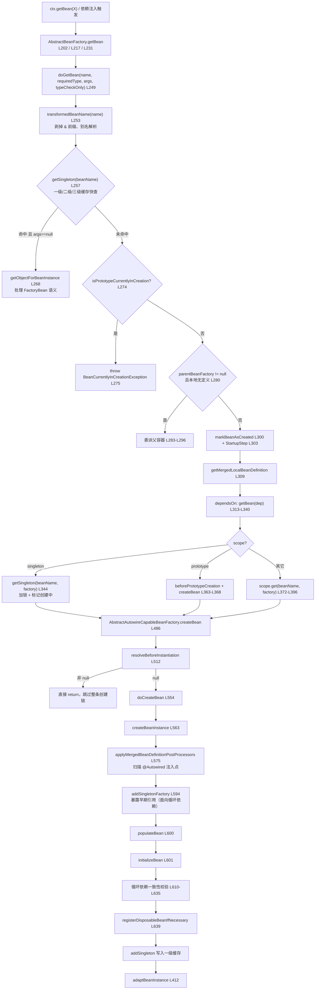
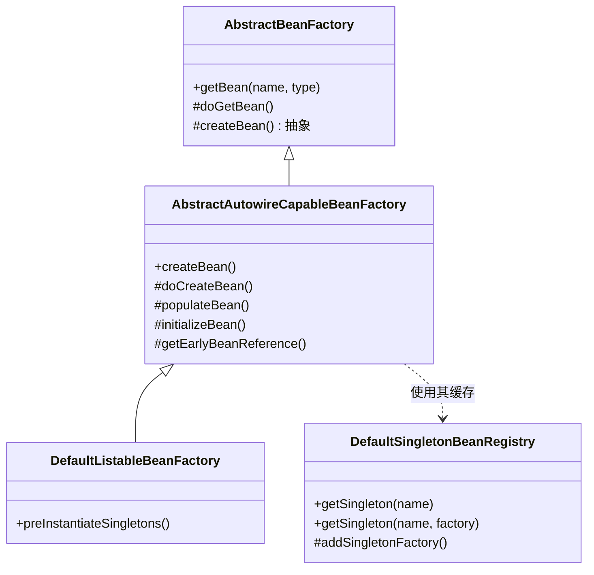
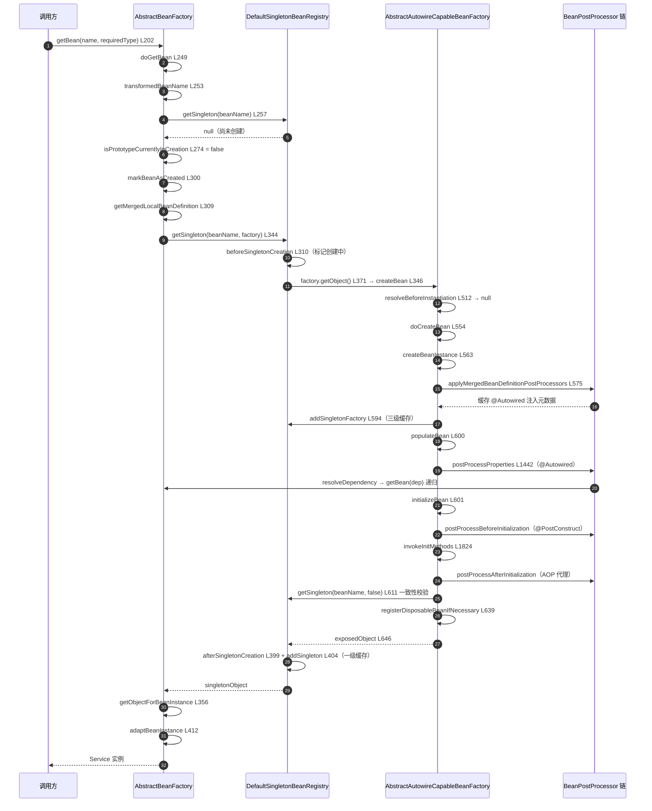
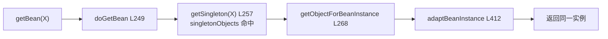

# Bean 创建全流程：getBean 与 createBean

> **一句话结论**：`getBean` 是 IoC 容器的**总入口**，一次调用要走过"三级缓存快查 → 父容器委派 → depends-on 召回 → 单例/原型/自定义 Scope 三条创建分支 → 实例化 → 注入 → 初始化 → 循环依赖收尾 → 注册销毁回调"这条固定流水线，而调度这套流程的代码集中在 `AbstractBeanFactory#doGetBean` 与 `AbstractAutowireCapableBeanFactory#createBean` 两个方法里。
>
> **阅读前置**：知道 `ApplicationContext`、`BeanFactory`、`BeanDefinition` 三个词的含义即可；读过 [01-refresh-容器启动全流程](01-refresh-容器启动全流程.md) 会更容易把本文放回 `refresh` 的上下文里。
> **预计阅读**：45~60 分钟（建议第二遍配合调试器打断点）。
> **源码基线**：`org.springframework:spring-beans:7.1.0`，涉及 `AbstractBeanFactory.java`、`AbstractAutowireCapableBeanFactory.java`、`DefaultSingletonBeanRegistry.java`、`DefaultListableBeanFactory.java`，全部已入库到 `assets/source/`。

---

## 0. 先看现象

### 0.1 一个最小可运行的现象（只看关键两行）

```java
@Bean Repo repo() { System.out.println("[@Bean] Cfg.repo()"); return new Repo(); }
@Bean Service service() { return new Service(); }
```

`Service` 里有一个 `@Autowired Repo repo` 字段，`Service` 与 `Repo` 都实现/打印构造器日志，`Service` 还实现 `InitializingBean` 打印 `afterPropertiesSet`。

### 0.2 从输出里能"看"出四件事

1. **`repo` 比 `service` 先创建**，但 `service()` 方法的源码里根本没调用 `repo()`——是容器在填 `@Autowired` 字段。说明"注入"发生在**构造器跑完之后**，由容器驱动，不是 Java 代码驱动的。
2. **构造器里 `repo == null`，`afterPropertiesSet()` 里已有值**。说明创建被严格分成"生出来（实例化）"和"喂饱（属性填充）"两个阶段。
3. **第二次 `getBean(Service.class)` 不再打印任何日志**，且 `==` 判断为 `true`。说明实例进了**缓存**，第二次走的是快路径。
4. **`[@Bean] Cfg.repo()` 只打印一次**。说明 `@Bean` 方法并不是"每次需要就调一次"，它只在容器创建这个 Bean 时被调用一次（为什么？见 [05 篇](05-配置类解析-configurationclasspostprocessor.md)）。

### 0.3 另一个常见困惑：BeanDefinition 不是 Bean

```text
ctx.registerBeanDefinition("late", new RootBeanDefinition(Repo.class));
ctx.getBeanFactory().containsSingleton("late")   // false  ← 只是登记了"菜谱"
ctx.getBean("late");
ctx.getBeanFactory().containsSingleton("late")   // true   ← 真的下锅了
```

`registerBeanDefinition` 只是往 `beanDefinitionMap` 里放一份**元数据**；`getBean` 才会走本文这条流水线把对象造出来并放进 `singletonObjects`。把这两件事分清，后面所有代码都好理解了。

---

## 1. 整体地图

### 1.1 一次 getBean 的全景图



> **读图说明**：三个最容易被忽略的箭头决定了一切。
> ① `E` 节点是**无锁快查**（`getSingleton(beanName)`），它是"第二次 getBean 不再 new"的原因，也是循环依赖成立的前提。
> ② `M` 节点才是真正的"创建窗口"：加锁、标记 `singletonsCurrentlyInCreation`、创建完成后写一级缓存都在 `getSingleton(beanName, factory)` 里。
> ③ `Q` 是全图**唯一**的"提前返回"出口：只要某个 `BeanPostProcessor` 在 `postProcessBeforeInstantiation` 返回了对象，`createBean` 就立刻 `return`，后面 T 到 Z 全部不执行。
> 另外注意 `K`（depends-on）与 `W`（注入）两处都会**反向再进 `getBean`**，形成递归——这正是循环依赖问题诞生的地方。

### 1.2 `doGetBean` 与 `createBean` 的职责分界

| 维度 | `AbstractBeanFactory#doGetBean`（L249-L413） | `AbstractAutowireCapableBeanFactory#createBean`（L486-L538） |
| --- | --- | --- |
| 角色 | **调度层**：决定"要不要创建、从哪儿创建" | **执行层**：决定"具体怎么创建" |
| 关心的事 | 缓存、作用域、父子容器、depends-on、循环引用标记 | 反射实例化、属性注入、初始化、AOP |
| 加锁 | 不直接加锁，通过 `getSingleton(name, factory)` 间接加锁 | 不加锁（被单例锁包着跑） |
| 扩展点 | 几乎没有，唯一钩子是抽象方法 `createBean` | 满屏 `BeanPostProcessor` 钩子 |
| 递归 | 会递归自己（`getBean(dep)`、依赖注入） | 会间接递归（依赖的 Bean 再走一遍 `doGetBean`） |
| 出错处理 | `catch (BeansException)` → `cleanupAfterBeanCreationFailure`（L398-L402） | 把各种 `Throwable` 包装成 `BeanCreationException` |

这条分界线的意义：**调用方（`getBean`）只关心"我要一个满足条件的对象"，不关心对象怎么造**。这也是为什么 `createBean` 是 `protected abstract` 的（`AbstractBeanFactory` L2010）——子类可以换成完全不同的造法，而 `getBean` 的语义保持不变。

---

## 2. 关键类逐个拆

### 2.1 `AbstractBeanFactory`——getBean 的调度中枢

- **职责**：提供 `getBean` 三个重载（L202、L217、L231，全部汇聚到 `doGetBean`）；处理父子容器委派；维护"当前线程正在创建的 prototype"标记；缓存合并后的 BeanDefinition。
- **在继承链上的位置**：`AbstractBeanFactory` ← `AbstractAutowireCapableBeanFactory` ← `DefaultListableBeanFactory`。你在 `DefaultListableBeanFactory` 上调的 `getBean`，代码其实就写在 `AbstractBeanFactory` 里。
- **本文关心的关键成员**：
  - `getMergedLocalBeanDefinition`（L309 调用）：把"父定义 + 本定义"合并成可实例化的 `RootBeanDefinition`，结果进缓存。
  - `markBeanAsCreated`（L300）与 `alreadyCreated` 集合：记录"这个名称已经走过创建流程"，配合失败清理使用。
  - `prototypesCurrentlyInCreation`（`ThreadLocal`）：`isPrototypeCurrentlyInCreation`（L274 调用）读的就是它。
  - 抽象方法 `createBean`（L2010）：模板方法模式的"可变步骤"。
- **设计意图**：把"取一个 Bean 实例"的所有策略判断（要不要问父容器、是不是 prototype、depends-on 要不要先初始化、走哪个 scope）集中在一处，让子类只需要实现 `createBean`。

### 2.2 `AbstractAutowireCapableBeanFactory`——Bean 的生产车间

- **职责**：实例化（`createBeanInstance` L1173）、注入（`populateBean` L1388）、初始化（`initializeBean` L1810）、销毁回调登记（`registerDisposableBeanIfNecessary`，L639 调用）、提前引用暴露（`getEarlyBeanReference` L964）。
- **两个关键开关字段**：
  - `allowCircularReferences`：是否允许"提前暴露早期引用"，默认 `true`。它决定 `doCreateBean` L587 的 `earlySingletonExposure` 是否可能为真。
  - `allowRawInjectionDespiteWrapping`：当 Bean 最终被 AOP 包装、而别的 Bean 已经拿过"裸对象"时，是否容忍，默认 `false`（即报错）。
- **设计意图**：把"从 Class 到一个可用对象"的全过程编排成**固定顺序**，并在关键位置留出 `BeanPostProcessor` 钩子。顺序本身就是 Spring 对外承诺的契约（"初始化前/后"到底指什么时刻）。

### 2.3 `DefaultSingletonBeanRegistry`——单例的户籍科

- **职责**：维护三个缓存（`singletonObjects` L86、`earlySingletonObjects` L95、`singletonFactories` L89）与"正在创建"集合（`singletonsCurrentlyInCreation` L101），对外提供两个 `getSingleton` 重载（L208 读、L255 创建）。
- **在本篇的角色**：`doGetBean` 的两次调用（L257 的快查、L344 的创建）都落到它这里；`doCreateBean` L594 的 `addSingletonFactory` 也在这里。
- **设计意图**：把"单例生命周期"从"Bean 创建细节"里剥离，让后者不必操心线程安全与缓存维护。**并发创建同一单例**的正确性完全由这里的 `singletonLock`（L83）保证。

> 三级缓存的完整机制（尤其"为什么必须是工厂而不是实例"）在 [03-循环依赖与三级缓存](03-循环依赖与三级缓存.md) 里讲透，本文只讲它在 `doGetBean` 里的两个调用点。

### 2.4 `DefaultListableBeanFactory`——容器本体

- **职责**：既是 `BeanDefinitionRegistry`（持有所有 BeanDefinition），也是 `BeanFactory`（能 `getBean`）。它的 `preInstantiateSingletons`（L1099）就是 `refresh` 最后一步的入口。
- **本文需要它的地方**：解释"为什么 `refresh` 一结束所有非懒加载单例都已经存在了"。

```java (src: DefaultListableBeanFactory.java#L1114-L1131)
			List<CompletableFuture<?>> futures = new ArrayList<>();
			for (String beanName : beanNames) {
				RootBeanDefinition mbd = getMergedLocalBeanDefinition(beanName);
				if (!mbd.isAbstract() && mbd.isSingleton()) {
					CompletableFuture<?> future = preInstantiateSingleton(beanName, mbd);
					if (future != null) {
						futures.add(future);
					}
				}
			}
			if (!futures.isEmpty()) {
				try {
					CompletableFuture.allOf(futures.toArray(new CompletableFuture<?>[0])).join();
				}
				catch (CompletionException ex) {
					ReflectionUtils.rethrowRuntimeException(ex.getCause());
				}
			}
```


这段是 `preInstantiateSingletons` 的主循环（L1114-L1123）。它只做一件事：遍历 `beanDefinitionNames` 的副本，对每个"非抽象 + 单例"的定义调用 `preInstantiateSingleton`，后者在非懒加载时执行 `instantiateSingleton`（L1214），而 `instantiateSingleton` 内部就是一句 `getBean(beanName)`。**所以"实例化所有单例"本质就是循环调用 `getBean`**——`getBean` 是绝对的主干道，不是"某条支路"。

- **为什么遍历副本**：注释写得很直白——`init-method` 里可能注册新的 BeanDefinition，直接遍历原列表会 `ConcurrentModificationException`。
- **为什么第二段循环单独走一遍**：`SmartInitializingSingleton#afterSingletonsInstantiated` 的语义是"所有单例都建完之后"，只能在第一段全部完成后触发。

### 2.5 五个类的协作关系



> **读图说明**：`DefaultListableBeanFactory` 同时继承了"调度能力"（`AbstractBeanFactory#doGetBean`）与"生产能力"（`AbstractAutowireCapableBeanFactory#createBean`），并通过组合持有一个 `DefaultSingletonBeanRegistry`（Spring 中单例注册表是**组合关系**，不是继承）。理解这点，就不会把 `getSingleton` 误认为 `DefaultListableBeanFactory` 自己的方法。

---

## 3. 源码逐段精读

### 3.1 第一件事：别名转换 + 单例缓存快查

```java (src: AbstractBeanFactory.java#L249-L276)
	protected <T> T doGetBean(
			String name, @Nullable Class<T> requiredType, @Nullable Object @Nullable [] args, boolean typeCheckOnly)
			throws BeansException {

		String beanName = transformedBeanName(name);
		Object beanInstance;

		// Eagerly check singleton cache for manually registered singletons.
		Object sharedInstance = getSingleton(beanName);
		if (sharedInstance != null && args == null) {
			if (logger.isTraceEnabled()) {
				if (isSingletonCurrentlyInCreation(beanName)) {
					logger.trace("Returning eagerly cached instance of singleton bean '" + beanName +
							"' that is not fully initialized yet - a consequence of a circular reference");
				}
				else {
					logger.trace("Returning cached instance of singleton bean '" + beanName + "'");
				}
			}
			beanInstance = getObjectForBeanInstance(sharedInstance, requiredType, name, beanName, null);
		}

		else {
			// Fail if we're already creating this bean instance:
			// We're assumably within a circular reference.
			if (isPrototypeCurrentlyInCreation(beanName)) {
				throw new BeanCurrentlyInCreationException(beanName);
			}
```


- **在干什么**：先用 `transformedBeanName(name)` 把外部名称规范成内部 beanName（`&` 前缀表示"要 FactoryBean 本身"，别名要解析成真名）；然后**无条件**查一次单例缓存；命中且调用方没传构造参数，就直接用 `getObjectForBeanInstance` 处理成最终返回对象。
- **为什么先查缓存**：`getBean` 是极高频路径，绝大多数调用应该"已存在直接返回"。`getSingleton(beanName)` 内部走 `ConcurrentHashMap` 快查、**不加锁**，把常见路径压到一次 map 查找。相比之下"直接创建"会在每次注入时都 re-new，单例语义立刻崩塌。
- **`args == null` 为什么也参与判断**：`getBean("x", arg1, arg2)` 的语义是"用我给的参数创建"，即使已有单例也不该返回旧对象；而 `sharedInstance != null && args == null` 保证了带参调用一定继续往下走。
- **日志里的两个"指纹"**：看到 `Returning eagerly cached instance ... a consequence of a circular reference` 说明你拿到的是**还没注入完的早期对象**；看到 `Returning cached instance ...` 说明是正常命中。
- **如果改成**：把这段挪进 `getSingleton(name, factory)` 里统一处理也能工作，但会多做加锁判断，且 `FactoryBean` 的 `&` 语义无法在"命中缓存"路径上单独优化。
- **常见坑**：这里传的 `allowEarlyReference` 是 `true`（因为 `getSingleton(String)` 恒等于 `getSingleton(name, true)`）。这意味着**普通 getBean 也能拿到早期引用**——它既是循环依赖能工作的一半原因，也是"为什么我注入进来的是个半成品"的根源。

### 3.2 prototype 循环检查与父容器委派

```java (src: AbstractBeanFactory.java#L271-L297)
		else {
			// Fail if we're already creating this bean instance:
			// We're assumably within a circular reference.
			if (isPrototypeCurrentlyInCreation(beanName)) {
				throw new BeanCurrentlyInCreationException(beanName);
			}

			// Check if bean definition exists in this factory.
			BeanFactory parentBeanFactory = getParentBeanFactory();
			if (parentBeanFactory != null && !containsBeanDefinition(beanName)) {
				// Not found -> check parent.
				String nameToLookup = originalBeanName(name);
				if (parentBeanFactory instanceof AbstractBeanFactory abf) {
					return abf.doGetBean(nameToLookup, requiredType, args, typeCheckOnly);
				}
				else if (args != null) {
					// Delegation to parent with explicit args.
					return (T) parentBeanFactory.getBean(nameToLookup, args);
				}
				else if (requiredType != null) {
					// No args -> delegate to standard getBean method.
					return parentBeanFactory.getBean(nameToLookup, requiredType);
				}
				else {
					return (T) parentBeanFactory.getBean(nameToLookup);
				}
			}
```


- **在干什么**：`isPrototypeCurrentlyInCreation(beanName)` 检查当前线程的 `ThreadLocal` 集合里是否已有这个名称；有就直接抛 `BeanCurrentlyInCreationException`。随后做父容器委派：本地没有对应 BeanDefinition 而存在 `parentBeanFactory` 时，把请求原样转给父亲（四种重载分别覆盖带参、带类型、都不带的情况）。
- **为什么这么写**：**单例**的循环依赖可以靠"提前暴露早期引用"解掉（§3.6）；**prototype** 每次 `getBean` 都要求全新实例，没有任何"把半成品借出去"的空间，一旦检测到"正在创建中又被要求创建"，只能报错。父容器委派则是 `ApplicationContext` 分层（`parent`）的实现基础，注意它是**单向**的：子容器找不到问父亲，父亲永远不会来问儿子。
- **如果改成**：让 prototype 也进三级缓存——技术上能做到"给你上次那个半成品"，但语义彻底错了（第二次 `getBean` 应该拿到新对象）。Spring 选择"显式报错"而不是"返回脏数据"。
- **常见坑**：这里的 `BeanCurrentlyInCreationException` message 里**只有 bean 名**，看不到依赖链。定位时把日志开到 `TRACE`，或在异常栈里找递归的 `doGetBean` 调用序列。

### 3.3 合并 BeanDefinition 与 depends-on

```java (src: AbstractBeanFactory.java#L299-L340)
			if (!typeCheckOnly) {
				markBeanAsCreated(beanName);
			}

			StartupStep beanCreation = this.applicationStartup.start("spring.beans.instantiate")
					.tag("beanName", name);
			try {
				if (requiredType != null) {
					beanCreation.tag("beanType", requiredType::toString);
				}
				RootBeanDefinition mbd = getMergedLocalBeanDefinition(beanName);
				checkMergedBeanDefinition(mbd, beanName, args);

				// Guarantee initialization of beans that the current bean depends on.
				String[] dependsOn = mbd.getDependsOn();
				if (dependsOn != null) {
					for (String dep : dependsOn) {
						if (isDependent(beanName, dep)) {
							throw new BeanCreationException(mbd.getResourceDescription(), beanName,
									"Circular depends-on relationship between '" + beanName + "' and '" + dep + "'");
						}
						registerDependentBean(dep, beanName);
						try {
							getBean(dep);
						}
						catch (NoSuchBeanDefinitionException ex) {
							throw new BeanCreationException(mbd.getResourceDescription(), beanName,
									"'" + beanName + "' depends on missing bean '" + dep + "'", ex);
						}
						catch (BeanCreationException ex) {
							if (requiredType != null) {
								// Wrap exception with current bean metadata but only if specifically
								// requested (indicated by required type), not for depends-on cascades.
								throw new BeanCreationException(mbd.getResourceDescription(), beanName,
										"Failed to initialize dependency '" + ex.getBeanName() + "' of " +
												requiredType.getSimpleName() + " bean '" + beanName + "': " +
												ex.getMessage(), ex);
							}
							throw ex;
						}
					}
				}
```


- **在干什么**：`markBeanAsCreated` 把名称记进 `alreadyCreated`（供失败清理）；`getMergedLocalBeanDefinition` 得到"父定义 + 本定义"合并后的 `RootBeanDefinition`（只有 `RootBeanDefinition` 才可实例化）；然后**先把 `dependsOn` 的 Bean 全部 `getBean` 出来**，再继续后面的创建。
- **为什么这么写**：`depends-on` 表达的是"初始化顺序"，而不是字段引用——两个 Bean 之间可以没有任何引用关系，但仍要求 B 先于 A 完成初始化（典型场景：注册驱动、初始化静态资源）。`registerDependentBean(dep, beanName)` 建立**反向依赖图**，服务于两件事：销毁顺序（先销毁依赖者）与循环依赖诊断（`hasDependentBean`，§3.9 会用到）。
- **如果改成**：去掉 `isDependent(beanName, dep)` 检查——A depends-on B、B depends-on A 会无限递归到 `StackOverflowError`；有了检查就变成一条清晰的 `Circular depends-on relationship` 异常。
- **常见坑**：`'x' depends on missing bean 'y'` 这条异常的 beanName 是**请求者 x**，缺失项写在 message 里（y）；只看异常主名容易误判。

### 3.4 三条创建分支

```java (src: AbstractBeanFactory.java#L342-L370)
				// Create bean instance.
				if (mbd.isSingleton()) {
					sharedInstance = getSingleton(beanName, () -> {
						try {
							return createBean(beanName, mbd, args);
						}
						catch (BeansException ex) {
							// Explicitly remove instance from singleton cache: It might have been put there
							// eagerly by the creation process, to allow for circular reference resolution.
							// Also remove any beans that received a temporary reference to the bean.
							destroySingleton(beanName);
							throw ex;
						}
					});
					beanInstance = getObjectForBeanInstance(sharedInstance, requiredType, name, beanName, mbd);
				}

				else if (mbd.isPrototype()) {
					// It's a prototype -> create a new instance.
					Object prototypeInstance = null;
					try {
						beforePrototypeCreation(beanName);
						prototypeInstance = createBean(beanName, mbd, args);
					}
					finally {
						afterPrototypeCreation(beanName);
					}
					beanInstance = getObjectForBeanInstance(prototypeInstance, requiredType, name, beanName, mbd);
				}
```


- **在干什么**：单例分支把 `createBean` 包成一个 `ObjectFactory` 交给 `getSingleton(beanName, factory)`——由后者负责加锁、二次检查缓存、标记"创建中"、创建完成后写一级缓存；失败时 `destroySingleton` 把可能已写入的早期引用清掉，顺带销毁依赖它的 Bean。原型分支自己用 `beforePrototypeCreation` / `afterPrototypeCreation` 维护 `ThreadLocal` 标记，**不缓存实例**。
- **为什么这么写**：单例的"创建"与"登记"必须原子地绑定（否则并发下会 new 两次、或暴露半成品），因此放进 `getSingleton`；原型的"创建"只需要防止递归（`ThreadLocal`），实例本身无需登记。注意失败分支里那句注释——它解释了为什么"创建失败后容器还能继续用"。
- **如果改成**：单例也像原型一样直接 `createBean`——两个线程同时 `getBean("x")` 将得到两个不同实例，单例契约崩塌。
- **常见坑**：lambda 里的 `catch (BeansException)` **只覆盖 `createBean`**，而 `getSingleton` 自己抛的异常（如销毁期禁止创建）不在这里；排查失败现场时先分清异常是从 lambda 里抛出还是从 `getSingleton` 里抛出。
- **自定义 Scope 分支（L372-L396，本文不展开）**：`scope.get(beanName, factory)` 委托给 `Scope` 实现（`session`、`request`、`thread` 等），找不到 scope 会抛 `"No Scope registered for scope name '...'"`（L379）；`ScopeNotActiveException`（L394）表示"scope 存在但当前上下文不可用"（例如在非 web 线程里取 `request` Bean）。

### 3.5 `createBean`：唯一的短路点

```java (src: AbstractAutowireCapableBeanFactory.java#L486-L538)
	protected Object createBean(String beanName, RootBeanDefinition mbd, @Nullable Object @Nullable [] args)
			throws BeanCreationException {

		if (logger.isTraceEnabled()) {
			logger.trace("Creating instance of bean '" + beanName + "'");
		}
		RootBeanDefinition mbdToUse = mbd;

		// Make sure bean class is actually resolved at this point, and
		// clone the bean definition in case of a dynamically resolved Class
		// which cannot be stored in the shared merged bean definition.
		Class<?> resolvedClass = resolveBeanClass(mbd, beanName);
		if (resolvedClass != null && !mbd.hasBeanClass() && mbd.getBeanClassName() != null) {
			mbdToUse = new RootBeanDefinition(mbd);
			mbdToUse.setBeanClass(resolvedClass);
			try {
				mbdToUse.prepareMethodOverrides();
			}
			catch (BeanDefinitionValidationException ex) {
				throw new BeanDefinitionStoreException(mbdToUse.getResourceDescription(),
						beanName, "Validation of method overrides failed", ex);
			}
		}

		try {
			// Give BeanPostProcessors a chance to return a proxy instead of the target bean instance.
			Object bean = resolveBeforeInstantiation(beanName, mbdToUse);
			if (bean != null) {
				return bean;
			}
		}
		catch (Throwable ex) {
			throw new BeanCreationException(mbdToUse.getResourceDescription(), beanName,
					"BeanPostProcessor before instantiation of bean failed", ex);
		}

		try {
			Object beanInstance = doCreateBean(beanName, mbdToUse, args);
			if (logger.isTraceEnabled()) {
				logger.trace("Finished creating instance of bean '" + beanName + "'");
			}
			return beanInstance;
		}
		catch (BeanCreationException | ImplicitlyAppearedSingletonException ex) {
			// A previously detected exception with proper bean creation context already,
			// or illegal singleton state to be communicated up to DefaultSingletonBeanRegistry.
			throw ex;
		}
		catch (Throwable ex) {
			throw new BeanCreationException(
					mbdToUse.getResourceDescription(), beanName, "Unexpected exception during bean creation", ex);
		}
	}
```


- **在干什么**：先确保 `Class` 被解析出来；如果原定义里只有类名、没有 `Class` 对象（例如 XML 里写的是 class 字符串），就**克隆**一个新的 `RootBeanDefinition` 把 `Class` 塞进去，并顺带校验 method overrides；然后交给 `resolveBeforeInstantiation`，只要它返回非 `null` 就**立刻 return**，后面的实例化/注入/初始化全部不执行。
- **为什么这么写**：这是 `InstantiationAwareBeanPostProcessor#postProcessBeforeInstantiation` 的入口，也是 **AOP 代理"完全替代目标对象"的通道**。`AbstractAutoProxyCreator` 在这条通道里可以返回代理，使目标对象**根本不被创建**（`@Async`、需要提前初始化的 `@Aspect` 都依赖这一点）。克隆定义则是因为"合并后的 `RootBeanDefinition` 是共享且不可变的"：要往里面加 `Class`/method overrides，只能复制一份。
- **如果改成**：把 `resolveBeforeInstantiation` 挪进 `doCreateBean` 内部——AOP 就无法阻止目标实例创建，很多"循环依赖 + 代理"的组合会退化成 §3.9 那个异常。
- **常见坑**：短路返回的对象**只经过 `applyBeanPostProcessorsAfterInitialization`**（见 §3.6 的 `resolveBeforeInstantiation` 源码），不走 `populateBean`、不走 `Aware`、不走 `init-method`。自己实现这条钩子时必须自己保证对象是完整可用的。

### 3.6 `resolveBeforeInstantiation` 与 `doCreateBean` 的骨架顺序

```java (src: AbstractAutowireCapableBeanFactory.java#L1122-L1138)
	protected @Nullable Object resolveBeforeInstantiation(String beanName, RootBeanDefinition mbd) {
		Object bean = null;
		if (!Boolean.FALSE.equals(mbd.beforeInstantiationResolved)) {
			// Make sure bean class is actually resolved at this point.
			if (!mbd.isSynthetic() && hasInstantiationAwareBeanPostProcessors()) {
				Class<?> targetType = determineTargetType(beanName, mbd);
				if (targetType != null) {
					bean = applyBeanPostProcessorsBeforeInstantiation(targetType, beanName);
					if (bean != null) {
						bean = applyBeanPostProcessorsAfterInitialization(bean, beanName);
					}
				}
			}
			mbd.beforeInstantiationResolved = (bean != null);
		}
		return bean;
	}
```


- **在干什么**：`beforeInstantiationResolved` 是"三态"缓存（`null` 未试过 / `TRUE` 成功过 / `FALSE` 失败过）：一旦确定失败，后续再问就直接返回 `null`，不再遍历处理器。真正干活的是 `applyBeanPostProcessorsBeforeInstantiation`，它只要求**第一个返回非 null 的对象**；拿到对象后再补一次 `postProcessAfterInitialization`（让它也能被后续 BPP 加工），最后把结果写回 `mbd.beforeInstantiationResolved`。
- **为什么成功能要"再走一次 after"**：因为短路返回的对象跳过了整条生命周期，只能靠 `postProcessAfterInitialization` 做最后的加工（例如给已有的代理再套一层 `@Transactional`）。

```java (src: AbstractAutowireCapableBeanFactory.java#L1151-L1159)
	protected @Nullable Object applyBeanPostProcessorsBeforeInstantiation(Class<?> beanClass, String beanName) {
		for (InstantiationAwareBeanPostProcessor bp : getBeanPostProcessorCache().instantiationAware) {
			Object result = bp.postProcessBeforeInstantiation(beanClass, beanName);
			if (result != null) {
				return result;
			}
		}
		return null;
	}
```


- **在干什么**：遍历 `instantiationAware` 缓存列表，**遇到第一个非 null 结果立即 `return`**——这就是"短路"两个字的来源。
- **常见坑**：顺序很关键：`AnnotationAwareAspectJAutoProxyCreator`（AOP）通常排在 `@Async`、`@Scheduled` 等之前，因此 AOP 先拿到决定权；如果它返回了代理，后面的处理器就永远不会被问。

```java (src: AbstractAutowireCapableBeanFactory.java#L557-L595)
		// Instantiate the bean.
		BeanWrapper instanceWrapper = null;
		if (mbd.isSingleton()) {
			instanceWrapper = this.factoryBeanInstanceCache.remove(beanName);
		}
		if (instanceWrapper == null) {
			instanceWrapper = createBeanInstance(beanName, mbd, args);
		}
		Object bean = instanceWrapper.getWrappedInstance();
		Class<?> beanType = instanceWrapper.getWrappedClass();
		if (beanType != NullBean.class) {
			mbd.resolvedTargetType = beanType;
		}

		// Allow post-processors to modify the merged bean definition.
		synchronized (mbd.postProcessingLock) {
			if (!mbd.postProcessed) {
				try {
					applyMergedBeanDefinitionPostProcessors(mbd, beanType, beanName);
				}
				catch (Throwable ex) {
					throw new BeanCreationException(mbd.getResourceDescription(), beanName,
							"Post-processing of merged bean definition failed", ex);
				}
				mbd.markAsPostProcessed();
			}
		}

		// Eagerly cache singletons to be able to resolve circular references
		// even when triggered by lifecycle interfaces like BeanFactoryAware.
		boolean earlySingletonExposure = (mbd.isSingleton() && this.allowCircularReferences &&
				isSingletonCurrentlyInCreation(beanName));
		if (earlySingletonExposure) {
			if (logger.isTraceEnabled()) {
				logger.trace("Eagerly caching bean '" + beanName +
						"' to allow for resolving potential circular references");
			}
			addSingletonFactory(beanName, () -> getEarlyBeanReference(beanName, mbd, bean));
		}
```


- **在干什么**：按序做四件事。① `createBeanInstance` 造对象（`factoryBeanInstanceCache` 是 `FactoryBean` 的复用通道）；② `applyMergedBeanDefinitionPostProcessors`——让 `MergedBeanDefinitionPostProcessor` 在"实例已存在、属性尚未注入"的时刻改写定义，**`@Autowired` 的注入点扫描就发生在这里**；③ 计算 `earlySingletonExposure`：单例 + 允许循环引用 + 当前确实在创建中；④ 三者同时成立时，把 `getEarlyBeanReference` 注册进三级缓存。
- **为什么"注入点扫描"必须在这里**：`@Autowired` 到底注哪些字段/方法，取决于**真实类型**（可能是 `@Bean` 工厂方法返回的子类型、也可能是被代理的用户类），而真实类型只有实例化之后才知道。所以扫描放在实例化之后、注入之前。
- **`earlySingletonExposure` 为什么需要第三个条件**：只有"创建过程被 `getSingleton` 的创建窗口包着"时，把工厂放进三级缓存才有意义（才可能有别人来取）。否则只是白占内存，还会在 `destroySingleton` 之后留下可疑状态。
- **如果改成**：去掉 `isSingletonCurrentlyInCreation(beanName)`——`createBean` 被直接调用（AOT、测试、自定义 Factory）时也会塞入三级缓存，出现问题极难定位。
- **常见坑**：`addSingletonFactory` 注册的是 **lambda（`ObjectFactory`）而不是实例**。这是三级缓存的精髓：**只有真的有人要早期引用时，`getEarlyBeanReference` 才会执行**（可能触发 AOP 提前生成代理）。详见 03 篇。

### 3.7 `populateBean`：注入发生地

```java (src: AbstractAutowireCapableBeanFactory.java#L1411-L1448)
		// Give any InstantiationAwareBeanPostProcessors the opportunity to modify the
		// state of the bean before properties are set. This can be used, for example,
		// to support styles of field injection.
		if (!mbd.isSynthetic() && hasInstantiationAwareBeanPostProcessors()) {
			for (InstantiationAwareBeanPostProcessor bp : getBeanPostProcessorCache().instantiationAware) {
				if (!bp.postProcessAfterInstantiation(bw.getWrappedInstance(), beanName)) {
					return;
				}
			}
		}

		PropertyValues pvs = (mbd.hasPropertyValues() ? mbd.getPropertyValues() : null);

		int resolvedAutowireMode = mbd.getResolvedAutowireMode();
		if (resolvedAutowireMode == AUTOWIRE_BY_NAME || resolvedAutowireMode == AUTOWIRE_BY_TYPE) {
			MutablePropertyValues newPvs = new MutablePropertyValues(pvs);
			// Add property values based on autowire by name if applicable.
			if (resolvedAutowireMode == AUTOWIRE_BY_NAME) {
				autowireByName(beanName, mbd, bw, newPvs);
			}
			// Add property values based on autowire by type if applicable.
			if (resolvedAutowireMode == AUTOWIRE_BY_TYPE) {
				autowireByType(beanName, mbd, bw, newPvs);
			}
			pvs = newPvs;
		}
		if (hasInstantiationAwareBeanPostProcessors()) {
			if (pvs == null) {
				pvs = mbd.getPropertyValues();
			}
			for (InstantiationAwareBeanPostProcessor bp : getBeanPostProcessorCache().instantiationAware) {
				PropertyValues pvsToUse = bp.postProcessProperties(pvs, bw.getWrappedInstance(), beanName);
				if (pvsToUse == null) {
					return;
				}
				pvs = pvsToUse;
			}
		}
```


- **在干什么**：三层处理。① `postProcessAfterInstantiation` 返回 `false` 就**整体跳过**属性填充（`return`）；② `AUTOWIRE_BY_NAME` / `AUTOWIRE_BY_TYPE` 这两种旧式自动装配在此追加到 `pvs`；③ 遍历所有 `InstantiationAwareBeanPostProcessor` 的 `postProcessProperties`，**`@Autowired` 注入就在这一步完成**；任一处理器返回 `null` 表示"我已处理完，别再填了"，直接 `return`。
- **为什么这么写**：把"注解注入"和"XML property 注入"统一抽象成 `PropertyValues` 的追加与消费。`@Autowired` 的实现很巧：它**不修改 `pvs`**，而是在 `postProcessProperties` 里直接反射 `field.set(...)`，然后原样返回 `pvs`——既拿到钩子，又不打断链条。
- **如果改成**：把 `@Autowired` 挪到 `postProcessAfterInstantiation`——不行，那个钩子只返回 `boolean`，没有 `PropertyValues` 通道，多个处理器之间无法传递。
- **常见坑**：`@Autowired(required = false)` 找不到 Bean 时字段保持 `null`，注入"失败但不报错"；`required = true` 时抛 `UnsatisfiedDependencyException`，message 里包含**注入点**（字段名/方法参数），这是排查"注入没生效"的第一现场（见 [04 篇](04-依赖注入-autowired与beanpostprocessor.md)）。

### 3.8 `initializeBean`：四步固定顺序

```java (src: AbstractAutowireCapableBeanFactory.java#L1810-L1835)
	protected Object initializeBean(String beanName, Object bean, @Nullable RootBeanDefinition mbd) {
		// Skip initialization of a NullBean
		if (bean.getClass() == NullBean.class) {
			return bean;
		}

		invokeAwareMethods(beanName, bean);

		Object wrappedBean = bean;
		if (mbd == null || !mbd.isSynthetic()) {
			wrappedBean = applyBeanPostProcessorsBeforeInitialization(wrappedBean, beanName);
		}

		try {
			invokeInitMethods(beanName, wrappedBean, mbd);
		}
		catch (Throwable ex) {
			throw new BeanCreationException(
					(mbd != null ? mbd.getResourceDescription() : null), beanName, ex.getMessage(), ex);
		}
		if (mbd == null || !mbd.isSynthetic()) {
			wrappedBean = applyBeanPostProcessorsAfterInitialization(wrappedBean, beanName);
		}

		return wrappedBean;
	}
```


- **在干什么**：严格四步——`invokeAwareMethods`（只处理 `BeanNameAware` / `BeanClassLoaderAware` / `BeanFactoryAware` 三个"老三家"）→ `BeanPostProcessor#postProcessBeforeInitialization`（`@PostConstruct` 在这里执行）→ `invokeInitMethods`（`InitializingBean#afterPropertiesSet` 与 `init-method`）→ `BeanPostProcessor#postProcessAfterInitialization`（**AOP 代理通常在这一步生成**）。
- **为什么代理必须放最后**：如果先代理再初始化，`@PostConstruct`、`afterPropertiesSet`、`init-method` 就会作用在代理对象上而不是目标对象上，语义错乱（代理类上根本没有这些方法）。所以 `AbstractAutoProxyCreator` 只在 `postProcessAfterInitialization` 里包装。
- **为什么 `NullBean` 直接跳过**：`@Bean` 方法可以返回 `null`，Spring 用 `NullBean` 占位，避免后续钩子 NPE。
- **`Aware` 为什么只有三个**：`ApplicationContextAware`、`EnvironmentAware` 等是 `ApplicationContextAwareProcessor`（一个 `BeanPostProcessor`）在 `postProcessBeforeInitialization` 阶段注入的，所以它们比"老三家"更晚。
- **常见坑**：`mbd.isSynthetic()` 为真时跳过 before/after 回调，但 `invokeInitMethods` 照跑。synthetic 定义通常由框架内部注册，业务 Bean 很少遇到。

### 3.9 循环依赖一致性校验与销毁回调

```java (src: AbstractAutowireCapableBeanFactory.java#L610-L646)
		if (earlySingletonExposure) {
			Object earlySingletonReference = getSingleton(beanName, false);
			if (earlySingletonReference != null) {
				if (exposedObject == bean) {
					exposedObject = earlySingletonReference;
				}
				else if (!this.allowRawInjectionDespiteWrapping && hasDependentBean(beanName)) {
					String[] dependentBeans = getDependentBeans(beanName);
					Set<String> actualDependentBeans = CollectionUtils.newLinkedHashSet(dependentBeans.length);
					for (String dependentBean : dependentBeans) {
						if (!removeSingletonIfCreatedForTypeCheckOnly(dependentBean)) {
							actualDependentBeans.add(dependentBean);
						}
					}
					if (!actualDependentBeans.isEmpty()) {
						throw new BeanCurrentlyInCreationException(beanName,
								"Bean with name '" + beanName + "' has been injected into other beans [" +
								StringUtils.collectionToCommaDelimitedString(actualDependentBeans) +
								"] in its raw version as part of a circular reference, but has eventually been " +
								"wrapped. This means that said other beans do not use the final version of the " +
								"bean. This is often the result of over-eager type matching - consider using " +
								"'getBeanNamesForType' with the 'allowEagerInit' flag turned off, for example.");
					}
				}
			}
		}

		// Register bean as disposable.
		try {
			registerDisposableBeanIfNecessary(beanName, bean, mbd);
		}
		catch (BeanDefinitionValidationException ex) {
			throw new BeanCreationException(
					mbd.getResourceDescription(), beanName, "Invalid destruction signature", ex);
		}

		return exposedObject;
```


- **在干什么**：`getSingleton(beanName, false)` 是"只读一二级缓存、**不允许生成新的早期引用**"的读取。若拿到早期引用且 `exposedObject == bean`（`initializeBean` 没换对象，即没生成代理），就用早期引用作为最终返回值（其实是同一个对象，保证"缓存里那个"就是"对外那个"）；若 `exposedObject != bean`（生成了代理）而又有别的 Bean 依赖过裸对象，则抛异常——除非 `allowRawInjectionDespiteWrapping = true`。
- **为什么这么写**：这是"循环依赖 + AOP"的守卫。A 先把裸对象暴露给 B，之后 A 被代理包装，B 手里就永远是裸对象。Spring 选择**报错而不是静默**。`removeSingletonIfCreatedForTypeCheckOnly` 用来剔除"只是为了类型检查而临时创建"的依赖者，避免误报。
- **如果改成**：去掉 `hasDependentBean(beanName)` 判断——只要生成代理就报错，会把大量 `@Transactional` 场景误伤（没有别的 Bean 依赖它时其实无害）。
- **常见坑**：看到这段异常，先确认两件事：① 两个 Bean 是否真的互相依赖（含三级间接）；② 其中之一是否被 AOP 代理。最实用的解法是改成构造器注入并重构依赖，或对被注入端加 `@Lazy`。

### 3.10 失败收尾与最终类型适配

```java (src: AbstractBeanFactory.java#L398-L413)
			catch (BeansException ex) {
				beanCreation.tag("exception", ex.getClass().toString());
				beanCreation.tag("message", String.valueOf(ex.getMessage()));
				cleanupAfterBeanCreationFailure(beanName);
				throw ex;
			}
			finally {
				beanCreation.end();
				if (!isCacheBeanMetadata()) {
					clearMergedBeanDefinition(beanName);
				}
			}
		}

		return adaptBeanInstance(name, beanInstance, requiredType);
	}
```


- **在干什么**：失败时 `cleanupAfterBeanCreationFailure(beanName)` 清掉 `alreadyCreated` 标记（让后续还能重试）；`finally` 结束 `StartupStep`（`ApplicationStartup` 埋点，可被 actuator / JFR 消费），并在"不缓存 BeanDefinition 元数据"时清掉合并定义。
- **为什么这么写**：失败后不清标记，下次 `getBean` 会以为"已创建过"而跳过部分初始化逻辑，出现难以复现的状态残留。
- **常见坑**：`cleanupAfterBeanCreationFailure` **只清标记、不清缓存**；清缓存是 §3.4 lambda 里 `destroySingleton(beanName)` 的职责，两者分工不同，不要混为一谈。

```java (src: AbstractBeanFactory.java#L415-L435)
	@SuppressWarnings("unchecked")
	<T> T adaptBeanInstance(String name, Object bean, @Nullable Class<?> requiredType) {
		// Check if required type matches the type of the actual bean instance.
		if (requiredType != null && !requiredType.isInstance(bean)) {
			try {
				Object convertedBean = getTypeConverter().convertIfNecessary(bean, requiredType);
				if (convertedBean == null) {
					throw new BeanNotOfRequiredTypeException(name, requiredType, bean.getClass());
				}
				return (T) convertedBean;
			}
			catch (TypeMismatchException ex) {
				if (logger.isTraceEnabled()) {
					logger.trace("Failed to convert bean '" + name + "' to required type '" +
							requiredType.getTypeName() + "'", ex);
				}
				throw new BeanNotOfRequiredTypeException(name, requiredType, bean.getClass());
			}
		}
		return (T) bean;
	}
```


- **在干什么**：调用方指定了 `requiredType` 而实例不是该类型时，尝试用 `TypeConverter` 转换（例如 `String` → `Integer`），转不了才抛 `BeanNotOfRequiredTypeException`。
- **为什么这么写**：`ctx.getBean("port", Integer.class)` 这类调用能工作，靠的就是这里。
- **常见坑**：`BeanNotOfRequiredTypeException`（有 Bean 但类型不对）与 `NoSuchBeanDefinitionException`（压根没有这个 Bean）是两种完全不同的错误，看异常类型就能定方向，不要都当成"没注入"。

### 3.11 附：`createBeanInstance` 决定"用什么造对象"

`createBeanInstance` 是本篇与 [03 篇](03-循环依赖与三级缓存.md) 的交叉点：构造器注入的循环依赖之所以无解，就是因为 `createBeanInstance` 必须在**依赖到位之前**完成。

```java (src: AbstractAutowireCapableBeanFactory.java#L1173-L1191)
	protected BeanWrapper createBeanInstance(String beanName, RootBeanDefinition mbd, @Nullable Object @Nullable [] args) {
		// Make sure bean class is actually resolved at this point.
		Class<?> beanClass = resolveBeanClass(mbd, beanName);

		if (beanClass != null && !Modifier.isPublic(beanClass.getModifiers()) && !mbd.isNonPublicAccessAllowed()) {
			throw new BeanCreationException(mbd.getResourceDescription(), beanName,
					"Bean class isn't public, and non-public access not allowed: " + beanClass.getName());
		}

		if (args == null) {
			Supplier<?> instanceSupplier = mbd.getInstanceSupplier();
			if (instanceSupplier != null) {
				return obtainFromSupplier(instanceSupplier, beanName, mbd);
			}
		}

		if (mbd.getFactoryMethodName() != null) {
			return instantiateUsingFactoryMethod(beanName, mbd, args);
		}
```


- **在干什么**：`instanceSupplier` 优先（`BeanDefinitionBuilder#instanceSupplier`、`@Bean` 的 Supplier 形式）；其次是 `factoryMethodName`（`@Bean` 方法走这里 → `instantiateUsingFactoryMethod`）；再次是缓存命中快路径；最后交给构造器逻辑。
- **常见坑**：`Bean class isn't public, and non-public access not allowed` 说明类/构造器不可访问，需要 `setNonPublicAccessAllowed(true)` 或把类改成 public。

```java (src: AbstractAutowireCapableBeanFactory.java#L1216-L1227)
				mbd.hasConstructorArgumentValues() || !ObjectUtils.isEmpty(args)) {
			return autowireConstructor(beanName, mbd, ctors, args);
		}

		// Preferred constructors for default construction?
		ctors = mbd.getPreferredConstructors();
		if (ctors != null) {
			return autowireConstructor(beanName, mbd, ctors, null);
		}

		// No special handling: simply use no-arg constructor.
		return instantiateBean(beanName, mbd);
```


- **在干什么**：`determineConstructorsFromBeanPostProcessors` 让 `SmartInstantiationAwareBeanPostProcessor` 决定候选构造器（`@Autowired` 构造器就是这里选出来的）；只要"有候选构造器 / 装配模式是 `AUTOWIRE_CONSTRUCTOR` / 有构造参数值 / 调用方传了参数"任一成立，就走 `autowireConstructor`（需要解析参数 → 会触发 `getBean`）；否则 `instantiateBean` 用无参构造器。
- **为什么这是 03 篇的伏笔**：`autowireConstructor` 在造对象**之前**就要拿到依赖，而依赖如果又需要自己，就形成"谁都造不出来"的死锁——这就是构造器注入循环依赖无解的根因。
- **常见坑**：`@Bean` 方法的 BeanDefinition 在 05 篇会看到被强制设成 `AUTOWIRE_CONSTRUCTOR`（`ConfigurationClassBeanDefinitionReader` L263），所以 `preInstantiateSingleton` 里的 `getBean` 走工厂方法而不是无参构造器。

---

## 4. 一次完整执行时序

### 4.1 首次 `getBean(Service.class)`



> **读图说明**：三个跨层箭头最值得盯。
> ① `ABF -> DSBR: getSingleton(beanName, factory)`（第 9 步）——创建窗口开启，`beforeSingletonCreation` 把名称加入 `singletonsCurrentlyInCreation`；这正是 `doCreateBean` L587 的 `earlySingletonExposure` 能成立的依据。
> ② `BPP -> ABF: resolveDependency -> getBean(dep)`（第 21 步）——**依赖注入会反向再进 `doGetBean`**，形成递归；递归回路上若遇到"正在创建"的 Bean，就靠三级缓存破局（03 篇）。
> ③ `DSBR: addSingleton`（倒数第 3 步）——**只有整条链走完**，实例才进一级缓存；之前它在三级/二级缓存里是"半成品"。

### 4.2 第二次 `getBean` 的快路径



> **读图说明**：第二次只有 4 个节点，完全不进 `createBean`。`getObjectForBeanInstance` 即使对普通 Bean 也不能省：`name` 可能是 `&foo`（请求 `FactoryBean` 本身），此时要剥前缀、返回 `FactoryBean` 实例而不是它 `getObject()` 的产物。

### 4.3 五个阶段的"状态快照"（背下来最有用）

| 阶段 | 方法 | 关键行 | 依赖注入好了吗 | 这时是代理吗 |
| --- | --- | --- | --- | --- |
| 实例化 | `createBeanInstance` | L563（实现 L1173） | 否 | 否 |
| 定义后处理 | `applyMergedBeanDefinitionPostProcessors` | L575 | 否（但注入点已扫好） | 否 |
| 早期暴露 | `addSingletonFactory` | L594 | 否 | **取用时才决定** |
| 属性填充 | `populateBean` | L600 | 正在填 | 否 |
| Aware 回调 | `invokeAwareMethods` | L1816 | 是 | 否 |
| 初始化前 | `postProcessBeforeInitialization` | L1820 | 是 | 否 |
| 初始化 | `invokeInitMethods` | L1824 | 是 | 否 |
| 初始化后 | `postProcessAfterInitialization` | L1831 | 是 | **可能变成代理** |

这张表能回答 90% 的"为什么这个时候我的字段还是 null / 为什么拿不到代理"。

### 4.4 三个阶段的时间线（同一个 Bean 的三次"身份变化"）


> **读图说明**：`t1` 到 `t2` 之间是唯一"挂着工厂但还没实例"的窗口。如果某个 Bean 恰好在这个窗口里被别人依赖，就会触发 `getEarlyBeanReference`（可能提前生成 AOP 代理），随后实例被搬进 `earlySingletonObjects`。`t5` 之后二级缓存条目被 `addSingleton` 清除（`singletonFactories.remove` + `earlySingletonObjects.remove`），从此只有一级缓存。

### 4.5 一个容易忽略的顺序细节：`applyMergedBeanDefinitionPostProcessors` 只跑一次

`doCreateBean` 里那段 `synchronized (mbd.postProcessingLock) { if (!mbd.postProcessed) { ... } }` 说明：**同一个合并定义只会被后处理一次**，即使这个定义对应多个实例（例如 prototype 被多次 `getBean`）。因为没有 `@Autowired` 元数据每次都重新扫描，`AutowiredAnnotationBeanPostProcessor` 才需要额外的"缓存是否过期"判断（`InjectionMetadata.needsRefresh`，见 04 篇）。

---

## 5. 设计模式与取舍

| 模式 | 出现位置 | 作用 |
| --- | --- | --- |
| 模板方法 | `doGetBean` 调用抽象 `createBean`（L2010 声明） | 调度固定、创建可变 |
| 模板方法（细粒度） | `initializeBean` L1810 固定四步 | 生命周期顺序成为契约 |
| 工厂方法 | `getSingleton(beanName, ObjectFactory)` L344 | 把"延迟创建"抽象成 lambda |
| 策略 | `InstantiationStrategy`、`Scope`（L372 分支） | 实例化方式、作用域可插拔 |
| 责任链 | `BeanPostProcessor` 循环 | 无限扩展点，彼此不感知 |
| 缓存旁路（Cache-Aside） | `getSingleton(beanName)` L257 | 高频路径 O(1) |
| 空对象 | `NullBean` | 避免 null 引发的 NPE 与钩子跳过 |
| 上下文对象 | `BeanWrapper` | 把"实例 + 类型转换 + 属性访问"打包传递 |

**取舍**：

1. **"先无锁快查 + 再加锁创建" vs "一律加锁创建"**：Spring 选前者。好处是并发读几乎零成本；代价是整个创建链必须容忍"早期引用"这种半成品状态，并额外引入 `allowRawInjectionDespiteWrapping` 这类开关兜底。若一律加锁，循环依赖会直接死锁，吞吐也会暴跌。
2. **短路点在 `createBean` 最前面 vs 放在 `doCreateBean` 内部**：放在最前面让 AOP 可以**完全不创建目标对象**；代价是短路路径绕过了所有生命周期回调，实现者得自己负责。
3. **失败即彻底清理 vs 保留半成品等重试**：Spring 选"清早期引用 + 清 `alreadyCreated` 标记"，让下一次 `getBean` 从零开始，避免"配置修好了却还拿到旧半成品"。
4. **`depends-on` 用递归 `getBean` vs 拓扑排序**：递归实现简单、天然支持运行时动态依赖；代价是深链会加深调用栈，且循环检测要额外用 `isDependent` 兜。
5. **`getObjectForBeanInstance` 在每个出口都调 vs 只在返回前调一次**：前者冗余但安全（`FactoryBean` 语义不会漏），后者省一次判断但极易漏分支——Spring 选了冗余。

### 5.1 五个取舍背后的"如果反过来会怎样"

- **如果 `getBean` 每次都加锁**：单例语义正确，但循环依赖必定死锁（A 创建持锁 → 要 B → B 要 A → 抢同一把锁），且每次注入都付出锁开销。Spring 用"无锁快查 + 只在创建时加锁"换来并发读的自由。
- **如果早期暴露直接存实例而非工厂**：那么每个 Bean 一创建就要立刻生成早期引用（可能触发 AOP 提前代理），既浪费又容易造成"提前代理"的语义偏差；工厂形式让"生成早期引用"变成**按需**动作。
- **如果失败后保留三级缓存条目**：下次 `getBean` 会命中一个"半成品"并当作完整对象返回，症状是"某些字段为 null 且不报错"，比直接启动失败难查十倍。
- **如果 `initializeBean` 把代理放在 `invokeInitMethods` 之前**：`@PostConstruct` 与 `afterPropertiesSet` 会打在代理上，`TargetSource` 解析、`equals/hashCode` 等都会偏离预期。
- **如果 `depends-on` 用拓扑排序一次性处理**：无法支持"运行时动态注册的 Bean"，且与 `Scope`、`FactoryBean` 的交互复杂度会显著上升。

---

## 6. 踩坑与调试手法

1. **把日志开到 `TRACE` 看三类指纹**：`Creating instance of bean 'x'`（`createBean` L490）、`Eagerly caching bean 'x'`（L591）、`Returning cached instance of singleton bean 'x'`（L265）。它们分别回答"是否在造""是否暴露了早期引用""是否命中缓存"。
2. **`@Autowired` 字段为 null 的三步定位**：① 该类是否由容器创建（`ctx.getBeanNamesForType(X.class)` 是否包含它）；② 当前对象是代理还是目标（`AopUtils.isAopProxy`）；③ 打开 DEBUG 看 `AutowiredAnnotationBeanPostProcessor` 是否处理过这个类。
3. **`BeanCurrentlyInCreationException` 怎么读**：message 里若含 `has been injected into other beans [...] in its raw version`，是 §3.9 的"代理包装 + 循环依赖"冲突；若只有一个 bean 名，大概率是 §3.2 的 prototype 循环。
4. **`preInstantiateSingletons` 不等于声明顺序**：`beanDefinitionNames` 是注册顺序，但递归（depends-on、`@Autowired`）会打乱实际创建顺序。要固定顺序用 `@DependsOn`，要固定集合顺序用 `@Order` + 集合注入。
5. **`FactoryBean` 与 `&` 前缀**：`getBean("myFactory")` 返回 `getObject()` 产物，`getBean("&myFactory")` 才返回 `FactoryBean` 本身。这就是每条出口都必须过 `getObjectForBeanInstance` 的原因。
6. **不要在测试里手工调 `createBean`**：它依赖 `singletonObjects` 的既有状态（`earlySingletonExposure` 判断），脱离 `getSingleton` 窗口调用会得到从未进缓存的对象，`getSingleton(name, false)` 永远返回 `null`。
7. **`refresh` 期间提前 `getBean` 的后遗症**：在 `BeanFactoryPostProcessor` 里 `getBean` 会让 Bean 在 `preInstantiateSingletons` 之前创建，`@Configuration` 增强可能来不及（05 篇有对应 warn 日志原文）。
8. **用 `StartupStep` 观测**：`spring.beans.instantiate`（L303-L304）与 `spring.context.refresh`、`spring.context.beans.post-process` 一起，能在 JFR / actuator 的 startup endpoint 里看到每个 Bean 的创建耗时。

### 6.1 一个真实的排查片段：Bean 卡在 `earlySingletonObjects` 里

`singletonObjects` 是 `ConcurrentHashMap`，很多人以为"看一眼 `containsSingleton` 就知道 Bean 有没有创建"。实际上 `containsSingleton`（`DefaultSingletonBeanRegistry` L490-L492）**只查一级缓存**，所以下面的现象非常容易误导人：

```text
ctx.getBeanFactory().containsSingleton("a")            // false
ctx.getBeanFactory().getBean("a")  // 触发创建，并在创建途中被别人取用
ctx.getBeanFactory().containsSingleton("a")            // true（此时已创建完成）
```

如果你在 `BeanPostProcessor` 里对某个 Bean 调 `containsSingleton` 得到 `false`，不代表"这个 Bean 不存在"——它可能正处于二级缓存阶段。判断"是否已存在"更可靠的方式是 `containsBean`（会考虑 BeanDefinition），判断"是否已完成创建"才用 `containsSingleton`。

### 6.2 三个断点位置（按排查效率排序）

1. `AbstractAutowireCapableBeanFactory#createBean` 的 L492（`RootBeanDefinition mbdToUse = mbd;`）：确认"这个 Bean 到底有没有进入创建流程"。
2. `AbstractAutowireCapableBeanFactory#doCreateBean` 的 L594（`addSingletonFactory(...)`）：确认"是否提前暴露了早期引用"，以及它的条件是真是假。
3. `AbstractBeanFactory#doGetBean` 的 L257（`Object sharedInstance = getSingleton(beanName);`）：确认"这次调用命中缓存还是新建"。

把这三个断点的命中序列打印出来，基本可以看出一次 `getBean` 走的是哪条路径。

### 6.3 为什么"在 `@PostConstruct` 里 `getBean`"看起来能用，实际很危险

`invokeInitMethods` 之前 `populateBean` 已完成，所以 `@PostConstruct` 里 `getBean` 通常能拿到完整对象；但此时**当前 Bean 仍在 `singletonsCurrentlyInCreation` 里**（`afterSingletonCreation` 还没执行）。若被 `getBean` 的那个 Bean 反过来依赖当前 Bean，就会走三级缓存拿到"当前 Bean 的早期引用"——看起来能用，实际拿到的是`initializeBean` 之前的版本（没有代理）。这类问题只在"恰好有 AOP"时才炸出来。

---

## 7. ⚠️ 版本差异

| 关注点 | Spring 5.x | Spring 6.x | Spring 7.1（本文基线） |
| --- | --- | --- | --- |
| `doGetBean` 骨架 | 已有缓存快查、depends-on、三作用域分支 | 相同 | 相同，但新增 `StartupStep`（L303-L304）与 `beanCreation.tag`（L399-L400） |
| 单例创建锁 | `synchronized (this.singletonObjects)` | 6.2 起换 `ReentrantLock singletonLock` + lenient 创建 | 保留 `singletonLock`（L83）与 lenient 分支（L266-L297） |
| 并发创建可观测性 | 无明显日志 | 6.2 起打 `Obtaining singleton bean ... while other thread holds singleton lock` | 同上（L277-L279） |
| `resolveBeforeInstantiation` 结果缓存 | 无 | 有 `beforeInstantiationResolved` | L1124 / L1135 用 `Boolean` 三态避免重复尝试 |
| `postProcessProperties` | 5.1 引入 | 稳定 | 仍需 `hasInstantiationAwareBeanPostProcessors()` 判断（L1437） |
| record 支持 | 无 | 有（`populateBean` 跳过 record） | L1400-L1409 抛 `Cannot apply property values to a record` |
| `preInstantiateSingletons` | 单线程串行 | 6.2 起支持后台初始化 | L1114-L1131 收集 `CompletableFuture` 后 `allOf().join()` |
| 销毁期创建保护 | 相同文案 | 相同 | `getSingleton` L300-L304 `BeanCreationNotAllowedException` |
| 原生镜像 / AOT | 无 | 6.0 引入 | `createBean`、`enhanceConfigurationClasses` 都参与 AOT 校验 |

**升级提醒**：6.2 → 7.x 最大的行为变化在**并发创建策略**（lenient creation）。如果应用启动期有多线程同时触发 `getBean`，6.1 及更早可能阻塞甚至死锁，7.1 会打 info 日志 `Obtaining singleton bean 'x' in thread "t" while other thread holds singleton lock for other beans [...]` 然后继续推进——看到这条日志不要误判为错误。

---

## 8. 面试高频问与答

**Q1：`getBean` 的核心流程能背一遍吗？**
A：三个重载都进 `doGetBean`（L249）。顺序：`transformedBeanName`（L253）→ 单例缓存快查（L257）→ prototype 循环检查（L274）→ 父容器委派（L280）→ `markBeanAsCreated` + 合并定义（L300-L310）→ depends-on（L313-L340）→ 按作用域分单例（L344）/原型（L363）/自定义 Scope（L372）→ `getObjectForBeanInstance` → `adaptBeanInstance`（L412）。`createBean`（L486）= `resolveBeforeInstantiation` 短路 + `doCreateBean`（L554：实例化 → 定义后处理 → 早期暴露 → 注入 → 初始化 → 一致性校验 → 注册销毁）。

**Q2：为什么先查缓存再创建？**
A：① 单例语义要求同名唯一实例，缓存是唯一权威；② `getBean` 高频，缓存命中是 O(1) 无锁快查；③ 循环依赖需要"创建中的半成品"可被再次取到，三级缓存提供了通道；④ `FactoryBean` 的 `&` 语义依赖"先拿原始实例再决定是否调 `getObject()`"。

**Q3：`getSingleton` 的三个重载分别做什么？**
A：① `getSingleton(String)`（L196-L198）→ 直接 `getSingleton(name, true)`，最常用；② `getSingleton(String, boolean allowEarlyReference)`（L208-L244）纯读：查一级，未命中且"创建中"查二级，允许早期引用时**加锁查三级并执行工厂**，随后三级→二级迁移；③ `getSingleton(String, ObjectFactory)`（L255 起）创建型：加锁、二次检查、`beforeSingletonCreation` 标记、执行工厂、`afterSingletonCreation`、`addSingleton` 写一级缓存。前两个读，第三个写。

**Q4：`resolveBeforeInstantiation` 的短路语义是什么？**
A：先看 `mbd.beforeInstantiationResolved` 是否已确定 `FALSE`（是则不再尝试）；否则遍历 `InstantiationAwareBeanPostProcessor#postProcessBeforeInstantiation`，**第一个返回非 null 的对象立即被采纳**（`applyBeanPostProcessorsBeforeInstantiation` 里直接 `return result`），随后只对它执行 `postProcessAfterInitialization`，`createBean` 随即 `return`（L512-L515）。目标 Bean **永不实例化**，注入、Aware、init-method 全部跳过。

**Q5：谁会真的走短路？**
A：`AbstractAutoProxyCreator#postProcessBeforeInstantiation`——AOP 自动代理在判断需要代理时直接返回代理对象。`@Async`、需要提前初始化的切面、"目标类无法正常实例化"的场景都依赖它。自定义 `InstantiationAwareBeanPostProcessor` 也可用它做 Mock 替换或"零创建"。

**Q6：`depends-on` 为什么必须在创建自己之前处理？`registerDependentBean` 有什么用？**
A：`depends-on` 表达初始化顺序而非引用关系，注入无法表达这个约束，只能在 `doGetBean` 里显式 `getBean(dep)`（L322）。`registerDependentBean(dep, beanName)` 建立反向依赖图，用于①销毁顺序（先销毁依赖者）；②循环依赖诊断（`hasDependentBean`，§3.9 要用）。

**Q7：单例创建失败后容器还能用吗？**
A：可以。`getSingleton` 的 lambda 里 `catch (BeansException) { destroySingleton(beanName); throw ex; }`（L348-L355）清掉三级缓存残留并销毁依赖它的 Bean；外层 `catch` 调 `cleanupAfterBeanCreationFailure`（L398-L402）清 `alreadyCreated`。下次 `getBean` 重新完整走一遍。若只清一半，就会出现"配置改好仍拿到旧半成品"。

**Q8：`postProcessProperties` 返回 `null` 与返回原 `pvs` 有何不同？**
A：返回 `null` = 我已处理完，`populateBean` 立即 `return`（L1443-L1445），后续处理器与 `applyPropertyValues` 都不执行；返回原 `pvs` = 正常继续（`@Autowired` 就是这种，它反射 set 字段但不动 `pvs`）；返回**新的** `PropertyValues` = 替换链条上的值，让后续处理器看到修改。

**Q9：`initializeBean` 的四步能换顺序吗？**
A：不能。`invokeAwareMethods` 必须在最前（后续钩子可能需要 beanName/beanFactory）；`postProcessBeforeInitialization` 必须在 `init-method` 之前（`@PostConstruct` 的语义就是"初始化前"）；`postProcessAfterInitialization` 必须在最后（AOP 只能在所有初始化逻辑跑完后包装，否则 `init-method` 会作用到代理上）。

**Q10：`getObjectForBeanInstance` 为什么在 `doGetBean` 里出现多次？**
A：L268（缓存命中）、L356（单例创建）、L369（原型）、L391（自定义 Scope）——每条"拿到原始实例"的出口都要经过它，因为它负责 `FactoryBean` 两种语义（带 `&` 给本身，不带 `&` 给 `getObject()` 产物）。漏掉任一条，`FactoryBean` 就会返回错误对象。

**Q11：prototype 为什么不能靠三级缓存解决循环依赖？**
A：prototype 每次 `getBean` 都要求新实例，不存在"把这一份借出去再用回来"的可能；`doGetBean` L274-L276 检测到"当前线程正在创建该 prototype"只能抛 `BeanCurrentlyInCreationException`。单例能解决，是因为单例只有一份，提前暴露的那份就是最终那份。

**Q12：`refresh` 和 `getBean` 是什么关系？**
A：`refresh` 的最后一步 `finishBeanFactoryInitialization` → `preInstantiateSingletons()`（`AbstractApplicationContext` L995），后者遍历非懒加载单例，`preInstantiateSingleton` → `instantiateSingleton`（L1214）→ `getBean(beanName)`。**容器启动的"实例化所有单例"就是批量调用 `getBean`**；`refresh` 的 12 步里只有这一步会创建业务 Bean（见 [01 篇](01-refresh-容器启动全流程.md)）。

**Q13：为什么 `mbdToUse = new RootBeanDefinition(mbd)` 要克隆？**
A：`getMergedLocalBeanDefinition` 返回的 `RootBeanDefinition` 是**缓存共享、合并后不可变**的；要把"仅类名"的定义补上解析出的 `Class` 和 method overrides，只能克隆新对象，否则污染共享缓存（L498-L508）。

---

## 9. 动手练习

### 练习 1：用日志验证"缓存快路径"

打开 `logging.level.org.springframework.beans.factory.support=TRACE`，连续调用两次 `ctx.getBean("service")`。

**验收**：第二次只出现 `Returning cached instance of singleton bean 'service'`，**不**出现 `Creating instance of bean 'service'`。若第一次就出现 `Returning eagerly cached instance ... circular reference`，说明有别的 Bean 在创建过程中依赖过它。

### 练习 2：制造并读懂 prototype 循环依赖

```java
@Bean @Scope("prototype") A a(B b) { return new A(b); }
@Bean @Scope("prototype") B b(A a) { return new B(a); }
```

**验收**：`ctx.getBean(A.class)` 抛 `BeanCurrentlyInCreationException`，栈里能看到 `AbstractBeanFactory.doGetBean` 的 `isPrototypeCurrentlyInCreation` 分支（L274-L276）。去掉两个 `@Scope("prototype")` 后启动成功，且 `a.b.a == a` 为 `true`（三级缓存生效，见 03 篇）。

### 练习 3：写一个 `InstantiationAwareBeanPostProcessor` 观察短路

```java
@Override
public Object postProcessBeforeInstantiation(Class<?> beanClass, String beanName) {
    return beanClass == Service.class ? new Service() : null;   // 直接替代目标对象
}
```

把该处理器注册为 Bean，并让 `Service` 构造器打印日志。

**验收**：`Service` 构造器日志只打印**一次**（你自己 new 的那次），且 `@Autowired Repo repo` 字段为 `null`——直接证明短路跳过了 `populateBean`。删除处理器后字段正常注入。

### 练习 4（进阶）：打断点看"早期引用"何时真的被创建

在 `DefaultSingletonBeanRegistry#getSingleton(String, boolean)` 的 `singletonObject = singletonFactory.getObject();`（L226）下断点，构造 A↔B 互相 `@Autowired` 的单例。

**验收**：断点只命中一次，且发生在**B 创建途中、A 尚未完成注入**时；栈顶是 `getEarlyBeanReference`。这验证了"三级缓存存的是工厂而不是实例"——只有真的有人来取，早期引用才生成。

---

## 小结

1. **`getBean` 唯一入口、`doGetBean` 唯一调度中心**：缓存快查（L257）→ 循环检查（L274）→ 父容器委派（L280）→ 合并定义（L309）→ depends-on（L313）→ 三作用域分支（L344/L359/L372）→ `getObjectForBeanInstance` → `adaptBeanInstance`（L412）。
2. **`createBean` 只做两件事**：`resolveBeforeInstantiation` 短路（L512-L515）与 `doCreateBean`（L523）。短路是 AOP"完全不创建目标对象"的通道，代价是绕过全部生命周期回调。
3. **`doCreateBean` 的顺序就是 Spring 的生命周期契约**：`createBeanInstance`（L563）→ `applyMergedBeanDefinitionPostProcessors`（L575）→ `addSingletonFactory`（L594）→ `populateBean`（L600）→ `initializeBean`（L601）→ 一致性校验（L610-L635）→ 注册销毁回调（L639）。
4. **实例进入一级缓存的时刻是"整条链走完"**（`getSingleton` 里的 `addSingleton`），在此之前它以"半成品"形式存在于三级/二级缓存——这既是循环依赖能成立的原因，也是"拿到未注入完对象"能发生的原因。
5. **失败路径与成功路径同样重要**：`destroySingleton` + `cleanupAfterBeanCreationFailure` 保证失败可重试，理解它们才能解释"改好配置重启后为什么就好了"。

---

## 自测题

1. `getBean` 的几个重载最终如何调用 `doGetBean`？四个参数分别是什么含义？
2. `doGetBean` 里 `getSingleton(beanName)` 的返回值在什么情况下**不会**被直接返回？
3. prototype 的循环依赖为什么必须抛异常？在哪一行抛？
4. `dependsOn` 为什么放在 `createBean` 之前？`registerDependentBean` 的两个作用是什么？
5. `resolveBeforeInstantiation` 返回非 null 后，哪些生命周期回调被跳过？至少列出四个。
6. `earlySingletonExposure` 成立的三个条件是什么？为什么需要第三个？
7. `applyMergedBeanDefinitionPostProcessors` 为什么必须在 `createBeanInstance` 之后？
8. `postProcessProperties` 返回 `null` 与返回原 `pvs` 有何不同？
9. `initializeBean` 四步顺序中，为什么 AOP 代理必须放最后？
10. `BeanCurrentlyInCreationException` 的两种典型 message 分别对应什么问题？
11. 为什么要 `new RootBeanDefinition(mbd)` 克隆定义？
12. `preInstantiateSingletons` 与 `getBean` 是什么关系？

<details><summary>参考答案要点</summary>

1. `getBean(String)` 无类型版本 → `doGetBean(name, null, null, false)`；`getBean(String, Class<T>)`（L202-L204）→ `doGetBean(name, requiredType, null, false)`；`getBean(String, Object...)`（L217-L220）→ `doGetBean(name, null, args, false)`；`getBean(String, Class<T>, Object...)`（L231-L235）→ `doGetBean(name, requiredType, args, false)`。四个参数：名称、必需类型、显式构造参数、是否仅做类型检查。
2. 当 `args != null` 时（L258 的 `sharedInstance != null && args == null` 不成立）不会直接返回，因为带参 `getBean` 的语义是"用我的参数创建"。
3. prototype 每次要求新实例，无法提前暴露可复用的半成品；`doGetBean` L274-L276 的 `isPrototypeCurrentlyInCreation(beanName)` 为真时抛 `new BeanCurrentlyInCreationException(beanName)`。
4. 因为 `depends-on` 表达初始化顺序，被依赖者必须先完成初始化。`registerDependentBean`：①建立反向图用于销毁顺序；②支持循环依赖诊断（`hasDependentBean`，用于 §3.9 的一致性校验）。
5. 跳过 `createBeanInstance`、`applyMergedBeanDefinitionPostProcessors`、`populateBean`、`invokeAwareMethods`、`invokeInitMethods`、`registerDisposableBeanIfNecessary`；**只**执行 `applyBeanPostProcessorsAfterInitialization`（L1131）。
6. `mbd.isSingleton()`、`allowCircularReferences`、`isSingletonCurrentlyInCreation(beanName)`（L587-L588）。第三个条件保证只有真处在 `getSingleton` 创建窗口内才暴露，避免 `createBean` 被直接调用时塞入无用条目、以及 `destroySingleton` 后的残留。
7. 因为 `@Autowired` 注入元数据要基于**真实类型**，而真实类型实例化后才知道（可能是 `@Bean` 工厂方法返回的子类型或代理）。`AutowiredAnnotationBeanPostProcessor#postProcessMergedBeanDefinition` 在这一步扫描并缓存 `InjectionMetadata`，供之后 `populateBean` 使用。
8. 返回 `null` 表示"已处理完"，`populateBean` 立即 `return`（L1443-L1445）；返回原 `pvs` 表示正常继续（`@Autowired` 就是这种，它反射 set 字段但不动 `pvs`）；返回新的 `PropertyValues` 表示替换链条上的值。
9. 因为代理必须在目标对象所有初始化逻辑完成后包装，否则 `postProcessBeforeInitialization`、`afterPropertiesSet`、`init-method` 会作用在代理上而非目标对象。`applyBeanPostProcessorsAfterInitialization`（L1831）正是代理生成点。
10. ① 只有一个 bean 名（如 `Requested bean is currently in creation`）→ prototype 循环依赖，见 L275；② 含 `has been injected into other beans [...] in its raw version as part of a circular reference, but has eventually been wrapped` → 单例循环依赖 + AOP 包装冲突，见 L624-L632。
11. 因为 `getMergedLocalBeanDefinition` 返回的定义是缓存共享且不可变的；要把"仅类名"补上 `Class` 与 method overrides，必须克隆新对象，避免污染共享缓存（L498-L508）。
12. `refresh` → `finishBeanFactoryInitialization` → `preInstantiateSingletons()`（`AbstractApplicationContext` L995）；后者遍历非懒加载单例，`preInstantiateSingleton` → `instantiateSingleton`（L1214）→ `getBean(beanName)`。所以容器启动的实例化阶段就是批量调用 `getBean`。

</details>
