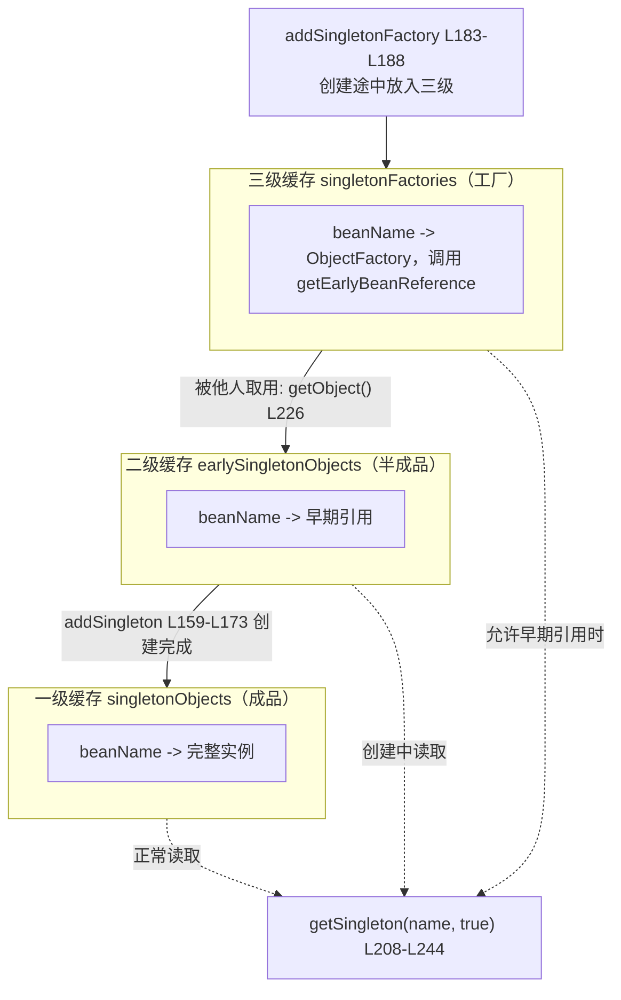
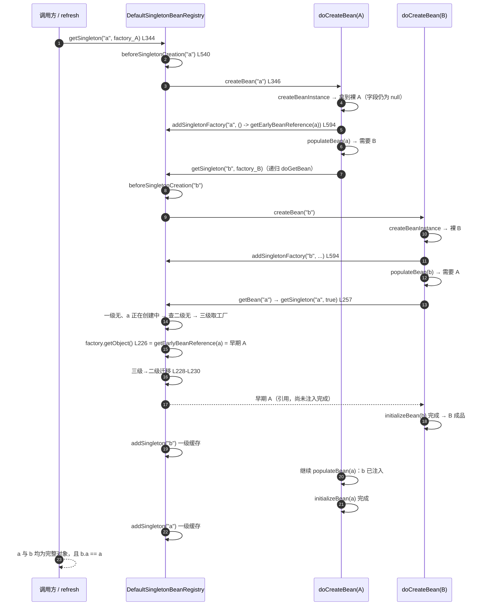
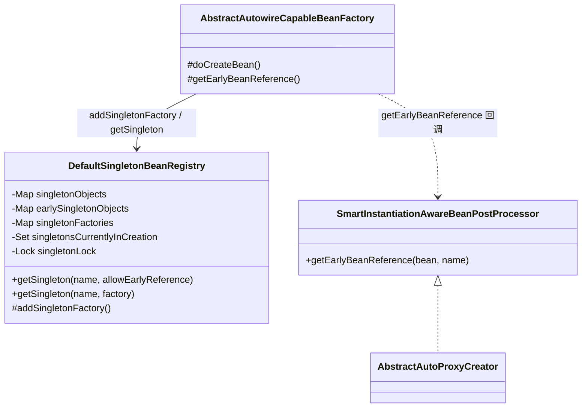
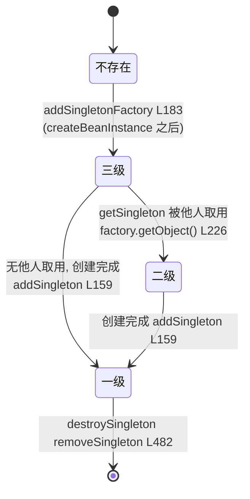
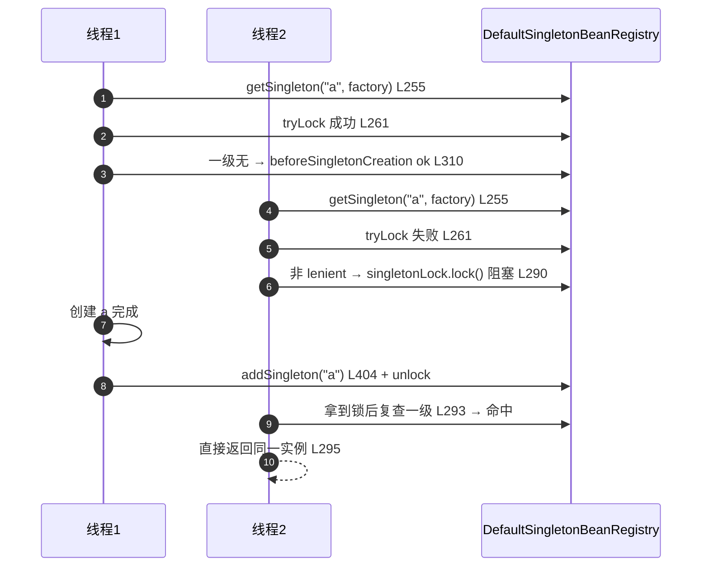

# 循环依赖与三级缓存

> **一句话结论**：Spring 能解决"单例 + setter/字段注入"的循环依赖，靠的是 `DefaultSingletonBeanRegistry` 里的三个 Map——**一级 `singletonObjects`（成品）、二级 `earlySingletonObjects`（半成品）、三级 `singletonFactories`（半成品的工厂）**；A 创建到一半时把"能产出 A 早期引用的工厂"放进三级缓存，B 需要 A 时取出并执行工厂，于是 B 顺利成型，A 回来时再把 B 注入进去。**构造器注入的循环依赖永远无解**，因为"造对象"这一步本身就要依赖，谁都无法先迈出第一步。
>
> **阅读前置**：读完 [02-bean 创建全流程](02-bean-创建全流程-getbean与createbean.md) 里 §3.4（三条创建分支）与 §3.6（`doCreateBean` 骨架），本文直接从那里接着往下讲。
> **预计阅读**：50~70 分钟（本文是全目录最需要画图理解的一篇）。
> **源码基线**：`org.springframework:spring-beans:7.1.0`，核心文件 `DefaultSingletonBeanRegistry.java`（838 行，已入库）、`AbstractAutowireCapableBeanFactory.java`。
> **术语先讲清楚**：
> - **循环依赖**：A 依赖 B、B 又依赖 A（可以隔着多级），形成环。
> - **早期引用（early reference）**：一个**已经 `new` 出来但还没注入、没初始化**的对象引用。
> - **三级缓存**：`singletonObjects`（一级）、`earlySingletonObjects`（二级）、`singletonFactories`（三级）三个 Map 的俗称。

---

## 0. 先看现象

### 0.1 能跑通的写法（字段注入）

```java
@Component class A { @Autowired B b; }
@Component class B { @Autowired A a; }
```

启动后 `ctx.getBean(A.class).b.a` 与 `ctx.getBean(A.class)` 是**同一个对象**，且都不为 null。Spring 会打一条 debug 日志：`Creating shared instance of singleton bean 'a'`，紧接着 trace 日志 `Eagerly caching bean 'a' to allow for resolving potential circular references`。

### 0.2 跑不通的写法一：构造器注入

```java
@Component class A { final B b; A(B b) { this.b = b; } }
@Component class B { final A a; B(A a) { this.a = a; } }
```

启动异常（节选，真实堆栈大概几十行，最后会被 Spring 包装成一次启动失败）：

```text
┌─────┐
|  a (field private final ... )
↑     ↓
|  b (field private final ... )
└─────┘
Action:
Relying upon circular references is discouraged and they are prohibited by default.
```

> 注意最后那句 `prohibited by default`：从 Spring Boot 2.6 / Spring Framework 5.3.x 后期起，**构造器注入的循环依赖默认被明确拒绝**（早期版本会"尽力而为"地退化为无参构造器或报错栈溢出）。这是 7.1 的默认行为。

### 0.3 跑不通的写法二：prototype 循环

```java
@Bean @Scope("prototype") A a(B b) { return new A(b); }
@Bean @Scope("prototype") B b(A a) { return new B(a); }
```

异常：`BeanCurrentlyInCreationException: Error creating bean with name 'a': Requested bean is currently in creation: Is there an unresolvable circular reference?`

### 0.4 三种现象的对照

| 场景 | 能否解决 | 关键机制 | 失败时异常 |
| --- | --- | --- | --- |
| 单例 + 字段/setter 注入 | 能 | 三级缓存（提前暴露早期引用） | — |
| 单例 + 构造器注入 | 不能 | 无（造对象前就要依赖） | 循环依赖报告 + `prohibited by default` |
| prototype（任意注入方式） | 不能 | 无（每次都要新实例） | `BeanCurrentlyInCreationException`（`AbstractBeanFactory` L274-L276） |
| 单例 + `@Async`/AOP 代理 | 能，但可能报错 | 三级缓存 + 一致性校验 | `has been injected into other beans [...] in its raw version` |
| 单例 + `@Lazy` | 能 | 注入代理，延迟解析 | — |

**为什么要这么设计**："循环依赖"本质是**图的强连通分量**，任何 DI 容器都想尽量支持它（现实中的业务代码确实会互相引用），但又不愿为此付出"允许任意半成品"的代价。三级缓存正是这个平衡点：**只在单例、只在真的有人提前要、只在允许的情况下**才暴露半成品。

---

## 1. 整体地图

### 1.1 三个 Map 的角色



> **读图说明**：数据**只能单向流动**：三级 → 二级 → 一级。`addSingletonFactory`（`AbstractAutowireCapableBeanFactory` L594 调用）把工厂放进三级；当有人通过 `getSingleton(name, true)` 要这个 Bean 时，若三级里有工厂，就执行它、把结果搬进二级（L228-L230）；创建完成后 `addSingleton` 写入一级并清掉二级/三级（L165-L166）。**没有反向流动**——不存在"一级的东西被放回二级"这种操作。

### 1.2 一次 A↔B 循环依赖的时序



> **读图说明**：第 14 步到第 20 步是全部魔法所在。B 在 `populateBean` 期间通过**普通 `getBean("a")`** 就能拿到 A 的早期引用——这正是 `doGetBean` L257 那次"无锁快查 + 允许早期引用"的意义。关键点有三个：
> ① A 能被"借出去"是因为它在 `createBeanInstance` 之后、`populateBean` **之前**就把工厂放进了三级缓存（L594，注意顺序）；
> ② 工厂被调用只会发生**一次**，结果搬进二级，之后所有索取者拿到的都是同一个早期引用；
> ③ A 最终返回给调用方的是"同一个对象"（`doCreateBean` L611-L614 的 `exposedObject = earlySingletonReference`），所以 `b.a == a` 成立。

### 1.3 为什么必须是"三级"而不是"两级"

这是最常见的面试题，先给结论再解释：

| 如果只有一级（`singletonObjects`） | 如果只有两级（一级 + 直接存早期实例） | 三级（现状） |
| --- | --- | --- |
| 单例只能"完整后才可见"，循环依赖必死 | 能解决循环依赖，但**创建时就得决定早期引用的形态**，AOP 代理会被迫提前生成 | 工厂延迟求值，**只有在真被提前依赖时才生成早期引用**（可能是代理，也可能就是裸对象） |
| 无法支持 A↔B | 对普通 Bean 浪费：所有 Bean 一创建就生成早期引用 | 无浪费：没有循环依赖时三级条目创建完成即被清除，工厂从不执行 |

所以三级缓存的核心动机是：**把"是否生成早期引用、以及是否提前应用 AOP"推迟到真正有人需要的时刻**。而二级缓存的存在是为了**避免工厂被重复执行**（同一个早期引用只生成一次）。

---

## 2. 关键类逐个拆

### 2.1 `DefaultSingletonBeanRegistry`——三个 Map 的持有者

- **类声明**（L76）：`public class DefaultSingletonBeanRegistry extends SimpleAliasRegistry implements SingletonBeanRegistry`。注意它是**被组合**进 `DefaultListableBeanFactory` 的（`DefaultListableBeanFactory extends FactoryBeanRegistrySupport`，而 `FactoryBeanRegistrySupport extends DefaultSingletonBeanRegistry`），也就是**继承链**上的祖先。
- **关键字段**：

```java (src: DefaultSingletonBeanRegistry.java#L76-L95)
public class DefaultSingletonBeanRegistry extends SimpleAliasRegistry implements SingletonBeanRegistry {

	/** Maximum number of suppressed exceptions to preserve. */
	private static final int SUPPRESSED_EXCEPTIONS_LIMIT = 100;


	/** Common lock for singleton creation. */
	final Lock singletonLock = new ReentrantLock();

	/** Cache of singleton objects: bean name to bean instance. */
	private final Map<String, Object> singletonObjects = new ConcurrentHashMap<>(256);

	/** Creation-time registry of singleton factories: bean name to ObjectFactory. */
	private final Map<String, ObjectFactory<?>> singletonFactories = new ConcurrentHashMap<>(16);

	/** Custom callbacks for singleton creation/registration. */
	private final Map<String, Consumer<Object>> singletonCallbacks = new ConcurrentHashMap<>(16);

	/** Cache of early singleton objects: bean name to bean instance. */
	private final Map<String, Object> earlySingletonObjects = new ConcurrentHashMap<>(16);
```


  - `singletonLock`（L83）：单例创建的**全局锁**。6.2 之前是 `synchronized (this.singletonObjects)`，7.1 改成 `ReentrantLock`，并配了 lenient 机制（见 §7）。
  - `singletonObjects`（L86）：一级缓存，初始容量 256（单例通常很多）。
  - `singletonFactories`（L89）：三级缓存，存 `ObjectFactory`，容量 16（同时处于"创建中的单例"极少）。
  - `earlySingletonObjects`（L95）：二级缓存，容量 16。
- **设计意图**：把"单例的可见性"与"Bean 的创建细节"彻底解耦。创建 Bean 的代码（`AbstractAutowireCapableBeanFactory`）只管调 `addSingletonFactory`、`getSingleton`，不用关心锁、并发、缓存迁移。

```java (src: DefaultSingletonBeanRegistry.java#L97-L104)
	/** Set of registered singletons, containing the bean names in registration order. */
	private final Set<String> registeredSingletons = Collections.synchronizedSet(new LinkedHashSet<>(256));

	/** Names of beans that are currently in creation. */
	private final Set<String> singletonsCurrentlyInCreation = ConcurrentHashMap.newKeySet(16);

	/** Names of beans currently excluded from in creation checks. */
	private final Set<String> inCreationCheckExclusions = ConcurrentHashMap.newKeySet(16);
```


- **在干什么**：`registeredSingletons` 是**按注册顺序**保存所有已登记名称的集合，服务于 `getSingletonNames()`（供销毁、诊断、`context.getBeanDefinitionNames()` 之外的场景枚举），`singletonsCurrentlyInCreation` 是**并发安全**的"正在创建中"集合（`ConcurrentHashMap.newKeySet`）。
- **为什么用 `ConcurrentHashMap.newKeySet` 而不是 `HashSet`**：这个集合会被**多个线程同时读写**（创建线程 add，别的线程在 `isSingletonCurrentlyInCreation` 里 contains），普通 `HashSet` 会数据竞争。
- **为什么 `registeredSingletons` 要包 `Collections.synchronizedSet`**：它需要保持插入顺序（`LinkedHashSet`）又需要线程安全，Java 没有现成的并发有序 Set，所以外面包一层。

### 2.2 `AbstractAutowireCapableBeanFactory`——两个"暴露/生成"的调用方

- `addSingletonFactory` 的**唯一调用点**在 `doCreateBean`（L594），条件是 L587-L588 的 `earlySingletonExposure`。
- `getEarlyBeanReference`（L964）是三级缓存工厂体：它遍历 `SmartInstantiationAwareBeanPostProcessor` 让它们"提前生成引用"（AOP 自动代理会在这里**提前**返回代理）。

```java (src: AbstractAutowireCapableBeanFactory.java#L964-L972)
	protected Object getEarlyBeanReference(String beanName, RootBeanDefinition mbd, Object bean) {
		Object exposedObject = bean;
		if (!mbd.isSynthetic() && hasInstantiationAwareBeanPostProcessors()) {
			for (SmartInstantiationAwareBeanPostProcessor bp : getBeanPostProcessorCache().smartInstantiationAware) {
				exposedObject = bp.getEarlyBeanReference(exposedObject, beanName);
			}
		}
		return exposedObject;
	}
```


- **在干什么**：如果没有 `SmartInstantiationAwareBeanPostProcessor`，直接返回原对象；否则依次让它加工，**后一个的输入是前一个的输出**。
- **为什么必须在这里也走一遍**：因为早期引用可能被别的 Bean 提前持有，如果 AOP 等到 `initializeBean` 才生成代理，那么"A 提前被别人持有的那个对象"就永远是裸对象——Spring 选择在**最早可能的时刻**就给它套上代理（这样提前持有的也是代理）。
- **常见坑**：这意味着 `@Transactional` 的 Bean 在循环依赖场景下，**代理对象可能在构造完成后、注入完成前就被创建**。如果切面的 `pointcut` 依赖注入状态（例如读某个字段决定是否拦截），行为可能不符合直觉。

### 2.3 `SmartInstantiationAwareBeanPostProcessor`——循环依赖的"代理感知"扩展点

- 这是 `BeanPostProcessor` 家族里的子接口，`AbstractAutoProxyCreator` 实现了它。`getEarlyBeanReference(bean, beanName)` 的语义是："如果需要代理，现在就给我，否则原样返回"。
- 它的存在解释了"为什么三级缓存放的是工厂而不是实例"：**只有通过工厂，才能把'是否需要提前代理'的决定权交给 AOP 层**。

### 2.4 `BeanCurrentlyInCreationException`——"环路"被发现的证据

- 三个抛出点：
  1. `AbstractBeanFactory#doGetBean` L275（prototype 正在创建中）；
  2. `DefaultSingletonBeanRegistry#beforeSingletonCreation` L540-L542（同一线程（或依赖等待链）重复进入创建窗口）；
  3. `AbstractAutowireCapableBeanFactory#doCreateBean` L624-L632（生成了代理但裸对象已被别人持有）。
- **为什么一个异常要设三个抛出点**：它们对应三种**完全不同**的环路形态（prototype 环、单例创建环、代理包装不一致），message 也各不相同，读异常要分清是哪一种。

### 2.5 一张图看清四个参与者的关系



> **读图说明**：`DefaultSingletonBeanRegistry` 只负责"存与取"，完全不知道 AOP 的存在；`AbstractAutowireCapableBeanFactory` 是唯一同时了解"创建流程"与"缓存"的类；真正的"是否提前代理"由 `SmartInstantiationAwareBeanPostProcessor` 的实现（`AbstractAutoProxyCreator`）决定。**这种分工是三级缓存能既通用又能配合 AOP 的原因**。

---

## 3. 源码逐段精读

### 3.1 三级缓存的数据结构

```java (src: DefaultSingletonBeanRegistry.java#L76-L95)
public class DefaultSingletonBeanRegistry extends SimpleAliasRegistry implements SingletonBeanRegistry {

	/** Maximum number of suppressed exceptions to preserve. */
	private static final int SUPPRESSED_EXCEPTIONS_LIMIT = 100;


	/** Common lock for singleton creation. */
	final Lock singletonLock = new ReentrantLock();

	/** Cache of singleton objects: bean name to bean instance. */
	private final Map<String, Object> singletonObjects = new ConcurrentHashMap<>(256);

	/** Creation-time registry of singleton factories: bean name to ObjectFactory. */
	private final Map<String, ObjectFactory<?>> singletonFactories = new ConcurrentHashMap<>(16);

	/** Custom callbacks for singleton creation/registration. */
	private final Map<String, Consumer<Object>> singletonCallbacks = new ConcurrentHashMap<>(16);

	/** Cache of early singleton objects: bean name to bean instance. */
	private final Map<String, Object> earlySingletonObjects = new ConcurrentHashMap<>(16);
```


- **在干什么**：定义三个 Map 加一把锁。注意泛型：一级/二级是 `Map<String, Object>`（直接存实例），三级是 `Map<String, ObjectFactory<?>>`（存工厂）。
- **为什么一级缓存初始容量 256**：单例数量通常上百，256 位能减少 HashMap 扩容。
- **为什么三级/二级只有 16**：同一时刻处于"创建中"的单例数量极少（一般 1~3 个），16 足够。
- **如果改成**：三级也存实例——那就退化成"两级"，AOP 必须提前代理所有 Bean（见 §1.3 表格）。

### 3.2 写入：`addSingleton` 与 `addSingletonFactory`

```java (src: DefaultSingletonBeanRegistry.java#L159-L188)
	protected void addSingleton(String beanName, Object singletonObject) {
		Object oldObject = this.singletonObjects.putIfAbsent(beanName, singletonObject);
		if (oldObject != null) {
			throw new IllegalStateException("Could not register object [" + singletonObject +
					"] under bean name '" + beanName + "': there is already object [" + oldObject + "] bound");
		}
		this.singletonFactories.remove(beanName);
		this.earlySingletonObjects.remove(beanName);
		this.registeredSingletons.add(beanName);

		Consumer<Object> callback = this.singletonCallbacks.get(beanName);
		if (callback != null) {
			callback.accept(singletonObject);
		}
	}

	/**
	 * Add the given singleton factory for building the specified singleton
	 * if necessary.
	 * <p>To be called for early exposure purposes, for example, to be able to
	 * resolve circular references.
	 * @param beanName the name of the bean
	 * @param singletonFactory the factory for the singleton object
	 */
	protected void addSingletonFactory(String beanName, ObjectFactory<?> singletonFactory) {
		Assert.notNull(singletonFactory, "Singleton factory must not be null");
		this.singletonFactories.put(beanName, singletonFactory);
		this.earlySingletonObjects.remove(beanName);
		this.registeredSingletons.add(beanName);
	}
```


- **在干什么**：
  - `addSingleton`（L159-L173）：`putIfAbsent` 写一级缓存；若已有值则抛 `Could not register object ...`；成功后**清掉三级与二级**（L165-L166），把名称加入 `registeredSingletons`，最后执行注册的回调。
  - `addSingletonFactory`（L183-L188）：把工厂写入三级，**同时清掉二级**，并登记名称。
- **为什么 `addSingletonFactory` 要清二级**：如果二级里已经有早期引用（旧工厂执行过），新工厂写入时必须让它失效，否则新旧引用不一致。
- **为什么 `addSingleton` 要 `putIfAbsent` 并抛异常**：单例的唯一性契约。7.1 里"lenient 创建"场景下可能出现"两个线程都创建成功"的情况，此时 `getSingleton` 的调用方会 catch 这个 `IllegalStateException` 并**接受已有实例**（L406-L412），但直接调用 `addSingleton` 的其它路径仍然会炸——这是"尽力而为"的取舍。
- **常见坑**：`ctx.getBeanFactory().registerSingleton("x", obj)` 走的是 `registerSingleton`（L141-L151，加锁后调 `addSingleton`）。如果 `x` 已经由容器创建，你会看到 `Could not register object [...] there is already object [...] bound`——**同名手工注册必须先于容器创建**。

### 3.3 读取（一）：`getSingleton(name, allowEarlyReference)`

```java (src: DefaultSingletonBeanRegistry.java#L196-L244)
	public @Nullable Object getSingleton(String beanName) {
		return getSingleton(beanName, true);
	}

	/**
	 * Return the (raw) singleton object registered under the given name.
	 * <p>Checks already instantiated singletons and also allows for an early
	 * reference to a currently created singleton (resolving a circular reference).
	 * @param beanName the name of the bean to look for
	 * @param allowEarlyReference whether early references should be created or not
	 * @return the registered singleton object, or {@code null} if none found
	 */
	protected @Nullable Object getSingleton(String beanName, boolean allowEarlyReference) {
		// Quick check for existing instance without full singleton lock.
		Object singletonObject = this.singletonObjects.get(beanName);
		if (singletonObject == null && isSingletonCurrentlyInCreation(beanName)) {
			singletonObject = this.earlySingletonObjects.get(beanName);
			if (singletonObject == null && allowEarlyReference) {
				if (!this.singletonLock.tryLock()) {
					// Avoid early singleton inference outside of original creation thread.
					return null;
				}
				try {
					// Consistent creation of early reference within full singleton lock.
					singletonObject = this.singletonObjects.get(beanName);
					if (singletonObject == null) {
						singletonObject = this.earlySingletonObjects.get(beanName);
						if (singletonObject == null) {
							ObjectFactory<?> singletonFactory = this.singletonFactories.get(beanName);
							if (singletonFactory != null) {
								singletonObject = singletonFactory.getObject();
								// Singleton could have been added or removed in the meantime.
								if (this.singletonFactories.remove(beanName) != null) {
									this.earlySingletonObjects.put(beanName, singletonObject);
								}
								else {
									singletonObject = this.singletonObjects.get(beanName);
								}
							}
						}
					}
				}
				finally {
					this.singletonLock.unlock();
				}
			}
		}
		return singletonObject;
	}
```


- **在干什么**：这是**纯读**的入口，四层判断：
  1. 查一级（L210）。命中直接返回。
  2. 一级没有且**该 Bean 正在创建中**（L211），才查二级（L212）。
  3. 二级也没有且**允许早期引用**（L213），`tryLock` 抢单例锁（L214）。
  4. 抢不到锁就**直接返回 null**（L216），注释写明 `Avoid early singleton inference outside of original creation thread`。
- **锁内为什么要三重复查**（L220-L235）：因为锁外是无锁读，进锁后状态可能已经变了。三级里取到工厂后执行 `factory.getObject()`（L226），然后**判断三级是否被移除**：
  - 移除成功 → 说明确实是"我把它从三级搬到了二级"（L228-L230）；
  - 移除失败 → 说明期间已经有人/有流程处理过了，以一级缓存为准（L232）。
- **为什么"抢不到锁就返回 null"**：防止一个**无关线程**（既不是创建者，也不在创建窗口内）触发早期引用的生成（生成可能涉及 AOP，代价高且有副作用）。宁可返回 null 让别人稍后再试，也不在这里执行工厂。
- **`allowEarlyReference` 的两种取值场景**：
  - `true`：`getSingleton(String)`（L196-L198）与 `doGetBean` L257 的快查——**这是循环依赖能成立的入口**。
  - `false`：`doCreateBean` L611 的一致性校验（只要已有结果，不再生成新的）。
- **常见坑**：`isSingletonCurrentlyInCreation` 用的是**全局**集合（不分线程），所以"别的线程正在创建 A"时，本线程也能走到三级/二级读取路径——这正是 §7 里 lenient 机制要处理的并发场景。

### 3.4 读取（二）：`getSingleton(name, ObjectFactory)`——创建窗口

```java (src: DefaultSingletonBeanRegistry.java#L255-L311)
	public Object getSingleton(String beanName, ObjectFactory<?> singletonFactory) {
		Assert.notNull(beanName, "Bean name must not be null");

		Thread currentThread = Thread.currentThread();
		Boolean lockFlag = isCurrentThreadAllowedToHoldSingletonLock();
		boolean acquireLock = !Boolean.FALSE.equals(lockFlag);
		boolean locked = (acquireLock && this.singletonLock.tryLock());

		try {
			Object singletonObject = this.singletonObjects.get(beanName);
			if (singletonObject == null) {
				if (acquireLock && !locked) {
					if (Boolean.TRUE.equals(lockFlag)) {
						// Another thread is busy in a singleton factory callback, potentially blocked.
						// Fallback as of 6.2: process given singleton bean outside of singleton lock.
						// Thread-safe exposure is still guaranteed, there is just a risk of collisions
						// when triggering creation of other beans as dependencies of the current bean.
						this.lenientCreationLock.lock();
						try {
							if (logger.isInfoEnabled()) {
								Set<String> lockedBeans = new HashSet<>(this.singletonsCurrentlyInCreation);
								lockedBeans.removeAll(this.singletonsInLenientCreation);
								logger.info("Obtaining singleton bean '" + beanName + "' in thread \"" +
										currentThread.getName() + "\" while other thread holds singleton " +
										"lock for other beans " + lockedBeans);
							}
							this.singletonsInLenientCreation.add(beanName);
						}
						finally {
							this.lenientCreationLock.unlock();
						}
					}
					else {
						// No specific locking indication (outside a coordinated bootstrap) and
						// singleton lock currently held by some other creation method -> wait.
						this.singletonLock.lock();
						locked = true;
						// Singleton object might have possibly appeared in the meantime.
						singletonObject = this.singletonObjects.get(beanName);
						if (singletonObject != null) {
							return singletonObject;
						}
					}
				}

				if (this.singletonsCurrentlyInDestruction) {
					throw new BeanCreationNotAllowedException(beanName,
							"Singleton bean creation not allowed while singletons of this factory are in destruction " +
							"(Do not request a bean from a BeanFactory in a destroy method implementation!)");
				}
				if (logger.isDebugEnabled()) {
					logger.debug("Creating shared instance of singleton bean '" + beanName + "'");
				}

				try {
					beforeSingletonCreation(beanName);
				}
```


- **在干什么**：这是**创建型**入口（`doGetBean` L344 调用），也是"创建窗口"的开启处：
  1. 取当前线程、决定是否要拿锁（L258-L261）；
  2. 先查一级（L264），已有就跳过（**双重检查**）；
  3. 若拿不到锁（L266）分两种情况：允许 lenient（`lockFlag == TRUE`，即处于 Spring 协调的启动期）就**不进锁创建**并打 info 日志（L272-L286）；否则老老实实阻塞等锁（L290-L296），等锁后**再查一次一级**（L293-L295）；
  4. **销毁期禁止创建**（L300-L304）：`BeanCreationNotAllowedException`——`Do not request a bean from a BeanFactory in a destroy method implementation!`；
  5. 打 debug 日志 `Creating shared instance of singleton bean '...'`（L305-L307）；
  6. **`beforeSingletonCreation(beanName)`（L310）把名称加入"创建中"**，若已在集合里则进入复杂的等待逻辑（L312-L358）。
- **为什么"销毁期禁止创建"要写在这里**：销毁过程中若某个 `destroy` 方法触发 `getBean`，会创建出永远没人管理的资源。这条守卫把它变成一条清晰的异常，而不是内存泄漏。
- **为什么 `catch (BeanCurrentlyInCreationException)` 要写几十行**（L312-L358）：这是 6.2 引入的 lenient 创建机制的"等待/让路"逻辑——若该 Bean 正被别的线程（或它的依赖等待链上的线程）创建，就等待 `lenientCreationFinished` 条件变量，或最终决定抛异常。这是本类最复杂的部分，业务上极少需要读懂细节，知道"它在这里处理并发创建冲突"即可。

```java (src: DefaultSingletonBeanRegistry.java#L360-L415)
				boolean newSingleton = false;
				boolean recordSuppressedExceptions = (locked && this.suppressedExceptions == null);
				if (recordSuppressedExceptions) {
					this.suppressedExceptions = new LinkedHashSet<>();
				}
				try {
					// Leniently created singleton object could have appeared in the meantime.
					singletonObject = this.singletonObjects.get(beanName);
					if (singletonObject == null) {
						this.currentCreationThreads.put(beanName, currentThread);
						try {
							singletonObject = singletonFactory.getObject();
						}
						finally {
							this.currentCreationThreads.remove(beanName);
						}
						newSingleton = true;
					}
				}
				catch (IllegalStateException ex) {
					// Has the singleton object implicitly appeared in the meantime ->
					// if yes, proceed with it since the exception indicates that state.
					singletonObject = this.singletonObjects.get(beanName);
					if (singletonObject == null) {
						throw ex;
					}
				}
				catch (BeanCreationException ex) {
					if (recordSuppressedExceptions) {
						for (Exception suppressedException : this.suppressedExceptions) {
							ex.addRelatedCause(suppressedException);
						}
					}
					throw ex;
				}
				finally {
					if (recordSuppressedExceptions) {
						this.suppressedExceptions = null;
					}
					afterSingletonCreation(beanName);
				}

				if (newSingleton) {
					try {
						addSingleton(beanName, singletonObject);
					}
					catch (IllegalStateException ex) {
						// Leniently accept same instance if implicitly appeared.
						Object object = this.singletonObjects.get(beanName);
						if (singletonObject != object) {
							throw ex;
						}
					}
				}
			}
			return singletonObject;
```


- **在干什么**：
  1. `suppressedExceptions` 只在真正持锁时收集（L361-L364），避免多线程共享一个集合；
  2. **执行工厂**（L371）：这一步才真正调用 `createBean` → `doCreateBean`；
  3. `catch (IllegalStateException)`（L379-L386）：如果异常是因为"期间别人已经创建成功"（`addSingleton` 冲突），那就采用已有实例，不再抛；
  4. `catch (BeanCreationException)`（L387-L394）：把并发期间收集的 suppressed 异常附加到主异常上（`addRelatedCause`），保证诊断信息不丢；
  5. `finally` 里 `afterSingletonCreation`（L399）——把名称从"创建中"移除；
  6. `if (newSingleton) addSingleton(...)`（L402-L413）——**只有本次真的创建了，才写入一级缓存**；若写的时候发现已存在（lenient 场景），比较是不是同一实例，不是才抛。
- **为什么 `while` 循环外的 `return singletonObject`（L415）在 try 里**：保证 `finally` 里能正确释放锁。
- **常见坑**：调试时看到 debug 日志 `Creating shared instance of singleton bean 'x'` 出现**两次**，说明有两个线程同时进入了创建流程（lenient 机制允许），但最终只有一份进一级缓存。

### 3.5 "创建中"标记：`beforeSingletonCreation` / `afterSingletonCreation`

```java (src: DefaultSingletonBeanRegistry.java#L533-L555)
	/**
	 * Callback before singleton creation.
	 * <p>The default implementation registers the singleton as currently in creation.
	 * @param beanName the name of the singleton about to be created
	 * @see #isSingletonCurrentlyInCreation
	 */
	protected void beforeSingletonCreation(String beanName) {
		if (!this.inCreationCheckExclusions.contains(beanName) && !this.singletonsCurrentlyInCreation.add(beanName)) {
			throw new BeanCurrentlyInCreationException(beanName);
		}
	}

	/**
	 * Callback after singleton creation.
	 * <p>The default implementation marks the singleton as not in creation anymore.
	 * @param beanName the name of the singleton that has been created
	 * @see #isSingletonCurrentlyInCreation
	 */
	protected void afterSingletonCreation(String beanName) {
		if (!this.inCreationCheckExclusions.contains(beanName) && !this.singletonsCurrentlyInCreation.remove(beanName)) {
			throw new IllegalStateException("Singleton '" + beanName + "' isn't currently in creation");
		}
	}
```


- **在干什么**：`beforeSingletonCreation` 用 `Set.add` 的返回值判断"是否第一次加入"——返回 `false` 说明已经在了，抛 `BeanCurrentlyInCreationException`；`afterSingletonCreation` 用 `remove` 的返回值判断"是否真的在集合里"，不在就抛 `IllegalStateException`。
- **为什么用 `add`/`remove` 的返回值而不是 `contains` 再操作**：这是一个**原子操作**，避免"检查-然后-动作"之间的竞态。`ConcurrentHashMap.newKeySet()` 的 `add` 是原子的。
- **`inCreationCheckExclusions` 是干什么的**：某些场景需要**临时禁用**循环检查——最典型的是 `ConfigurationClassEnhancer.BeanMethodInterceptor#resolveBeanReference`（L455-L459）：当 `@Configuration` 类里 `@Bean` 方法互相调用时，会临时把当前 Bean 从检查中排除，以避免误报循环依赖。
- **常见坑**：`setCurrentlyInCreation(beanName, false)`（L505-L513）是**反过来**的语义——参数 `false` 表示"排除检查"（加进 `inCreationCheckExclusions`），`true` 表示"恢复正常检查"（从排除集合移除）。这个反直觉的命名坑了不少人。

```java (src: DefaultSingletonBeanRegistry.java#L476-L488)

	/**
	 * Remove the bean with the given name from the singleton registry, either on
	 * regular destruction or on cleanup after early exposure when creation failed.
	 * @param beanName the name of the bean
	 */
	protected void removeSingleton(String beanName) {
		this.singletonObjects.remove(beanName);
		this.singletonFactories.remove(beanName);
		this.earlySingletonObjects.remove(beanName);
		this.registeredSingletons.remove(beanName);
	}

```


- **在干什么**：一次性把该名称从三个缓存和登记集合里删掉。
- **谁在调它**：`destroySingleton`、以及 `AbstractBeanFactory` L275 / `getSingleton` lambda 的失败清理（`destroySingleton(beanName)`）。
- **为什么失败时要连三级一起清**：因为失败后三级里可能还挂着"能产出半成品"的工厂，下次 `getBean` 会直接拿到它，形成"永远的半成品"。

### 3.6 早期引用是怎么"按需生成"的

```java (src: AbstractAutowireCapableBeanFactory.java#L964-L972)
	protected Object getEarlyBeanReference(String beanName, RootBeanDefinition mbd, Object bean) {
		Object exposedObject = bean;
		if (!mbd.isSynthetic() && hasInstantiationAwareBeanPostProcessors()) {
			for (SmartInstantiationAwareBeanPostProcessor bp : getBeanPostProcessorCache().smartInstantiationAware) {
				exposedObject = bp.getEarlyBeanReference(exposedObject, beanName);
			}
		}
		return exposedObject;
	}
```


- **在干什么**：遍历 `getBeanPostProcessorCache().smartInstantiationAware`，逐个调 `getEarlyBeanReference`。
- **为什么用 `getBeanPostProcessorCache()` 而不是遍历 `beanPostProcessors`**：`BeanPostProcessor` 列表在启动后不再变化，Spring 6.x 起把它们按接口分类缓存（`smartInstantiationAware`、`instantiationAware`、`destructionAware` 等），避免每次创建都做 `instanceof` 过滤。这也是 6.x → 7.x 微调过的性能细节。
- **`mbd.isSynthetic()` 为什么跳过**：synthetic 定义来自框架内部（例如 `conversionService` 之类），不需要 AOP 代理。
- **常见坑**：如果你的自定义 `SmartInstantiationAwareBeanPostProcessor#getEarlyBeanReference` 每次返回**新对象**，循环依赖会立刻出问题——别的 Bean 拿到的早期引用和最终对象不是同一个，`b.a == a` 为 `false`，随后会被 §3.7 的一致性校验抓住。

### 3.7 最终一致性：`doCreateBean` 的收尾检查

在 02 篇 §3.9 已经贴过源码，这里从"循环依赖视角"重述关键分支：

```java (src: AbstractAutowireCapableBeanFactory.java#L610-L646)
		if (earlySingletonExposure) {
			Object earlySingletonReference = getSingleton(beanName, false);
			if (earlySingletonReference != null) {
				if (exposedObject == bean) {
					exposedObject = earlySingletonReference;
				}
				else if (!this.allowRawInjectionDespiteWrapping && hasDependentBean(beanName)) {
					String[] dependentBeans = getDependentBeans(beanName);
					Set<String> actualDependentBeans = CollectionUtils.newLinkedHashSet(dependentBeans.length);
					for (String dependentBean : dependentBeans) {
						if (!removeSingletonIfCreatedForTypeCheckOnly(dependentBean)) {
							actualDependentBeans.add(dependentBean);
						}
					}
					if (!actualDependentBeans.isEmpty()) {
						throw new BeanCurrentlyInCreationException(beanName,
								"Bean with name '" + beanName + "' has been injected into other beans [" +
								StringUtils.collectionToCommaDelimitedString(actualDependentBeans) +
								"] in its raw version as part of a circular reference, but has eventually been " +
								"wrapped. This means that said other beans do not use the final version of the " +
								"bean. This is often the result of over-eager type matching - consider using " +
								"'getBeanNamesForType' with the 'allowEagerInit' flag turned off, for example.");
					}
				}
			}
		}

		// Register bean as disposable.
		try {
			registerDisposableBeanIfNecessary(beanName, bean, mbd);
		}
		catch (BeanDefinitionValidationException ex) {
			throw new BeanCreationException(
					mbd.getResourceDescription(), beanName, "Invalid destruction signature", ex);
		}

		return exposedObject;
```


- **在干什么**：`getSingleton(beanName, false)` 拿到早期引用（不生成新的）。如果 `exposedObject == bean`（`initializeBean` 没换对象），就用早期引用作为返回值；否则（生成了代理）检查"是否有别的 Bean 已经依赖了裸对象"，有就抛异常。
- **为什么"生成了代理就要报错"**：A 的裸对象已经被 B 持有，A 又变成了代理，于是容器里存在 A 的两个版本：B 里的裸 A、一级缓存里的代理 A。Spring 认为这是**不可接受的语义歧义**，宁可报错。
- **`allowRawInjectionDespiteWrapping` 什么时候会打开**：它默认 `false`。某些框架/测试场景会显式打开以"容忍"这种不一致（不推荐）。
- **常见坑**：这条异常常见于"A 被 `@Transactional` 或 `@Async` 代理 + A 与 B 互相依赖"。解决顺序建议：① 改构造器注入并重构依赖（首选）；② 对注入点加 `@Lazy`（注入代理，解析推迟）；③ 用 `ObjectProvider` / `ApplicationContext` 延迟获取；④ 最后才是调开关（不推荐）。

### 3.8 构造器注入为什么无解

```java (src: AbstractAutowireCapableBeanFactory.java#L1216-L1227)
				mbd.hasConstructorArgumentValues() || !ObjectUtils.isEmpty(args)) {
			return autowireConstructor(beanName, mbd, ctors, args);
		}

		// Preferred constructors for default construction?
		ctors = mbd.getPreferredConstructors();
		if (ctors != null) {
			return autowireConstructor(beanName, mbd, ctors, null);
		}

		// No special handling: simply use no-arg constructor.
		return instantiateBean(beanName, mbd);
```


- **在干什么**：`createBeanInstance` 里如果发现"有候选构造器 / 装配模式是 `AUTOWIRE_CONSTRUCTOR` / 有构造参数值 / 传了参数"，就走 `autowireConstructor`——而它要**先解析构造参数**。
- **为什么无解**：解析 A 的构造参数需要 B，创建 B 需要 A，而 A 此刻**还没有对象**（`createBeanInstance` 尚未返回），因此三级缓存里根本没有 A 的工厂（`addSingletonFactory` 在 L594，晚于 L563 的实例化）。于是 B 的 `getBean("a")` 走到 `getSingleton("a", factory)`，发现 `a` 已在 `singletonsCurrentlyInCreation` 中（L540-L542），抛 `BeanCurrentlyInCreationException`。
- **形式化地说**：三级缓存解决的是"对象的**装配阶段**的环"，而构造器注入把环提到了"对象的**构造阶段**"，而构造阶段**没有任何可以提前暴露的东西**（对象还不存在）。
- **Spring Boot 的改进报告**：5.3 之后专门的 `CircularReferences` 失败分析器会把环画出来（就是 §0.2 那个方框 ASCII 图），并提示 `prohibited by default`。

### 3.9 顺便回答：为什么 `@Lazy` 能破环

`@Lazy` 注入的不是真实 Bean，而是一个**代理**（`ContextAnnotationAutowireCandidateResolver#getLazyResolutionProxyIfNecessary`，对应 `DefaultListableBeanFactory#resolveDependency` L1650-L1655 的分支）。代理在被**第一次调用方法**时才去容器查真实 Bean，此时双方的创建早已完成。所以它对**构造器注入的循环依赖同样有效**——因为构造阶段拿到的只是一个空壳代理。

---

## 4. 一次完整执行时序

### 4.1 三级缓存的完整生命周期（单线程视角）



> **读图说明**：两条路径都通向一级缓存。注意"三级 → 一级"这条直连：**常见情况（没有循环依赖）下，工厂从来不会被执行**，`addSingleton` 直接清掉三级条目。这也解释了为什么很多人从来没见过 `getEarlyBeanReference` 被调用。

### 4.2 并发场景：两个线程同时 `getBean("a")`



> **读图说明**：这是**经典**路径（`lockFlag` 不是 `TRUE`）：线程 2 在 `singletonLock` 上等待，醒来后靠 L293-L295 的复查命中已有实例，不会重复创建。而 §3.4 里那段 lenient 分支（L266-L297）是为"Spring 协调的启动期"准备的——那时若线程 2 也是"被允许持有的线程"，它会**不等待**而是并行创建（打 info 日志），最后靠 `addSingleton` 的冲突处理收敛。

### 4.3 一张速查表：什么情况查哪一级

| 调用点 | 方法 | `allowEarlyReference` | 能否查三级 | 执行工厂 |
| --- | --- | --- | --- | --- |
| `doGetBean` L257 | `getSingleton(name)` | `true` | 能 | **能** |
| `doCreateBean` L611 | `getSingleton(name, false)` | `false` | 不能 | 不能 |
| `preInstantiateSingletons` 第二段 | `getSingleton(beanName, false)` | `false` | 不能 | 不能 |
| `getSingleton(name, factory)` L264/L293/L315 | 只查 `singletonObjects` | — | 不能 | — |

---

## 5. 设计模式与取舍

| 模式 | 出现位置 | 作用 |
| --- | --- | --- |
| 延迟初始化（Lazy / Virtual Proxy） | `singletonFactories` 存 `ObjectFactory` | 把"是否生成早期引用"推迟到真正需要 |
| 缓存三级分级（L1/L2/L3） | `singletonObjects` / `earlySingletonObjects` / `singletonFactories` | 按"成熟度"分级，避免浪费与重复 |
| 状态标记（in-creation set） | `singletonsCurrentlyInCreation` | 判断"是否已在创建中"，替代加锁判断 |
| 幂等钩子 + 短路 | `getEarlyBeanReference` | 允许 BPP 决定"要不要提前代理" |
| 定义式守卫（Guard Clause） | `singletonsCurrentlyInDestruction` 检查（L300） | 用显式异常替代隐蔽的资源泄漏 |
| 二阶段提交思想（近似） | `beforeSingletonCreation` / `afterSingletonCreation` | 进入/退出创建窗口必须成对 |
| 逃逸分析替代方案：`@Lazy` 代理 | `getLazyResolutionProxyIfNecessary` | 用代理彻底绕开"对象尚未存在"的问题 |

**取舍**：

1. **支持循环依赖 vs 强制无环设计**：Spring 选择"支持但有代价"（半成品可见、代理提前、一致性校验可能报错）。很多团队反过来选"禁止循环依赖"（`spring.main.allow-circular-references=false`），把问题暴露在编译期/启动期。**没有绝对正确，取决于团队规模与历史包袱**。
2. **三级缓存 vs 两级缓存**：三级多了一个工厂层，代码复杂度上升（`getSingleton` 的三重嵌套、锁内复查），换来"不必要时不生成早期引用"。若没有 AOP，两级足够；正因为 AOP 普遍存在，三级才是必需的。
3. **"抢不到锁返回 null" vs "阻塞等锁"**：返回 null 避免了"无关线程触发 AOP 提前代理"的副作用，代价是调用方必须能处理"暂时取不到"（`doGetBean` 会继续走创建流程，最终在创建窗口里被 `beforeSingletonCreation` 拦住/等待）。
4. **`allowRawInjectionDespiteWrapping` 默认 false**：宁可启动失败，也不接受"两个版本的 A"。这是"正确性优先于可用性"的典型取舍。
5. **构造器注入不解决 vs 用字节码/代理强行解决**：Spring 明确不解决。理由：强行解决需要"延迟构造"，会破坏 `final` 字段与不可变对象的语义，收益远小于代价。

---

## 6. 踩坑与调试手法

1. **开启 `TRACE` 抓三个关键词**：`Creating shared instance of singleton bean`（进入创建窗口）、`Eagerly caching bean`（放进了三级）、`Returning eagerly cached instance`（有人取了早期引用）。三句都出现，说明真的走了循环依赖路径。
2. **用 `containsSingleton` 判断有坑**：它只查一级缓存（L490-L492）。处于二级/三级的 Bean 会返回 `false`（`containsBean` 才是"定义存在"）。
3. **看 `b.a == a` 是否成立**：这是判断"循环依赖是否被正确解决"的最快手段。若不成立，通常意味着某个 BPP 的 `getEarlyBeanReference` 返回了新对象。
4. **`@Async` + 循环依赖极易触发一致性异常**：`AsyncAnnotationBeanPostProcessor` 会在 `postProcessAfterInitialization` 生成代理，而裸对象已被别人持有 → L624-L632 报错。解法见 §3.7 常见坑。
5. **`spring.main.allow-circular-references=false`**（Boot 2.6+ 默认）：想主动"让循环依赖在启动期就炸"，这是最有价值的开关。打开后 `allowCircularReferences` 为 `false`，`earlySingletonExposure` 恒假，三级缓存根本不启用。
6. **`@Lazy` 不是万灵药**：它把错误从"启动失败"推迟成"首次调用时的 `BeanCurrentlyInCreationException`"或性能问题（每次调用都要过代理）。用它之前先想清楚能否重构。
7. **prototype 的循环依赖永远报错**，且 message 很短（L275 只传 beanName）。若日志里只有 `Requested bean is currently in creation` 而没有依赖链，先搜代码里 `@Scope("prototype")`。
8. **调试断点建议**：`DefaultSingletonBeanRegistry#getSingleton(String, boolean)` 的 L226（工厂执行点）与 `addSingletonFactory` 的 L185。前者回答"谁触发了早期引用生成"，后者回答"是谁把工厂放进去的"。
9. **Spring Boot 的循环依赖报告**：`CircularReferences` 分析器会把整条环路画出来并标出每个 Bean 的创建位置（`beanDefinition` 的来源）。看到 `┌─────┐ / ↑ ↓` 的 ASCII 图，先找图里最后被创建的那个 Bean，通常是"破环点"。
10. **不要用 `@Autowired` 字段注入来"凑"循环依赖**：虽然能跑，但会让"对象何时可用"变得不可推理。优先构造器注入 + 重新划分模块。

---

## 7. ⚠️ 版本差异

| 关注点 | Spring 5.x | Spring 6.x | Spring 7.1（本文基线） |
| --- | --- | --- | --- |
| 单例锁 | `synchronized (this.singletonObjects)` | 6.2 起 `ReentrantLock singletonLock` | L83 `final Lock singletonLock = new ReentrantLock()` |
| 并发创建策略 | 一律阻塞等锁 | 6.2 起引入 **lenient creation**（`singletonsInLenientCreation`、`lenientCreationFinished`、`currentCreationThreads`） | 保留（L266-L297、L312-L358、L369-L375） |
| `earlySingletonObjects` 类型 | `HashMap`（早期版本）→ `ConcurrentHashMap` | `ConcurrentHashMap` | L95 `ConcurrentHashMap<>(16)` |
| `getSingleton(name, true)` 抢不到锁 | 直接进锁（阻塞） | 6.2 起 `tryLock` 失败返回 null（避免无关线程生成早期引用） | L214-L217 |
| 构造器注入循环依赖 | 5.3 之前可能"尽力而为" | 默认禁止（`allowCircularReferences` 默认 true，但 Boot 2.6 起把它设 false） | `prohibited by default` 报告 |
| `BeanCurrentlyInCreationException` 并发等待 | 简单抛 | 6.2 起带等待/依赖线程链检查（`checkDependentWaitingThreads`） | L312-L358 |
| 三级缓存条目清理 | `addSingleton` 清 | 相同 | L165-L166 |
| AOT / 原生镜像 | 无 | 6.0 起 `addSingletonFactory` 在某些 AOT 场景被裁剪 | 7.1 中 `earlySingletonExposure` 仍保留完整逻辑 |

**升级提醒**：如果你从 5.3 升到 7.1，**最可能踩的坑是并发启动行为变化**——旧版本在多线程 `getBean` 时可能"安静地串行"，7.1 会打 `Obtaining singleton bean ... while other thread holds singleton lock for other beans` 的 info 日志并可能并行创建。看到这条日志不必恐慌，但如果你依赖"Bean 只被创建一次"的隐含假设（例如构造器里有副作用），需要检查。

---

## 8. 面试高频问与答

**Q1：Spring 的三级缓存分别是哪三个 Map？各自存什么？**
A：一级 `singletonObjects`（L86，`Map<String,Object>`）存完整单例；二级 `earlySingletonObjects`（L95）存早期引用（半成品）；三级 `singletonFactories`（L89，`Map<String,ObjectFactory<?>>`）存能产出早期引用的工厂（通常就是 `() -> getEarlyBeanReference(beanName, mbd, bean)`）。

**Q2：为什么需要三级，两级不行吗？**
A：两级（一级 + 直接存早期实例）能解决循环依赖，但**创建时就得决定早期引用的形态**，如果有 AOP，就必须给所有 Bean 提前生成代理。三级存工厂把"是否生成、生成什么"推迟到真正被提前依赖时，没有循环依赖就从不执行。二级缓存的作用是"工厂只执行一次"，避免重复生成不一致的引用。

**Q3：三级缓存分别在什么时机被写入和清理？**
A：三级：`doCreateBean` L594 `addSingletonFactory`（实例化后、注入前）写入；被取用时执行并从三级删除（L228），或创建完成时被 `addSingleton` 清除（L165）。二级：L229 写入；`addSingletonFactory`（L186）与 `addSingleton`（L166）都会清除。一级：`addSingleton`（L161）写入；`removeSingleton`（L482）清除。

**Q4：为什么构造器注入的循环依赖无解？**
A：构造器注入要求"造对象前先拿到依赖"，而 `createBeanInstance`（L563）在实例化成功前没有任何东西可以提前暴露（`addSingletonFactory` 在 L594，晚于它）。于是 B 要 A 时，A 还在构造，三级缓存里没有 A 的工厂，`beforeSingletonCreation`（L540）发现 A 已在创建中 → `BeanCurrentlyInCreationException`。三级缓存只能解决"装配阶段"的环，不能解决"构造阶段"的环。

**Q5：`@Lazy` 为什么能解决构造器注入的循环依赖？**
A：`@Lazy` 注入的是代理（`DefaultListableBeanFactory#resolveDependency` L1650-L1655 的 lazy resolution proxy），构造时只创建空的代理壳子，不触发真实 Bean 创建。等真正调用代理方法时才 `getBean`，那时环两端的创建都已完成。代价是：每次调用多一层代理，且错误被推迟到首次调用。

**Q6：prototype 为什么不能解决循环依赖？**
A：prototype 每次 `getBean` 都要**新实例**，不存在"把这一份借给别人"的语义；`doGetBean` L274-L276 一旦检测到当前线程已在创建该 prototype，只能抛错。Spring 选择显式报错，而不是返回一个可能被误用的半成品。

**Q7：`getSingleton(name, true)` 里为什么用 `tryLock` 失败就返回 null？**
A：为了避免**无关线程**（不是创建者、也不在创建窗口内）去触发生成早期引用——生成早期引用可能要执行 AOP 代理创建，有代价也有副作用。返回 null 让调用方稍后重试，比在任意线程里执行工厂更安全。见 L214-L217 的注释 `Avoid early singleton inference outside of original creation thread`。

**Q8：`earlySingletonObjects` 和 `singletonFactories` 为什么迁移时用 `if (this.singletonFactories.remove(beanName) != null)` 判断？**
A：这是一个 CAS 式判断（L228-L233）：只有"我把它从三级删掉了"才说明我是真正的迁移者，此时把结果放进二级；如果 `remove` 返回 null，说明期间已经有人/流程处理过（比如创建已完成、进了 `addSingleton`），那就以一级缓存为准（L232），避免用旧的工厂结果覆盖新状态。

**Q9：什么时候 `getEarlyBeanReference` 会被调用？**
A：只有在"该 Bean 是单例 + 允许循环引用 + 正在创建中"（`doCreateBean` L587-L588）且**真的有人来取早期引用**时，`getSingleton(name, true)` 才会执行三级里的工厂（L226），进而调 `getEarlyBeanReference`。没有循环依赖时它永远不会被调用。

**Q10：`getEarlyBeanReference` 里为什么要遍历 `SmartInstantiationAwareBeanPostProcessor`？**
A：因为 AOP 自动代理（`AbstractAutoProxyCreator`）实现了这个接口，它需要在"最早可能的时刻"决定是否给对象套代理。如果等到 `initializeBean` 才代理，那么已经被提前持有的裸对象就永远不是代理了——这会导致"有的注入拿到代理、有的拿到裸对象"的不一致。见 `AbstractAutowireCapableBeanFactory` L964-L972。

**Q11：`has been injected into other beans [...] in its raw version` 这个异常在说什么？**
A：`doCreateBean` L616-L632。含义：A 的裸对象已经作为早期引用被 B 持有，但 A 最终变成了代理（`initializeBean` 换了对象），于是 B 里的 A 和一级缓存里的 A 不是同一个版本。Spring 认为这种不一致不可接受，抛 `BeanCurrentlyInCreationException`。解法：重构依赖 / `@Lazy` / 调 `allowRawInjectionDespiteWrapping`（不推荐）。

**Q12：Spring Boot 为什么默认禁止循环依赖？**
A：循环依赖是**设计坏味道**：它往往意味着两个模块职责不清。Spring 保留能力（`allowCircularReferences`），但 Boot 2.6 起通过 `spring.main.allow-circular-references=false` 默认关闭，把问题暴露在启动期，促使团队重构。关闭后 `doCreateBean` L587 的 `earlySingletonExposure` 恒为假，三级缓存整体失效。

**Q13：`singletonsCurrentlyInCreation` 是全局的还是线程局的？为什么？**
A：全局的（`ConcurrentHashMap.newKeySet`，L101）。因为循环依赖可能跨线程（lenient 创建），而且"某 Bean 正在被创建"是容器级事实，不是线程级事实。对比 `AbstractBeanFactory#prototypesCurrentlyInCreation` 是 `ThreadLocal`——prototype 的"创建中"是线程局部概念，因为不同线程各建各的。

**Q14：怎么判断一个 Bean 是"成品"还是"半成品"？**
A：看它在哪个缓存：`singletonObjects` 里有 → 成品（注入与初始化都完成）；`earlySingletonObjects` 里有 → 半成品（已实例化，注入/初始化未完成）；只有 `singletonFactories` 里 → 连半成品都还没生成。实践中用 `getSingleton(name, false)` 只能看到前两级。

---

## 9. 动手练习

### 练习 1：验证"没有循环依赖时工厂从不执行"

写一个自定义 `SmartInstantiationAwareBeanPostProcessor`，在 `getEarlyBeanReference` 里打一行日志；建两个**互不依赖**的普通 Bean（字段注入别的无关 Bean）。

**验收**：日志**一次都不打印**。说明三级缓存里的工厂从未被执行（`addSingleton` 直接清掉了三级条目）。

### 练习 2：制造 A↔B 循环依赖并观察三级缓存迁移

A、B 互相 `@Autowired`。在 `DefaultSingletonBeanRegistry#getSingleton(String, boolean)` 的 L226 与 L228 分别下断点。

**验收**：L226 断点命中一次（工厂执行），此时栈里能看到 `doCreateBean(B)` → `populateBean` → `AutowiredFieldElement#resolveFieldValue` → `doGetBean("a")`；L228 之后 `earlySingletonObjects` 里有 `"a"`。再验证 `ctx.getBean(A.class).b.a == ctx.getBean(A.class)` 为 `true`。

### 练习 3：把单例改成 prototype 观察失败

给 A、B 都加 `@Scope("prototype")`。

**验收**：抛 `BeanCurrentlyInCreationException`，栈中能看到 `AbstractBeanFactory#doGetBean` 的 L274-L276。再把 A 改成单例、B 改成 prototype，观察错误类型是否变化（通常会变成"创建 prototype 时依赖了正在创建的单例"的其它形态），并记录日志差异。

### 练习 4：让 `@Transactional` 与循环依赖撞车

A、B 互相 `@Autowired` 且 A 上标 `@Transactional`（注意 Spring Boot 中 `@Transactional` 会生成代理），并在 B 里持有 A 后调用 A 的方法。

**验收**：大概率出现 `has been injected into other beans [...] in its raw version as part of a circular reference`（`doCreateBean` L624-L632）。改用构造器注入 + `@Lazy` 后能启动，并思考"B 里拿到的 A 到底是代理还是裸对象"。

### 练习 5（进阶）：关掉循环依赖支持

设置 `spring.main.allow-circular-references=false`，重跑练习 2 的代码。

**验收**：启动失败，异常是"循环引用被禁止"的报告，且**没有**出现任何 `Eagerly caching bean` 日志（因为 `earlySingletonExposure` 恒假）。

---

## 小结

1. **三个 Map 单向流动**：`singletonFactories`（三级）→ `earlySingletonObjects`（二级）→ `singletonObjects`（一级）；`addSingletonFactory`（L183）写入三级，`getSingleton` 取用后迁到二级（L228-L230），`addSingleton`（L159）写一级并清前两级。
2. **三级而非两级的关键动机**：把"是否生成早期引用"推迟到真正被提前依赖的时刻，使 AOP 不必对所有 Bean 提前代理；二级缓存保证工厂只执行一次。
3. **能解决的只有"单例 + 装配阶段的环"**：构造器注入的环发生在对象尚不存在时（`createBeanInstance` 之前），三级缓存无能为力；prototype 每次要新实例，同样无解（`doGetBean` L274-L276）。
4. **一致性靠 `doCreateBean` L610-L635 收尾**：若最终对象是代理而裸对象已被别人持有，直接报错，宁可启动失败也不接受"两个版本的 A"。
5. **新版本增加了并发创建的复杂度**（lenient creation）：`singletonLock` + `currentCreationThreads` + `lenientCreationFinished`，代价是 `getSingleton(name, factory)` 从 30 行长到 170 行。

---

## 自测题

1. 三级缓存分别是哪三个字段？各自泛型是什么？
2. 为什么必须"三级"？两级缓存会带来什么具体问题？
3. `addSingletonFactory` 在 `doCreateBean` 的哪个时刻被调用？为什么必须在这个时刻？
4. `getSingleton(name, true)` 内部为什么要做"锁内三重复查"？
5. `if (this.singletonFactories.remove(beanName) != null)` 这个判断在防止什么？
6. `earlySingletonExposure` 的三个条件是什么？关掉循环依赖支持后它会怎样？
7. 构造器注入的循环依赖为什么无解？请从"何时才有东西可以暴露"的角度解释。
8. `getEarlyBeanReference` 为什么必须遍历 `SmartInstantiationAwareBeanPostProcessor`？
9. `singletonsCurrentlyInCreation` 与 `prototypesCurrentlyInCreation` 的存储介质有何不同？为什么？
10. `setCurrentlyInCreation(beanName, false)` 的语义是什么？谁会调用它？
11. 出现 `has been injected into other beans [...] in its raw version` 说明什么问题？给出三种解法。
12. `@Lazy` 解决构造器循环依赖的原理是什么？代价是什么？

<details><summary>参考答案要点</summary>

1. 一级 `singletonObjects`（L86，`Map<String,Object>`）、二级 `earlySingletonObjects`（L95，`Map<String,Object>`）、三级 `singletonFactories`（L89，`Map<String,ObjectFactory<?>>`）。
2. 两级（一级 + 早期实例）也能解循环依赖，但**创建时就决定了早期引用形态**：有 AOP 时必须给所有 Bean 提前生成代理，浪费且改变语义。三级存工厂让"是否生成早期引用"延迟到真正被提前依赖时才决定；二级则保证工厂只执行一次。
3. 在 `createBeanInstance` 之后、`populateBean` 之前（L594，条件 L587-L588）。必须在这个时刻：太早没有对象（工厂里的 bean 还不存在），太晚则别人已经需要它却取不到。注意工厂里捕获的是 `bean` 引用，所以对象一造出来就能暴露。
4. 锁外是无锁读，进锁后状态可能变化：需要复查一级（别人可能已完成）、二级（别人可能已迁移）、三级（是否还有工厂）；并据此判断"三级→二级迁移"是否由自己完成。
5. 防止"用旧的工厂结果覆盖新状态"：若 `remove` 返回 null，说明期间的创建已走完 `addSingleton`（三级已被清除），此时应以一级缓存为准（L232），而不是把刚执行出来的旧对象塞进二级。
6. `mbd.isSingleton()`、`allowCircularReferences`、`isSingletonCurrentlyInCreation(beanName)`（L587-L588）。关掉后 `allowCircularReferences` 为 `false`，`earlySingletonExposure` 恒假，`addSingletonFactory` 永不执行，三级缓存整体失效。
7. 构造器注入要求在 `createBeanInstance` **内部**（`autowireConstructor` 解析参数时）就拿到依赖，而三级缓存的工厂要到 `createBeanInstance` **返回之后**（L594）才注册。此刻对象尚不存在，没有任何东西可以暴露，于是 `beforeSingletonCreation`（L540）发现重复进入创建窗口并抛 `BeanCurrentlyInCreationException`。
8. 因为 AOP 自动代理（`AbstractAutoProxyCreator`）就是通过这个接口的 `getEarlyBeanReference` 决定"是否现在就给代理"。若不遍历，提前被持有的对象永远是裸对象，最终与一级缓存里的代理版本不一致（正是 L624-L632 报错的来源）。
9. `singletonsCurrentlyInCreation` 是容器级 `ConcurrentHashMap.newKeySet`（L101）；`prototypesCurrentlyInCreation` 是 `ThreadLocal`。原因：单例的"创建中"是容器级事实（可能跨线程 lenient 创建），而 prototype 的"创建中"只对当前线程有意义（不同线程各自创建互不影响）。
10. 语义是**把该 Bean 排除出循环检查**（加入 `inCreationCheckExclusions`，L505-L513）——参数 `false` 表示"不再算作 in creation"。典型调用方是 `ConfigurationClassEnhancer.BeanMethodInterceptor#resolveBeanReference`（L455-L459），在 `@Configuration` 类里 `@Bean` 方法互调时临时解除检查，避免误报。
11. 说明 A 的裸对象已被其它 Bean 作为早期引用持有，而 A 最终被 AOP 包装成了另一个对象，容器里出现两个版本。解法：①改用构造器注入并重构依赖（首选）；②对被注入端加 `@Lazy`（注入代理，延迟解析）；③用 `ObjectProvider`/`ApplicationContext` 延迟获取；④（不推荐）设置 `allowRawInjectionDespiteWrapping=true`。
12. 原理：`@Lazy` 注入的是代理（`DefaultListableBeanFactory#resolveDependency` L1650-L1655 的 lazy resolution proxy），构造阶段只创建空壳，不触发真实 Bean 创建；首次调用方法时才 `getBean`，此时环两端都已创建完成。代价：多一层代理开销、错误被推迟到首次调用、反射/序列化等场景需注意代理类型。

</details>
