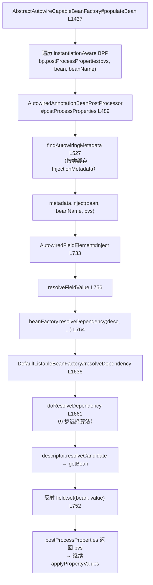
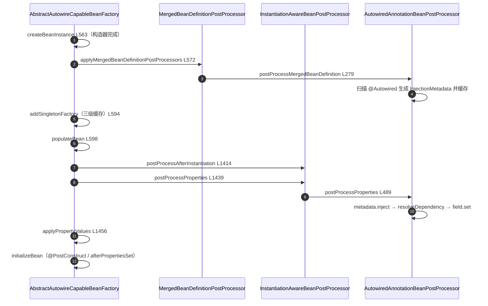
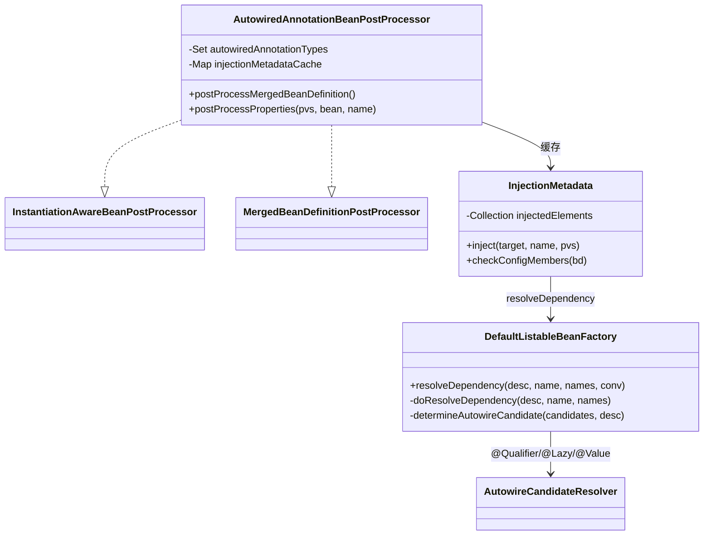
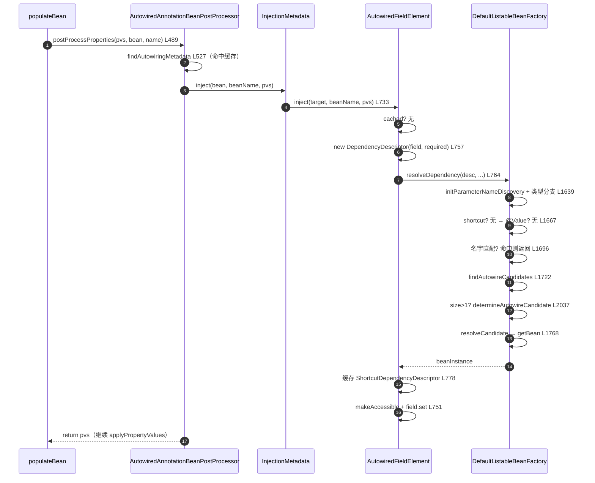
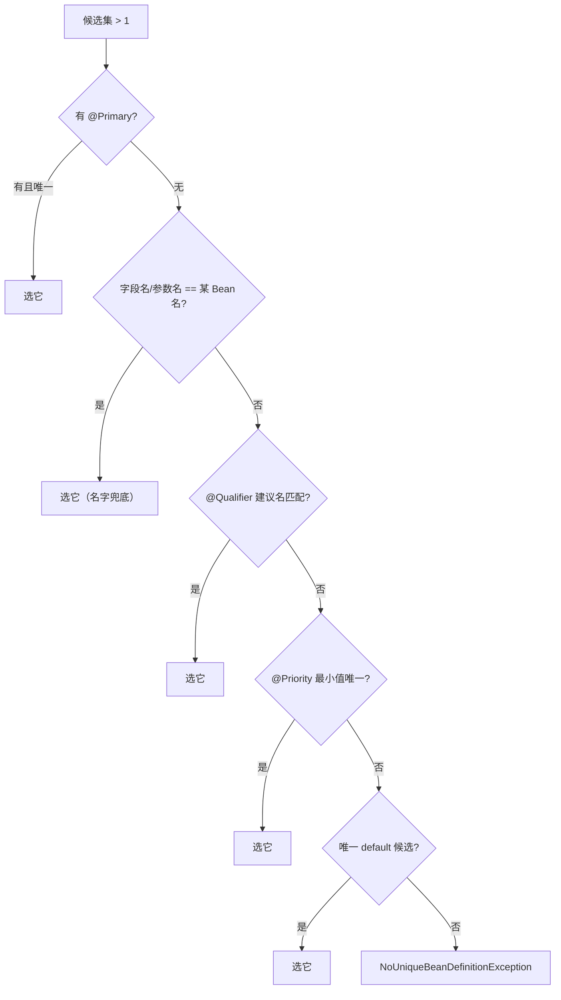

# 依赖注入：`@Autowired` 与 `BeanPostProcessor`

> **一句话结论**：`@Autowired` 不是"创建 Bean 的人"干的活，而是**`AutowiredAnnotationBeanPostProcessor`（一个 `InstantiationAwareBeanPostProcessor`）在 `populateBean` 阶段插入的一道属性填充钩子**：它先在 `postProcessMergedBeanDefinition` 里扫描类（含父类）上所有 `@Autowired` 字段/方法并缓存成 `InjectionMetadata`，然后在 `postProcessProperties` 里对每个注入点调 `beanFactory.resolveDependency(...)`，最终由 `DefaultListableBeanFactory#doResolveDependency` 按"**@Value → 唯一类型 → 集合 → 按类型找候选 → @Primary → 字段名 → @Priority → default 候选 → resolvableDependencies**"的固定顺序挑出一个 Bean 并反射写进去。
>
> **阅读前置**：[02-bean 创建全流程](02-bean-创建全流程-getbean与createbean.md) §3.7（`populateBean`）。本文就是它的"放大镜"。
> **预计阅读**：45~60 分钟。
> **源码基线**：`org.springframework:spring-beans:7.1.0`，核心文件 `AutowiredAnnotationBeanPostProcessor.java`（1089 行）、`DefaultListableBeanFactory.java`（2812 行）、`AbstractAutowireCapableBeanFactory.java`。
> **术语先讲清楚**：
> - **`BeanPostProcessor`（BPP）**：Spring 提供的"Bean 加工钩子"，容器在创建每个 Bean 的过程中会回调这些对象的方法。可以理解为"Bean 出厂前的质检工位"。
> - **`InstantiationAwareBeanPostProcessor`**：BPP 的子接口，多了"实例化前后"与"属性填充（`postProcessProperties`）"三个机会——`@Autowired` 就挂在这里。
> - **`InjectionMetadata`**：一个 Bean 上"所有需要注入的点"的集合（字段点 `AutowiredFieldElement` + 方法点 `AutowiredMethodElement`）。
> - **`DependencyDescriptor`（依赖描述符）**：把"我要一个什么类型的参数/字段"抽象成一个对象，交给 `BeanFactory#resolveDependency` 去解析。
> - **自动装配候选（autowire candidate）**：容器里"可以被注入到别处"的 Bean；`@Autowired(required=false)`、`@Bean(autowireCandidate=false)` 等会影响这个标记。

---

## 0. 先看现象

### 0.1 最普通的一段代码

```java
@Service class OrderService {
    @Autowired private PayClient payClient;
    @Autowired private List<Notifier> notifiers;
}
```

运行起来三件事同时成立：`payClient` 不为 null；`notifiers` 是**全部** `Notifier` 实现的有序集合；如果容器里有两个 `Notifier` 实现而没有任何 `@Primary`/`@Order` 之类区分，`List<Notifier>` 依然能注入成功——**但 `@Autowired Notifier notifier` 会报 `NoUniqueBeanDefinitionException`**。

### 0.2 一个更值得注意的现象：日志顺序

在 `OrderService` 的构造器里打印 `"ctor"`、`@Autowired` 的 setter 里打印 `"setter"`、`@PostConstruct` 里打印 `"postConstruct"`、`InitializingBean#afterPropertiesSet` 里打印 `"afterPropertiesSet"`，你会看到：

```text
ctor
setter
postConstruct
afterPropertiesSet
```

**结论**：`@Autowired` 的注入发生在"构造完成之后、`@PostConstruct` 之前"。这就是为什么在构造器里读 `@Autowired` 字段一定是 `null`，也是"构造器注入比字段注入更安全"的底层原因。

### 0.3 `@Autowired` 与 `@Resource` 的差别（同一段代码换个注解）

```java
@Service class OrderService {
    @Resource private PayClient payClient;   // 先按名字 payClient 找，找不到再按类型
    @Autowired private PayClient other;      // 先按类型找
}
```

如果容器里同时有 `payClient` 与 `backupPayClient` 两个 `PayClient`：
- `@Resource PayClient payClient` **能成功**（字段名 `payClient` 与 Bean 名一致）；
- `@Autowired PayClient other` **失败**（类型不唯一，且字段名 `other` 匹配不到任何 Bean 名）。

### 0.4 现象背后的三个问题

| 现象 | 提问 | 本文回答位置 |
| --- | --- | --- |
| 注入发生在构造之后 | 谁在什么时机做的？ | §3.1、§3.2、§4 |
| 有多个候选时怎么选？ | 选择顺序是什么？ | §3.6、§3.8 |
| `List<T>` 为什么不会"不唯一"？ | 谁把多个 Bean 收成集合？ | §3.7 |

---

## 1. 整体地图

### 1.1 从 `populateBean` 到真正写入字段



> **读图说明**：整条链路里只有**两个**角色：`AutowiredAnnotationBeanPostProcessor`（知道"哪些地方要注入"）与 `DefaultListableBeanFactory`（知道"容器里有哪些 Bean、选哪个"）。**前者完全不关心容器结构，后者完全不知道注解细节**——这是 Spring 把"注解驱动注入"做成可插拔的标准手法：换一套注解（比如 `jakarta.inject.Inject`）只需要换 BPP，解析逻辑复用。

### 1.2 BPP 在 Bean 生命周期里的位置（放大看）



> **读图说明**：注意**扫描（第 3-5 步）与注入（第 9-11 步）是分开的两次回调**。扫描发生在"实例化之后、放入三级缓存之前"（`doCreateBean` L572-L583 在 L594 之前），注入发生在 `populateBean` 里。分开的好处是：①`InjectionMetadata` 只需扫描一次，可以按类缓存；②`BeanDefinition` 里的 `property values` 也可以在扫描阶段被修正（`checkConfigMembers`）。

### 1.3 `DefaultListableBeanFactory#resolveDependency` 的九步选择算法（总览）

| 步骤 | 判据 | 源码 |
| --- | --- | --- |
| 0 | 特殊类型：`Optional` / `ObjectFactory` / `ObjectProvider` / `jakarta.inject.Provider` / `@Lazy` | L1639-L1656 |
| 1 | 捷径缓存 `descriptor.resolveShortcut(this)` | L1667-L1670 |
| 2 | `@Value` 表达式 | L1672-L1693 |
| 3 | 字段/参数名直配（名字存在于容器且类型匹配） | L1696-L1714 |
| 4a | 多元素（数组 / `Collection` / `Map` / `Stream`） | L1716-L1720 |
| 4b | 按类型收集候选 `findAutowireCandidates` | L1722-L1734 |
| 5 | 候选 > 1 → `determineAutowireCandidate` | L1739-L1761 |
| 6 | 解析候选为实例 `resolveCandidate` / `resolveInstance` | L1763-L1770 |

`determineAutowireCandidate`（L2037-L2081）内部又有 5 个子步骤，见 §3.8。

---

## 2. 关键类逐个拆

### 2.1 `AutowiredAnnotationBeanPostProcessor`

类声明与核心字段（`assets/source/AutowiredAnnotationBeanPostProcessor.java.md`，源码 1089 行）：

```java (src: AutowiredAnnotationBeanPostProcessor.java#L158-L182)
public class AutowiredAnnotationBeanPostProcessor implements SmartInstantiationAwareBeanPostProcessor,
		MergedBeanDefinitionPostProcessor, BeanRegistrationAotProcessor, PriorityOrdered, BeanFactoryAware {

	private static final Constructor<?>[] EMPTY_CONSTRUCTOR_ARRAY = new Constructor<?>[0];


	protected final Log logger = LogFactory.getLog(getClass());

	private final Set<Class<? extends Annotation>> autowiredAnnotationTypes = CollectionUtils.newLinkedHashSet(4);

	private String requiredParameterName = "required";

	private boolean requiredParameterValue = true;

	private int order = Ordered.LOWEST_PRECEDENCE - 2;

	private @Nullable ConfigurableListableBeanFactory beanFactory;

	private @Nullable MetadataReaderFactory metadataReaderFactory;

	private final Set<String> lookupMethodsChecked = ConcurrentHashMap.newKeySet(256);

	private final Map<Class<?>, Constructor<?>[]> candidateConstructorsCache = new ConcurrentHashMap<>(256);

	private final Map<String, InjectionMetadata> injectionMetadataCache = new ConcurrentHashMap<>(256);
```


- **它实现的四个接口各管一段**：
  - `SmartInstantiationAwareBeanPostProcessor`：决定"用哪个构造器"（`determineCandidateConstructors`）以及"早期引用"（继承默认实现）；
  - `MergedBeanDefinitionPostProcessor`：在 `populateBean` **之前**扫描注入点（`postProcessMergedBeanDefinition`）；
  - `PriorityOrdered`：`order = Ordered.LOWEST_PRECEDENCE - 2`（L172）——**必须在 `CommonAnnotationBeanPostProcessor`（`...-3`）与 `PersistenceAnnotationBeanPostProcessor`（`...-1`）之间**，这个顺序保证 `@Resource`（CommonAnnotation 的）在 `@Autowired` **之前**解析，因此 `@Autowired` 会"看到"`@Resource` 已经填过的属性；
  - `BeanFactoryAware`：拿到 `ConfigurableListableBeanFactory` 才能调 `resolveDependency`。
- **`autowiredAnnotationTypes`（L166）**：一个 `Set<Class<? extends Annotation>>`，默认 {@Autowired, @Value}，构造器里再**反射尝试**加入 `jakarta.inject.Inject`（若 classpath 上存在）。这解释了"为什么 `@Inject` 和 `@Autowired` 行为完全一致"。

```java (src: AutowiredAnnotationBeanPostProcessor.java#L191-L205)
	@SuppressWarnings("unchecked")
	public AutowiredAnnotationBeanPostProcessor() {
		this.autowiredAnnotationTypes.add(Autowired.class);
		this.autowiredAnnotationTypes.add(Value.class);

		ClassLoader classLoader = AutowiredAnnotationBeanPostProcessor.class.getClassLoader();
		try {
			this.autowiredAnnotationTypes.add((Class<? extends Annotation>)
					ClassUtils.forName("jakarta.inject.Inject", classLoader));
			logger.trace("'jakarta.inject.Inject' annotation found and supported for autowiring");
		}
		catch (ClassNotFoundException ex) {
			// jakarta.inject API not available - simply skip.
		}
	}
```


- **在干什么**：构造器里注册注解类型。`@Value` 也在这张表里——所以 `@Value("${x}")` 走的是同一条注入链路（在 `doResolveDependency` 的 Step2 被拦下）。
- **为什么用反射 `Class.forName` 找 `jakarta.inject.Inject`**：`spring-beans` 模块**不强制依赖** `jakarta.inject`，只能运行时探测；找不到就 `ClassNotFoundException` 忽略。
- **如果改成**：直接 `import jakarta.inject.Inject`，则 `spring-beans` 会有硬依赖，不符合模块化设计。

### 2.2 `InjectionMetadata` 与两种 Element

- `InjectionMetadata`（`org.springframework.beans.factory.annotation`）：持有 `targetClass` + `Collection<InjectedElement>`，`inject(target, beanName, pvs)` 依次调用每个元素的 `inject`。
- `AutowiredFieldElement`（L722-L792）：管字段注入。
- `AutowiredMethodElement`（L798-…）：管方法注入（setter / 普通方法 / 多参数方法），多参数方法每个参数都是独立的 `DependencyDescriptor`。
- **为什么字段与方法要分两个类**：方法的注入参数可能为 0 个（被忽略并打日志）、可能有多个，且需要"短路"（任一参数解析失败则不调用方法，避免半初始化状态）。

### 2.3 `DefaultListableBeanFactory`：依赖解析的真正大脑

- 它是 `BeanFactory` 的标准实现，持有全部 `BeanDefinition` 与单例缓存（通过继承 `DefaultSingletonBeanRegistry`）。
- `resolveDependency`（L1636-L1658）做"类型/特殊包装"处理，`doResolveDependency`（L1661-L1775）做"找哪个 Bean"。
- **`getAutowireCandidateResolver()`**：可插拔的候选判定器（默认 `ContextAnnotationAutowireCandidateResolver`），负责 `@Qualifier`、`@Lazy`、`@Value` 建议值、泛型匹配等。**这是"注解语义"与"容器算法"之间的桥**。

### 2.4 `DependencyDescriptor`：一次依赖请求的完整描述

- 保存：`MethodParameter`（字段或方法参数）、`required` 标志、`fieldName`、`containingClass`、`Eager` 标志、泛型声明类型（`ResolvableType`）。
- 关键子类：
  - `AutowireByTypeDependencyDescriptor`（`AbstractAutowireCapableBeanFactory` L1523）：`XML` 的 `byType` 装配用；
  - `MultiElementDescriptor`：解析数组/集合中的**单个元素**时用（`eager = false`）；
  - `ShortcutDependencyDescriptor`（`AutowiredAnnotationBeanPostProcessor` L778）：缓存"唯一候选"的捷径。

### 2.5 一张图看清协作关系



> **读图说明**：注入链路的**三个解耦点**：①BPP 只认注解、不认容器结构；②`InjectionMetadata` 把"扫一次算一次"变成"扫一次用一生"；③`AutowireCandidateResolver` 把 `@Qualifier` 这类语义从容器算法里剥离出去（`QualifierAnnotationAutowireCandidateResolver` 负责判断"这个 Bean 的名字/注解是否匹配限定符"）。

### 2.6 `BeanPostProcessor` 的注册与排序（为什么顺序很重要）

`PostProcessorRegistrationDelegate#registerBeanPostProcessors` 会把 BPP 按 `PriorityOrdered` → `Ordered` → 其余 三批注册。`@Autowired` 的处理排在很后面（`LOWEST_PRECEDENCE - 2`），意味着：

- **`ConfigurationPropertiesBindingPostProcessor`（`Ordered.HIGHEST_PRECEDENCE + 1`）先跑**：它会把 `@ConfigurationProperties` 对象**提前**创建成单例，这也是为什么 `@ConfigurationProperties` 类里的 `@Autowired` 可能表现异常（它在 `@Autowired` 处理器就位前就被创建了）。
- 自定义 BPP 若想在 `@Autowired` 之后运行，`getOrder()` 返回比 `LOWEST_PRECEDENCE - 2` 更大的值（例如 `LOWEST_PRECEDENCE - 1` 会排在它后面）。

---

## 3. 源码逐段精读

### 3.1 阶段一：`postProcessMergedBeanDefinition` 扫描注入点

```java (src: AutowiredAnnotationBeanPostProcessor.java#L527-L545)
	private InjectionMetadata findAutowiringMetadata(String beanName, Class<?> clazz, @Nullable PropertyValues pvs) {
		// Fall back to class name as cache key, for backwards compatibility with custom callers.
		String cacheKey = (StringUtils.hasLength(beanName) ? beanName : clazz.getName());
		// Quick check on the concurrent map first, with minimal locking.
		InjectionMetadata metadata = this.injectionMetadataCache.get(cacheKey);
		if (InjectionMetadata.needsRefresh(metadata, clazz)) {
			synchronized (this.injectionMetadataCache) {
				metadata = this.injectionMetadataCache.get(cacheKey);
				if (InjectionMetadata.needsRefresh(metadata, clazz)) {
					if (metadata != null) {
						metadata.clear(pvs);
					}
					metadata = buildAutowiringMetadata(clazz);
					this.injectionMetadataCache.put(cacheKey, metadata);
				}
			}
		}
		return metadata;
	}
```


- **在干什么**：先取缓存（缓存 key 是 `beanName`，取不到就用 `clazz.getName()`——因为 prototype 每次都新建，用类名做缓存 key 更有效）；若缓存存在但 `needsRefresh`（类变了或属性变化），加锁后清空并重建。
- **为什么用 `synchronized (metadata)` 而不是整方法加锁**：只有在 `needsRefresh` 的罕见路径上才需要同步，正常路径无锁命中缓存。这是典型的双重检查锁（DCL）。
- **`metadata.clear(pvs)`**：清掉字段元素里缓存的"已解析参数值"（`cached`），因为 `pvs`（`PropertyValues`）变了，之前缓存的注入值可能失效。
- **常见坑**：`injectionMetadataCache` 是**按 beanName 或类名**缓存的弱引用表（`ConcurrentReferenceHashMap`）。如果同一个类名被不同 `ClassLoader` 加载（热部署），缓存可能命中错误的元数据——Spring 用 `needsRefresh` + `targetClass` 对比来缓解。

```java (src: AutowiredAnnotationBeanPostProcessor.java#L547-L607)
	private InjectionMetadata buildAutowiringMetadata(Class<?> clazz) {
		if (!AnnotationUtils.isCandidateClass(clazz, this.autowiredAnnotationTypes)) {
			return InjectionMetadata.EMPTY;
		}

		final List<InjectionMetadata.InjectedElement> elements = new ArrayList<>();
		Class<?> targetClass = ClassUtils.getUserClass(clazz);

		do {
			final List<InjectionMetadata.InjectedElement> fieldElements = new ArrayList<>();
			ReflectionUtils.doWithLocalFields(targetClass, field -> {
				MergedAnnotation<?> ann = findAutowiredAnnotation(field);
				if (ann != null) {
					if (Modifier.isStatic(field.getModifiers())) {
						if (logger.isInfoEnabled()) {
							logger.info("Autowired annotation is not supported on static fields: " + field);
						}
						return;
					}
					boolean required = determineRequiredStatus(ann);
					fieldElements.add(new AutowiredFieldElement(field, required));
				}
			});

			final List<InjectionMetadata.InjectedElement> methodElements = new ArrayList<>();
			ReflectionUtils.doWithLocalMethods(targetClass, method -> {
				if (method.isBridge()) {
					return;
				}
				MergedAnnotation<?> ann = findAutowiredAnnotation(method);
				if (ann != null && method.equals(BridgeMethodResolver.getMostSpecificMethod(method, clazz))) {
					if (Modifier.isStatic(method.getModifiers())) {
						if (logger.isInfoEnabled()) {
							logger.info("Autowired annotation is not supported on static methods: " + method);
						}
						return;
					}
					if (method.getParameterCount() == 0) {
						if (method.getDeclaringClass().isRecord()) {
							// Annotations on the compact constructor arguments made available on accessors, ignoring.
							return;
						}
						if (logger.isInfoEnabled()) {
							logger.info("Autowired annotation should only be used on methods with parameters: " +
									method);
						}
					}
					boolean required = determineRequiredStatus(ann);
					PropertyDescriptor pd = BeanUtils.findPropertyForMethod(method, clazz);
					methodElements.add(new AutowiredMethodElement(method, required, pd));
				}
			});

			elements.addAll(0, sortMethodElements(methodElements, targetClass));
			elements.addAll(0, fieldElements);
			targetClass = targetClass.getSuperclass();
		}
		while (targetClass != null && targetClass != Object.class);

		return InjectionMetadata.forElements(elements, clazz);
	}
```


- **在干什么**：从 `clazz` 往上**逐级遍历父类**（`ClassUtils.getUserClass` 先剥离 CGLIB 代理层），对每个类：
  - 字段：拿到 `@Autowired` 注解 → `new AutowiredFieldElement(field, required)`；
  - 方法：跳过 bridge 方法、解析最具体方法（`BridgeMethodResolver`）、跳过 static 方法（打 info 日志）、跳过零参数方法（打 info 日志，record 的 accessor 例外）；
  - 最后 `elements.addAll(0, ...)` 两次把"父类的元素"插到最前面，保证**父类字段先注入**。
- **为什么父类先注入**：子类方法可能覆盖父类方法，父类的字段可能被子类依赖，先填父类更符合"先有基类状态再有派生状态"的直觉。
- **为什么跳过 static**：`@Autowired` 注的是**实例**的依赖，static 字段/方法属于类，容器无法知道要注入到哪个实例上。所以打了 info 日志后跳过（不是报错）。
- **常见坑**：`private static` 字段被标了 `@Autowired` 时，**启动不报错、值恒为 null**。这是最常见的"注入失败但不报错"来源之一。

### 3.2 阶段二：`postProcessProperties` 执行注入

```java (src: AutowiredAnnotationBeanPostProcessor.java#L489-L502)
	@Override
	public PropertyValues postProcessProperties(PropertyValues pvs, Object bean, String beanName) {
		InjectionMetadata metadata = findAutowiringMetadata(beanName, bean.getClass(), pvs);
		try {
			metadata.inject(bean, beanName, pvs);
		}
		catch (BeanCreationException ex) {
			throw ex;
		}
		catch (Throwable ex) {
			throw new BeanCreationException(beanName, "Injection of autowired dependencies failed", ex);
		}
		return pvs;
	}
```


- **在干什么**：取元数据 → `metadata.inject(bean, beanName, pvs)` → **原样返回 `pvs`**。
- **为什么返回 `pvs` 而不是 `null`**：`AbstractAutowireCapableBeanFactory#populateBean` L1441-L1447 规定"若某个 BPP 返回 `null`，则**提前结束**属性填充"。`@Autowired` 处理器返回原 `pvs`，表示"我处理完了，但 `PropertyValues` 里的 XML/property 值还要继续应用"。
- **异常包装**：`BeanCreationException` 原样抛（保留细节），其它 `Throwable` 包成 `Injection of autowired dependencies failed`。
- **常见坑**：自己写 BPP 时若在 `postProcessProperties` 里 `return null`，会**静默跳过后面的 BPP 与 `applyPropertyValues`**——`@Value` 与 XML `<property>` 可能都不生效。

### 3.3 字段注入：`AutowiredFieldElement#inject`

```java (src: AutowiredAnnotationBeanPostProcessor.java#L733-L754)
		protected void inject(Object bean, @Nullable String beanName, @Nullable PropertyValues pvs) throws Throwable {
			Field field = (Field) this.member;
			Object value;
			if (this.cached) {
				try {
					value = resolveCachedArgument(beanName, this.cachedFieldValue);
				}
				catch (BeansException ex) {
					// Unexpected target bean mismatch for cached argument -> re-resolve
					this.cached = false;
					logger.debug("Failed to resolve cached argument", ex);
					value = resolveFieldValue(field, bean, beanName);
				}
			}
			else {
				value = resolveFieldValue(field, bean, beanName);
			}
			if (value != null) {
				ReflectionUtils.makeAccessible(field);
				field.set(bean, value);
			}
		}
```


- **在干什么**：先看是否缓存了值（L736-L740）；没缓存就 `resolveFieldValue` 解析；解析到非 null 才 `makeAccessible` + `field.set`。
- **为什么 null 就不 set**：`@Autowired(required=false)` 找不到依赖时返回 null，此时**保留字段的初始值**（可能是构造器或字段初始化给的默认值），而不是粗暴写 null。
- **为什么要 `ReflectionUtils.makeAccessible(field)`**：`private` 字段默认不可写，需要 `setAccessible(true)`。Spring 7.x 在 `ReflectionUtils` 里对 JDK 17+ 的模块系统做了兼容处理。
- **常见坑**：`final` 字段 + `@Autowired` 在 JDK 17 下**不保证生效**（`Field#set` 对 final 字段的行为依赖 JVM 实现与是否可访问）。所以"`final` 字段只能构造器注入"这条规则不是洁癖，是硬约束。

```java (src: AutowiredAnnotationBeanPostProcessor.java#L756-L791)
		private @Nullable Object resolveFieldValue(Field field, Object bean, @Nullable String beanName) {
			DependencyDescriptor desc = new DependencyDescriptor(field, this.required);
			desc.setContainingClass(bean.getClass());
			Set<String> autowiredBeanNames = new LinkedHashSet<>(2);
			Assert.state(beanFactory != null, "No BeanFactory available");
			TypeConverter typeConverter = beanFactory.getTypeConverter();
			Object value;
			try {
				value = beanFactory.resolveDependency(desc, beanName, autowiredBeanNames, typeConverter);
			}
			catch (BeansException ex) {
				throw new UnsatisfiedDependencyException(null, beanName, new InjectionPoint(field), ex);
			}
			synchronized (this) {
				if (!this.cached) {
					if (value != null || this.required) {
						Object cachedFieldValue = desc;
						registerDependentBeans(beanName, autowiredBeanNames);
						if (value != null && autowiredBeanNames.size() == 1) {
							String autowiredBeanName = autowiredBeanNames.iterator().next();
							if (beanFactory.containsBean(autowiredBeanName) &&
									beanFactory.isTypeMatch(autowiredBeanName, field.getType())) {
								cachedFieldValue = new ShortcutDependencyDescriptor(desc, autowiredBeanName);
							}
						}
						this.cachedFieldValue = cachedFieldValue;
						this.cached = true;
					}
					else {
						this.cachedFieldValue = null;
						// cached flag remains false
					}
				}
			}
			return value;
		}
```


- **在干什么**：
  1. 建 `DependencyDescriptor(field, required)` 并 `setContainingClass`（用于泛型解析与错误信息）；
  2. 调 `beanFactory.resolveDependency(desc, beanName, autowiredBeanNames, typeConverter)`——注意传了 `Set<String> autowiredBeanNames`，用于**记录本次解析用到了哪些 Bean**，供失败时给依赖图；
  3. 失败时包成 `UnsatisfiedDependencyException`，并附带 `InjectionPoint(field)`——这就是异常信息里能看到"哪个字段注入失败"的原因。
- **为什么成功后要建 `ShortcutDependencyDescriptor`（L778）**：如果本次只解析出一个候选 Bean（`autowiredBeanNames.size() == 1`），那么**下次（prototype 再创建、或元数据刷新后）**可以直接走 Step1 捷径拿到同一个 Bean，跳过整个 9 步算法。注意还额外校验了 `isTypeMatch`，防止类型变化后错误复用。
- **常见坑**：`cached` 一旦为 true 且候选 Bean 后来被销毁/重新定义，`resolveCachedArgument` 会抛异常并**回退**到重新解析（L736-L740 的注释 `Failed to resolve cached argument`），所以缓存是安全的——但会在 debug 日志里留下痕迹。

### 3.4 方法注入：`AutowiredMethodElement#inject`

```java (src: AutowiredAnnotationBeanPostProcessor.java#L809-L838)
		protected void inject(Object bean, @Nullable String beanName, @Nullable PropertyValues pvs) throws Throwable {
			if (!shouldInject(pvs)) {
				return;
			}
			Method method = (Method) this.member;
			@Nullable Object[] arguments;
			if (this.cached) {
				try {
					arguments = resolveCachedArguments(beanName, this.cachedMethodArguments);
				}
				catch (BeansException ex) {
					// Unexpected target bean mismatch for cached argument -> re-resolve
					this.cached = false;
					logger.debug("Failed to resolve cached argument", ex);
					arguments = resolveMethodArguments(method, bean, beanName);
				}
			}
			else {
				arguments = resolveMethodArguments(method, bean, beanName);
			}
			if (arguments != null) {
				try {
					ReflectionUtils.makeAccessible(method);
					method.invoke(bean, arguments);
				}
				catch (InvocationTargetException ex) {
					throw ex.getTargetException();
				}
			}
		}
```


- **在干什么**：先 `shouldInject(pvs)` 判断"值是否由外部 `PropertyValues` 指定"（如果 XML 里已显式给了属性值，则跳过方法注入）；再 `resolveMethodArguments` 逐个解析参数；任一参数解析失败（返回 null 且非 optional）就不调用方法；全部成功才 `method.invoke(bean, arguments)`。
- **为什么任何参数失败就不调用**：方法调用是有副作用的。若传一半参数（部分 null），方法体可能抛出更隐蔽的错误或写入错误状态。
- **常见坑**：`@Autowired` 标在**零参数方法**上会被跳过并打 info 日志 `Autowired annotation should only be used on methods with parameters`——不报错，容易误以为生效了。record 的紧凑构造器是例外（Spring 6.x 起支持）。

### 3.5 `DefaultListableBeanFactory#resolveDependency`：先处理"特殊类型"

```java (src: DefaultListableBeanFactory.java#L1636-L1658)
	public @Nullable Object resolveDependency(DependencyDescriptor descriptor, @Nullable String requestingBeanName,
			@Nullable Set<String> autowiredBeanNames, @Nullable TypeConverter typeConverter) throws BeansException {

		descriptor.initParameterNameDiscovery(getParameterNameDiscoverer());
		if (Optional.class == descriptor.getDependencyType()) {
			return createOptionalDependency(descriptor, requestingBeanName, autowiredBeanNames, null);
		}
		else if (ObjectFactory.class == descriptor.getDependencyType() ||
				ObjectProvider.class == descriptor.getDependencyType()) {
			return new DependencyObjectProvider(descriptor, requestingBeanName);
		}
		else if (jakartaInjectProviderClass == descriptor.getDependencyType()) {
			return new Jsr330Factory().createDependencyProvider(descriptor, requestingBeanName);
		}
		else if (descriptor.supportsLazyResolution()) {
			Object result = getAutowireCandidateResolver().getLazyResolutionProxyIfNecessary(
					descriptor, requestingBeanName);
			if (result != null) {
				return result;
			}
		}
		return doResolveDependency(descriptor, requestingBeanName, autowiredBeanNames, typeConverter);
	}
```


- **在干什么**（按顺序）：
  1. `initParameterNameDiscovery`：让 `descriptor` 能拿到**参数名**（`@Autowired` 的字段名兜底依赖它，L1699 的 `getDependencyName` 就是从这来的）；
  2. `Optional` → `createOptionalDependency`（包装成"找不到也不报错"）；
  3. `ObjectFactory` / `ObjectProvider` → `DependencyObjectProvider`（**延迟解析**，每次 `getObject()` 才去容器拿）；
  4. `jakarta.inject.Provider` → `Jsr330Factory`（同理）；
  5. `@Lazy`（`descriptor.supportsLazyResolution()`）→ `getLazyResolutionProxyIfNecessary`；
  6. 都不是 → `doResolveDependency`。
- **为什么 `Optional` 要单独处理**：`Optional<T>` 的语义是"可以没有"，需要把 `required` 改成 false（见 `createOptionalDependency` L2339-L2359 的匿名子类重写 `isRequired()` 返回 false）。
- **常见坑**：`ObjectProvider` 与 `@Lazy` 都能"延迟"，但**语义不同**：`ObjectProvider` 每次 `getObject()` 都可能拿到不同实例（prototype）或新的解析结果；`@Lazy` 生成的是一个**固定代理**，内部每次调用都 `getBean`（也是每次解析，但形态是代理对象）。

### 3.6 `doResolveDependency` 的 Step1~Step3

```java (src: DefaultListableBeanFactory.java#L1695-L1714)
			// Step 3: shortcut for declared dependency name or qualifier-suggested name matching target bean name
			if (descriptor.usesStandardBeanLookup()) {
				String dependencyName = descriptor.getDependencyName();
				if (dependencyName == null || !containsBean(dependencyName)) {
					String suggestedName = getAutowireCandidateResolver().getSuggestedName(descriptor);
					dependencyName = (suggestedName != null && containsBean(suggestedName) ? suggestedName : null);
				}
				if (dependencyName != null) {
					dependencyName = canonicalName(dependencyName);  // dependency name can be alias of target name
					if (isTypeMatch(dependencyName, type) && isAutowireCandidate(dependencyName, descriptor) &&
							!isFallback(dependencyName) && !hasPrimaryConflict(dependencyName, type) &&
							!isSelfReference(beanName, dependencyName)) {
						if (autowiredBeanNames != null) {
							autowiredBeanNames.add(dependencyName);
						}
						Object dependencyBean = resolveBean(dependencyName, descriptor.getResolvableType());
						return resolveInstance(dependencyBean, descriptor, type, dependencyName);
					}
				}
			}
```


- **在干什么**：
  - Step1（L1667-L1670）：`descriptor.resolveShortcut(this)`——如果 `descriptor` 是 `ShortcutDependencyDescriptor`（§3.3 缓存的那个），直接返回缓存的 Bean。
  - Step2（L1672-L1693）：`getSuggestedValue(descriptor)` 拿到 `@Value` 的字符串，做占位符解析（`resolveEmbeddedValue`）+ SpEL 求值（`evaluateBeanDefinitionString`）+ 类型转换（`convertIfNecessary`）。若 `@Value` 写在字段上而转换失败，会退回到 `MethodParameter` 上的注解再试一次。
  - Step3（L1696-L1714）：**名字直配**——如果字段名/参数名恰好是容器里某个 Bean 的名字，且类型匹配、是 autowire candidate、不是 fallback、无 `@Primary` 冲突、不是自引用，就直接用这个 Bean。
- **为什么 Step3 要检查 `hasPrimaryConflict`**：如果容器里有另一个标了 `@Primary` 的同类型 Bean，那么"按名字命中"就不该赢——否则字段名会悄悄劫持 `@Primary` 的意图。这个细节非常容易被忽略，是排查"为什么注入的不是我以为的那个"的关键。
- **为什么 Step3 要检查 `isSelfReference`**：避免 `@Autowired MySelf self` 这种自引用绕开正常的候选逻辑。

### 3.7 Step4~Step6：多元素、候选收集与最终解析

```java (src: DefaultListableBeanFactory.java#L1716-L1770)
			// Step 4a: multiple beans as stream / array / standard collection / plain map
			Object multipleBeans = resolveMultipleBeans(descriptor, beanName, autowiredBeanNames, typeConverter);
			if (multipleBeans != null) {
				return multipleBeans;
			}
			// Step 4b: direct bean matches, possibly direct beans of type Collection / Map
			Map<String, Object> matchingBeans = findAutowireCandidates(beanName, type, descriptor);
			if (matchingBeans.isEmpty()) {
				// Step 4c (fallback): custom Collection / Map declarations for collecting multiple beans
				multipleBeans = resolveMultipleBeansFallback(descriptor, beanName, autowiredBeanNames, typeConverter);
				if (multipleBeans != null) {
					return multipleBeans;
				}
				// Raise exception if nothing found for required injection point
				if (isRequired(descriptor)) {
					raiseNoMatchingBeanFound(type, descriptor.getResolvableType(), descriptor);
				}
				return null;
			}

			String autowiredBeanName;
			Object instanceCandidate;

			// Step 5: determine single candidate
			if (matchingBeans.size() > 1) {
				autowiredBeanName = determineAutowireCandidate(matchingBeans, descriptor);
				if (autowiredBeanName == null) {
					if (isRequired(descriptor) || !indicatesArrayCollectionOrMap(type)) {
						// Raise exception if no clear match found for required injection point
						return descriptor.resolveNotUnique(descriptor.getResolvableType(), matchingBeans);
					}
					else {
						// In case of an optional Collection/Map, silently ignore a non-unique case:
						// possibly it was meant to be an empty collection of multiple regular beans
						// (before 4.3 in particular when we didn't even look for collection beans).
						return null;
					}
				}
				instanceCandidate = matchingBeans.get(autowiredBeanName);
			}
			else {
				// We have exactly one match.
				Map.Entry<String, Object> entry = matchingBeans.entrySet().iterator().next();
				autowiredBeanName = entry.getKey();
				instanceCandidate = entry.getValue();
			}

			// Step 6: validate single result
			if (autowiredBeanNames != null) {
				autowiredBeanNames.add(autowiredBeanName);
			}
			if (instanceCandidate instanceof Class) {
				instanceCandidate = descriptor.resolveCandidate(autowiredBeanName, type, this);
			}
			return resolveInstance(instanceCandidate, descriptor, type, autowiredBeanName);
```


- **在干什么**：
  - Step4a（L1716-L1720）：`resolveMultipleBeans` 处理 `Stream` / 数组 / `Collection` / `Map`，把多个候选积成多元素（内部用 `MultiElementDescriptor` 逐个解析）；
  - Step4b（L1722-L1734）：`findAutowireCandidates` 按类型收集候选；空则尝试 fallback，仍是空且 `required` → `raiseNoMatchingBeanFound`；
  - Step5（L1739-L1761）：候选多于 1 → `determineAutowireCandidate`；返回 null 时，若是 `required` 或不是数组/集合/Map，则 `descriptor.resolveNotUnique(...)` 抛 `NoUniqueBeanDefinitionException`；
  - Step6（L1763-L1770）：候选值若还是 `Class`（延迟未实例化），`descriptor.resolveCandidate(...)` 触发 `getBean`，最后 `resolveInstance` 做类型校验。
- **为什么 `findAutowireCandidates` 不直接实例化所有候选**：见 `addCandidateEntry`（L2010-L2027）——只有当候选是"多元素"或单例时才提前实例化，否则只放 `Class`。这是为了避免"为了判断类型而提前初始化一堆 Bean"（会破坏懒加载、放大启动时间）。
- **常见坑**：`findAutowireCandidates` 里的 `beanNamesForTypeIncludingAncestors(this, requiredType, true, descriptor.isEager())`（L1961-L1962）最后一个参数是 `eager`。`@Autowired` 默认 eager=true（会触发 `FactoryBean#getObject` 来判定类型），这可能**提前初始化 FactoryBean**。想避免就用 `ObjectProvider` 或 `@Lazy`。

### 3.8 Step5 内部：`determineAutowireCandidate` 的五级判定

```java (src: DefaultListableBeanFactory.java#L2037-L2081)
	protected @Nullable String determineAutowireCandidate(Map<String, Object> candidates, DependencyDescriptor descriptor) {
		Class<?> requiredType = descriptor.getDependencyType();
		// Step 1: check primary candidate
		String primaryCandidate = determinePrimaryCandidate(candidates, requiredType);
		if (primaryCandidate != null) {
			return primaryCandidate;
		}
		// Step 2a: match bean name against declared dependency name
		String dependencyName = descriptor.getDependencyName();
		if (dependencyName != null) {
			for (String beanName : candidates.keySet()) {
				if (matchesBeanName(beanName, dependencyName)) {
					return beanName;
				}
			}
		}
		// Step 2b: match bean name against qualifier-suggested name
		String suggestedName = getAutowireCandidateResolver().getSuggestedName(descriptor);
		if (suggestedName != null) {
			for (String beanName : candidates.keySet()) {
				if (matchesBeanName(beanName, suggestedName)) {
					return beanName;
				}
			}
		}
		// Step 3: check highest priority candidate
		String priorityCandidate = determineHighestPriorityCandidate(candidates, requiredType);
		if (priorityCandidate != null) {
			return priorityCandidate;
		}
		// Step 4: pick unique default-candidate
		String defaultCandidate = determineDefaultCandidate(candidates);
		if (defaultCandidate != null) {
			return defaultCandidate;
		}
		// Step 5: pick directly registered dependency
		for (Map.Entry<String, Object> entry : candidates.entrySet()) {
			String candidateName = entry.getKey();
			Object beanInstance = entry.getValue();
			if (beanInstance != null && this.resolvableDependencies.containsValue(beanInstance)) {
				return candidateName;
			}
		}
		return null;
	}
```


- **在干什么**（严格按顺序，前一级命中就返回）：
  1. **`determinePrimaryCandidate`**（L2040）——有 `@Primary` 的候选胜出（多个 `@Primary` 且同为本地的会抛 `NoUniqueBeanDefinitionException`，见 L2091-L2126）；
  2. **字段名/参数名兜底**（L2045-L2052）——`descriptor.getDependencyName()` 与某个 Bean 的名字（或别名）相等（`matchesBeanName` L2257-L2260）就选它；
  3. **`getSuggestedName(descriptor)`**（L2054-L2061）——`@Qualifier` 给出的名字（`QualifierAnnotationAutowireCandidateResolver` 负责）；
  4. **`determineHighestPriorityCandidate`**（L2062-L2066）——`@Priority` 值最小的候选胜出；
  5. **`determineDefaultCandidate`**（L2067-L2071）——`@Bean(defaultCandidate=true)` / `@Fallback` 语义；
  6. **`resolvableDependencies`**（L2072-L2080）——手工注册的可解析依赖（如 `BeanFactory`、`ApplicationContext`、`ResourceLoader` 自身）。
- **⚠️ 最容易记错的顺序**：**`@Priority` 排在"字段名兜底"之后**！很多人以为"@Priority 优先级最高"，实际上 `@Primary` > 名字匹配 > `@Qualifier` 名字 > `@Priority`。所以"给两个候选都加了 `@Priority`，但字段名恰好等于其中一个 Bean 名"时，赢的是字段名那个。
- **为什么 `@Qualifier` 在这里是"名字匹配"而不是"过滤"**：过滤（筛选候选集）真正发生在 `findAutowireCandidates` → `isAutowireCandidate(candidate, descriptor)` 里，由 `QualifierAnnotationAutowireCandidateResolver#checkQualifier` 完成。这里的 Step3 是**第二道保险**：当候选集合已被 `@Qualifier` 过滤后仍多于 1 个时（例如同一个 Bean 名有多个别名），用建议名再筛一次。

### 3.9 `@Primary` 与 `@Priority` 的实现细节

```java (src: DefaultListableBeanFactory.java#L2091-L2126)
	protected @Nullable String determinePrimaryCandidate(Map<String, Object> candidates, Class<?> requiredType) {
		String primaryBeanName = null;
		// First pass: identify unique primary candidate
		for (Map.Entry<String, Object> entry : candidates.entrySet()) {
			String candidateBeanName = entry.getKey();
			Object beanInstance = entry.getValue();
			if (isPrimary(candidateBeanName, beanInstance)) {
				if (primaryBeanName != null) {
					boolean candidateLocal = containsBeanDefinition(candidateBeanName);
					boolean primaryLocal = containsBeanDefinition(primaryBeanName);
					if (candidateLocal == primaryLocal) {
						String message = "more than one 'primary' bean found among candidates: " + candidates.keySet();
						logger.trace(message);
						throw new NoUniqueBeanDefinitionException(requiredType, candidates.size(), message);
					}
					else if (candidateLocal) {
						primaryBeanName = candidateBeanName;
					}
				}
				else {
					primaryBeanName = candidateBeanName;
				}
			}
		}
		// Second pass: identify unique non-fallback candidate
		if (primaryBeanName == null) {
			for (String candidateBeanName : candidates.keySet()) {
				if (!isFallback(candidateBeanName)) {
					if (primaryBeanName != null) {
						return null;
					}
					primaryBeanName = candidateBeanName;
				}
			}
		}
		return primaryBeanName;
```


- **在干什么**：`@Primary` 分两遍扫描——第一遍找所有 `isPrimary` 的候选，若唯一则返回；若有多个，**本地定义优先**（`candidateLocal == primaryLocal`），否则抛 `more than one 'primary' bean found among candidates`。第二遍找"唯一的非 fallback 候选"（`isFallback` 为 false 的那个）。
- **为什么第二遍要找"非 fallback"**：`@Fallback`（Spring 6.2 引入）表示"实在没有别的才用我"。所以集合里一主多备时，主必然是"非 fallback"的那个。
- **`@Fallback` 与 `@Primary` 的区别**：`@Primary` 是"优先"，`@Fallback` 是"垫底"；两者都不解决"两个都是主"的冲突。

```java (src: DefaultListableBeanFactory.java#L2143-L2178)
	protected @Nullable String determineHighestPriorityCandidate(Map<String, Object> candidates, Class<?> requiredType) {
		String highestPriorityBeanName = null;
		Integer highestPriority = null;
		boolean highestPriorityConflictDetected = false;
		for (Map.Entry<String, Object> entry : candidates.entrySet()) {
			String candidateBeanName = entry.getKey();
			Object beanInstance = entry.getValue();
			if (beanInstance != null) {
				Integer candidatePriority = getPriority(beanInstance);
				if (candidatePriority != null) {
					if (highestPriority != null) {
						if (candidatePriority.equals(highestPriority)) {
							highestPriorityConflictDetected = true;
						}
						else if (candidatePriority < highestPriority) {
							highestPriorityBeanName = candidateBeanName;
							highestPriority = candidatePriority;
							highestPriorityConflictDetected = false;
						}
					}
					else {
						highestPriorityBeanName = candidateBeanName;
						highestPriority = candidatePriority;
					}
				}
			}
		}

		if (highestPriorityConflictDetected) {
			throw new NoUniqueBeanDefinitionException(requiredType, candidates.size(),
					"Multiple beans found with the same highest priority (" + highestPriority +
					") among candidates: " + candidates.keySet());

		}
		return highestPriorityBeanName;
	}
```


- **在干什么**：取每个候选的 `@Priority` 值（`getPriority` 用 `Ordered` 接口或 `@Priority` 注解，取**最小值**）；只有一个最小值时返回它；多个并列最小值 → `NoUniqueBeanDefinitionException`，message 是 `Multiple beans found with the same highest priority (...)`。
- **为什么用"最小"而不是"最大"**：`@Order`/`@Priority` 的约定是**数字越小优先级越高**（`Ordered.HIGHEST_PRECEDENCE = Integer.MIN_VALUE`）。
- **常见坑**：`@Priority` 只影响**注入时的候选选择**，并且**只在"没有 @Primary、名字也对不上"时生效**。很多"我加了 @Priority 为什么不生效"的排查最终都归到"字段名刚好撞上了另一个 Bean 名"。

### 3.10 `findAutowireCandidates`：候选从哪来

```java (src: DefaultListableBeanFactory.java#L1958-L2004)
	protected Map<String, Object> findAutowireCandidates(
			@Nullable String beanName, Class<?> requiredType, DependencyDescriptor descriptor) {

		String[] candidateNames = BeanFactoryUtils.beanNamesForTypeIncludingAncestors(
				this, requiredType, true, descriptor.isEager());
		Map<String, Object> result = CollectionUtils.newLinkedHashMap(candidateNames.length);
		for (Map.Entry<Class<?>, Object> classObjectEntry : this.resolvableDependencies.entrySet()) {
			Class<?> autowiringType = classObjectEntry.getKey();
			if (autowiringType.isAssignableFrom(requiredType)) {
				Object autowiringValue = classObjectEntry.getValue();
				autowiringValue = AutowireUtils.resolveAutowiringValue(autowiringValue, requiredType);
				if (requiredType.isInstance(autowiringValue)) {
					result.put(ObjectUtils.identityToString(autowiringValue), autowiringValue);
					break;
				}
			}
		}
		for (String candidate : candidateNames) {
			if (!isSelfReference(beanName, candidate) && isAutowireCandidate(candidate, descriptor)) {
				addCandidateEntry(result, candidate, descriptor, requiredType);
			}
		}
		if (result.isEmpty()) {
			boolean multiple = indicatesArrayCollectionOrMap(requiredType);
			// Consider fallback matches if the first pass failed to find anything...
			DependencyDescriptor fallbackDescriptor = descriptor.forFallbackMatch();
			for (String candidate : candidateNames) {
				if (!isSelfReference(beanName, candidate) && isAutowireCandidate(candidate, fallbackDescriptor) &&
						(!multiple || matchesBeanName(candidate, descriptor.getDependencyName()) ||
								getAutowireCandidateResolver().hasQualifier(descriptor))) {
					addCandidateEntry(result, candidate, descriptor, requiredType);
				}
			}
			if (result.isEmpty() && !multiple) {
				// Consider self references as a final pass...
				// but in the case of a dependency collection, not the very same bean itself.
				for (String candidate : candidateNames) {
					if (isSelfReference(beanName, candidate) &&
							(!(descriptor instanceof MultiElementDescriptor) || !beanName.equals(candidate)) &&
							isAutowireCandidate(candidate, fallbackDescriptor)) {
						addCandidateEntry(result, candidate, descriptor, requiredType);
					}
				}
			}
		}
		return result;
	}
```


- **在干什么**：
  1. 问容器要"所有类型匹配的 Bean 名"（含祖先容器，`allowEagerInit` 决定是否允许触发 `FactoryBean` 实例化）；
  2. 把 `resolvableDependencies`（手工注册的）里类型匹配的也加入；
  3. 逐个过滤：**不是自引用**（`isSelfReference`）且**是 autowire candidate**（`isAutowireCandidate`，`@Qualifier` 在这里生效）；
  4. 若为空，用 `descriptor.forFallbackMatch()` 放宽条件再找一遍（把 `@Fallback` 候选纳入）；
  5. 仍为空且不是多元素，允许自引用兜底（L1992-L2000）。
- **为什么"自引用"平时被排除、兜底时又允许**：正常情况 `A` 注入 `A` 型依赖是无意义的；但如果容器里只有自己匹配，说明用户的意图就是"注入自己"（例如某些模板方法场景），此时放行比报错更有用。
- **常见坑**：`@Qualifier` 写错名字时，候选集会被过滤成**空**，最终错误是 `NoSuchBeanDefinitionException: expected at least 1 bean which qualifies as autowire candidate. Dependency annotations: {@Qualifier("typo")}`（`raiseNoMatchingBeanFound` L2296-L2304）——**注意不是** `NoUniqueBeanDefinitionException`，看到"at least 1"就要想到"限定符没匹配上"。

### 3.11 `addCandidateEntry`：延迟实例化的巧妙之处

```java (src: DefaultListableBeanFactory.java#L2010-L2027)
	private void addCandidateEntry(Map<String, Object> candidates, String candidateName,
			DependencyDescriptor descriptor, Class<?> requiredType) {

		if (descriptor instanceof MultiElementDescriptor) {
			Object beanInstance = descriptor.resolveCandidate(candidateName, requiredType, this);
			if (!(beanInstance instanceof NullBean)) {
				candidates.put(candidateName, beanInstance);
			}
		}
		else if (containsSingleton(candidateName) ||
				(descriptor instanceof StreamDependencyDescriptor streamDescriptor && streamDescriptor.isOrdered())) {
			Object beanInstance = descriptor.resolveCandidate(candidateName, requiredType, this);
			candidates.put(candidateName, beanInstance);
		}
		else {
			candidates.put(candidateName, getType(candidateName));
		}
	}
```


- **在干什么**：把候选加入 `Map<String, Object>`。注意 value 可能是**实例**，也可能只是 **`Class` 对象**：
  - 如果是 `MultiElementDescriptor`（解析集合的单个元素）→ 直接 `descriptor.resolveCandidate(...)` 拿实例；
  - 否则如果该候选是**单例**（`containsSingleton`）→ 直接拿已有实例；
  - 其余（prototype、尚未创建的单例）→ 只放 `getType(candidateName)`（Class）。
- **为什么这么做**：避免"为了选出一个 Bean 而把其它候选全部创建出来"。这是**性能与懒加载语义**的双重考量。
- **与 Step6 的呼应**：`doResolveDependency` L1763-L1766 检查 `instanceCandidate instanceof Class` 才真正 `resolveCandidate`——也就是**只有最终胜出的那个才被实例化**。

---

## 4. 一次完整执行时序

### 4.1 单字段注入的完整调用链



> **读图说明**：整条链路里**只有一次真正的 `getBean`**（第 14 步），发生在确定候选之后。前面所有步骤都只是"筛选"，这正是 §3.11 延迟实例化设计的效果。另外注意第 16 步缓存捷径——同一个字段在第二次创建（prototype）时会直接在第 6 步命中。

### 4.2 多候选场景的决策树



> **读图说明**：这张图是排查"注入的不是我以为的那个"的唯一正确顺序。特别注意第二层"名字兜底"在"`@Qualifier`"之前——虽然实践中 `@Qualifier` 通常已在 `findAutowireCandidates` 阶段把候选集缩小到 1，此时根本走不到这里。

### 4.3 阶段时间线：一个 `@Autowired` 字段什么时候有值

| 时刻 | 动作 | 字段值 |
| --- | --- | --- |
| `createBeanInstance` 返回 | 构造器执行完毕 | `null` |
| `applyMergedBeanDefinitionPostProcessors` | 扫描注入点，生成 `InjectionMetadata` | `null` |
| `addSingletonFactory` | 放入三级缓存（早期引用可见） | `null` |
| `populateBean` → `postProcessProperties` | **注入发生** | 有值 |
| `initializeBean` → `@PostConstruct` | 初始化回调 | 有值 |
| `initializeBean` → `afterPropertiesSet` | `InitializingBean` | 有值 |
| `initializeBean` → 自定义 init-method | — | 有值 |

> 这张表解释了 §0.2 的日志顺序，也解释了"为什么 `@PostConstruct` 里可以安全使用注入的依赖"。

---

## 5. 设计模式与取舍

| 模式 | 出现位置 | 作用 |
| --- | --- | --- |
| 回调 / 钩子（Template Callback） | `postProcessMergedBeanDefinition`、`postProcessProperties` | 框架预留扩展点，不侵入创建流程 |
| 策略（Strategy） | `AutowireCandidateResolver` | 把 `@Qualifier`/`@Lazy`/`@Value` 语义做成可替换策略 |
| 元数据缓存（Metadata Caching） | `injectionMetadataCache`（L182） | 扫描一次、复用一生 |
| 责任链（Chain of Responsibility） | `determineAutowireCandidate` 五级判定 | 每一级只看自己关心的事，命中即返回 |
| 备忘录 / 捷径（Memento / Shortcut） | `ShortcutDependencyDescriptor` | 记住"唯一候选"，下次跳过算法 |
| 延迟对象（Lazy Object / Proxy） | `DependencyObjectProvider`、`@Lazy` 代理 | 把解析推迟到真正使用 |
| 空对象（Null Object） | `NullBean`、`Optional` 包装 | 用对象表示"没有"，避免散落的 null 判断 |

**取舍**：

1. **字段注入 vs 构造器注入**：字段注入实现简单、能解循环依赖，但**隐藏依赖**、**不可变**、**不能在没有容器时单测**。Spring 官方立场是"优先构造器注入"。本文讲字段注入的机制是为了让你能读懂别人的代码和异常栈，不是为了推荐它。
2. **`required=true` 默认 vs `false`**：默认 `true` 能让"漏配依赖"在启动期暴露；但有些可选能力（插件式扩展）确实应该 `false`。用 `ObjectProvider<T>` 通常比 `@Autowired(required=false)` 更好——它保留了"类型信息"和"多实例能力"。
3. **按名字 vs 按类型**：按名字（`@Resource`）稳健但也脆弱（重命名字段就坏）；按类型（`@Autowired`）更符合 DI 的本意，但需要 `@Primary`/`@Qualifier` 处理多实现。**团队应当统一一种风格**，混用是万恶之源。
4. **eager 类型匹配 vs 延迟**：`@Autowired` 默认 `eager=true`（要触发 FactoryBean 实例化才能判类型），换来"启动期就能发现类型问题"；`ObjectProvider` 反之。启动快 vs 失败早，自己选。
5. **缓存元数据 vs 每次反射扫描**：缓存显著降低启动成本（尤其大应用），代价是"类被重新定义时需刷新"（`resetBeanDefinition` L296-L299 负责清缓存）。

---

## 6. 踩坑与调试手法

1. **`NoSuchBeanDefinitionException: expected at least 1 bean which qualifies as autowire candidate`**：99% 是 `@Qualifier` 名字写错，或该 Bean 被 `@Bean(autowireCandidate=false)` 排除了。看 message 里的 `Dependency annotations: {@Qualifier("...")}`。
2. **`NoUniqueBeanDefinitionException`**：候选多于 1 且五级判定全失败。用 `ctx.getBeanNamesForType(X.class)` 列出所有候选，逐个看是否有 `@Primary`/`@Qualifier`/`@Priority`/Bean 名。
3. **`UnsatisfiedDependencyException`**：外层只说"字段 X 注入失败"，**真正原因在内层的 `cause`**（通常是 NoSuchBean / NoUnique / 类型转换失败）。看栈时务必往下翻。
4. **static 字段注入为 null**：`buildAutowiringMetadata` L562 只打 info 日志就跳过。把日志级别调到 INFO 才能看到。
5. **`final` 字段 `@Autowired` 不生效**：JDK 17+ 对 final 字段的反射写入行为不确定。改成构造器注入。
6. **`@PostConstruct` 里再 `getBean` 造成循环依赖**：`@PostConstruct` 位于 `initializeBean` 内、`doCreateBean` 中，此时该 Bean 仍在创建中（`singletonsCurrentlyInCreation` 包含它）。若在 `@PostConstruct` 里 `getBean` 一个依赖自己的 Bean，很容易撞上 §03 篇的循环依赖问题。
7. **`@ConfigurationProperties` 类里 `@Autowired` 拿不到值**：`ConfigurationPropertiesBindingPostProcessor` 的 order 比 `AutowiredAnnotationBeanPostProcessor` 高，可能在该 BPP 注册前就创建了 Bean。解决：不要在 `@ConfigurationProperties` 类里用 `@Autowired`，改用构造器注入（Boot 支持）。
8. **断点建议**：①`AutowiredAnnotationBeanPostProcessor#postProcessProperties` L489（注入总入口）；②`DefaultListableBeanFactory#doResolveDependency` L1661（选择算法入口）；③`determineAutowireCandidate` L2037（多候选时看选了谁）。
9. **打开 `TRACE` 观察捷径**：`AutowiredAnnotationBeanPostProcessor` 在 L736 附近有 `Failed to resolve cached argument` 的 debug 日志——出现它说明 `ShortcutDependencyDescriptor` 失效并回退重解析。
10. **`@Lazy` + 循环依赖看似"解决"实则延迟报错**：`@Lazy` 注入的代理在首次调用时才 `getBean`，若此时环的另一端仍未创建完，错误会出现在**业务调用栈**里而不是启动日志里。

---

## 7. ⚠️ 版本差异

| 关注点 | Spring 5.x | Spring 6.x | Spring 7.1（本文基线） |
| --- | --- | --- | --- |
| `javax.inject.Inject` | 支持 | 6.x 起改为 `jakarta.inject.Inject` | 构造器里反射探测 `jakarta.inject.Inject`（L192-L205） |
| 构造器上的 `@Autowired` 选择 | `determineCandidateConstructors` 已有 | 行为微调（Kotlin 默认参数、主构造器识别） | L349-L451，含 `BeanUtils.findPrimaryConstructor` |
| BPP 分类缓存 | 每次 `instanceof` 过滤 | 6.0 引入 `getBeanPostProcessorCache()` 分类缓存 | 保留 |
| `@Fallback` | 无 | 6.2 引入 | 参与 `determinePrimaryCandidate` 第二遍与 `findAutowireCandidates` fallback（L1983、L2107-L2126） |
| `DependencyDescriptor#resolveShortcut` | 6.0 引入 | 有 | L1667-L1670 |
| `@Value` 类型转换失败回退 | 有 | 有 | L1681-L1692（`UnsupportedOperationException` 时改用 `MethodParameter`） |
| `ObjectProvider` API | `getIfAvailable` 等 | 6.x 加入 `stream()` 等 | 保留，`DependencyObjectProvider` 无实质变化 |
| `@Autowired` 在 record 上 | 不支持 | 6.x 起支持 record 紧凑构造器 | `buildAutowiringMetadata` L584-L593 的 record 例外分支 |
| 静态字段/方法注入 | 静默跳过 + info 日志 | 同 | 同（L562、L578-L583） |

**升级提醒**：6.x 起 `jakarta.*` 替换 `javax.*`，若你的项目混用 `javax.inject.Inject`，在 7.1 里**不会被识别**（构造器里探测的是 `jakarta.inject.Inject`），表现为"注解在、注入不生效、也不报错"。这是升级最隐蔽的坑之一。

---

## 8. 面试高频问与答

**Q1：`@Autowired` 的实现原理是什么？**
A：它由一个 `BeanPostProcessor`——`AutowiredAnnotationBeanPostProcessor` 实现。分两步：①`postProcessMergedBeanDefinition`（L279）在实例化后扫描类及父类的 `@Autowired` 字段/方法，生成 `InjectionMetadata` 并缓存；②`postProcessProperties`（L489）在 `populateBean` 阶段调 `metadata.inject`，对每个注入点构造 `DependencyDescriptor` 调 `beanFactory.resolveDependency`，最终反射写入。

**Q2：注入发生在生命周期的哪个阶段？**
A：构造器之后、`@PostConstruct` 之前。具体在 `AbstractAutowireCapableBeanFactory#populateBean` → `postProcessProperties`（L1439）→ `AutowiredAnnotationBeanPostProcessor#postProcessProperties`（L489）。因此构造器里读不到 `@Autowired` 字段。

**Q3：多个同类型 Bean 时，`@Autowired` 的选择顺序是什么？**
A：`determineAutowireCandidate`（L2037-L2081）：①`@Primary`；②字段名/参数名与 Bean 名（或别名）匹配；③`@Qualifier` 建议名匹配；④`@Priority` 值最小；⑤唯一 `default` 候选（`@Bean(defaultCandidate=true)`/`@Fallback` 语义）；⑥`resolvableDependencies`。全失败抛 `NoUniqueBeanDefinitionException`。
注意：`@Qualifier` 的"过滤"其实更早发生在 `findAutowireCandidates` 的 `isAutowireCandidate` 里。

**Q4：`@Priority` 为什么常常"不生效"？**
A：因为它在顺序上排在"字段名兜底"之后（L2045 在 L2063 之前）。如果你的字段名恰好等于某个候选 Bean 的名字，会选择字段名那个，`@Priority` 根本没机会。另外 `@Priority` 还排在 `@Primary` 之后。

**Q5：`@Autowired` 和 `@Resource` 有什么区别？**
A：`@Resource` 由 `CommonAnnotationBeanPostProcessor` 处理，**默认先按名字**（字段名/setter 名）找，找不到再按类型；`@Autowired` **先按类型**，名字只作为兜底。`@Resource` 没有 `required` 属性（语义等价于 required=true）。执行顺序上 `@Resource` 的 BPP 排在 `@Autowired` 之前（`LOWEST_PRECEDENCE - 3` vs `- 2`）。

**Q6：`@Autowired` 和 `@Inject` 呢？**
A：完全等价。`AutowiredAnnotationBeanPostProcessor` 的构造器（L192-L205）会把 `jakarta.inject.Inject` 加进 `autowiredAnnotationTypes`，两者走同一套解析逻辑。

**Q7：`List<T>` 为什么能注入多个 Bean？而 `T` 不行？**
A：`doResolveDependency` Step4a（L1716-L1720）先用 `resolveMultipleBeans` 拦截"数组/`Collection`/`Map`/`Stream`"类型，对集合元素逐个用 `MultiElementDescriptor` 解析（`resolveMultipleBeanCollection` L1862-L1886）。单个 `T` 走 Step4b，候选多于 1 就走五级判定，全失败则报 `NoUniqueBeanDefinitionException`。

**Q8：`ObjectProvider<T>` 和 `@Lazy` 有什么区别？**
A：`ObjectProvider` 是一个"依赖容器"对象（`DependencyObjectProvider`），提供 `getObject()`、`getIfAvailable()`、`stream()` 等方法，**每次调用都可能重新解析**；`@Lazy` 注入的是一个**代理**，调用其方法时才 `getBean`。两者都能破循环依赖与延迟实例化，但 `ObjectProvider` 更灵活（能拿多个、能判空），`@Lazy` 更透明（对业务代码看起来就像原类型）。

**Q9：为什么 `postProcessProperties` 要返回原 `pvs`？返回 null 会怎样？**
A：`populateBean` L1441-L1447 规定返回 null 即**提前结束**属性填充。返回原 `pvs` 表示"注入做完了，`PropertyValues` 里的值继续应用"。返回 null 会静默跳过后续 BPP 与 `applyPropertyValues`，导致 `@Value`/XML `<property>` 不生效。

**Q10：`@Autowired` 能不能用在 static 字段上？**
A：不能。`buildAutowiringMetadata` L562 检测到 static 就只打 info 日志并跳过（不报错）。static 属于类而非实例，容器无法确定注入给哪个实例。

**Q11：为什么 `@Autowired` 的 BPP 要排在 `LOWEST_PRECEDENCE - 2`？**
A：为了排在 `CommonAnnotationBeanPostProcessor`（`-3`）之后——保证 `@Resource`/`@PostConstruct` 相关的注入先完成；同时排在 `PersistenceAnnotationBeanPostProcessor`（`-1`）之前。顺序错了会导致"同一个 Bean 的多个注入注解互相覆盖"。

**Q12：`AutowiredFieldElement` 里的 `ShortcutDependencyDescriptor` 是干什么的？**
A：当一次解析只得到唯一候选 Bean 时（L778），把这个候选记成捷径。下次同一个字段再注入（prototype 场景）时，`doResolveDependency` Step1（L1667）直接命中，跳过整个 9 步算法。同时会校验 `isTypeMatch`，防止类型变化后复用错误结果。

**Q13：`@Qualifier` 在源码里到底在哪生效？**
A：两处：①`findAutowireCandidates` → `isAutowireCandidate(candidate, descriptor)`（L1976）→ `QualifierAnnotationAutowireCandidateResolver#checkQualifier`，**过滤**候选集；②`determineAutowireCandidate` Step2b（L2054-L2061）用 `getSuggestedName(descriptor)` 再**筛一次**。第一处是主要战场。

**Q14：`@Value` 的解析为什么也在 `resolveDependency` 里？**
A：因为 `@Value` 与 `@Autowired` 共用同一套"注入点扫描"机制（`autowiredAnnotationTypes` 同时包含二者）。区别只在 `doResolveDependency` Step2（L1672-L1693）——它先问 `getSuggestedValue(descriptor)` 要字符串，再做占位符解析 + SpEL + 类型转换，成功则直接返回，不再走"找 Bean"的流程。

---

## 9. 动手练习

### 练习 1：给 `@Autowired` 加一个"注入日志"切面

写一个自定义 `InstantiationAwareBeanPostProcessor`，在 `postProcessProperties` 里打印"`beanName` + 类名"，并声明 `getOrder()` 返回 `Ordered.LOWEST_PRECEDENCE - 1`（排在 `@Autowired` 之后）。

**验收**：日志能在每个 Bean 上打印一次，且能观察到 `@Autowired` 字段已经有值（`LOWEST_PRECEDENCE - 1` 在 `- 2` 之后）。再把 order 改成 `LOWEST_PRECEDENCE - 3`，观察字段是 null——**证明 BPP 顺序决定注入可见性**。

### 练习 2：验证五级判定的顺序

定义两个 `Notifier` 实现：`emailNotifier` 与 `smsNotifier`。分四轮测试：
1. 都不加注解，字段名 `notifier` → 期望 `NoUniqueBeanDefinitionException`；
2. 给 `smsNotifier` 加 `@Primary` → 期望注入 sms；
3. 去掉 `@Primary`，字段改名为 `emailNotifier` → 期望注入 email（名字兜底）；
4. 字段名仍为 `emailNotifier`，但给 `smsNotifier` 加 `@Priority(1)` → 期望**仍然注入 email**（因为名字兜底先于 `@Priority`）。

**验收**：四轮结果全部符合预期，第 4 轮是本文最重要的一课。

### 练习 3：观察 `FactoryBean` 被提前初始化

写一个 `FactoryBean<Foo>`，在 `getObject()` 里打印日志，另一个 Bean 用 `@Autowired Foo foo` 注入。

**验收**：日志在注入阶段就打印（`findAutowireCandidates` 的 `eager=true` 触发）。把注入点改成 `@Autowired ObjectProvider<Foo>` 后，启动期不再打印，直到调用 `getObject()` 才打印。

### 练习 4（进阶）：自己实现一个"按注解注入"

写一个 `@MyInject` 注解 + 对应的 `InstantiationAwareBeanPostProcessor`，实现"按字段名找 Bean，找不到再按类型"（即 `@Resource` 的语义）。

**验收**：能正确注入单例与 prototype；字段名写错时抛出自定义的 `UnsatisfiedDependencyException`；把 BPP 的 order 设为 `LOWEST_PRECEDENCE - 3` 可与 `@Autowired` 叠加使用（`@Autowired` 覆盖 `@MyInject` 的结果）。

---

## 小结

1. **`@Autowired` = 一个 BPP + 一套解析算法**：`AutowiredAnnotationBeanPostProcessor` 负责"找到注入点"（`postProcessMergedBeanDefinition` L279 / `postProcessProperties` L489），`DefaultListableBeanFactory#doResolveDependency`（L1661）负责"选出 Bean"。
2. **注入时机在构造之后、`@PostConstruct` 之前**（`populateBean` → `postProcessProperties` L1439），所以构造器里读不到注入字段，`@PostConstruct` 里可以。
3. **多候选选择顺序固定为**：`@Primary` → 字段名/参数名 → `@Qualifier` 建议名 → `@Priority`（数值最小）→ default 候选 → `resolvableDependencies`（`determineAutowireCandidate` L2037-L2081）。**`@Priority` 排在名字兜底之后**，这是最容易记错的一点。
4. **集合类型走另一条路**：`resolveMultipleBeans`（L1716）先拦截数组/`Collection`/`Map`/`Stream`，逐个元素解析，所以 `List<T>` 永远不会"不唯一"。
5. **性能靠三个缓存**：`injectionMetadataCache`（按类缓存注入点）、`ShortcutDependencyDescriptor`（记住唯一候选）、`addCandidateEntry` 的延迟实例化（只创建最终胜出的那个）。

---

## 自测题

1. `@Autowired` 是由哪个 `BeanPostProcessor` 处理的？它实现了哪几个接口，各自负责什么？
2. `postProcessMergedBeanDefinition` 与 `postProcessProperties` 分别在生命周期的哪个位置被调用？
3. 为什么在构造器里读 `@Autowired` 字段一定是 null？（用具体方法名与行号回答）
4. 容器里有 3 个 `PayClient` 实现，字段 `@Autowired PayClient payClient` 会注入哪个？顺序讲清楚。
5. `@Qualifier` 在源码里生效的两个位置分别是什么？
6. `@Priority` 和字段名兜底谁先？如果两者冲突会怎样？
7. `List<Notifier>` 为什么不会抛 `NoUniqueBeanDefinitionException`？
8. `postProcessProperties` 返回 null 会发生什么？
9. `@Autowired` 与 `@Resource` 的处理顺序谁先？为什么？
10. `ShortcutDependencyDescriptor` 的作用是什么？它在哪一步被使用？
11. static 字段加 `@Autowired` 会怎样？为什么？
12. `@Value` 与 `@Autowired` 在源码里是怎么共用一套机制的？

<details><summary>参考答案要点</summary>

1. `AutowiredAnnotationBeanPostProcessor`。实现 `SmartInstantiationAwareBeanPostProcessor`（决定构造器候选 `determineCandidateConstructors`）、`MergedBeanDefinitionPostProcessor`（`postProcessMergedBeanDefinition` 扫描注入点）、`PriorityOrdered`（排序 `LOWEST_PRECEDENCE - 2`）、`BeanFactoryAware`（拿容器调 `resolveDependency`）。
2. `postProcessMergedBeanDefinition` 在 `doCreateBean` 的 L572-L583（实例化之后、`addSingletonFactory` 之前）；`postProcessProperties` 在 `populateBean` 的 L1439-L1447（属性填充阶段）。
3. 因为在 `createBeanInstance`（L563）执行构造器时，`populateBean`（L598）还没跑，`AutowiredAnnotationBeanPostProcessor#postProcessProperties`（L489）尚未被调用，字段自然为 null。
4. 走 `determineAutowireCandidate`：①都无 `@Primary`；②字段名 `payClient` 与某个 Bean 名/别名匹配则**就是它**；③否则看 `@Qualifier`；④否则 `@Priority` 最小者；⑤否则唯一 default 候选；⑥全失败抛 `NoUniqueBeanDefinitionException`。注意 Step3（`doResolveDependency` L1696-L1714）可能会先命中"名字直配"。
5. ①`findAutowireCandidates` 中 `isAutowireCandidate(candidate, descriptor)`（L1976）→ `QualifierAnnotationAutowireCandidateResolver#checkQualifier` 过滤候选集；②`determineAutowireCandidate` Step2b（L2054-L2061）用 `getSuggestedName` 再筛一次。
6. 字段名兜底先（L2045-L2052），`@Priority` 后（L2062-L2066）。冲突时选中**名字匹配**的那个 Bean，`@Priority` 不生效。
7. 因为 `doResolveDependency` Step4a（L1716-L1720）先用 `resolveMultipleBeans` 拦截集合类型，元素逐个用 `MultiElementDescriptor` 解析（`resolveMultipleBeanCollection` L1862-L1886），不进入"多候选需选一个"的分支。
8. `populateBean` L1441-L1447 遇到 null 直接 `return`，后续的 BPP 与 `applyPropertyValues` 全部跳过——`@Value` 与 XML `<property>` 可能失效，且没有任何异常提示。
9. `@Resource` 先（`CommonAnnotationBeanPostProcessor` 的 order 为 `LOWEST_PRECEDENCE - 3`，`@Autowired` 为 `- 2`）。这样保证 `@Resource`/`@PostConstruct` 先完成，`@Autowired` 在其结果之上做补充。
10. 当一次解析只得到唯一候选时（`resolveFieldValue` L778）把它记成捷径；下次同一字段注入时在 `doResolveDependency` Step1（L1667-L1670）直接命中，跳过 9 步算法。附带 `isTypeMatch` 校验。
11. 只打 info 日志 `Autowired annotation is not supported on static fields` 并**跳过**（`buildAutowiringMetadata` L562），不报错，字段恒为 null。原因：static 属于类，容器无法确定注入到哪个实例。
12. 二者都在 `autowiredAnnotationTypes`（L166，构造器里加入 `@Value`），共用"扫描注入点 → `resolveDependency`"链路；区别在 `doResolveDependency` Step2（L1672-L1693）——`@Value` 走到 `getSuggestedValue(descriptor)` 后直接做占位符/SpEL/类型转换并返回，不再去找 Bean。

</details>
