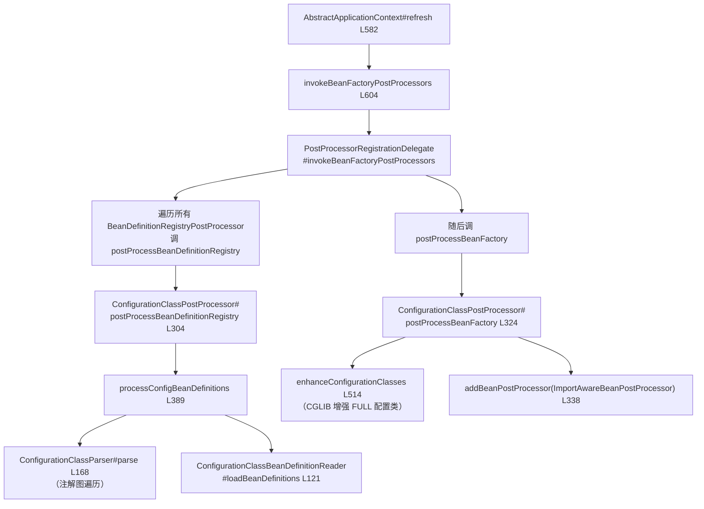
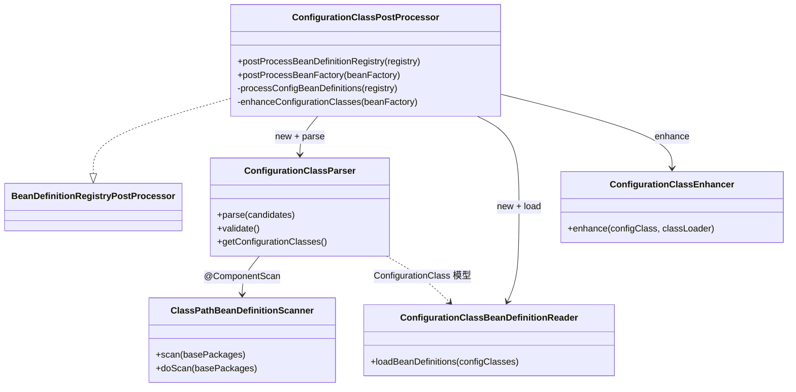
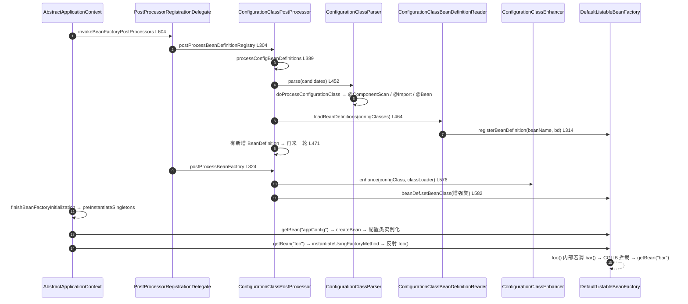
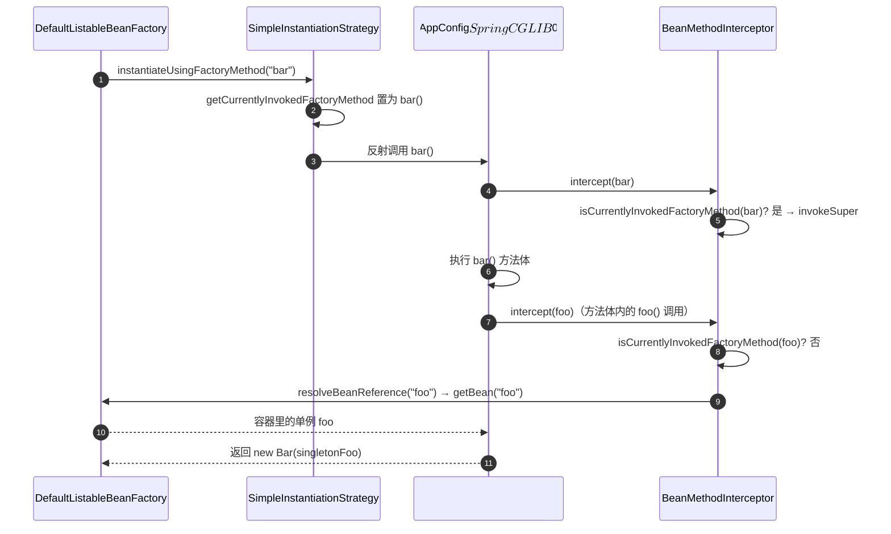

# 配置类解析：`ConfigurationClassPostProcessor`

> **一句话结论**：`@Configuration` / `@Bean` / `@ComponentScan` / `@Import` 这些**注解本身没有任何"执行能力"**——是 `ConfigurationClassPostProcessor`（一个 `BeanDefinitionRegistryPostProcessor`）在 `refresh()` 的 `invokeBeanFactoryPostProcessors` 阶段把"配置类"解析成普通的 `BeanDefinition` 注册进容器：`ConfigurationClassParser` 负责**把注解图遍历出来**（扫包、处理 `@Import`、收集 `@Bean` 方法），`ConfigurationClassBeanDefinitionReader` 负责**落地成 BeanDefinition**，`ConfigurationClassEnhancer` 负责**给 `@Configuration` 类生成 CGLIB 子类**以便 `@Bean` 方法互调时返回容器里的单例。
>
> **阅读前置**：[01-refresh 容器启动全流程](01-refresh-容器启动全流程.md)（知道 `refresh()` 的 12 步）、[02-bean 创建全流程](02-bean-创建全流程-getbean与createbean.md)（知道 `BeanDefinition` 与 `createBean` 的关系）。本文是"`BeanDefinition` 从哪来"的答案。
> **预计阅读**：50~70 分钟。
> **源码基线**：`org.springframework:spring-context:7.1.0`（`ConfigurationClassPostProcessor`、`ConfigurationClassParser`、`ConfigurationClassBeanDefinitionReader`、`ConfigurationClassEnhancer`、`ClassPathBeanDefinitionScanner`），配合 `spring-beans:7.1.0`。
> **术语先讲清楚**：
> - **`BeanDefinition`**：Bean 的"图纸"——类名、作用域、构造参数、是否懒加载、工厂方法名等。容器靠它创建实例。
> - **`BeanDefinitionRegistryPostProcessor`**：`BeanFactoryPostProcessor` 的子接口，能在**所有普通 Bean 创建之前**往容器里注册新的 `BeanDefinition`。`@Configuration` 解析就是靠它。
> - **FULL / LITE 配置类**：`@Configuration(proxyBeanMethods=true)`（默认）= FULL，会被 CGLIB 增强；`@Configuration(proxyBeanMethods=false)` 或普通 `@Component` 类里写 `@Bean` = LITE，不增强。属性名常量是 `ConfigurationClassUtils.CONFIGURATION_CLASS_ATTRIBUTE`，取值 `full` / `lite`。
> - **配置类（configuration class）候选**：类上有 `@Configuration`、`@Component`、`@ComponentScan`、`@Import`、`@ImportResource` 或含 `@Bean` 方法的类，详见 `ConfigurationClassUtils#checkConfigurationClassCandidate`。

---

## 0. 先看现象

### 0.1 最常见的困惑："我写的 `@Bean` 方法什么时候被调用？"

```java
@Configuration
class AppConfig {
    AppConfig() { System.out.println("[1] AppConfig 构造器"); }
    @Bean Foo foo() { System.out.println("[2] foo() 被调用"); return new Foo(); }
    @Bean Bar bar() { System.out.println("[3] bar() 被调用"); return new Bar(foo()); }
}
```

启动后输出顺序是：

```text
[1] AppConfig 构造器
[2] foo() 被调用
[3] bar() 被调用
```

**并且 `bar` 里拿到的 `foo()` 与容器里的 `foo` Bean 是同一个对象**（这是 FULL 配置类 CGLIB 增强的效果）。如果换成 `@Configuration(proxyBeanMethods = false)`，输出看起来一样，但 `bar` 里的 `foo()` 会**再执行一次**（产生第二个 Foo 实例），只是恰好被丢弃——`bar.foo != ctx.getBean(Foo.class)`。

### 0.2 三条容易混淆的结论

| 你以为 | 实际上是 |
| --- | --- |
| `@Bean` 方法在"启动时统一调用一遍" | 每个 `@Bean` 方法对应一个 `BeanDefinition`，**首次需要该 Bean 时才调用**（默认非懒加载单例则在 `preInstantiateSingletons` 阶段逐个调用） |
| `@Configuration` 类的构造器只执行一次 | 是，但它是在"Bean 创建阶段"执行的——**晚于**所有 `BeanDefinition` 的注册 |
| `proxyBeanMethods=false` 让人省心更快 | 确实更快（不生成 CGLIB 类），但**方法互调不再返回容器单例**，必须用参数注入替代 |

### 0.3 一个"看起来莫名"的启动日志

```text
INFO  ... Cannot enhance @Configuration bean definition 'myConfig' since its singleton instance has been created too early.
     The typical cause is a non-static @Bean method with a BeanDefinitionRegistryPostProcessor return type:
     Consider declaring such methods as 'static' and/or marking the containing configuration class as 'proxyBeanMethods=false'.
```

这条日志来自 `ConfigurationClassPostProcessor#enhanceConfigurationClasses`（L549-L557）。它说明**你的配置类实例在增强之前就被创建了**——最常见的写法错误就是：

```java
@Configuration
class MyConfig {
    @Bean MyBdrp myBdrp() { return new MyBdrp(); }   // 非 static！
}
```

`MyBdrp` 是 `BeanDefinitionRegistryPostProcessor`，容器为了尽早调用它，必须**先创建 `myConfig`** 才能调用这个（非 static 的）`@Bean` 方法，于是 `myConfig` 在 CGLIB 替换它的类之前就成了单例 → 增强失败 → `@Bean` 方法互调不再返回单例。

**修法**：把 `@Bean` 方法声明为 `static`，或把该配置类标记为 `proxyBeanMethods = false`。

---

## 1. 整体地图

### 1.1 它在 `refresh()` 的哪个阶段



> **读图说明**：一次刷新里，`ConfigurationClassPostProcessor` 被调**两次**：`postProcessBeanDefinitionRegistry`（注册 `@Bean`/扫描出的 BeanDefinition）与 `postProcessBeanFactory`（做 CGLIB 增强 + 注册 `ImportAwareBeanPostProcessor`）。**`@Bean` 方法真正被调用则要等到更后面的 `finishBeanFactoryInitialization` → `preInstantiateSingletons`**，那是 02 篇的内容。所以时间轴上共有三个不同的阶段：**解析 → 增强 → 实例化**。

### 1.2 解析阶段内部的两大组件

```mermaid
flowchart LR
    BD["已注册的 BeanDefinition 集合"] --> P["ConfigurationClassParser<br/>parse(Set) L168"]
    P --> P1["processConfigurationClass L248<br/>（含父类循环）"]
    P1 --> P2["doProcessConfigurationClass L305"]
    P2 --> S["@ComponentScan → ClassPathBeanDefinitionScanner<br/>→ registry 里多出新的 BeanDefinition"]
    P2 --> IMP["@Import / @ImportResource / 内部类 / @Bean 方法"]
    P --> OUT["Set&lt;ConfigurationClass&gt;"]
    OUT --> R["ConfigurationClassBeanDefinitionReader<br/>loadBeanDefinitions L121"]
    R --> R1["loadBeanDefinitionsForConfigurationClass L132"]
    R1 --> R2["loadBeanDefinitionsForBeanMethod L190<br/>（每个 @Bean 一个 BeanDefinition）"]
    S -. "新增的候选需要再解析一轮" --> P
```

> **读图说明**：这张图是理解"为什么 `processConfigBeanDefinitions` 要写 `do { ... } while (!candidates.isEmpty())`"的关键——**扫描会新增 BeanDefinition，这些新 BeanDefinition 里可能还有配置类**，于是必须再解析一轮。`ConfigurationClassParser` 只产出"配置类模型"（`ConfigurationClass` 对象，里面装着 `@Bean` 方法元数据、`@Import` 结果等），**不直接注册 BeanDefinition**；注册由 `ConfigurationClassBeanDefinitionReader` 完成。**解析与注册分离**是这一整套设计的骨架。

### 1.3 三个阶段的产物对照

| 阶段 | 执行者 | 输入 | 产物 | 时机 |
| --- | --- | --- | --- | --- |
| 解析 | `ConfigurationClassParser` | 候选 `BeanDefinition` + 类元数据 | `Set<ConfigurationClass>`（内存模型） | `invokeBeanFactoryPostProcessors` 前半 |
| 注册 | `ConfigurationClassBeanDefinitionReader` | `ConfigurationClass` | 新的 `BeanDefinition`（`@Bean` 方法、`@Import` 的类） | 同一方法内紧随其后 |
| 增强 | `ConfigurationClassEnhancer` | FULL 配置类的 `BeanDefinition` | `beanDef.setBeanClass(CGLIB 子类)` | `postProcessBeanFactory` |
| 实例化 | `AbstractAutowireCapableBeanFactory` | `BeanDefinition` | Bean 实例（`@Bean` 方法被真正调用） | `preInstantiateSingletons` |

---

## 2. 关键类逐个拆

### 2.1 `ConfigurationClassPostProcessor`

```java (src: ConfigurationClassPostProcessor.java#L210-L213)
	public int getOrder() {
		return Ordered.LOWEST_PRECEDENCE;  // within PriorityOrdered
	}

```


- **`getOrder()` 返回 `Ordered.LOWEST_PRECEDENCE`**：注释写着 `// within PriorityOrdered`——它实现了 `PriorityOrdered`，因此**排在所有普通 `Ordered` 的 BFPP 之前**，但在 `PriorityOrdered` 内部排最后。这个位置保证：用户自定义的 `PriorityOrdered` BFPP（如 `PropertySourcesPlaceholderConfigurer` 的早期形态）可以先跑，而所有"需要完整 BeanDefinition 集合"的 BFPP 后跑。

```java (src: ConfigurationClassPostProcessor.java#L304-L339)
	public void postProcessBeanDefinitionRegistry(BeanDefinitionRegistry registry) {
		int registryId = System.identityHashCode(registry);
		if (this.registriesPostProcessed.contains(registryId)) {
			throw new IllegalStateException(
					"postProcessBeanDefinitionRegistry already called on this post-processor against " + registry);
		}
		if (this.factoriesPostProcessed.contains(registryId)) {
			throw new IllegalStateException(
					"postProcessBeanFactory already called on this post-processor against " + registry);
		}
		this.registriesPostProcessed.add(registryId);

		processConfigBeanDefinitions(registry);
	}

	/**
	 * Prepare the Configuration classes for servicing bean requests at runtime
	 * by replacing them with CGLIB-enhanced subclasses.
	 */
	@Override
	public void postProcessBeanFactory(ConfigurableListableBeanFactory beanFactory) {
		int factoryId = System.identityHashCode(beanFactory);
		if (this.factoriesPostProcessed.contains(factoryId)) {
			throw new IllegalStateException(
					"postProcessBeanFactory already called on this post-processor against " + beanFactory);
		}
		this.factoriesPostProcessed.add(factoryId);
		if (!this.registriesPostProcessed.contains(factoryId)) {
			// BeanDefinitionRegistryPostProcessor hook apparently not supported...
			// Simply call processConfigurationClasses lazily at this point then.
			processConfigBeanDefinitions((BeanDefinitionRegistry) beanFactory);
		}

		enhanceConfigurationClasses(beanFactory);
		beanFactory.addBeanPostProcessor(new ImportAwareBeanPostProcessor(beanFactory));
	}
```


- **`postProcessBeanDefinitionRegistry`（L304-L317）**：
  - 用 `registriesPostProcessed` 集合防重复调用（同一 registry 被调两次会抛 `IllegalStateException`）——因为 `refresh` 内部可能有多条路径触发；
  - 若 `factoriesPostProcessed` 已包含该 registry，说明顺序反了，也抛异常；
  - 真正工作委托给 `processConfigBeanDefinitions`（L316）。
- **`postProcessBeanFactory`（L324-L338）**：
  - 若 `postProcessBeanDefinitionRegistry` 没跑过（可能因为使用者只把它当 BFPP 用），**在这里懒补一次**（L331-L335）；
  - `enhanceConfigurationClasses(beanFactory)`（L337）：给 FULL 配置类做 CGLIB 替换；
  - `addBeanPostProcessor(new ImportAwareBeanPostProcessor(beanFactory))`（L338）：让 `@Import` 进来的类能拿到"导入它的配置类"的注解元数据（`ImportAware` 接口）。

### 2.2 `processConfigBeanDefinitions`：主流程

```java (src: ConfigurationClassPostProcessor.java#L389-L446)
	public void processConfigBeanDefinitions(BeanDefinitionRegistry registry) {
		List<BeanDefinitionHolder> configCandidates = new ArrayList<>();
		String[] candidateNames = registry.getBeanDefinitionNames();

		for (String beanName : candidateNames) {
			BeanDefinition beanDef = registry.getBeanDefinition(beanName);
			if (beanDef.getAttribute(ConfigurationClassUtils.CONFIGURATION_CLASS_ATTRIBUTE) != null) {
				if (logger.isDebugEnabled()) {
					logger.debug("Bean definition has already been processed as a configuration class: " + beanDef);
				}
			}
			else if (ConfigurationClassUtils.checkConfigurationClassCandidate(beanDef, this.metadataReaderFactory)) {
				configCandidates.add(new BeanDefinitionHolder(beanDef, beanName));
			}
		}

		// Return immediately if no @Configuration classes were found
		if (configCandidates.isEmpty()) {
			return;
		}

		// Sort by previously determined @Order value, if applicable
		configCandidates.sort((bd1, bd2) -> {
			int i1 = ConfigurationClassUtils.getOrder(bd1.getBeanDefinition());
			int i2 = ConfigurationClassUtils.getOrder(bd2.getBeanDefinition());
			return Integer.compare(i1, i2);
		});

		// Detect any custom bean name generation strategy supplied through the enclosing application context
		SingletonBeanRegistry singletonRegistry = null;
		if (registry instanceof SingletonBeanRegistry sbr) {
			singletonRegistry = sbr;
			BeanNameGenerator configurationGenerator = (BeanNameGenerator) singletonRegistry.getSingleton(
					AnnotationConfigUtils.CONFIGURATION_BEAN_NAME_GENERATOR);
			if (configurationGenerator != null) {
				if (this.localBeanNameGeneratorSet) {
					if (configurationGenerator instanceof ConfigurationBeanNameGenerator &
							configurationGenerator != this.importBeanNameGenerator) {
						throw new IllegalStateException("Context-level ConfigurationBeanNameGenerator [" +
								configurationGenerator + "] must not be overridden with processor-level generator [" +
								this.importBeanNameGenerator + "]");
					}
				}
				else {
					this.componentScanBeanNameGenerator = configurationGenerator;
					this.importBeanNameGenerator = configurationGenerator;
				}
			}
		}

		if (this.environment == null) {
			this.environment = new StandardEnvironment();
		}

		// Parse each @Configuration class
		ConfigurationClassParser parser = new ConfigurationClassParser(
				this.metadataReaderFactory, this.problemReporter, this.environment,
				this.resourceLoader, this.componentScanBeanNameGenerator, registry);
```


- **在干什么**：
  1. 遍历容器里**已有**的 BeanDefinition，用 `ConfigurationClassUtils.checkConfigurationClassCandidate` 判断是否是"配置类候选"，是就把属性 `CONFIGURATION_CLASS_ATTRIBUTE` 设为 `full` 或 `lite`；
  2. 没有候选就直接返回（一个纯 XML 容器不会走这套）；
  3. 按 `getOrder` 排序候选；
  4. 校验 `ConfigurationBeanNameGenerator`（`IMPORT_BEAN_NAME_GENERATOR` 是全限定名生成器，避免 `@Import` 的类与已有名字冲突）；
  5. 构造 `ConfigurationClassParser`，带上 `Environment`、`ResourceLoader`、`BeanNameGenerator`、`ProblemReporter` 等。

- **为什么用 `ConfigurationClassUtils.checkConfigurationClassCandidate` 而不是简单判断 `@Configuration`**：因为"lite"配置类（普通 `@Component` 里写 `@Bean`、或用 `@ComponentScan`/`@Import` 的类）也必须被解析。`checkConfigurationClassCandidate` 会看 `@Configuration`、`@Component`、`@ComponentScan`、`@Import`、`@ImportResource`、以及"类里有 `@Bean` 方法"这几个条件。

```java (src: ConfigurationClassPostProcessor.java#L450-L491)
		do {
			StartupStep processConfig = this.applicationStartup.start("spring.context.config-classes.parse");
			parser.parse(candidates);
			parser.validate();

			Set<ConfigurationClass> configClasses = new LinkedHashSet<>(parser.getConfigurationClasses());
			configClasses.removeAll(alreadyParsed);

			// Read the model and create bean definitions based on its content
			if (this.reader == null) {
				this.reader = new ConfigurationClassBeanDefinitionReader(
						registry, this.sourceExtractor, this.resourceLoader, this.environment,
						this.importBeanNameGenerator, parser.getImportRegistry());
			}
			this.reader.loadBeanDefinitions(configClasses);
			for (ConfigurationClass configClass : configClasses) {
				this.beanRegistrars.addAll(configClass.getBeanRegistrars());
			}
			alreadyParsed.addAll(configClasses);
			processConfig.tag("classCount", () -> String.valueOf(configClasses.size())).end();

			candidates.clear();
			if (registry.getBeanDefinitionCount() > candidateNames.length) {
				String[] newCandidateNames = registry.getBeanDefinitionNames();
				Set<String> oldCandidateNames = Set.of(candidateNames);
				Set<String> alreadyParsedClasses = CollectionUtils.newHashSet(alreadyParsed.size());
				for (ConfigurationClass configurationClass : alreadyParsed) {
					alreadyParsedClasses.add(configurationClass.getMetadata().getClassName());
				}
				for (String candidateName : newCandidateNames) {
					if (!oldCandidateNames.contains(candidateName)) {
						BeanDefinition bd = registry.getBeanDefinition(candidateName);
						if (ConfigurationClassUtils.checkConfigurationClassCandidate(bd, this.metadataReaderFactory) &&
								!alreadyParsedClasses.contains(bd.getBeanClassName())) {
							candidates.add(new BeanDefinitionHolder(bd, candidateName));
						}
					}
				}
				candidateNames = newCandidateNames;
			}
		}
		while (!candidates.isEmpty());
```


- **在干什么**（这个 `do-while` 是整套机制的心跳）：
  1. `parser.parse(candidates)`（L452）：遍历解析；
  2. `parser.validate()`（L453）：校验 `@Configuration` 之间的 `@Bean` 名冲突等；
  3. `configClasses = new LinkedHashSet<>(parser.getConfigurationClasses())`，去掉 `alreadyParsed`；
  4. **懒创建** `ConfigurationClassBeanDefinitionReader`（L459-L463），然后 `this.reader.loadBeanDefinitions(configClasses)`（L464）——把模型落成 BeanDefinition；
  5. 收集 `ImportBeanDefinitionRegistrar`（L465-L467）供后续调用；
  6. `alreadyParsed.addAll(configClasses)`；
  7. **`if (registry.getBeanDefinitionCount() > candidateNames.length)`（L471）**：如果这轮解析让 BeanDefinition 变多了（扫描或 `@Import` 引入了新候选），就更新 `candidateNames`、重新收集候选，进入下一轮（L473-L490）。
  8. 循环结束后（L494-L496）把 `ImportRegistry` 作为单例注册进去，供 `ImportAware` 与 `ImportBeanDefinitionRegistrar` 使用。
- **为什么要多轮**：`@ComponentScan` 扫出来的类本身可能又带 `@Configuration`/`@Import`/`@Bean`，必须继续解析直到"没有新候选"。这也是"配置类解析是固定点迭代"的体现。
- **常见坑**：如果你在 `@ComponentScan` 的包里放了带 `@Bean` 的类，但**该类不在任何扫描路径下**，它永远不会被解析——`@Bean` 方法会被彻底忽略（不报错）。这是新手最常见的问题。

### 2.3 `ConfigurationClassParser`

- 输入：`Set<BeanDefinitionHolder>`；输出：`Map<ConfigurationClass, ConfigurationClass>`（`configurationClasses`）。
- 核心方法是递归的：`processConfigurationClass`（L248）→ `doProcessConfigurationClass`（L305）→ 返回父类继续处理，直到 `null`。

```java (src: ConfigurationClassParser.java#L168-L201)
	public void parse(Set<BeanDefinitionHolder> configCandidates) {
		for (BeanDefinitionHolder holder : configCandidates) {
			BeanDefinition bd = holder.getBeanDefinition();
			try {
				ConfigurationClass configClass;
				if (bd instanceof AnnotatedBeanDefinition annotatedBeanDef) {
					configClass = parse(annotatedBeanDef, holder.getBeanName());
				}
				else if (bd instanceof AbstractBeanDefinition abstractBeanDef && abstractBeanDef.hasBeanClass()) {
					configClass = parse(abstractBeanDef.getBeanClass(), holder.getBeanName());
				}
				else {
					configClass = parse(bd.getBeanClassName(), holder.getBeanName());
				}

				// Downgrade to lite (no enhancement) in case of no instance-level @Bean methods.
				if (!configClass.getMetadata().isAbstract() && !configClass.hasNonStaticBeanMethods() &&
						ConfigurationClassUtils.CONFIGURATION_CLASS_FULL.equals(
								bd.getAttribute(ConfigurationClassUtils.CONFIGURATION_CLASS_ATTRIBUTE))) {
					bd.setAttribute(ConfigurationClassUtils.CONFIGURATION_CLASS_ATTRIBUTE,
							ConfigurationClassUtils.CONFIGURATION_CLASS_LITE);
				}
			}
			catch (BeanDefinitionStoreException ex) {
				throw ex;
			}
			catch (Throwable ex) {
				throw new BeanDefinitionStoreException(
						"Failed to parse configuration class [" + bd.getBeanClassName() + "]", ex);
			}
		}

		this.deferredImportSelectorHandler.process();
	}
```


- **在干什么**（`parse(Set)` L168-L201）：
  - L173-L181：按 `BeanDefinition` 的类型分派（`AnnotatedBeanDefinition` / 有 `beanClassName` / 有 `beanClass`）；
  - **L183-L189 是一个关键优化**："Downgrade to lite (no enhancement) in case of no instance-level @Bean methods"——如果一个 FULL 配置类**没有任何非 static 的 `@Bean` 方法**，就把它降级成 LITE，**跳过 CGLIB 增强**（因为增强的唯一目的就是拦截 `@Bean` 方法互调）；
  - L191-L197：解析失败时抛（或报告）`Failed to parse configuration class [...]`；
  - **L200 `this.deferredImportSelectorHandler.process()`**：`DeferredImportSelector`（自动配置的实现基础，如 `@EnableAutoConfiguration`）在**所有**配置类解析完之后才处理。
- **为什么 `DeferredImportSelector` 要最后处理**：`@ConditionalOnClass`、`@ConditionalOnMissingBean` 这类条件需要看到"用户自己定义的所有 Bean"，如果自动配置先跑，就会误判"没有用户定义"。这条 `process()` 调用是 Spring Boot 自动配置正确性的基石。

```java (src: ConfigurationClassParser.java#L248-L295)
	protected void processConfigurationClass(ConfigurationClass configClass, Predicate<String> filter) {
		if (this.conditionEvaluator.shouldSkip(configClass.getMetadata(), ConfigurationPhase.PARSE_CONFIGURATION)) {
			return;
		}

		ConfigurationClass existingClass = this.configurationClasses.get(configClass);
		if (existingClass != null) {
			if (configClass.isImported()) {
				if (existingClass.isImported()) {
					existingClass.mergeImportedBy(configClass);
				}
				// Otherwise ignore new imported config class; existing non-imported class overrides it.
				return;
			}
			else if (configClass.isScanned()) {
				if (existingClass.isImported()) {
					String beanName = configClass.getBeanName();
					if (StringUtils.hasLength(beanName) && this.registry.containsBeanDefinition(beanName)) {
						this.registry.removeBeanDefinition(beanName);
					}
				}
				// An implicitly scanned bean definition should not override an explicit import.
				return;
			}
			else {
				// Explicit bean definition found, probably replacing an import.
				// Let's remove the old one and go with the new one.
				this.configurationClasses.remove(configClass);
				removeKnownSuperclass(configClass.getMetadata().getClassName(), false);
			}
		}

		// Recursively process the configuration class and its superclass hierarchy.
		SourceClass sourceClass = null;
		try {
			sourceClass = asSourceClass(configClass, filter);
			do {
				sourceClass = doProcessConfigurationClass(configClass, sourceClass, filter);
			}
			while (sourceClass != null);
		}
		catch (IOException ex) {
			throw new BeanDefinitionStoreException(
					"I/O failure while processing configuration class [" + sourceClass + "]", ex);
		}

		this.configurationClasses.put(configClass, configClass);
	}
```


- **在干什么**（`processConfigurationClass` L248-L295）：
  1. L249：`conditionEvaluator.shouldSkip(sourceClass.getMetadata(), PARSE_CONFIGURATION)`——`@Conditional` 在这里生效，不满足就整个类跳过；
  2. L253-L278：如果**同类**已经在 `configurationClasses` 里，分三种情况处理（被 import 的 / 被扫描的 / 显式注册的），把"先存在的"标记为 imported 或直接返回，避免重复解析；
  3. L284-L287：`do { sourceClass = doProcessConfigurationClass(...) } while (sourceClass != null)`——**循环处理当前类与所有父类**；
  4. L294：`configurationClasses.put(sourceClass, configClass)`。
- **为什么父类要一起处理**：`@Bean` 方法、`@Autowired` 字段都可能继承自父类；Spring 支持"配置类继承"，一个子配置类会带着父类的 `@Bean` 方法一起注册。
- **常见坑**：父类里的 `@Bean` 方法注册出来的 Bean 名与子类冲突时，`ConfigurationClassBeanDefinitionReader` L230-L237 会抛 `Bean name derived from @Bean method '...' clashes with bean name for containing configuration class`。

### 2.4 `doProcessConfigurationClass`：注解图遍历的中枢

```java (src: ConfigurationClassParser.java#L305-L326)
	protected final @Nullable SourceClass doProcessConfigurationClass(
			ConfigurationClass configClass, SourceClass sourceClass, Predicate<String> filter)
			throws IOException {

		if (configClass.getMetadata().isAnnotated(Component.class.getName())) {
			// Recursively process any member (nested) classes first
			processMemberClasses(configClass, sourceClass, filter);
		}

		// Process any @PropertySource annotations
		for (AnnotationAttributes propertySource : AnnotationConfigUtils.attributesForRepeatable(
				sourceClass.getMetadata(), org.springframework.context.annotation.PropertySource.class,
				PropertySources.class, true)) {
			if (this.propertySourceRegistry != null) {
				this.propertySourceRegistry.processPropertySource(propertySource);
			}
			else {
				logger.info("Ignoring @PropertySource annotation on [" + sourceClass.getMetadata().getClassName() +
						"]. Reason: Environment must implement ConfigurableEnvironment");
			}
		}

```


- **在干什么**（前段）：
  - L309-L312：如果类上有 `@Component`，先处理**内部成员类**（`processMemberClasses`）——这就是"静态内部配置类也能被识别"的原因；
  - L315-L325：处理 `@PropertySource`，把属性源加入 `Environment`（注意 L320-L322 的检查：`Environment` 必须实现 `ConfigurableEnvironment`，否则打 warn 忽略）。
- **为什么 `@PropertySource` 要在这里处理而不是更早**：因为 `@Configuration` 类本身可能由 `@Import` 动态决定，只有解析时才拿得到完整的注解集合。

```java (src: ConfigurationClassParser.java#L327-L360)
		// Search for locally declared @ComponentScan annotations first.
		Set<AnnotationAttributes> componentScans = AnnotationConfigUtils.attributesForRepeatable(
				sourceClass.getMetadata(), ComponentScan.class, ComponentScans.class,
				MergedAnnotation::isDirectlyPresent);

		// Fall back to searching for @ComponentScan meta-annotations (which indirectly
		// includes locally declared composed annotations).
		if (componentScans.isEmpty()) {
			componentScans = AnnotationConfigUtils.attributesForRepeatable(sourceClass.getMetadata(),
					ComponentScan.class, ComponentScans.class, MergedAnnotation::isMetaPresent);
		}

		if (!componentScans.isEmpty()) {
			List<Condition> registerBeanConditions = collectRegisterBeanConditions(configClass);
			if (!registerBeanConditions.isEmpty()) {
				throw new ApplicationContextException(
						"Component scan for configuration class [%s] could not be used with conditions in REGISTER_BEAN phase: %s"
								.formatted(configClass.getMetadata().getClassName(), registerBeanConditions));
			}
			for (AnnotationAttributes componentScan : componentScans) {
				// The config class is annotated with @ComponentScan -> perform the scan immediately
				Set<BeanDefinitionHolder> scannedBeanDefinitions =
						this.componentScanParser.parse(componentScan, sourceClass.getMetadata().getClassName());
				// Check the set of scanned definitions for any further config classes and parse recursively if needed
				for (BeanDefinitionHolder holder : scannedBeanDefinitions) {
					BeanDefinition bdCand = holder.getBeanDefinition().getOriginatingBeanDefinition();
					if (bdCand == null) {
						bdCand = holder.getBeanDefinition();
					}
					if (ConfigurationClassUtils.checkConfigurationClassCandidate(bdCand, this.metadataReaderFactory)) {
						parse(bdCand.getBeanClassName(), holder.getBeanName());
					}
				}
			}
```


- **在干什么**：
  - L328-L337：先 `getAnnotationAttributes(ComponentScan.class)`（直接标注），拿不到再 `getAnnotationAttributes(ComponentScan.class, true)`（元注解，即 `@ComponentScan` 被别的注解封装的情况）；
  - L340-L345：如果 `@ComponentScan` 上带了 `REGISTER_BEAN` 阶段的 `@Conditional`，抛 `ApplicationContextException`（扫描期条件不支持）；
  - L346-L360：`componentScanParser.parse(componentScan, sourceClass.getMetadata().getClassName())`——**真正扫包**；扫出来的候选再递归 `parse(...)`，因为扫描结果里可能有新的配置类。
- **为什么扫描要递归解析**：扫描出的类上可能又有 `@Configuration`/`@Import`/`@Bean`，必须继续展开。这是 §2.2 那个 `do-while` 的微观原因。

```java (src: ConfigurationClassParser.java#L364-L385)
		processImports(configClass, sourceClass, getImports(sourceClass), filter, true);

		// Process any @ImportResource annotations
		AnnotationAttributes importResource =
				AnnotationConfigUtils.attributesFor(sourceClass.getMetadata(), ImportResource.class);
		if (importResource != null) {
			String[] resources = importResource.getStringArray("locations");
			Class<? extends BeanDefinitionReader> readerClass = importResource.getClass("reader");
			for (String resource : resources) {
				String resolvedResource = this.environment.resolveRequiredPlaceholders(resource);
				configClass.addImportedResource(resolvedResource, readerClass);
			}
		}

		// Process individual @Bean methods
		Set<MethodMetadata> beanMethods = retrieveBeanMethodMetadata(sourceClass);
		for (MethodMetadata methodMetadata : beanMethods) {
			if (methodMetadata.isAnnotated("kotlin.jvm.JvmStatic") && !methodMetadata.isStatic()) {
				continue;
			}
			configClass.addBeanMethod(new BeanMethod(methodMetadata, configClass));
		}
```


- **在干什么**：
  - L364：`processImports(...)`——处理 `@Import`（三种：普通类、`ImportSelector`、`ImportBeanDefinitionRegistrar`）；
  - L367-L376：`@ImportResource` 把 XML 配置文件也纳入解析（`@ImportResource` 的 XML 里还能再有 `<context:component-scan>`，所以也可能引入新候选）；
  - L379-L385：`retrieveBeanMethodMetadata(...)` 收集所有 `@Bean` 方法，`configClass.addBeanMethod(new BeanMethod(methodMetadata, configClass))`——**注意这里只是把方法"记下来"**，不注册 BeanDefinition，也不调用方法。
- **这就是 §0.1 的答案**：`@Bean` 方法此刻只是被记录成 `BeanMethod` 元数据对象；真正的 `BeanDefinition` 由 `ConfigurationClassBeanDefinitionReader` 生成，真正的**方法调用**要等到 Bean 实例化时（作为 `factoryMethod`）才发生。

```java (src: ConfigurationClassParser.java#L387-L404)
		// Process default methods on interfaces
		processInterfaces(configClass, sourceClass);

		// Process superclass, if any
		if (sourceClass.getMetadata().hasSuperClass()) {
			String superclass = sourceClass.getMetadata().getSuperClassName();
			if (superclass != null && !superclass.startsWith("java")) {
				boolean superclassKnown = this.knownSuperclasses.containsKey(superclass);
				this.knownSuperclasses.add(superclass, configClass);
				if (!superclassKnown) {
					// Superclass found, return its annotation metadata and recurse
					return sourceClass.getSuperClass();
				}
			}
		}

		// No superclass -> processing is complete
		return null;
```


- **在干什么**：`processInterfaces` 把接口（及其父接口）上的 `@Bean` 默认方法也纳入；最后 `return sourceClass.getSuperClass()`——**让外层 `do-while` 继续处理父类**；没有父类则返回 `null` 结束。
- **为什么 `@Bean` 能写在接口 default 方法上**：Spring 5.0+ 支持；生成 BeanDefinition 时 `factoryBeanName` 指向实现类实例，方法调用走 `default` 实现。

### 2.5 `ConfigurationClassBeanDefinitionReader`：把模型落成图纸

```java (src: ConfigurationClassBeanDefinitionReader.java#L132-L154)
	private void loadBeanDefinitionsForConfigurationClass(
			ConfigurationClass configClass, TrackedConditionEvaluator trackedConditionEvaluator) {

		if (trackedConditionEvaluator.shouldSkip(configClass)) {
			String beanName = configClass.getBeanName();
			if (StringUtils.hasLength(beanName) && this.registry.containsBeanDefinition(beanName)) {
				this.registry.removeBeanDefinition(beanName);
			}
			this.importRegistry.removeImportingClass(configClass.getMetadata().getClassName());
			return;
		}

		if (configClass.isImported()) {
			registerBeanDefinitionForImportedConfigurationClass(configClass);
		}
		for (BeanMethod beanMethod : configClass.getBeanMethods()) {
			loadBeanDefinitionsForBeanMethod(beanMethod);
		}

		loadBeanDefinitionsFromImportedResources(configClass.getImportedResources());
		loadBeanDefinitionsFromImportBeanDefinitionRegistrars(configClass.getImportBeanDefinitionRegistrars());
		loadBeanDefinitionsFromBeanRegistrars(configClass.getBeanRegistrars());
	}
```


- **在干什么**（`loadBeanDefinitionsForConfigurationClass` L132-L154）：
  - L135-L142：如果该配置类在 `REGISTER_BEAN` 阶段的 `@Conditional` 不满足，**把自己注册的 BeanDefinition 移除**，并从导入者的 `importedBy` 里摘掉，然后返回；
  - L144-L146：如果这个类是 `@Import` 进来的，先给它自己注册一个 BeanDefinition（`registerBeanDefinitionForImportedConfigurationClass`）；
  - L147-L149：遍历 `@Bean` 方法，逐个 `loadBeanDefinitionsForBeanMethod`；
  - L151-L153：处理 `@ImportResource` / `ImportBeanDefinitionRegistrar` / `BeanDefinitionRegistrar`（`BeanRegistrar` 是 6.2 引入的轻量版注册器）。
- **为什么 `@Conditional` 要在这里再判断一次**：`PARSE_CONFIGURATION` 阶段与 `REGISTER_BEAN` 阶段的可见信息不同（比如"某个 Bean 存在与否"在注册阶段才确定）。所以同一个 `@Conditional` 可能被判两次。

```java (src: ConfigurationClassBeanDefinitionReader.java#L190-L238)
	private void loadBeanDefinitionsForBeanMethod(BeanMethod beanMethod) {
		ConfigurationClass configClass = beanMethod.getConfigurationClass();
		MethodMetadata metadata = beanMethod.getMetadata();
		String methodName = metadata.getMethodName();

		// Do we need to mark the bean as skipped by its condition?
		if (this.conditionEvaluator.shouldSkip(metadata, ConfigurationPhase.REGISTER_BEAN)) {
			configClass.skippedBeanMethods.add(methodName);
			return;
		}
		if (configClass.skippedBeanMethods.contains(methodName)) {
			return;
		}

		AnnotationAttributes bean = AnnotationConfigUtils.attributesFor(metadata, Bean.class);
		Assert.state(bean != null, "No @Bean annotation attributes");

		// Consider name and any aliases.
		String[] explicitNames = bean.getStringArray("name");
		String beanName = (explicitNames.length > 0 && StringUtils.hasText(explicitNames[0])) ? explicitNames[0] : null;
		String localBeanName = defaultBeanName(beanName, methodName);
		beanName = (this.importBeanNameGenerator instanceof ConfigurationBeanNameGenerator cbng ?
				cbng.deriveBeanName(metadata, beanName) : localBeanName);
		if (!localBeanName.equals(beanName) && !this.registry.containsBeanDefinition(localBeanName) &&
				!this.registry.isAlias(localBeanName)) {
			// Register original name as alias unless registered already.
			this.registry.registerAlias(beanName, localBeanName);
		}
		if (explicitNames.length > 0) {
			// Register aliases even when overridden below.
			for (int i = 1; i < explicitNames.length; i++) {
				this.registry.registerAlias(beanName, explicitNames[i]);
			}
		}

		ConfigurationClassBeanDefinition beanDef =
				new ConfigurationClassBeanDefinition(configClass, metadata, localBeanName);
		beanDef.setSource(this.sourceExtractor.extractSource(metadata, configClass.getResource()));

		// Has this effectively been overridden before (for example, via XML)?
		if (isOverriddenByExistingDefinition(beanMethod, beanName, beanDef)) {
			if (beanName.equals(beanMethod.getConfigurationClass().getBeanName())) {
				throw new BeanDefinitionStoreException(beanMethod.getConfigurationClass().getResource().getDescription(),
						beanName, "Bean name derived from @Bean method '" + beanMethod.getMetadata().getMethodName() +
						"' clashes with bean name for containing configuration class; please make those names unique!");
			}
			return;
		}

```


- **在干什么**（`loadBeanDefinitionsForBeanMethod` 前段 L190-L238）：
  - L196-L199：`REGISTER_BEAN` 阶段的 `@Conditional`（如 `@ConditionalOnMissingBean`）不满足 → 记入 `skippedBeanMethods` 并返回；
  - L204-L223：读 `@Bean` 的 `name`/`value` 属性，生成主名（`defaultBeanName` = 方法名，L317-L319），其余作为别名注册；
  - L225-L227：`new ConfigurationClassBeanDefinition(configClass, metadata, localBeanName)`——这是一个"记录着配置类与工厂方法"的特殊 BeanDefinition；
  - L230-L237：若名字与配置类自身冲突，抛 `Bean name derived from @Bean method '...' clashes with bean name for containing configuration class; please make those names unique!`。
- **为什么 `@Bean` 方法名就是 Bean 名**：约定优于配置。这也是"方法重命名 = Bean 重命名 = 可能的 `@Qualifier` 失效"的根因。

```java (src: ConfigurationClassBeanDefinitionReader.java#L239-L263)
		if (metadata.isStatic()) {
			// static @Bean method
			if (configClass.getMetadata() instanceof StandardAnnotationMetadata sam) {
				beanDef.setBeanClass(sam.getIntrospectedClass());
			}
			else {
				beanDef.setBeanClassName(configClass.getMetadata().getClassName());
			}
			beanDef.setUniqueFactoryMethodName(methodName);
		}
		else {
			// instance @Bean method
			beanDef.setFactoryBeanName(configClass.getBeanName());
			beanDef.setUniqueFactoryMethodName(methodName);
		}

		if (metadata instanceof StandardMethodMetadata smm &&
				configClass.getMetadata() instanceof StandardAnnotationMetadata sam) {
			Method method = ClassUtils.getMostSpecificMethod(smm.getIntrospectedMethod(), sam.getIntrospectedClass());
			if (method == smm.getIntrospectedMethod()) {
				beanDef.setResolvedFactoryMethod(method);
			}
		}

		beanDef.setAutowireMode(AbstractBeanDefinition.AUTOWIRE_CONSTRUCTOR);
```


- **在干什么**（这段是全文最关键的 25 行）：
  - **L239-L248（static `@Bean`）**：`beanDef.setBeanClass(...)` 或 `setBeanClassName(...)`，然后 `setUniqueFactoryMethodName(methodName)`。BeanDefinition 的"工厂"是**类本身**（静态方法不需要实例）。
  - **L249-L253（instance `@Bean`）**：`beanDef.setFactoryBeanName(configClass.getBeanName())` + `setUniqueFactoryMethodName(methodName)`。BeanDefinition 的"工厂"是**配置类的那个 Bean**（`factoryBeanName`）。
  - **L255-L261**：如果方法已被解析（`mbd.getResolvedFactoryMethod() != null`），直接 `setResolvedFactoryMethod`，加速后续实例化。
  - **L263 `beanDef.setAutowireMode(AbstractBeanDefinition.AUTOWIRE_CONSTRUCTOR)`**——`@Bean` 方法的参数按**构造器注入**方式解析（即"方法参数全部按类型自动装配"）。
- **为什么 instance `@Bean` 要写成 `factoryBeanName` 而不是"直接调用方法"**：注册阶段**不能**调用 `@Bean` 方法（配置类实例还没创建；调用会产生副作用）；只能记录"将来用哪个 Bean 的哪个方法"。等到 `createBeanInstance`（02 篇 §3.11）发现 `factoryMethodName != null`，才通过反射调用。
- **这就是"`@Bean` 方法什么时候被调用"的完整答案**：`doCreateBean` → `createBeanInstance` → `instantiateUsingFactoryMethod` → 反射 `config.foo()`。

```java (src: ConfigurationClassBeanDefinitionReader.java#L255-L315)
		if (metadata instanceof StandardMethodMetadata smm &&
				configClass.getMetadata() instanceof StandardAnnotationMetadata sam) {
			Method method = ClassUtils.getMostSpecificMethod(smm.getIntrospectedMethod(), sam.getIntrospectedClass());
			if (method == smm.getIntrospectedMethod()) {
				beanDef.setResolvedFactoryMethod(method);
			}
		}

		beanDef.setAutowireMode(AbstractBeanDefinition.AUTOWIRE_CONSTRUCTOR);
		AnnotationConfigUtils.processCommonDefinitionAnnotations(beanDef, metadata);

		boolean autowireCandidate = bean.getBoolean("autowireCandidate");
		if (!autowireCandidate) {
			beanDef.setAutowireCandidate(false);
		}

		boolean defaultCandidate = bean.getBoolean("defaultCandidate");
		if (!defaultCandidate) {
			beanDef.setDefaultCandidate(false);
		}

		Bean.Bootstrap instantiation = bean.getEnum("bootstrap");
		if (instantiation == Bean.Bootstrap.BACKGROUND) {
			beanDef.setBackgroundInit(true);
		}

		String initMethodName = bean.getString("initMethod");
		if (StringUtils.hasText(initMethodName)) {
			beanDef.setInitMethodName(initMethodName);
		}

		String destroyMethodName = bean.getString("destroyMethod");
		beanDef.setDestroyMethodName(destroyMethodName);

		// Consider scoping
		ScopedProxyMode proxyMode = ScopedProxyMode.NO;
		AnnotationAttributes attributes = AnnotationConfigUtils.attributesFor(metadata, Scope.class);
		if (attributes != null) {
			beanDef.setScope(attributes.getString("value"));
			proxyMode = attributes.getEnum("proxyMode");
			if (proxyMode == ScopedProxyMode.DEFAULT) {
				proxyMode = ScopedProxyMode.NO;
			}
		}

		// Replace the original bean definition with the target one, if necessary
		BeanDefinition beanDefToRegister = beanDef;
		if (proxyMode != ScopedProxyMode.NO) {
			BeanDefinitionHolder proxyDef = ScopedProxyCreator.createScopedProxy(
					new BeanDefinitionHolder(beanDef, beanName), this.registry,
					proxyMode == ScopedProxyMode.TARGET_CLASS);
			beanDefToRegister = new ConfigurationClassBeanDefinition(
					(RootBeanDefinition) proxyDef.getBeanDefinition(), configClass, metadata, localBeanName);
		}

		if (logger.isTraceEnabled()) {
			logger.trace("Registering bean definition for @Bean method %s.%s() with bean name '%s'"
					.formatted(configClass.getMetadata().getClassName(), methodName, beanName));
		}
		this.registry.registerBeanDefinition(beanName, beanDefToRegister);
	}
```


- **在干什么**：
  - L255-L261：缓存 `resolvedFactoryMethod`；
  - L264：`processCommonDefinitionAnnotations`（`@Lazy`/`@Primary`/`@DependsOn`/`@Role`/`@Description`）；
  - L266-L274：`@Bean(autowireCandidate=false)` / `defaultCandidate` 属性；
  - L276-L279：`@Bean(bootstrap = BACKGROUND)` 标记为后台初始化（7.x 的启动加速特性）；
  - L281-L287：`initMethod` / `destroyMethod`；
  - L289-L308：`@Scope` + `ScopedProxyMode`，生成作用域代理（`ScopedProxyCreator.createScopedProxy`）；
  - L310-L314：trace 日志 `Registering bean definition for @Bean method %s.%s() with bean name '%s'` + **`this.registry.registerBeanDefinition(beanName, beanDefToRegister)`**——这才是 BeanDefinition 真正进入容器的时刻。
- **常见坑**：`@Bean` 方法返回类型是接口、实现类是包可见时，`ScopedProxyMode.TARGET_CLASS` 可能失败；另外 `@Bean` 方法是 `private` 虽然能跑，但 CGLIB 无法覆盖 private 方法，**FULL 配置下的互调会退化为直接调用**（每次 new 一个）。

### 2.6 `ConfigurationClassEnhancer`：为什么要 CGLIB

```java (src: ConfigurationClassEnhancer.java#L79-L93)
class ConfigurationClassEnhancer {

	// The callbacks to use. Note that these callbacks must be stateless.
	static final Callback[] CALLBACKS = new Callback[] {
			new BeanMethodInterceptor(),
			new BeanFactoryAwareMethodInterceptor(),
			NoOp.INSTANCE
	};

	private static final ConditionalCallbackFilter CALLBACK_FILTER = new ConditionalCallbackFilter(CALLBACKS);

	private static final String BEAN_FACTORY_FIELD = "$$beanFactory";

	private static final String KOTLIN_DEFAULT_CONSTRUCTOR_MARKER =
			"kotlin.jvm.internal.DefaultConstructorMarker";
```


- **在干什么**：这是包私有的增强器，三个回调（`CALLBACKS`）：
  1. `BeanMethodInterceptor`：拦截 `@Bean` 方法调用；
  2. `BeanFactoryAwareMethodInterceptor`：拦截 `setBeanFactory`，把 `$$beanFactory` 字段注入（L90 的字段名）；
  3. `NoOp.INSTANCE`：兜底，其它方法直接走父类。
- **`CALLBACK_FILTER`**：根据"被拦截的方法是不是 `@Bean` 方法 / 是不是 `setBeanFactory`"选择回调索引。
- **为什么需要增强**：FULL 配置下 `bar()` 里调 `foo()` 应当返回**容器里的单例**（否则同一个 Bean 会有两个实例，`@Transactional` 等 AOP 全部错乱）。Java 没有办法拦截"同类里的方法调用"，只能靠 CGLIB 生成子类 + 覆盖方法。

```java (src: ConfigurationClassEnhancer.java#L106-L152)
	public Class<?> enhance(Class<?> configClass, @Nullable ClassLoader classLoader) {
		if (EnhancedConfiguration.class.isAssignableFrom(configClass)) {
			if (logger.isDebugEnabled()) {
				logger.debug(String.format("Ignoring request to enhance %s as it has " +
						"already been enhanced. This usually indicates that more than one " +
						"ConfigurationClassPostProcessor has been registered (for example, via " +
						"<context:annotation-config>). This is harmless, but you may " +
						"want check your configuration and remove one CCPP if possible",
						configClass.getName()));
			}
			return configClass;
		}

		if (KotlinDetector.isKotlinType(configClass) && hasKotlinConstructorDefaultValues(configClass)) {
			throw new BeanDefinitionStoreException("Kotlin configuration class [" + configClass.getName() +
					"] declares constructor parameters with default values, which are not supported " +
					"with CGLIB enhancement. Remove the default values or declare " +
					"@Configuration(proxyBeanMethods=false) without inter-bean references between " +
					"@Bean methods on the configuration class.");
		}

		try {
			// Use original ClassLoader if config class not locally loaded in overriding class loader
			boolean classLoaderMismatch = (classLoader != null && classLoader != configClass.getClassLoader());
			if (classLoaderMismatch && classLoader instanceof SmartClassLoader smartClassLoader) {
				classLoader = smartClassLoader.getOriginalClassLoader();
				classLoaderMismatch = (classLoader != configClass.getClassLoader());
			}
			// Use original ClassLoader if config class relies on package visibility
			if (classLoaderMismatch && reliesOnPackageVisibility(configClass)) {
				classLoader = configClass.getClassLoader();
				classLoaderMismatch = false;
			}
			Enhancer enhancer = newEnhancer(configClass, classLoader);
			Class<?> enhancedClass = createClass(enhancer, classLoaderMismatch);
			if (logger.isTraceEnabled()) {
				logger.trace(String.format("Successfully enhanced %s; enhanced class name is: %s",
						configClass.getName(), enhancedClass.getName()));
			}
			return enhancedClass;
		}
		catch (CodeGenerationException ex) {
			throw new BeanDefinitionStoreException("Could not enhance configuration class [" + configClass.getName() +
					"]. Consider declaring @Configuration(proxyBeanMethods=false) without inter-bean references " +
					"between @Bean methods on the configuration class, avoiding the need for CGLIB enhancement.", ex);
		}
	}
```


- **在干什么**（`enhance` L106-L152）：
  - L107-L117：已经是 `EnhancedConfiguration` 子类 → 直接返回（并 debug 提示"注册了多个 `ConfigurationClassPostProcessor`"，通常是因为同时用了 `<context:annotation-config>`）；
  - L119-L125：Kotlin 默认参数场景抛 `BeanDefinitionStoreException`；
  - L127-L145：`newEnhancer` + `createClass`，处理 classloader 不匹配与"包可见性"问题（非 public 的 `@Bean` 方法需要生成的子类在**同一个包**里）；
  - L147-L151：`CodeGenerationException` → 提示 `Consider declaring @Configuration(proxyBeanMethods=false) without inter-bean references...`。
- **常见坑**：`@Configuration` 类是 `final`、`@Bean` 方法是 `final`/`private`、类有非无参构造器、或类是 package-private 且 `@Bean` 方法也 package-private 时，CGLIB 生成失败的概率显著上升。看到 `Could not enhance configuration class` 先检查这些修饰符。

```java (src: ConfigurationClassEnhancer.java#L215-L233)
	private Enhancer newEnhancer(Class<?> configSuperClass, @Nullable ClassLoader classLoader) {
		Enhancer enhancer = new Enhancer();
		if (classLoader != null) {
			enhancer.setClassLoader(classLoader);
			if (classLoader instanceof SmartClassLoader smartClassLoader &&
					smartClassLoader.isClassReloadable(configSuperClass)) {
				enhancer.setUseCache(false);
			}
		}
		enhancer.setSuperclass(configSuperClass);
		enhancer.setInterfaces(new Class<?>[] {EnhancedConfiguration.class});
		enhancer.setUseFactory(false);
		enhancer.setNamingPolicy(SpringNamingPolicy.INSTANCE);
		enhancer.setAttemptLoad(enhancer.getUseCache() && AotDetector.useGeneratedArtifacts());
		enhancer.setStrategy(new BeanFactoryAwareGeneratorStrategy(classLoader));
		enhancer.setCallbackFilter(CALLBACK_FILTER);
		enhancer.setCallbackTypes(CALLBACK_FILTER.getCallbackTypes());
		return enhancer;
	}
```


- **在干什么**（`newEnhancer` L215-L233）：设置父类（原配置类）、实现 `EnhancedConfiguration` 接口、关闭 CGLIB 的 factory（不用 `Enhancer` 工厂模式）、设置命名策略（`SpringNamingPolicy` 生成 `Xxx$$SpringCGLIB$$0` 这类名字）、`BeanFactoryAwareGeneratorStrategy`（给生成的类**加一个 `$$beanFactory` 字段**）、设置回调过滤器与类型。
- **`setAttemptLoad(enhancer.getUseCache() && AotDetector.useGeneratedArtifacts())`（L229）**：AOT/原生镜像场景下尝试加载已经生成的类，避免运行时生成字节码。这是 6.x → 7.x 的一项重要能力。

```java (src: ConfigurationClassEnhancer.java#L394-L446)
		@Override
		public @Nullable Object intercept(Object enhancedConfigInstance, Method beanMethod, Object[] beanMethodArgs,
					MethodProxy cglibMethodProxy) throws Throwable {

			ConfigurableBeanFactory beanFactory = getBeanFactory(enhancedConfigInstance);
			String beanName = BeanAnnotationHelper.determineBeanNameFor(beanMethod, beanFactory);

			// Determine whether this bean is a scoped-proxy
			if (BeanAnnotationHelper.isScopedProxy(beanMethod)) {
				String scopedBeanName = ScopedProxyCreator.getTargetBeanName(beanName);
				if (beanFactory.isCurrentlyInCreation(scopedBeanName)) {
					beanName = scopedBeanName;
				}
			}

			// To handle the case of an inter-bean method reference, we must explicitly check the
			// container for already cached instances.

			// First, check to see if the requested bean is a FactoryBean. If so, create a subclass
			// proxy that intercepts calls to getObject() and returns any cached bean instance.
			// This ensures that the semantics of calling a FactoryBean from within @Bean methods
			// is the same as that of referring to a FactoryBean within XML. See SPR-6602.
			String factoryBeanName = BeanFactory.FACTORY_BEAN_PREFIX + beanName;
			if (factoryContainsBean(beanFactory, factoryBeanName) && factoryContainsBean(beanFactory, beanName)) {
				Object factoryBean = beanFactory.getBean(factoryBeanName);
				if (factoryBean instanceof ScopedProxyFactoryBean) {
					// Scoped proxy factory beans are a special case and should not be further proxied
				}
				else {
					// It is a candidate FactoryBean - go ahead with enhancement
					return enhanceFactoryBean(factoryBean, beanMethod.getReturnType(), beanFactory, beanName);
				}
			}

			if (isCurrentlyInvokedFactoryMethod(beanMethod)) {
				// The factory is calling the bean method in order to instantiate and register the bean
				// (i.e. via a getBean() call) -> invoke the super implementation of the method to actually
				// create the bean instance.
				if (logger.isInfoEnabled() &&
						BeanFactoryPostProcessor.class.isAssignableFrom(beanMethod.getReturnType())) {
					logger.info("""
							@Bean method %s.%s is non-static and returns an object assignable to Spring's \
							BeanFactoryPostProcessor interface. This will result in a failure to process \
							annotations such as @Autowired, @Resource, and @PostConstruct within the method's \
							declaring @Configuration class. Add the 'static' modifier to this method to avoid \
							these container lifecycle issues; see @Bean javadoc for complete details."""
								.formatted(beanMethod.getDeclaringClass().getSimpleName(), beanMethod.getName()));
				}
				return cglibMethodProxy.invokeSuper(enhancedConfigInstance, beanMethodArgs);
			}

			return resolveBeanReference(beanMethod, beanMethodArgs, beanFactory, beanName);
		}
```


- **在干什么**（`BeanMethodInterceptor#intercept` L394-L446）：
  1. L398：从增强实例的 `$$beanFactory` 字段拿到容器；
  2. L399：算出这个 `@Bean` 方法对应的 Bean 名（`BeanAnnotationHelper.determineBeanNameFor`）；
  3. L402-L407：`@Scope(proxyMode=...)` 的 `@Bean` 需要特殊处理；
  4. L416-L426：如果方法返回 `FactoryBean`，需要 `getBean("&" + beanName)` 并做增强判断；
  5. **L428-L443**：`if (isCurrentlyInvokedFactoryMethod(beanMethod))` —— 如果**当前正在执行的工厂方法就是这个方法**（即容器自己通过反射调用它来创建 Bean），就 `cglibMethodProxy.invokeSuper(...)` **执行方法体本身**；同时如果方法**非 static** 且返回类型可赋给 `BeanFactoryPostProcessor`，打一条 info 警告（就是 §0.3 那条日志的来源）；
  6. L445：否则（是"业务代码里的互调"）→ `resolveBeanReference(...)` 去容器拿已有实例。
- **`isCurrentlyInvokedFactoryMethod` 的魔法**：`SimpleInstantiationStrategy.getCurrentlyInvokedFactoryMethod()` 是一个 `ThreadLocal`，容器在反射调用工厂方法前后会设置/清理它。这样拦截器就能区分"容器在造 Bean"和"用户在互调"——**同一个方法，两种语义**。
- **常见坑**：`@Bean` 方法在**非** `@Configuration` 类（LITE）里互调时**没有这层拦截**，直接执行方法体。这就是 LITE 配置类"互调不复用单例"的根本原因。

```java (src: ConfigurationClassEnhancer.java#L448-L512)
		private @Nullable Object resolveBeanReference(Method beanMethod, Object[] beanMethodArgs,
				ConfigurableBeanFactory beanFactory, String beanName) {

			// The user (i.e. not the factory) is requesting this bean through a call to
			// the bean method, direct or indirect. The bean may have already been marked
			// as 'in creation' in certain autowiring scenarios; if so, temporarily set
			// the in-creation status to false in order to avoid an exception.
			boolean alreadyInCreation = beanFactory.isCurrentlyInCreation(beanName);
			try {
				if (alreadyInCreation) {
					beanFactory.setCurrentlyInCreation(beanName, false);
				}
				boolean useArgs = !ObjectUtils.isEmpty(beanMethodArgs);
				if (useArgs && beanFactory.isSingleton(beanName)) {
					// Stubbed null arguments just for reference purposes,
					// expecting them to be autowired for regular singleton references?
					// A safe assumption since @Bean singleton arguments cannot be optional...
					for (Object arg : beanMethodArgs) {
						if (arg == null) {
							useArgs = false;
							break;
						}
					}
				}
				Object beanInstance = (useArgs ? beanFactory.getBean(beanName, beanMethodArgs) :
						beanFactory.getBean(beanName));
				if (!ClassUtils.isAssignableValue(beanMethod.getReturnType(), beanInstance)) {
					// Detect package-protected NullBean instance through equals(null) check
					if (beanInstance.equals(null)) {
						if (logger.isDebugEnabled()) {
							logger.debug(String.format("@Bean method %s.%s called as bean reference " +
									"for type [%s] returned null bean; resolving to null value.",
									beanMethod.getDeclaringClass().getSimpleName(), beanMethod.getName(),
									beanMethod.getReturnType().getName()));
						}
						beanInstance = null;
					}
					else {
						String msg = String.format("@Bean method %s.%s called as bean reference " +
								"for type [%s] but overridden by non-compatible bean instance of type [%s].",
								beanMethod.getDeclaringClass().getSimpleName(), beanMethod.getName(),
								beanMethod.getReturnType().getName(), beanInstance.getClass().getName());
						try {
							BeanDefinition beanDefinition = beanFactory.getMergedBeanDefinition(beanName);
							msg += " Overriding bean of same name declared in: " + beanDefinition.getResourceDescription();
						}
						catch (NoSuchBeanDefinitionException ex) {
							// Ignore - simply no detailed message then.
						}
						throw new IllegalStateException(msg);
					}
				}
				Method currentlyInvoked = SimpleInstantiationStrategy.getCurrentlyInvokedFactoryMethod();
				if (currentlyInvoked != null) {
					String outerBeanName = BeanAnnotationHelper.determineBeanNameFor(currentlyInvoked, beanFactory);
					beanFactory.registerDependentBean(beanName, outerBeanName);
				}
				return beanInstance;
			}
			finally {
				if (alreadyInCreation) {
					beanFactory.setCurrentlyInCreation(beanName, true);
				}
			}
		}
```


- **在干什么**（`resolveBeanReference` L448-L512）：
  - L455-L459：如果该 Bean `isCurrentlyInCreation`，**临时把它从"创建中"排除**（`setCurrentlyInCreation(beanName, false)`），否则 `getBean` 会被判定为循环依赖；`finally` 里恢复（L507-L511）；
  - L460-L471：判断是否需要带参数调用（`@Bean` 方法有参数时，`beanFactory.getBean(beanName, args)`）；
  - L472-L473：`beanFactory.getBean(beanName)`——**互调实际变成了容器查询**；
  - L474-L498：类型不匹配时处理 `NullBean` 与报错 `@Bean method ... called as bean reference for type [...] but overridden by non-compatible bean instance`；
  - L500-L504：`beanFactory.registerDependentBean(beanName, outerBeanName)`——登记依赖关系，保证销毁顺序。
- **为什么这个方法能解决"互调循环依赖"**：`foo()` 里调 `bar()`、`bar()` 里调 `foo()` 在容器看来是"普通的方法调用"，但通过 CGLIB 变成两次 `getBean`。临时解除 in-creation 标记让 `getBean` 能走下去（如果对应 Bean 已在一级/二级缓存则直接命中）。

### 2.7 `ClassPathBeanDefinitionScanner`：`@ComponentScan` 的执行者

```java (src: ClassPathBeanDefinitionScanner.java#L159-L170)
	public ClassPathBeanDefinitionScanner(BeanDefinitionRegistry registry, boolean useDefaultFilters,
			Environment environment, @Nullable ResourceLoader resourceLoader) {

		Assert.notNull(registry, "BeanDefinitionRegistry must not be null");
		this.registry = registry;

		if (useDefaultFilters) {
			registerDefaultFilters();
		}
		setEnvironment(environment);
		setResourceLoader(resourceLoader);
	}
```


- **在干什么**：构造器里 `registerDefaultFilters()`（L163-L168 附近）注册默认过滤器：`@Component`、`@ManagedBean`、`@Named`，以及 `@Configuration`（因为 `@Configuration` 本身标了 `@Component`）。这意味着**只扫 `@Component` 及其派生注解**。
- **`useDefaultFilters=false` 的后果**：一个都不扫，除非你手动 `addIncludeFilter`。

```java (src: ClassPathBeanDefinitionScanner.java#L275-L300)
	protected Set<BeanDefinitionHolder> doScan(String... basePackages) {
		Assert.notEmpty(basePackages, "At least one base package must be specified");
		Set<BeanDefinitionHolder> beanDefinitions = new LinkedHashSet<>();
		for (String basePackage : basePackages) {
			Set<BeanDefinition> candidates = findCandidateComponents(basePackage);
			for (BeanDefinition candidate : candidates) {
				ScopeMetadata scopeMetadata = this.scopeMetadataResolver.resolveScopeMetadata(candidate);
				candidate.setScope(scopeMetadata.getScopeName());
				String beanName = this.beanNameGenerator.generateBeanName(candidate, this.registry);
				if (candidate instanceof AbstractBeanDefinition abstractBeanDefinition) {
					postProcessBeanDefinition(abstractBeanDefinition, beanName);
				}
				if (candidate instanceof AnnotatedBeanDefinition annotatedBeanDefinition) {
					AnnotationConfigUtils.processCommonDefinitionAnnotations(annotatedBeanDefinition);
				}
				if (checkCandidate(beanName, candidate)) {
					BeanDefinitionHolder definitionHolder = new BeanDefinitionHolder(candidate, beanName);
					definitionHolder =
							AnnotationConfigUtils.applyScopedProxyMode(scopeMetadata, definitionHolder, this.registry);
					beanDefinitions.add(definitionHolder);
					registerBeanDefinition(definitionHolder, this.registry);
				}
			}
		}
		return beanDefinitions;
	}
```


- **在干什么**（`doScan` L275-L300）：
  1. L279：`findCandidateComponents(basePackage)`——资源层面的扫描（`PathMatchingResourcePatternResolver` 找 class 文件 → `MetadataReader` 读注解元数据 → `isCandidateComponent` 过滤）；
  2. L283-L285：解析 `@Scope` 并设置；
  3. L286：生成 Bean 名（`AnnotationBeanNameGenerator` 默认用类名首字母小写）；
  4. L287-L289：`postProcessBeanDefinition`（给 `AbstractBeanDefinition` 补默认值：`autowireCandidate=true`、`lazyInit` 等）；
  5. L291-L293：`processCommonDefinitionAnnotations`（`@Lazy`/`@Primary`/`@DependsOn`/`@Role`/`@Description`）；
  6. L294：`checkCandidate(beanName, candidate)`——**同名冲突检测**（默认"已存在且不兼容就跳过"并打 debug 日志）；
  7. L296-L298：`applyScopedProxyMode` + `registerBeanDefinition`。
- **`scan()`（L254-L265）与 `doScan()` 的区别**：`scan` 是"对外 API"，返回**新增的 BeanDefinition 数量**；`doScan` 只返回被扫描出的 holder 集合。`scan` 里还会调 `AnnotationConfigUtils.registerAnnotationConfigProcessors(this.registry)`（L259-L261），保证 `ConfigurationClassPostProcessor` 等基础处理器已注册。
- **常见坑**：`@ComponentScan` 的 `basePackages` 写错包名**不会报错**，只是扫不到东西。调试时把 `ClassPathBeanDefinitionScanner` 的日志级别调到 TRACE（`Identified candidate component class: ...`）。

### 2.8 `ConfigurationClassUtils`：判定 "FULL / LITE / 不是配置类"

- `CONFIGURATION_CLASS_ATTRIBUTE`：BeanDefinition 上的属性名，值 `full` / `lite`。
- `checkConfigurationClassCandidate(BeanDefinition, MetadataReaderFactory)`：
  - 有 `@Configuration(proxyBeanMethods=true)` → FULL；
  - 有 `@Component` / `@ComponentScan` / `@Import` / `@ImportResource` / 有 `@Bean` 方法 → LITE；
  - 否则 → 不是配置类。
- **为什么要这个三分**：只有 FULL 需要 CGLIB 增强；LITE 只需要"把 `@Bean` 方法注册成 BeanDefinition"；非配置类完全不进这套流程。这是性能与正确性的平衡。

### 2.9 一张图看清四个类的协作



> **读图说明**：`ConfigurationClassPostProcessor` 是**唯一的编排者**（所有 `new` 都在它手里），其它三个类都只做一件事。这种"编排与执行分离"让每个组件都能单独测试（Spring 自己的测试就是这么做的）。另外注意 `ConfigurationClassParser` 与 `ConfigurationClassBeanDefinitionReader` 之间**没有直接引用**——它们通过 `ConfigurationClass` 这个纯数据模型通信。

---

## 3. 源码逐段精读

### 3.1 `getOrder()` 与两个回调入口

见 §2.1 的 @@BLOCK 说明。要点回顾：`postProcessBeanDefinitionRegistry` 做"解析 + 注册"，`postProcessBeanFactory` 做"增强 + 注册 ImportAware 处理器"。

### 3.2 收集候选：`checkConfigurationClassCandidate`

见 §2.2 第二段源码（`processConfigBeanDefinitions`）的 L393-L403：

- `ConfigurationClassUtils.checkConfigurationClassCandidate(beanDef, this.metadataReaderFactory)` 返回 true 才加入 `candidates`；
- debug 日志 `Bean definition has already been processed as a configuration class` 出现在候选已在 `alreadyParsed` 时。

### 3.3 解析：`parse(Set<BeanDefinitionHolder>)` 的两个关键细节

见 §2.3 `parse(Set<BeanDefinitionHolder>)` 源码块：

- **L183-L189 的 lite 降级**是性能优化中最重要的一个：它让"只写了 `@Configuration` 但没有任何实例 `@Bean` 方法"的类免于 CGLIB。如果你的配置类只有 `@Import`，它也不会被增强。
- **L200 的 `deferredImportSelectorHandler.process()`**：自动配置的最后一道闸门。

### 3.4 单个配置类的解析：父类链与循环

`processConfigurationClass` 的 `do-while`（L284-L287）实现"当前类 → 父类 → 父父类"的链式处理，每一轮 `doProcessConfigurationClass` 都可能返回父类。**注意**：`processMemberClasses`（L410-L433）处理内部类时用 `importStack` 检测循环（`@Import` 形成环会报错而不是栈溢出）。

### 3.5 `@ComponentScan` 的处理

见 §2.4 `@ComponentScan` 处理那段源码。三个要点：

1. `isDirectlyPresent` → `isMetaPresent` 的两级查找，支持"自定义注解封装 `@ComponentScan`"；
2. `REGISTER_BEAN` 阶段条件不支持，会抛 `ApplicationContextException`（message 明确说 `could not be used with conditions in REGISTER_BEAN phase`）；
3. 扫描结果是"类名 + Bean 名"，再递归 `parse(className, beanName)` —— 保证扫出来的配置类继续展开。

### 3.6 `@Import` 的三种形态

`processImports`（`ConfigurationClassParser` L364 附近调用，具体实现含 `ImportSelector` / `ImportBeanDefinitionRegistrar` / 普通类三分支）：

- **普通类** → 递归 `processConfigurationClass`，把它当配置类解析；
- **`ImportSelector`** → 调 `selectImports(...)` 拿到类名数组，再递归解析（`DeferredImportSelector` 延后到 L200）；
- **`ImportBeanDefinitionRegistrar`** → 记入 `configClass.addImportBeanDefinitionRegistrar(...)`，由 `ConfigurationClassBeanDefinitionReader#loadBeanDefinitionsForConfigurationClass` L152-L153 稍后调用 `registerBeanDefinitions(...)`。

**这就是 `@MapperScan`、`@EnableTransactionManagement` 之类"框架级注解"的实现方式**：它们内部用 `@Import` 引入一个 `ImportBeanDefinitionRegistrar`，在注册阶段批量放 BeanDefinition。

### 3.7 `@Bean` 方法 → BeanDefinition 的逐行解读

见 §2.5 关于 `loadBeanDefinitionsForBeanMethod` 的两段源码（前段与 static/instance 分支）。建议按这个顺序读：

1. 先看 L249-L253（instance 分支）——`setFactoryBeanName(configClass.getBeanName())` + `setUniqueFactoryMethodName`；
2. 再看 L239-L248（static 分支）——`setBeanClassName` + 同样的 `setUniqueFactoryMethodName`；
3. 最后看 L263——`AUTOWIRE_CONSTRUCTOR`，这解释了"`@Bean` 方法参数为什么能自动注入"。

### 3.8 `@Bean` 方法真正被调用的时刻

回看 02 篇 §3.11：`AbstractAutowireCapableBeanFactory#createBeanInstance`（L1173-L1228）中

- L1189-L1191：`if (mbd.getFactoryMethodName() != null) { return instantiateUsingFactoryMethod(beanName, mbd, args); }`

`instantiateUsingFactoryMethod` 会：

1. 若 `factoryBeanName != null`，先 `getBean(factoryBeanName)` 拿到配置类实例（**此时配置类才被创建**，对应 §0.1 的 `[1]`）；
2. 再反射调用 `factoryMethod`（对应 `[2]`/`[3]`）；
3. 若配置类已被 CGLIB 增强，反射调用会经过 `BeanMethodInterceptor`，`isCurrentlyInvokedFactoryMethod` 返回 true → `invokeSuper` 执行方法体。

**完整时间线**：

```text
refresh()
 ├─ invokeBeanFactoryPostProcessors → ConfigurationClassPostProcessor
 │    ├─ 解析：AppConfig 有 @Bean foo/bar → 注册两个 BeanDefinition（不创建实例）
 │    └─ 增强：AppConfig 是 FULL → beanClass 替换为 CGLIB 子类
 ├─ registerBeanPostProcessors
 └─ finishBeanFactoryInitialization → preInstantiateSingletons
      ├─ getBean("appConfig") → 创建配置类实例（构造器打印 [1]）
      ├─ getBean("foo") → instantiateUsingFactoryMethod → 反射 foo()（打印 [2]）
      └─ getBean("bar") → 反射 bar()（打印 [3]），其中 foo() 调用被拦截 → 容器返回已有 foo
```

### 3.9 为什么 `@Bean` 方法要用 `@Configuration` 类装（FULL 的意义）

若 `AppConfig` 是 LITE（`proxyBeanMethods=false`），`bar()` 里的 `foo()` 会**直接执行方法体**并 `new Foo()`，这个新对象不会被容器管理：

- 它没有走 Bean 生命周期（无 `@PostConstruct`、无 AOP、无销毁回调）；
- 它与容器里的 `foo` **不是同一个对象**，如果 `Foo` 有状态（计数器、缓存），行为会错乱。

**判断标准**：如果 `@Bean` 方法之间**互相调用**，必须用 FULL；如果都用参数注入（`@Bean Bar bar(Foo foo)`），用 LITE 更快。

### 3.10 `@Bean` 方法参数注入 vs 方法互调

```java
@Configuration(proxyBeanMethods = false)
class Cfg {
    @Bean Foo foo() { return new Foo(); }
    @Bean Bar bar(Foo foo) { return new Bar(foo); }   // 推荐：参数注入
}
```

`@Bean` 方法有参数时，`ConfigurationClassBeanDefinitionReader` 设置 `AUTOWIRE_CONSTRUCTOR`（L263），实例化时会自动解析这些参数——**等价于构造器注入**，且完全不需要 CGLIB。这是 LITE 模式下推荐的写法。

### 3.11 `ImportAware` 与 `ImportRegistry`

`postProcessBeanFactory` L338 注册的 `ImportAwareBeanPostProcessor` 会：

- 在 `postProcessBeforeInitialization` 里，若 Bean 实现了 `ImportAware`，从 `ImportRegistry` 里取出"导入它的那个配置类"的注解元数据，调 `setImportMetadata(...)`；
- 这让 `@EnableXxx` 这类注解能把参数传给 `@Import` 进来的配置类（自动配置里非常常用）。

### 3.12 一个完整的解析示例（走读）

配置：

```java
@Configuration
@ComponentScan("com.demo.svc")
@Import(DataSourceRegistrar.class)
class AppConfig { @Bean Foo foo() { return new Foo(); } }

@Configuration
class DbConfig { @Bean DataSource ds() { return new HikariDataSource(); } }
```

解析顺序：

| 步 | 动作 | 结果 |
| --- | --- | --- |
| 1 | `checkConfigurationClassCandidate(AppConfig)` → FULL | 进 `candidates` |
| 2 | `parse(candidates)` → `processConfigurationClass(AppConfig)` | `doProcessConfigurationClass` |
| 3 | `@ComponentScan` | `ClassPathBeanDefinitionScanner#doScan("com.demo.svc")` 扫出若干 BeanDefinition，其中若有配置类则递归 `parse` |
| 4 | `@Import(DataSourceRegistrar)` | 识别为 `ImportBeanDefinitionRegistrar`，记录到 `configClass` |
| 5 | `@Bean foo()` | `configClass.addBeanMethod(...)` |
| 6 | `reader.loadBeanDefinitions(configClasses)` | 注册 `foo` 的 BeanDefinition；调 `DataSourceRegistrar.registerBeanDefinitions(...)` 注册数据源相关定义 |
| 7 | `registry.getBeanDefinitionCount()` 变大 | 回到 2，解析新候选（例如扫描出的 `DbConfig`） |
| 8 | `DbConfig` 解析 → 注册 `ds` | 循环结束 |
| 9 | `postProcessBeanFactory` → `enhanceConfigurationClasses` | `AppConfig`、`DbConfig` 的 beanClass 替换为 CGLIB 子类 |

> **注意第 7 步**：这就是"配置类解析要多轮"的现场。若 `DbConfig` 上还有 `@Bean` 方法互相调用，它也需要被增强（第 9 步统一处理）。

---

## 4. 一次完整执行时序

### 4.1 从 `refresh()` 到 `@Bean` 方法被调用



> **读图说明**：这张图最重要的信息是**三个阶段严格分离**：第 4-11 步（解析 + 注册）只动 `BeanDefinition`，不动实例；第 12-14 步只改 `BeanDefinition` 的 `beanClass`；第 15-17 步才创建实例并调用 `@Bean` 方法。**任何"我在配置类构造器里读 BeanDefinition"的写法都发生在第 15 步**——这就是为什么配置类构造器里 `getBean` 可能引发过早初始化问题。

### 4.2 FULL 配置类里 `@Bean` 方法互调的拦截路径



> **读图说明**：同一个 `intercept` 方法被调用两次，走**两条不同分支**——第 7 步是"容器在造 Bean"（`invokeSuper`，执行方法体），第 11 步是"业务互调"（`resolveBeanReference`，查容器）。区分它们的是 `SimpleInstantiationStrategy` 的 `ThreadLocal`（`getCurrentlyInvokedFactoryMethod`）。**这是整个 CGLIB 增强机制的核心技巧**，也是面试最爱问的点。

### 4.3 时间线速查

| 时刻 | 发生了什么 | `@Bean` 方法被调用？ | 配置类实例存在？ |
| --- | --- | --- | --- |
| `postProcessBeanDefinitionRegistry` | 解析 + 注册 BeanDefinition | 否 | 否 |
| `postProcessBeanFactory` | CGLIB 增强（替换 beanClass） | 否 | 否（若过早存在会警告） |
| `registerBeanPostProcessors` | BPP 就位 | 否 | 否 |
| `preInstantiateSingletons` 遍历到配置类 | 配置类实例化 | 否 | 是 |
| `preInstantiateSingletons` 遍历到 `@Bean` 名 | `instantiateUsingFactoryMethod` | **是** | 是 |

---

## 5. 设计模式与取舍

| 模式 | 出现位置 | 作用 |
| --- | --- | --- |
| 模板方法 | `AbstractApplicationContext#refresh` → `invokeBeanFactoryPostProcessors` | 把"配置类解析"挂在固定扩展点上 |
| 策略（Strategy） | `ImportSelector` / `DeferredImportSelector` / `BeanNameGenerator` | 决定"导入什么"、"Bean 叫什么" |
| 建造者（Builder-ish） | `ConfigurationClass` 收集 `beanMethods` / `importedResources` / `registrars` | 先攒齐模型，再统一落地 |
| 访问者/遍历（Visitor） | `ConfigurationClassParser` 递归处理父类、内部类、接口 | 注解图遍历 |
| 代理（Proxy） | `ConfigurationClassEnhancer` 的 CGLIB 子类 | 拦截 `@Bean` 方法互调 |
| 固定点迭代 | `processConfigBeanDefinitions` 的 do-while | 直到没有新候选 |
| 元数据缓存 | `configurationClasses` map / `resolvedFactoryMethod` | 避免重复解析 |

**取舍**：

1. **FULL（CGLIB）vs LITE**：FULL 保证互调返回单例，代价是启动期生成字节码（类数量 +1、启动变慢、AOT 需要额外产物）。Spring Boot 3.x 起官方推荐 **`proxyBeanMethods=false` + 参数注入**，因为这种写法更"函数式"、更快、对原生镜像更友好。
2. **解析与注册分离 vs 边解析边注册**：分离让"解析结果"可校验（`parser.validate()`）、可去重、可多轮迭代；代价是多一层内存模型（`ConfigurationClass`）。
3. **`@ComponentScan` 递归解析 vs 一次扫完**：递归保证每轮都能处理新出现的配置类，代价是 `BeanDefinition` 数量的多次遍历（`getBeanDefinitionCount()` 比较触发）。
4. **`DeferredImportSelector` 延后 vs 立即处理**：延后是自动配置正确性的必要条件（要看到用户定义）；代价是解析流程多一个阶段。
5. **CGLIB 增强 vs 强制参数注入**：Spring 保留 FULL 作为默认（兼容历史代码），但通过 lite 降级（L183-L189）与 lite 引导（文档/Boot 生成器）逐步推动"无代理"风格。

---

## 6. 踩坑与调试手法

1. **`@Bean` 方法没生效？** 先确认它所在的类**真的被解析了**：类有没有 `@Configuration`/`@Component` 且在扫描路径内、或是否被 `@Import`。把 `ConfigurationClassPostProcessor` 与 `ClassPathBeanDefinitionScanner` 的日志级别调到 DEBUG/TRACE。
2. **`Cannot enhance @Configuration bean definition ... created too early`**（L549-L557）：见 §0.3。修法：把返回 `BeanFactoryPostProcessor`/`BeanDefinitionRegistryPostProcessor` 的 `@Bean` 方法声明为 `static`，或整个配置类 `proxyBeanMethods=false`。
3. **`Bean name derived from @Bean method '...' clashes with bean name for containing configuration class`**（L230-L237）：`@Bean` 方法名与配置类 Bean 名相同。改名或用 `@Bean("otherName")`。
4. **`@Bean` 方法互调返回的不是单例**：①配置类是 LITE；②增强失败（见上条）；③`@Bean` 方法是 `private`/`final`（CGLIB 覆盖不了）。用参数注入替代互调最稳。
5. **循环依赖 + `@Configuration` 里 `getBean`**：`resolveBeanReference` L455-L459 会临时解除 in-creation 标记，所以这里出现的循环依赖与普通 Bean 的循环依赖表现不同——不要在配置类里手动 `getBean` 其它 Bean（用参数注入）。
6. **`@ComponentScan` 扫不到**：检查 `basePackages`、`useDefaultFilters`、以及目标类是否是 `abstract`/`interface`（默认过滤掉）。扫描结果是"新增 BeanDefinition 数量"，可在启动后打印 `ctx.getBeanDefinitionCount()` 对比。
7. **想让 CGLIB 名字可读**：`ConfigurationClassEnhancer` 用 `SpringNamingPolicy`，生成的类名形如 `AppConfig$$SpringCGLIB$$0`。日志里看到这种类名不要慌。
8. **AOT / native image 下增强失败**：检查 `setAttemptLoad`（L229）是否生效——需要 `Enhancer#getUseCache()` 且 `AotDetector.useGeneratedArtifacts()` 为 true，这要求 AOT 处理阶段真的生成了增强类。
9. **调试断点建议**：①`ConfigurationClassPostProcessor#processConfigBeanDefinitions` L452（看候选集合）；②`ConfigurationClassBeanDefinitionReader#loadBeanDefinitionsForBeanMethod` L314（看每个 `@Bean` 注册的 Bean 名）；③`ConfigurationClassEnhancer#enhance` L106（看哪些类被增强）。
10. **不要在 `@Configuration` 构造器里做重活**：配置类实例的创建时机受"是否被 BFPP 依赖"影响（可能极早），在里面 `getBean` 会引发过早初始化甚至上面第 2 条的警告。

---

## 7. ⚠️ 版本差异

| 关注点 | Spring 5.2/5.3 | Spring 6.x | Spring 7.1（本文基线） |
| --- | --- | --- | --- |
| 增强库 | CGLIB 内嵌 | CGLIB → **Spring 自研的字节码生成（spring-core 内 `org.springframework.cglib` 重打包/替换）** | 同 6.x，`setAttemptLoad` + `AotDetector`（L229） |
| `@Configuration(proxyBeanMethods)` | 5.2 引入 | 支持 | 支持 |
| 无实例 `@Bean` 方法的 FULL 类 | 仍增强 | 6.x 起 **降级为 lite**（L183-L189） | 保留 |
| `BeanRegistrar`（`@Import` 新形态） | 无 | 6.2 引入 | `loadBeanDefinitionsForConfigurationClass` L151-L153 支持 |
| `@Bean(bootstrap = BACKGROUND)` | 无 | 6.2 引入（后台启动加速） | `loadBeanDefinitionsForBeanMethod` L276-L279 |
| `@Fallback` | 无 | 6.2 引入 | 参与候选判定（04 篇 §3.8） |
| `ImportRegistry` 单例注册 | 有 | 有 | `processConfigBeanDefinitions` L494-L496 |
| `jakarta.annotation` | `javax.annotation` | `jakarta.annotation` | `jakarta.annotation` |
| Kotlin 默认参数增强限制 | 无显式检查 | 抛 `BeanDefinitionStoreException` | `enhance` L119-L125 |
| AOT 处理 | 无 | 6.0 引入 `ConfigurationClassPostProcessor` 的 AOT 贡献（`BeanRegistrationAotProcessor`） | 类签名包含 `BeanRegistrationAotProcessor, BeanFactoryInitializationAotProcessor` |

**升级提醒**：从 5.x 升到 6/7 时，**`javax.*` → `jakarta.*`** 会影响 `@PostConstruct`、`@Resource`、`@PreDestroy` 的识别；另外 6.x 起大量 Spring 内部 CGLIB 换成了自研生成器，某些"依赖 CGLIB 具体类名/包名"的测试工具（如某些 mock 框架的按名匹配）可能失效。

---

## 8. 面试高频问与答

**Q1：`@Configuration` 和 `@Component` 有什么区别？**
A：`@Configuration` 本身标注了 `@Component`，所以两者都会被扫描。区别是 `@Configuration(proxyBeanMethods=true)`（默认）会被 `ConfigurationClassEnhancer` 用 CGLIB 增强，`@Bean` 方法互调时返回容器单例；`@Component` 里写 `@Bean` 属于 LITE 配置类（`ConfigurationClassUtils` 判定），不增强，互调会重复创建实例。

**Q2：`@Bean` 方法什么时候被调用？**
A：分三个时刻：①**解析阶段**（`ConfigurationClassParser#doProcessConfigurationClass` L379-L385）只记录 `BeanMethod` 元数据，不调用；②**注册阶段**（`ConfigurationClassBeanDefinitionReader#loadBeanDefinitionsForBeanMethod` L249-L253）生成 `factoryBeanName` + `factoryMethodName` 的 BeanDefinition，仍不调用；③**实例化阶段**（`AbstractAutowireCapableBeanFactory#createBeanInstance` L1189-L1191 → `instantiateUsingFactoryMethod`）反射调用。默认单例非懒加载，所以发生在 `preInstantiateSingletons`。

**Q3：FULL 配置类为什么要 CGLIB 增强？**
A：Java 无法拦截同类内部方法调用。若不增强，`bar()` 里调 `foo()` 会真的执行 `foo()` 方法体，产生一个不受容器管理的第二个 `Foo` 实例，导致 AOP 失效、状态不一致。增强后 `BeanMethodInterceptor#intercept` 把互调转成 `getBean("foo")`（L445 → `resolveBeanReference`）。

**Q4：增强器怎么区分"容器正在造 Bean"和"业务代码互调"？**
A：靠 `SimpleInstantiationStrategy.getCurrentlyInvokedFactoryMethod()`（ThreadLocal）。容器反射调用工厂方法前会设置它；`isCurrentlyInvokedFactoryMethod(beanMethod)`（`ConfigurationClassEnhancer` L554-L558）比对方法名 + 参数类型：相等说明是容器在造（`invokeSuper` 执行方法体，L439），不等说明是互调（`resolveBeanReference`，L445）。

**Q5：`proxyBeanMethods=false` 有什么好处与代价？**
A：好处：不生成 CGLIB 类（启动更快、类更少、AOT/原生镜像更友好）。代价：`@Bean` 方法互调不再返回容器单例，必须改用参数注入（`@Bean Bar bar(Foo foo)`）。Spring Boot 3.x 起官方推荐默认用 `false`。

**Q6：`ConfigurationClassPostProcessor` 实现了哪些接口？为什么？**
A：`BeanDefinitionRegistryPostProcessor`（在 Bean 创建前注册 BeanDefinition）、`PriorityOrdered`（排在普通 `Ordered` 之前，`getOrder()` 返回 `LOWEST_PRECEDENCE`，注释 `within PriorityOrdered`）、`ResourceLoaderAware`/`EnvironmentAware`/`BeanClassLoaderAware`/`ApplicationStartupAware`（解析需要这些上下文）、`BeanRegistrationAotProcessor`/`BeanFactoryInitializationAotProcessor`（AOT 支持）。

**Q7：为什么 `processConfigBeanDefinitions` 要 `do-while`？**
A：因为解析过程中会产生**新的** BeanDefinition（`@ComponentScan` 扫出的类、`@Import` 引入的类），这些新 BeanDefinition 里可能还有配置类。L471 通过 `registry.getBeanDefinitionCount() > candidateNames.length` 判断"是否变多"，变多就再收集候选、再解析，直到没有新候选。

**Q8：`DeferredImportSelector` 为什么要延后处理？**
A：因为它的实现（自动配置）靠 `@ConditionalOnMissingBean` 等条件判断"用户是否已定义某个 Bean"。只有把所有用户配置类都解析完之后，这个判断才准确。所以 `parse` 方法最后一步（L200）才 `deferredImportSelectorHandler.process()`。

**Q9：`@ComponentScan` 由谁执行？扫出来的类怎么处理？**
A：`ConfigurationClassParser#doProcessConfigurationClass` L346-L360 把 `@ComponentScan` 交给 `ComponentScanAnnotationParser`，它内部用 `ClassPathBeanDefinitionScanner#doScan`（L275-L300）扫描 class 文件、生成 BeanDefinition 并注册。扫出的类名会**递归** `parse(className, beanName)`，因为它们可能也是配置类。

**Q10：`@Import` 有哪三种用法？**
A：①普通类 → 当作配置类递归解析；②`ImportSelector`（含 `DeferredImportSelector`）→ 调 `selectImports` 拿到类名数组再解析；③`ImportBeanDefinitionRegistrar` → 记录后由 `ConfigurationClassBeanDefinitionReader` L152-L153 调 `registerBeanDefinitions(...)` 手工注册。`@MapperScan`、`@EnableTransactionManagement` 都是 ③。

**Q11：instance `@Bean` 与 static `@Bean` 在 BeanDefinition 上有何不同？**
A：instance：`beanDef.setFactoryBeanName(configClass.getBeanName())` + `setUniqueFactoryMethodName(...)`（L249-L253），实例化时先 `getBean(配置类)` 再反射调用。static：`beanDef.setBeanClassName(...)` + `setUniqueFactoryMethodName(...)`（L239-L248），直接反射调用静态方法，不需要配置类实例——这也是"返回 BFPP 的 `@Bean` 方法应该是 static"的原因（避免配置类过早创建）。

**Q12：`@Bean` 方法为什么能用参数做注入？**
A：`ConfigurationClassBeanDefinitionReader` L263 给这些 BeanDefinition 设置了 `setAutowireMode(AUTOWIRE_CONSTRUCTOR)`，实例化 `instantiateUsingFactoryMethod` 时按构造器注入的方式解析方法参数。无需 CGLIB 也不需要互调。

**Q13：`Cannot enhance @Configuration bean definition ... created too early` 怎么解决？**
A：根因是配置类实例在 CGLIB 替换 `beanClass` 之前就被创建了，典型场景是 `@Bean` 方法返回 `BeanFactoryPostProcessor`/`BeanDefinitionRegistryPostProcessor` 且方法非 static。解法：①把该 `@Bean` 方法改成 `static`；②把配置类标为 `@Configuration(proxyBeanMethods=false)`；③把这类 Bean 挪到独立的配置类。

**Q14：LITE 配置类里的 `@Bean` 方法互调会怎样？**
A：会**直接执行方法体**，每次调用都 `new` 一个新对象，与容器单例无关。因为 LITE 类没有 CGLIB 子类，方法调用没有被拦截。推荐改用参数注入。源码依据：`ConfigurationClassParser` L183-L189 的降级逻辑 + `ConfigurationClassEnhancer` 只处理 FULL。

---

## 9. 动手练习

### 练习 1：观察 `@Bean` 方法的三个时刻

在配置类构造器、`@Bean` 方法、`BeanFactoryPostProcessor#postProcessBeanFactory` 里各打一行日志，并在 `@Bean` 方法里打 `System.identityHashCode(this)`。

**验收**：日志顺序为 `BFPP` → `配置类构造器` → `@Bean 方法`；并且 `@Bean` 方法里 `this` 的类名是 `AppConfig$$SpringCGLIB$$0`（FULL 模式）。改成 `proxyBeanMethods=false` 后类名变成 `AppConfig`。

### 练习 2：复现 "created too early" 警告

写一个 `@Configuration` 类，里面用**非 static** 的 `@Bean` 方法返回一个 `BeanDefinitionRegistryPostProcessor`。

**验收**：启动日志出现 `Cannot enhance @Configuration bean definition '...' since its singleton instance has been created too early`。把方法改成 `static` 后警告消失，并验证 `@Bean` 方法互调重新返回单例（`bar.foo == ctx.getBean(Foo.class)`）。

### 练习 3：手写一个 `@Import` + `ImportBeanDefinitionRegistrar`

自定义 `@EnableMyFeature` 注解，`@Import(MyRegistrar.class)`，`MyRegistrar` 实现 `ImportBeanDefinitionRegistrar`，在 `registerBeanDefinitions` 里注册两个固定类。

**验收**：`ctx.getBeanNamesForType(...)` 能看到这两个 Bean；在 `MyRegistrar#registerBeanDefinitions` 打日志，确认它在 `ConfigurationClassBeanDefinitionReader#loadBeanDefinitionsForConfigurationClass` L152-L153 被调用（栈里能看到）。再给注解加一个属性，用 `AnnotationMetadata` 读出属性值决定注册几个。

### 练习 4：证明 LITE 模式互调会重复创建

```java
@Configuration(proxyBeanMethods = false)
class LiteCfg {
    @Bean Foo foo() { return new Foo(); }
    @Bean Bar bar() { return new Bar(foo()); }
}
```

**验收**：`ctx.getBean(Bar.class).foo != ctx.getBean(Foo.class)`，并且在 `Foo` 构造器里打日志会看到被调用两次。改成 FULL 后两者相等、只调用一次。

### 练习 5（进阶）：跟踪完整解析轮数

在 `ConfigurationClassPostProcessor#processConfigBeanDefinitions` 的 L452（`parser.parse(candidates)`）下断点，用一个"`@ComponentScan` 扫出的配置类里又有 `@Import`"的工程观察。

**验收**：断点至少命中两次，第二次的 `candidates` 是第一次扫描/导入新增的类；同时在 `loadBeanDefinitions` 后观察 `registry.getBeanDefinitionCount()` 的变化，理解 L471 的判断条件。

---

## 小结

1. **注解没有执行能力，`ConfigurationClassPostProcessor` 才是执行者**：它在 `invokeBeanFactoryPostProcessors` 里把 `@Configuration`/`@Bean`/`@ComponentScan`/`@Import` 翻译成普通的 `BeanDefinition`。
2. **解析与注册分离**：`ConfigurationClassParser`（L168/L248/L305）只产出 `ConfigurationClass` 模型；`ConfigurationClassBeanDefinitionReader`（L121/L190）负责 `registry.registerBeanDefinition`（L314）。`do-while`（L450-L491）保证"扫描/导入出的新配置类"也被解析。
3. **`@Bean` 方法在实例化阶段才被调用**：注册时只记录 `factoryBeanName` + `factoryMethodName`（L239-L253），真正调用发生在 `createBeanInstance` → `instantiateUsingFactoryMethod`。
4. **FULL 配置类的 CGLIB 增强只为拦截互调**：`BeanMethodInterceptor` 用 `getCurrentlyInvokedFactoryMethod()` 区分"容器造 Bean"（`invokeSuper`）与"业务互调"（`getBean`）；无实例 `@Bean` 方法的 FULL 类会被降级为 LITE（L183-L189）。
5. **常见故障三连**：`@Bean` 方法不生效（类没被解析）、互调不复用单例（LITE / private / 增强失败）、`created too early`（非 static 的 BFPP `@Bean` 方法）。

---

## 自测题

1. `ConfigurationClassPostProcessor` 在 `refresh()` 的哪一步被执行？它实现了哪两个关键接口？
2. `ConfigurationClassParser` 与 `ConfigurationClassBeanDefinitionReader` 的职责边界是什么？
3. 为什么 `processConfigBeanDefinitions` 要用 `do-while` 循环？
4. `@Bean` 方法的三个"时刻"分别是什么？请在每个时刻说出对应的类与方法。
5. instance `@Bean` 与 static `@Bean` 生成的 BeanDefinition 有何区别？
6. FULL 配置类为什么需要 CGLIB 增强？不增强会出什么问题？
7. `BeanMethodInterceptor` 怎么区分"容器正在造 Bean"和"业务互调"？
8. `Cannot enhance @Configuration bean definition ... created too early` 的根因与三种修法？
9. `DeferredImportSelector` 为什么延后处理？在哪一行被触发？
10. `@Import` 的三种形态分别如何处理？
11. LITE 配置类里 `@Bean` 方法互调会发生什么？为什么？
12. `@Bean` 方法为什么可以用参数做注入？哪一行设置了这个行为？

<details><summary>参考答案要点</summary>

1. 在 `refresh()` 的 `invokeBeanFactoryPostProcessors` 阶段（`AbstractApplicationContext` L604）。实现 `BeanDefinitionRegistryPostProcessor`（注册阶段）与 `PriorityOrdered`（排序，`getOrder()` = `LOWEST_PRECEDENCE`），另有 `BeanRegistrationAotProcessor`/`BeanFactoryInitializationAotProcessor` 等 AOT 相关接口。
2. 解析器只遍历注解图、产出 `ConfigurationClass` 内存模型（`@Bean` 方法元数据、`@Import` 结果、`@ImportResource` 等），**不注册 BeanDefinition**；Reader 把模型落成 BeanDefinition 并调 `registry.registerBeanDefinition`（L314）。二者通过 `ConfigurationClass` 解耦。
3. 因为解析过程中 `@ComponentScan` 扫描与 `@Import` 会向 registry 新增 BeanDefinition，其中可能还有配置类候选。L471 用 `registry.getBeanDefinitionCount() > candidateNames.length` 判断是否出现新候选，出现就再收集、再解析一轮，直到没有新候选。
4. ①解析：`ConfigurationClassParser#doProcessConfigurationClass` L379-L385（记录 `BeanMethod`）；②注册：`ConfigurationClassBeanDefinitionReader#loadBeanDefinitionsForBeanMethod` L249-L253（生成 `factoryBeanName` + `factoryMethodName`）；③实例化：`AbstractAutowireCapableBeanFactory#createBeanInstance` L1189-L1191 → `instantiateUsingFactoryMethod`（反射调用方法）。
5. instance：`setFactoryBeanName(configClass.getBeanName())` + `setUniqueFactoryMethodName(...)`（需要配置类实例）；static：`setBeanClassName(...)` + `setUniqueFactoryMethodName(...)`（直接调静态方法，不创建配置类实例）。两者都设 `AUTOWIRE_CONSTRUCTOR`（L263）。
6. 因为 Java 无法拦截同类内部方法调用。不增强时 `bar()` 里的 `foo()` 会真的执行方法体，产生一个不受容器管理的第二个实例（无 AOP、无生命周期、与容器单例不同），造成状态不一致。
7. 用 `SimpleInstantiationStrategy.getCurrentlyInvokedFactoryMethod()`（ThreadLocal）。`isCurrentlyInvokedFactoryMethod(beanMethod)`（L554-L558）比对方法名 + 参数类型：相等 → 容器正在造（`invokeSuper`，L439）；不等 → 业务互调（`resolveBeanReference`，L445）。
8. 根因：配置类实例在 `enhanceConfigurationClasses` 把 `beanClass` 换成 CGLIB 子类之前就被创建了（典型是非 static 的 `@Bean` 方法返回 `BeanFactoryPostProcessor`/`BeanDefinitionRegistryPostProcessor`，容器必须先创建配置类才能调用它）。修法：①该 `@Bean` 方法改为 `static`；②配置类标 `@Configuration(proxyBeanMethods=false)`；③把这类 Bean 移到单独配置类。
9. 因为它的实现（如 `@EnableAutoConfiguration`）依赖 `@ConditionalOnMissingBean` 之类条件，必须等所有用户配置类解析完才能准确判断。触发位置：`ConfigurationClassParser#parse(Set)` L200 `this.deferredImportSelectorHandler.process()`。
10. ①普通类 → 递归 `processConfigurationClass` 当作配置类解析；②`ImportSelector`/`DeferredImportSelector` → 调 `selectImports` 得到类名数组再解析（Deferred 延后到 L200）；③`ImportBeanDefinitionRegistrar` → 记入配置类，由 `ConfigurationClassBeanDefinitionReader` L152-L153 调 `registerBeanDefinitions(...)`。
11. 会直接执行方法体，每次互调都 `new` 一个新对象，与容器单例无关。原因：LITE 类没有 CGLIB 子类，方法调用未被 `BeanMethodInterceptor` 拦截。
12. 因为 `ConfigurationClassBeanDefinitionReader` L263 给 `@Bean` 生成的 BeanDefinition 设置了 `setAutowireMode(AUTOWIRE_CONSTRUCTOR)`，实例化时通过 `instantiateUsingFactoryMethod` 按构造器注入方式解析方法参数，无需 CGLIB 也无需互调。

</details>
