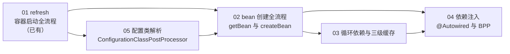
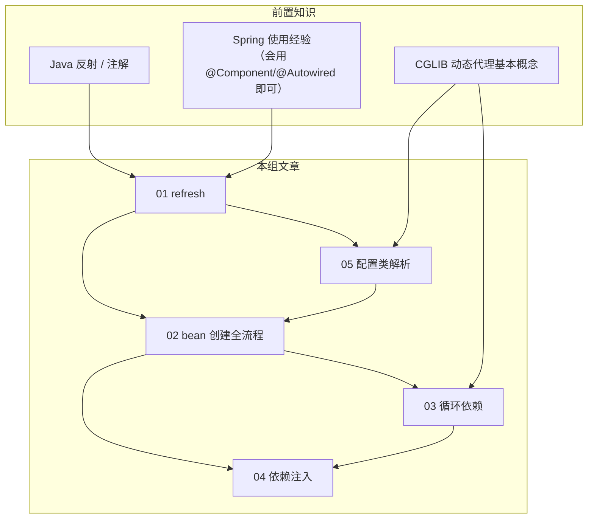

# 01 · IoC 容器与 Bean 生命周期

> 本目录是"Spring 源码解析"教程的第一组。它只回答一个问题：**你在 `@Configuration` / `@Component` 里写的那些注解，究竟是怎么变成一个能用的对象的？**
>
> 结论链条是：`refresh()` 启动容器 → `ConfigurationClassPostProcessor` 把注解翻译成 `BeanDefinition` → `preInstantiateSingletons` 逐个 `getBean` → `doGetBean` / `createBean` / `doCreateBean` 造出对象 → 期间靠三级缓存解开循环依赖、靠 `AutowiredAnnotationBeanPostProcessor` 完成注入。
>
> **源码基线**：Spring Framework **7.1.0**。本目录所有代码块的行号都能在 `../../assets/source/` 里逐字核对（该目录只放机械抓取的原文，禁止手改）。

---

## 学习目标

读完这 5 篇，你应当能够：

1. **按时间顺序讲出一次 `refresh()` 里 Bean 相关动作的全貌**：哪一步注册 `BeanDefinition`、哪一步增强配置类、哪一步实例化单例、哪一步注入属性、哪一步回调初始化。
2. **读懂任何一条 Spring 启动异常栈**：`NoSuchBeanDefinitionException`、`NoUniqueBeanDefinitionException`、`UnsatisfiedDependencyException`、`BeanCurrentlyInCreationException`、`BeanCreationNotAllowedException` 各自在哪一行被抛出、根因是什么。
3. **解释清楚 `@Autowired` 的注入时机与候选选择顺序**，并知道"为什么 `@Priority` 有时不生效"。
4. **判断一段循环依赖代码能否跑通**，并说出"构造器注入为什么无解"的源码依据。
5. **回答"我写的 `@Bean` 方法什么时候被调用"**，并解释 FULL / LITE 配置类的差别与 CGLIB 增强的目的。
6. 在这套源码里**自己下断点、定位下一步该读哪个方法**，而不是靠搜索引擎。

---

## 文章顺序

> **读图说明**：**01 是总纲**（`refresh()` 的 12 步），**05 是上游**（讲清 `BeanDefinition` 是怎么来的），**02 是中轴**（讲清 `BeanDefinition` 怎么变成对象），**03 与 04 是 02 的两个放大镜**（03 放大 `addSingletonFactory`/`getSingleton` 这一段，04 放大 `populateBean` 这一段）。箭头 `E → B` 表示"没有 05 就没有 BeanDefinition"，箭头 `A → B` 表示"没有 01 就不知道 `preInstantiateSingletons` 在什么时机被调用"。**推荐阅读顺序：01 → 05 → 02 → 03 → 04**（但 02 的自洽性很强，先读 02 也不会卡住）。

---

## 每篇一句话摘要

| # | 文章 | 一句话摘要 |
| --- | --- | --- |
| 01 | [refresh 容器启动全流程](01-refresh-容器启动全流程.md) | `AbstractApplicationContext#refresh()` 用模板方法把 12 个步骤编排成一次可回滚的启动流程，`invokeBeanFactoryPostProcessors` 管"图纸"、`registerBeanPostProcessors` 管"钩子"、`finishBeanFactoryInitialization` 管"造对象"。 |
| 02 | [bean 创建全流程：getBean 与 createBean](02-bean-创建全流程-getbean与createbean.md) | `doGetBean` 先查三级缓存、再走作用域分支调用 `createBean`；`createBean` 里的 `resolveBeforeInstantiation` 可以把创建流程**短路**；`doCreateBean` 依次执行"实例化 → 暴露早期引用 → 注入 → 初始化 → 一致性校验"。 |
| 03 | [循环依赖与三级缓存](03-循环依赖与三级缓存.md) | `singletonObjects` / `earlySingletonObjects` / `singletonFactories` 三个 Map 单向流动（三级→二级→一级），让"单例 + 字段注入"的环得以解开；工厂延迟求值是为了让 AOP 只在真需要时才提前代理；构造器注入的环永远无解。 |
| 04 | [依赖注入：@Autowired 与 BeanPostProcessor](04-依赖注入-autowired与beanpostprocessor.md) | `@Autowired` 由 `AutowiredAnnotationBeanPostProcessor` 在 `populateBean` 里完成，候选选择顺序固定为 `@Primary` → 字段名 → `@Qualifier` → `@Priority` → default 候选，集合类型另有 `resolveMultipleBeans` 分支。 |
| 05 | [配置类解析：ConfigurationClassPostProcessor](05-配置类解析-configurationclasspostprocessor.md) | `@Configuration`/`@Bean`/`@ComponentScan`/`@Import` 由 `ConfigurationClassPostProcessor` 在 BFPP 阶段解析成 `BeanDefinition`，FULL 配置类经 CGLIB 增强以拦截 `@Bean` 方法互调；`@Bean` 方法**真正被调用**是在后面的实例化阶段。 |

---

## 依赖关系（读一篇需要先读什么）

> **读图说明**：`K1`/`K3` 是硬前置（不会反射就完全读不懂 `field.set`）；`K2` 只在 03（`getEarlyBeanReference`）与 05（`ConfigurationClassEnhancer`）里需要，先知道"CGLIB 能生成子类并覆盖方法"就够了。**跨文章引用**：02 §3.7 与 §3.8 是 04 的入口；02 §3.6 是 03 的入口；05 §3.8 会把读者送回 02 §3.11。本组之外，后续的 AOP / 事务 / Spring Boot 自动配置都以 05 的 `@Import` 与 `ImportSelector` 为基础。

**外部依赖（本目录尚未覆盖，需要时另行查阅）**：
- `BeanDefinition` 的继承体系（`AbstractBeanDefinition` / `RootBeanDefinition` / `GenericBeanDefinition`）
- `BeanFactoryPostProcessor` 的排序与 `PostProcessorRegistrationDelegate` 的完整逻辑
- `FactoryBean` 的两级缓存（`factoryBeanObjectCache`）
- `BeanWrapper` / 类型转换（`TypeConverter`、`ConversionService`）

---

## 学完能做到什么

以下列的是**可验证的行为**，而不是"了解"：

1. **看异常栈就能定位**：拿到 `UnsatisfiedDependencyException` 时，知道往下翻 `cause`、知道最终可能是 04 篇 §3.10 的 `raiseNoMatchingBeanFound`，并能用 `ctx.getBeanNamesForType(...)` 自查。
2. **能解释启动日志**：看到 `Creating shared instance of singleton bean 'x'`、`Eagerly caching bean 'x'`、`Cannot enhance @Configuration bean definition ... created too early`、`Obtaining singleton bean ... while other thread holds singleton lock` 都能立刻说出对应的类与方法。
3. **能判定循环依赖能否成立**：给出任意一组 Bean 的注入方式（构造器 / 字段 / setter / `@Lazy` / prototype），能直接判断"能起 / 不能起 / 报哪个异常"。
4. **能自己写一个 `BeanPostProcessor` 并选对顺序**：知道 `postProcessBeforeInstantiation`、`postProcessAfterInstantiation`、`postProcessProperties`、`postProcessBeforeInitialization`、`postProcessAfterInitialization` 五个钩子的确切时机与返回值语义。
5. **能判断一个 `@Bean` 方法写法是否正确**：是否需要 `static`、是否应该 `proxyBeanMethods=false`、互调是否安全、方法参数依赖如何解析。
6. **能自己给 Spring 源码下断点**：02 §6 给出了三个关键断点，03 §6 给出两个，04 §6 给出三个，05 §6 给出三个。

---

## 检查点

### 检查点 A：读之前自测（不会就说明需要先补基础）

- [ ] 能说出 `@Component`、`@Autowired`、`@Bean` 三者的用途区别。
- [ ] 知道 Java 反射能读写私有字段（`setAccessible(true)`）。
- [ ] 知道"单例"与"prototype"的作用域差异。

### 检查点 B：读完 01 + 05 后

- [ ] 能不看文章复述 `refresh()` 的 12 步，并指出哪一步做 `BeanDefinition` 注册、哪一步做实例化。
- [ ] 能说出 `ConfigurationClassParser` 与 `ConfigurationClassBeanDefinitionReader` 的分工。
- [ ] 能解释"FULL 配置类为什么要 CGLIB 增强"以及 `proxyBeanMethods=false` 的代价。

### 检查点 C：读完 02 后

- [ ] 能画出 `doGetBean → getSingleton → createBean → doCreateBean → populateBean → initializeBean` 的调用链，并说出每一步的关键行号。
- [ ] 能解释 `resolveBeforeInstantiation` 的短路语义（返回非 null 就直接返回，不走后续生命周期）。
- [ ] 能说出 `doCreateBean` 中"实例化 → 放三级缓存 → 注入 → 初始化"的**顺序为什么不能变**。

### 检查点 D：读完 03 后

- [ ] 能说出三个 Map 的名字、内容与流动方向。
- [ ] 能解释"为什么两级缓存不够"（AOP 提前代理的浪费）。
- [ ] 能解释构造器注入循环依赖无解的源码依据（`addSingletonFactory` 晚于 `createBeanInstance`）。

### 检查点 E：读完 04 后

- [ ] 能背出 `determineAutowireCandidate` 的五级顺序，并知道 `@Priority` 排在字段名之后。
- [ ] 能解释 `postProcessProperties` 返回 `null` 与返回 `pvs` 的区别。
- [ ] 能说出 `@Resource` 与 `@Autowired` 的处理先后顺序与原因。

### 检查点 F：综合实战（能全部完成说明本组已过关）

- [ ] 给一个"两个 `DataSource` Bean + 一个 `@Autowired DataSource` 字段"的场景，写出三种让它正确注入的写法，并说明各自走哪一级判定。
- [ ] 给一个"`A` 与 `B` 互相依赖且 `A` 上有 `@Transactional`"的场景，说明会出现什么异常、为什么、怎么修。
- [ ] 给一个"`@Bean` 方法返回 `BeanDefinitionRegistryPostProcessor`"的场景，说明为何出现 `created too early` 警告。

---

## 本目录源码索引（`assets/source/`）

| 类 | 模块 | 主要出现在 |
| --- | --- | --- |
| `AbstractApplicationContext.java` | spring-context | 01、05 |
| `ConfigurationClassPostProcessor.java` | spring-context | 05 |
| `ConfigurationClassParser.java` | spring-context | 05 |
| `ConfigurationClassBeanDefinitionReader.java` | spring-context | 05 |
| `ConfigurationClassEnhancer.java` | spring-context | 05 |
| `ConfigurationClassUtils.java` | spring-context | 05 |
| `ConfigurationClass.java` | spring-context | 05 |
| `ClassPathBeanDefinitionScanner.java` | spring-context | 05 |
| `AnnotationConfigApplicationContext.java` | spring-context | 01 |
| `AbstractBeanFactory.java` | spring-beans | 02、03 |
| `AbstractAutowireCapableBeanFactory.java` | spring-beans | 02、03、04 |
| `DefaultSingletonBeanRegistry.java` | spring-beans | 02、03 |
| `DefaultListableBeanFactory.java` | spring-beans | 02、04 |
| `AutowiredAnnotationBeanPostProcessor.java` | spring-beans | 04 |

> 核对方式：本目录文章里的每个代码块首行都写着 `(src: 文件名#L起-L止)`，行号对应 `assets/source/` 里机械抓取的原文（原文每行前缀形如 `  123 | 代码`，只保留代码部分即可逐字比对）。
