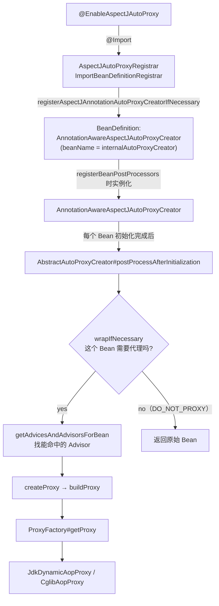
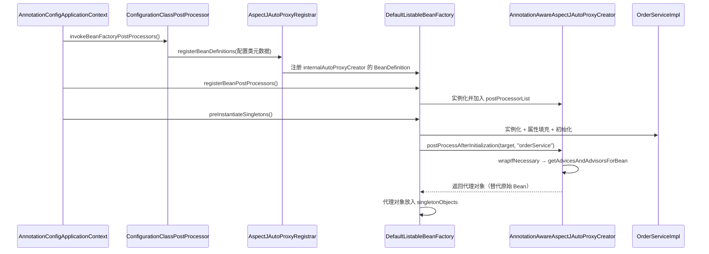
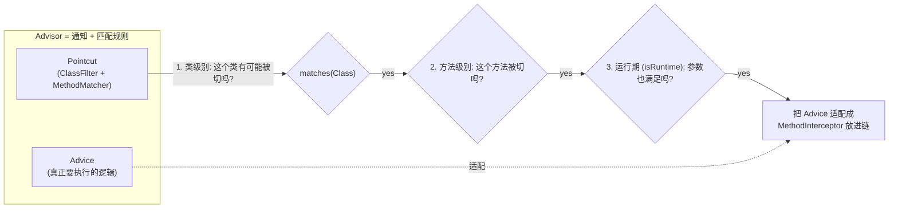

# Spring Framework 源码精读 AOP 01：AOP 原理与自动代理创建（`@EnableAspectJAutoProxy` → `AnnotationAwareAspectJAutoProxyCreator` → `wrapIfNecessary`）

> 一句话结论：Spring AOP 不是一个"编译器"，而是一个**藏在 Bean 初始化后置处理阶段的工厂**——`AnnotationAwareAspectJAutoProxyCreator` 在 `postProcessAfterInitialization` 里判断"这个 Bean 有没有 Advisor 能命中"，命中就把原始对象塞进 `SingletonTargetSource`，再用 `ProxyFactory` 换一个代理对象交给容器。
> 阅读前置：会用 `@Aspect`/`@Around`；知道 Bean 生命周期"实例化 → 属性填充 → 初始化 → 后置处理"；读过本套 `01-IoC容器与Bean生命周期/01-refresh-容器启动全流程.md`
> 预计阅读：40 分钟 ｜ 源码：`org.springframework:spring-aop:7.1.0`、`org.springframework:spring-context:7.1.0`

---

## 0. 先看现象

先写一个最小可运行的例子，把"AOP 到底何时发生"钉死在时间线上：

```text
// 片段：演示用应用代码，非 Spring 源码
@Configuration
@EnableAspectJAutoProxy
public class AppConfig {

    @Bean
    public OrderService orderService() {
        System.out.println("[构造] OrderService 实例化");
        return new OrderServiceImpl();
    }

    @Bean
    public LogAspect logAspect() {
        return new LogAspect();
    }
}
...
@Aspect
public class LogAspect {
    @Around("execution(* com.acme.OrderService.*(..))")
    public Object around(ProceedingJoinPoint pjp) throws Throwable {
        System.out.println("[切面] 进入");
        return pjp.proceed();
    }
}
```

上面这段是"组装现场"：`@Bean` 方法里打印构造日志，便于观察时序。被切的 `OrderService` / `OrderServiceImpl` 是两个独立文件，`pay(String)` 只打印一行业务日志；`LogAspect` 用 `@Around` 包住 `OrderService` 的全部方法。四段代码放在同一个 `com.acme` 包里，`AppConfig` 开了**类路径扫描关闭**的写法（这里用显式 `@Bean`，不需要 `@ComponentScan`），因此不会引入额外变量。

运行 `ctx.getBean(OrderService.class)`，你会观察到三件事：

1. `getBean` 返回的对象 **不是** `OrderServiceImpl`，`getClass()` 打印出来是 `com.sun.proxy.$ProxyXX` 或 `OrderServiceImpl$$SpringCGLIB$$0`；
2. `[构造] OrderService 实例化` 这行日志在 `getBean` 过程中打印，**早于**任何业务调用；
3. 把 `@EnableAspectJAutoProxy` 注释掉，第 1 点立刻消失，第 2 点不受影响。

这三个现象合起来说明：**代理对象是"造 Bean 的最后一道工序"产生的**，业务方法体本身一行都没被改。那这道工序是谁、在哪一行插进去的？这就是本文要回答的全部问题。

## 1. 整体地图

先看调用链全景，从"注解"到"代理对象"：



> 读图说明：这张图里只有一个"横向"入口（注解）和一个"纵向"钩子（Bean 后置处理器）。请注意 `C` 和 `D` 之间跨了一步 `registerBeanPostProcessors`——这正是 IoC 篇里 `refresh()` 的第 6 步。**AOP 的注册发生在第 6 步之前（BeanFactoryPostProcessor 阶段），执行发生在第 11 步（单例预实例化阶段）。**

再看"谁在什么时候做判断"的时序，把它和 IoC 十二步对齐：



> 读图说明：`BF->>APC: postProcessAfterInitialization(...)` 这一条箭头就是"AOP 介入点"。它发生在**目标对象已经完整创建之后**，所以 Spring AOP 永远拿得到"成品 Bean"作为 target；同时也意味着 **AOP 无法改变 Bean 的实例化过程**（构造器里的调用不会被拦截）。

## 2. 关键类逐个拆

### 2.1 `@EnableAspectJAutoProxy` —— 一个"开关 + 两个旋钮"

它本身没有任何逻辑，只是一个 `@Import` 载体加两个布尔属性。

```java (src: EnableAspectJAutoProxy.java#L119-L139)
@Target(ElementType.TYPE)
@Retention(RetentionPolicy.RUNTIME)
@Documented
@Import(AspectJAutoProxyRegistrar.class)
public @interface EnableAspectJAutoProxy {

	/**
	 * Indicate whether subclass-based (CGLIB) proxies are to be created as opposed
	 * to standard Java interface-based proxies. The default is {@code false}.
	 */
	boolean proxyTargetClass() default false;

	/**
	 * Indicate that the proxy should be exposed by the AOP framework as a {@code ThreadLocal}
	 * for retrieval via the {@link org.springframework.aop.framework.AopContext} class.
	 * Off by default, i.e. no guarantees that {@code AopContext} access will work.
	 * @since 4.3.1
	 */
	boolean exposeProxy() default false;

}
```

**这段在干什么**：把一个注解变成两条信息——"要不要开 AOP"（存在即开启）和"代理形态怎么选"（`proxyTargetClass`）、"要不要把代理对象暴露到 `ThreadLocal`"（`exposeProxy`）。

**为什么这样设计**：`@Import` 是 Spring 的"注解 → 注册 BeanDefinition"标准通道。真正的注册逻辑放在 `ImportBeanDefinitionRegistrar` 里，因为注册**一个 BeanDefinition** 这件事无法用普通 `@Bean` 表达——`@Bean` 需要一个用户可见的方法，而这里是框架内部的基础设施 Bean。

**改成别的会怎样**：如果不用 `@EnableAspectJAutoProxy` 而是手工 `new AnnotationAwareAspectJAutoProxyCreator()` 并 `registerSingleton`，第一次 `getBean` 之后注册的后处理器**不会对已创建的 Bean 生效**（等价于 IoC 篇里 "not eligible for getting processed by all BeanPostProcessors" 那条警告），所以"注册时机"必须由容器自己掌控。

**坑**：注解上的 Javadoc 写得很清楚——它**只对本地 `ApplicationContext` 生效**（源码 L104-108 的 Note）。父子容器（Spring MVC 的 root context + `DispatcherServlet` context）里，子容器不会继承父容器的自动代理器，两边都要各自声明。

### 2.2 `AspectJAutoProxyRegistrar` —— 注册"代理制造机"

```java (src: AspectJAutoProxyRegistrar.java#L34-L59)
class AspectJAutoProxyRegistrar implements ImportBeanDefinitionRegistrar {

	/**
	 * Register, escalate, and configure the AspectJ auto proxy creator based on the value
	 * of the @{@link EnableAspectJAutoProxy#proxyTargetClass()} attribute on the importing
	 * {@code @Configuration} class.
	 */
	@Override
	public void registerBeanDefinitions(
			AnnotationMetadata importingClassMetadata, BeanDefinitionRegistry registry) {

		AopConfigUtils.registerAspectJAnnotationAutoProxyCreatorIfNecessary(registry);

		AnnotationAttributes enableAspectJAutoProxy =
				AnnotationConfigUtils.attributesFor(importingClassMetadata, EnableAspectJAutoProxy.class);
		if (enableAspectJAutoProxy != null) {
			if (enableAspectJAutoProxy.getBoolean("proxyTargetClass")) {
				AopConfigUtils.forceAutoProxyCreatorToUseClassProxying(registry);
			}
			if (enableAspectJAutoProxy.getBoolean("exposeProxy")) {
				AopConfigUtils.forceAutoProxyCreatorToExposeProxy(registry);
			}
		}
	}

}
```

**这段在干什么**：`registerAspectJAnnotationAutoProxyCreatorIfNecessary(registry)` 往容器里注册一个 `AnnotationAwareAspectJAutoProxyCreator` 的 BeanDefinition（beanName 固定为 `org.springframework.aop.config.internalAutoProxyCreator`）；接下来两行把注解上的两个旋钮**翻译成该 BeanDefinition 的属性值**。

**为什么方法名带 `IfNecessary`**：这是一个"幂等 + 可升级"的注册。如果容器里已经有自动代理器（例如 XML 的 `<aop:config>` 或是 `@EnableTransactionManagement` 注册的那个），它不会重复注册；如果已存在的那个"能力更弱"（比如是 `InfrastructureAdvisorAutoProxyCreator`），它会把 BeanDefinition 的 class **升级**为更强的 `AnnotationAwareAspectJAutoProxyCreator`。这也是为什么 `@EnableTransactionManagement` 和 `@EnableAspectJAutoProxy` 可以共存而不打架。

**改成别的会怎样**：假设你自己写了 `AopConfigUtils.registerAutoProxyCreatorIfNecessary(registry)`（不带 `AspectJAnnotation`），注册出来的是 `DefaultAdvisorAutoProxyCreator`——它**不认识 `@Aspect`**，`@Around` 全部静默失效，只有实现了 `Advisor` 接口的 Bean 才会被应用。这是"注解不生效"类问题最常见的根因之一。

**坑**：`AnnotationConfigUtils.attributesFor(importingClassMetadata, ...)` 依赖"注解直接写在被导入的配置类上"。如果 `@EnableAspectJAutoProxy` 是写在某个自定义组合注解（meta-annotation）里，Spring 7 的 `attributesFor` 仍然能通过 `MergedAnnotations` 搜索到，但**同一配置类上不能同时出现两个不同取值的同名属性**，否则会被 `AnnotationConfigurationException` 拒绝。

### 2.3 `AbstractAutoProxyCreator` —— 整套机制的骨架

这个类的继承关系决定了它"什么时候被调"：

```java (src: AbstractAutoProxyCreator.java#L95-L110)
@SuppressWarnings("serial")
public abstract class AbstractAutoProxyCreator extends ProxyProcessorSupport
		implements SmartInstantiationAwareBeanPostProcessor, BeanFactoryAware {

	/**
	 * Convenience constant for subclasses: Return value for "do not proxy".
	 * @see #getAdvicesAndAdvisorsForBean
	 */
	protected static final Object @Nullable [] DO_NOT_PROXY = null;

	/**
	 * Convenience constant for subclasses: Return value for
	 * "proxy without additional interceptors, just the common ones".
	 * @see #getAdvicesAndAdvisorsForBean
	 */
	protected static final Object[] PROXY_WITHOUT_ADDITIONAL_INTERCEPTORS = new Object[0];
```

**这段在干什么**：定义了两个"魔法返回值"，让抽象方法 `getAdvicesAndAdvisorsForBean` 用一个 `Object[]` 同时表达三种语义——`null`（完全不用代理）、空数组（只用公共拦截器）、非空数组（用这些专属拦截器）。

**为什么是 `SmartInstantiationAwareBeanPostProcessor`**：这个接口继承自 `InstantiationAwareBeanPostProcessor`，比普通 `BeanPostProcessor` 多了 `predictBeanType`、`determineBeanType`、`determineCandidateConstructors`、`getEarlyBeanReference` 四个"实例化阶段"的钩子。AOP 需要它们，是因为**类型预测**（`@Autowired` 按类型注入时得知道最终是代理类型）和**循环依赖**（提前暴露的必须是代理，不能是裸对象）都必须赶在 Bean 造完之前给答案。

**改成别的会怎样**：如果只实现普通 `BeanPostProcessor`，`@Autowired OrderService` 在循环依赖场景下会注入到**未代理**的 `OrderServiceImpl`，于是切面在那一处引用上完全失效——这是"我明明加了切面，偏偏某个 Service 里没生效"的经典来源。

**坑**：注意 `extends ProxyProcessorSupport`，而 `ProxyProcessorSupport extends ProxyConfig implements Ordered, BeanClassLoaderAware, AopInfrastructureBean`。`AopInfrastructureBean` 是一个**空标记接口**，作用见下文 `isInfrastructureClass`——它保证 AOP 自己的基础设施 Bean 不会把自己代理了（否则会无限递归）。

### 2.4 `AbstractAdvisorAutoProxyCreator` 与 `AnnotationAwareAspectJAutoProxyCreator` —— "找 Advisor"的两级细化

基类只管"把候选 Advisor 全部捞出来 + 排序"，子类再加一层"把 `@Aspect` 转成 Advisor"：

```java (src: AbstractAdvisorAutoProxyCreator.java#L75-L110)
	@Override
	protected Object @Nullable [] getAdvicesAndAdvisorsForBean(
			Class<?> beanClass, String beanName, @Nullable TargetSource targetSource) {

		List<Advisor> advisors = findEligibleAdvisors(beanClass, beanName);
		if (advisors.isEmpty()) {
			return DO_NOT_PROXY;
		}
		return advisors.toArray();
	}
...
	protected List<Advisor> findEligibleAdvisors(Class<?> beanClass, String beanName) {
		List<Advisor> candidateAdvisors = findCandidateAdvisors();
		List<Advisor> eligibleAdvisors = findAdvisorsThatCanApply(candidateAdvisors, beanClass, beanName);
		extendAdvisors(eligibleAdvisors);
		if (!eligibleAdvisors.isEmpty()) {
			try {
				eligibleAdvisors = sortAdvisors(eligibleAdvisors);
			}
			catch (BeanCreationException ex) {
				throw new AopConfigException("Advisor sorting failed with unexpected bean creation, probably due " +
						"to custom use of the Ordered interface. Consider using the @Order annotation instead.", ex);
			}
		}
		return eligibleAdvisors;
	}
```

**这段在干什么**：四步流水线——"捞候选 → 过滤能用的 → 扩展 → 排序"。`DO_NOT_PROXY` 是 `null`，只要一个 Advisor 都没命中就直接返回 `null`，上层的 `wrapIfNecessary` 看到 `null` 就不会创建代理。

**为什么排序异常要转成 `AopConfigException` 并提示 `@Order`**：`sortAdvisors` 用的是 `AnnotationAwareOrderComparator`，它在排序时会**读取 `Ordered` 接口方法的值**，如果你的 `Advisor` Bean 是 `@Scope("prototype")` 或依赖了尚未就绪的 Bean，`getOrder()` 期间可能触发 `BeanCreationException`。框架明确告诉你：用 `@Order` 注解（读注解不需要实例化）比实现 `Ordered` 接口更安全。

**改成别的会怎样**：去掉 `findAdvisorsThatCanApply` 这步（把候选全给代理），那所有 Bean 都会变成代理对象，方法签名都还对，但 `instanceof` 判断、`@Transactional` 之外的自定义类型匹配全部失真，性能也会明显下降——因为**每个 Bean 都在创建时多了一次"类级别匹配 + 建代理"的开销**。

**坑**：`extendAdvisors` 是个空钩子，子类 `AspectJAwareAdvisorAutoProxyCreator` 用它往链头插一个 `ExposeInvocationInterceptor`（前提是链上存在 `AspectJPrecedenceInformation` 类型的 advice）。这一个隐含动作是"`ExposeInvocationInterceptor.currentInvocation()` 为什么总能拿到当前调用"的答案，也是 `AopContext.currentProxy()` 的注释里说"需要 exposeProxy"之外的另一条路。

接着看子类如何把 `@Aspect` 变成候选：

```java (src: AnnotationAwareAspectJAutoProxyCreator.java#L76-L110)
	@Override
	protected void initBeanFactory(ConfigurableListableBeanFactory beanFactory) {
		super.initBeanFactory(beanFactory);
		if (this.aspectJAdvisorFactory == null) {
			this.aspectJAdvisorFactory = new ReflectiveAspectJAdvisorFactory(beanFactory);
		}
		this.aspectJAdvisorsBuilder =
				new BeanFactoryAspectJAdvisorsBuilderAdapter(beanFactory, this.aspectJAdvisorFactory);
	}


	@Override
	protected List<Advisor> findCandidateAdvisors() {
		// Add all the Spring advisors found according to superclass rules.
		List<Advisor> advisors = super.findCandidateAdvisors();
		// Build Advisors for all AspectJ aspects in the bean factory.
		if (this.aspectJAdvisorsBuilder != null) {
			advisors.addAll(this.aspectJAdvisorsBuilder.buildAspectJAdvisors());
		}
		return advisors;
	}

	@Override
	protected boolean isInfrastructureClass(Class<?> beanClass) {
		// Previously we setProxyTargetClass(true) in the constructor, but that has too
		// broad an impact. Instead we now override isInfrastructureClass to avoid proxying
		// aspects. I'm not entirely happy with that as there is no good reason not
		// to advise aspects, except that it causes advice invocation to go through a
		// proxy, and if the aspect implements, for example, the Ordered interface it will be
		// proxied by that interface and fail at runtime as the advice method is not
		// defined on the interface. We could potentially relax the restriction about
		// not advising aspects in the future.
		return (super.isInfrastructureClass(beanClass) ||
				(this.aspectJAdvisorFactory != null && this.aspectJAdvisorFactory.isAspect(beanClass)));
	}
```

**这段在干什么**：`findCandidateAdvisors` 在父类"扫描实现了 `Advisor` 接口的 Bean"之外，多扫一遍"所有带 `@Aspect` 的 Bean"，用 `ReflectiveAspectJAdvisorFactory` 把每个通知方法包装成 `Advisor`。`isInfrastructureClass` 则把 `@Aspect` 类自身排除在代理之外。

**为什么切面自己不能被代理**：注释罕见地写了作者的真实纠结——如果切面被代理（尤其是它恰好实现了 `Ordered` 之类接口，JDK 代理会只暴露那个接口），那么"通过代理调用 advice 方法"就会因为"advice 方法不在接口上"而在运行期炸掉。所以宁可一刀切：切面类不做代理。

**改成别的会怎样**：如果你自定义一个 `AbstractAutoProxyCreator` 子类但忘了覆写 `isInfrastructureClass`，而你的 `Advisor` Bean 恰好又实现了业务接口，就可能出现"Advisor 被自己代理 → 调用 `getAdvice()` 时递归 → `StackOverflowError`"。

**坑**：`initBeanFactory` 里的 `BeanFactoryAspectJAdvisorsBuilderAdapter` 内部带 `volatile List<Advisor> cachedAdvisors` 缓存，**第一次调用就把所有切面的 Advisor 建好并缓存**。这意味着：运行期动态往容器里 `registerSingleton` 一个新的 `@Aspect` Bean，**不会被自动发现**。需要新切面请走 `Advised` 接口的 `addAdvisor`。

### 2.5 `Advisor` / `Pointcut` / `Advice` —— 三者关系必须一次说清

这是 AOP 里最容易被面试问倒的概念，用一张"三层漏斗"图说清：



> 读图说明：**`Advisor` 是打包单位，`Pointcut` 是"在哪切"，`Advice` 是"切了干什么"。** 三级判断分别在三个不同时机发生：第 1 级在**创建代理时**（决定这个 Bean 要不要代理），第 2 级在**建拦截器链时**（决定这个方法的方法体是否被包），第 3 级在**每次调用时**（`args()` 这类依赖运行期参数的表达式）。

三者的代码契约（不需要背，理解层次即可）：

| 概念 | 接口/类 | 关键方法 | 回答的问题 |
| --- | --- | --- | --- |
| `Advice` | `org.aopalliance.aop.Advice`（空标记） | 无 | "做什么" |
| `Pointcut` | `org.springframework.aop.Pointcut` | `getClassFilter()`、`getMethodMatcher()` | "在哪做" |
| `Advisor` | `org.springframework.aop.Advisor` | `getAdvice()`、`isPerInstance()` | "把前两者打包" |
| `PointcutAdvisor` | 子接口 | `getPointcut()` | 带匹配规则的 Advisor |
| `IntroductionAdvisor` | 子接口 | `getClassFilter()`、`getInterfaces()` | 引入（declare parents）专用 |

**一句话记忆**：`Advisor = Pointcut + Advice`；`@Aspect` 类里的每个通知方法最终都会被包装成一个 `InstantiationModelAwarePointcutAdvisorImpl`（一个 `PointcutAdvisor`）。

**坑**：`Advice` 是**空接口**，所以"一个实现了 `MethodInterceptor` 的 Bean"既是 `Advice` 又是 `Interceptor`，它的 `Pointcut` 是 `TruePointcut`（全匹配）——这就是"任何 Bean 直接实现 `MethodInterceptor` 后放进容器，就自动对所有 Bean 全切"的原因，也是调试时最容易被意外触发的行为。

### 2.6 `AspectJExpressionPointcut` —— 一个类同时扮演三个角色

它是整个 AOP 里"职责最多"的类：

```java (src: AspectJExpressionPointcut.java#L88-L98)
	private static final Set<PointcutPrimitive> SUPPORTED_PRIMITIVES = Set.of(
			PointcutPrimitive.EXECUTION,
			PointcutPrimitive.ARGS,
			PointcutPrimitive.REFERENCE,
			PointcutPrimitive.THIS,
			PointcutPrimitive.TARGET,
			PointcutPrimitive.WITHIN,
			PointcutPrimitive.AT_ANNOTATION,
			PointcutPrimitive.AT_WITHIN,
			PointcutPrimitive.AT_ARGS,
			PointcutPrimitive.AT_TARGET);
```

**这段在干什么**：声明 Spring AOP **支持哪些 AspectJ 切点指示符**。注意 `EXECUTION` 在第一位——它是唯一"真正意义上的方法执行"指示符，其它都是"条件限定"。

**为什么只有这些**：`call()`、`get()`、`set()`、`initialization()`、`handler()`、`cflow()`、`cflowbelow()`、`percflow`、`if()`、`adviceexecution()` 都**不支持**，因为 Spring AOP 只在"方法执行"这一个 join point 上工作（代理只能拦截方法调用）。这就是为什么 `@Aspect` 里写 `call(* *(..))` 会在启动时报 `UnsupportedPointcutPrimitiveException`。

**改成别的会怎样**：`initializePointcutParser` 额外调用 `registerPointcutDesignatorHandler(new BeanPointcutDesignatorHandler())`（源码 L242-248），把 Spring 私有的 `bean()` 指示符注册进去。你需要用 `bean(**)` 只切某个 beanName 时靠的就是它——但它**不在** `SUPPORTED_PRIMITIVES` 里，是通过 handler 机制注册的，所以两者并不矛盾。

**坑**：`replaceBooleanOperators`（L257-262）会把表达式里的 `" and "`、`" or "`、`" not "` 替换成 `&&`、`||`、`!`。因此在**注解**里写 `and` 能跑，但在 XML 里写 `&&` 需要转义成 `&amp;&amp;`。两种写法混用会让人怀疑人生。

再看它如何做方法匹配，这是"为什么 `@Around` 只对某些方法生效"的答案：

```java (src: AspectJExpressionPointcut.java#L308-L343)
	@Override
	public boolean matches(Method method, Class<?> targetClass, boolean hasIntroductions) {
		ShadowMatch shadowMatch = getTargetShadowMatch(method, targetClass);

		// Special handling for this, target, @this, @target, @annotation
		// in Spring - we can optimize since we know we have exactly this class,
		// and there will never be matching subclass at runtime.
		if (shadowMatch.alwaysMatches()) {
			return true;
		}
		else if (shadowMatch.neverMatches()) {
			return false;
		}
		else {
			// the maybe case
			if (hasIntroductions) {
				return true;
			}
			// A match test returned maybe - if there are any subtype sensitive variables
			// involved in the test (this, target, at_this, at_target, at_annotation) then
			// we say this is not a match as in Spring there will never be a different
			// runtime subtype.
			RuntimeTestWalker walker = getRuntimeTestWalker(shadowMatch);
			return (!walker.testsSubtypeSensitiveVars() || walker.testTargetInstanceOfResidue(targetClass));
		}
	}

	@Override
	public boolean matches(Method method, Class<?> targetClass) {
		return matches(method, targetClass, false);
	}

	@Override
	public boolean isRuntime() {
		return obtainPointcutExpression().mayNeedDynamicTest();
	}
```

**这段在干什么**：把 AspectJ 匹配器的三种结果（`alwaysMatches` / `neverMatches` / `maybe`）翻译成 Spring 需要的布尔值。`maybe` 是 AspectJ 的正常输出（"静态看不出来，得等运行期"），Spring 在这里**主动把它压成布尔**，因为 Spring AOP 的"类"在运行期就是那个确切的类，不可能再出现子类替换。

**为什么需要 `RuntimeTestWalker`**：`maybe` 的来源通常是 `this(Foo)` / `target(Foo)` / `@annotation` 这类"子类型敏感"的残留条件。`walker.testsSubtypeSensitiveVars()` 告诉你"这里残留的确实是子类型判断"，那么就用 `testTargetInstanceOfResidue(targetClass)` 在**已知目标类**上把它算掉。

**改成别的会怎样**：如果把 `maybe` 一律当成 `true`，`execution(* FooService+.*(..))`（`+` 表示子类型）会对任何名字匹配的类都生效；如果一律当成 `false`，`@annotation` 类切点会在某些场景静默失效。

**坑**：`isRuntime()` 返回 `true` 的切点（典型是带 `args()`、`@args()`，或 `@target`/`target` 引用了需要绑定的对象），会让整条链在**每次调用**都重做一次匹配（见下一篇 `ReflectiveMethodInvocation#proceed` 里的 `InterceptorAndDynamicMethodMatcher` 分支）。这不是 bug，但会带来可测量的性能差异——所以**能用静态切点就别用 `args()` 绑参数**，需要参数时优先 `@annotation` + 方法参数。

`matches(Class)` 与 `matches(Method,...)` 的分工还要补一句：前者走 `couldMatchJoinPointsInType`（只问"这个类里**可能**有连接点吗"），是**粗筛**；后者才是**精筛**。粗筛失败时整个 Bean 不会被代理——这就是"类级别不匹配时连代理都不会创建"的源码依据。

## 3. 源码逐段精读

### 3.1 挂载点：`postProcessAfterInitialization`

这是 AOP 唯一的"入口闸门"，只有 9 行：

```java (src: AbstractAutoProxyCreator.java#L284-L293)
	@Override
	public @Nullable Object postProcessAfterInitialization(@Nullable Object bean, String beanName) {
		if (bean != null) {
			Object cacheKey = getCacheKey(bean.getClass(), beanName);
			if (this.earlyBeanReferences.remove(cacheKey) != bean) {
				return wrapIfNecessary(bean, beanName, cacheKey);
			}
		}
		return bean;
	}
```

**这段在干什么**：Bean 初始化完成后的回调。先算缓存 key，再判断"这个 Bean 是不是在循环依赖里已经被提前代理过了"——如果是，`earlyBeanReferences.remove(cacheKey)` 会返回那个早期引用，和当前 `bean` **相等**，于是直接返回 `bean`（其实是代理），不再重复包一层。

**为什么必须这样判断**：循环依赖场景下，`getEarlyBeanReference` 已经调用过 `wrapIfNecessary` 生成了代理 P 并交给对方；现在原 Bean 初始化完了，如果再来一次 `wrapIfNecessary`，就会得到"代理的代理"P'，而对方持有的是 P——两个引用不等，容器一致性被破坏。这 3 行是**双检机制的核心**。

**改成别的会怎样**：把 `!=` 改成 `==`（即"相等也代理"），循环依赖下会出现两个不同代理实例；把这段删掉，则循环依赖里的代理会被包两层，`@Around` 会执行两次——"切面执行了两遍"的经典现象。

**坑**：`getCacheKey` 在 7.0.2 之后返回 `ComposedCacheKey(beanClass, beanName)`（源码 L305-312 与其后的 `record ComposedCacheKey`）。**7.0.1 及更早只按 beanName 或只按 class 缓存**，所以在同类型多 Bean 的场景下会出现缓存串扰。排查老版本问题时要留意这个差异。

### 3.2 决策枢纽：`wrapIfNecessary`

```java (src: AbstractAutoProxyCreator.java#L321-L345)
	protected Object wrapIfNecessary(Object bean, String beanName, Object cacheKey) {
		if (StringUtils.hasLength(beanName) && this.targetSourcedBeans.contains(beanName)) {
			return bean;
		}
		if (Boolean.FALSE.equals(this.advisedBeans.get(cacheKey))) {
			return bean;
		}
		if (isInfrastructureClass(bean.getClass()) || shouldSkip(bean.getClass(), beanName)) {
			this.advisedBeans.put(cacheKey, Boolean.FALSE);
			return bean;
		}

		// Create proxy if we have advice.
		Object[] specificInterceptors = getAdvicesAndAdvisorsForBean(bean.getClass(), beanName, null);
		if (specificInterceptors != DO_NOT_PROXY) {
			this.advisedBeans.put(cacheKey, Boolean.TRUE);
			Object proxy = createProxy(
					bean.getClass(), beanName, specificInterceptors, new SingletonTargetSource(bean));
			this.proxyTypes.put(cacheKey, proxy.getClass());
			return proxy;
		}

		this.advisedBeans.put(cacheKey, Boolean.FALSE);
		return bean;
	}
```

**这段在干什么**：五道闸门依次放行——① 走自定义 `TargetSource` 的 Bean 跳过（它的代理在 `postProcessBeforeInstantiation` 就造好了）；② 上次已判定"不代理"的直接跳过（用 `advisedBeans` 缓存）；③ 基础设施类 / `xxx.ORIGINAL` 后缀跳过；④ 找 Advisor，全都不命中则记 `FALSE` 并原样返回；⑤ 有 Advisor 就 `createProxy`，并把"原始 Bean"用 `SingletonTargetSource` 包成 target。

**为什么用 `SingletonTargetSource` 而不是直接存 target 字段**：`TargetSource` 是一个**策略接口**，`SingletonTargetSource` 只是最朴素的一种（永远返回同一个对象）。原型池、热替换、`@Scope("request")` 的代理都靠换 `TargetSource` 实现。把"拿目标对象"这件事抽出去，代理只需知道"每次调用问一下 `getTarget()`"。

**改成别的会怎样**：如果这里 `new SingletonTargetSource(bean)` 换成 `null`，`DefaultAopProxyFactory` 会因"拿不到 targetClass 也没有接口"抛 `AopConfigException: TargetSource cannot determine target class`。这个异常信息就是判断"代理为什么没建起来"的第一线索。

**坑**：`advisedBeans` 缓存的是 `Boolean.FALSE/TRUE` 而不是 Advisor 列表。所以**即使你在运行期往容器里加了新切面，某个 Bean 已经被判定 `FALSE` 就永远不代理了**。验证方法：看 `Advised` 接口，`getBean(...)` 返回的对象如果连 `Advised` 都不是，说明它当初就走了 `FALSE` 分支。

### 3.3 排除规则：哪些 Bean 绝不代理

```java (src: AbstractAutoProxyCreator.java#L359-L384)
	protected boolean isInfrastructureClass(Class<?> beanClass) {
		boolean retVal = Advice.class.isAssignableFrom(beanClass) ||
				Pointcut.class.isAssignableFrom(beanClass) ||
				Advisor.class.isAssignableFrom(beanClass) ||
				AopInfrastructureBean.class.isAssignableFrom(beanClass);
		if (retVal && logger.isTraceEnabled()) {
			logger.trace("Did not attempt to auto-proxy infrastructure class [" + beanClass.getName() + "]");
		}
		return retVal;
	}

	/**
	 * Subclasses should override this method to return {@code true} if the
	 * given bean should not be considered for auto-proxying by this post-processor.
	 * <p>Sometimes we need to be able to avoid this happening, for example, if it will lead to
	 * a circular reference or if the existing target instance needs to be preserved.
	 * This implementation returns {@code false} unless the bean name indicates an
	 * "original instance" according to {@code AutowireCapableBeanFactory} conventions.
	 * @param beanClass the class of the bean
	 * @param beanName the name of the bean
	 * @return whether to skip the given bean
	 * @see org.springframework.beans.factory.config.AutowireCapableBeanFactory#ORIGINAL_INSTANCE_SUFFIX
	 */
	protected boolean shouldSkip(Class<?> beanClass, String beanName) {
		return AutoProxyUtils.isOriginalInstance(beanName, beanClass);
	}
```

**这段在干什么**：把"AOP 自己用来工作的零件"排除掉——任何 `Advice`、`Pointcut`、`Advisor`、`AopInfrastructureBean` 都不代理。`shouldSkip` 再补一条：名字以 `.ORIGINAL` 结尾的 Bean（`getBean("foo.ORIGINAL")` 语义）跳过。

**为什么必须排除**：代理一个 `Advisor` 会导致"为了判断是否代理它而需要调用它自己的 `getPointcut()`，而调用它又需要先代理它"的循环。这是**框架自举**（bootstrapping）问题的标准解法：基础设施类先于使用者完成。

**改成别的会怎样**：移除 `AopInfrastructureBean` 判断，则 `AnnotationAwareAspectJAutoProxyCreator` **自己**也会被当成候选 Bean 送去 `wrapIfNecessary`，直接无限递归。如果你写的自定义 BPP 也带 `AopInfrastructureBean`，它就不会被 AOP 代理——这也是"给 BPP 加 `@Transactional` 无效"的原因。

**坑**：`shouldSkip` 是 `protected` 的**扩展点**。`@EnableTransactionManagement` 之外的场景（例如需要"某个 Bean 永不代理"），可以继承 `AnnotationAwareAspectJAutoProxyCreator` 覆写它，然后用 `AopConfigUtils` 注册自己的子类。这比在切点表达式里写一堆 `!bean(xxx)` 更可靠。

### 3.4 造代理：`createProxy` → `buildProxy`

```java (src: AbstractAutoProxyCreator.java#L440-L466)
	private Object buildProxy(Class<?> beanClass, @Nullable String beanName,
			Object @Nullable [] specificInterceptors, TargetSource targetSource, boolean classOnly) {

		if (this.beanFactory instanceof ConfigurableListableBeanFactory clbf) {
			AutoProxyUtils.exposeTargetClass(clbf, beanName, beanClass);
		}

		ProxyFactory proxyFactory = new ProxyFactory();
		proxyFactory.copyFrom(this);
		proxyFactory.setFrozen(false);

		if (shouldProxyTargetClass(beanClass, beanName)) {
			proxyFactory.setProxyTargetClass(true);
		}
		else {
			Class<?>[] ifcs = (this.beanFactory instanceof ConfigurableListableBeanFactory clbf ?
					AutoProxyUtils.determineExposedInterfaces(clbf, beanName) : null);
			if (ifcs != null) {
				proxyFactory.setProxyTargetClass(false);
				for (Class<?> ifc : ifcs) {
					proxyFactory.addInterface(ifc);
				}
			}
			if (ifcs != null ? ifcs.length == 0 : !proxyFactory.isProxyTargetClass()) {
				evaluateProxyInterfaces(beanClass, proxyFactory);
			}
		}
```

**这段在干什么**：为每个 Bean 现场 new 一个 `ProxyFactory`，把自动代理器上的配置（`proxyTargetClass`、`exposeProxy`、`optimize`、`opaque` 等）用 `copyFrom(this)` 拷过来，然后决定"接口从哪来"：优先用 `@EnableAspectJAutoProxy` 或 `@Bean(proxyBeanMethods)` 之类暴露的接口清单；没有清单就调 `evaluateProxyInterfaces` 自动探测。

**为什么每个 Bean 都新建一个 `ProxyFactory`**：`ProxyFactory` 是**可变的一次性配置对象**（`setFrozen(false)` 明确表示"还会再改"）。它是 `AdvisedSupport` 的子类，直接持有 `targetSource`、`interfaces`、`advisors` 三个可写集合。复用会有严重的并发问题。

**改成别的会怎样**：`evaluateProxyInterfaces` 在 `ProxyProcessorSupport` 里（源码 L97-116），它会遍历目标类的所有接口，**过滤掉 `Opaque` 之后的 `isConfigurationCallbackInterface`（`BeanFactoryAware` 等容器回调）和 `isInternalLanguageInterface`（`GroovyObject` 等）**；一个"合理接口"都没有时，主动 `setProxyTargetClass(true)`。所以"类没实现接口"时会自动转 CGLIB——这个"自动降级"就发生在这里，而不是在 `DefaultAopProxyFactory` 里。

**坑**：`AutoProxyUtils.exposeTargetClass(clbf, beanName, beanClass)` 把原始类记进 `BeanDefinition` 的属性里，供后续 `getBean(Class)` 按类型查找时使用。如果你自己 `new ProxyFactory()` 手搓代理，绕过了这一步，`getBean(OrderServiceImpl.class)` 会因为"容器里只有 `$ProxyXX`"而失败。

接着看最后一段：

```java (src: AbstractAutoProxyCreator.java#L478-L494)
		Advisor[] advisors = buildAdvisors(beanName, specificInterceptors);
		proxyFactory.addAdvisors(advisors);
		proxyFactory.setTargetSource(targetSource);
		customizeProxyFactory(proxyFactory);

		proxyFactory.setFrozen(isFrozen());
		if (advisorsPreFiltered()) {
			proxyFactory.setPreFiltered(true);
		}

		// Use original ClassLoader if bean class not locally loaded in overriding class loader
		ClassLoader classLoader = getProxyClassLoader();
		if (classLoader instanceof SmartClassLoader smartClassLoader && classLoader != beanClass.getClassLoader()) {
			classLoader = smartClassLoader.getOriginalClassLoader();
		}
		return (classOnly ? proxyFactory.getProxyClass(classLoader) : proxyFactory.getProxy(classLoader));
	}
```

**这段在干什么**：装 Advisor 数组 → 设 TargetSource → 调 `customizeProxyFactory` 钩子 → 冻结（`isFrozen()` 默认 `false`，只有在 AOT 等场景才冻结）→ 标记"Advisor 已按类预过滤"（`AbstractAdvisorAutoProxyCreator` 返回 `true`，所以运行期可以跳过 `ClassFilter`）→ 最后 `getProxy(classLoader)` 真正生成代理。

**为什么 `preFiltered` 是个性能开关**：`setPreFiltered(true)` 告诉 `DefaultAdvisorChainFactory`：这些 Advisor 在创建代理时已经用 `ClassFilter` 筛过一遍了，建链时**不用再调 `matches(actualClass)`**。这省掉的是每次方法调用前的类级别匹配。

**改成别的会怎样**：`classOnly ? getProxyClass : getProxy` 这个三元表达式是 7.0 之后为 `determineBeanType` 服务的路径（`createProxyClass`，源码 L434-438），只生成 Class 不生成实例。它在 `predictBeanType` 场景下被调用——如果你好奇"为什么有时候会看到 `$$SpringCGLIB$$` 类被加载但对象没建"，答案就是这条分支。

**坑**：`getProxyClassLoader()` 那段 `SmartClassLoader` 处理是**跨 ClassLoader 热部署**（Devtools）的关键。表现为：某次改代码之后，旧的 bean class 被新的 ClassLoader 加载，代理类却生成在老 ClassLoader 里，于是 `ClassCastException`。Devtools 重启后就不会出现；生产环境不会触发。

### 3.5 `@Aspect` → `Advisor` 的翻译过程

关键的一步是把 `@Around("execution(...)")` 变成 `PointcutAdvisor`：

```java (src: ReflectiveAspectJAdvisorFactory.java#L74-L95)
	// Exclude @Pointcut methods
	private static final MethodFilter adviceMethodFilter = ReflectionUtils.USER_DECLARED_METHODS
			.and(method -> (AnnotationUtils.getAnnotation(method, Pointcut.class) == null));

	private static final Comparator<Method> adviceMethodComparator;

	static {
		// Note: although @After is ordered before @AfterReturning and @AfterThrowing,
		// an @After advice method will actually be invoked after @AfterReturning and
		// @AfterThrowing methods due to the fact that AspectJAfterAdvice.invoke(MethodInvocation)
		// invokes proceed() in a `try` block and only invokes the @After advice method
		// in a corresponding `finally` block.
		Comparator<Method> adviceKindComparator = new ConvertingComparator<Method, @Nullable Annotation>(
				new InstanceComparator<>(
						Around.class, Before.class, After.class, AfterReturning.class, AfterThrowing.class),
				method -> {
					AspectJAnnotation ann = AbstractAspectJAdvisorFactory.findAspectJAnnotationOnMethod(method);
					return (ann != null ? ann.getAnnotation() : null);
				});
		Comparator<Method> methodNameComparator = new ConvertingComparator<>(Method::getName);
		adviceMethodComparator = adviceKindComparator.thenComparing(methodNameComparator);
	}
```

**这段在干什么**：定义"哪些方法是通知方法"（用户声明的方法里、**不是** `@Pointcut` 的），以及"多个通知方法之间的排序规则"：先按注解种类 `@Around → @Before → @After → @AfterReturning → @AfterThrowing`，同一种注解内再按**方法名字母序**。

**为什么同类注解要按方法名排序**：注释里那句"since Java 7 the 'current position' is not valid"（L136-143）说明了原因——JDK 7 起 `getDeclaredMethods()` 返回顺序不再保证等于源码顺序。为了"不同 JVM 启动得到相同通知顺序"，只能改用**确定性的键**：注解类型 + 方法名。副作用是 `@Before` 有多个时，`abc()` 一定排在 `xyz()` 前面，而不是"源码里谁先写谁先执行"。

**改成别的会怎样**：如果只按 `InstanceComparator` 排序不加名字兜底，同类注解的顺序会随 JVM 浮动，导致"本地测试正常、线上偶发异常"——这是很难查的一类 bug。反过来，如果你**必须**控制同类注解的执行顺序，可靠做法是把它们拆到多个切面并用 `@Order` 控制（`@Order` 作用于切面级别，不受方法名排序影响）。

**坑**：`@After` 排在 `@AfterReturning` / `@AfterThrowing` **之前**（注意 `Around, Before, After, AfterReturning, AfterThrowing` 这个顺序）、但**实际执行在后**——因为 `AspectJAfterAdvice` 是在 `finally` 里调 advice 的。这个"声明顺序 ≠ 执行顺序"的错位是 Spring AOP 里最经典的坑，下一篇会展开。

然后是真正体：

```java (src: ReflectiveAspectJAdvisorFactory.java#L200-L238)
	@Override
	public @Nullable Advisor getAdvisor(Method candidateAdviceMethod, MetadataAwareAspectInstanceFactory aspectInstanceFactory,
			int declarationOrderInAspect, String aspectName) {

		validate(aspectInstanceFactory.getAspectMetadata().getAspectClass());

		AspectJExpressionPointcut expressionPointcut = getPointcut(
				candidateAdviceMethod, aspectInstanceFactory.getAspectMetadata().getAspectClass());
		if (expressionPointcut == null) {
			return null;
		}

		try {
			return new InstantiationModelAwarePointcutAdvisorImpl(expressionPointcut, candidateAdviceMethod,
					this, aspectInstanceFactory, declarationOrderInAspect, aspectName);
		}
		catch (IllegalArgumentException | IllegalStateException ex) {
			if (logger.isDebugEnabled()) {
				logger.debug("Ignoring incompatible advice method: " + candidateAdviceMethod, ex);
			}
			return null;
		}
	}

	private @Nullable AspectJExpressionPointcut getPointcut(Method candidateAdviceMethod, Class<?> candidateAspectClass) {
		AspectJAnnotation aspectJAnnotation =
				AbstractAspectJAdvisorFactory.findAspectJAnnotationOnMethod(candidateAdviceMethod);
		if (aspectJAnnotation == null) {
			return null;
		}

		AspectJExpressionPointcut ajexp =
				new AspectJExpressionPointcut(candidateAspectClass, new String[0], new Class<?>[0]);
		ajexp.setExpression(aspectJAnnotation.getPointcutExpression());
		if (this.beanFactory != null) {
			ajexp.setBeanFactory(this.beanFactory);
		}
		return ajexp;
	}
```

**这段在干什么**：每个通知方法建一个 `AspectJExpressionPointcut`（把注解里的字符串塞进 `expression`），然后连同"切面实例工厂 + 方法 + 声明顺序 + 切面名"打包成 `InstantiationModelAwarePointcutAdvisorImpl`。

**为什么要把 `beanFactory` 传进 `AspectJExpressionPointcut`**：`AspectJExpressionPointcut#determinePointcutClassLoader`（源码 L209-217）优先用 `ConfigurableBeanFactory.getBeanClassLoader()` 来解析表达式。这保证了"表达式里的类名"和"容器里的类"用同一个 ClassLoader 解析——在多模块、插件化、Devtools 场景下这是正确性前提。

**改成别的会怎样**：`catch (IllegalArgumentException | IllegalStateException)` 把"不兼容的 advice 方法"降级成 **debug 日志 + 返回 null**，而不是抛异常。所以：**写了签名错误的通知方法，切面不会启动失败，只会静默跳过**。如果你的切面"完全没生效"，先把日志级别开到 `debug` 看有没有 `Ignoring incompatible advice method`。

**坑**：`new AspectJExpressionPointcut(candidateAspectClass, new String[0], new Class<?>[0])` 两个空数组意味着**不支持在注解里引用带参数的具名切点**（`@Before("myPointcut()")` 且 `myPointcut` 有参数时）。这是 Spring AOP 与完整 AspectJ 的一个能力差距。

最后是"按注解种类分派具体 Advice 实现"：

```java (src: ReflectiveAspectJAdvisorFactory.java#L266-L299)
		AbstractAspectJAdvice springAdvice;

		switch (aspectJAnnotation.getAnnotationType()) {
			case AtPointcut -> {
				if (logger.isDebugEnabled()) {
					logger.debug("Processing pointcut '" + candidateAdviceMethod.getName() + "'");
				}
				return null;
			}
			case AtAround -> springAdvice = new AspectJAroundAdvice(
					candidateAdviceMethod, expressionPointcut, aspectInstanceFactory);
			case AtBefore -> springAdvice = new AspectJMethodBeforeAdvice(
					candidateAdviceMethod, expressionPointcut, aspectInstanceFactory);
			case AtAfter -> springAdvice = new AspectJAfterAdvice(
					candidateAdviceMethod, expressionPointcut, aspectInstanceFactory);
			case AtAfterReturning -> {
				springAdvice = new AspectJAfterReturningAdvice(
						candidateAdviceMethod, expressionPointcut, aspectInstanceFactory);
				AfterReturning afterReturningAnnotation = (AfterReturning) aspectJAnnotation.getAnnotation();
				if (StringUtils.hasText(afterReturningAnnotation.returning())) {
					springAdvice.setReturningName(afterReturningAnnotation.returning());
				}
			}
			case AtAfterThrowing -> {
				springAdvice = new AspectJAfterThrowingAdvice(
						candidateAdviceMethod, expressionPointcut, aspectInstanceFactory);
				AfterThrowing afterThrowingAnnotation = (AfterThrowing) aspectJAnnotation.getAnnotation();
				if (StringUtils.hasText(afterThrowingAnnotation.throwing())) {
					springAdvice.setThrowingName(afterThrowingAnnotation.throwing());
				}
			}
			default -> throw new UnsupportedOperationException(
					"Unsupported advice type on method: " + candidateAdviceMethod);
		}
```

**这段在干什么**：五种注解分别对应五个 `AbstractAspectJAdvice` 子类；`@AfterReturning` 额外记录 `returning` 参数名，`@AfterThrowing` 额外记录 `throwing` 参数名（这两个名字决定了通知方法能拿到返回值/异常）。

**为什么不用一个通用类 + 枚举**：这五个子类的**执行语义完全不同**（`try/finally`、`try/catch`、`proceed` 包裹、纯前置），把它们压成一个类只能靠 switch 分支，反而更难读。用多态让 `invoke(MethodInvocation)` 各自实现，这是典型的**策略模式**——下一篇的"拦截器链"正是靠这个把 `@Around` 和 `@Before` 统一成 `MethodInterceptor`。

**改成别的会怎样**：`@Pointcut` 返回 `null` 而不是抛异常，因为 `@Pointcut` 方法本身**不是通知**，它的作用只是"给别处引用"。注意 `adviceMethodFilter` 已经在扫描阶段排除了 `@Pointcut`，这个 case 只是最后一道保险。

**坑**：`@AfterReturning(returning = "ret")` 里的 `ret` 必须和通知方法的参数名一致；Java 编译时必须保留参数名（`-parameters`，Spring Boot 的 `spring-boot-starter-parent` 默认开启）。不加 `-parameters` 时会报 `AspectJInvocationException: Mismatch on arguments to advice method`——这个异常信息来自 `AbstractAspectJAdvice#invokeAdviceMethodWithGivenArgs` 的 `catch (IllegalArgumentException)`（源码 L650-654）。

## 4. 完整执行时序

把前面所有片段拼成一次"从容器启动到第一次调用"的完整时序：

| 阶段 | 位置 | 关键动作 | 观察点 |
| --- | --- | --- | --- |
| 1 | `ConfigurationClassPostProcessor` | 解析配置类，发现 `@Import(AspectJAutoProxyRegistrar)` | 断点 `AspectJAutoProxyRegistrar#registerBeanDefinitions` |
| 2 | `AspectJAutoProxyRegistrar` | 注册 `internalAutoProxyCreator` 的 BeanDefinition（含两个旋钮属性） | 看 `registry.getBeanDefinitionNames()` 是否含该名字 |
| 3 | `registerBeanPostProcessors` | 实例化该 BPP，`setBeanFactory` → `initBeanFactory` → 创建 `ReflectiveAspectJAdvisorFactory` | 断点 `initBeanFactory` |
| 4 | `preInstantiateSingletons` | 逐个创建 Bean：实例化 → 填充 → `Aware` → `@PostConstruct` | — |
| 5 | `postProcessAfterInitialization` | AOP 闸门：算 cacheKey、查 earlyBeanReferences | 断点此处，看 `beanName` |
| 6 | `wrapIfNecessary` | 五道闸门 → `getAdvicesAndAdvisorsForBean` | 看 `specificInterceptors` 是 null 还是数组 |
| 7 | `findEligibleAdvisors` | 捞候选（含 `buildAspectJAdvisors`）→ 过滤 → 排序 | 断点 `findAdvisorsThatCanApply` |
| 8 | `AopUtils.findAdvisorsThatCanApply` | `AspectJExpressionPointcut.matches(Class)` **粗筛** | 粗筛不过 → 无代理 |
| 9 | `createProxy` → `buildProxy` | `ProxyFactory` 配置 + `buildAdvisors` | 看 `proxyFactory.isProxyTargetClass()` |
| 10 | `proxyFactory.getProxy` | 委派 `AopProxyFactory` 造 JDK/CGLIB 代理 | 看 `getClass()` 是 `$Proxy` 还是 `$$SpringCGLIB$$` |
| 11 | `proxyTypes.put` / `advisedBeans.put` | 记缓存，返回代理给容器 | `singletonObjects` 里已是代理 |

**粗筛与精筛的时机差异**是这张表里最值得记住的一行：第 8 步只做"这个类有没有可能被切"（`couldMatchJoinPointsInType`），第 9 步之后才在每个方法调用时做精筛。这解释了为什么"切点写错但类名恰好匹配"时，代理**照样会被创建**——只是每次调用都不命中，白白多一层反射调用。

## 5. 设计模式与取舍

| 模式 | 体现 | 学到什么 |
| --- | --- | --- |
| 后置处理器（拓展点） | `postProcessAfterInitialization` | 不改代码就"换掉"对象：框架留的钩子比继承更值钱 |
| 抽象工厂 | `AopProxyFactory` / `AopProxy` | 造代理的算法完全可替换 |
| 模板方法 | `AbstractAutoProxyCreator` 固定流程，`getAdvicesAndAdvisorsForBean` 抽象 | 骨架复用 + 策略下放 |
| 策略 | `TargetSource`、`Pointcut`、`MethodMatcher` | "拿目标""在哪切"都能换 |
| 组合 | `Advisor = Pointcut + Advice` | 两个小接口拼出一个可打包概念 |
| 责任链 | 下一篇的 `ReflectiveMethodInvocation#proceed` | 拦截器链可任意增删重排 |
| 缓存 | `advisedBeans`、`proxyTypes`、`ShadowMatchUtils` | AOP 是热路径，一切重复计算都要缓存 |

**取舍**：Spring AOP 选择"运行期代理"而不是"编译期织入"，代价是**只能拦方法调用**（拦不到字段访问、构造器、同类自调用），收益是**零构建侵入**——不需要 AspectJ 编译器插件，任何普通 `javac` 产物都能用。如果你的需求必须拦构造器或私有方法，正确选择是 `aspectjweaver` 的 LTW（加载期织入），本文这套机制就完全用不上了。

另一个取舍是"**先造对象再换代理**"：Bean 被完整创建（包括 `@PostConstruct`）之后才被包起来。这意味着 `@PostConstruct` 里的方法调用**不会**被切面拦到——很多人第一次写切面就踩这个坑。

## 6. 踩坑与调试

1. **`@Aspect` 没生效**：先确认 `@EnableAspectJAutoProxy` 在该 `ApplicationContext` 上（父子容器要各加一次）。再确认 `aspectjweaver` 在 classpath——注解 L110-112 明确要求它存在，`spring-aop` 本身只把它当可选依赖。
2. **切面 Bean 没被扫描到**：`@Aspect` 只是标记，不是 `@Component`。需要 `@Aspect + @Component`（或 `@Bean` 显式注册）。
3. **断点打在哪**：`AbstractAutoProxyCreator#wrapIfNecessary` 第 1 行。用条件断点 `beanName.equals("orderService")`，然后 `Evaluate Expression` 看 `getAdvicesAndAdvisorsForBean(...)` 的返回值——`null` 就是"没命中"。
4. **看缓存状态**：`advisedBeans` 是 `ConcurrentHashMap`，`FALSE` 说明"曾经判定不代理"。如果某 Bean 应该是代理却不是，先看这个 map 里有没有它（说明早期被判定过）。
5. **打开 trace 日志**：`logging.level.org.springframework.aop=TRACE`。会看到 `Did not attempt to auto-proxy infrastructure class`、`Creating implicit proxy for bean 'xxx' with N common interceptors and M specific interceptors` 等关键行。
6. **`UnsupportedPointcutPrimitiveException`**：用了 `call()`/`cflow()` 等不支持的指示符，回到 §2.6 的 `SUPPORTED_PRIMITIVES` 对照。
7. **表达式解析失败静默**：`matches(Class)` 里 `pointcutParsingFailed = true` 后**永远返回 false**（源码 L296-301），此后不再重试。表现为"启动不报错、切面全程不生效"。看到这个现象优先怀疑表达式语法。
8. **`@Aspect` 里的 `@Value` 注入为 null**：切面 Bean 是在"第一次 `findCandidateAdvisors`"时被提前拉起来的，可能早于某些 BPP 就绪。用 `ObjectProvider` 延迟获取，或把切面依赖的东西换到别的 Bean 里。
9. **`@Order` 不生效**：`@Order` 作用在**切面类**（即 `Advisor` 层面）才有意义，写在通知方法上无效。方法级顺序只由"注解种类 + 方法名"决定。
10. **AOP 让 `@Autowired` 变慢或循环依赖报错**：`getEarlyBeanReference` 提前生成了代理，务必不要在切面里注入被切 Bean 自身（会形成 `BeanCurrentlyInCreationException`）。

## 7. ⚠️ 版本差异

| 版本 | 差异 |
| --- | --- |
| Spring 4.x | `CglibAopProxy` 走 `enhancer.create()`；`proxyTargetClass` 默认 `false`；`ComposedCacheKey` 不存在 |
| Spring 5.x | 引入 `@EnableAspectJAutoProxy` 的 `exposeProxy`（4.3.1）；开始支持 `@Order` 排序 Advisor |
| Spring 6.0 | JDK 17 基线；`ObjenesisCglibAopProxy` 成为默认；`ProxyConfig` 的布尔字段全部改为 `@Nullable Boolean`（可从 BeanDefinition 属性"未设置"状态区分） |
| Spring 6.1.15+ | 新增 `spring.aop.ajc.ignore` 开关（`AbstractAspectJAdvisorFactory#IGNORE_AJC_PROPERTY_NAME`），用于避免 ajc 编译过的切面被**双重执行** |
| Spring 7.0.2 | `getCacheKey` 改为 `ComposedCacheKey(beanClass, beanName)`，修掉同类型多 Bean 的缓存串扰 |
| Spring 7.1 | `DefaultAopProxyFactory` / `DefaultAdvisorChainFactory` 均提供 `INSTANCE` 单例；`AspectJExpressionPointcut` 实现 `IntroductionAwareMethodMatcher`；CGLIB 代码在 `spring-core` 内（`org.springframework.cglib`），不再有独立 `cglib` 依赖 |

## 8. 面试高频问与答

1. **Spring AOP 在哪个阶段创建代理？** → Bean 初始化完成后的 `postProcessAfterInitialization`；循环依赖场景下会更早，在 `getEarlyBeanReference`。
2. **`Advisor`、`Pointcut`、`Advice` 什么关系？** → `Advisor = Pointcut + Advice`；`Pointcut` 由 `ClassFilter + MethodMatcher` 组成，回答"在哪切"；`Advice` 回答"做什么"。
3. **为什么 Spring AOP 只能拦方法？** → 代理只能在"方法调用"这一层插入；字段访问、构造器、`static` 初始化都不经过代理对象。
4. **`@EnableAspectJAutoProxy` 到底做了什么？** → 通过 `@Import(AspectJAutoProxyRegistrar)` 注册 `AnnotationAwareAspectJAutoProxyCreator`，并把 `proxyTargetClass` / `exposeProxy` 写进它的 BeanDefinition。
5. **切面自己会不会被代理？** → 不会。`AnnotationAwareAspectJAutoProxyCreator#isInfrastructureClass` 把 `@Aspect` 类排除，原因见源码注释（避免 advice 方法因接口代理而不可达）。
6. **`AspectJExpressionPointcut` 的 `maybe` 分支为什么能压成布尔？** → Spring AOP 的目标类在运行期是确定的那一个类，不存在子类替换，所以用 `RuntimeTestWalker` 在已知 `targetClass` 上把子类型残留条件算掉。
7. **为什么 `advisedBeans` 缓存能让"新加切面"失效？** → 缓存的是"是否代理"的结论，`FALSE` 一旦写入就不会再变；要动态加切面得走 `Advised#addAdvisor`。
8. **`SingletonTargetSource` 有什么意义？** → 把"拿目标对象"抽象成 `TargetSource`，单例只是最简实现；池化、热替换、request scope 全都靠换 TargetSource。
9. **`preFiltered` 省了什么？** → 建链时跳过 `ClassFilter.matches(actualClass)`，因为创建代理时已按类筛过。
10. **为什么 `@Aspect` 类里的通知方法要按方法名排序？** → JDK 7 起 `getDeclaredMethods()` 无序，为保证跨 JVM 启动的通知顺序确定，排序键改为"注解种类 + 方法名"。
11. **父子容器下切面为什么可能失效？** → `@EnableAspectJAutoProxy` 只对本地 `ApplicationContext` 生效，子容器需要重新声明。
12. **想让某个 Bean 永不代理，怎么做？** → 覆写 `shouldSkip`，或让 Bean 实现 `AopInfrastructureBean`，或在切点里加 `!bean(xxx)`（最不可靠）。

## 9. 动手练习

1. **看代理类型**：写一个实现接口的 Service 和一个不实现接口的 Service，都给它们加切面，打印 `getBean(...).getClass()`。**验收**：能说出第一个是 `com.sun.proxy.$ProxyNN`、第二个是 `XxxService$$SpringCGLIB$$0`，并指出 `evaluateProxyInterfaces` 在其中的作用。
2. **让切面静默失效**：把 `@Before("execution(* *(..))")` 改成 `@Before("call(* *(..))")`，观察启动行为。**验收**：能解释为什么"不报错但完全不生效"，并定位到 `matches(Class)` 的 `pointcutParsingFailed` 分支。
3. **验证缓存**：给某个 Bean 加一个"只在运行期注册"的 Advisor（通过 `Advised#addAdvisor`），对比"启动前就存在的切面"和"运行期加的切面"生效差异。**验收**：能说出 `advisedBeans` 缓存在哪一行写入。
4. **画一次完整调用链**：在 `wrapIfNecessary`、`createProxy`、`ProxyFactory#getProxy` 三处打断点，记录 `beanName` 与 `Advisor` 数量。**验收**：能填出本文 §4 那张 11 行时序表的每一行。
5. **不加 `@Component`**：只写 `@Aspect` 不写 `@Component`，运行并解释。**验收**：能说出 `findCandidateAdvisors` 里 `BeanFactoryUtils.beanNamesForTypeIncludingAncestors(beanFactory, Advisor.class, ...)` 为什么找不到它。

## 小结

- Spring AOP 是一个**藏在 `postProcessAfterInitialization` 里的工厂**：判断 → 找 Advisor → `ProxyFactory#getProxy` → 用代理替换原始 Bean。
- `@EnableAspectJAutoProxy` → `AspectJAutoProxyRegistrar` → 注册 `AnnotationAwareAspectJAutoProxyCreator`（升级式、幂等注册），两个旋钮是 `proxyTargetClass` 与 `exposeProxy`。
- `wrapIfNecessary` 的五道闸门（TargetSource → 缓存 → 基础设施 → 找 Advisor → 造代理）是所有"为什么没代理"问题的排查地图。
- `Advisor = Pointcut + Advice`；`Pointcut` 的类级别粗筛在**创建代理时**，方法级别精筛在**建链时**，运行期匹配在**每次调用时**。
- `AspectJExpressionPointcut` 同时是 `ClassFilter`、`MethodMatcher`、`IntroductionAwareMethodMatcher`，用 AspectJ 的 `ShadowMatch` 做匹配，并主动把 `maybe` 压成布尔。
- 代理创建后，原始 Bean 被包进 `SingletonTargetSource`——所以 `@PostConstruct` 内的自调用不会被切。

## 自测题

> 先自己想答案，再点开每题的"参考答案"对照；每道题的依据都能在前文找到对应源码行。

**1. `@EnableAspectJAutoProxy` 通过什么机制注册自动代理器？注册的 beanName 是什么？**

<details><summary>参考答案</summary>

`@Import(AspectJAutoProxyRegistrar.class)`，由 `ImportBeanDefinitionRegistrar` 调用 `AopConfigUtils.registerAspectJAnnotationAutoProxyCreatorIfNecessary(registry)`，beanName 是 `org.springframework.aop.config.internalAutoProxyCreator`。

</details>

**2. `wrapIfNecessary` 里五道闸门分别是什么？哪一道会写 `advisedBeans` 缓存？**

<details><summary>参考答案</summary>

① 自定义 `TargetSource` 的 Bean 跳过；② `advisedBeans` 为 `FALSE` 跳过；③ 基础设施类 / `shouldSkip` 跳过；④ 找 Advisor，`DO_NOT_PROXY` 则写 `FALSE`；⑤ 有 Advisor 则 `createProxy` 并写 `TRUE`。

</details>

**3. 为什么 `postProcessAfterInitialization` 里要判断 `earlyBeanReferences.remove(cacheKey) != bean`？**

<details><summary>参考答案</summary>

循环依赖时 `getEarlyBeanReference` 已生成代理并交给对方；若此处再包一层会产生"代理的代理"，与原引用不等，破坏容器一致性。

</details>

**4. `DO_NOT_PROXY` 与 `PROXY_WITHOUT_ADDITIONAL_INTERCEPTORS` 的区别是什么？**

<details><summary>参考答案</summary>

`DO_NOT_PROXY`（`null`）= 完全不代理；`PROXY_WITHOUT_ADDITIONAL_INTERCEPTORS`（空数组）= 只用 `interceptorNames` 配置的公共拦截器，不用 Bean 专属的。

</details>

**5. `isInfrastructureClass` 排除的四类接口中，哪一个是为了防"框架自举递归"？**

<details><summary>参考答案</summary>

`AopInfrastructureBean`。自动代理器本身实现了它，所以不会被自己代理，避免无限递归。

</details>

**6. `AspectJExpressionPointcut` 用哪些手段把 AspectJ 的 `maybe` 变成确定性布尔值？**

<details><summary>参考答案</summary>

`alwaysMatches`/`neverMatches` 直接返回；`maybe` 时用 `hasIntroductions` 短路，再用 `RuntimeTestWalker#testsSubtypeSensitiveVars` + `testTargetInstanceOfResidue(targetClass)` 在已知目标类上求值。

</details>

**7. `SUPPORTED_PRIMITIVES` 里没有 `call()`，如果写了会发生什么？**

<details><summary>参考答案</summary>

表达式解析抛 `UnsupportedPointcutPrimitiveException`，被 `matches(Class)` 捕获后置 `pointcutParsingFailed = true` 并返回 `false`，此后永不重试——不报错但全程不生效。

</details>

**8. 为什么 `@Aspect` 类不会被自动代理？源码注释给出的原因是什么？**

<details><summary>参考答案</summary>

因为 advice 方法通常不在切面实现的接口上，一旦切面被 JDK 代理（例如它实现了 `Ordered`），通过代理调用 advice 时运行期会失败。见 `AnnotationAwareAspectJAutoProxyCreator#isInfrastructureClass` 注释。

</details>

**9. `preFiltered = true` 在哪一层省掉了什么计算？**

<details><summary>参考答案</summary>

在 `DefaultAdvisorChainFactory` 建链时省掉 `pointcutAdvisor.getPointcut().getClassFilter().matches(actualClass)` 这类级别匹配。

</details>

**10. 为什么"运行期动态注册的 `@Aspect` Bean"不会被自动发现？**

<details><summary>参考答案</summary>

`BeanFactoryAspectJAdvisorsBuilderAdapter` 内部有 `cachedAdvisors` 缓存，第一次 `buildAspectJAdvisors()` 后不再重新扫描。

</details>

**11. 通知方法的排序键为什么是"注解种类 + 方法名"而不是"声明顺序"？**

<details><summary>参考答案</summary>

因为 JDK 7 起 `getDeclaredMethods()` 不再保证源码顺序；用"注解种类 + 方法名"作为确定性键，保证跨 JVM 启动的 advice 顺序一致。

</details>

**12. `evaluateProxyInterfaces` 在什么情况下会主动切到 CGLIB？**

<details><summary>参考答案</summary>

当目标类没有任何"合理接口"时（所有接口都是容器回调 `isConfigurationCallbackInterface` 或 `isInternalLanguageInterface`，或接口无方法），`evaluateProxyInterfaces` 主动 `setProxyTargetClass(true)`。

</details>
