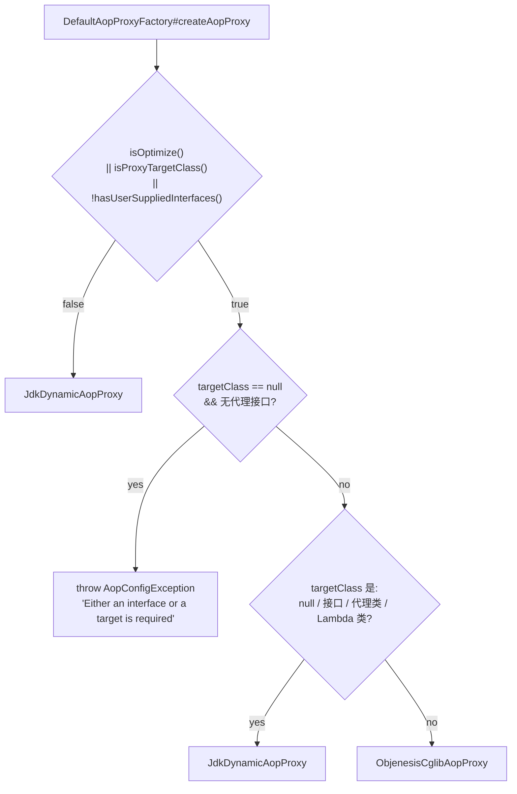
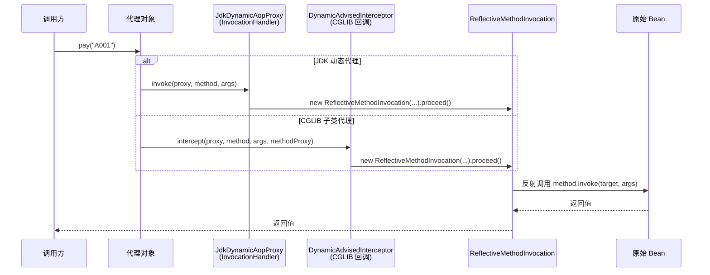

# Spring Framework 源码精读 AOP 02：代理方式 —— JDK 与 CGLIB 的选择与实现

> 一句话结论：`DefaultAopProxyFactory` 是一个只有 15 行的**二选一开关**——`proxyTargetClass`/`optimize`/无自定义接口三者任一为真就走"类代理"分支，再排除掉"接口本身 / 已是代理类 / Lambda 类"之后落到 CGLIB；JDK 代理靠 `java.lang.reflect.Proxy` + `InvocationHandler`，CGLIB 靠**生成子类 + 方法重写 + `MethodProxy`**，因此 `final` 天然无解。
> 阅读前置：读过 [01-aop-原理与自动代理创建](./01-aop-原理与自动代理创建.md)；知道 `java.lang.reflect.Proxy` 的基本用法
> 预计阅读：45 分钟 ｜ 源码：`org.springframework:spring-aop:7.1.0`、`org.springframework:spring-core:7.1.0`（CGLIB）

---

## 0. 先看现象

先把"选择结果"用最直白的方式打印出来：

```text
public interface PayService {
    void pay(String orderNo);
}

public class PayServiceImpl implements PayService {
    @Override
    public void pay(String orderNo) {
        System.out.println("pay " + orderNo);
    }
}

public static class FinalPayService {           // 没有接口
    public final void pay(String orderNo) {     // 注意 final
        System.out.println("final pay " + orderNo);
    }
}

public static class PlainService {              // 没有接口，也没 final
    public void pay(String orderNo) {
        System.out.println("plain pay " + orderNo);
    }
}
```

用 `AspectJProxyFactory` 手工造代理（绕开容器，变量最少）：

```java
// 片段：演示用法，非 Spring 源码
public static Object proxyOf(Class<?> targetClass) {
    AspectJProxyFactory factory = new AspectJProxyFactory(targetClass);
    factory.addAspect(new LogAspect());
    return factory.getProxy();
}
```

三种调用结果：

| 目标类型 | `proxyOf(...).getClass()` | `pay` 是否被切面拦到 |
| --- | --- | --- |
| `PayServiceImpl`（有接口） | `jdk.proxy2.$Proxy12`（JDK 17+） | ✅ 是 |
| `FinalPayService`（无接口、final 方法） | `FinalPayService$$SpringCGLIB$$0` | ❌ 否，**且启动只打一行 warn** |
| `PlainService`（无接口、普通方法） | `PlainService$$SpringCGLIB$$0` | ✅ 是 |

第二行是最让人迷惑的：**代理对象生成了，但 `final` 方法根本没被拦**。CGLIB 不会失败，只会"跳过这一个方法"——因为子类无法重写 `final` 方法，只能继承。这就是为什么排查这类问题必须看日志，而不是看"有没有报错"。

## 1. 整体地图

先看二选一的决策树：



> 读图说明：注意**第一个判断是"或"关系**——只要 `!hasUserSuppliedInterfaces()`（用户没指定任何接口）成立，就进入"类代理"分支。这就是"我的 Bean 没实现接口，所以自动变成 CGLIB"的源码依据；反过来，"Bean 实现了接口且 `proxyTargetClass=false`"会从左边直接走 JDK，连 `targetClass` 都不看。

再看两种代理在运行期如何把一次方法调用变成拦截器链：



> 读图说明：两条分支**最终汇合到同一行**——`new ReflectiveMethodInvocation(proxy, target, method, args, targetClass, chain).proceed()`。这个收敛点是 Spring AOP 设计的精髓：代理技术可以换，拦截器链机制只有一份。

## 2. 关键类逐个拆

### 2.1 `DefaultAopProxyFactory` —— 决策全部逻辑

```java (src: DefaultAopProxyFactory.java#L28-L54)
 * <p>Creates a CGLIB proxy if one the following is true for a given
 * {@link AdvisedSupport} instance:
 * <ul>
 * <li>the {@code optimize} flag is set
 * <li>the {@code proxyTargetClass} flag is set
 * <li>no proxy interfaces have been specified
 * </ul>
 *
 * <p>In general, specify {@code proxyTargetClass} to enforce a CGLIB proxy,
 * or specify one or more interfaces to use a JDK dynamic proxy.
 *
 * @author Rod Johnson
 * @author Juergen Hoeller
 * @author Sebastien Deleuze
 * @author Sam Brannen
 * @since 12.03.2004
 * @see AdvisedSupport#setOptimize
 * @see AdvisedSupport#setProxyTargetClass
 * @see AdvisedSupport#setInterfaces
 */
public class DefaultAopProxyFactory implements AopProxyFactory, Serializable {

	/**
	 * Singleton instance of this class.
	 * @since 6.0.10
	 */
	public static final DefaultAopProxyFactory INSTANCE = new DefaultAopProxyFactory();
```

**这段在干什么**：类注释把规则写成了三条"或"条件，并在 7.1 里提供了一个无状态单例 `INSTANCE`（因为判断逻辑纯函数化，没有实例字段）。

**为什么要提供单例**：Spring 6.0.10 起，`ProxyFactory`/`AdvisedSupport` 的默认 `aopProxyFactory` 直接指向 `INSTANCE`，避免每建一个 `ProxyFactory` 就 new 一个工厂对象。AOT 与 GraalVM native image 场景下，减少对象分配是可见收益。

**改成别的会怎样**：自己实现 `AopProxyFactory` 并 `proxyFactory.setAopProxyFactory(myFactory)`，可以插入第三种代理技术（例如字节码生成的自定义代理）。这是唯一的官方扩展点——但注意 `getProxy()` 返回的对象必须实现 `SpringProxy` 与 `Advised`（见 `AopProxyUtils.completeProxiedInterfaces`），否则容器里的很多类型判断会失效。

**坑**：注释里"no proxy interfaces have been specified"非常关键——`AdvisedSupport#addInterface` 加进去的 `SpringProxy`/`Advised` 两个标记接口**不算**"用户指定"。判断用的是 `hasUserSuppliedInterfaces()`，它会排除 `SpringProxy` 与 `IntroductionAdvisor` 引入的接口，见 §2.2。

### 2.2 `AdvisedSupport` —— "有没有用户指定接口"

```java (src: AdvisedSupport.java#L268-L275)
	boolean hasUserSuppliedInterfaces() {
		for (Class<?> ifc : this.interfaces) {
			if (!SpringProxy.class.isAssignableFrom(ifc) && !isAdvisorIntroducedInterface(ifc)) {
				return true;
			}
		}
		return false;
	}
```

**这段在干什么**：遍历代理接口集合，只要发现一个"不是 `SpringProxy` 且不是引入接口"的接口，就认为用户确实指定了接口 → 可以走 JDK 代理。

**为什么排除 `SpringProxy`**：`SpringProxy` 是 Spring 自己追加的**标记接口**（`interface SpringProxy {}`，无任何方法），目的是让 `AopUtils.isAopProxy(bean)` 只需一次 `instanceof` 就能判断"这是不是 Spring 造的代理"。它不算业务接口。

**改成别的会怎样**：如果这里只判 `!this.interfaces.isEmpty()`，那么**每个被代理的 Bean 都会自动带上 `SpringProxy`**，导致条件永远为真 → 永远走 CGLIB，JDK 代理彻底失效。这是一个极小的判断写错就会导致"代理方式全变"的例子。

**坑**：`AopProxyUtils.completeProxiedInterfaces` 追加接口的顺序也有讲究——先**过滤掉 `sealed` 接口**（`ifc.isSealed()`，源码 L207-210），再追加 `SpringProxy`、`Advised`、`DecoratingProxy`。因为 JDK 17 起**密封接口不能被动态代理实现**（`Proxy.newProxyInstance` 会抛 `IllegalArgumentException: ... is sealed`）。

### 2.3 决策代码本体：`createAopProxy`

```java (src: DefaultAopProxyFactory.java#L59-L76)
	@Override
	public AopProxy createAopProxy(AdvisedSupport config) throws AopConfigException {
		if (config.isOptimize() || config.isProxyTargetClass() || !config.hasUserSuppliedInterfaces()) {
			Class<?> targetClass = config.getTargetClass();
			if (targetClass == null && config.getProxiedInterfaces().length == 0) {
				throw new AopConfigException("TargetSource cannot determine target class: " +
						"Either an interface or a target is required for proxy creation.");
			}
			if (targetClass == null || targetClass.isInterface() ||
					Proxy.isProxyClass(targetClass) || ClassUtils.isLambdaClass(targetClass)) {
				return new JdkDynamicAopProxy(config);
			}
			return new ObjenesisCglibAopProxy(config);
		}
		else {
			return new JdkDynamicAopProxy(config);
		}
	}
```

**这段在干什么**：先分两大类；进入"类代理"分支后，先做**空值/非法组合**的防御（既没 targetClass 也没接口 → 无从下手，直接抛），再做**"虽然要求类代理，但目标本身必须用 JDK 代理"**的四连排除，最后才 `new ObjenesisCglibAopProxy`。

**为什么"要求类代理"还要排除这四种**：`targetClass` 是接口时你没法"生成接口的子类"；`targetClass` 已经是 JDK 代理类（`Proxy.isProxyClass`）时再继承没有意义；`Lambda` 类是 `final` 且运行时生成，CGLIB 无法继承。这四处是"看起来该走 CGLIB 但实际只能走 JDK"的兜底。

**改成别的会怎样**：把 `Proxy.isProxyClass(targetClass)` 判断去掉，就会出现"对已经是 JDK 代理的对象再做 CGLIB 子类"的情况，代理接口全在父类上、`Advised` 语义开始错乱，运行期 `ClassCastException` 频繁出现。这类问题在"手动 `new ProxyFactory(existingProxy)`"的代码里最容易遇到。

**坑**：`new ObjenesisCglibAopProxy(config)` —— 注意**不是** `new CglibAopProxy(config)`。`ObjenesisCglibAopProxy` 是包私有子类（`class ObjenesisCglibAopProxy extends CglibAopProxy`），它绕过了"必须有无参构造器"的限制。这也是"为什么现在拦截一个**没有无参构造器**的类也能成功"的原因。

### 2.4 `JdkDynamicAopProxy` —— 一个 `InvocationHandler` 撑起全部

它同时实现 `AopProxy` 和 `InvocationHandler`，`getProxy` 只做一件事：

```java (src: JdkDynamicAopProxy.java#L116-L154)
	@Override
	public Object getProxy(@Nullable ClassLoader classLoader) {
		if (logger.isTraceEnabled()) {
			logger.trace("Creating JDK dynamic proxy: " + this.advised.getTargetSource());
		}
		return Proxy.newProxyInstance(determineClassLoader(classLoader), this.cache.proxiedInterfaces, this);
	}

	@SuppressWarnings("deprecation")
	@Override
	public Class<?> getProxyClass(@Nullable ClassLoader classLoader) {
		return Proxy.getProxyClass(determineClassLoader(classLoader), this.cache.proxiedInterfaces);
	}

	/**
	 * Determine whether the JDK bootstrap or platform loader has been suggested ->
	 * use higher-level loader which can see Spring infrastructure classes instead.
	 */
	private ClassLoader determineClassLoader(@Nullable ClassLoader classLoader) {
		if (classLoader == null) {
			// JDK bootstrap loader -> use spring-aop ClassLoader instead.
			return getClass().getClassLoader();
		}
		if (classLoader.getParent() == null) {
			// Potentially the JDK platform loader on JDK 9+
			ClassLoader aopClassLoader = getClass().getClassLoader();
			ClassLoader aopParent = aopClassLoader.getParent();
			while (aopParent != null) {
				if (classLoader == aopParent) {
					// Suggested ClassLoader is ancestor of spring-aop ClassLoader
					// -> use spring-aop ClassLoader itself instead.
					return aopClassLoader;
				}
				aopParent = aopParent.getParent();
			}
		}
		// Regular case: use suggested ClassLoader as-is.
		return classLoader;
	}
```

**这段在干什么**：把 `AdvisedSupport` 里已经算好的接口数组（`this.cache.proxiedInterfaces`，来自 `AopProxyUtils.completeProxiedInterfaces`）交给 JDK 的 `Proxy.newProxyInstance`，第三个参数是 `this`——代理对象上的**所有方法调用**都会回到 `invoke`。

**为什么接口数组要缓存**：构造器（源码 L94-108）会检查 `config.proxyMetadataCache` 是不是 `ProxiedInterfacesCache`，是就复用，否则新建并回写。这个缓存跨多次 `getProxy` 共享，避免重复做"扫描全部接口 + 过滤 sealed + 追加标记接口"的工作。

**改成别的会怎样**：`determineClassLoader` 的 `null` 分支很值得注意——如果传来 `null`（bootstrap loader），它会**改用 spring-aop 的 ClassLoader**。否则代理类由 bootstrap loader 定义，看不见 Spring 的 `Advised` 接口，`Proxy.newProxyInstance` 直接抛 `IllegalArgumentException: interface ... is not visible from class loader`。

**坑**：`Proxy.getProxyClass` 从 JDK 9 起被标记为 `deprecated`（源码上就带 `@SuppressWarnings("deprecation")`），它只生成 Class 不生成实例。这条路径服务于 `createProxyClass`（AOT / 类型预测），日常不会走到。

真正的"总入口"是 `invoke`：

```java (src: JdkDynamicAopProxy.java#L162-L203)
	@Override
	public @Nullable Object invoke(Object proxy, Method method, Object[] args) throws Throwable {
		Object oldProxy = null;
		boolean setProxyContext = false;

		TargetSource targetSource = this.advised.targetSource;
		Object target = null;

		try {
			if (!this.cache.equalsDefined && AopUtils.isEqualsMethod(method)) {
				// The target does not implement the equals(Object) method itself.
				return equals(args[0]);
			}
			else if (!this.cache.hashCodeDefined && AopUtils.isHashCodeMethod(method)) {
				// The target does not implement the hashCode() method itself.
				return hashCode();
			}
			else if (method.getDeclaringClass() == DecoratingProxy.class) {
				// There is only getDecoratedClass() declared -> dispatch to proxy config.
				return AopProxyUtils.ultimateTargetClass(this.advised);
			}
			else if (!this.advised.isOpaque() && method.getDeclaringClass().isInterface() &&
					method.getDeclaringClass().isAssignableFrom(Advised.class)) {
				// Service invocations on ProxyConfig with the proxy config...
				return AopUtils.invokeJoinpointUsingReflection(this.advised, method, args);
			}

			Object retVal;

			if (this.advised.isExposeProxy()) {
				// Make invocation available if necessary.
				oldProxy = AopContext.setCurrentProxy(proxy);
				setProxyContext = true;
			}

			// Get as late as possible to minimize the time we "own" the target,
			// in case it comes from a pool.
			target = targetSource.getTarget();
			Class<?> targetClass = (target != null ? target.getClass() : null);

			// Get the interception chain for this method.
			List<Object> chain = this.advised.getInterceptorsAndDynamicInterceptionAdvice(method, targetClass);
```

**这段在干什么**：四类"特殊方法"先分流（`equals`、`hashCode`、`DecoratingProxy#getDecoratedClass`、`Advised` 接口上的管理方法），它们**不进拦截器链**；然后按需把代理对象放进 `ThreadLocal`（`exposeProxy`）；接着**尽可能晚**地拿 target，并按方法算拦截器链。

**为什么 `equals`/`hashCode` 要特殊处理**：JDK 代理的 `equals` 如果不特判，会被当成业务方法进链，`@Around` 里一调 `equals` 就可能无限递归。而且两个代理对象如果代理的是同一个 target，它们应该"相等"——所以 `JdkDynamicAopProxy#equals`（源码 L260-280）支持"对方是另一个 JDK 代理时取出它的 `InvocationHandler`"再比较 `advised`。

**改成别的会怎样**：删掉 `isExposeProxy()` 那段，`AopContext.currentProxy()` 会抛 `IllegalStateException: Cannot find current proxy`；而"同类自调用"就没有任何可行的 `AopContext` 解法（详见 03 篇）。

**坑**：`AopUtils.invokeJoinpointUsingReflection(this.advised, method, args)` 这一行是"在代理对象上调用 `getTargetSource()`、`getAdvisors()` 能拿到真实配置"的原因。它也意味着 **`Advised` 接口上的方法永远不会被切面拦截**——想拦 `getAdvisors()` 是不可能的。

接着看剩下的部分：

```java (src: JdkDynamicAopProxy.java#L205-L235)
			// Check whether we have any advice. If we don't, we can fall back on direct
			// reflective invocation of the target, and avoid creating a MethodInvocation.
			if (chain.isEmpty()) {
				// We can skip creating a MethodInvocation: just invoke the target directly
				// Note that the final invoker must be an InvokerInterceptor so we know it does
				// nothing but a reflective operation on the target, and no hot swapping or fancy proxying.
				@Nullable Object[] argsToUse = AopProxyUtils.adaptArgumentsIfNecessary(method, args);
				retVal = AopUtils.invokeJoinpointUsingReflection(target, method, argsToUse);
			}
			else {
				// We need to create a method invocation...
				MethodInvocation invocation =
						new ReflectiveMethodInvocation(proxy, target, method, args, targetClass, chain);
				// Proceed to the joinpoint through the interceptor chain.
				retVal = invocation.proceed();
			}

			// Massage return value if necessary.
			Class<?> returnType = method.getReturnType();
			if (retVal != null && retVal == target &&
					returnType != Object.class && returnType.isInstance(proxy) &&
					!RawTargetAccess.class.isAssignableFrom(method.getDeclaringClass())) {
				// Special case: it returned "this" and the return type of the method
				// is type-compatible. Note that we can't help if the target sets
				// a reference to itself in another returned object.
				retVal = proxy;
			}
			else if (retVal == null && returnType != void.class && returnType.isPrimitive()) {
				throw new AopInvocationException(
						"Null return value from advice does not match primitive return type for: " + method);
			}
```

**这段在干什么**：链为空时**跳过 `MethodInvocation` 对象**直接反射调用（省一次对象分配）；有链就走 `proceed`。之后做两处返回值加工——把 `return this` 换成返回代理；把"`null` 返回给原始类型"变成明确异常。

**为什么要处理"返回 this"**：工厂方法模式（`FooService create()` 返回 `this`）很常见。如果代理不把"target 自己"换成"代理对象"，调用方拿到的就是**未被代理的裸对象**，后续调用全部丢切面——这就是"从 `create()` 里拿到的对象切面不生效"的根源。

**改成别的会怎样**：不处理 `null → 原始类型`，你会得到一个很难懂的 `NullPointerException`（JDK 代理自动拆箱）。Spring 换成 `AopInvocationException: Null return value from advice does not match primitive return type for: ...`，直接指出"是通知返回了 `null`"。

**坑**：`!RawTargetAccess.class.isAssignableFrom(method.getDeclaringClass())` 这个条件是"例外中的例外"——实现了 `RawTargetAccess` 的接口（例如 `TargetClassAware#getTargetClass`）**故意允许**返回裸对象，因为它就是要暴露原始信息。

最后是资源释放：

```java (src: JdkDynamicAopProxy.java#L241-L251)
		finally {
			if (target != null && !targetSource.isStatic()) {
				// Must have come from TargetSource.
				targetSource.releaseTarget(target);
			}
			if (setProxyContext) {
				// Restore old proxy.
				AopContext.setCurrentProxy(oldProxy);
			}
		}
	}
```

**这段在干什么**：`finally` 里归还 target（池化 `TargetSource` 必需），并恢复 `ThreadLocal` 里的旧代理。

**为什么"归还"只对非静态 TargetSource 做**：`SingletonTargetSource#isStatic()` 返回 `true`，它没有"归池"概念；只有池化实现（`CommonsPool2TargetSource` 等）需要。这个 `isStatic()` 判断在 CGLIB 侧被大量用于选择更快的回调（见 §2.6）。

**改成别的会怎样**：漏掉 `releaseTarget`，池化场景下连接/对象永远不归还，表现为"用着用着就卡住"。

**坑**：`releaseTarget` 与 `getTarget` 在 try 块外声明 `target = null`，如果 `getTarget()` 本身抛异常，`finally` 里 `target != null` 为假 → 不会误归还。这个细节在多线程池化场景下很重要。

### 2.5 `CglibAopProxy#buildProxy` —— 生成子类的全过程

```java (src: CglibAopProxy.java#L171-L201)
	private Object buildProxy(@Nullable ClassLoader classLoader, boolean classOnly) {
		if (logger.isTraceEnabled()) {
			logger.trace("Creating CGLIB proxy: " + this.advised.getTargetSource());
		}

		try {
			Class<?> rootClass = this.advised.getTargetClass();
			Assert.state(rootClass != null, "Target class must be available for creating a CGLIB proxy");

			Class<?> proxySuperClass = rootClass;
			if (rootClass.getName().contains(ClassUtils.CGLIB_CLASS_SEPARATOR)) {
				proxySuperClass = rootClass.getSuperclass();
				Class<?>[] additionalInterfaces = rootClass.getInterfaces();
				for (Class<?> additionalInterface : additionalInterfaces) {
					this.advised.addInterface(additionalInterface);
				}
			}

			// Validate the class, writing log messages as necessary.
			validateClassIfNecessary(proxySuperClass, classLoader);

			// Configure CGLIB Enhancer...
			Enhancer enhancer = createEnhancer();
			if (classLoader != null) {
				enhancer.setClassLoader(classLoader);
				if (classLoader instanceof SmartClassLoader smartClassLoader &&
						smartClassLoader.isClassReloadable(proxySuperClass)) {
					enhancer.setUseCache(false);
				}
			}
			enhancer.setSuperclass(proxySuperClass);
```

**这段在干什么**：取 `rootClass`；如果是"代理的代理"（类名含 `$$` 分隔符 `CGLIB_CLASS_SEPARATOR`），就上溯一层到真实父类，并把代理类实现的接口补进来；然后校验类（打 final 警告），配置 `Enhancer`（ClassLoader、父类）。

**为什么要处理 `CGLIB_CLASS_SEPARATOR`**：CGLIB 子类的类名形如 `Foo$$SpringCGLIB$$0`。如果拿它当父类继续生成子类，会得到 `Foo$$SpringCGLIB$$0$$SpringCGLIB$$0` 这种层层嵌套的类，类加载器上不断堆积。这段代码把"已经被代理过的类"压回原类，是**幂等性保护**。

**改成别的会怎样**：删掉这段，重复 `getProxy()` 会产生多层代理类，进而出现"切面执行多次"（每层回调都进一次链）以及 Metaspace 膨胀。

**坑**：`!isOptimize() && logger.isInfoEnabled()` 才会校验（见 `validateClassIfNecessary`）。如果你开了 `optimize=true`，`final` 方法的警告就**完全没有**了——排查这类问题时先把 optimize 关掉。

```java (src: CglibAopProxy.java#L202-L241)
			enhancer.setInterfaces(AopProxyUtils.completeProxiedInterfaces(this.advised));
			enhancer.setNamingPolicy(SpringNamingPolicy.INSTANCE);
			enhancer.setAttemptLoad(enhancer.getUseCache() && AotDetector.useGeneratedArtifacts());
			enhancer.setStrategy(KotlinDetector.isKotlinType(proxySuperClass) ?
					new ClassLoaderAwareGeneratorStrategy(classLoader) :
					new ClassLoaderAwareGeneratorStrategy(classLoader, undeclaredThrowableStrategy)
			);

			Callback[] callbacks = getCallbacks(rootClass);
			Class<?>[] types = new Class<?>[callbacks.length];
			for (int x = 0; x < types.length; x++) {
				types[x] = callbacks[x].getClass();
			}
			// fixedInterceptorMap only populated at this point, after getCallbacks call above
			ProxyCallbackFilter filter = new ProxyCallbackFilter(
					this.advised.getConfigurationOnlyCopy(), this.fixedInterceptorMap, this.fixedInterceptorOffset);
			enhancer.setCallbackFilter(filter);
			enhancer.setCallbackTypes(types);

			// Generate the proxy class and create a proxy instance.
			// ProxyCallbackFilter has method introspection capability with Advisor access.
			try {
				return (classOnly ? createProxyClass(enhancer) : createProxyClassAndInstance(enhancer, callbacks));
			}
			finally {
				// Reduce ProxyCallbackFilter to key-only state for its class cache role
				// in the CGLIB$CALLBACK_FILTER field, not leaking any Advisor state...
				filter.advised.reduceToAdvisorKey();
			}
		}
		catch (CodeGenerationException | IllegalArgumentException ex) {
			throw new AopConfigException("Could not generate CGLIB subclass of " + this.advised.getTargetClass() +
					": Common causes of this problem include using a final class or a non-visible class",
					ex);
		}
		catch (Throwable ex) {
			// TargetSource.getTarget() failed
			throw new AopConfigException("Unexpected AOP exception", ex);
		}
	}
```

**这段在干什么**：依次设置接口、命名策略、加载策略、生成策略；准备回调数组（每个回调对应 `ProxyCallbackFilter` 的一个返回值索引）；设置 `CallbackFilter` 与 `CallbackTypes`；最后生成类与实例。参数校验失败统一包成 `AopConfigException`，消息里直接写了两个最常见原因："final class" 与 "non-visible class"。

**为什么要 `setCallbackFilter` + `setCallbackTypes` 而不是 `setCallbacks`**：这是"按方法选回调"的机制——生成的子类里，每个重写方法都带一个 `int` 常量（callback 索引），CGLIB 据此直接跳转到对应回调，**没有分支判断**。`setInterceptDuringConstruction(false)` 保证构造器内的方法调用不被拦（此时 target 还没赋值）。

**改成别的会怎样**：把 `setInterceptDuringConstruction(true)`，父类构造器里调用任何虚方法都会进拦截器链，而 `target` 还是 `null` → `AopUtils.invokeJoinpointUsingReflection(null, ...)` 直接 NPE。Spring 选择 `false` 就是因为这个。

**坑**：`filter.advised.reduceToAdvisorKey()` 是 7.1 的新动作——把 `ProxyCallbackFilter` 里持有的 `AdvisedSupport` **压缩成"只有 key"的状态**，防止字节码里的 `CGLIB$CALLBACK_FILTER` 静态字段长期强引用 Advisor（以及它背后的 BeanFactory）。这是内存泄漏修复，不是逻辑变更。

### 2.6 `DynamicAdvisedInterceptor#intercept` —— CGLIB 侧的 `invoke`

```java (src: CglibAopProxy.java#L709-L751)
		@Override
		public @Nullable Object intercept(Object proxy, Method method, Object[] args, MethodProxy methodProxy) throws Throwable {
			Object oldProxy = null;
			boolean setProxyContext = false;
			Object target = null;
			TargetSource targetSource = this.advised.getTargetSource();
			try {
				if (this.advised.isExposeProxy()) {
					// Make invocation available if necessary.
					oldProxy = AopContext.setCurrentProxy(proxy);
					setProxyContext = true;
				}
				// Get as late as possible to minimize the time we "own" the target, in case it comes from a pool...
				target = targetSource.getTarget();
				Class<?> targetClass = (target != null ? target.getClass() : null);
				List<Object> chain = this.advised.getInterceptorsAndDynamicInterceptionAdvice(method, targetClass);
				Object retVal;
				// Check whether we only have one InvokerInterceptor: that is,
				// no real advice, but just reflective invocation of the target.
				if (chain.isEmpty()) {
					// We can skip creating a MethodInvocation: just invoke the target directly.
					// Note that the final invoker must be an InvokerInterceptor, so we know
					// it does nothing but a reflective operation on the target, and no hot
					// swapping or fancy proxying.
					@Nullable Object[] argsToUse = AopProxyUtils.adaptArgumentsIfNecessary(method, args);
					retVal = AopUtils.invokeJoinpointUsingReflection(target, method, argsToUse);
				}
				else {
					// We need to create a method invocation...
					retVal = new ReflectiveMethodInvocation(proxy, target, method, args, targetClass, chain).proceed();
				}
				return processReturnType(proxy, target, method, args, retVal);
			}
			finally {
				if (target != null && !targetSource.isStatic()) {
					targetSource.releaseTarget(target);
				}
				if (setProxyContext) {
					// Restore old proxy.
					AopContext.setCurrentProxy(oldProxy);
				}
			}
		}
```

**这段在干什么**：与 `JdkDynamicAopProxy#invoke` 结构几乎一一对应——exposeProxy、拿 target、算链、空链直接反射、否则 `ReflectiveMethodInvocation#proceed`、`processReturnType` 加工返回值、finally 清理。

**为什么两个类要各写一遍而不是抽公共父类**：两者的入参形态不同（`invoke(proxy, method, args)` vs `intercept(proxy, method, args, methodProxy)`），且 CGLIB 侧还能利用 `methodProxy` 做进一步的 fast-invoke 优化。硬抽公共方法会牺牲这些优化点，收益不抵成本。

**改成别的会怎样**：注意 `processReturnType` 在这里同时负责"返回 `this` 换代理"和"primitive null 报错"两件事（`JdkDynamicAopProxy` 里是内联写的）。若把它挪到链之前，`@Around` 拿到的返回值就不是最终值了。

**坑**：`methodProxy` 参数在 `DynamicAdvisedInterceptor` 里**根本没用**——因为要"调 target 对象"，而 `methodProxy.invokeSuper` 只能调 `super`（即代理对象自己继承来的父方法，此时 `this` 是代理、字段全是默认值）。真正的 target 调用走 `AopUtils.invokeJoinpointUsingReflection(target, ...)` 反射。这解释了一个常见疑惑："CGLIB 代理为什么还是反射调用？"——是的，**Spring AOP 的 CGLIB 代理仍然用反射调 target**，`MethodProxy` 只在少数快速回调里用。

### 2.7 `MethodProxy` —— 为什么 `invoke` 与 `invokeSuper` 语义天差地别

```java (src: MethodProxy.java#L217-L242)
	/**
	 * Invoke the original method, on a different object of the same type.
	 * @param obj the compatible object; recursion will result if you use the object passed as the first
	 * argument to the MethodInterceptor (usually not what you want)
	 * @param args the arguments passed to the intercepted method; you may substitute a different
	 * argument array as long as the types are compatible
	 * @throws Throwable the bare exceptions thrown by the called method are passed through
	 * without wrapping in an <code>InvocationTargetException</code>
	 * @see MethodInterceptor#intercept
	 */
	public Object invoke(Object obj, Object[] args) throws Throwable {
		try {
			init();
			FastClassInfo fci = fastClassInfo;
			return fci.f1.invoke(fci.i1, obj, args);
		}
		catch (InvocationTargetException ex) {
			throw ex.getTargetException();
		}
		catch (IllegalArgumentException ex) {
			if (fastClassInfo.i1 < 0) {
				throw new IllegalArgumentException("Protected method: " + sig1);
			}
			throw ex;
		}
	}
```

**这段在干什么**：`invoke(obj, args)` **在 `obj` 上调用原始方法**（`fci.f1` 是"原始类的方法索引表"）。注释直白警告：如果你把 `intercept` 的第一个参数（即代理对象）传进来，**会递归**。

**为什么会有递归**：`f1.invoke(i1, proxy, args)` 是对**代理对象**做虚调用 → 又回到被重写的代理方法 → 又进 `intercept` → 再 `invoke` → 无限递归直到栈溢出。正确用法是传 **target 对象**（`methodProxy.invoke(target, args)`）。

**改成别的会怎样**：`invokeSuper(obj, args)`（源码 L254-259）用的是 `fci.f2`，即"父类方法表"，走 `invokespecial` 语义——**绕过代理重写，直接执行父类实现**，而 `this` 仍是代理对象。因此你以为在调 target，其实是在**代理实例上跑父类代码**：target 的字段值一个都没有（Objeneis 生成，字段全是默认值），这就是 §0 里 `final` 方法之外另一个"字段全 null"的来源。

**坑**：`catch (IllegalArgumentException ex)` 里 `fastClassInfo.i1 < 0` 的判断专门识别"`protected` 方法"。`protected` 方法在 `FastClass` 索引里是负值，不能通过 `invoke` 调用（只能 `invokeSuper`）。这也是"CGLIB 代理 protected 方法行为诡异"的机制层原因。

### 2.8 Spring 7 的 CGLIB 在哪：`org.springframework.cglib`

```java (src: package-info.java#L1-L13)
/**
 * Spring's repackaging of
 * <a href="https://github.com/cglib/cglib">CGLIB 3.3</a>
 * (with Spring-specific patches; for internal use only).
 *
 * <p>This repackaging technique avoids any potential conflicts with
 * dependencies on CGLIB at the application level or from third-party
 * libraries and frameworks.
 */
@NullUnmarked
package org.springframework.cglib;

import org.jspecify.annotations.NullUnmarked;
```

**这段在干什么**：明确声明 `org.springframework.cglib` 是 **Spring 自己重新打包（repackaging）的 CGLIB 3.3**，带 Spring 私有补丁，"仅供内部使用"。

**为什么强调内联**：弹簧从很早就把 CGLIB 源码**内联**进 `spring-core`（而不是依赖 `cglib:cglib` 这个外部 jar），并整体改包名为 `org.springframework.cglib`。这样做的原因写在注释里——避免与应用层或第三方库的 CGLIB 依赖**冲突**（同一个 `net.sf.cglib.proxy.Enhancer` 被两个版本加载会出各种 `LinkageError`）。

**改成别的会怎样**：如果你在项目中显式引入 `cglib:cglib:3.x`（老教程常这么写），你会得到**两套** CGLIB；Spring 只用自己那套，你 `new Enhancer()` 用的是另一套，两者生成的类互不兼容。Boot 4 之后这种写法会直接与 `spring-core` 的类冲突。

**坑**：`@NullUnmarked` 是 JSpecify 注解，表示"这个包不做 null 检查"。这提示 CGLIB 内部代码并没有 Spring 主干的 null 安全约定——**不要直接依赖 `org.springframework.cglib` 的 API 写业务代码**，它没有任何兼容性承诺，随时可能变。

### 2.9 `ProxyCallbackFilter#accept` —— 每个方法选哪个回调

CGLIB 的性能优化全在这一个方法里：

```java (src: CglibAopProxy.java#L825-L909)
		@Override
		public int accept(Method method) {
			if (AopUtils.isFinalizeMethod(method)) {
				logger.trace("Found finalize() method - using NO_OVERRIDE");
				return NO_OVERRIDE;
			}
			if (!this.advised.isOpaque() && method.getDeclaringClass().isInterface() &&
					method.getDeclaringClass().isAssignableFrom(Advised.class)) {
				if (logger.isTraceEnabled()) {
					logger.trace("Method is declared on Advised interface: " + method);
				}
				return DISPATCH_ADVISED;
			}
			// We must always proxy equals, to direct calls to this.
			if (AopUtils.isEqualsMethod(method)) {
				if (logger.isTraceEnabled()) {
					logger.trace("Found 'equals' method: " + method);
				}
				return INVOKE_EQUALS;
			}
			// We must always calculate hashCode based on the proxy.
			if (AopUtils.isHashCodeMethod(method)) {
				if (logger.isTraceEnabled()) {
					logger.trace("Found 'hashCode' method: " + method);
				}
				return INVOKE_HASHCODE;
			}
			Class<?> targetClass = this.advised.getTargetClass();
			// Proxy is not yet available, but that shouldn't matter.
			List<?> chain = this.advised.getInterceptorsAndDynamicInterceptionAdvice(method, targetClass);
			boolean haveAdvice = !chain.isEmpty();
			boolean isStatic = this.advised.getTargetSource().isStatic();
			boolean isFrozen = this.advised.isFrozen();
			boolean exposeProxy = this.advised.isExposeProxy();
			if (haveAdvice || !isFrozen) {
				// If exposing the proxy, then AOP_PROXY must be used.
				if (exposeProxy) {
					if (logger.isTraceEnabled()) {
						logger.trace("Must expose proxy on advised method: " + method);
					}
					return AOP_PROXY;
				}
				// Check to see if we have fixed interceptor to serve this method.
				// Else use the AOP_PROXY.
				if (isStatic && isFrozen && this.fixedInterceptorMap.containsKey(method)) {
					if (logger.isTraceEnabled()) {
						logger.trace("Method has advice and optimizations are enabled: " + method);
					}
					// We know that we are optimizing so we can use the FixedStaticChainInterceptors.
					int index = this.fixedInterceptorMap.get(method);
					return (index + this.fixedInterceptorOffset);
				}
				else {
					if (logger.isTraceEnabled()) {
						logger.trace("Unable to apply any optimizations to advised method: " + method);
					}
					return AOP_PROXY;
				}
			}
			else {
				// See if the return type of the method is outside the class hierarchy of the target type.
				// If so we know it never needs to have return type massage and can use a dispatcher.
				// If the proxy is being exposed, then must use the interceptor the correct one is already
				// configured. If the target is not static, then we cannot use a dispatcher because the
				// target needs to be explicitly released after the invocation.
				if (exposeProxy || !isStatic) {
					return INVOKE_TARGET;
				}
				Class<?> returnType = method.getReturnType();
				if (targetClass != null && returnType.isAssignableFrom(targetClass)) {
					if (logger.isTraceEnabled()) {
						logger.trace("Method return type is assignable from target type and " +
								"may therefore return 'this' - using INVOKE_TARGET: " + method);
					}
					return INVOKE_TARGET;
				}
				else {
					if (logger.isTraceEnabled()) {
						logger.trace("Method return type ensures 'this' cannot be returned - " +
								"using DISPATCH_TARGET: " + method);
					}
					return DISPATCH_TARGET;
				}
			}
		}
```

**这段在干什么**：为每个方法返回一个回调索引：`finalize` → 不重写；`Advised` 方法 → 直接分发；`equals`/`hashCode` → 专用回调；**有通知**（或代理未冻结）→ `AOP_PROXY`（`DynamicAdvisedInterceptor`）；**无通知** → 按"能否返回 `this`""target 是否静态""是否 expose"细分到 `INVOKE_TARGET`/`DISPATCH_TARGET`。

**为什么"无通知的方法"要单独优化**：一个类通常只有少数方法被切，其余方法每次调用都白走一遍"建链 + 建 `MethodInvocation`"太浪费。无通知的方法直接 `AopUtils.invokeJoinpointUsingReflection` 或直接分发到 target，省掉全部 AOP 开销。

**改成别的会怎样**：把所有方法都返回 `AOP_PROXY`，功能完全正确，但每次调用都要 `getInterceptorsAndDynamicInterceptionAdvice` + 分配 `ReflectiveMethodInvocation`。在高频方法上这是可测量的（几十 ns 级），也是"用了 AOP 后吞吐下降"的常见原因之一。

**坑**：`if (haveAdvice || !isFrozen)` 这个条件里的 `!isFrozen` 很容易看漏——**未冻结的代理即使当前没有通知，也必须走 `AOP_PROXY`**，因为运行期可能通过 `Advised#addAdvisor` 加通知，回调索引是编译进字节码的、不能改。只有 AOT 场景冻结后才会走"无通知"快路径。

## 3. 源码逐段精读

### 3.1 `final` 类为什么直接崩，`final` 方法为什么静默失效

```java (src: CglibAopProxy.java#L283-L321)
	private void doValidateClass(Class<?> proxySuperClass, @Nullable ClassLoader proxyClassLoader, Set<Class<?>> ifcs) {
		if (proxySuperClass != Object.class) {
			Method[] methods = proxySuperClass.getDeclaredMethods();
			for (Method method : methods) {
				int mod = method.getModifiers();
				if (!Modifier.isStatic(mod) && !Modifier.isPrivate(mod)) {
					if (Modifier.isFinal(mod)) {
						if (logger.isWarnEnabled() && Modifier.isPublic(mod)) {
							if (implementsInterface(method, ifcs)) {
								// Final methods inherited from configuration callback interfaces are
								// typically driven by the container itself rather than by user code, so
								// logging a warning about CGLIB being unable to advise them is misleading noise.
								if (!implementsOnlyConfigurationCallbackInterfaces(method, ifcs)) {
									logger.warn("Unable to proxy interface-implementing method [" + method + "] because " +
											"it is marked as final, consider using interface-based JDK proxies instead.");
								}
							}
							else {
								logger.warn("Public final method [" + method + "] cannot get proxied via CGLIB, " +
										"consider removing the final marker or using interface-based JDK proxies.");
							}
						}
						if (logger.isDebugEnabled()) {
							logger.debug("Final method [" + method + "] cannot get proxied via CGLIB: " +
									"Calls to this method will NOT be routed to the target instance and " +
									"might lead to NPEs against uninitialized fields in the proxy instance.");
						}
					}
					else if (logger.isDebugEnabled() && !Modifier.isPublic(mod) && !Modifier.isProtected(mod) &&
							proxyClassLoader != null && proxySuperClass.getClassLoader() != proxyClassLoader) {
						logger.debug("Method [" + method + "] is package-visible across different ClassLoaders " +
								"and cannot get proxied via CGLIB: Declare this method as public or protected " +
								"if you need to support invocations through the proxy.");
					}
				}
			}
			doValidateClass(proxySuperClass.getSuperclass(), proxyClassLoader, ifcs);
		}
	}
```

**这段在干什么**：递归扫描类及其所有父类（直到 `Object`）的声明方法；对 `final` **实例非私有**方法打警告；对跨 ClassLoader 的包级可见方法打 debug。

**为什么"final 类"和"final 方法"表现完全不同**：`final class` 无法被继承 → `Enhancer.createClass()` 抛 `IllegalArgumentException`/`CodeGenerationException` → 被包成 `AopConfigException: Could not generate CGLIB subclass of X: Common causes ... final class or a non-visible class`（**启动即失败**）。而 `final method` 只影响**那一个方法**：子类生成成功，只是那个方法无法重写 → 调用直接走父类实现、完全不进拦截器（**静默失效**）。

**改成别的会怎样**：`static`/`private` 被跳过是有道理的——它们本来就不会被 CGLIB 重写（`private` 是静态绑定），所以不算"异常"，无需噪音。若把它们也 warn，日志会被 `Object` 继承下来的内容淹没。

**坑**：`implementsOnlyConfigurationCallbackInterfaces` 那个分支说明 Spring 有意**压制**某些 final 方法的警告：如果这些方法只来自 `BeanFactoryAware` 之类容器回调接口，它们通常由容器自己驱动，不会通过代理调用，警告纯属噪音。所以**你看到"没有任何 final 警告"不代表没有 final 方法**。

### 3.2 CGLIB 如何绕过构造器：`ObjenesisCglibAopProxy`

```java (src: ObjenesisCglibAopProxy.java#L55-L93)
	@Override
	protected Class<?> createProxyClass(Enhancer enhancer) {
		return enhancer.createClass();
	}

	@Override
	protected Object createProxyClassAndInstance(Enhancer enhancer, Callback[] callbacks) {
		Class<?> proxyClass = enhancer.createClass();
		Object proxyInstance = null;

		if (objenesis.isWorthTrying()) {
			try {
				proxyInstance = objenesis.newInstance(proxyClass, enhancer.getUseCache());
			}
			catch (Throwable ex) {
				logger.debug("Unable to instantiate proxy using Objenesis, " +
						"falling back to regular proxy construction", ex);
			}
		}

		if (proxyInstance == null) {
			// Regular instantiation via default constructor...
			try {
				Constructor<?> ctor = (this.constructorArgs != null ?
						proxyClass.getDeclaredConstructor(this.constructorArgTypes) :
						proxyClass.getDeclaredConstructor());
				ReflectionUtils.makeAccessible(ctor);
				proxyInstance = (this.constructorArgs != null ?
						ctor.newInstance(this.constructorArgs) : ctor.newInstance());
			}
			catch (Throwable ex) {
				throw new AopConfigException("Unable to instantiate proxy using Objenesis, " +
						"and regular proxy instantiation via default constructor fails as well", ex);
			}
		}

		((Factory) proxyInstance).setCallbacks(callbacks);
		return proxyInstance;
	}
```

**这段在干什么**：先 `enhancer.createClass()` 只生成类；再用 **Objenesis** 直接分配实例（**不调用任何构造器**）；失败则回退到反射调用无参构造器（或指定参数构造器）；最后 `setCallbacks` 注入回调。

**为什么需要"不调构造器"**：CGLIB 的 `enhancer.create()` 会调用父类构造器，而 Spring 代理的是一个**已经存在的 Bean**——它不想再跑一遍构造器（副作用会重复、构造器需要参数、`@PostConstruct` 之前就执行）。用 Objenesis 绕过，代理对象只是"字段全空壳"，真正干活的永远是 `TargetSource` 里的那个 Bean。

**改成别的会怎样**：回退到"默认构造器"路径时，没有无参构造器的类必然抛 `AopConfigException: Unable to instantiate proxy using Objenesis, and regular proxy instantiation via default constructor fails as well`。Spring 3.2 之前正是这个限制——**没有无参构造器的类无法被 CGLIB 代理**。

**坑**：`((Factory) proxyInstance).setCallbacks(callbacks)` 说明 `callbacks` 是**事后注入**的。这也解释了为什么"构造器内的方法调用"不会被拦：注入回调发生在构造完成之后，且 `setInterceptDuringConstruction(false)` 已经关掉了拦截。两个机制方向一致，都指向"代理不参与构造"。

### 3.3 JDK 与 CGLIB 的对照表

| 维度 | JDK 动态代理 | CGLIB 子类代理 |
| --- | --- | --- |
| 实现机制 | `Proxy.newProxyInstance` 生成实现指定接口的类 | `Enhancer` 生成继承目标类的子类，重写非 final 方法 |
| 前置条件 | 目标**必须**实现接口（或目标本身就是接口） | 目标类**不能**是 `final`；被切方法**不能**是 `final`/`static`/`private` |
| 实例化 | 通过 `InvocationHandler` 反射创建，无需构造器 | `Objenesis` 绕过构造器，或回退无参构造器 |
| 拦截入口 | `JdkDynamicAopProxy#invoke` | `DynamicAdvisedInterceptor#intercept` |
| 字段状态 | 代理只有 `InvocationHandler` 字段（`h`），无业务字段 | 代理是子类实例，**父类字段存在但默认值**（除非构造器跑过） |
| `this` 语义 | 代理对象不存在"父类 this"问题；返回 target 时需换代理 | 子类内部 `this` 就是代理，直接访问字段会拿到默认值 |
| 调用 target | 反射 `method.invoke(target, args)` | 同样反射 `AopUtils.invokeJoinpointUsingReflection` |
| 生成成本 | 低（JDK 内建缓存） | 高（一次性字节码生成 + 类加载） |
| 调用成本 | 较高（反射 + 数组装箱） | 略低（有 `MethodProxy` 快路径，但 Spring 主路径仍是反射） |
| 类型可见性 | 调用方只能看到接口方法 | 可强转为目标类，能调用非接口的 public 方法 |

**一句话记忆**：**JDK 代理是"同接口"，CGLIB 代理是"子类"**。前者天然安全但要求接口，后者兼容性好但受 `final` 限制。

### 3.4 `proxyTargetClass=true` 的代价

`@EnableAspectJAutoProxy(proxyTargetClass = true)` 只是把 `ProxyConfig#proxyTargetClass` 置为 `true`（`ProxyConfig.java` L62-70：字段是 `@Nullable Boolean`，`isProxyTargetClass()` 返回 `proxyTargetClass != null && proxyTargetClass`）。付出的代价有四项：

1. **强制 CGLIB**：即使 Bean 实现了接口，走 `DefaultAopProxyFactory` 第一个条件即为真，`hasUserSuppliedInterfaces()` 的判断被短路 → 直接进入"类代理"分支。
2. **多一次字节码生成 + 类加载**：每个被切的 Bean 类都需要一次 `Enhancer.createClass()`。启动时间（尤其在大量小 Bean 的应用里）会明显上升，Metaspace 占用也随之上升。
3. **`final` 类无法代理**：直接 `AopConfigException` 启动失败。而 JDK 代理对 `final` 类完全没问题（只要实现了接口）。
4. **构造器副作用可能被执行两次（回退路径）**：当 Objenesis 不可用（极少数 JVM/被禁用的环境）而回退到"无参构造器"时，目标类的构造器逻辑会**再执行一次**在代理实例上。

**为什么 Spring Boot 2.x 默认把它设为 `true`**：因为"按类型注入 `OrderServiceImpl`（而非接口）"太常见，JDK 代理拿不到目标类型 → `@Autowired OrderServiceImpl` 找不到 Bean。Boot 通过 `AopAutoConfiguration` 设置 `spring.aop.proxy-target-class=true` 作为默认，本质是**用启动成本换兼容性**。

**反过来，什么时候应该改为 `false`**：目标类实现了接口、且希望加快启动、减少 Metaspace；或者类里有 `final` 方法（此时 JDK 代理反而能拦到接口方法，CGLIB 只能拦非 final 方法）。注意：如果 Bean **没有**实现任何"合理接口"，`evaluateProxyInterfaces` 仍会自动切到 CGLIB——`proxyTargetClass=false` 并不保证一定用 JDK。

## 4. 完整执行时序

把两种代理的创建与调用各走一遍：

| # | 位置 | 动作 | 观察点 |
| --- | --- | --- | --- |
| 1 | `ProxyFactory#getProxy` | 委派 `aopProxyFactory.createAopProxy(this)` | 断点看 `config` 的三个标志 |
| 2 | `DefaultAopProxyFactory#createAopProxy` | 三个"或"条件判断 | `hasUserSuppliedInterfaces()` 结果 |
| 3 | `AopProxyUtils.completeProxiedInterfaces` | 过滤 sealed、补 `SpringProxy`/`Advised`/`DecoratingProxy` | 接口数组内容 |
| 4a | `JdkDynamicAopProxy` 构造 | 复用或新建 `ProxiedInterfacesCache` | `cache.proxiedInterfaces` |
| 4b | `CglibAopProxy#buildProxy` | `validateClassIfNecessary` → `Enhancer` 配置 → `getCallbacks` → `ProxyCallbackFilter` | 日志里有没有 final 警告 |
| 5 | `proxyFactory.getProxy` 返回 | 代理对象交给容器 | `getClass().getName()` |
| 6 | 调用 `pay("A001")` | JDK：`invoke` / CGLIB：`intercept` | 断点这两处 |
| 7 | `getInterceptorsAndDynamicInterceptionAdvice` | 按方法取链 | 链的 size |
| 8 | `new ReflectiveMethodInvocation(...).proceed()` | 进入责任链 | 见 03 篇 |
| 9 | `AopUtils.invokeJoinpointUsingReflection` | 反射调用 target | 方法真正执行处 |
| 10 | `processReturnType` / 返回 `this`→代理 | 返回值加工 | 返回值是不是代理 |

> **注意 4a 与 4b 的分叉本质**：JDK 侧"构造"几乎零成本（只是缓存接口数组），CGLIB 侧"构造"包含完整的字节码生成。这解释了为什么"类代理"的第一次调用总是慢（首帧要加载生成的类）。

## 5. 设计模式与取舍

| 模式 | 体现 | 学到什么 |
| --- | --- | --- |
| 策略 | `AopProxyFactory` 决定用哪种 `AopProxy` | 决策与执行分离，扩展新代理技术不用改调用方 |
| 适配器 | `AopProxy` 统一了 JDK 的 `InvocationHandler` 与 CGLIB 的 `MethodInterceptor` 两套 API | 两套不兼容的三方机制被同一接口收编 |
| 外观 | `ObjenesisCglibAopProxy` 隐藏了"绕过构造器"的复杂度 | 增强能力用子类，不改原类 |
| 表驱动 | `ProxyCallbackFilter` 返回的整数索引 + `setCallbackTypes` | 用"编译期常量"替代运行期分支 |
| 缓存 | `ProxiedInterfacesCache`、`validatedClasses`（`WeakHashMap`） | 生成成本高的东西必须复用且不泄漏 |

**取舍一：功能完整性 vs 启动性能**。CGLIB 能代理"无接口"的类，代价是字节码生成；JDK 代理快但要求接口。Spring 的默认策略是"**有接口就用 JDK，没接口才 CGLIB**"，把成本留给真正需要的场景。

**取舍二：CGLIB 调用 target 用反射而不是 `MethodProxy#invoke`**。理论上 `methodProxy.invoke(target, args)` 比 `Method.invoke` 快。但 Spring 需要对 `RawTargetAccess`、返回值替换、`TargetSource` 生命周期做统一处理，用反射更容易在 `AopUtils.invokeJoinpointUsingReflection` 一个地方集中。这里选择了**可维护性**。

**取舍三：不缓存"每个方法对应哪个回调"以外的信息**。`ProxyCallbackFilter#accept` 在**类生成期**调用一次，之后字节码里存的就是索引，运行期零决策。这是 CGLIB 代理调用开销能接近原生调用的关键。

## 6. 踩坑与调试

1. **"启动就报 `Could not generate CGLIB subclass ... final class`"**：目标类是 `final`。两种解法：去掉 `final`，或者让它实现接口 + `proxyTargetClass=false`。
2. **"`final` 方法里的切面不生效"，且没有报错**：看 `logger.warn` 有没有 `Public final method ... cannot get proxied via CGLIB`。修复只能去掉 `final` 或用 JDK 代理（此时切的是接口方法）。
3. **`optimize=true` 后连警告都没了**：`validateClassIfNecessary` 在 `isOptimize()` 时直接跳过校验。
4. **`ClassCastException: $Proxy12 cannot be cast to XxxServiceImpl`**：用了 JDK 代理却按实现类强转。改成按接口注入，或 `proxyTargetClass=true`。
5. **`AopContext.currentProxy()` 抛 `IllegalStateException`**：忘开 `exposeProxy = true`（`@EnableAspectJAutoProxy(exposeProxy = true)`）。
6. **`IllegalArgumentException: ... is sealed`**：目标接口是 `sealed` 接口，JDK 17+ 不允许动态代理实现它。`AopProxyUtils` 会过滤掉它，但如果只剩它一个，代理就退化成 CGLIB 或直接失败。
7. **`Null return value from advice does not match primitive return type`**：`@Around` 里某条路径忘了 `return pjp.proceed()`，返回了 `null`，而目标方法返回 `int`/`boolean`。
8. **"字段全是 null / 0"**：如果你在切面里拿到的是 CGLIB 代理对象并用 `invokeSuper` 调的父类方法，字段当然为空。始终通过 `pjp.getTarget()` 拿真实对象。
9. **"同一个对象切面执行了两次"**：多层代理。检查是否有"手动 `new ProxyFactory(bean)` 后再被自动代理包一层"，或子类名里出现两层 `$$SpringCGLIB$$`。
10. **`StackOverflowError` 且栈里全是 `intercept`**：`methodProxy.invoke(proxy, args)` 传了代理对象本身（§2.7 注释明确警告的用法）。
11. **Devtools 热重启后 `ClassCastException`**：`SmartClassLoader#isClassReloadable` 为真时 `enhancer.setUseCache(false)`，但老代理类仍被旧 loader 持有。重启进程即可，不是代码问题。
12. **想看选择结果**：`logging.level.org.springframework.aop=TRACE`，会打印 `Creating JDK dynamic proxy: ...` / `Creating CGLIB proxy: ...`——一行日志直接给答案。

## 7. ⚠️ 版本差异

| 版本 | 差异 |
| --- | --- |
| Spring 3.x | 依赖外部 `cglib-nodep`；`ObjenesisCglibAopProxy` 作为特殊子类存在，CGLIB 代理**需要无参构造器** |
| Spring 4.0 | CGLIB 源码内联进 `spring-core`（包名 `org.springframework.cglib`），`ObjenesisCglibAopProxy` 成为默认 |
| Spring 5.x | `proxyTargetClass` 默认仍为 `false`（Spring Boot 侧默认 `true`） |
| Spring 6.0 | JDK 17 基线；`AopProxyUtils.completeProxiedInterfaces` 增加 `sealed` 接口过滤；`DefaultAopProxyFactory.INSTANCE`（6.0.10） |
| Spring 6.1 | CGLIB 内联代码升级（基于 CGLIB 3.3 + Spring 补丁）；`ProxyConfig` 布尔字段改为 `@Nullable Boolean` |
| Spring 7.0 | `CglibAopProxy` 增加 `setAttemptLoad(...)`（配合 AOT 生成产物加载） |
| Spring 7.1 | `buildProxy` 的 `finally` 里新增 `filter.advised.reduceToAdvisorKey()`，防止 `CGLIB$CALLBACK_FILTER` 强引用 Advisor（内存泄漏修复）；`org.springframework.cglib` 明确标注 `@NullUnmarked` |

## 8. 面试高频问与答

1. **Spring AOP 用 JDK 代理还是 CGLIB？** → 看 `DefaultAopProxyFactory`：`proxyTargetClass`/`optimize`/无用户接口任一为真 → 类代理分支（再排除接口/代理类/Lambda 后 CGLIB）；否则 JDK。
2. **JDK 代理为什么要求接口？** → `java.lang.reflect.Proxy` 只能生成"实现给定接口"的类，代理对象与目标对象只能是"兄弟"关系，不能是父子关系。
3. **CGLIB 为什么不能代理 `final` 类？** → 它的原理是生成子类并重写方法；`final` 类不可继承、`final` 方法不可重写。
4. **`final` 方法的表现是报错还是静默？** → 静默失效 + `warn` 日志。代理类生成成功，只是那个方法直接继承父类实现。
5. **Spring 7 的 CGLIB 从哪来？** → `spring-core` 里 `org.springframework.cglib` 包（CGLIB 3.3 的重打包 + Spring 补丁），不需要任何外部 CGLIB 依赖。
6. **CGLIB 代理会调用目标类的构造器吗？** → Spring 用 `Objenesis` 绕过构造器；失败才回退反射无参构造器。并且 `setInterceptDuringConstruction(false)` 保证构造期方法不被拦。
7. **`MethodProxy#invoke` 与 `invokeSuper` 的区别？** → `invoke(obj)` 在 `obj` 上做虚调用（传代理对象会递归），`invokeSuper(obj)` 走父类方法表（`this` 仍是代理，字段是默认值）。
8. **`proxyTargetClass=true` 有什么代价？** → 强制 CGLIB；每类一次字节码生成 + 类加载；`final` 类无法代理；回退路径可能重复执行构造器。
9. **为什么 `Advised` 接口上的方法不能被切？** → `invoke`/`intercept` 里被提前分流到 `AopUtils.invokeJoinpointUsingReflection(this.advised, ...)`，不进拦截器链。
10. **`ProxyCallbackFilter` 存在的意义？** → 在类生成期为每个方法选定回调索引，把"运行期判断"变成"编译期常量"，是无通知方法和有通知方法走不同快路径的机制。
11. **为什么代理对象 `equals` 两个同样代理同一 target 的对象会返回 `true`？** → `JdkDynamicAopProxy#equals` 比较 `advised`（接口 + advisors + TargetSource），而不是引用。
12. **为什么 `return this` 要被换成 `proxy`？** → 否则调用方拿到裸对象，后续调用丢切面；`RawTargetAccess` 接口是唯一例外。

## 9. 动手练习

1. **打印代理类型**：对"有接口 / 无接口 / `final` 类 / Lambda"四种目标分别用 `AspectJProxyFactory` 造代理，打印 `getClass()`。**验收**：能对每种结果指出 `createAopProxy` 走的是哪个分支，`final` 类要能复现 `AopConfigException` 原文。
2. **复现 final 方法静默失效**：写一个类，`public` 方法被切、`public final` 方法也被切，调用两者。**验收**：能贴出 `logger.warn` 的原文，并解释为什么两个方法表现不同。
3. **验证 sealed 接口**：定义 `sealed interface S permits SImpl`，让 Bean 实现它，观察 `AopProxyUtils.completeProxiedInterfaces` 过滤后的接口数组。**验收**：能指出过滤发生在哪一行，以及过滤后代理类型变化。
4. **手写一个 InvocationHandler**：不用 Spring，用 `Proxy.newProxyInstance` 拦截接口方法；再对比 `JdkDynamicAopProxy#invoke` 多做了哪四件事（equals/hashCode/Advised/exposeProxy）。**验收**：能列出这四件事的源码位置。
5. **看 TRACE 日志**：开关 `proxyTargetClass`，对比 `Creating JDK dynamic proxy` / `Creating CGLIB proxy` 两类日志。**验收**：能说出改成 `true` 后启动日志里多出多少次生成动作。

## 小结

- `DefaultAopProxyFactory#createAopProxy` 是唯一决策点：三条"或"条件 → 类代理分支；再排除"接口/null/代理类/Lambda" → CGLIB，其余 → JDK。
- `hasUserSuppliedInterfaces()` 排除了 `SpringProxy` 与引入接口，这是"有接口就走 JDK"能成立的细节前提。
- JDK 代理：`Proxy.newProxyInstance(loader, interfaces, this)`，所有调用汇入 `JdkDynamicAopProxy#invoke`；`equals`/`hashCode`/`Advised`/`DecoratingProxy` 四类方法被分流、不进链。
- CGLIB 代理：`Enhancer` + `Objenesis` 生成子类，回调由 `ProxyCallbackFilter` 按方法选定，有通知走 `DynamicAdvisedInterceptor#intercept`，无通知走更快的 target 直连回调。
- 两条路径最终都收敛到 `new ReflectiveMethodInvocation(...).proceed()`——这是 AOP 的"公共主干"。
- `final` 类是硬失败（无法继承），`final` 方法是软失效（无法重写，只 warn）。Spring 7 的 CGLIB 已内联在 `spring-core` 的 `org.springframework.cglib` 包，仅供内部使用。

## 自测题

> 先自己想答案，再点开每题的"参考答案"对照；每道题的依据都能在前文找到对应源码行。

**1. `createAopProxy` 中决定走"类代理"分支的三个条件分别是什么？**

<details><summary>参考答案</summary>

`config.isOptimize()`、`config.isProxyTargetClass()`、`!config.hasUserSuppliedInterfaces()`，三者任一为真。

</details>

**2. `hasUserSuppliedInterfaces()` 为什么要把 `SpringProxy` 排除在外？**

<details><summary>参考答案</summary>

因为 `SpringProxy` 是 Spring 自动追加的无方法标记接口，不代表用户意图；若算作"用户接口"，则所有被代理 Bean 都满足条件 → 永远走 CGLIB。

</details>

**3. `targetClass` 满足哪四个条件之一时，即使要求类代理也只能用 JDK 代理？**

<details><summary>参考答案</summary>

`targetClass == null`、`targetClass.isInterface()`、`Proxy.isProxyClass(targetClass)`、`ClassUtils.isLambdaClass(targetClass)`。

</details>

**4. JDK 代理里被"提前分流、不进拦截器链"的四类方法是什么？**

<details><summary>参考答案</summary>

`equals`、`hashCode`、`DecoratingProxy#getDecoratedClass`、`Advised`（及其父接口）上的管理方法。

</details>

**5. `AopProxyUtils.completeProxiedInterfaces` 会追加哪三个接口？哪个是可选的？**

<details><summary>参考答案</summary>

`SpringProxy`（始终）、`Advised`（非 opaque 时）、`DecoratingProxy`（`decoratingProxy=true` 时）。另外会先过滤掉 `sealed` 接口。

</details>

**6. CGLIB 代理实例是如何绕过目标类构造器的？失败后的回退路径是什么？**

<details><summary>参考答案</summary>

`ObjenesisCglibAopProxy#createProxyClassAndInstance` 先 `enhancer.createClass()`，再用 `SpringObjenesis#newInstance` 分配实例；失败回退到反射调用无参构造器（或指定参数构造器），再失败抛 `AopConfigException`。

</details>

**7. `setInterceptDuringConstruction(false)` 解决了什么问题？**

<details><summary>参考答案</summary>

避免父类构造器内的虚方法调用进入拦截器链（此时 target 尚未赋值，`invokeJoinpointUsingReflection(null, ...)` 会 NPE）。

</details>

**8. `ProxyCallbackFilter#accept` 在"无通知 + 未冻结"的方法上返回什么？为什么不能返回 `DISPATCH_TARGET`？**

<details><summary>参考答案</summary>

返回 `AOP_PROXY`。因为 `isFrozen == false` 时运行期可能通过 `Advised#addAdvisor` 加通知，而回调索引已编译进字节码无法更改，必须走最通用的动态路径。

</details>

**9. `MethodProxy#invoke(proxy, args)` 为什么会递归？正确用法是什么？**

<details><summary>参考答案</summary>

`invoke` 对传入对象做虚调用，传代理对象会再次进入被重写的方法 → 再次 `intercept` → 无限递归。正确用法是传 target 对象（`methodProxy.invoke(target, args)`）。

</details>

**10. `final class` 与 `final method` 在 CGLIB 代理下的表现有什么本质区别？**

<details><summary>参考答案</summary>

`final class`：无法生成子类 → `Enhancer.createClass()` 抛异常 → `AopConfigException` 启动失败；`final method`：子类生成成功但该方法不可重写 → 调用不进拦截器 → 静默失效（仅 warn）。

</details>

**11. `proxyTargetClass=true` 有哪四项代价？**

<details><summary>参考答案</summary>

①强制 CGLIB（有接口也不用 JDK）；②每类一次字节码生成 + 类加载（启动变慢、Metaspace 增大）；③`final` 类无法代理；④Objenesis 不可用时回退构造器，可能导致构造逻辑重复执行。

</details>

**12. 为什么说 Spring 的 CGLIB 代理"调 target 仍然用反射"？**

<details><summary>参考答案</summary>

因为 `DynamicAdvisedInterceptor#intercept` 里最终调用 `AopUtils.invokeJoinpointUsingReflection(target, method, args)`，`methodProxy` 参数实际未用于调用 target（`invokeSuper` 会落到代理自身的父类方法上，字段为默认值）。

</details>
