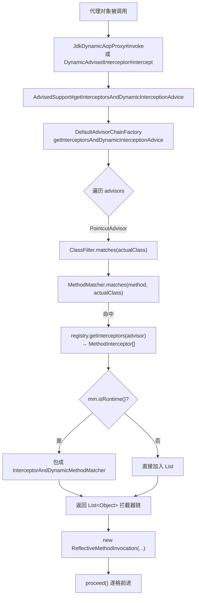
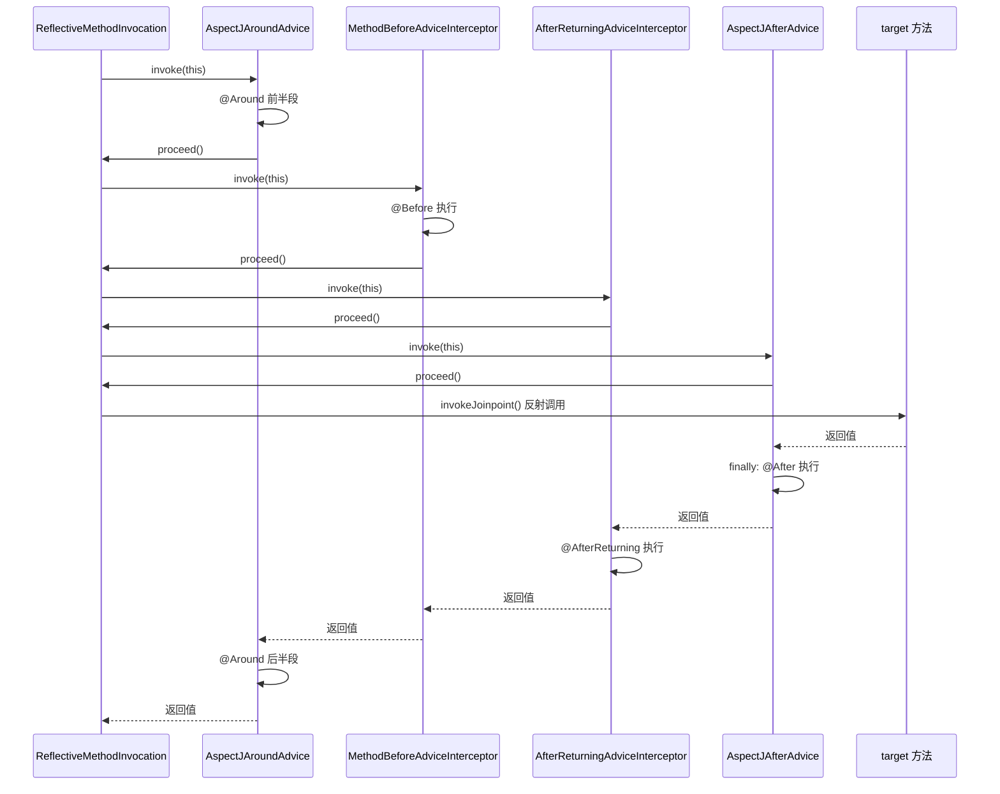

# Spring Framework 源码精读 AOP 03：拦截器链的构建与通知执行顺序

> 一句话结论：一次被切方法的调用最终会变成一个 `List<Object>`（拦截器链）+ 一个 `ReflectiveMethodInvocation`，后者用 `currentInterceptorIndex` 这个**从 -1 开始的游标**在链上"前进"，每前进一格就调用一个 `MethodInterceptor#invoke` 并把 `this` 传进去——这就是**责任链模式**；通知的执行顺序由"`ReflectiveAspectJAdvisorFactory` 里方法排序"和"各 Advice 适配器在 `proceed()` 前后插入代码的位置"**共同**决定，所以 `@After` 虽然排得靠前却在最后执行。
> 阅读前置：读过 [01-aop-原理与自动代理创建](./01-aop-原理与自动代理创建.md) 与 [02-代理方式-jdk与cglib](./02-代理方式-jdk与cglib.md)
> 预计阅读：50 分钟 ｜ 源码：`org.springframework:spring-aop:7.1.0`

---

## 0. 先看现象

一个切面里放全五种通知，配一个"正常返回"和一个"抛异常"的方法：

```text
// 片段：演示用应用代码，非 Spring 源码
@Aspect
@Component
@Order(1)
public class TraceAspect {

    @Around("execution(* com.acme.DemoService.*(..))")
    public Object around(ProceedingJoinPoint pjp) throws Throwable {
        System.out.println("1  @Around  before");
        Object ret = pjp.proceed();
        System.out.println("1' @Around  after");
        return ret;
    }

    @Before("execution(* com.acme.DemoService.*(..))")
    public void before() {
        System.out.println("2  @Before");
    }

    @After("execution(* com.acme.DemoService.*(..))")
    public void after() {
        System.out.println("5  @After");
    }

    @AfterReturning("execution(* com.acme.DemoService.*(..))")
    public void afterReturning() {
        System.out.println("3  @AfterReturning");
    }

    @AfterThrowing("execution(* com.acme.DemoService.*(..))")
    public void afterThrowing() {
        System.out.println("4  @AfterThrowing");
    }
}
```

调用 `ok()`（正常返回）与 `boom()`（抛异常）：

| 场景 | 输出顺序 |
| --- | --- |
| `ok()` | `1 @Around before` → `2 @Before` → `3 @AfterReturning` → `1' @Around after` → `5 @After` |
| `boom()` | `1 @Around before` → `2 @Before` → `4 @AfterThrowing` → `5 @After` → 异常继续抛给调用方 |

有三点与直觉不符，必须靠源码解释：

1. **`@After` 没有排在 `@AfterReturning` 前面输出，尽管它排得更靠前**——因为 `AspectJAfterAdvice` 把调用写在 `finally` 里。
2. **`@Around` 的 "after" 打在 `@AfterReturning` 之后、`@After` 之前**——因为 `@Around` 是一个"包住整条链"的拦截器，它的 `proceed()` 之后还有 `@After` 要执行，所以它的后半段只能在 `@After` 之前。
3. **`@AfterReturning` 与 `@AfterThrowing` 互斥**——它们在链里的位置相同（一前一后地套着同一个 `pjp.proceed()`），条件不同。

## 1. 整体地图

先看"调用链落盘"的过程：从代理对象拿到 `Method`，到变成 `List`。



> 读图说明：链是**每次调用按方法现算的**（然后被 `methodCache` 缓存）。"命中"包含**两级判断**：先比类（`ClassFilter`，一次性），再比方法（`MethodMatcher`）。只有 `mm.isRuntime()`（动态匹配）才会被包成 `InterceptorAndDynamicMethodMatcher` 留到调用时再判一次——这是"静态切点零开销、动态切点多一次判断"的机制来源。

再看 `proceed()` 这个游标如何在链上"套娃"：



> 读图说明：注意箭头**向下是"进入"，向上是"返回"**。每个拦截器在 `proceed()` **之前**写的代码构成"前通知"，在 `proceed()` **之后**写的代码构成"后通知"。`@After` 在 `finally` 里，所以它一定在返回路径上最后执行（只要 `@AfterThrowing` 排在它外面）。这张图就是"顺序表"的图形版本。

## 2. 关键类逐个拆

| 角色 | 类 | 职责 |
| --- | --- | --- |
| 链工厂 | `DefaultAdvisorChainFactory` | 把 `Advisor[]` 按当前方法筛成 `List<Object>` |
| 适配器注册表 | `DefaultAdvisorAdapterRegistry` | 把各种 `Advice` 转成 `MethodInterceptor` |
| 调用载体 | `ReflectiveMethodInvocation` | 持有链 + 游标，实现 `proceed()` 责任链 |
| 四种 AspectJ Advice | `AspectJAroundAdvice` / `AspectJMethodBeforeAdvice` / `AspectJAfterAdvice` / `AspectJAfterReturningAdvice` / `AspectJAfterThrowingAdvice` | 各自在 `proceed()` 前后插入"调用切面方法"的时机 |
| 经典 Advice 拦截器 | `MethodBeforeAdviceInterceptor` / `AfterReturningAdviceInterceptor` / `ThrowsAdviceInterceptor` | `@Before`/`@AfterReturning`/`@AfterThrowing` 的实际执行者 |
| 排序依据 | `ReflectiveAspectJAdvisorFactory` | 决定同一 `@Aspect` 内多个通知方法加入链的顺序 |

关键认知：**Spring AOP 的"顺序"不是一张表，而是两个独立机制叠加的结果**——(a) 通知方法转成 Advisor 的**遍历顺序**；(b) 每个拦截器把 `proceed()` 放在自己代码的**哪个位置**。

### 2.1 `DefaultAdvisorChainFactory` —— 链的构建

```java (src: DefaultAdvisorChainFactory.java#L57-L83)
	@Override
	public List<Object> getInterceptorsAndDynamicInterceptionAdvice(
			Advised config, Method method, @Nullable Class<?> targetClass) {

		// This is somewhat tricky... We have to process introductions first,
		// but we need to preserve order in the ultimate list.
		AdvisorAdapterRegistry registry = GlobalAdvisorAdapterRegistry.getInstance();
		Advisor[] advisors = config.getAdvisors();
		List<Object> interceptorList = new ArrayList<>(advisors.length);
		Class<?> actualClass = (targetClass != null ? targetClass : method.getDeclaringClass());
		Boolean hasIntroductions = null;

		for (Advisor advisor : advisors) {
			if (advisor instanceof PointcutAdvisor pointcutAdvisor) {
				// Add it conditionally.
				if (config.isPreFiltered() || pointcutAdvisor.getPointcut().getClassFilter().matches(actualClass)) {
					MethodMatcher mm = pointcutAdvisor.getPointcut().getMethodMatcher();
					boolean match;
					if (mm instanceof IntroductionAwareMethodMatcher iamm) {
						if (hasIntroductions == null) {
							hasIntroductions = hasMatchingIntroductions(advisors, actualClass);
						}
						match = iamm.matches(method, actualClass, hasIntroductions);
					}
					else {
						match = mm.matches(method, actualClass);
					}
```

**这段在干什么**：取全局适配器注册表、`config` 上的全部 `Advisor`，准备一个与 advisors 等长的 `List`；然后对每个 `Advisor` 先做**类级匹配**（`ClassFilter`），再做**方法级匹配**（`MethodMatcher`）。若 `MethodMatcher` 是 `IntroductionAwareMethodMatcher`（Spring 自家的 `AspectJExpressionPointcut` 就是），还要额外告诉它"这个类上有没有引入（inter-type declaration）"，因为引入会让"类上没有的方法"变成可切的。

**为什么这个循环不能提前 break 或重排**：注释写得很直白——引入（introduction）需要优先处理，但**最终顺序必须保持 `Advisor` 原序**。顺序决定了通知的执行顺序，重排一次就会出现"`@Before` 在 `@Around` 里面/外面"错乱。

**改成别的会怎样**：如果把 `config.isPreFiltered()` 去掉（忽略"已预筛"标记），AOT/native 场景下会多做一遍类匹配，性能下降但功能不变。若把 `hasIntroductions` 的懒计算改成每次现算，则每个 advisor 都遍历一遍全部 advisors，复杂度从 O(n) 变 O(n²)。

**坑**：`actualClass = targetClass != null ? targetClass : method.getDeclaringClass()` —— 这行决定了切点表达式里的 `args()`/`@target()` 等判断作用在**哪个类**上。用 JDK 代理时 `method.getDeclaringClass()` 是接口，用 CGLIB 时是目标类，这就导致 **同一份切点表达式在两种代理方式下匹配结果可能不同**（见 §6 第 6 条）。

```java (src: DefaultAdvisorChainFactory.java#L84-L112)
					if (match) {
						MethodInterceptor[] interceptors = registry.getInterceptors(advisor);
						if (mm.isRuntime()) {
							// Creating a new object instance in the getInterceptors() method
							// isn't a problem as we normally cache created chains.
							for (MethodInterceptor interceptor : interceptors) {
								interceptorList.add(new InterceptorAndDynamicMethodMatcher(interceptor, mm));
							}
						}
						else {
							interceptorList.addAll(Arrays.asList(interceptors));
						}
					}
				}
			}
			else if (advisor instanceof IntroductionAdvisor ia) {
				if (config.isPreFiltered() || ia.getClassFilter().matches(actualClass)) {
					Interceptor[] interceptors = registry.getInterceptors(advisor);
					interceptorList.addAll(Arrays.asList(interceptors));
				}
			}
			else {
				Interceptor[] interceptors = registry.getInterceptors(advisor);
				interceptorList.addAll(Arrays.asList(interceptors));
			}
		}

		return interceptorList;
	}
```

**这段在干什么**：命中后把 advisor 交给注册表转成 `MethodInterceptor[]`；**动态**匹配器则把每个拦截器包一层 `InterceptorAndDynamicMethodMatcher`（携带 matcher，留到调用时再判）；引入类 advisor 走另一分支；普通 advisor 无条件加入。

**为什么一个 `Advisor` 可能对应"多个"拦截器**：`registry.getInterceptors(advisor)` 返回数组。一个 `AspectJPointcutAdvisor` 通常只有 1 个，但自定义 advisor 可以返回多个——这也是"一个切点命中后执行了两次通知"的一种成因（同一个 advisor 被注册了两遍，或 advice 实现了 `MethodInterceptor` 又在 adapter 里被识别一次）。

**改成别的会怎样**：把 `mm.isRuntime()` 判断去掉、一律直接 `addAll`，动态切点（例如 `args(...)` 绑定了具体值、`@annotation` 带参数）就会**在类加载期就"永远命中"**，运行期不再校验 → 切面在不该切的时候也被执行。这是非常隐蔽的 bug。

**坑**：`registry.getInterceptors` 的实现在 `DefaultAdvisorAdapterRegistry`（下文 §2.2），它内部也要遍历 3 个 adapter。也就是说**每次算链**都要做"advice → interceptor"的类型匹配。这就是为什么 `AdvisedSupport` 要给链做 `methodCache` 缓存（`AdvisedSupport.java` L516-538）。

### 2.2 `DefaultAdvisorAdapterRegistry` —— Advice 变 Interceptor

```java (src: DefaultAdvisorAdapterRegistry.java#L52-L56)
	public DefaultAdvisorAdapterRegistry() {
		registerAdvisorAdapter(new MethodBeforeAdviceAdapter());
		registerAdvisorAdapter(new AfterReturningAdviceAdapter());
		registerAdvisorAdapter(new ThrowsAdviceAdapter());
	}
```

**这段在干什么**：构造时注册**三个**适配器，对应 Spring AOP 的三种经典通知：`MethodBeforeAdvice`、`AfterReturningAdvice`、`ThrowsAdvice`。

**为什么只有三个**：AspectJ 的 `@Around` 通知本身就已经是 `MethodInterceptor`（不需要适配），`@After` 也是（`AspectJAfterAdvice implements MethodInterceptor`）。而 `@Before` 对应的 `AspectJMethodBeforeAdvice` 实现的是 `MethodBeforeAdvice`、`@AfterReturning` 的 `AspectJAfterReturningAdvice` 实现的是 `AfterReturningAdvice`、`@AfterThrowing` 的 `AspectJAfterThrowingAdvice` **也**是 `MethodInterceptor`——所以真正需要适配的只有"`@Before` 与 `@AfterReturning` 两类"。

**改成别的会怎样**：注册一个自定义 `AdvisorAdapter`（实现 `supportsAdvice` + `getInterceptor`），就能让"自己定义的 `Advice` 子接口"参与 AOP。这也是老式 Spring AOP（非 AspectJ 注解）的扩展点。

**坑**：这里的 `adapters` 是 `ArrayList<>(3)`，顺序就是注册顺序。如果某个自定义 `Advice` **同时**被两个 adapter 认为支持，只有第一个会生效，后一个永远不会被调用——这类问题表现为"我的 `ThrowsAdvice` 不执行"，实际是被 `AfterReturningAdviceAdapter` 抢先匹配了。

```java (src: DefaultAdvisorAdapterRegistry.java#L59-L78)
	@Override
	public Advisor wrap(Object adviceObject) throws UnknownAdviceTypeException {
		if (adviceObject instanceof Advisor advisor) {
			return advisor;
		}
		if (!(adviceObject instanceof Advice advice)) {
			throw new UnknownAdviceTypeException(adviceObject);
		}
		if (advice instanceof MethodInterceptor) {
			// So well-known it doesn't even need an adapter.
			return new DefaultPointcutAdvisor(advice);
		}
		for (AdvisorAdapter adapter : this.adapters) {
			// Check that it is supported.
			if (adapter.supportsAdvice(advice)) {
				return new DefaultPointcutAdvisor(advice);
			}
		}
		throw new UnknownAdviceTypeException(advice);
	}
```

**这段在干什么**：`wrap` 做**降级归一**：已经是 `Advisor` 的直接用；是 `Advice` 且实现了 `MethodInterceptor` 的直接套 `DefaultPointcutAdvisor`（无切点 = 配全匹配）；否则试三个 adapter；都不行则抛 `UnknownAdviceTypeException`。

**为什么 `wrap` 只需要判断"能不能当 interceptor"，不需要真的转换**：`DefaultPointcutAdvisor(advice)` 保存的是原始 `Advice`，真正的"变成 interceptor"发生在 `getInterceptors()`。`wrap` 只是**验证可行性**并加一层 advisor 壳。这个设计让"advice 校验"发生在**注册期**（`AbstractAutoProxyCreator#buildAdvisors`），而不是每次调用期。

**改成别的会怎样**：如果 `wrap` 里不做这个"能否处理"的校验直接接受，那么一个不认识的自定义 `Advice` 会在**第一次调用时**才抛 `UnknownAdviceTypeException`——错误从启动期推迟到运行期，是最差的失败模式。Spring 有意在启动期失败。

**坑**：如果 `adviceObject` 既不是 `Advisor` 也不是 `Advice`（例如你误把 `MethodInterceptor` 的实现类忘了 `implements`），会抛 `UnknownAdviceTypeException`。报错栈里通常能看到 `AbstractAutoProxyCreator#buildAdvisors`。

> **注意**：`getInterceptors(Advisor)` 的实现紧随其后（同文件 L81-96），逻辑是"`Advice` 本身是 `MethodInterceptor` 就直接加；否则遍历 adapter，`supportsAdvice` 命中就 `getInterceptor(advisor)`；一个都没有则抛 `UnknownAdviceTypeException`"。于是"一个 `Advice` → 一个 `MethodInterceptor`"完成了**适配器模式**的收口——`proceed()` 的链里最终**只认 `MethodInterceptor`**。

### 2.3 `ReflectiveMethodInvocation#proceed` —— 全书最重要的一段

```java (src: ReflectiveMethodInvocation.java#L154-L181)
	@Override
	public @Nullable Object proceed() throws Throwable {
		// We start with an index of -1 and increment early.
		if (this.currentInterceptorIndex == this.interceptorsAndDynamicMethodMatchers.size() - 1) {
			return invokeJoinpoint();
		}

		Object interceptorOrInterceptionAdvice =
				this.interceptorsAndDynamicMethodMatchers.get(++this.currentInterceptorIndex);
		if (interceptorOrInterceptionAdvice instanceof InterceptorAndDynamicMethodMatcher dm) {
			// Evaluate dynamic method matcher here: static part will already have
			// been evaluated and found to match.
			Class<?> targetClass = (this.targetClass != null ? this.targetClass : this.method.getDeclaringClass());
			if (dm.matcher().matches(this.method, targetClass, this.arguments)) {
				return dm.interceptor().invoke(this);
			}
			else {
				// Dynamic matching failed.
				// Skip this interceptor and invoke the next in the chain.
				return proceed();
			}
		}
		else {
			// It's an interceptor, so we just invoke it: The pointcut will have
			// been evaluated statically before this object was constructed.
			return ((MethodInterceptor) interceptorOrInterceptionAdvice).invoke(this);
		}
	}
```

**这段在干什么**：如果游标已到链尾，就执行**真正的连接点**（反射调用 target）。否则把游标 `++` 前进一格取出元素：是 `InterceptorAndDynamicMethodMatcher` 就先做动态匹配，命中就 `interceptor.invoke(this)`，不命中就**递归 `proceed()` 跳过它**；是普通拦截器就 `invoke(this)`。

**为什么游标从 `-1` 开始、且"先自增再取"**：这样"递归 `proceed()`"这个动作天然共享同一个游标字段（`this`），每次进入 `proceed()` 都会推进一格，**不需要在拦截器里记录位置**。这就是责任链能做到"拦截器无状态、链共享"的关键。注意 `invoke(this)` 传的是**这个 `MethodInvocation` 本身**——拦截器内部调 `mi.proceed()` 时操作的还是同一个对象、同一个游标。

**改成别的会怎样**：若把 `++this.currentInterceptorIndex` 改成先取后增，第一格永远是 `-1` → `IndexOutOfBoundsException`；若换成一个新对象递归（不做浅克隆共享游标），`@Around` 里调两次 `pjp.proceed()` 会从链头重跑，`@Before` 执行两次——这正是"重置游标"的后果，也是**为什么两次 `proceed()` 必须用 `invocableClone`**（见 §2.6）。

**坑**：`proceed()` 的返回值被 `return` 直传，所以**任何拦截器都可以"改写"返回值**，也可以选择"不调 `proceed()` 直接返回"（短路）。`@Around` 的短路能力就来自这里。另外，`size() - 1` 与 `currentInterceptorIndex` 的比较放在了**每次调用**都会执行的位置——空链时（`size()==0`）`0-1 == -1` 立即成立，直接 `invokeJoinpoint()`，不会取元素。

```java (src: ReflectiveMethodInvocation.java#L189-L191)
	protected @Nullable Object invokeJoinpoint() throws Throwable {
		return AopUtils.invokeJoinpointUsingReflection(this.target, this.method, this.arguments);
	}
```

**这段在干什么**：链尾的"终点动作"——用反射在 **target** 上执行原方法。

**为什么这里永远用反射，而不是 CGLIB 的 `MethodProxy#invokeSuper`**：`target` 是**原始 Bean**，不是代理对象。要让 target 执行"真正的业务方法"，最简单的就是 `method.invoke(target, args)`。`invokeSuper` 只能在代理对象上跑父类代码，字段是默认值（详见 02 篇 §2.7）。

**改成别的会怎样**：如果这里改成 `methodProxy.invokeSuper(proxy, args)`，会得到一个"字段全空"的代理实例上跑出的结果，且所有 `@Autowired` 字段为 `null`——生产事故级 bug。

**坑**：`AopUtils.invokeJoinpointUsingReflection` 里还会做 `BridgeMethodResolver.findBridgedMethod`（桥接方法解析）与 `makeAccessible`。**泛型接口的桥接方法**是"AOP 切面没生效"的常见真凶之一（见 §6 第 7 条）。

### 2.4 五种通知在 `proceed()` 前后的插入点

```java (src: MethodBeforeAdviceInterceptor.java#L54-L58)
	@Override
	public @Nullable Object invoke(MethodInvocation mi) throws Throwable {
		this.advice.before(mi.getMethod(), mi.getArguments(), mi.getThis());
		return mi.proceed();
	}
```

**这段在干什么**：`@Before` 的最终执行者——先调通知，再 `proceed()`。就这四行。

**为什么 `@Before` 无法阻止方法执行**：它没有能力"不调 `proceed()`"，因为 `MethodBeforeAdviceInterceptor` 是硬编码 `return mi.proceed()`。想阻止执行只能用 `@Around` 抛异常。

**改成别的会怎样**：注意 `mi.getThis()` 传的是**代理对象**（不是 target）。所以 `MethodBeforeAdvice#before` 的第三个参数拿到的是代理——这也是老式 AOP 里"用 target 类型强转会 `ClassCastException`"的原因。

**坑**：如果 `@Before` 方法本身抛异常，`proceed()` 永远不会被调用（方法体根本没执行），异常直接沿链上抛。这在"参数校验类切面"里是**预期行为**。

```java (src: AfterReturningAdviceInterceptor.java#L54-L59)
	@Override
	public @Nullable Object invoke(MethodInvocation mi) throws Throwable {
		Object retVal = mi.proceed();
		this.advice.afterReturning(retVal, mi.getMethod(), mi.getArguments(), mi.getThis());
		return retVal;
	}
```

**这段在干什么**：`@AfterReturning`——先 `proceed()` 拿返回值，再执行通知，最后**返回原值**（`return retVal`）。

**为什么它能"看到"返回值**：因为它在 `proceed()` **之后**执行，且把 `retVal` 一并传下去。`AspectJAfterReturningAdvice#afterReturning` 会先判断 `shouldInvokeOnReturnValueOf(...)`，只有返回值类型与 `returning` 属性匹配时才调用切面方法。

**改成别的会怎样**：如果这里 `return this.advice.afterReturning(...)`（返回通知的返回值），`@AfterReturning` 就能改写返回结果——但 Spring 有意**不支持**，因为 AspectJ 语义里 `@AfterReturning` 是"返回后通知"，无权改返回值。要改返回值只能用 `@Around`。

**坑**：`retVal == null` 且方法返回 `int` 时，这个拦截器本身没问题，问题出在 `proceed()` 的调用方（`JdkDynamicAopProxy#invoke` 的 primitive 检查）——见 02 篇 §2.4。另外，若 `@AfterReturning` 内部抛异常，方法本身已经执行成功了，但调用方看到的是异常。

```java (src: AspectJAfterAdvice.java#L45-L53)
	@Override
	public @Nullable Object invoke(MethodInvocation mi) throws Throwable {
		try {
			return mi.proceed();
		}
		finally {
			invokeAdviceMethod(getJoinPointMatch(), null, null);
		}
	}
```

**这段在干什么**：`@After`——把 `proceed()` 放在 `try`，把"调用切面方法"放在 `finally`。注释（源码 L60-85 的 `invokeAdviceMethodWithGivenArgs`）里明确写了这是 `try/finally` 而不是 `catch`。

**为什么用 `finally` 而不是 `catch`**：`@After` 的语义是"无论正常还是异常都要执行"，等价于 `try...finally`。所以它在**返回值路径上最后执行**——因为 `finally` 的代码在 `return` 之前执行，而它又在链的较外层。

**改成别的会怎样**：把 `finally` 改成"`proceed()` 之后直接调用"（不加 `try`），方法抛异常时 `@After` 就**不会执行**，与 AspectJ 语义不符。这个改动在"资源释放类切面"里会造成泄漏。

**坑**：`finally` 中若切面方法自己抛异常，会**覆盖**原始异常（`Throwable` 后抛者胜）。这在"`@After` 里做日志、日志框架炸了"的场景下，会让你看到一条莫名其妙的日志异常而丢失原始业务异常。务必在 `@After` 里自己 try-catch。

```java (src: AspectJAfterThrowingAdvice.java#L60-L79)
	@Override
	public @Nullable Object invoke(MethodInvocation mi) throws Throwable {
		try {
			return mi.proceed();
		}
		catch (Throwable ex) {
			if (shouldInvokeOnThrowing(ex)) {
				invokeAdviceMethod(getJoinPointMatch(), null, ex);
			}
			throw ex;
		}
	}

	/**
	 * In AspectJ semantics, after throwing advice that specifies a throwing clause
	 * is only invoked if the thrown exception is a subtype of the given throwing type.
	 */
	private boolean shouldInvokeOnThrowing(Throwable ex) {
		return getDiscoveredThrowingType().isInstance(ex);
	}
```

**这段在干什么**：`@AfterThrowing`——`catch (Throwable ex)`，如果异常类型匹配 `throwing` 属性就调切面方法，然后**`throw ex` 原样上抛**。

**为什么要 `throw ex`**：`@AfterThrowing` 不能"吞掉"异常（除了切面自己抛新异常）。AspectJ 语义里它只是"观察者"。

**改成别的会怎样**：把 `throw ex` 删掉（或 `return null`），异常就被吞了——调用方以为成功。这是最危险的自定义改造之一，会掩盖所有业务失败。

**坑**：这里 `catch` 的是 `Throwable`（包括 `Error`），但 `shouldInvokeOnThrowing` 做类型过滤，所以"`throwing = RuntimeException.class`"时 `Error` 不会触发切面方法，但仍会被 `throw ex` 原样抛出。另外，若 `@After` 排在它外面（通常是），`@After` 仍会执行——这就是"异常时 `@AfterThrowing` 先、`@After` 后"的原因。

```java (src: AspectJAroundAdvice.java#L63-L71)
	@Override
	public @Nullable Object invoke(MethodInvocation mi) throws Throwable {
		if (!(mi instanceof ProxyMethodInvocation pmi)) {
			throw new IllegalStateException("MethodInvocation is not a Spring ProxyMethodInvocation: " + mi);
		}
		ProceedingJoinPoint pjp = lazyGetProceedingJoinPoint(pmi);
		JoinPointMatch jpm = getJoinPointMatch(pmi);
		return invokeAdviceMethod(pjp, jpm, null, null);
	}
```

**这段在干什么**：`@Around`——先强制要求 `mi` 是 `ProxyMethodInvocation`（Spring 自己的接口），懒创建 `ProceedingJoinPoint` 包装，然后**调用切面方法并把 `pjp` 作为第一个参数传进去**。

**为什么 `@Around` 与其它四种完全不同**：其它四种是"Spring 调用切面方法"，`@Around` 是"Spring 把 `pjp` 交给切面方法，由**切面自己**决定何时调 `pjp.proceed()`"。所以 `@Around` 的"前后"完全由用户代码决定——这也解释了 §0 中 `@Around after` 为什么出现在 `@AfterReturning` 之后：用户的 `pjp.proceed()` 返回时，链内层的 `@After` 还没执行完（`@After` 在更内层、`finally` 还没跑）。

**改成别的会怎样**：`@Around` 里不调 `pjp.proceed()` 就是**短路**（方法不执行）；调两次就是**方法执行两次**（第二次用 `invocableClone`，见 §2.6）；把 `proceed()` 的结果改掉就是**改返回值**。三种能力都是 `@Around` 独有的。

**坑**：`lazyGetProceedingJoinPoint(pmi)` 是"懒"的——它把 `MethodInvocationProceedingJoinPoint` 缓存进 `pmi` 的 user attribute。若你两次 `pjp.proceed()`，第二次用的是 `invocableClone`（新 `MethodInvocation`），但 `pjp` 本身还是同一个——所以 `pjp.getArgs()` 在 `proceed(Object[])` 里会被显式 `setArguments` 改写。

### 2.5 `MethodInvocationProceedingJoinPoint` —— `pjp.proceed()` 到底做了什么

```java (src: MethodInvocationProceedingJoinPoint.java#L80-L95)
	@Override
	public @Nullable Object proceed() throws Throwable {
		return this.methodInvocation.invocableClone().proceed();
	}

	@Override
	public @Nullable Object proceed(Object[] arguments) throws Throwable {
		Assert.notNull(arguments, "Argument array passed to proceed cannot be null");
		if (arguments.length != this.methodInvocation.getArguments().length) {
			throw new IllegalArgumentException("Expecting " +
					this.methodInvocation.getArguments().length + " arguments to proceed, " +
					"but was passed " + arguments.length + " arguments");
		}
		this.methodInvocation.setArguments(arguments);
		return this.methodInvocation.invocableClone(arguments).proceed();
	}
```

**这段在干什么**：`proceed()` 不是直接调 `methodInvocation.proceed()`，而是先 `invocableClone()` **造一个浅拷贝**，再在拷贝上 `proceed()`。

**为什么必须克隆**：`ReflectiveMethodInvocation` 的游标 `currentInterceptorIndex` 是**实例字段**。如果两次 `proceed()` 都用同一个对象，第二次会从"上一次停下的位置"继续 —— 结果就是"链的剩余部分被跳过"或"`IndexOutOfBoundsException`"。克隆的浅拷贝**共享同一个链 List、同一个 target、同一个游标值（此时在 `@Around` 这一格）**，但拥有独立的游标字段，所以每次 `proceed()` 都从 `@Around` 的下一格重新开始。

**改成别的会怎样**：不克隆直接 `proceed()`，`pjp.proceed()` 调两次的行为是"第二次从链尾继续"→ 直接反射执行 target（跳过所有内层通知），且返回后 `@Around` 拿到的两次返回值不一致。这种 bug 表象是"重试逻辑里内层 `@Before` 只执行了一次"。

**坑**：`proceed(Object[] arguments)` 里先 `this.methodInvocation.setArguments(arguments)` **再** `invocableClone(arguments)` —— 两处都改。前一处让**后续拦截器**（以及 `pjp.getArgs()`）看到新参数，后一处让**本次 clone 的链**用新参数。若只改一处，`@Before` 与 target 看到的参数会不一致。另外参数个数**必须相同**，否则抛 `IllegalArgumentException: Expecting N arguments to proceed, but was passed M arguments`——**`@Around` 里无法增删参数个数**。

### 2.6 `invocableClone` —— 浅拷贝为什么足够

```java (src: ReflectiveMethodInvocation.java#L202-L238)
	@Override
	public MethodInvocation invocableClone() {
		@Nullable Object[] cloneArguments = this.arguments;
		if (this.arguments.length > 0) {
			// Build an independent copy of the arguments array.
			cloneArguments = this.arguments.clone();
		}
		return invocableClone(cloneArguments);
	}

	/**
	 * This implementation returns a shallow copy of this invocation object,
	 * using the given arguments array for the clone.
	 * <p>We want a shallow copy in this case: We want to use the same interceptor
	 * chain and other object references, but we want an independent value for the
	 * current interceptor index.
	 * @see java.lang.Object#clone()
	 */
	@Override
	public MethodInvocation invocableClone(@Nullable Object... arguments) {
		// Force initialization of the user attributes Map,
		// for having a shared Map reference in the clone.
		if (this.userAttributes == null) {
			this.userAttributes = new HashMap<>();
		}

		// Create the MethodInvocation clone.
		try {
			ReflectiveMethodInvocation clone = (ReflectiveMethodInvocation) clone();
			clone.arguments = arguments;
			return clone;
		}
		catch (CloneNotSupportedException ex) {
			throw new IllegalStateException(
					"Should be able to clone object of type [" + getClass() + "]: " + ex);
		}
	}
```

**这段在干什么**：`invocableClone()` 先复制参数数组，再走带参版本；带参版本**先强制初始化 `userAttributes` 为 `HashMap`**（为了克隆后共享同一个 Map 引用），然后 `clone()` 出一个新对象并替换 `arguments`。

**为什么"强制初始化 userAttributes"是关键**：`clone()` 是 `Object#clone` 的浅拷贝，`userAttributes` 字段如果是 `null`，克隆后两边都是 `null`；之后任一方 `setUserAttribute` 会各自 new 一个新的 Map → **克隆与原对象不再共享**。提前初始化成非 null 的 Map，浅拷贝就会共享同一个引用。`JoinPointMatch`（参数绑定结果）和 `JOIN_POINT_KEY`（缓存的 `JoinPoint`）都存在这里，共享是必须的。

**改成别的会怎样**：去掉强制初始化，`@Around` 里第二次 `proceed()` 时 `getJoinPointMatch(pmi)` 返回 `null` → `@Before` 的通知方法参数绑定失败 → 抛 `AopInvocationException: Mismatch on arguments to advice method`。这个 bug 极难排查，因为它只在"`@Around` 调两次 `proceed()`"且"通知带参数绑定"时出现。

**坑**：注释里"independent value for the current interceptor index"是核心——`currentInterceptorIndex` 是 `int` 原始类型，浅拷贝天然独立（值拷贝）。这是"克隆能重置游标"的根本原因。如果哪天它改成 `AtomicInteger` 之类的引用字段，克隆就会共享游标，机制立刻崩坏。

### 2.7 排序真相：`ReflectiveAspectJAdvisorFactory`

```java (src: ReflectiveAspectJAdvisorFactory.java#L74-L95)
	// Exclude @Pointcut methods
	private static final MethodFilter adviceMethodFilter = ReflectionUtils.USER_DECLARED_METHODS
			.and(method -> (AnnotationUtils.getAnnotation(method, Pointcut.class) == null));

	private static final Comparator<Method> adviceMethodComparator;

	static {
		// Note: although @After is ordered before @AfterReturning and @AfterThrowing,
		// an @After advice method will actually be invoked after @AfterReturning and
		// @AfterThrowing methods due to the fact that AspectJAfterAdvice.invoke(MethodInvocation)
		// invokes proceed() in a `try` block and only invokes the @After advice method
		// in a corresponding `finally` block.
		Comparator<Method> adviceKindComparator = new ConvertingComparator<Method, @Nullable Annotation>(
				new InstanceComparator<>(
						Around.class, Before.class, After.class, AfterReturning.class, AfterThrowing.class),
				method -> {
					AspectJAnnotation ann = AbstractAspectJAdvisorFactory.findAspectJAnnotationOnMethod(method);
					return (ann != null ? ann.getAnnotation() : null);
				});
		Comparator<Method> methodNameComparator = new ConvertingComparator<>(Method::getName);
		adviceMethodComparator = adviceKindComparator.thenComparing(methodNameComparator);
	}
```

**这段在干什么**：定义"切面内方法 → Advisor"的排序规则——先按通知类型 `Around, Before, After, AfterReturning, AfterThrowing` 排序，同类型再按**方法名字母序**。`InstanceComparator` 的语义是"列表里靠前的类型更小"。

**为什么注释里要专门写一段警告**：因为**排序 ≠ 执行顺序**。`@After` 排在第三个，但实际最后执行。原因是 §2.4 的 `AspectJAfterAdvice` 把调用写在 `finally` 里。注释把这个"看似矛盾"的点钉在代码里，避免后人误改顺序。

**改成别的会怎样**：把 `After` 移到最后（与执行顺序一致），对比代码阅读更直观，但会让 `@After` 的 advisor 顺序变化 → 影响 `@Order` 相同、类型不同的通知在**同一切面内**的相对关系，也可能影响 `ExposeInvocationInterceptor` 之类特殊 advisor 的位置。Spring 20 年没改这段，说明"改动风险 > 可读性收益"。

**坑**：**同类型多通知按方法名字母序**，不是声明顺序！`getDeclaredMethods()` 从 JDK 7 起不保证顺序，所以 Spring 只能用名字做稳定排序。这意味着 `@Before` 方法名 `aCheck` 会排在 `zCheck` 之前执行——想控制顺序请**用 `@Order` 拆到不同切面**，不要靠方法名。

```java (src: ReflectiveAspectJAdvisorFactory.java#L168-L175)
	private List<Method> getAdvisorMethods(Class<?> aspectClass) {
		List<Method> methods = new ArrayList<>();
		ReflectionUtils.doWithMethods(aspectClass, methods::add, adviceMethodFilter);
		if (methods.size() > 1) {
			methods.sort(adviceMethodComparator);
		}
		return methods;
	}
```

**这段在干什么**：扫描切面类的所有用户声明方法（排除 `@Pointcut`），数量大于 1 时按上面的比较器排序。

**为什么 `@Pointcut` 被排除**：`@Pointcut` 只是在定义可复用的切点表达式，本身不是通知。`adviceMethodFilter` 提前把它过滤掉。

**改成别的会怎样**：若不过滤 `@Pointcut`，`getAdvisor` 里的 `switch (AtPointcut -> return null)` 也会返回 `null`，功能上不出错，但会多做一次反射分析。

**坑**：`ReflectionUtils.doWithMethods` 会**包含父类方法**（`doWithMethods` 递归）。所以在父类里定义的通知方法也会被扫到——`@Aspect` 类的继承是支持的，但排序会按"子类方法 + 父类方法"混在一起排。

```java (src: ReflectiveAspectJAdvisorFactory.java#L266-L287)
		AbstractAspectJAdvice springAdvice;

		switch (aspectJAnnotation.getAnnotationType()) {
			case AtPointcut -> {
				if (logger.isDebugEnabled()) {
					logger.debug("Processing pointcut '" + candidateAdviceMethod.getName() + "'");
				}
				return null;
			}
			case AtAround -> springAdvice = new AspectJAroundAdvice(
					candidateAdviceMethod, expressionPointcut, aspectInstanceFactory);
			case AtBefore -> springAdvice = new AspectJMethodBeforeAdvice(
					candidateAdviceMethod, expressionPointcut, aspectInstanceFactory);
			case AtAfter -> springAdvice = new AspectJAfterAdvice(
					candidateAdviceMethod, expressionPointcut, aspectInstanceFactory);
			case AtAfterReturning -> {
				springAdvice = new AspectJAfterReturningAdvice(
						candidateAdviceMethod, expressionPointcut, aspectInstanceFactory);
				AfterReturning afterReturningAnnotation = (AfterReturning) aspectJAnnotation.getAnnotation();
				if (StringUtils.hasText(afterReturningAnnotation.returning())) {
					springAdvice.setReturningName(afterReturningAnnotation.returning());
				}
```

**这段在干什么**：把每个通知注解映射到具体的 `AbstractAspectJAdvice` 子类，并读取 `returning` 等属性。

**为什么这个映射决定了"谁是 `MethodInterceptor`"**：`AspectJAroundAdvice`、`AspectJAfterAdvice`、`AspectJAfterThrowingAdvice` 都直接 `implements MethodInterceptor`；而 `AspectJMethodBeforeAdvice`、`AspectJAfterReturningAdvice` 只实现 `MethodBeforeAdvice`/`AfterReturningAdvice`，**需要经过 adapter** 才变成拦截器。

**改成别的会怎样**：注意 `AtAround` 的 advisor 加入链的位置由排序决定，但它内部的行为（前后插入什么）由**用户代码**决定。所以"把 `@Around` 移到最外层"这个需求，只能通过 `@Order` 调切面顺序实现，改这一行 `switch` 没用。

**坑**：`AtAfterReturning` 分支里要额外读 `returning` 属性并 `setReturningName`——若你的 `@AfterReturning` 方法有两个参数（`(Object ret)` 或 `(JoinPoint jp, Object ret)`），参数绑定就依赖这里设置的 `returningName`。这也是老版本里"`bind` 写错导致所有通知失败"的根源。

### 2.8 `AbstractAspectJAdvice` —— 切面方法最终怎么被调用

```java (src: AbstractAspectJAdvice.java#L620-L658)
	protected @Nullable Object invokeAdviceMethod(@Nullable JoinPointMatch jpMatch,
			@Nullable Object returnValue, @Nullable Throwable ex) throws Throwable {

		return invokeAdviceMethodWithGivenArgs(argBinding(getJoinPoint(), jpMatch, returnValue, ex));
	}

	// As above, but in this case we are given the join point.
	protected @Nullable Object invokeAdviceMethod(JoinPoint jp, @Nullable JoinPointMatch jpMatch,
			@Nullable Object returnValue, @Nullable Throwable t) throws Throwable {

		return invokeAdviceMethodWithGivenArgs(argBinding(jp, jpMatch, returnValue, t));
	}

	protected @Nullable Object invokeAdviceMethodWithGivenArgs(@Nullable Object[] args) throws Throwable {
		@Nullable Object[] actualArgs = args;
		if (this.aspectJAdviceMethod.getParameterCount() == 0) {
			actualArgs = null;
		}
		Object aspectInstance = this.aspectInstanceFactory.getAspectInstance();
		if (aspectInstance.equals(null)) {
			// Possibly a NullBean -> simply proceed if necessary.
			if (getJoinPoint() instanceof ProceedingJoinPoint pjp) {
				return pjp.proceed();
			}
			return null;
		}
		try {
			ReflectionUtils.makeAccessible(this.aspectJAdviceMethod);
			return this.aspectJAdviceMethod.invoke(aspectInstance, actualArgs);
		}
		catch (IllegalArgumentException ex) {
			throw new AopInvocationException("Mismatch on arguments to advice method [" +
					this.aspectJAdviceMethod + "]; pointcut expression [" +
					this.pointcut.getPointcutExpression() + "]", ex);
		}
		catch (InvocationTargetException ex) {
			throw ex.getTargetException();
		}
	}
```

**这段在干什么**：两件事——(1) 通过 `argBinding(...)` 把 `JoinPoint`、`JoinPointMatch`、返回值、异常**拼装**成切面方法的实参数组；(2) 反射调用切面实例上的那个方法。`IllegalArgumentException` 会被翻译成 `AopInvocationException` 并**带上切点表达式**，因为最常见的原因就是"实参与形参不匹配"。

**为什么要 `argBinding` 这么复杂**：一个通知方法的形参可能来自 `JoinPoint`、`@annotation`、`args()` 绑定、`returning`、`throwing` 等多种来源，位置任意。`argBinding` 按**切面方法签名**逐个决定"第 i 个参数从哪里取"。这是 Spring AOP 相对 AspectJ 编译期织入"参数绑定能力受限"的根源。

**改成别的会怎样**：`actualArgs = null`（当切面方法零参时）是为了兼容 `Method#invoke` 对 null 数组的处理。如果去掉，零参方法传空数组也正常，但某些 JVM 实现在可变参数上会退化为"传一个 null 参数"，从而触发 `IllegalArgumentException`。

**坑**：`aspectInstance.equals(null)` 判断——这不是"等于 null"（`equals(null)` 永远 false），而是为了兼容 `NullBean`（容器里 `@Bean` 方法返回 `null` 时的占位对象）。7.1 里它被写成 `equals(null)` 形式，行为上是"某个特殊 `equals` 实现返回 true"。若你的切面 bean 是 `NullBean`，通知不会执行、`@Around` 退化为直接 `proceed()`。

## 3. 源码逐段精读

### 3.1 把顺序表"算"出来

假设切面类里只有 5 个方法，各一个通知。根据 §2.7 的排序，Advisor 顺序是：

| 链位置 | Advisor 对应的通知 | 实现类 | 是否直接是 `MethodInterceptor` |
| --- | --- | --- | --- |
| 0 | `@Around` | `AspectJAroundAdvice` | ✅ 是 |
| 1 | `@Before` | `AspectJMethodBeforeAdvice` → `MethodBeforeAdviceInterceptor` | ❌ 需 adapter |
| 2 | `@After` | `AspectJAfterAdvice` | ✅ 是 |
| 3 | `@AfterReturning` | `AspectJAfterReturningAdvice` → `AfterReturningAdviceInterceptor` | ❌ 需 adapter |
| 4 | `@AfterThrowing` | `AspectJAfterThrowingAdvice` | ✅ 是 |

`proceed()` 的执行树（`ok()` 正常返回）：

```
AspectJAroundAdvice      [@Around before]
  MethodBeforeAdviceInterceptor   [@Before]
    AspectJAfterAdvice (try)
      AfterReturningAdviceInterceptor
        AspectJAfterThrowingAdvice (try)
          invokeJoinpoint()  → target.ok()
        (无异常，catch 不进入)
      [@AfterReturning]
    (finally) [@After]
  [@Around after]
```

按"进入顺序"读，就是 `@Around` → `@Before` → `@AfterReturning` → `@After`；按"退出顺序"读，`@Around` 的后半段在 `@AfterReturning` 之后、`@After` 之前。**与 §0 的实测完全一致**。

### 3.2 多个切面之间的顺序：`@Order`

同一 `@Aspect` 内部靠"类型排序"，**不同切面之间靠 `AnnotationAwareOrderComparator`**。这个排序发生在 `AbstractAdvisorAutoProxyCreator#findEligibleAdvisors`（源码 L96-110）末尾的 `sortAdvisors(advisors)` 调用里。

规则：
- `@Order(1)` 的切面**先**加入 advisors 列表 → 在链里**更靠外** → `@Before` 更早、`@After` 更晚；
- `Ordered` 接口的 `getOrder()` 次之，无注解默认 `Ordered.LOWEST_PRECEDENCE`（`Integer.MAX_VALUE`）；
- 数值相同则保持"发现顺序"（`AnnotationAwareOrderComparator` 是**稳定**排序）。

**一个高频误解**：`@Order(1)` 切面的 `@After` 在 `@Order(2)` 切面的 `@After` **之后**执行——因为外层 `finally` 后跑。若把 `@Order` 理解成"所有通知都按此顺序"，就会得出错误结论。

### 3.3 三个 `isBeforeAdvice`/`isAfterAdvice` 的用途

`AspectJAfterAdvice`/`AspectJAfterThrowingAdvice`/`AspectJAfterReturningAdvice` 的 `isAfterAdvice()` 都返回 `true`，`AspectJAroundAdvice` 两个都 `false`。这不是给 `proceed()` 用的（`proceed()` 只看 List 顺序），而是给**排序算法**用的：`AspectJAwareAdvisorAutoProxyCreator` 在比较两个 advisor 时，会用 `isAfterAdvice()` 判断"若两个来自同一切面且其一为 after 型，则 after 型更靠内"。

**这解释了一个"排序结果"的细节**：同一 `@Aspect` 内，`@After` 型通知总是比 `@Before` 型更靠内，从而它的"调用动作"（`finally` 里的）在更晚执行——**两套机制（类型排序 + `isAfterAdvice` 比较 + `try/finally`）互相印证同一个语义**，是 Spring 在"可读顺序"与"执行顺序"之间求一致的努力。

### 3.4 一张表：异常时谁执行

| 通知 | 正常返回 | 抛异常 | 能否改返回值 | 能否吞异常 |
| --- | --- | --- | --- | --- |
| `@Around` | ✅ 前半/后半 | ✅ 可 catch | ✅ | ✅ |
| `@Before` | ✅ | ✅（在 target 之前，异常时已执行） | ❌ | ❌（只能靠抛异常阻止） |
| `@AfterReturning` | ✅ | ❌ | ❌ | ❌ |
| `@AfterThrowing` | ❌ | ✅ | ❌ | ❌（`throw ex` 硬编码） |
| `@After` | ✅ | ✅ | ❌ | ❌ |

**表里最容易踩错的一格**：`@AfterReturning` 在方法抛异常时**完全不执行**，不只是"不执行方法体"，而是拦截器根本没走到 `afterReturning(...)` 那一行（因为 `mi.proceed()` 就抛了）。所以"在 `@AfterReturning` 里清理资源"是错的，必须用 `@After`。

## 4. 完整执行时序

| # | 位置 | 动作 | 观察点 |
| --- | --- | --- | --- |
| 1 | `JdkDynamicAopProxy#invoke` / `DynamicAdvisedInterceptor#intercept` | 拿 `target`、算 `targetClass` | `targetClass` 决定切点匹配 |
| 2 | `AdvisedSupport#getInterceptorsAndDynamicInterceptionAdvice` | 查 `methodCache` | 命中缓存则跳过 3 |
| 3 | `DefaultAdvisorChainFactory` | 遍历 advisor，ClassFilter → MethodMatcher → adapter | 链 `size()` |
| 4 | `new ReflectiveMethodInvocation(proxy, target, method, args, targetClass, chain)` | 构造，`currentInterceptorIndex = -1` | 游标初值 |
| 5 | `proceed()` | `-1 == size-1`? → 否 → `get(0)` → `invoke(this)` | 进入 `@Around` |
| 6 | `AspectJAroundAdvice#invoke` | 造 `pjp`，调切面方法 | 用户 `@Around` 第一行 |
| 7 | `pjp.proceed()` → `invocableClone().proceed()` | 克隆，游标重置，链从下一格继续 | 克隆对象 ≠ 原对象 |
| 8 | `MethodBeforeAdviceInterceptor#invoke` | `advice.before(...)` 然后 `proceed()` | `@Before` 执行 |
| 9 | `AspectJAfterAdvice#invoke` | `try { proceed() }` | 进入 `try` |
| 10 | `AfterReturningAdviceInterceptor#invoke` | `retVal = proceed()` | 等内层返回 |
| 11 | `AspectJAfterThrowingAdvice#invoke` | `try { proceed() }` | 进入 `try` |
| 12 | `proceed()` 到链尾 | `invokeJoinpoint()` → 反射调 target | 业务方法执行 |
| 13 | 逐层返回 | 11 无异常 → 10 `afterReturning` → 9 `finally` → 8 → 7 → 6 `@Around after` | 观察顺序 |

> **注意 7 与 12 的关系**：`@Around` 的 `proceed()` 造了一个**新** `MethodInvocation`，所以 8~12 都发生在克隆对象上；回到 6 时原对象还在"第 0 格"。这就是"为什么要克隆"的最直观解释。

## 5. 设计模式与取舍

| 模式 | 体现 | 学到什么 |
| --- | --- | --- |
| 责任链 | `proceed()` 把 `this` 传给下一个拦截器 | 每个拦截器只关心自己和不关心下一个是谁 |
| 适配器 | `DefaultAdvisorAdapterRegistry` 把 3 类 `Advice` 变成 `MethodInterceptor` | 让"只认 `MethodInterceptor`"的链接纳多种通知模型 |
| 模板方法 | `AbstractAspectJAdvice` 的 `invokeAdviceMethod` 由子类决定"谁是 JoinPoint" | 五种通知共用参数绑定与反射调用 |
| 原型（克隆） | `invocableClone` | 一次性对象需要"可重放"时，浅拷贝比重建更省 |
| 策略 | `AdvisorChainFactory` / `MethodMatcher.isRuntime()` | 静态匹配与动态匹配分道，各自优化 |

**取舍一：链缓存粒度是"方法"，不是"类"**。`AdvisedSupport` 的 `methodCache` 以 `MethodCacheKey`（方法 + 目标类）为键。粒度太粗会切错方法，太细（每次调用都算）则每次都要反射 + 类型匹配。Spring 选了"按方法缓存"。

**取舍二：`@After` 用 `try/finally` 而不是"排在最后"**。如果用"排到最后 + 顺序调用"能直接用链顺序表达，但那样就做不到"异常时也执行"——因为链里只要有一个拦截器抛异常，后面的就不执行了。`try/finally` 是唯一能保证"异常路径也执行"的机制。

**取舍三：`@Around` 用 `ProceedingJoinPoint` 而非直接暴露 `MethodInvocation`**。`ProceedingJoinPoint` 是 AspectJ 的公共 API，用户代码不依赖 Spring 的 `MethodInvocation`。代价是要多一层包装（`MethodInvocationProceedingJoinPoint`）和一次 `invocableClone`。这是"API 兼容性 > 一点性能"的典型选择。

## 6. 踩坑与调试

链的问题是**最不直观的一类 bug**：没有异常、没有日志，方法就是"少执行了一段"。下面按"命中率 × 排查难度"排序，前 4 条给完整分析，后 8 条速查。

### 6.1 "同类自调用为什么失效"——本篇最核心的坑

```text

@Service
public class OrderServiceImpl implements OrderService {

    @Override
    public void create(String no) {
        this.audit(no);      // ← 自调用：走的是 this，不是代理
    }

    @Override
    public void audit(String no) {
        System.out.println("audit " + no);
    }
}
```

`this.audit(no)` **完全绕过 AOP**。原因链条（三层，缺一不可）：

1. **AOP 的入口只在代理对象上**。`JdkDynamicAopProxy#invoke` / `DynamicAdvisedInterceptor#intercept` 是唯一进入拦截器链的门；调用 `this.audit(...)` 时，`this` 指向**原始 Bean**（`AbstractAutoProxyCreator#wrapIfNecessary` 里 `new SingletonTargetSource(bean)` 包的就是它，源码 L321-345），根本不经过代理对象。
2. **`this` 是原始对象，不是代理**。容器把代理放进单例池（`wrapIfNecessary` 返回 `proxy`），但 Bean 自己的方法体里 `this` 还是那个原始实例——`bytecode` 里 `invokevirtual` 绑定的是自己。
3. **不是"切点没匹配上"**。这点必须辨清：切点表达式、`ClassFilter`、`MethodMatcher` 全部正常，链也能算出来——只是**没有调用方带着它进代理**。所以打日志看"切点匹配"是看不出来的。

```java (src: AbstractAutoProxyCreator.java#L333-L345)
		// Create proxy if we have advice.
		Object[] specificInterceptors = getAdvicesAndAdvisorsForBean(bean.getClass(), beanName, null);
		if (specificInterceptors != DO_NOT_PROXY) {
			this.advisedBeans.put(cacheKey, Boolean.TRUE);
			Object proxy = createProxy(
					bean.getClass(), beanName, specificInterceptors, new SingletonTargetSource(bean));
			this.proxyTypes.put(cacheKey, proxy.getClass());
			return proxy;
		}

		this.advisedBeans.put(cacheKey, Boolean.FALSE);
		return bean;
	}
```

**这段在干什么**：容器拿到"原始 `bean`"，用 `SingletonTargetSource` 把它包起来，返回 `proxy` 作为最终 Bean。`bean` 本身**没有被替换**，它只是被代理"持有"。这就是 `this` 仍然是原始对象的源码依据。

**为什么必须这样设计**：如果 `this` 指向代理，那代理里再调 `this.audit()` 会再进一次链 → 每次自调用都重复执行前置通知，`@Around` 无限嵌套。原生 AspectJ（编译期织入）不需要代理，所以 `this.audit()` 会被织入——**这是 Spring AOP（运行期代理）与 AspectJ（编译期织入）最大的语义差异**。

**改成别的会怎样**：没有"改一行让 `this` 变代理"的做法。Java 的 `this` 在方法体里不可重绑定。所有修复方案本质都是"**让调用经过代理对象**"。

**坑**：`AbstractAutoProxyCreator#wrapIfNecessary` 里有一行 `this.advisedBeans.put(cacheKey, Boolean.TRUE)` —— 这说明"**是否代理**"是按 `beanClass + beanName` 缓存的。如果你的 Bean 是通过 `@Bean` 方法手工 `new` 出来的、或用了 `ObjectProvider` 里的原始实例，那么"从某处拿到的是不是代理"需要逐个路径确认。

### 6.2 三种修复方式与源码级原因

**修复 1：注入自己（self-injection），让调用经过代理**

```text

@Service
public class OrderServiceImpl implements OrderService {

    @Autowired
    @Lazy
    private OrderService self;

    @Override
    public void create(String no) {
        self.audit(no);   // ← 走代理 → 进链
    }
}
```

**源码级原因**：`self` 注入的是**容器里的 Bean**，而容器里放的就是 `wrapIfNecessary` 返回的那个 `proxy`。所以 `self.audit(...)` 是 `invokevirtual` 到代理类上的方法 → 进入 `JdkDynamicAopProxy#invoke` 或 `DynamicAdvisedInterceptor#intercept` → 算链 → `proceed()`。

**为什么必须配 `@Lazy`**：`OrderServiceImpl` 正在创建时就去解析 `OrderService` 类型的依赖，会遇到"自己还在创建中"。`@Lazy` 注入一个**代理**（注意是另一层代理：`ContextAnnotationAutowireCandidateResolver` 造的懒解析代理），首次调用时才从容器取真实 Bean → 打破循环。

**代价**：多一层懒代理（`ProxyFactoryBean` 风格），`self.getClass()` 不是你的实现类；且有轻微开销。**这是最推荐的方式**，因为语义最清晰。

**修复 2：`AopContext.currentProxy()`**

```text

@EnableAspectJAutoProxy(exposeProxy = true)   // ← 必须开
public class AppConfig { }

@Service
public class OrderServiceImpl implements OrderService {
    @Override
    public void create(String no) {
        ((OrderService) AopContext.currentProxy()).audit(no);
    }
}
```

**源码级原因**：`JdkDynamicAopProxy#invoke` 里有（源码 L191-195）：

```java (src: JdkDynamicAopProxy.java#L189-L200)
			Object retVal;

			if (this.advised.isExposeProxy()) {
				// Make invocation available if necessary.
				oldProxy = AopContext.setCurrentProxy(proxy);
				setProxyContext = true;
			}

			// Get as late as possible to minimize the time we "own" the target,
			// in case it comes from a pool.
			target = targetSource.getTarget();
			Class<?> targetClass = (target != null ? target.getClass() : null);
```

**这段在干什么**：当 `exposeProxy == true` 时，把**代理对象**放进 `ThreadLocal`（`AopContext`），并在 `finally` 里恢复旧值（源码 L241-250）。

**为什么能解决问题**：`create()` 本身是**从代理进入**的，所以进入时 `AopContext` 已经被设成代理；方法体里取 `currentProxy()` 就拿到代理，再调 `audit()` 就走代理 → 进链。

**代价**：①必须 `exposeProxy = true`（**多一个 `ThreadLocal` 写 + 清**，每次调用都有成本）；②`AopContext` 是线程绑定的，**异步线程里取不到**（`CompletableFuture` 里会抛 `IllegalStateException: Cannot find current proxy`）；③代码强耦合 Spring API，不可单测（需 mock 静态方法）。

**修复 3：拆类（把 `audit` 挪到另一个 Bean）**

```text

@Service
public class OrderServiceImpl implements OrderService {
    private final AuditService auditService;   // 构造器注入

    @Override
    public void create(String no) {
        auditService.audit(no);   // ← 跨 Bean 调用，走 auditService 的代理
    }
}
```

**源码级原因**：`auditService` 是**另一个 Bean**，容器里放的是它自己的代理（`AbstractAutoProxyCreator#wrapIfNecessary` 为它单独创建）。跨 Bean 调用天然经过代理，没有任何技巧。

**代价**：需要重新划分职责边界（有时不自然），但**这是唯一没有运行期额外成本、且不破坏可测试性的方案**。DDD 视角下，"审计"本来就应该是一个独立的能力（横切关注点），拆类反而更合理。

### 6.3 三方案对比表

| 方案 | 额外开销 | 可测试性 | 异步安全 | 适用场景 |
| --- | --- | --- | --- | --- |
| 注入自己 + `@Lazy` | 一层懒代理 | 好（依赖可 mock） | ✅ | 通用，首选 |
| `AopContext.currentProxy()` | `ThreadLocal` 读写 | 差（依赖静态上下文） | ❌ | 遗留代码小改 |
| 拆类 | 无 | 极好 | ✅ | 能力本就该独立时 |

### 6.4 其余 8 个高频坑

1. **`@Before` 里改参数无效**：`@Before` 拿到的 `args` 是数组引用，改数组**元素**有效（`mi.getArguments()` 和 target 共用同一数组），但"替换数组"无效（`MethodBeforeAdvice` 无法 `setArguments`）。要改参数请用 `@Around` + `pjp.proceed(newArgs)`。
2. **`@Around` 里 `pjp.proceed()` 两次，`@Before` 执行两次**：这是**预期行为**（见 §2.6）。若只想要"重试"，注意副作用会翻倍，且 `@After`/`@AfterReturning` 也会执行两次。
3. **`@AfterReturning` 改不了返回值**：`AfterReturningAdviceInterceptor` 是 `return retVal`（原值）。见 §2.4。
4. **`@After` 里抛异常会掩盖业务异常**：`finally` 后抛者胜。
5. **`@AfterThrowing` 捕获不到 `@Around` 内层抛的异常**：如果 `@Around` 把异常 catch 掉没重抛，`@AfterThrowing` 就看不到（因为它在更内层，异常在它那里已经抛过、被外层 `@Around` 吃了）。**顺序是 `@Around` 在外**，所以 `@Around` 能吞掉 `@AfterThrowing` 的上抛。
6. **JDK 代理与 CGLIB 代理下切点匹配结果不同**：`actualClass` 取 `targetClass` 或 `method.getDeclaringClass()`；`@target()`、`this()`、`target()` 等 PCD 对接口/实现类的判断不同。写切点尽量用 `@annotation` 或 `execution`，少用 `this()`/`target()` 类型判断。
7. **泛型接口的桥接方法**：`interface Handler<T> { void handle(T t); }` 的实现类有桥接方法 `handle(Object)`。`AopUtils.invokeJoinpointUsingReflection` 用 `BridgeMethodResolver.findBridgedMethod` 解析，但如果切点用的是具体参数类型，桥接方法的 `Method` 可能匹配不上 → 表现"只切到一半"。
8. **`@Order` 只在同层切面间比较，同一切面内按类型 + 方法名**：想让同一切面的多个 `@Before` 有序，只能拆切面或用 `@Order` 加在**不同**切面类上。
9. **`ExposeInvocationInterceptor` 不在链首时 `AopContext` 相关能力异常**：它是最高优先级的 advisor（`Ordered.HIGHEST_PRECEDENCE + 1`），正常情况下总在第一个。手工 `ProxyFactory` 造代理时若没加它，`AspectJ` 风格的通知会走不通。
10. **调试技巧**：`logging.level.org.springframework.aop=TRACE` 会打印 `Found AspectJ method`、`Unable to apply any optimizations to advised method` 等；在 `ReflectiveMethodInvocation#proceed` 下断点，看 `currentInterceptorIndex` 与 `interceptorsAndDynamicMethodMatchers` 就是**链的真实内容与执行进度**，比猜快得多。

## 7. ⚠️ 版本差异

| 版本 | 差异 |
| --- | --- |
| Spring 1.x | 只有 `MethodBeforeAdvice`/`AfterReturningAdvice`/`ThrowsAdvice` 三种，链工厂是 `AdvisorChainFactory` 的第一版 |
| Spring 2.0 | 引入 `@AspectJ` 支持：`ReflectiveAspectJAdvisorFactory`、`AspectJAroundAdvice`、`AspectJAfterAdvice` 等；`proceed()` 结构基本定型 |
| Spring 3.x | `AspectJAfterAdvice` 等改为 `implements MethodInterceptor`（不再依赖 adapter 包装） |
| Spring 4.x | `MethodInvocationProceedingJoinPoint` 加入 `invocableClone` 支持（多次 `proceed()`） |
| Spring 5.x | `proceed()` 的 `InterceptorAndDynamicMethodMatcher` 分支加入"动态匹配失败则递归跳过"；`ExposeInvocationInterceptor` 改为 `ThreadLocal` + user attribute 混合策略 |
| Spring 6.0 | JDK 17 基线；`DefaultAdvisorChainFactory.INSTANCE` 单例（6.0.10）；`InvocationHandler`/`MethodInterceptor` 参数加 `@Nullable` |
| Spring 6.1.15 | `AbstractAspectJAdvisorFactory` 新增 `spring.aop.ajc.ignore` 系统属性（避免 ajc 编译的切面被 Spring AOP 再代理一次导致**双重执行**） |
| Spring 7.0 | `@After` 排序注释补充说明 `try/finally` 原因；`ReflectiveMethodInvocation` 用 `instanceof` 模式匹配重写 |
| Spring 7.1 | `AbstractAspectJAdvice#invokeAdviceMethodWithGivenArgs` 增加 `NullBean` 兼容分支（`aspectInstance.equals(null)`）；`CglibAopProxy` 的 `ProxyCallbackFilter` 在生成后 `reduceToAdvisorKey()` 防泄漏 |

## 8. 面试高频问与答

1. **Spring AOP 的拦截器链是什么数据结构？** → `List<Object>`，元素是 `MethodInterceptor` 或 `InterceptorAndDynamicMethodMatcher`；由 `DefaultAdvisorChainFactory` 按方法现算，并被 `AdvisedSupport#methodCache` 缓存。
2. **`proceed()` 的责任链是怎么"前进"的？** → `currentInterceptorIndex` 从 `-1` 起，`get(++index)` 取下一个，把 `this` 传给拦截器；拦截器调 `mi.proceed()` 继续。共享游标 = 无状态拦截器。
3. **五种通知的执行顺序？** → 进入顺序 `@Around` → `@Before` → `@AfterReturning`/`@AfterThrowing` → `@After`；`@Around` 的后半段在 `@AfterReturning` 之后、`@After` 之前。
4. **为什么 `@After` 排在 `@AfterReturning` 前面定义却最后执行？** → 排序只决定链位置，`AspectJAfterAdvice` 把调用写在 `finally` 里（源码注释明确说明）。
5. **同一切面内多个同类型通知的顺序怎么定？** → `ReflectiveAspectJAdvisorFactory#adviceMethodComparator`：先按类型，再按方法名。
6. **`@AfterReturning` 能改返回值吗？** → 不能，`AfterReturningAdviceInterceptor` 返回原值。
7. **`@Around` 能改返回值/短路/重试吗？** → 都能。改：`return 新值`；短路：不调 `proceed()`；重试：多次 `proceed()`（每次走 `invocableClone`）。
8. **为什么同类自调用会失效？** → `this` 指向原始 Bean，不经过代理对象；AOP 入口只在代理上。
9. **三种修复方式？** → 注入自己（`@Lazy`）、`AopContext.currentProxy()`（需 `exposeProxy=true`）、拆类。
10. **`invocableClone` 为什么是浅拷贝？** → 需要共享链、target、userAttributes，但要有独立的 `currentInterceptorIndex`（`int` 值拷贝天然独立）。
11. **动态切点在哪里二次判断？** → `ReflectiveMethodInvocation#proceed` 的 `InterceptorAndDynamicMethodMatcher` 分支，命中才 `invoke`，不命中递归跳过。
12. **一个 `Advisor` 能对应多个拦截器吗？** → 能，`registry.getInterceptors(advisor)` 返回数组；自定义 advisor 可返回多个。

## 9. 动手练习

1. **打印链的内容**：在 `ReflectiveMethodInvocation` 构造处下一个断点（或写一个 `@Around` + `((Advised) proxy).getAdvisors()`），打印链里每个元素的类名。**验收**：能对上 §3.1 的表格（类型 + 顺序）。
2. **验证 `proceed()` 两次**：写 `@Around` 调两次 `pjp.proceed()`，在 `@Before` 里打印计数。**验收**：`@Before` 打印 2 次；能解释每次 `proceed()` 的 `currentInterceptorIndex` 分别从哪开始。
3. **验证 `@After` 的异常行为**：在 `@After` 里 `throw new RuntimeException("log-broke")`，target 抛 `IllegalStateException`。**验收**：观察调用方收到的异常是哪个，并解释 `finally` 语义。
4. **复现自调用失效并逐一修复**：写自调用代码 → 用三种方案各修一次。**验收**：三种方案都能让切面生效；能说出每种方案的源码依据（`SingletonTargetSource` / `AopContext.setCurrentProxy` / 独立代理）。
5. **`@Order` 实验**：两个切面 `@Order(1)`/`@Order(2)`，各带 `@Before`/`@After`。**验收**：能预测并实测 4 条输出顺序，并解释为什么 `@Order(1)` 的 `@After` 最后。

## 小结

- 链的构建在 `DefaultAdvisorChainFactory`：`ClassFilter`（类级）→ `MethodMatcher`（方法级）→ `registry.getInterceptors`（Advice → MethodInterceptor）；动态匹配器被包成 `InterceptorAndDynamicMethodMatcher` 留到运行期再判。
- 链的执行在 `ReflectiveMethodInvocation#proceed`：游标 `-1` 起、`get(++index)`、`invoke(this)`；链尾 `invokeJoinpoint()` 反射调 target。
- 通知顺序 = **Advisor 排序**（`Around, Before, After, AfterReturning, AfterThrowing` + 方法名）× **各拦截器把 `proceed()` 放在哪**（`@Before` 前后、`@AfterReturning` 之后、`@After` 的 `finally`、`@AfterThrowing` 的 `catch`、`@Around` 用户代码）。
- `@After` 排得靠前却最后执行，唯一原因是 `AspectJAfterAdvice` 的 `finally`。
- `pjp.proceed()` 必须 `invocableClone`：浅拷贝共享链与 userAttributes、独立游标；`userAttributes` 强制初始化以共享 Map。
- 同类自调用失效是因为 `this` 是原始 Bean（`SingletonTargetSource(bean)`）；三种修复的本质都是"让调用经过代理"。

## 自测题

> 先自己想答案，再点开每题的"参考答案"对照；每道题的依据都能在前文找到对应源码行。

**1. `DefaultAdvisorChainFactory` 里判断"这个方法要不要被某个 advisor 切"的两级条件分别是什么？**

<details><summary>参考答案</summary>

`config.isPreFiltered() || pointcut.getPointcut().getClassFilter().matches(actualClass)`（类级），然后 `MethodMatcher.matches(method, actualClass)` 或 `IntroductionAwareMethodMatcher.matches(method, actualClass, hasIntroductions)`（方法级）。

</details>

**2. 为什么 `InterceptorAndDynamicMethodMatcher` 要包一层而不是直接放 `MethodInterceptor`？**

<details><summary>参考答案</summary>

因为它携带 `MethodMatcher`，需要在**运行期用真实参数**再判一次（`args()`、`@annotation` 值等）；静态匹配器不需要，直接放拦截器。

</details>

**3. `currentInterceptorIndex` 的初始值是多少？为什么"先自增再取"？**

<details><summary>参考答案</summary>

初始 `-1`。因为这样"链尾判断"（`index == size-1`）在链为空时也成立，且每次 `proceed()` 都推进一格，游标由链共享、无需在拦截器里维护位置。

</details>

**4. 空链时 `proceed()` 的第一行判断为什么能直接成立？**

<details><summary>参考答案</summary>

因为 `currentInterceptorIndex` 是 `-1`，而 `size() - 1` 在空链时是 `-1`，两者相等 → 直接 `invokeJoinpoint()`。

</details>

**5. `@After` 为什么一定在 `@AfterReturning` 之后执行？源码依据？**

<details><summary>参考答案</summary>

因为 `AspectJAfterAdvice#invoke` 把 `invokeAdviceMethod(...)` 写在 `try { return mi.proceed(); } finally { ... }` 的 `finally` 里；链位置靠前只影响"进入"的时机，`finally` 决定"退出"的时机。

</details>

**6. `@AfterReturning` 与 `@AfterThrowing` 在链里的位置关系是怎样的（谁在外）？为什么这样能实现互斥？**

<details><summary>参考答案</summary>

`AspectJAfterThrowingAdvice` 在链里**更内层**（`@AfterReturning` 之外/之内关系由排序决定：`After` 在 `AfterReturning` 之前、`AfterThrowing` 最后 → `AfterThrowing` **最内**）。`AfterReturningAdviceInterceptor` 在 `proceed()` **之后**执行（异常时走不到），`AspectJAfterThrowingAdvice` 只能 `catch` 到内层（target 及更内层）抛的异常，两者天然互斥。

</details>

**7. `invocableClone` 的"强制初始化 `userAttributes`"解决什么问题？**

<details><summary>参考答案</summary>

`clone()` 是浅拷贝；若 `userAttributes` 为 `null`，克隆后两边都是 `null`，之后各自 `setUserAttribute` 会各建一个新 Map，导致 `JoinPointMatch` 缓存等**不再共享** → 第二次 `proceed()` 参数绑定失败。

</details>

**8. `proceed(Object[] arguments)` 为什么要同时 `setArguments` 和 `invocableClone(arguments)`？**

<details><summary>参考答案</summary>

`setArguments` 让**当前调用对象**（后续拦截器、`pjp.getArgs()`）看到新参数；`invocableClone(arguments)` 让**本次克隆的链**用新参数。只改一处会造成"`@Before` 与 target 参数不一致"。

</details>

**9. 同一切面内两个 `@Before` 方法的执行顺序由什么决定？为什么不能依赖声明顺序？**

<details><summary>参考答案</summary>

由 `adviceMethodComparator` 决定：先按通知类型，同类型再按**方法名字母序**（`Method::getName`）。因为 `getDeclaredMethods()` 从 JDK 7 起不保证顺序，Spring 只能用名字稳定排序。

</details>

**10. `@Order(1)` 切面的 `@After` 与 `@Order(2)` 切面的 `@After`，谁先执行？为什么？**

<details><summary>参考答案</summary>

`@Order(1)` 的 `@After` **更晚**执行。因为 `@Order` 小的切面更靠外层，`@After` 在 `finally` 中执行，外层 `finally` 后跑。

</details>

**11. 同类自调用失效的三层原因分别是什么？**

<details><summary>参考答案</summary>

①AOP 入口只在代理对象上（`invoke`/`intercept`）；②`this` 指向原始 Bean（`SingletonTargetSource(bean)` 包的是原对象，容器返回的是 proxy）；③不是切点匹配问题，链算得出来但没有调用方带着它进代理。

</details>

**12. `AopContext.currentProxy()` 方案的两个致命限制是什么？**

<details><summary>参考答案</summary>

①必须有 `exposeProxy = true`（否则抛 `IllegalStateException: Cannot find current proxy`），且带 `ThreadLocal` 读写开销；②线程绑定，异步/线程池场景取不到代理。

</details>
