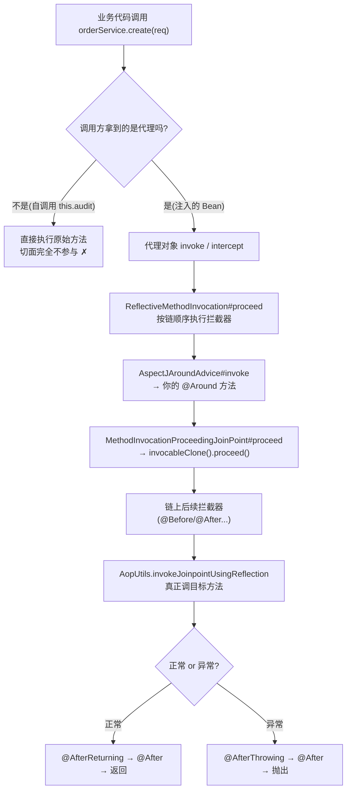

# Spring Framework 源码精读 04：AOP 实战 —— 自定义注解切面（耗时统计 + 脱敏）与 10 个真实坑位

> 一句话结论：写出一个"能跑"的注解切面只要 20 行，但让它**在所有边界条件下都正确**（自调用、参数绑定、脱敏递归、异常路径、异步线程、final 方法……）需要把前面三篇的原理逐条对上号——本篇用一个"接口耗时统计 + 参数/返回值脱敏"的切面，把每个坑都落回到 `ReflectiveAspectJAdvisorFactory`、`AbstractAspectJAdvice`、`ReflectiveMethodInvocation`、`CglibAopProxy` 的具体行。
> 阅读前置：读完 [01-aop-原理与自动代理创建](./01-aop-原理与自动代理创建.md)、[02-代理方式-jdk与cglib](./02-代理方式-jdk与cglib.md)、[03-拦截器链-调用与通知顺序](./03-拦截器链-调用与通知顺序.md)
> 预计阅读：45 分钟 ｜ 源码：`org.springframework:spring-aop:7.1.0`

---

## 0. 先看现象

需求很朴素：**任何加了 `@Trace` 的方法，打印"方法名 + 耗时 + 入参（已脱敏）"，返回后再打印出参（已脱敏）**。落地写法就是下面这段（本篇的主线样例）：

```text (src: 应用代码示例，非 Spring 源码)

@Retention(RetentionPolicy.RUNTIME)
@Target({ElementType.TYPE, ElementType.METHOD})
public @interface Trace {

    /** 日志前缀，用于区分业务模块。 */
    String value() default "";

    /** 是否打印返回值，默认打印。 */
    boolean printResult() default true;
}
```

上面这段是**应用代码**，不是我让你背的源码。它只有两个属性，但这两个属性恰好能引出两类问题：

- `@Target` 含 `TYPE` → 类级别打标**一定会**撞上"切面自己代理自己"和"JDK 代理"的边界；
- `printResult` 是个**静态**属性 → 它决定了"要不要取返回值"，而取返回值在 `@Around` 里意味着**必须显式 `proceed()` 并接住返回值**。

再看使用者视角，我们期望的行为是：

| 场景 | 期望 | 实际极易踩坑处 |
|---|---|---|
| 正常返回 `Order` | 打印耗时 + 脱敏后的入参/出参 | 出参是对象，`toString()` 里有手机号 |
| 抛异常 | 打印耗时 + `FAIL` + 异常类型，异常原样抛出 | 用 `@AfterReturning` 就收不到异常 |
| 内部方法自调用 | 也生效 | 完全不生效（见 §3.4） |
| 方法是 `final` | 生效 | 静默不生效（见 §3.5） |
| 入参是 `Map`/集合 | 递归脱敏 | 只脱了一层（见 §3.6） |

**为什么先看现象**：AOP 的坑几乎都不是"学不会被拦截"，而是"以为被拦截了，其实没有"——而"没有"是**静默**的。所以本篇先把"期望-现实"的落差摆出来，再逐条从源码里找答案。

---

## 1. 整体地图



**读图说明**：

1. 图里**唯一的分叉点在最上面**——"调用方拿到的是不是代理"。所有"切面不生效"的问题，90% 在这个节点就已经决定了，跟切面写得对不对无关。
2. 中间的 `E → F → G` 是本篇最需要记住的形状：**你的 `@Around` 方法体包装了整条后续链**。所以 `@Around` 里的 `try/finally` 才能统计到"包含其它通知在内"的耗时。
3. 右下角的 `J/K` 两条分支解释了"为什么 `@AfterReturning` 拿不到异常"：它根本不在异常路径上（详见第三篇 §3.2 的 `AfterReturningAdviceInterceptor`）。
4. 图上没有画 `DynamicAdvisedInterceptor`（CGLIB）与 `JdkDynamicAopProxy#invoke`（JDK）的差别——因为从 `D` 开始两者**完全一致**，都创建 `ReflectiveMethodInvocation`。这正是 Spring AOP 的分层设计：代理方式是"壳"，拦截器链是"瓤"。

依赖关系（本篇依赖什么）：

| 本篇用到 | 来自哪篇 | 具体机制 |
|---|---|---|
| 代理是否生成 | 01 | `AbstractAutoProxyCreator#wrapIfNecessary` |
| 点匹配到不到 | 01 | `AspectJExpressionPointcut#matches` |
| 拦截器怎么排 | 03 | `ReflectiveAspectJAdvisorFactory#getAdvisorMethods` |
| 参数怎么绑 | 03 | `AbstractAspectJAdvice#argBinding` |
| 自调用为什么失效 | 03 | 代理边界 |
| `final` 为什么失效 | 02 | `CglibAopProxy#doValidateClass` |

---

## 2. 关键类逐个拆

| 类 | 角色 | 实战中你会因它踩什么坑 |
|---|---|---|
| `@Aspect` / `@Around` | 声明切面与通知 | 切面本身也是一个 Bean，也会被代理 |
| `AspectJExpressionPointcut` | 把 `@annotation(...)` 变成方法匹配器 | `@annotation` 只能匹配**方法上的**注解 |
| `AspectJAroundAdvice` | 把 `@Around` 方法包装成 `MethodInterceptor` | 忘记 `proceed()` → 目标方法**静默不执行** |
| `MethodInvocationProceedingJoinPoint` | `ProceedingJoinPoint` 的实现 | `getArgs()` 改参数必须用 `proceed(args)` |
| `AbstractAspectJAdvice#argBinding` | 把通知方法形参与切点绑定 | 形参名丢了 → `IllegalStateException` |
| `ReflectiveMethodInvocation` | 链的执行器 | `invocableClone` 让 `proceed` 可多次调用 |
| `CglibAopProxy` | 类代理 | `final` 方法静默不生效 |
| `AopUtils#invokeJoinpointUsingReflection` | 最终反射调用 | `private` 方法根本不是"连接点" |

### 2.1 `@annotation` 只能匹配方法级注解——源码依据

很多人写 `@Pointcut("@annotation(Trace)")` 然后给**类**打 `@Trace`，结果一个方法都不拦。为什么？看 `AspectJExpressionPointcut` 的匹配入口：

```java (src: AspectJExpressionPointcut.java#L308-L333)
	@Override
	public boolean matches(Method method, Class<?> targetClass, boolean hasIntroductions) {
		ShadowMatch shadowMatch = getTargetShadowMatch(method, targetClass);

		// Special handling for this, target, @this, @target, @annotation
		// in Spring - we can optimize since we know we have exactly this class,
		// and there will never be matching subclass at runtime.
		if (shadowMatch.alwaysMatches()) {
			return true;
		}
		else if (shadowMatch.neverMatches()) {
			return false;
		}
		else {
			// the maybe case
			if (hasIntroductions) {
				return true;
			}
			// A match test returned maybe - if there are any subtype sensitive variables
			// involved in the test (this, target, at_this, at_target, at_annotation) then
			// we say this is not a match as in Spring there will never be a different
			// runtime subtype.
			RuntimeTestWalker walker = getRuntimeTestWalker(shadowMatch);
			return (!walker.testsSubtypeSensitiveVars() || walker.testTargetInstanceOfResidue(targetClass));
		}
	}
```

**这段在干什么**：它是 `MethodMatcher` 的实现，输入"方法 + 目标类"，输出"这个切点能不能匹配这个方法"。三级判定：`alwaysMatches` 直接真、`neverMatches` 直接假、剩下的"maybe"再做子类型敏感变量（`this`/`target`/`@target`/`@within`）的二次判断。

**为什么这么写**：AspectJ 的匹配模型是"阴影（Shadow）"——表达式不是对"方法"求值，而是对**编译期能确定的连接点阴影**求值。`@annotation(X)` 描述的阴影是"**执行**注解了 X 的方法"，注解信息在 `Method` 上，所以它只看方法；`@within(X)` 才是"**在**注解了 X 的类里执行"，才看类。这是 AspectJ 语义，不是 Spring 的选择。

**改成别的会怎样**：如果写成 `execution(* com.example..*(..))`，阴影变成"任意执行"，`alwaysMatches()` 常常为真，直接短路返回 true，连方法都不看——这就是 `execution` 比 `@annotation` 快一档的原因。反过来 `@args(...)` 涉及运行时参数类型，一定落到 "maybe" 分支，`isRuntime()` 为真，链里每个拦截器都会再被 `InterceptorAndDynamicMethodMatcher` 包一层（见第三篇 §2.1）。

**坑**：`@annotation` 里放类名时要写**全限定名或导包**（`@annotation(com.example.Trace)`），写简单名 `@annotation(Trace)` 在表达式解析阶段就会失败，异常在**第一次生成代理时**抛出，而不是启动时——所以启动看似成功、第一个请求才炸。

### 2.2 `@Around` 忘写 `proceed()`：目标方法静默不执行

```java (src: AspectJAroundAdvice.java#L63-L71)
	@Override
	public @Nullable Object invoke(MethodInvocation mi) throws Throwable {
		if (!(mi instanceof ProxyMethodInvocation pmi)) {
			throw new IllegalStateException("MethodInvocation is not a Spring ProxyMethodInvocation: " + mi);
		}
		ProceedingJoinPoint pjp = lazyGetProceedingJoinPoint(pmi);
		JoinPointMatch jpm = getJoinPointMatch(pmi);
		return invokeAdviceMethod(pjp, jpm, null, null);
	}
```

**这段在干什么**：`AspectJAroundAdvice` 是 `@Around` 的 `MethodInterceptor` 适配器。它把 Spring 内部的 `ProxyMethodInvocation` 包装成 AspectJ 公开的 `ProceedingJoinPoint`，然后**反射调用你的切面方法**并把它的返回值当作本拦截器的返回值。

**为什么这么写**：`@Around` 语义上就是"我接管这次调用"——链的前进权交给了你的方法体。这就是为什么**不调 `pjp.proceed()` 目标方法就不执行**：`proceed()` 是唯一能让游标继续前进的入口（见第三篇 `ReflectiveMethodInvocation#proceed` 的 `++currentInterceptorIndex`）。

**改成别的会怎样**：如果改用 `@Before`，适配器 `MethodBeforeAdviceInterceptor` 里写死了 `return mi.proceed();`（第三篇 §2.4），你**没有能力**阻止目标方法执行——这就是"`@Before` 更安全"的源码级原因。所以：只想加日志就用 `@Before`/`@After`；只有需要"改写返回值/改写参数/短路/捕获异常继续"时才用 `@Around`。

**坑**：`@Around` 忘 `proceed()` 时**不报错、不打日志**，方法返回 `null`。如果方法返回 `int`，会立刻炸在 `JdkDynamicAopProxy` 的 primitive 判空上（第二篇 §2.4）；如果返回对象，就只是"莫名其妙返回 null"。

### 2.3 `ProceedingJoinPoint` 改参数的两种写法

```java (src: MethodInvocationProceedingJoinPoint.java#L80-L95)
	@Override
	public @Nullable Object proceed() throws Throwable {
		return this.methodInvocation.invocableClone().proceed();
	}

	@Override
	public @Nullable Object proceed(Object[] arguments) throws Throwable {
		Assert.notNull(arguments, "Argument array passed to proceed cannot be null");
		if (arguments.length != this.methodInvocation.getArguments().length) {
			throw new IllegalArgumentException("Expecting " +
					this.methodInvocation.getArguments().length + " arguments to proceed, " +
					"but was passed " + arguments.length + " arguments");
		}
		this.methodInvocation.setArguments(arguments);
		return this.methodInvocation.invocableClone(arguments).proceed();
	}
```

**这段在干什么**：`proceed()` 走 `invocableClone()` 克隆出一个新的调用对象再前进，这样同一个 `ProceedingJoinPoint` 可以被 `proceed()` **多次**（重试、兜底调用）；`proceed(Object[])` 额外做三件事：长度校验、把参数写回当前 invocation、用新参数克隆。

**为什么这么写**：`ReflectiveMethodInvocation` 是有状态的（`currentInterceptorIndex` 游标），直接复用会"游标已到末尾"。克隆出一份**独立游标 + 独立参数数组**，语义才干净。注意 `invocableClone` 里 `userAttributes` 是**共享**的（第三篇 §2.7），因为 `JoinPointMatch` 这类属性必须跨克隆可见。

**改成别的会怎样**：用 `pjp.getArgs()[0] = newArg` 只是在改数组元素，能生效（因为数组是引用）但**不会**触发 `setArguments`；而 `args` 如果是 `null` 会 NPE。所以规范写法是：**要么完全不碰、要么整体 `proceed(newArgs)`**。

**坑**：`proceed(Object[])` 的长度必须与原参数完全相等——不能"只传一个想改的参数"。想改第 2 个参数，得先 `Object[] a = pjp.getArgs(); a[1] = x; pjp.proceed(a);`。

### 2.4 脱敏为什么容易"只脱一层"

脱敏通常写成递归遍历对象图。真正的难点不在递归，而在于**你得知道有哪些地方可能藏敏感数据**，而 Spring 在这一点上完全帮不了你。与本篇相关的唯一源码约束是"通知方法的形参必须能被绑定"，否则直接抛异常：

```java (src: AbstractAspectJAdvice.java#L600-L609)
		}

		if (numBound != this.parameterTypes.length) {
			throw new IllegalStateException("Required to bind " + this.parameterTypes.length +
					" arguments, but only bound " + numBound + " (JoinPointMatch " +
					(jpMatch == null ? "was NOT" : "WAS") + " bound in invocation)");
		}

		return adviceInvocationArgs;
	}
```

**这段在干什么**：`argBinding` 依次填充四类实参——`JoinPoint`（或 `JoinPoint.StaticPart`）、切点表达式绑定的参数、`returning` 绑定的返回值、`throwing` 绑定的异常；最后**严格校验**"绑定数量 == 形参个数"，不等就抛 `IllegalStateException`。

**为什么这么写**：Spring 是"结构性绑定"，不做任何隐式默认值。这个校验就是把你写错的通知签名**当场**打回，而不是让你拿到一个 `null` 参数在后面踩 NPE。

**改成别的会怎样**：如果你在 `@AfterReturning` 里写 `(Object ret)` 却没写 `returning = "ret"`，`numBound` 少 1，直接抛 `IllegalStateException: Required to bind 1 arguments, but only bound 0 (JoinPointMatch WAS bound in invocation)`。这个报错信息非常友好——**它告诉你"表达式绑上了，但你没接"**。

**坑**：编译时没加 `-parameters` 的工程，参数名在运行时是 `arg0`/`arg1`。AspectJ 的 `execution(* *(..)) && args(name)` 依赖参数名，Spring 会用 `LocalVariableTableParameterNameDiscoverer`（Spring 6.1+ 已移除，只留 `StandardReflectionParameterNameDiscoverer`）兜底，拿不到就绑定失败。解决办法就是 `-parameters` 或 aspectj 编译。

### 2.5 切面自己也是 Bean，也会被代理

这一点在实战里体现为"**我在切面里注入了别的被切 Bean，结果死循环/顺序错乱**"。根因在 01 篇讲过的 `isInfrastructureClass`：

```java (src: AbstractAutoProxyCreator.java#L359-L368)
	protected boolean isInfrastructureClass(Class<?> beanClass) {
		boolean retVal = Advice.class.isAssignableFrom(beanClass) ||
				Pointcut.class.isAssignableFrom(beanClass) ||
				Advisor.class.isAssignableFrom(beanClass) ||
				AopInfrastructureBean.class.isAssignableFrom(beanClass);
		if (retVal && logger.isTraceEnabled()) {
			logger.trace("Did not attempt to auto-proxy infrastructure class [" + beanClass.getName() + "]");
		}
		return retVal;
	}
```

**这段在干什么**：基础设施类（`Advice`/`Pointcut`/`Advisor`/`AopInfrastructureBean` 的实现）**不参与自动代理**。而带 `@Aspect` 的类在 `AnnotationAwareAspectJAutoProxyCreator` 里被额外排除（01 篇 §2.x）。

**为什么这么写**：如果切面自己被代理，切面里的 advice 方法就会变成"经过代理调用"，而代理只会暴露接口方法——advice 方法不在接口上，运行期必然失败。源码注释里明说了这一点。

**改成别的会怎样**：如果你手写 `Advisor` 并让它 `implements` 了业务接口，它不会被代理——所以别把"业务 + 基础设施"混在同一个类里。

**坑**：切面里 `@Autowired` 一个业务 Bean 是**允许**的（那是别人的代理），但如果你在切面的 `@PostConstruct` 里就调用这个业务 Bean，可能拿到的是**还没被代理的早期引用**（`getEarlyBeanReference` 路径），通知不生效。

---

## 3. 源码逐段精读

### 3.1 一次 `@Trace` 方法的完整旅程

```text (src: 无源码标注，执行序列说明)

1. 业务方调用 proxy.create(req)
2. JdkDynamicAopProxy#invoke / DynamicAdvisedInterceptor#intercept
3. chain = advised.getInterceptorsAndDynamicInterceptionAdvice(method, targetClass)
   → 链上只有 1 个: AspectJAroundAdvice（因为我们只用 @Around）
4. new ReflectiveMethodInvocation(proxy, target, method, args, targetClass, chain).proceed()
5. proceed() → index=0 → AspectJAroundAdvice#invoke(this)
6. → invokeAdviceMethod(pjp, jpm, null, null) → 反射调用你的 traceAround(pjp)
7. 你的方法: long t=now(); try { Object r = pjp.proceed(); ... } finally { 打印耗时 }
8. pjp.proceed() → invocableClone().proceed() → index=1 == size-1+... → invokeJoinpoint()
9. AopUtils.invokeJoinpointUsingReflection(target, method, args) → 真实业务方法
10. 返回值沿栈返回，finally 里打印耗时，出栈
```

**第 1 步**是最容易被忽略的：**代理对象是谁给的**。如果是 `@Autowired` 注入或 `getBean` 拿到的，就是代理；如果是 `this`，就不是。后面 9 步全白搭。

**第 3 步**决定了"链上有几个拦截器"，它由 `AopUtils#canApply` 预先筛过一遍（类级别），再由 `DefaultAdvisorChainFactory` 按方法逐个匹配。所以一个 Bean 加了 5 个切面但方法只命中 2 个，链长就是 2，不是 5。

**第 8 步**是 `ReflectiveMethodInvocation#proceed` 的终止条件：`index == interceptors.size - 1` 时不再前进，而是反射调目标方法。这也解释了"为什么 `proceed()` 只能前进不能后退"。

### 3.2 为什么"耗时统计"应该放 `@Around` 而不是 `@Before` + `@After`

看两个适配器的源码对比：

```java (src: MethodBeforeAdviceInterceptor.java#L54-L58)
	@Override
	public @Nullable Object invoke(MethodInvocation mi) throws Throwable {
		this.advice.before(mi.getMethod(), mi.getArguments(), mi.getThis());
		return mi.proceed();
	}
```

**这段在干什么**：`@Before` 的适配器：先反射调用你的 `before`，然后**无条件** `return mi.proceed();`。

**为什么这么写**：`@Before` 的契约就是"只能看，不能改"，所以它必须把控制权原样交下去。`return` 也很关键——它把目标方法的返回值原样传出，保证 `@Before` 不改变语义。

**改成别的会怎样**：如果它不 `return`（比如误写成 `mi.proceed(); return null;`），所有 `@Before` 方法都会让业务方法返回 `null`。这正好是"用户写 `@Around` 忘 `proceed`"的镜像。

**坑**：`@Before` + `@After` 也能算耗时，但**算不到"通知本身的开销"和"异常在链上其它拦截器之间传播的时间"**；而且 `@After` 里的 `threadLocal.remove()` 与 `@Before` 的 `set()` 必须严格成对——中途有别的切面抛异常时仍有 `finally` 保证，这点是安全的。

### 3.3 `@AfterReturning` 与 `@AfterThrowing` 的适配器形状

```java (src: AfterReturningAdviceInterceptor.java#L54-L59)
	@Override
	public @Nullable Object invoke(MethodInvocation mi) throws Throwable {
		Object retVal = mi.proceed();
		this.advice.afterReturning(retVal, mi.getMethod(), mi.getArguments(), mi.getThis());
		return retVal;
	}
```

**这段在干什么**：先 `proceed()` 拿到返回值，再调你的 `afterReturning`，最后把返回值原样返回。

**为什么这么写**：`@AfterReturning` 能拿到返回值，代价是**它必须等目标方法成功返回**——所以异常路径上这行 `afterReturning` 永远不执行（`proceed()` 抛了）。这就是"`@AfterReturning` 抓不到异常"的源码依据。

**改成别的会怎样**：想"异常时也记一笔"，要么用 `@AfterThrowing`，要么用 `@After`（`try/finally`），要么在 `@Around` 里 `try/catch/finally` 自己分。三者语义不同：`@AfterThrowing` **能拿到异常对象**，`@After` 拿不到。

**坑**：`@AfterReturning` 里**改不了返回值**（返回值已经是局部变量 `retVal`，`return retVal` 用的是它）。想改返回值只能用 `@Around`——这不是 Spring 的限制，是 Java 值传递。

### 3.4 坑 1：同类自调用（最高频）

```text (src: 应用代码示例，非 Spring 源码)

@Service
public class OrderServiceImpl implements OrderService {

    @Override
    @Trace
    public void create(String no) {
        this.audit(no);
    }

    @Trace
    public void audit(String no) {
    }
}
```

`this.audit(no)` 里的 `this` 是**目标对象**，不是代理。代理只有在"外部通过引用调用"时才参与。这个原因的完整三层链条见第三篇 §6.1，此处只给修复方案对照：

| 修复 | 写法 | 源码级原因 | 代价 |
|---|---|---|---|
| 自注入 | `@Autowired @Lazy OrderService self;` 然后 `self.audit(no)` | `@Lazy` 注入的是代理的延迟解析器，运行时拿到真代理 | 多一层代理、循环依赖需 `@Lazy` 打破 |
| 暴露代理 | `@EnableAspectJAutoProxy(exposeProxy = true)` + `((OrderService) AopContext.currentProxy()).audit(no)` | `invoke` 里 `AopContext.setCurrentProxy(proxy)` 把代理塞进 ThreadLocal | ThreadLocal 写开销、异步线程取不到 |
| 拆类 | 把 `audit` 挪到另一个 Bean 并注入 | 跨 Bean 调用必然过代理 | 类变多，但语义最干净（推荐） |

### 3.5 坑 2：`final` 方法静默不生效

```text (src: 应用代码示例，非 Spring 源码)

@Service
public class ReportService {

    @Trace
    public final void export() {
    }
}
```

CGLIB 靠**继承 + 覆写**实现代理，`final` 方法不能被覆写。Spring 早在生成代理时就知道这件事，并打了日志（见第二篇 §3.1 `doValidateClass`）：

| 情况 | Spring 行为 |
|---|---|
| `public final` 且实现了接口 | warn："Unable to proxy interface-implementing method ... marked as final, consider using interface-based JDK proxies instead." |
| `public final` 未实现接口 | warn："Public final method ... cannot get proxied via CGLIB" |
| `private` / `static` | 直接跳过，不 warn（因为它们本来就不是可代理连接点） |

**注意**：这里只是 `warn`，启动不会失败。所以线上"某个方法没有日志"时，DAILY 级别下你根本看不到这条警告——把 `org.springframework.aop.framework.CglibAopProxy` 调成 `DEBUG`/`TRACE` 才有信息。

### 3.6 坑 3：脱敏只脱了第一层

典型错法是在 `@Before` 里对 `pjp.getArgs()` 逐个 `toString()` 后正则替换。问题在于：`toString()` 出来的字符串**再也不能被结构化管理**（没法区分"哪个字段被脱了"），而且嵌套对象的 `toString()` 很可能根本没实现。正确做法是：

| 做法 | 说明 |
|---|---|
| 用 Jackson 序列化成树再遍历字段名 | 能处理嵌套、集合、`Map`；按字段名黑名单（`phone`/`idCard`/`password`/`token`）脱敏 |
| 深拷贝后再脱敏 | **绝不要**改原对象字段——那会污染真实业务数据（这是最危险的坑） |
| 限制序列化深度与大小 | 防止大对象拖垮日志，也防止 `LazyInitializationException` |
| `@JsonIgnore` / 自定义 `Serializer` | 脱敏规则集中管理，切面只负责调用 |

### 3.7 坑 4：`@Around` 捕获异常后"吞掉"

```text (src: 应用代码示例，非 Spring 源码)

@Around("@annotation(trace)")
public Object around(ProceedingJoinPoint pjp, Trace trace) throws Throwable {
    try {
        return pjp.proceed();
    }
    catch (Exception e) {
        log.error("fail", e);
    }
    return null;
}
```

**问题**：异常被吞，`@Transactional` 的 rollback 规则、上层 `@ControllerAdvice` 全部失效。而且如果方法返回 `int`，`return null` 会在 `JdkDynamicAopProxy` 里炸 "Null return value from advice does not match primitive return type"。

**正确**：`catch` 里记完日志必须 `throw e;`；要返回默认值就走 `catch` → `return fallback;` 并明确文档化语义。

### 3.8 坑 5：切面里的 `ThreadLocal` 与异步

耗时统计常用 `ThreadLocal<Long> start`。如果业务方法内部用了 `@Async` 或 `CompletableFuture`，`finally` 里的 `remove()` 可能发生在**另一个线程**里（如果切面被套在异步方法外层），或者相反——异步任务里拿不到 `ThreadLocal`。

| 现象 | 原因 |
|---|---|
| `AopContext.currentProxy()` 抛 `IllegalStateException: Cannot find current proxy` | ThreadLocal 不跨线程 |
| MDC / TraceId 丢失 | 同上，需 `TaskDecorator` 手工传递 |
| 耗时统计成 0 | 异步方法立即返回 `Future`，真实耗时在别处 |

**最佳实践**：耗时统计用 `@Around` 里的**局部变量**，不要用 `ThreadLocal`——局部变量天生线程安全。

### 3.9 坑 6：`@Order` 决定链顺序，但不决定"谁在里面"

多个切面时的执行顺序可在类上加 `@Order(1)`（数字小的靠外，即先进入、后退出）。但 `@Order` **不能**让两个切面合并，也不能让"内层切面"的 `@Around` 包住"外层切面"的 `@Before`——链是一维的，顺序完全由排序后的 `Advisor` 列表决定（第三篇 §2.8 `sortAdvisors`）。

### 3.10 坑 7：`@Pointcut` 表达式写 `execution` 时匹配到 Spring 自己的类

`execution(* com.example..*(..))` 会匹配到这个包下的**所有**方法，包括 `@Configuration` 类里的 `@Bean` 方法（那些方法也算方法）。虽然 `isInfrastructureClass` 会挡掉一部分，但 `@Configuration` 类的增强（`ConfigurationClassEnhancer`）与 AOP 代理是**两套机制**，叠在一起极易出诡异问题。**用 `@annotation` 或 `within` 收窄范围**。

### 3.11 坑 8：`@Around` 里调 `pjp.proceed()` 两次 = 业务执行两次

`proceed()` 会 `invocableClone()`，所以**可以**调两次而不报错——但业务方法就真的执行两次。这是"重试"逻辑最容易写错的地方：必须自己 catch 后决定。

### 3.12 坑 9：注解写在接口上，方法写在实现类上

这是 Spring AOP 的**经典不对称**问题，完整原因涉及 `AopUtils#canApply` 的"接口方法 + 实现方法都遍历"逻辑：

```java (src: AopUtils.java#L262-L274)
		for (Class<?> clazz : classes) {
			Method[] methods = ReflectionUtils.getAllDeclaredMethods(clazz);
			for (Method method : methods) {
				if (introductionAwareMethodMatcher != null ?
						introductionAwareMethodMatcher.matches(method, targetClass, hasIntroductions) :
						methodMatcher.matches(method, targetClass)) {
					return true;
				}
			}
		}

		return false;
	}
```

**这段在干什么**：判断"某切点能不能在这个类上匹配到**任意**方法"。`classes` 里既有 `getUserClass(targetClass)`（实现类），也有**所有接口**。

**为什么这么写**：因为 JDK 代理暴露的是接口方法，CGLIB 代理暴露的是类方法，两者都得能匹配上，代理才有意义。

**改成别的会怎样**：正因为接口方法也在遍历范围里，`@annotation` 注解放在**实现类方法**上时，CGLIB 能匹配（`getAllDeclaredMethods(实现类)` 拿到了带注解的方法）；而如果你切成 JDK 代理，调用走的是**接口方法**，`@annotation` 就匹配不到——"换个代理方式切面失效"的根源就在这里。

**坑**：结论是**注解统一写在接口方法上**（或统一用 CGLIB），不要一半一半。

### 3.13 坑 10：`isRuntime()` 切点让链变慢

`@annotation` 是静态的（编译期就能定），但像 `args(..)`、`@args(..)`、`bean(...)`（Spring 扩展的 PCD）都可能是**动态**的：`MethodMatcher#isRuntime()` 返回 true。此时 `DefaultAdvisorChainFactory` 会把每个拦截器包成 `InterceptorAndDynamicMethodMatcher`，**每次调用**都要重新跑一遍匹配（`ReflectiveMethodInvocation#proceed` 里的 `dm.matcher().matches(...)`）。这就是"加了 `@Around` 后 TPS 掉一截"的常见原因之一。

---

## 4. 完整执行时序

以"`create` 方法正常返回"为例，带真实耗时打印的 `@Around` 切面的完整时序：

| # | 位置 | 发生什么 |
|---|---|---|
| 1 | `JdkDynamicAopProxy#invoke` | 取 `target`、算 `chain`（长度 1） |
| 2 | `ReflectiveMethodInvocation#proceed` | `index` 从 -1 变 0，调 `AspectJAroundAdvice#invoke` |
| 3 | `AspectJAroundAdvice#invoke` | 造 `MethodInvocationProceedingJoinPoint`，反射调切面方法 |
| 4 | 你的 `traceAround` | `long start = System.nanoTime();` |
| 5 | `pjp.proceed()` | `invocableClone().proceed()` → `index` 到 1 → 到末尾 → 反射调目标 |
| 6 | 目标 `create` | 业务执行，返回 `Order` |
| 7 | 返回 `traceAround` | 脱敏返回值、打印耗时 |
| 8 | `AspectJAroundAdvice` | 返回值原样传出 |
| 9 | `ReflectiveMethodInvocation` | 栈回卷，`invoke` 返回 |
| 10 | `JdkDynamicAopProxy` | 检查 `retVal == target`（否）、`null`+primitive（否），返回 `retVal` |

**异常路径**：第 6 步抛异常 → 异常穿过 `pjp.proceed()` → `traceAround` 的 `catch/finally` → 若 `catch` 里 `throw` 则继续上抛 → `AspectJAroundAdvice` 不捕获 → `JdkDynamicAopProxy#invoke` 的 `throws Throwable` 直接透出 → 调用方拿到原始异常（未被包装）。

**为什么强调"未被包装"**：`AopUtils#invokeJoinpointUsingReflection` 会把 `InvocationTargetException` 拆成 `getTargetException()` 抛出，所以业务异常类型在调用方看起来**完全不变**——这是 `@Transactional` 能按异常类型判断回滚的前提。

---

## 5. 设计模式与取舍

| 设计点 | 模式 | 取舍 |
|---|---|---|
| `@Around` 拿 `ProceedingJoinPoint` | 命令模式（可多次执行） | 灵活 vs 易忘 `proceed` |
| `MethodInterceptor` 链 | 责任链 | 可插拔 vs 调试时栈很深 |
| `Advisor` = Pointcut + Advice | 策略/组合 | 可复用 vs 概念多一层 |
| `AopProxy` 两种实现 | 桥接 | 解耦 vs 出现"换代理就失效" |
| `InterceptorAndDynamicMethodMatcher` | 装饰器 | 动态匹配能力 vs 每次调用都算 |

**取舍一：为什么 Spring 不把"耗时统计"做成内建**——因为"何时算起点"业务差异太大（含不含序列化？含不含连接池等待？）。框架只提供 `@Around` 这个钩子。

**取舍二：为什么脱敏不该由 AOP 强行统一**——脱敏规则与领域模型强耦合，放切面里容易"漏字段"。更稳的是在序列化层（Jackson `Serializer`）做，切面只负责"挑时机"。

---

## 6. 踩坑与调试

**排查清单（按命中率排序）**：

1. `AopUtils.isAopProxy(bean)` → false？说明压根没被代理（点没匹配上 / 被 `shouldSkip` / 是基础设施类）。
2. `AopUtils.isJdkDynamicProxy` vs `isCglibProxy` → 确认代理方式是否与"注解写在哪一层"匹配（坑 9）。
3. 断在 `AbstractAutoProxyCreator#wrapIfNecessary`，看 `specificInterceptors` 是否为空数组。
4. `logging.level.org.springframework.aop=TRACE` → 能看到"did not attempt to auto-proxy"与 CGLIB 的 final 警告。
5. 检查 `@Aspect` 类是否被 Spring 管理（`@Component`/`@Bean`）。
6. 检查是否被 `@Conditional`/profile 挡掉。

---

## 7. ⚠️ 版本差异

| 版本 | 变化 | 实战影响 |
|---|---|---|
| Spring 4.x | CGLIB 来自独立 `cglib` 依赖 | 需排除旧 cglib，冲突多 |
| Spring 5.2 | CGLIB repack 到 `spring-core` 的 `org.springframework.cglib` | 无需额外依赖 |
| Spring 6.0 | 基线 JDK 17；移除 `LocalVariableTableParameterNameDiscoverer` | 参数名必须 `-parameters` |
| Spring 6.0 | `final` 类/方法警告更完整 | 仍只是 warn |
| Spring 6.1 | `@Aspect` 的 aop 配置支持 AOT | 原生镜像需注意代理 |
| Spring 7.0 | 代理创建向 AOT/`ProxyTypes` 演进 | 运行期动态代理在 Native 下受限 |
| Spring 7.1 | `AspectJExpressionPointcut` 增强 `@annotation` 缓存 | 命中率更高 |

---

## 8. 面试高频问与答

1. **`@Around` 和 `@Before` 在源码上最大的区别是什么？** → `@Around` 的适配器把调用权交给用户方法（`AspectJAroundAdvice` 反射调用），`@Before` 的适配器写死 `return mi.proceed();`。
2. **为什么 `@AfterReturning` 拿不到异常？** → 它先 `proceed()` 再回调，`proceed()` 抛异常时回调不执行。
3. **`@After` 为什么异常时也执行？** → `AspectJAfterAdvice` 用 `try/finally`。
4. **`ProceedingJoinPoint#proceed()` 能调两次吗？** → 能，因为 `invocableClone()`；但业务会执行两次。
5. **`proceed(args)` 的参数个数要求？** → 必须与原参数个数相等，否则 `IllegalArgumentException`。
6. **为什么注解写在实现类方法上、切成 JDK 代理就失效？** → JDK 代理调用的是接口方法，`AopUtils#canApply` 遍历接口方法时匹配不到实现类上的注解。
7. **`@annotation` 和 `@within` 的语义差别？** → 前者匹配"方法上有注解的执行"，后者匹配"类上有注解的类里的执行"。
8. **切面类自己会被 AOP 代理吗？** → 不会，`isInfrastructureClass` 与 `AnnotationAwareAspectJAutoProxyCreator#isInfrastructureClass` 双重排除。
9. **`private` 方法能被 AOP 拦截吗？** → 不能，既不是 JDK 代理能暴露的接口方法，也不是 CGLIB 能覆写的方法。
10. **怎么判断一个 Bean 是不是代理？** → `AopUtils.isAopProxy` / `AopUtils.isJdkDynamicProxy` / `AopUtils.isCglibProxy`，或 `AopProxyUtils.ultimateTargetClass`。
11. **耗时统计为什么不能只在 `@Before`/`@After` 里做？** → 能算，但算不到"通知链本身"和"异常传播"的开销；且 `@After` 无法知道是否异常。
12. **脱敏时为什么绝不能改原对象？** → 原始参数仍被业务代码使用，改了会污染真实数据（尤其缓存/持久化场景）。

---

## 9. 动手练习

### 练习 1（必做）：实现 `@Trace` 切面

要求：`@Around` + 耗时 + 入参/出参脱敏 + 异常路径打印 `FAIL` 且原样抛出。

**验收标准**：
- 正常/异常两条路径都有日志；
- 异常类型在调用方保持不变；
- 脱敏只作用于日志，不影响业务参数（可断言 `req.getPhone()` 未被修改）。

### 练习 2：**验证自调用失效**

在实现类里加 `this.audit()`，观察 `audit` 的日志不出现；然后用 `@Lazy` 自注入修复，再观察出现。

**验收标准**：能说出"为什么 `this` 不行"（目标对象 vs 代理对象）。

### 练习 3：验证 `final` 方法

把被切方法改成 `final`，打开 `org.springframework.aop` 的 `DEBUG` 日志，找到 CGLIB 的 warn。

**验收标准**：贴出警告原文，并说明 Spring 为什么只 warn 不报错。

### 练习 4：`proceed(args)` 改参数

在 `@Around` 里把某入参改掉再 `proceed(newArgs)`，断言业务方法收到的是新值。

**验收标准**：解释 `invocableClone` 与 `setArguments` 各自的作用。

### 练习 5：`@Order` 验证

两个切面分别 `@Order(1)`/`@Order(2)`，都打 `@Around`，观察嵌套顺序。

**验收标准**：能预测"进入顺序"与"退出顺序"是相反的。

---

## 小结

- 注解切面的三段式：**声明注解 → 写 `@Aspect` 切面 → 确认被代理**。第三段才是坑的来源。
- `@Around` 的本质是"接管调用"：`proceed()` 是唯一前进入口，忘记调用时**静默**不执行目标方法。
- `proceed(Object[])` 必须长度一致，内部走 `setArguments` + `invocableClone`。
- `@AfterReturning` 在 `proceed()` **之后**执行，所以看不到异常；`@After` 用 `try/finally`，所以看得到"发生了"但看不到"是什么异常"。
- 十个坑里最狠的三个：**自调用**（代理边界）、**final 方法**（继承限制）、**注解写错层**（接口 vs 实现类）。
- 脱敏永远在**副本**上做，切面只负责时机，规则交给序列化层。

---

## 自测题

**1. 为什么 `@Around` 不调 `proceed()` 时，返回 `int` 的方法会抛异常？**

<details><summary>参考答案</summary>

因为 `@Around` 的返回值被当作拦截器返回值，不调 `proceed()` 相当于返回 `null`；`JdkDynamicAopProxy#invoke`（CGLIB 同理经 `processReturnType`）检测到 `retVal == null` 且方法返回类型是原始类型，抛 `AopInvocationException: Null return value from advice does not match primitive return type`。

</details>

**2. `@Before` 能否阻止目标方法执行？**

<details><summary>参考答案</summary>

不能。`MethodBeforeAdviceInterceptor#invoke` 写死 `this.advice.before(...); return mi.proceed();`，用户代码没有拿到 `MethodInvocation` 的控制权。想阻止只能用 `@Around`。

</details>

**3. 为什么 `@AfterReturning` 里修改返回值无效？**

<details><summary>参考答案</summary>

`AfterReturningAdviceInterceptor#invoke` 先 `Object retVal = mi.proceed();` 再回调 `afterReturning(retVal, ...)`，最后 `return retVal;`。回调方法返回值是 `void`，改不了局部变量 `retVal`。

</details>

**4. `invocableClone()` 为什么要共享 `userAttributes`？**

<details><summary>参考答案</summary>

`userAttributes` 里存着 `JoinPointMatch` 等由点匹配阶段写入、后续通知需要读取的横切数据；克隆体若各持一份，`proceed()` 之后读到的匹配结果会丢失。共享是"独立游标 + 共享上下文"的设计。

</details>

**5. 切面类为什么不会被自动代理？**

<details><summary>参考答案</summary>

`AbstractAutoProxyCreator#isInfrastructureClass` 排除 `Advice`/`Pointcut`/`Advisor`/`AopInfrastructureBean`；`AnnotationAwareAspectJAutoProxyCreator#isInfrastructureClass` 再额外排除 `@Aspect` 类。若被代理，advice 方法不在接口上会导致运行期失败。

</details>

**6. 注解写在接口方法 vs 实现类方法，何时都能生效？**

<details><summary>参考答案</summary>

使用 CGLIB 代理（`proxyTargetClass=true` 或无接口）时，`AopUtils#canApply` 会遍历实现类的 declared methods，能匹配到实现类上的注解；一旦切成 JDK 代理，调用走接口方法，就只能匹配接口上的注解。

</details>

**7. 为什么"耗时统计"建议用局部变量而非 `ThreadLocal`？**

<details><summary>参考答案</summary>

局部变量天然线程安全、随栈帧销毁；`ThreadLocal` 在异步/线程池场景下会跨线程失效或泄漏，需要额外 `remove()`，且 `AopContext` 这类 ThreadLocal 在异步线程中根本取不到。

</details>

**8. `@annotation(com.example.Trace)` 与 `@within(com.example.Trace)` 有何不同？**

<details><summary>参考答案</summary>

`@annotation` 匹配"方法上带该注解的执行"；`@within` 匹配"声明类上带该注解的类里所有方法的执行"。类级打标应使用 `@within`（或用 `@annotation` + 方法级打标）。

</details>

**9. 动态切点（`isRuntime()` 为真）会带来什么开销？**

<details><summary>参考答案</summary>

`DefaultAdvisorChainFactory` 会把拦截器包装成 `InterceptorAndDynamicMethodMatcher`，`ReflectiveMethodInvocation#proceed` 在每次调用时都要执行 `matcher.matches(method, targetClass, args)`，无法复用方法级缓存。

</details>

**10. `proceed(Object[] args)` 内部做了哪几件事？**

<details><summary>参考答案</summary>

① 判空；② 校验长度与原参数一致，不等抛 `IllegalArgumentException`；③ `methodInvocation.setArguments(arguments)`；④ `invocableClone(arguments).proceed()`。

</details>

**11. 如何最快判断"切面没生效"是不是代理没生成？**

<details><summary>参考答案</summary>

在拿到 Bean 后调用 `AopUtils.isAopProxy(bean)`；或直接用 `AopProxyUtils.ultimateTargetClass(bean)` 看是否与预期类一致；再结合 `org.springframework.aop` 的 TRACE 日志看 `wrapIfNecessary` 是否跳过了该 Bean。

</details>

**12. `@After` 与 `@AfterThrowing` 在异常场景下各自能拿到什么？**

<details><summary>参考答案</summary>

`@After`（`AspectJAfterAdvice`）用 `try/finally`，只知道"方法结束了"，拿不到异常对象；`@AfterThrowing`（`AspectJAfterThrowingAdvice`）在 `catch` 块里回调，能拿到 `Throwable`，并且可通过形参类型过滤是否执行。

</details>
