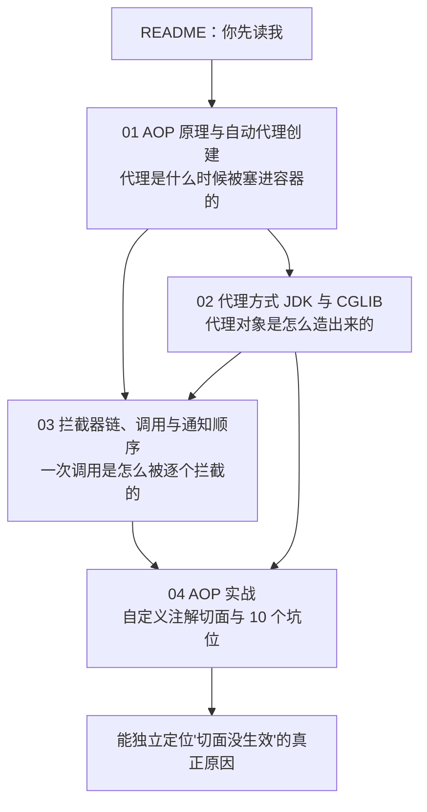

# 02-AOP与代理：一个 `@Transactional` 背后到底发生了什么

> 一句话结论：Spring AOP 不是"在方法前后插代码"，而是**在 Bean 初始化后置处理阶段把一个代理对象塞进容器**；调用方拿到的是代理，代理按"方法"算出一条拦截器链，再用**责任链**逐个执行通知——所以"切面不生效"的 90% 问题都能归到两件事：**代理没生成**，或者**你绕过了代理**。
>
> 阅读前置：读完 [01-IoC容器与Bean生命周期](../01-IoC容器与Bean生命周期/)（尤其是 `refresh` 的 `finishBeanFactoryInitialization` 与 `BeanPostProcessor` 时机）；会用 `@Aspect`/`@Transactional` 写业务代码。
>
> 预计阅读：本组 4 篇，每篇 40~60 分钟 ｜ 源码：`org.springframework:spring-aop:7.1.0`（配套 `spring-context:7.1.0`、`spring-core:7.1.0`、Spring Boot 4.2.0）

## 学习目标

学完这一组，你应当能**不看源码**讲出下面 7 件事：

1. `@EnableAspectJAutoProxy` 只做了一件小事——往容器里注册一个 `AnnotationAwareAspectJAutoProxyCreator`；AOP 的**全部介入点**只有 `postProcessAfterInitialization` 这一处。
2. `Advisor` = `Pointcut` + `Advice`：`@Aspect` 类里的每个通知方法都会被翻译成一个 `Advisor`，`Pointcut` 负责"匹配谁"，`Advice` 负责"做什么"。
3. `AspectJExpressionPointcut` 如何把一个字符串表达式变成"能对 `Method` 回答是/否"的 `MethodMatcher`，`isRuntime()` 又为什么会让调用变慢。
4. JDK 动态代理与 CGLIB 的**选择规则**（`DefaultAopProxyFactory#createAopProxy` 三个条件），以及为什么 `final` 类/方法在 CGLIB 下**静默**失效。
5. 一次被切方法调用如何变成 `ReflectiveMethodInvocation` + `currentInterceptorIndex` 游标推进，`@Around` 的 `proceed()` 为什么能让链继续。
6. 五种通知的**真实执行顺序**，以及 `@After` "排在前面却最后执行"的源码原因（`try/finally`，不是排序）。
7. 同类自调用为什么失效，以及 3 种修复方式各自的源码级原理与代价。

## 文章顺序



**读图说明**：箭头是**知识依赖**，阅读请沿箭头走。

- **01 是地基**：它回答"代理从哪来"。没搞清 `AbstractAutoProxyCreator#postProcessAfterInitialization`，后面两篇都只是背概念。读 01 时请随时对照 IoC 篇的 `refresh` 步骤——AOP 就发生在 `finishBeanFactoryInitialization` 里那 11 个 `BeanPostProcessor` 中的**一个**。
- **02 与 03 是并列的两条腿**，都属于"代理造出来之后"：02 讲**壳**（代理对象的字节码从哪来、为什么有的类代理不了），03 讲**瓤**（壳里那个 `List<Object> chain` 怎么执行）。可以换序读，但**不能跳过 01**。
- **03 依赖 02**：因为 `ReflectiveMethodInvocation` 是被 `JdkDynamicAopProxy#invoke` 和 `DynamicAdvisedInterceptor#intercept` **创建**出来的，不知道壳就找不到瓤的入口。
- **04 是终点**：它不引入新原理，只是把 01-03 的原理逐条落到"注解写在哪层""`final` 方法""脱敏改原对象"这些工程细节上。**如果时间紧，04 可以先跳过**，不影响主线。
- 没有反向依赖：读 04 时不需要回头改 03 的理解。

## 每篇摘要

| 文章 | 主线（源码调用链） | 学完能回答 | 源码依据（主要锚点） |
| --- | --- | --- | --- |
| [01-aop-原理与自动代理创建](01-aop-原理与自动代理创建.md) | `@EnableAspectJAutoProxy` → `AspectJAutoProxyRegistrar#registerBeanDefinitions` → `AopConfigUtils.registerAspectJAnnotationAutoProxyCreatorIfNecessary` → `AnnotationAwareAspectJAutoProxyCreator` → `AbstractAutoProxyCreator#postProcessAfterInitialization` → `wrapIfNecessary` → `createProxy` | AOP 究竟在 Bean 生命周期的哪一步介入？`Advisor`/`Pointcut`/`Advice` 三者是什么关系？`@Aspect` 类为什么自己不被代理？ | [[源码:EnableAspectJAutoProxy.java#L119-L139]]、[[源码:AspectJAutoProxyRegistrar.java#L34-L59]]、[[源码:AbstractAutoProxyCreator.java#L321-L345]]、[[源码:AspectJExpressionPointcut.java#L308-L343]] |
| [02-代理方式-jdk与cglib](02-代理方式-jdk与cglib.md) | `DefaultAopProxyFactory#createAopProxy` → `JdkDynamicAopProxy#getProxy/invoke`；`CglibAopProxy#buildProxy` → `DynamicAdvisedInterceptor#intercept` | 什么时候用 JDK、什么时候用 CGLIB？为什么 JDK 必须要有接口？Spring 7 的 CGLIB 为什么不用额外依赖了？`final` 为什么代理不了？ | [[源码:DefaultAopProxyFactory.java#L59-L76]]、[[源码:JdkDynamicAopProxy.java#L162-L203]]、[[源码:CglibAopProxy.java#L709-L751]]、[[源码:CglibAopProxy.java#L283-L321]] |
| [03-拦截器链-调用与通知顺序](03-拦截器链-调用与通知顺序.md) | `DefaultAdvisorChainFactory#getInterceptorsAndDynamicInterceptionAdvice` → `ReflectiveMethodInvocation#proceed` → `MethodBeforeAdviceInterceptor` / `AfterReturningAdviceInterceptor` / `AspectJAfterAdvice` / `AspectJAfterThrowingAdvice` / `AspectJAroundAdvice` | 五种通知谁先谁后？`@After` 为什么最后才执行？多切面时 `@Order` 怎么起作用？同类自调用为什么失效？ | [[源码:DefaultAdvisorChainFactory.java#L57-L112]]、[[源码:ReflectiveMethodInvocation.java#L154-L181]]、[[源码:AspectJAfterAdvice.java#L45-L53]]、[[源码:ReflectiveAspectJAdvisorFactory.java#L80-L95]] |
| [04-aop-实战-自定义注解切面与坑位](04-aop-实战-自定义注解切面与坑位.md)（加分篇） | `@Trace` 注解 → `@Aspect` 切面 → `AspectJAroundAdvice` → `MethodInvocationProceedingJoinPoint#proceed` → `AbstractAspectJAdvice#argBinding` | 耗时统计该用 `@Around` 还是 `@Before`+`@After`？脱敏为什么不能改原对象？注解写在接口还是实现类？ | [[源码:AspectJAroundAdvice.java#L63-L71]]、[[源码:MethodInvocationProceedingJoinPoint.java#L80-L95]]、[[源码:AbstractAspectJAdvice.java#L600-L609]]、[[源码:AopUtils.java#L262-L274]] |

## 依赖关系

- **前置（必须）**：`01-IoC容器与Bean生命周期`。具体需要三块知识：
  1. `refresh()` 的 12 步、`finishBeanFactoryInitialization` 里"实例化所有非懒加载单例"；
  2. `BeanPostProcessor` 的两个入口 `postProcessBeforeInitialization` / `postProcessAfterInitialization`；
  3. `ImportBeanDefinitionRegistrar` 能"动态注册 BeanDefinition"（`@EnableXxx` 的通用套路）。
  可直接参考：[01-refresh-容器启动全流程](../01-IoC容器与Bean生命周期/01-refresh-容器启动全流程.md)。
- **前置（建议）**：了解 Java 反射 `Proxy`/`Method`，以及"字节码生成"是什么（不要求会写 ASM）。
- **本组内部**：`01 → 02 → 03 → 04`，其中 02、03 之间是"壳 → 瓤"的关系，见上方读图说明。
- **后续**：`03-事务管理`（`@Transactional` 就是一个 `Advisor`：`BeanFactoryTransactionAttributeSourceAdvisor` + `TransactionInterceptor`，它的自调用失效、`final` 失效、`proxyTargetClass` 问题与本组**完全同源**）；`02-SpringBoot`（`AopAutoConfiguration` 只是把 `proxyTargetClass` 默认设成 `true`）。

## 源码入库约定（本组共用）

本组所有代码块都来自入库原文，块头写法统一：

```text
​```java (src: AbstractAutoProxyCreator.java#L321-L345)
		...
​```
```

- `src:` 里的文件名对应 `assets/source/<文件名>.md`；
- `#L起-L止` 是**原始 `.java` 文件的行号**（不是文档行号）；正文里出现的 `[[源码:AbstractAutoProxyCreator.java#L321-L345]]` 是同一个锚点；
- 块内首行必须正好是 `L起` 那一行，中间省略用**单独一行** `...`；
- 每篇末尾都跑了 `node tools/check-doc.mjs 01-Spring框架/02-AOP与代理`，**错误 0、警告 0**。

## 本组涉及的源码文件

| 包 | 文件 | 主要看点 |
| --- | --- | --- |
| `spring-context` | `EnableAspectJAutoProxy`、`AspectJAutoProxyRegistrar` | `@Import` + `ImportBeanDefinitionRegistrar` |
| `aop/framework/autoproxy` | `AbstractAutoProxyCreator`、`AbstractAdvisorAutoProxyCreator`、`AnnotationAwareAspectJAutoProxyCreator` | 自动代理的三层继承 |
| `aop/aspectj/annotation` | `AspectJExpressionPointcut`、`AspectJAdvisorFactory`、`AbstractAspectJAdvisorFactory`、`ReflectiveAspectJAdvisorFactory` | 表达式匹配与 Advisor 生成 |
| `aop/framework` | `DefaultAopProxyFactory`、`JdkDynamicAopProxy`、`CglibAopProxy`、`ObjenesisCglibAopProxy`、`AdvisedSupport`、`ProxyConfig`、`AopProxyUtils` | 代理创建与配置 |
| `aop/framework` | `ReflectiveMethodInvocation`、`DefaultAdvisorChainFactory`、`DefaultAdvisorAdapterRegistry` | 拦截器链的执行 |
| `aop/aspectj` | `AspectJAroundAdvice`、`AspectJAfterAdvice`、`AspectJAfterReturningAdvice`、`AspectJAfterThrowingAdvice`、`MethodInvocationProceedingJoinPoint`、`AbstractAspectJAdvice` | 通知适配器 |
| `aop/support` | `AopUtils`、`MethodBeforeAdviceInterceptor`、`AfterReturningAdviceInterceptor`、`ThrowsAdviceInterceptor` | 工具与适配器 |
| `spring-core` | `org/springframework/cglib/**`（含 `proxy/MethodProxy`） | Spring 7 内联 CGLIB 的实证 |

## 学习检查点

- [ ] 能说出 `@EnableAspectJAutoProxy` 最终注册的 Bean 是哪一个类，以及它实现了哪几个 `BeanPostProcessor` 相关接口。
- [ ] 能在纸上画出 `postProcessAfterInitialization → wrapIfNecessary → createProxy → getProxy` 的方法名序列，并标出"哪一步生成代理对象字节码"。
- [ ] 能解释 `Advisor`、`Pointcut`、`Advice` 三者的组合关系，并指出 `MethodInterceptor` 与 `Advice` 的关系（提示：`MethodInterceptor extends Advice`）。
- [ ] 能默写 `DefaultAopProxyFactory#createAopProxy` 的判断条件，并说明"有接口但 `proxyTargetClass=true`"时走哪条路。
- [ ] 能解释为什么 `final` 类不能 CGLIB 代理、`final` 方法代理后"能启动但通知不生效"。
- [ ] 能说出 `ReflectiveMethodInvocation` 的 `currentInterceptorIndex` 初值是几、什么时候停止前进。
- [ ] 能给出五种通知在"正常返回"和"抛异常"两种情形下的完整执行顺序，并说明各自依据哪一行源码。
- [ ] 能写出一段"同类自调用失效"的最小复现，并给出 3 种修复方式与它们的代价。
- [ ] 能解释 `@Transactional` 的失效场景与本组哪几条原理一一对应。
