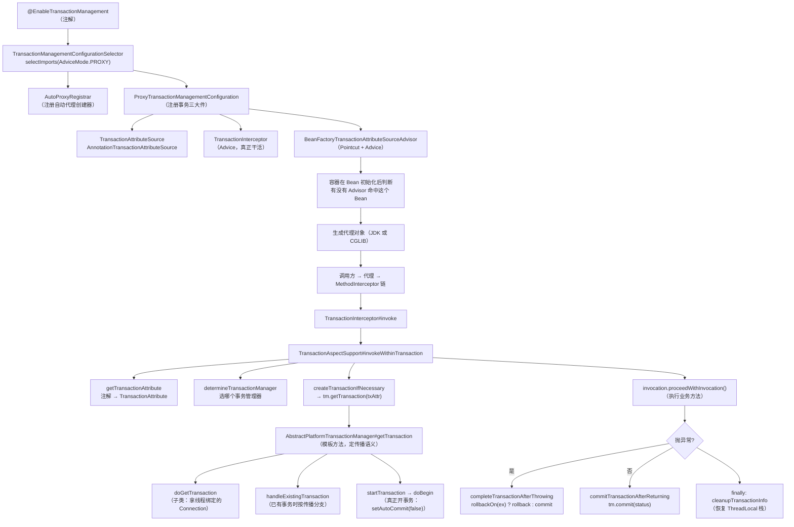
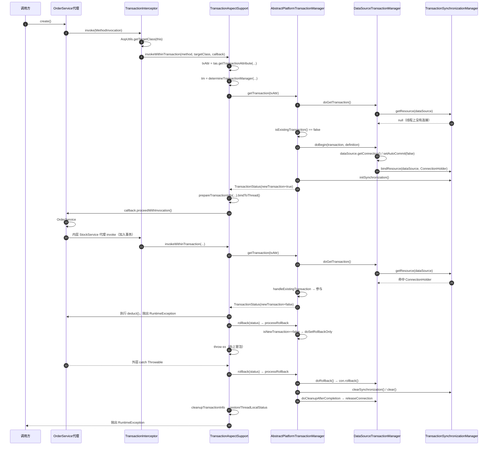

# Spring Framework 源码精读 事务 01：`@Transactional` 拦截器与七种传播行为（`@EnableTransactionManagement` → `TransactionInterceptor#invoke` → `AbstractPlatformTransactionManager#getTransaction/handleExistingTransaction`）

> 一句话结论：`@Transactional` **不产生事务**，它只是让 Spring 在代理上多挂一条拦截器链——`TransactionInterceptor`（一个 `MethodInterceptor`）先向 `TransactionAttributeSource` 要一份"事务属性"（传播行为、隔离级别、超时、只读标记、回滚规则），再交给 `PlatformTransactionManager#getTransaction` 决定"**开新事务 / 加入已有事务 / 挂起已有事务**"，方法跑完后按异常类型决定 `commit` 还是 `rollback`。
> 阅读前置：读完 [02-AOP与代理](../02-AOP与代理/README.md)——尤其要知道"代理是在 `postProcessAfterInitialization` 里生成的""调用方拿到的是代理""同类自调用不经过代理"；会用 `@Transactional` 写过业务代码。
> 预计阅读：50 分钟 ｜ 源码：`org.springframework:spring-tx:7.1.0`（配套 `spring-context:7.1.0`、`spring-aop:7.1.0`、`spring-jdbc:7.1.0`、Spring Boot 4.2.0 / `spring-framework@v7.1.0`）

---

## 0. 先看现象

这一节解决一个问题：**事务相关的问题长什么样**，让你在动源码之前先有一张"症状 → 可疑点"的对照表。

先看三段最小可运行代码（不用跑起来，先读懂它们在干什么）。

```java
// 现象 1：两个方法都有 @Transactional，但只有一个"看起来生效"了
@Service
public class OrderService {

    @Autowired private JdbcTemplate jdbcTemplate;

    @Transactional
    public void outer() {
        jdbcTemplate.update("insert into t_order(id) values (1)");
        inner();                       // ① 同类自调用：不经过代理
        throw new IllegalStateException("boom");
    }

    @Transactional(propagation = Propagation.REQUIRES_NEW)
    public void inner() {
        jdbcTemplate.update("insert into t_log(id) values (1)");
    }
}
```

```java (src: TransactionAspectSupport.java#L705-L724)
			if (txInfo.transactionAttribute != null && txInfo.transactionAttribute.rollbackOn(ex)) {
				invocation.onRollback(ex, txInfo.getTransactionStatus());
				try {
					txInfo.getTransactionManager().rollback(txInfo.getTransactionStatus());
				}
...
			else {
				// We don't roll back on this exception.
				// Will still roll back if TransactionStatus.isRollbackOnly() is true.
				try {
					txInfo.getTransactionManager().commit(txInfo.getTransactionStatus());
```

\java (src: TransactionTemplate.java#L139-L150)
			catch (RuntimeException | Error ex) {
				// Transactional code threw application exception -> rollback
				rollbackOnException(status, ex);
				throw ex;
			}
			catch (Throwable ex) {
				// Transactional code threw unexpected exception -> rollback
				rollbackOnException(status, ex);
			this.transactionManager.commit(status);
				throw new UndeclaredThrowableException(ex, "TransactionCallback threw undeclared checked exception");
			}
```

三个现象只对应一张"路线图"：

| 你看到的现象 | 直接原因（表层） | 本文要给你定位的源码位置 |
| --- | --- | --- |
| 自调用里的 `REQUIRES_NEW` 没开新事务 | 调用没经过代理，拦截器根本没被执行 | `TransactionAttributeSourcePointcut#matches` → `TransactionInterceptor#invoke`（3.2 / 3.3） |
| 内外层都回滚，外层还抛 `UnexpectedRollbackException` | 内层参与外层事务，回滚被翻译成 `rollback-only` 标记 | `AbstractPlatformTransactionManager#processRollback` → `commit`（3.8 / 3.9） |
| 捕获了异常仍然全部回滚 | 内层方法已把"共享事务"标记为 rollback-only | `completeTransactionAfterThrowing` → `rollbackOn`（3.6） |
| 传播行为"看起来没生效" | 分支其实在 `handleExistingTransaction` 里 | `handleExistingTransaction`（3.8） |
| 配置了 `readOnly = true` 却写成功了 | `readOnly` 只是 hint，`DataSourceTransactionManager` 默认不强制 | `DefaultTransactionAttribute#isReadOnly` 的消费者（3.4 讲解 + 03 篇 3.5） |

> **读法建议**：上面三份代码先不用看懂细节，只要记住"**所有事务问题的入口只有一个：代理有没有被调用到**"。本篇文章第 1 节给地图，第 2 节认人（关键类），第 3 节逐段读源码，第 4 节把一条调用链从头串到尾。

---

## 1. 整体地图

这一节解决一个问题：**从一行 `@EnableTransactionManagement` 到一次 `commit()`，中间到底有几个环节**。

先看全景图。图里每个框都是一个真实的类或方法，箭头是"谁调用谁"。



> 读图说明：**关键箭头是 `C2 → D3 → E → F`**——这一段解释了"为什么必须有代理"，`@Transactional` 本身没有任何运行时魔法，它只是一个"标记"，被 `TransactionAttributeSourcePointcut` 读出来变成"这个 Bean 需要事务拦截"的判断依据。第二条关键路径是 **`I → K → L → M1/M2/M3`**——这是"传播行为"唯一真正生效的地方；你在 `@Transactional(propagation = ...)` 里写的一切，最后都只是被 `getTransaction` 拿去 switch 了一遍。第三条是 **`O → P/q`**——回滚与否不是"抛没抛异常"，而是 `TransactionAttribute#rollbackOn(Throwable)` 的回答；`catch` 住的异常在这条路径上根本看不见。

把这张图拆成 12 步，就得到本文的目录骨架：

| 步 | 动作 | 落在哪个类/方法 | 本文位置 |
| --- | --- | --- | --- |
| 1 | 引入配置：把两个配置类注册进容器 | `TransactionManagementConfigurationSelector#selectImports` | 3.1 |
| 2 | 注册三大件：`TransactionAttributeSource`、`TransactionInterceptor`、`Advisor` | `ProxyTransactionManagementConfiguration` | 3.1 |
| 3 | 决定"哪些方法需要拦截" | `TransactionAttributeSourcePointcut#matches` | 3.2 |
| 4 | 拦截入口，拿到目标类 | `TransactionInterceptor#invoke` | 3.3 |
| 5 | 注解 → `TransactionAttribute` | `AbstractFallbackTransactionAttributeSource#computeTransactionAttribute` + `SpringTransactionAnnotationParser` | 3.4 |
| 6 | 选择事务管理器 | `TransactionAspectSupport#determineTransactionManager` | 3.5 |
| 7 | 判断该提交还是该回滚 | `RuleBasedTransactionAttribute#rollbackOn` / `DefaultTransactionAttribute#rollbackOn` | 3.6 |
| 8 | 事务主流程（get/commit/rollback） | `TransactionAspectSupport#invokeWithinTransaction` | 3.7 |
| 9 | 传播行为分流 | `AbstractPlatformTransactionManager#getTransaction` / `handleExistingTransaction` | 3.8 |
| 10 | 开启 / 挂起 / 恢复 | `startTransaction` / `suspend` / `resume` | 3.9 |
| 11 | 提交时的 5 个回调 | `processCommit` | 3.10 |
| 12 | 回滚与 rollback-only 的传播 | `processRollback` | 3.11 |

---

## 2. 关键类逐个拆

这一节解决一个问题：**认识这台机器上有哪些零件，各自只负责什么**。先认人，再读它们之间的对话（源码）。

### 2.1 `EnableTransactionManagement`（开关，但只是"贴纸"）

- **职责**：给配置类贴一个"请开启注解驱动事务"的标记。它自己**一行业务逻辑都没有**。
- **关键点**：`@Import(TransactionManagementConfigurationSelector.class)` —— Spring 的 `@EnableXxx` 套路，靠 `@Import` 把真正的配置类拉进来。所以"事务为什么生效了"和"事务为什么没生效"的第一个问号都应该落在这里：**配置类上到底有没有这个注解**。
- **属性**：`mode`（`PROXY` 还是 `ASPECTJ`）、`proxyTargetClass`、`order`、`rollbackOn`（6.2 新增，决定默认是否对受检异常也回滚）。

### 2.2 `TransactionManagementConfigurationSelector`（分流器）

- **职责**：`selectImports` 根据 `mode` 决定往容器里塞哪些类。`PROXY` 模式下塞两个：`AutoProxyRegistrar`（AOP 那边的"注册自动代理创建器"）和 `ProxyTransactionManagementConfiguration`（事务这边的事务三大件）。
- **为什么存在**：`mode = ASPECTJ` 时走的是另一套（`spring-aspects` 的编译期/加载期织入），两者装配方式完全不同，所以需要一个"选择器"。

### 2.3 `ProxyTransactionManagementConfiguration`（装配车间）

- **职责**：注册三件东西——
  1. `TransactionAttributeSource`：把"注解"翻译成"事务属性"；
  2. `TransactionInterceptor`：一个 `MethodInterceptor`，方法调用时在这里被拦；
  3. `BeanFactoryTransactionAttributeSourceAdvisor`：把前两者打包成 AOP 认识的 `Advisor`（Pointcut + Advice）。
- **设计意图**：**事务 = AOP 的一个普通应用**。它没有自己的"代理机制"，完全复用 `@EnableAspectJAutoProxy` 那一套 `AbstractAutoProxyCreator`。

### 2.4 `BeanFactoryTransactionAttributeSourceAdvisor` + `TransactionAttributeSourcePointcut`（"谁需要事务"的判断器）

- **职责**：`Advisor` 是"切点 + 通知"的组合。这里的切点是 `TransactionAttributeSourcePointcut`，它的 `matches` 只做一件事：**问 `TransactionAttributeSource` 这个方法的有没有 `TransactionAttribute`**——有就返回 `true`。
- **关键**：所以"哪些 Bean 会被代理"完全由"哪些方法能被解析出 `@Transactional`"决定。解析不出来（比如 `private` 方法、`Object` 自身方法、`final` 类）→ 不代理 → 事务不存在。这就是 02 篇所有失效场景的总根源。

### 2.5 `AnnotationTransactionAttributeSource` + `AbstractFallbackTransactionAttributeSource`（解析器骨架）

- **职责**：把 `Method` + `targetClass` 变成 `TransactionAttribute`，并**缓存**结果（`ConcurrentHashMap`，key 是 `MethodClassKey(method, targetClass)`）。
- **骨架会做的三件"不属于注解"的事**：
  1. 跳过 `Object` 自身方法（`equals/hashCode/toString`…）；
  2. 按"方法 → 类 → 原接口方法 → 接口类"的**四级 fallback** 查找；
  3. 用 `AopUtils.getMostSpecificMethod` 把"接口上的 `Method`"还原成"实现类上的方法"。
- **子类只负责一件事**：`findTransactionAttribute(AnnotatedElement)`——真正去读注解。

### 2.6 `SpringTransactionAnnotationParser`（注解 → 对象）

- **职责**：用 `AnnotatedElementUtils.findMergedAnnotationAttributes` 支持"元注解/组合注解"，然后把注解属性逐个 `set` 到一个 `RuleBasedTransactionAttribute` 上。
- **注意**：`AnnotatedTransactionAttributeSource` 默认 `publicMethodsOnly = true`，但 `ProxyTransactionManagementConfiguration` 里构造的是 `new AnnotationTransactionAttributeSource(false)`——**7.x 里 `protected` 方法（CGLIB 代理下）也能被解析**，这是 6.0 起的行为。

### 2.7 `TransactionAttribute` / `RuleBasedTransactionAttribute` / `DefaultTransactionAttribute`（属性对象与回滚策略）

- **`TransactionAttribute`**：一份"事务配置"的值对象，继承自 `TransactionDefinition`（传播行为、隔离级别、超时、只读、名称）+ 额外两项：`getQualifier()`（选哪个事务管理器）和 `rollbackOn(Throwable)`（要不要回滚）。
- **`RuleBasedTransactionAttribute`**：`@Transactional` 解析后的实际类型。它持有一组 `RollbackRuleAttribute` / `NoRollbackRuleAttribute`，`rollbackOn` 会挑出**最贴近异常类型**（depth 最小）的那条规则。
- **`DefaultTransactionAttribute`**：父类。没有规则命中时回落到它——**只回滚 `RuntimeException` 与 `Error`，受检异常默认提交**。

### 2.8 `TransactionInterceptor`（拦截器，AOP 与事务的接缝）

- **职责**：实现 `MethodInterceptor`，`invoke` 里干两件事：算出 `targetClass`（`AopUtils.getTargetClass(invocation.getThis())`），然后**原样转交**给父类 `TransactionAspectSupport#invokeWithinTransaction`。
- **为什么要转交**：`TransactionAspectSupport` 是"与 AOP 无关"的抽象层——它只认 `InvocationCallback`，不认 `MethodInvocation`。这样同一套事务逻辑既能被 Spring AOP 复用，也能被 AspectJ 织入复用。

### 2.9 `TransactionAspectSupport`（事务主流程，真正的"大脑"）

- **职责**：`invokeWithinTransaction` 一口气把"取属性 → 选管理器 → 开事务 → 执行 → 异常判断 → 提交/回滚 → 清理"串起来。
- **关键私有状态**：`transactionInfoHolder`（`ThreadLocal<TransactionInfo>`），每一层嵌套调用 `bindToThread` 压栈、`restoreThreadLocalStatus` 出栈。这是"嵌套事务能正确嵌套"的数据结构基础。

### 2.10 `PlatformTransactionManager` + `AbstractPlatformTransactionManager`（事务语义的模板）

- **职责**：`PlatformTransactionManager` 只有三个方法：`getTransaction` / `commit` / `rollback`（像"事务 API 的三字经"）。
- **`AbstractPlatformTransactionManager` 用模板方法把"传播行为、挂起恢复、回调触发、异常翻译"全部写死在父类**，子类只需实现 `doGetTransaction` / `isExistingTransaction` / `doBegin` / `doCommit` / `doRollback` 等"与具体资源相关"的钩子。
- **一句话**：`@Transactional` 的一切"高级语义"都在这个类里；JDBC / JPA / JTA 的差别只在钩子里。

### 2.11 `TransactionDefinition` / `Propagation`（传播行为的常量来源）

- **职责**：`Propagation` 是 `enum`，7 个值：`REQUIRED`、`SUPPORTS`、`MANDATORY`、`REQUIRES_NEW`、`NOT_SUPPORTED`、`NEVER`、`NESTED`。每个枚举值携带一个 int 常量（`value()`），`SpringTransactionAnnotationParser` 就是通过 `propagation.value()` 把它塞进 `TransactionAttribute` 的。
- **注意**：枚举本身**没有行为**，行为全在 `AbstractPlatformTransactionManager` 的 `if/else` 里。这也是"背传播行为没用、必须看 `handleExistingTransaction`"的原因。

### 2.12 一览表

| 类 | 一句话定位 | 你会在这里打第一次断点的场景 |
| --- | --- | --- |
| `TransactionManagementConfigurationSelector` | 决定装哪套配置 | "我明明加了 `@EnableTransactionManagement` 但事务没生效" |
| `ProxyTransactionManagementConfiguration` | 注册事务三大件 | 想确认容器里有没有 `TransactionInterceptor` |
| `TransactionAttributeSourcePointcut#matches` | 判断某方法是否要事务 | "这个 Bean 为什么没被代理" |
| `TransactionInterceptor#invoke` | 拦截入口 | 确认拦截器到底有没有被调用 |
| `AbstractFallbackTransactionAttributeSource#computeTransactionAttribute` | 注解解析骨架 | "我的 `@Transactional` 怎么被解析成了 null" |
| `RuleBasedTransactionAttribute#rollbackOn` | 回滚策略 | "为什么抛了异常还是提交了" |
| `TransactionAspectSupport#invokeWithinTransaction` | 主流程 | 想看 `getTransaction`/`commit` 的前后 |
| `AbstractPlatformTransactionManager#getTransaction` | 传播分流 | "`REQUIRES_NEW` 到底有没有开新事务" |
| `AbstractPlatformTransactionManager#processRollback` | 回滚细节 | "为什么收到 `UnexpectedRollbackException`" |

---


## 3. 源码逐段精读

这一节解决一个问题：**把第 1 节那张图上最重要的十几段代码真正读一遍**，并保证每段都能回答"为什么这么写"。

### 3.1 从 `@EnableTransactionManagement` 到三个 Bean

先看"开关"本身有多薄。

```java (src: EnableTransactionManagement.java#L159-L163)
@Target(ElementType.TYPE)
@Retention(RetentionPolicy.RUNTIME)
@Documented
@Import(TransactionManagementConfigurationSelector.class)
public @interface EnableTransactionManagement {
```

- **在干什么**：给配置类加一个标记，并通过 `@Import` 把"选择器"拉进容器。注解体里没有任何属性被读取的代码——因为它只负责"引入"。
- **为什么这么写**：Spring 的 `@EnableXxx` 统一套路：注解 = 入口 + `@Import` = 真正的装配。这样做的好处是：注解不需要知道装配细节，装配逻辑可以随版本演进（比如 6.2 加了 `rollbackOn`、7.0 加了 `@ImportRuntimeHints`）而不破坏用户代码。
- **如果改成别的**：如果不用 `@Import` 而要求用户手动 `@Bean` 一个 `TransactionInterceptor`，Spring Boot 的 `TransactionAutoConfiguration` 就没法"零配置"接管事务，`spring-boot-starter-jdbc` 引入后事务也不会自动可用。
- **常见坑**：`@EnableTransactionManagement` 只能贴在**配置类**上（`@Target(ElementType.TYPE)`）。贴在 `@Service` 上也能"碰巧"生效（因为 `@Service` 也是组件），但那会让事务配置散落在业务类里；Boot 场景下由 `TransactionAutoConfiguration` 自动加上这个注解，**自己再贴一次通常无害但会让人误以为是它生效的**。

选择器决定"装哪一套"：

```java (src: TransactionManagementConfigurationSelector.java#L46-L53)
	@Override
	protected String[] selectImports(AdviceMode adviceMode) {
		return switch (adviceMode) {
			case PROXY -> new String[] {AutoProxyRegistrar.class.getName(),
					ProxyTransactionManagementConfiguration.class.getName()};
			case ASPECTJ -> new String[] {determineTransactionAspectClass()};
		};
	}
```

- **在干什么**：`PROXY` 模式返回两个类名：`AutoProxyRegistrar`（AOP 侧：注册 `InfrastructureAdvisorAutoProxyCreator`）与 `ProxyTransactionManagementConfiguration`（事务侧：注册三大件）。`ASPECTJ` 模式返回另一个配置类（`spring-aspects` 里的 `AspectJTransactionManagementConfiguration` 或 JTA 版）。
- **为什么这么写**：`AutoProxyRegistrar` 是"负责造代理的人"，`ProxyTransactionManagementConfiguration` 是"负责提供拦截器的人"，**两者必须成对出现**。这也是为什么单独 `@Bean` 一个 `TransactionInterceptor` 没有任何效果——没有代理创建器去消费它。
- **如果改成别的**：如果你只想要 `TransactionInterceptor` 而不想要自动代理（比如手工 `ProxyFactory`），可以自己 `@Bean`；但那就绕过了 Spring 的"自动代理"体系，`@Transactional` 的 Pointcut 也不会被用到。
- **常见坑**：`mode = ASPECTJ` 需要 `spring-aspects` JAR 和织入器，且 `proxyTargetClass` 会被忽略。生产上极少用，但它是"自调用也能被拦截"的唯一官方手段（见 02 篇 2.6）。

接下来是三大件的装配：

```java (src: ProxyTransactionManagementConfiguration.java#L44-L67)
	@Bean(name = TransactionManagementConfigUtils.TRANSACTION_ADVISOR_BEAN_NAME)
	@Role(BeanDefinition.ROLE_INFRASTRUCTURE)
	public BeanFactoryTransactionAttributeSourceAdvisor transactionAdvisor(
			TransactionAttributeSource transactionAttributeSource, TransactionInterceptor transactionInterceptor) {

		BeanFactoryTransactionAttributeSourceAdvisor advisor = new BeanFactoryTransactionAttributeSourceAdvisor();
		advisor.setTransactionAttributeSource(transactionAttributeSource);
		advisor.setAdvice(transactionInterceptor);
		if (this.enableTx != null) {
			advisor.setOrder(this.enableTx.<Integer>getNumber("order"));
		}
		return advisor;
	}

	@Bean
	@Role(BeanDefinition.ROLE_INFRASTRUCTURE)
	public TransactionInterceptor transactionInterceptor(TransactionAttributeSource transactionAttributeSource) {
		TransactionInterceptor interceptor = new TransactionInterceptor();
		interceptor.setTransactionAttributeSource(transactionAttributeSource);
		if (this.txManager != null) {
			interceptor.setTransactionManager(this.txManager);
		}
		return interceptor;
	}
```

- **在干什么**：造一个 `Advisor`（切点 + 通知），把 `TransactionInterceptor` 塞进去当 Advice；再单独注册这个 `TransactionInterceptor` 为 Bean（可被 `ApplicationEventPublisherAware` 注入事件发布器）。`advisor.setOrder(enableTx.getNumber("order"))` 决定它与其它切面（如 `@Async` 的切面、自定义 `@Aspect`）**谁先谁后**。
- **为什么这么写**：把 Advisor 与 Advice 拆成两个 Bean，是为了让用户能单独拿到 `TransactionInterceptor` 做增强（例如设置自定义的 `TransactionAttributeSource`），同时也让 `Advisor` 的 `order` 只在一个地方可配。
- **如果改成别的**：如果 `order` 很大（默认 `LOWEST_PRECEDENCE`），事务拦截器就会**排在其他切面里面**——即"先执行别人的 `@Before`，再开事务"。如果你的切面里有数据库操作，它就会跑在事务外。反过来调小 `order` 可以让事务在最外层。
- **常见坑**：`@Bean(name = TransactionManagementConfigUtils.TRANSACTION_ADVISOR_BEAN_NAME)` 这个名字（`org.springframework.transaction.config.internalTransactionAdvisor`）是硬编码约定。Boot 的 `TransactionAutoConfiguration` 会检查这个名字来判断"用户是否已手工配置事务"。

这三件东西要靠 `TransactionAttributeSource` 串起来。它的具体实现是怎么被造出来的：

```java (src: AbstractTransactionManagementConfiguration.java#L82-L92)
	@Bean
	@Role(BeanDefinition.ROLE_INFRASTRUCTURE)
	public TransactionAttributeSource transactionAttributeSource() {
		// Accept protected @Transactional methods on CGLIB proxies, as of 6.0
		AnnotationTransactionAttributeSource tas = new AnnotationTransactionAttributeSource(false);
		// Apply default rollback rule, as of 6.2
		if (this.enableTx != null && this.enableTx.getEnum("rollbackOn") == RollbackOn.ALL_EXCEPTIONS) {
			tas.addDefaultRollbackRule(RollbackRuleAttribute.ROLLBACK_ON_ALL_EXCEPTIONS);
		}
		return tas;
	}
```

- **在干什么**：造 `AnnotationTransactionAttributeSource`，构造参数 `false` 表示"**不要**只认 public 方法"（`publicMethodsOnly = false`）；如果 `@EnableTransactionManagement(rollbackOn = ALL_EXCEPTIONS)`，再追加一条"所有异常都回滚"的默认规则。
- **为什么这么写**：6.0 起 CGLIB 成为默认代理方式，`protected` 方法在 CGLIB 下是可以被拦截的，因此解析层不应该提前把非 public 方法判死。6.2 起把"回滚默认策略"提升为可配置项，正好对应 JTA 的 `rollbackOn` 语义，便于从 JTA 迁移。
- **如果改成别的**：如果这里用 `new AnnotationTransactionAttributeSource()`（`publicMethodsOnly = true`），那么 `protected` 方法上的 `@Transactional` 会被静默忽略——**方法照常执行、但没有任何事务**，这类问题极难发现。
- **常见坑**：`ALL_EXCEPTIONS` 只是"默认规则"，方法级别显式写的 `noRollbackFor` 仍然优先（`RuleBasedTransactionAttribute#rollbackOn` 里 depth 最小者胜出）。另外注意 `addDefaultRollbackRule` 是**追加**到每条解析结果的 `rollbackRules` 里，不是替换。

为了让上面的 `enableTx` 有值，这个配置类必须实现 `ImportAware`：

```java (src: AbstractTransactionManagementConfiguration.java#L48-L67)
@Configuration
public abstract class AbstractTransactionManagementConfiguration implements ImportAware {

	protected @Nullable AnnotationAttributes enableTx;

	/**
	 * Default transaction manager, as configured through a {@link TransactionManagementConfigurer}.
	 */
	protected @Nullable TransactionManager txManager;


	@Override
	public void setImportMetadata(AnnotationMetadata importMetadata) {
		this.enableTx = AnnotationAttributes.fromMap(
				importMetadata.getAnnotationAttributes(EnableTransactionManagement.class.getName()));
		if (this.enableTx == null) {
			throw new IllegalArgumentException(
					"@EnableTransactionManagement is not present on importing class " + importMetadata.getClassName());
		}
	}
```

- **在干什么**：`ImportAware` 是 Spring 给"被 `@Import` 进来的配置类"的专属回调：Spring 会把**导入者的注解元数据**交给它。这里从中取出 `@EnableTransactionManagement` 的全部属性存成 `AnnotationAttributes`，后面所有 `getNumber("order")`、`getEnum("rollbackOn")` 都从这份 map 里读。
- **为什么这么写**：配置类本身不是你写的，拿不到你的注解；`ImportAware` 就是官方给的"我要读导入者注解"的通道。`AnnotationAttributes` 是一个 `Map`，避免反复反射读注解。
- **如果改成别的**：如果不实现 `ImportAware`，就只能用 `@EnableTransactionManagement` 上的固定默认值，`order`、`rollbackOn` 这些属性全部失效。
- **常见坑**：`setImportMetadata` 里 `enableTx == null` 会直接抛 `IllegalArgumentException`。**如果你手工 `@Import(ProxyTransactionManagementConfiguration.class)` 却没贴 `@EnableTransactionManagement`，启动就会炸**——报错文本里明确写了 `"@EnableTransactionManagement is not present on importing class ..."`，看到这句就不用再猜别的原因了。

---


### 3.2 切点：谁需要被事务拦截

`Advisor` 的"切点"决定哪些方法会被拦。这一段是整个事务体系最关键的判断题。

```java (src: TransactionAttributeSourcePointcut.java#L53-L57)
	@Override
	public boolean matches(Method method, Class<?> targetClass) {
		return (this.transactionAttributeSource == null ||
				this.transactionAttributeSource.hasTransactionAttribute(method, targetClass));
	}
```

- **在干什么**：方法匹配的全部逻辑就是"问属性源：这个方法有没有事务属性"。`hasTransactionAttribute` 内部走的就是后面 3.4 的解析链。
- **为什么这么写**：把"匹配"和"解析"合并成一次查询，避免"先匹配再解析"的重复劳动。因为 AOP 只有在 `matches` 返回 `true` 时才会把 Advice 加进这个 Bean 的拦截器链，所以这里返回 `false` 就等于"这个方法完全没有事务"。
- **如果改成别的**：如果这里直接 `return true`（匹配所有方法），那么**所有 Bean 都会被代理**，即使只有一两个方法有 `@Transactional`——这是早期某些"事务全家桶"框架的写法，代价是内存与启动时间的显著上升，并且 `final` 类会大面积报错。
- **常见坑**：这里用的是**被调用方法**（接口方法或代理上的方法）与 `targetClass`。自调用时根本不会走到这里——因为自调用没有经过代理，AOP 的 `matches` 压根没被调用。

类级别还有一层过滤，避免在"显然不需要事务"的类上做无谓搜索：

```java (src: TransactionAttributeSourcePointcut.java#L82-L90)
		@Override
		public boolean matches(Class<?> clazz) {
			if (TransactionalProxy.class.isAssignableFrom(clazz) ||
					TransactionManager.class.isAssignableFrom(clazz) ||
					PersistenceExceptionTranslator.class.isAssignableFrom(clazz)) {
				return false;
			}
			return (transactionAttributeSource == null || transactionAttributeSource.isCandidateClass(clazz));
		}
```

- **在干什么**：`ClassFilter` 直接排除三类类：事务代理自身（`TransactionalProxy`）、事务管理器（`TransactionManager`）、异常翻译器（`PersistenceExceptionTranslator`），其余交给 `isCandidateClass`（默认实现是"类上有没有 `@Transactional` 或候选注解"）。
- **为什么这么写**：事务管理器本身绝对不能事务化（否则 `getTransaction` 一调用就要开事务，形成自举死锁）；代理对象上再套代理会产生"代理的代理"，日志和调试都会变乱。这是**防御性设计**。
- **如果改成别的**：如果不排除，某些容器里 `DataSourceTransactionManager` 会被自己代理一次，`commit()` 变成被事务包裹的调用——这是历史上有名的"事务管理器被代理"事故。
- **常见坑**：`isCandidateClass` 默认只做"类上有注解"的粗筛（性能优化），筛掉了不会影响正确性——因为方法级 `matches` 还会再判一次。但如果你自己实现了 `TransactionAttributeSource` 且 `isCandidateClass` 返回 `false`，方法级匹配就永远不会被调用了。

---

### 3.3 拦截器入口：`TransactionInterceptor#invoke`

这里是 AOP 与事务的接缝。它短得惊人，但每一行都有原因。

```java (src: TransactionInterceptor.java#L122-L134)
	@Override
	public @Nullable Object invoke(MethodInvocation invocation) throws Throwable {
		// Work out the target class: may be {@code null}.
		// The TransactionAttributeSource should be passed the target class
		// as well as the method, which may be from an interface.
		Class<?> targetClass = (invocation.getThis() != null ? AopUtils.getTargetClass(invocation.getThis()) : null);

		// Adapt to TransactionAspectSupport's invokeWithinTransaction...
		return invokeWithinTransaction(invocation.getMethod(), targetClass, new InvocationCallback() {
			@Override
			public @Nullable Object proceedWithInvocation() throws Throwable {
				return invocation.proceed();
			}
```

- **在干什么**：先算出目标类（`invocation.getThis()` 是代理对象，`AopUtils.getTargetClass` 穿透代理拿到真实类），再把 `invocation.proceed()` 包成 `InvocationCallback`，交给父类的 `invokeWithinTransaction`。
- **为什么这么写**：`MethodInvocation` 是 AOP 的概念，`TransactionAspectSupport` 不想依赖它。用一个只有两个方法的回调接口（`proceedWithInvocation` / `onRollback`）把"执行下一步"抽象出来，于是同一份事务代码可以被 Spring AOP、AspectJ 织入、甚至手写代理复用。这就是**依赖倒置**在这里的落地。
- **如果改成别的**：如果直接写 `invocation.proceed()` 前后加 `getTransaction`/`commit`，逻辑上也能跑，但会把"事务主流程"和"Spring AOP API"绑死，AspectJ 模式就要复制一份。
- **常见坑**：`AopUtils.getTargetClass(invocation.getThis())` 拿的是**目标类**而不是接口。这就是为什么"`@Transactional` 只写在接口上"有时不生效——解析时会在目标类上找不到注解（详见 3.4 的四级 fallback 和 02 篇 2.5）。

同一个 `invoke` 里还有一个 `onRollback` 回调：

```java (src: TransactionInterceptor.java#L135-L151)
			@Override
			public void onRollback(Throwable failure, TransactionExecution execution) {
				MethodRollbackEvent event = new MethodRollbackEvent(invocation, failure, execution);
				logger.trace(event, failure);
				if (applicationEventPublisher != null) {
					try {
						applicationEventPublisher.publishEvent(event);
					}
					catch (Throwable ex) {
						if (logger.isWarnEnabled()) {
							logger.warn("Failed to publish " + event, ex);
						}
					}
				}
			}
		});
	}
```

- **在干什么**：当事务被判定要回滚时，发布一个 `MethodRollbackEvent`，携带方法调用、异常和事务执行状态。
- **为什么这么写**：给"事务回滚"提供一个可观测点（Boot 的 `TransactionAutoConfiguration` 里就有监听器用来做日志/埋点）。注意 `publishEvent` 被 `try/catch(Throwable)` 包住并只 warn——**监控永远不能影响业务事务**。
- **如果改成别的**：如果这里让事件异常往外抛，一个埋点 bug 就能把正常业务回滚掉。这种"监控反向影响业务"的坑在生产上极其致命。
- **常见坑**：这个回调只在 `rollbackOn(ex) == true` 时被调用（`completeTransactionAfterThrowing` 里），**参与者标记 rollback-only 导致的最终回滚不会触发它**——事件语义是"这个方法因为异常主动请求回滚"，不是"最终事务回滚了"。

---

### 3.4 注解 → `TransactionAttribute`：解析链

这一节回答"我写的 `@Transactional(...)` 是怎么变成一个对象的"。

#### 3.4.1 骨架：先排除、再缓存、再计算

```java (src: AbstractFallbackTransactionAttributeSource.java#L109-L121)
	private @Nullable TransactionAttribute getTransactionAttribute(
			Method method, @Nullable Class<?> targetClass, boolean cacheNull) {

		if (ReflectionUtils.isObjectMethod(method)) {
			return null;
		}

		Object cacheKey = getCacheKey(method, targetClass);
		TransactionAttribute cached = this.attributeCache.get(cacheKey);

		if (cached != null) {
			return (cached != NULL_TRANSACTION_ATTRIBUTE ? cached : null);
		}
```

- **在干什么**：第一步就把 `Object` 声明的方法（`getClass`、`hashCode`、`equals`、`toString`、`clone`、`finalize`、`wait`、`notify`、`notifyAll`）判为"无事务"；然后用 `MethodClassKey(method, targetClass)` 查缓存；命中就直接返回（用 `NULL_TRANSACTION_ATTRIBUTE` 这个哨兵值表示"缓存的是 null"）。
- **为什么这么写**：`Object` 方法被 `hashCode()`/日志框架频繁调用，如果每次都走一遍完整的注解解析，性能会被吃掉；而且没人会给 `equals` 写 `@Transactional`。缓存 null 是因为"绝大多数方法都没有 `@Transactional`"，缓存空结果能避免重复解析。用哨兵对象而不是 `Optional` 或 `Map.containsKey`，是为了**一次 `get` 判定两种状态**。
- **如果改成别的**：如果去掉 `isObjectMethod` 判断，`hashCode` 上也不会有注解，结果一样，但每次都要多查一次；如果不用哨兵而用 `containsKey`，就要两次哈希查找，并且要额外处理并发下的 `containsKey`→`get` 空窗。
- **常见坑**：缓存 key 包含 `targetClass`。所以同一个 `Method` 在不同目标类上会被分别解析——这是"接口方法 + 实现类注解"能正确工作的原因，但如果你用动态代理包装了多个目标类，缓存条目会变多（不是 bug，是必要）。

#### 3.4.2 四级 fallback：方法 → 类 → 原接口方法 → 接口类

```java (src: AbstractFallbackTransactionAttributeSource.java#L161-L185)
	protected @Nullable TransactionAttribute computeTransactionAttribute(Method method, @Nullable Class<?> targetClass) {
		// Don't allow non-public methods, as configured.
		if (allowPublicMethodsOnly() && !Modifier.isPublic(method.getModifiers())) {
			return null;
		}
		// Skip setBeanFactory method on BeanFactoryAware.
		if (method.getDeclaringClass() == BeanFactoryAware.class) {
			return null;
		}

		// The method may be on an interface, but we need attributes from the target class.
		// If the target class is null, the method will be unchanged.
		Method specificMethod = AopUtils.getMostSpecificMethod(method, targetClass);

		// First try is the method in the target class.
		TransactionAttribute txAttr = findTransactionAttribute(specificMethod);
		if (txAttr != null) {
			return txAttr;
		}

		// Second try is the transaction attribute on the target class.
		txAttr = findTransactionAttribute(specificMethod.getDeclaringClass());
		if (txAttr != null && ClassUtils.isUserLevelMethod(method)) {
			return txAttr;
		}
```

- **在干什么**：四道关卡：① 非 public 且 `allowPublicMethodsOnly()` 为 `true` → 直接 `null`；② `BeanFactoryAware#setBeanFactory` 跳过（基础设施方法不参与事务）；③ 把 `Method` 换成"目标类上的具体方法"（`AopUtils.getMostSpecificMethod`）；④ 按"**具体方法 → 声明类 → 原接口方法 → 接口类**"的顺序找注解，第一个非 `null` 的胜出。
- **为什么这么写**：`@Transactional` 允许写在类上作为"默认值"，方法上的就近覆盖；同时还要兼容"注解写在接口方法/接口类上、实现类什么都不写"的老代码。`ClassUtils.isUserLevelMethod(method)` 这一层判断是为了排除 `Object` 方法以及编译器生成的桥接方法（bridge method）——否则 `@Transactional` 会"莫名"通过桥接方法传播到不相干的重载上。
- **如果改成别的**：如果只查方法不查类，`@Transactional` 写在类上就完全失效；如果先查类再查方法，方法级覆盖就没了。如果去掉 `getMostSpecificMethod`，从接口反射来的 `Method` 在实现类上永远找不到注解——这就是"注解在实现类上、但通过接口调用时不生效"的根因之一。
- **常见坑**：`allowPublicMethodsOnly()` 在父类默认返回 `false`（见下一段），但 `AnnotationTransactionAttributeSource` 的字段默认是 `true`，**实际值是 `new AnnotationTransactionAttributeSource(false)` 传进来的 `false`**。如果你自己 `new AnnotationTransactionAttributeSource()` 注册到容器，就会退化成"只认 public"。

继续看后两级 fallback 和父类的默认值：

```java (src: AbstractFallbackTransactionAttributeSource.java#L187-L201)
		if (specificMethod != method) {
			// Fallback is to look at the original method.
			txAttr = findTransactionAttribute(method);
			if (txAttr != null) {
				return txAttr;
			}
			// Last fallback is the class of the original method.
			txAttr = findTransactionAttribute(method.getDeclaringClass());
			if (txAttr != null && ClassUtils.isUserLevelMethod(method)) {
				return txAttr;
			}
		}

		return null;
	}
```

- **在干什么**：只有当"具体方法 ≠ 原始方法"（即调用来自接口）时，才再去接口方法、接口类上找一次。四处都找不到返回 `null` → 该方法是"非事务方法"。
- **为什么这么写**：接口注解是"约定"，实现类注解是"细节"，约定应该能兜底但不能压制实现类。这个查找顺序正好体现了这个优先级。注意 `specificMethod != method` 这个条件：如果本来就是实现类直调，也就没有必要回退到接口。
- **如果改成别的**：如果无条件回退（去掉这个 `if`），实现类和接口都会被查两遍，结果一样但多一次反射；如果干脆不回退，"注解写在接口上"的 Spring 老项目就全崩了。
- **常见坑**：`@Transactional` 在接口上虽然能被解析，但**前提是运行时代理调用的 `Method` 确实是那个接口方法**。JDK 动态代理满足这一点；CGLIB 代理时 `method` 通常是实现类方法，此时 `specificMethod == method`，就走不到接口 fallback——但第一级 `findTransactionAttribute(specificMethod)` 已经能在继承的接口方法上通过 `AnnotatedElementUtils` 找到注解。所以真正的坑是"接口上有、实现类重写时不小心把注解漏了且用了不同签名"。

父类的默认值：

```java (src: AbstractFallbackTransactionAttributeSource.java#L224-L226)
	protected boolean allowPublicMethodsOnly() {
		return false;
	}
```
- **在干什么**：抽象骨架的默认策略是"允许非 public 方法参与事务"，交给子类覆盖。
- **为什么这么写**：因为存在两种截然不同的使用场景——AOP 代理（只该管能被拦截的方法）与 AspectJ 织入（连 `private` 都能织入）。把默认值放宽，让"能拦截"的判断交给切点去处理，比在解析层提前判死更安全。
- **如果改成别的**：如果默认 `true`，AspectJ 模式下 `protected` 方法上的注解会被静默忽略。
- **常见坑**：如上一段所说，`AnnotationTransactionAttributeSource` 的**字段**默认是 `true`，两者容易看混。判断"我的方法会不会被解析"时，要看你实际注册进容器的那个实例的构造参数。

#### 3.4.3 缓存与属性字符串解析

```java (src: AbstractFallbackTransactionAttributeSource.java#L122-L140)
		else {
			TransactionAttribute txAttr = computeTransactionAttribute(method, targetClass);
			if (txAttr != null) {
				String methodIdentification = ClassUtils.getQualifiedMethodName(method, targetClass);
				if (txAttr instanceof DefaultTransactionAttribute dta) {
					dta.setDescriptor(methodIdentification);
					dta.resolveAttributeStrings(this.embeddedValueResolver);
				}
				if (logger.isTraceEnabled()) {
					logger.trace("Adding transactional method '" + methodIdentification + "' with attribute: " + txAttr);
				}
				this.attributeCache.put(cacheKey, txAttr);
			}
			else if (cacheNull) {
				this.attributeCache.put(cacheKey, NULL_TRANSACTION_ATTRIBUTE);
			}
			return txAttr;
		}
	}
```

- **在干什么**：解析出属性后，先把"方法全名"写进 `descriptor`（用于日志/监控），再调用 `resolveAttributeStrings` 把 `timeoutString` 里的 `${...}` 占位符解析成真实值，最后放入缓存。解析失败时，如果 `cacheNull` 为 `true`（来自 `getTransactionAttribute` 公开方法），也缓存一个哨兵。
- **为什么这么写**：`timeoutString` 是为"配置中心/占位符"设计的（`@Transactional(timeoutString = "${db.tx.timeout}")`），必须延迟到运行时用 `EmbeddedValueResolver` 解析；`descriptor` 让 debug 日志能直接看出"是哪个方法的事务"。
- **如果改成别的**：如果去掉 `resolveAttributeStrings`，`timeoutString` 会原样保留成字符串，`getTimeout()` 返回 `-1`，超时配置静默失效——这是 5.3 刚引入 `timeoutString` 时最典型的问题。
- **常见坑**：`cacheNull` 由调用者决定。切点匹配（`hasTransactionAttribute`）传的是 `false`，因为"不确定的类可能被反复检查"，缓存 null 反而浪费内存；而真正的解析调用传 `true`。**不要以为缓存里没有 null 就是"没解析过"**。

#### 3.4.4 真正读注解的解析器

```java (src: SpringTransactionAnnotationParser.java#L54-L64)
	@Override
	public @Nullable TransactionAttribute parseTransactionAnnotation(AnnotatedElement element) {
		AnnotationAttributes attributes = AnnotatedElementUtils.findMergedAnnotationAttributes(
				element, Transactional.class, false, false);
		if (attributes != null) {
			return parseTransactionAnnotation(attributes);
		}
		else {
			return null;
		}
	}
```

- **在干什么**：用 `AnnotatedElementUtils.findMergedAnnotationAttributes` 找 `@Transactional` 的**合并后**属性（"合并"指把元注解上的属性一起算进来，例如 `@MyTxService` 上标注的 `@Transactional(readOnly = true)`）。
- **为什么这么写**：`findMergedAnnotationAttributes` 支持"组合注解"和"注解继承"，而简单 `getAnnotation` 不支持。这决定了你能否自定义 `@ReadOnlyTx` 这类封装注解。两个 `false` 参数表示"不允许类层级搜索、不做属性覆盖式合并"，即**只找当前元素上的（含元注解）**。
- **如果改成别的**：如果换成 `element.getAnnotation(Transactional.class)`，组合注解全部失效，Spring 全家桶里大量 `@MyBatisMapper` 式的封装都会崩。
- **常见坑**：这个方法是"按元素"找一个注解。如果注解写在**接口方法**上，而 `element` 传的是实现类方法，`findMergedAnnotationAttributes` **不会**顺着接口去找——接口 fallback 是靠 `computeTransactionAttribute` 显式换 `Method` 实现的。

解析成对象：

```java (src: SpringTransactionAnnotationParser.java#L70-L86)
	protected TransactionAttribute parseTransactionAnnotation(AnnotationAttributes attributes) {
		RuleBasedTransactionAttribute rbta = new RuleBasedTransactionAttribute();

		Propagation propagation = attributes.getEnum("propagation");
		rbta.setPropagationBehavior(propagation.value());
		Isolation isolation = attributes.getEnum("isolation");
		rbta.setIsolationLevel(isolation.value());

		rbta.setTimeout(attributes.getNumber("timeout").intValue());
		String timeoutString = attributes.getString("timeoutString");
		Assert.isTrue(!StringUtils.hasText(timeoutString) || rbta.getTimeout() < 0,
				"Specify 'timeout' or 'timeoutString', not both");
		rbta.setTimeoutString(timeoutString);

		rbta.setReadOnly(attributes.getBoolean("readOnly"));
		rbta.setQualifier(attributes.getString("value"));
		rbta.setLabels(Set.of(attributes.getStringArray("label")));
```

- **在干什么**：把注解属性逐个搬到 `RuleBasedTransactionAttribute`：传播行为取 `propagation.value()`（int），隔离级别取 `isolation.value()`，超时、只读、`value`（→ qualifier，即"用哪个事务管理器"）、`label`（事务标签）。
- **为什么这么写**：`TransactionAttribute` 是 Spring 内部的"配置对象"，用 int 常量而不是枚举，是为了兼容"XML 时代用字符串配事务属性"的历史（`TransactionDefinition` 里的 `PROPAGATION_*` 常量）。用 `Assert` 在解析期就拦住"`timeout` 与 `timeoutString` 同时配"的非法组合，比运行时莫名超时好排查得多。
- **如果改成别的**：如果不做这个 `Assert`，两个属性同时配置时到底谁生效取决于内部覆盖顺序，行为不可预期。
- **常见坑**：`attributes.getString("value")` 读的是 `@Transactional("orderTxManager")` 里的字符串，最终会变成 `qualifier`，交给 3.5 的 `determineTransactionManager` 去按 Bean 名找管理器。写错名字不会在解析期报错，只会在**第一次调用**时抛 `NoSuchBeanDefinitionException`。

回滚规则也在这里组装：

```java (src: SpringTransactionAnnotationParser.java#L88-L104)
		List<RollbackRuleAttribute> rollbackRules = new ArrayList<>();
		for (Class<?> rbRule : attributes.getClassArray("rollbackFor")) {
			rollbackRules.add(new RollbackRuleAttribute(rbRule));
		}
		for (String rbRule : attributes.getStringArray("rollbackForClassName")) {
			rollbackRules.add(new RollbackRuleAttribute(rbRule));
		}
		for (Class<?> rbRule : attributes.getClassArray("noRollbackFor")) {
			rollbackRules.add(new NoRollbackRuleAttribute(rbRule));
		}
		for (String rbRule : attributes.getStringArray("noRollbackForClassName")) {
			rollbackRules.add(new NoRollbackRuleAttribute(rbRule));
		}
		rbta.setRollbackRules(rollbackRules);

		return rbta;
	}
```

- **在干什么**：把 `rollbackFor` / `rollbackForClassName` 变成 `RollbackRuleAttribute`，把 `noRollbackFor` / `noRollbackForClassName` 变成 `NoRollbackRuleAttribute`，全部塞进一个 `List`。
- **为什么这么写**：四种属性最终是**同一个列表里的一堆规则**，谁更具体谁生效（3.6 的 depth 算法），而不是"先看 rollbackFor 再看 noRollbackFor"这种层级判断。这样 `@Transactional(rollbackFor = Exception.class, noRollbackFor = BizWarnException.class)` 才能表达"除了 `BizWarnException` 之外全都回滚"。
- **如果改成别的**：如果拆成两个独立字段并规定"noRollback 优先"，那"更具体的 rollbackFor 覆盖更宽的 noRollbackFor"就无法表达。
- **常见坑**：`rollbackForClassName` 是**子串匹配**，不是全等匹配（见 3.6 与 02 篇）。写 `"Exception"` 会匹配几乎所有异常，把 `noRollbackFor` 规则全部盖掉。

---


### 3.5 选哪个事务管理器

这一节解决一个问题：**`TransactionInterceptor` 怎么知道该把事务交给哪个 `PlatformTransactionManager`**——单数据源、多数据源、`@Transactional("txB")`、类型级 `@Qualifier` 都在这里分流。
一个容器里可能有多个 `PlatformTransactionManager`（多数据源）。选择顺序是固定的四级。

```java (src: TransactionAspectSupport.java#L489-L534)
	protected @Nullable TransactionManager determineTransactionManager(
			@Nullable TransactionAttribute txAttr, @Nullable Class<?> targetClass) {

		TransactionManager tm = determineTransactionManager(txAttr);
		if (tm != null) {
			return tm;
		}

		// Do not attempt to lookup tx manager if no tx attributes are set
		if (txAttr == null || this.beanFactory == null) {
			return getTransactionManager();
		}

		String qualifier = txAttr.getQualifier();
		if (StringUtils.hasText(qualifier)) {
			return determineQualifiedTransactionManager(this.beanFactory, qualifier);
		}
		else if (targetClass != null) {
			// Consider type-level qualifier annotations for transaction manager selection
			String typeQualifier = BeanFactoryAnnotationUtils.getQualifierValue(targetClass);
			if (StringUtils.hasText(typeQualifier)) {
				try {
					return determineQualifiedTransactionManager(this.beanFactory, typeQualifier);
				}
				catch (NoSuchBeanDefinitionException ex) {
					// Consider type qualifier as optional, proceed with regular resolution below.
				}
			}
		}

		if (StringUtils.hasText(this.transactionManagerBeanName)) {
			return determineQualifiedTransactionManager(this.beanFactory, this.transactionManagerBeanName);
		}
		else {
			TransactionManager defaultTransactionManager = getTransactionManager();
			if (defaultTransactionManager == null) {
				defaultTransactionManager = this.transactionManagerCache.get(DEFAULT_TRANSACTION_MANAGER_KEY);
				if (defaultTransactionManager == null) {
					defaultTransactionManager = this.beanFactory.getBean(TransactionManager.class);
					this.transactionManagerCache.putIfAbsent(
							DEFAULT_TRANSACTION_MANAGER_KEY, defaultTransactionManager);
				}
			}
			return defaultTransactionManager;
		}
	}
```

- **在干什么**：① 先看 `TransactionInterceptor#setTransactionManager` 显式设过的（`determineTransactionManager(txAttr)` 旧重载，6.2 起已废弃并返回 `null`，仅为兼容子类）；② 无事务属性 → 用拦截器上配置的默认管理器；③ 注解里的 `@Transactional("xxxTx")` → 按 qualifier 找 Bean。
- **为什么这么写**：显式配置 > 注解指定 > 类型级注解 > 按类型取唯一 Bean，这是 Spring "越具体越优先"的一贯原则。
- **如果改成别的**：如果先按类型找再按 qualifier 找，多数据源场景下 `@Transactional("orderTx")` 就失效了——因为你总会先命中某个默认管理器。
- **常见坑**：`txAttr == null`（即方法上没注解）时直接返回 `getTransactionManager()`，**不会去查容器**。这个分支看起来多余，实际是给"手工 `TransactionInterceptor` + `MethodMatcher` 全匹配"这种老用法留的后路。

继续看后三级：

```java (src: TransactionAspectSupport.java#L506-L534)
		else if (targetClass != null) {
			// Consider type-level qualifier annotations for transaction manager selection
			String typeQualifier = BeanFactoryAnnotationUtils.getQualifierValue(targetClass);
			if (StringUtils.hasText(typeQualifier)) {
				try {
					return determineQualifiedTransactionManager(this.beanFactory, typeQualifier);
				}
				catch (NoSuchBeanDefinitionException ex) {
					// Consider type qualifier as optional, proceed with regular resolution below.
				}
			}
		}

		if (StringUtils.hasText(this.transactionManagerBeanName)) {
			return determineQualifiedTransactionManager(this.beanFactory, this.transactionManagerBeanName);
		}
		else {
			TransactionManager defaultTransactionManager = getTransactionManager();
			if (defaultTransactionManager == null) {
				defaultTransactionManager = this.transactionManagerCache.get(DEFAULT_TRANSACTION_MANAGER_KEY);
				if (defaultTransactionManager == null) {
					defaultTransactionManager = this.beanFactory.getBean(TransactionManager.class);
					this.transactionManagerCache.putIfAbsent(
							DEFAULT_TRANSACTION_MANAGER_KEY, defaultTransactionManager);
				}
			}
			return defaultTransactionManager;
		}
	}
```

- **在干什么**：③' 6.2 起支持**类型级 `@Qualifier`**（`@Service @Qualifier("orderTx")`），找不到 Bean 时**静默忽略**并继续往下走；④ 拦截器 beanName；⑤ 最后 `beanFactory.getBean(TransactionManager.class)` 按类型取"唯一"的那个，并缓存结果。
- **为什么这么写**：类型级 qualifier 允许"整个 Service 类都走某个数据源"，比每个方法写 `@Transactional("orderTx")` 更符合直觉；静默忽略则是为了兼容"`@Qualifier` 是给别的用途写的"这一现实。缓存默认管理器（`putIfAbsent`）避免了每次调用都走一遍 `getBean`。
- **如果改成别的**：如果类型级 qualifier 找不到就抛异常，大量"`@Qualifier` 用于其它 Bean 注入"的类会突然启动失败；如果不缓存默认管理器，高频事务方法每次都要查一次的 `getBean`（虽有单例缓存，但仍是一次 Map 查找 + 解析）。
- **常见坑**：`beanFactory.getBean(TransactionManager.class)` 在**有多个**事务管理器且没有任何一个被标记 `@Primary` 时抛 `NoUniqueBeanDefinitionException`。报错信息是"expected single matching bean but found 2"，看到它就说明要么加 `@Primary`，要么用 qualifier 指定——这属于启动期问题，不是运行时问题。

---

### 3.6 到底该回滚还是该提交

这是"事务不回滚"类问题的核心。先看基类策略：

```java (src: DefaultTransactionAttribute.java#L179-L182)
	@Override
	public boolean rollbackOn(Throwable ex) {
		return (ex instanceof RuntimeException || ex instanceof Error);
	}
```

- **在干什么**：只有 `RuntimeException` 与 `Error` 回滚，其余（受检异常）**提交**。
- **为什么这么写**：这是 EJB 时代传下来的"业务异常"约定——受检异常被视为"可预期的业务结果"，调用方会处理它，因此不应当作系统故障而回滚。反过来，`RuntimeException` 通常意味着"代码 bug 或系统故障"，必须回滚。
- **如果改成别的**：如果改成"所有异常都回滚"，那"登录失败抛 `BadCredentialsException` 但要把失败次数 +1 落库"这种场景就没法写了。6.2 起官方给了开关 `@EnableTransactionManagement(rollbackOn = ALL_EXCEPTIONS)`，让需要"一律回滚"的项目一步切换（见 3.1）。
- **常见坑**：`Error` 也回滚，但 `Error` 通常意味着 JVM 已经不可信（`OutOfMemoryError`），此时 `rollback` 本身也可能失败——`processRollback` 里会有 `TransactionSystemException` 兜底，但不要指望它一定成功。

再看 `@Transactional` 实际使用的子类，它引入了规则匹配：

```java (src: RuleBasedTransactionAttribute.java#L122-L143)
	@Override
	public boolean rollbackOn(Throwable ex) {
		RollbackRuleAttribute winner = null;
		int deepest = Integer.MAX_VALUE;

		if (this.rollbackRules != null) {
			for (RollbackRuleAttribute rule : this.rollbackRules) {
				int depth = rule.getDepth(ex);
				if (depth >= 0 && depth < deepest) {
					deepest = depth;
					winner = rule;
				}
			}
		}

		// User superclass behavior (rollback on unchecked) if no rule matches.
		if (winner == null) {
			return super.rollbackOn(ex);
		}

		return !(winner instanceof NoRollbackRuleAttribute);
	}
```

- **在干什么**：遍历所有规则，用 `rule.getDepth(ex)` 算出"规则类型距离实际异常类多少层父类"，取 **depth 最小（最贴近）** 的那条规则作为 `winner`；没有规则命中就回落到父类的"只回滚 unchecked"。`winner` 是 `NoRollbackRuleAttribute` 就返回 `false`（提交），否则 `true`（回滚）。
- **为什么这么写**：这样 `rollbackFor = Exception.class` + `noRollbackFor = BizWarnException.class` 就能表达"几乎全回滚，但 `BizWarnException` 例外"。**depth 越小越具体**是唯一的仲裁规则，与规则的书写顺序无关。
- **如果改成别的**：如果按"列表顺序第一个命中"来判，那注解属性的书写顺序就会影响语义（`rollbackFor` 总是先被遍历），`noRollbackFor` 永远无法覆盖 `rollbackFor = Exception.class`。
- **常见坑**：如果两条规则 depth 相同（比如父类和子类同时声明为 `rollbackFor`），**先遍历到的胜出**，也就是 `rollbackFor` 数组里的顺序。所以 `@Transactional(rollbackFor = {BizException.class, Exception.class})` 与反着写，对 `BizException` 的判定都由 depth 决定（`BizException` 的规则 depth=0 更小，胜出，与顺序无关）；真正受顺序影响的只有"同一异常同时被 `rollbackFor` 和 `noRollbackFor` 精确匹配"这种病态配置。

`getDepth` 的实现决定了"匹配"到底是什么语义：

```java (src: RollbackRuleAttribute.java#L165-L186)
	public int getDepth(Throwable exception) {
		return getDepth(exception.getClass(), 0);
	}


	private int getDepth(Class<?> exceptionType, int depth) {
		if (this.exceptionType != null) {
			if (this.exceptionType.equals(exceptionType)) {
				// Found it!
				return depth;
			}
		}
		else if (exceptionType.getName().contains(this.exceptionPattern)) {
			// Found it!
			return depth;
		}
		// If we've gone as far as we can go and haven't found it...
		if (exceptionType == Throwable.class) {
			return -1;
		}
		return getDepth(exceptionType.getSuperclass(), depth + 1);
	}
```

- **在干什么**：从异常类开始沿父类链上溯：类型规则用 `equals` 比较，字符串规则用 `contains`（**子串包含**）；找到就返回当前层数，到 `Throwable` 还没找到返回 `-1`。
- **为什么这么写**：沿父类链递归，天然实现"规则匹配该异常及其子类"。字符串规则用 `contains` 是为了支持"只写类名不写包名"（`"ServletException"`），这是历史兼容。
- **如果改成别的**：如果字符串规则也改成 `equals`，那么 `rollbackForClassName = "BizException"` 就匹配不到了，所有老配置全部失效。
- **常见坑**：`contains` 的副作用是"相似类名会被误匹配"：规则 `"com.example.CustomException"` 会匹配 `com.example.CustomExceptionV2`、`com.example.CustomException$Other`。官方在 `Transactional` 的 javadoc 里专门写了 WARNING。**优先用 `rollbackFor`（类型），少用 `rollbackForClassName`（字符串）**。

---

### 3.7 主流程：`TransactionAspectSupport#invokeWithinTransaction`

前面铺垫完了，这里是"总线"。

```java (src: TransactionAspectSupport.java#L333-L339)
	protected @Nullable Object invokeWithinTransaction(Method method, @Nullable Class<?> targetClass,
			final InvocationCallback invocation) throws Throwable {

		// If the transaction attribute is null, the method is non-transactional.
		TransactionAttributeSource tas = getTransactionAttributeSource();
		final TransactionAttribute txAttr = (tas != null ? tas.getTransactionAttribute(method, targetClass) : null);
		final TransactionManager tm = determineTransactionManager(txAttr, targetClass);
```

- **在干什么**：取属性源 → 解析出 `TransactionAttribute`（可能为 `null`）→ 选事务管理器。这两行就是"配置"的全部来源。
- **为什么这么写**：把"解析"与"执行"分离，让后面所有分支都可以基于 `txAttr`/`tm` 做判断，且解析结果有缓存（3.4）。
- **如果改成别的**：如果在执行阶段才解析属性，每次调用都要走一遍反射 + `AnnotatedElementUtils`，性能不可接受。
- **常见坑**：`txAttr == null` 时该方法**仍会被拦截器执行一遍**（因为它进得来 `invoke`），只是后面不创建事务。所以"拦截器里加了日志"的方法不一定有事务。

标准分支（非响应式、非"回调优先"型管理器）：

```java (src: TransactionAspectSupport.java#L360-L380)
		PlatformTransactionManager ptm = asPlatformTransactionManager(tm);
		final String joinpointIdentification = methodIdentification(method, targetClass, txAttr);

		if (txAttr == null || !(ptm instanceof CallbackPreferringPlatformTransactionManager cpptm)) {
			// Standard transaction demarcation with getTransaction and commit/rollback calls.
			TransactionInfo txInfo = createTransactionIfNecessary(ptm, txAttr, joinpointIdentification);

			Object retVal;
			try {
				// This is an around advice: Invoke the next interceptor in the chain.
				// This will normally result in a target object being invoked.
				retVal = invocation.proceedWithInvocation();
			}
			catch (Throwable ex) {
				// target invocation exception
				completeTransactionAfterThrowing(txInfo, invocation, ex);
				throw ex;
			}
			finally {
				cleanupTransactionInfo(txInfo);
			}
```

- **在干什么**：`try` 前开事务，`try` 里执行链的下一环（最终是业务方法），`catch(Throwable)` 里做"提交或回滚"再原样抛出，`finally` 里恢复 `ThreadLocal` 栈。
- **为什么这么写**：这是一个教科书式的 **around advice**。`catch (Throwable)` 而不是 `catch (Exception)`，是为了让 `Error` 也能触发回滚判断（`rollbackOn` 里包含 `Error`）。`finally` 里的 `cleanupTransactionInfo` 保证即使业务代码抛 `Error`，`transactionInfoHolder` 也能正确弹栈，否则线程池复用时会把"上一个请求的事务状态"带进下一个请求——**这是最隐蔽的一类事务 bug**。
- **如果改成别的**：如果把 `cleanupTransactionInfo` 放到 `catch` 之后、`finally` 之前，一旦 `completeTransactionAfterThrowing` 自己抛异常，栈就漏了。
- **常见坑**：`catch` 里 `throw ex;` 是必须的——如果不抛，异常被吞掉，调用方以为成功。但如果此处抛出的是 `TransactionSystemException`，说明"回滚也失败了"，原始业务异常会挂在 `initApplicationException` 上（3.7 后半段）。

异步返回值与 `Vavr.Try` 的特殊处理：

```java (src: TransactionAspectSupport.java#L382-L406)
			if (retVal != null && txAttr != null) {
				TransactionStatus status = txInfo.getTransactionStatus();
				if (status != null) {
					if (retVal instanceof Future<?> future && future.isDone()) {
						try {
							future.get();
						}
						catch (ExecutionException ex) {
							Throwable cause = ex.getCause();
							Assert.state(cause != null, "Cause must not be null");
							if (txAttr.rollbackOn(cause)) {
								invocation.onRollback(cause, status);
								status.setRollbackOnly();
							}
						}
						catch (InterruptedException ex) {
							Thread.currentThread().interrupt();
						}
					}
					else if (VAVR_PRESENT && VavrDelegate.isVavrTry(retVal)) {
						// Set rollback-only in case of Vavr failure matching our rollback rules...
						retVal = VavrDelegate.evaluateTryFailure(invocation, retVal, txAttr, status);
					}
				}
			}
```

- **在干什么**：如果业务方法返回一个**已经完成**的 `Future`（典型是 `@Async` 与非 `@Async` 混用的场景），就 `future.get()` 一下：内部异常若满足回滚规则，则调用 `onRollback` 并 `status.setRollbackOnly()`，让后面的 `commit` 变成回滚。`Vavr` 的 `Try` 同理。
- **为什么这么写**：Spring 6.1 起为"返回 `Future` 的方法"补了一个兜底：异步任务里抛的异常不会传播到调用线程，如果不检查，事务会**静默提交**。`future.isDone()` 这个条件保证只对"同步完成的 Future"生效——真正的异步（没完成）不能阻塞等待，否则会把事务持续时间拖长到不可控。
- **如果改成别的**：如果无条件 `future.get()`，一个耗时 30 秒的异步任务会让事务连接被占用 30 秒，连接池直接枯竭。
- **常见坑**：`@Async` 且**真的异步**时，这个方法走不到这里的 `else` 判定——因为 `future.isDone()` 为 `false`。此时事务在"提交后"才有结果，`@Transactional` 覆盖不到异步线程（`Transactional` 的 javadoc 明确写了 `This does NOT propagate to newly started threads`）。要正确处理必须让异步方法与事务同线程，或改用 `TransactionTemplate` 在异步线程内部再开。

提交与返回：

```java (src: TransactionAspectSupport.java#L408-L410)
			commitTransactionAfterReturning(txInfo);
			return retVal;
		}
```

- **在干什么**：业务正常返回后调用 `commit`，然后把返回值原样交回。
- **为什么这么写**：提交发生在"业务方法返回之后、返回值交给调用方之前"。这一步决定了"调用方拿到返回值时事务已经结束"。
- **如果改成别的**：如果先返回再提交，调用方可能读到"未提交的数据"再去做下一步，形成逻辑漏洞。
- **常见坑**：`commit()` 本身可能抛 `UnexpectedRollbackException`（全局 rollback-only），此时**业务代码完全正常**却会收到异常。这就是第 0 节现象 2 的原因，详见 3.11。

开事务的那一步：

```java (src: TransactionAspectSupport.java#L611-L638)
	@SuppressWarnings("serial")
	protected TransactionInfo createTransactionIfNecessary(@Nullable PlatformTransactionManager tm,
			@Nullable TransactionAttribute txAttr, final String joinpointIdentification) {

		// If no name specified, apply method identification as transaction name.
		if (txAttr != null && txAttr.getName() == null) {
			txAttr = new DelegatingTransactionAttribute(txAttr) {
				@Override
				public String getName() {
					return joinpointIdentification;
				}
			};
		}

		TransactionStatus status = null;
		if (txAttr != null) {
			if (tm != null) {
				status = tm.getTransaction(txAttr);
			}
			else {
				if (logger.isDebugEnabled()) {
					logger.debug("Skipping transactional joinpoint [" + joinpointIdentification +
							"] because no transaction manager has been configured");
				}
			}
		}
		return prepareTransactionInfo(tm, txAttr, joinpointIdentification, status);
	}
```

- **在干什么**：若事务没有显式名字，用"方法全名"当下手（`DelegatingTransactionAttribute` 匿名子类覆盖 `getName()`）；然后调 `tm.getTransaction(txAttr)`——**事务真正开始的地方**；管理器为空则只打一条 debug 日志，**不抛异常**。
- **为什么这么写**：用委托子类而不是 `setName`，是因为 `txAttr` 可能是缓存里的共享对象，直接改会污染缓存。管理器为空不抛异常，是为了兼容"只有属性源没有管理器"的测试场景（例如只测切点匹配）。
- **如果改成别的**：如果直接 `txAttr.setName(...)`，同一个 `TransactionAttribute` 被多个方法复用时名字会互相覆盖，日志全乱。
- **常见坑**：debug 日志 `"Skipping transactional joinpoint [...] because no transaction manager has been configured"` 是"事务没生效"的第一现场证据。默认日志级别下看不到它，**排查时必须临时打开 `org.springframework.transaction` 的 DEBUG**。

把状态压栈：

```java (src: TransactionAspectSupport.java#L648-L675)
	protected TransactionInfo prepareTransactionInfo(@Nullable PlatformTransactionManager tm,
			@Nullable TransactionAttribute txAttr, String joinpointIdentification,
			@Nullable TransactionStatus status) {

		TransactionInfo txInfo = new TransactionInfo(tm, txAttr, joinpointIdentification);
		if (txAttr != null) {
			// We need a transaction for this method...
			if (logger.isTraceEnabled()) {
				logger.trace("Getting transaction for [" + txInfo.getJoinpointIdentification() + "]");
			}
			// The transaction manager will flag an error if an incompatible tx already exists.
			txInfo.newTransactionStatus(status);
		}
		else {
			// The TransactionInfo.hasTransaction() method will return false. We created it only
			// to preserve the integrity of the ThreadLocal stack maintained in this class.
			if (logger.isTraceEnabled()) {
				logger.trace("No need to create transaction for [" + joinpointIdentification +
						"]: This method is not transactional.");
			}
		}

		// We always bind the TransactionInfo to the thread, even if we didn't create
		// a new transaction here. This guarantees that the TransactionInfo stack
		// will be managed correctly even if no transaction was created by this aspect.
		txInfo.bindToThread();
		return txInfo;
	}
```

- **在干什么**：打包成 `TransactionInfo`（管理器 + 属性 + 方法标识 + 状态 + 上一个 `TransactionInfo`），并**无条件**压入 `ThreadLocal` 栈。
- **为什么这么写**：即使本次没有事务，也要压栈占个位。否则"外层有事务 → 中间调用一个无事务方法 → 内层再开事务"时，栈高度会对不上，`restoreThreadLocalStatus` 恢复错对象。这是**为栈完整性付出的最小代价**。
- **如果改成别的**：如果只在有事务时压栈，`cleanupTransactionInfo` 就必须知道"这次到底压没压"，代码会立刻变复杂且易错。
- **常见坑**：`TransactionInfo.hasTransaction()` 判断的是"有没有 `TransactionStatus`"，不是"有没有事务在执行"。无事务方法也可能有 `TransactionInfo`。

提交与回滚的两个收尾方法：

```java (src: TransactionAspectSupport.java#L682-L689)
	protected void commitTransactionAfterReturning(@Nullable TransactionInfo txInfo) {
		if (txInfo != null && txInfo.getTransactionStatus() != null) {
			if (logger.isTraceEnabled()) {
				logger.trace("Completing transaction for [" + txInfo.getJoinpointIdentification() + "]");
			}
			txInfo.getTransactionManager().commit(txInfo.getTransactionStatus());
		}
	}
```

- **在干什么**：有 `TransactionStatus` 时才提交；提交只调 `commit`，不做任何异常翻译。
- **为什么这么写**：把"要不要提交"的判断留在调用方（`invokeWithinTransaction` 只在正常返回时调用本方法），本方法保持单一职责。
- **如果改成别的**：如果在这里再 `try/catch` 并吞掉提交异常，`UnexpectedRollbackException` 就永远传不到上层。
- **常见坑**：`commit` 内的异常（如 `TransactionSystemException`、`UnexpectedRollbackException`）会直接从 `invokeWithinTransaction` 抛出，**替换掉业务返回值**。日志里出现"业务成功但接口报错"通常就是这里。

```java (src: TransactionAspectSupport.java#L697-L737)
	protected void completeTransactionAfterThrowing(
			@Nullable TransactionInfo txInfo, InvocationCallback invocation, Throwable ex) {

		if (txInfo != null && txInfo.getTransactionStatus() != null) {
			if (logger.isTraceEnabled()) {
				logger.trace("Completing transaction for [" + txInfo.getJoinpointIdentification() +
						"] after exception: " + ex);
			}
			if (txInfo.transactionAttribute != null && txInfo.transactionAttribute.rollbackOn(ex)) {
				invocation.onRollback(ex, txInfo.getTransactionStatus());
				try {
					txInfo.getTransactionManager().rollback(txInfo.getTransactionStatus());
				}
				catch (TransactionSystemException ex2) {
					logger.error("Application exception overridden by rollback exception", ex);
					ex2.initApplicationException(ex);
					throw ex2;
				}
				catch (RuntimeException | Error ex2) {
					logger.error("Application exception overridden by rollback exception", ex);
					throw ex2;
				}
			}
			else {
				// We don't roll back on this exception.
				// Will still roll back if TransactionStatus.isRollbackOnly() is true.
				try {
					txInfo.getTransactionManager().commit(txInfo.getTransactionStatus());
				}
				catch (TransactionSystemException ex2) {
					logger.error("Application exception overridden by commit exception", ex);
					ex2.initApplicationException(ex);
					throw ex2;
				}
				catch (RuntimeException | Error ex2) {
					logger.error("Application exception overridden by commit exception", ex);
					throw ex2;
				}
			}
		}
	}
```

- **在干什么**：`rollbackOn(ex)` 为 `true` → 先 `onRollback` 回调（发事件）再 `rollback`；为 `false` → **调用 `commit`**（注意：不是什么都不做！）。两个分支都对 `TransactionSystemException` 做了"业务异常挂载"处理。
- **为什么这么写**：`rollbackOn == false` 时调 `commit` 是刻意的——受检异常不应该回滚，但事务必须结束，否则连接不会释放、`ThreadLocal` 不会清理。而 `commit` 内部还会再检查 `isRollbackOnly()`，所以"别处已经把事务标记为回滚"时，这里 `commit` 实际会走回滚（见 3.9）。这就是注释所说的 `Will still roll back if TransactionStatus.isRollbackOnly() is true`。
- **如果改成别的**：如果 `rollbackOn == false` 时既不 commit 也不 rollback，`DataSourceTransactionManager#doCleanupAfterCompletion` 不会被调用，连接泄漏（这属于资源管理器层面的错误，在早期版本里确实是 bug 来源）。
- **常见坑**：`catch` 住业务异常后 `commit` 抛出的 `UnexpectedRollbackException` 会**替换**掉原异常出现在日志里。看到"业务异常 A，但最终报 `UnexpectedRollbackException`"，说明 A 被 `rollbackOn` 判为不回滚、且事务已被标记 rollback-only。

---

### 3.8 传播行为：`getTransaction` 与 `handleExistingTransaction`

这一节回答"7 种传播行为在源码里到底长什么样"。

先看无既有事务时的分流：

```java (src: AbstractPlatformTransactionManager.java#L372-L390)
	@Override
	public final TransactionStatus getTransaction(@Nullable TransactionDefinition definition)
			throws TransactionException {

		// Use defaults if no transaction definition given.
		TransactionDefinition def = (definition != null ? definition : TransactionDefinition.withDefaults());

		Object transaction = doGetTransaction();
		boolean debugEnabled = logger.isDebugEnabled();

		if (isExistingTransaction(transaction)) {
			// Existing transaction found -> check propagation behavior to find out how to behave.
			return handleExistingTransaction(def, transaction, debugEnabled);
		}

		// Check definition settings for new transaction.
		if (def.getTimeout() < TransactionDefinition.TIMEOUT_DEFAULT) {
			throw new InvalidTimeoutException("Invalid transaction timeout", def.getTimeout());
		}
```

- **在干什么**：① 兜底默认定义；② `doGetTransaction()` 由子类实现，负责"看看当前线程有没有已存在的事务资源"；③ `isExistingTransaction` 判断是否已有事务，有则整个交给 `handleExistingTransaction`；④ 无事务时先校验超时值。
- **为什么这么写**：`final` 修饰 + 模板方法，保证**传播语义只有这一份实现**，子类无法篡改。把"是否存在事务"的判断抽象成钩子，是因为不同资源类型的判断方式完全不同（JDBC 看 `ConnectionHolder#isTransactionActive`，JPA 看 `EntityManager` 是否已绑定）。
- **如果改成别的**：如果让子类各自实现传播逻辑，JDBC / JPA / JTA / JMS 的行为必然发散，"同一个 `@Transactional` 在不同数据访问层行为不同"会变成常态。
- **常见坑**：`doGetTransaction()` **不是**"开事务"，它只是"打探"。名字容易误读，很多人在 `doGetTransaction` 里打断点看到"每次调用都进来"就以为事务被重复开启。

无事务时的三种走向：

```java (src: AbstractPlatformTransactionManager.java#L392-L421)
		// No existing transaction found -> check propagation behavior to find out how to proceed.
		if (def.getPropagationBehavior() == TransactionDefinition.PROPAGATION_MANDATORY) {
			throw new IllegalTransactionStateException(
					"No existing transaction found for transaction marked with propagation 'mandatory'");
		}
		else if (def.getPropagationBehavior() == TransactionDefinition.PROPAGATION_REQUIRED ||
				def.getPropagationBehavior() == TransactionDefinition.PROPAGATION_REQUIRES_NEW ||
				def.getPropagationBehavior() == TransactionDefinition.PROPAGATION_NESTED) {
			SuspendedResourcesHolder suspendedResources = suspend(null);
			if (debugEnabled) {
				logger.debug("Creating new transaction with name [" + def.getName() + "]: " + def);
			}
			try {
				return startTransaction(def, transaction, false, debugEnabled, suspendedResources);
			}
			catch (RuntimeException | Error ex) {
				resume(null, suspendedResources);
				throw ex;
			}
		}
		else {
			// Create "empty" transaction: no actual transaction, but potentially synchronization.
			if (def.getIsolationLevel() != TransactionDefinition.ISOLATION_DEFAULT && logger.isWarnEnabled()) {
				logger.warn("Custom isolation level specified but no actual transaction initiated; " +
						"isolation level will effectively be ignored: " + def);
			}
			boolean newSynchronization = (getTransactionSynchronization() == SYNCHRONIZATION_ALWAYS);
			return prepareTransactionStatus(def, null, true, newSynchronization, debugEnabled, null);
		}
	}
```

- **在干什么**：`MANDATORY` 直接抛 `IllegalTransactionStateException`；`REQUIRED`/`REQUIRES_NEW`/`NESTED` 都是"开新事务"（无既有事务时 `REQUIRES_NEW` 与 `REQUIRED` 无差别）；其余（`SUPPORTS`/`NOT_SUPPORTED`/`NEVER`）创建"空事务"：`transaction = null`，只可能带同步。
- **为什么这么写**：`suspend(null)` 在无事务时通常返回 `null`，看似无用，但它会**挂起当前线程可能存在的同步**（例如外层是 `SUPPORTS` 的空事务已激活同步），保证新事务的同步环境干净。`catch → resume` 保证"开事务失败时把挂起的资源还回去"，否则外层事务就永远回不来了。
- **如果改成别的**：如果去掉 `suspend(null)`，`REQUIRES_NEW` 在"外层空事务"场景下会把内层同步挂到外层同步列表上，回调顺序错乱。
- **常见坑**：`SUPPORTS` 在无事务时**不会**打印 `"Creating new transaction"`，`TransactionStatus.isNewTransaction()` 也是 `false`（`hasTransaction()==false`）。因此 `TransactionSynchronizationManager.isActualTransactionActive()` 为 `false`，而 `isSynchronizationActive()` 可能是 `true`——这就是 03 篇要讲的"有同步没事务"状态。

有既有事务时的完整分流，这是传播行为的全部实现：
```java (src: AbstractPlatformTransactionManager.java#L426-L460)
	private TransactionStatus handleExistingTransaction(
			TransactionDefinition definition, Object transaction, boolean debugEnabled)
			throws TransactionException {

		if (definition.getPropagationBehavior() == TransactionDefinition.PROPAGATION_NEVER) {
			throw new IllegalTransactionStateException(
					"Existing transaction found for transaction marked with propagation 'never'");
		}

		if (definition.getPropagationBehavior() == TransactionDefinition.PROPAGATION_NOT_SUPPORTED) {
			if (debugEnabled) {
				logger.debug("Suspending current transaction");
			}
			Object suspendedResources = suspend(transaction);
			boolean newSynchronization = (getTransactionSynchronization() == SYNCHRONIZATION_ALWAYS);
			return prepareTransactionStatus(
					definition, null, false, newSynchronization, debugEnabled, suspendedResources);
		}

		if (definition.getPropagationBehavior() == TransactionDefinition.PROPAGATION_REQUIRES_NEW) {
			if (debugEnabled) {
				logger.debug("Suspending current transaction, creating new transaction with name [" +
						definition.getName() + "]");
			}
			SuspendedResourcesHolder suspendedResources = suspend(transaction);
			try {
				return startTransaction(definition, transaction, false, debugEnabled, suspendedResources);
			}
			catch (RuntimeException | Error beginEx) {
				resumeAfterBeginException(transaction, suspendedResources, beginEx);
				throw beginEx;
			}
		}

		if (definition.getPropagationBehavior() == TransactionDefinition.PROPAGATION_NESTED) {
```

- **在干什么**：`handleExistingTransaction` 用一个 `if` 链把"已有事务"的三种特殊传播行为单独处理：`NEVER` 直接抛、`NOT_SUPPORTED` 挂起外层后返回空状态、`REQUIRES_NEW` 挂起外层后 `startTransaction` 真正新开一个事务（失败时 `resumeAfterBeginException` 恢复外层再抛）。其余（`REQUIRED`/`SUPPORTS`/`MANDATORY`）落到方法末尾的参与分支（下一段）。
- **为什么这么写**：`doGetTransaction()` 已经知道"线程上有没有事务"，但**如何处理**完全由内层的传播行为决定（外层说了不算）。`NEVER` 与 `NOT_SUPPORTED` 都不开事务，区别是前者遇到事务直接失败、后者安静挂起；`REQUIRES_NEW` 与参与分支的区别只在"要不要 `doBegin`"。
- **如果改成别的**：如果 `NOT_SUPPORTED` 不 `suspend`，内层代码通过 `DataSourceUtils.getConnection()` 仍会拿到外层绑定的连接，于是"没事务"的方法实际写在外层事务里。
- **常见坑**：`NEVER` 的报错文本是 `Existing transaction found for transaction marked with propagation 'never'`，和"无事务时 `MANDATORY` 报的 `No existing transaction found ... 'mandatory'`"互为镜像，看日志别搞混。另外 `REQUIRES_NEW` 需要**两条数据库连接**，连接池小（1~2 个）时会直接卡死不报错。

`NESTED`（保存点）分支与参与分支：

```java (src: AbstractPlatformTransactionManager.java#L460-L519)
		if (definition.getPropagationBehavior() == TransactionDefinition.PROPAGATION_NESTED) {
			if (!isNestedTransactionAllowed()) {
				throw new NestedTransactionNotSupportedException(
						"Transaction manager does not allow nested transactions by default - " +
						"specify 'nestedTransactionAllowed' property with value 'true'");
			}
			if (debugEnabled) {
				logger.debug("Creating nested transaction with name [" + definition.getName() + "]");
			}
			if (useSavepointForNestedTransaction()) {
				// Create savepoint within existing Spring-managed transaction,
				// through the SavepointManager API implemented by TransactionStatus.
				// Usually uses JDBC savepoints. Never activates Spring synchronization.
				DefaultTransactionStatus status = newTransactionStatus(
						definition, transaction, false, false, true, debugEnabled, null);
				this.transactionExecutionListeners.forEach(listener -> listener.beforeBegin(status));
				try {
					status.createAndHoldSavepoint();
				}
				catch (RuntimeException | Error ex) {
					this.transactionExecutionListeners.forEach(listener -> listener.afterBegin(status, ex));
					throw ex;
				}
				this.transactionExecutionListeners.forEach(listener -> listener.afterBegin(status, null));
				return status;
			}
			else {
				// Nested transaction through nested begin and commit/rollback calls.
				// Usually only for JTA: Spring synchronization might get activated here
				// in case of a pre-existing JTA transaction.
				return startTransaction(definition, transaction, true, debugEnabled, null);
			}
		}

		// PROPAGATION_REQUIRED, PROPAGATION_SUPPORTS, PROPAGATION_MANDATORY:
		// regular participation in existing transaction.
		if (debugEnabled) {
			logger.debug("Participating in existing transaction");
		}
		if (isValidateExistingTransaction()) {
			if (definition.getIsolationLevel() != TransactionDefinition.ISOLATION_DEFAULT) {
				Integer currentIsolationLevel = TransactionSynchronizationManager.getCurrentTransactionIsolationLevel();
				if (currentIsolationLevel == null || currentIsolationLevel != definition.getIsolationLevel()) {
					throw new IllegalTransactionStateException("Participating transaction with definition [" +
							definition + "] specifies isolation level which is incompatible with existing transaction: " +
							(currentIsolationLevel != null ?
									DefaultTransactionDefinition.getIsolationLevelName(currentIsolationLevel) :
									"(unknown)"));
				}
			}
			if (!definition.isReadOnly()) {
				if (TransactionSynchronizationManager.isCurrentTransactionReadOnly()) {
					throw new IllegalTransactionStateException("Participating transaction with definition [" +
							definition + "] is not marked as read-only but existing transaction is");
				}
			}
		}
		boolean newSynchronization = (getTransactionSynchronization() != SYNCHRONIZATION_NEVER);
		return prepareTransactionStatus(definition, transaction, false, newSynchronization, debugEnabled, null);
	}
```

- **在干什么**：`NESTED` 要求 `nestedTransactionAllowed = true`，保存点模式下 `newTransactionStatus(..., newTransaction=false, newSynchronization=false, nested=true, ...)` 再 `createAndHoldSavepoint()`——**复用外层连接**、只打一个 JDBC savepoint；`REQUIRED`/`SUPPORTS`/`MANDATORY` 走参与分支：打一条 `"Participating in existing transaction"`、可选校验隔离级别与只读、返回 `newTransaction = false` 的状态。
- **为什么这么写**：`NESTED` 的语义是"子事务失败只回滚到保存点，外层可以继续"，本质是**同一个物理事务**，所以 `newTransaction=false`（提交时只释放保存点，不做 `doCommit`）、`newSynchronization=false`（不新建同步列表）。这与 `REQUIRES_NEW` 的根本区别是：**一个连接 vs 两个连接、可单独回滚 vs 完全独立**。参与分支则相反——什么都不做才最省资源，`REQUIRED` 的核心就是"加入"。
- **如果改成别的**：如果给 `NESTED` 也 `startTransaction`，就变成 `REQUIRES_NEW` 的语义（要第二条连接）；如果给参与分支也 `suspend` + `startTransaction`，`REQUIRED` 就变成了 `REQUIRES_NEW`——这是手写事务框架最常见的 bug。
- **常见坑**：① `createAndHoldSavepoint` 要求底层 `Connection` 支持 savepoint（`ConnectionHolder#supportsSavepoints`），老驱动或开启 `autoCommit` 的中间件会抛 `NestedTransactionNotSupportedException`；② `NESTED` 下 `TransactionSynchronization` 回调**只在最外层触发一次**；③ `isValidateExistingTransaction()` 默认 `false`，一旦打开，大量"内层声明了不同隔离级别"的历史代码会直接抛异常。


### 3.9 真正开始一个事务：`startTransaction`

`getTransaction` 的所有"开新事务"分支最终都落到这里：

```java (src: AbstractPlatformTransactionManager.java#L524-L541)
	private TransactionStatus startTransaction(TransactionDefinition definition, Object transaction,
			boolean nested, boolean debugEnabled, @Nullable SuspendedResourcesHolder suspendedResources) {

		boolean newSynchronization = (getTransactionSynchronization() != SYNCHRONIZATION_NEVER);
		DefaultTransactionStatus status = newTransactionStatus(
				definition, transaction, true, newSynchronization, nested, debugEnabled, suspendedResources);
		this.transactionExecutionListeners.forEach(listener -> listener.beforeBegin(status));
		try {
			doBegin(transaction, definition);
		}
		catch (RuntimeException | Error ex) {
			this.transactionExecutionListeners.forEach(listener -> listener.afterBegin(status, ex));
			throw ex;
		}
		prepareSynchronization(status, definition);
		this.transactionExecutionListeners.forEach(listener -> listener.afterBegin(status, null));
		return status;
	}
```

- **在干什么**：先 `newTransactionStatus(..., newTransaction = true, ...)` 建状态对象，再 `doBegin` 让子类去"真正开启资源"，最后 `prepareSynchronization` 把事务特征写进 `ThreadLocal` 并激活同步。
- **为什么这么写**：三步严格分离——**状态对象 → 物理事务 → 线程上下文**。`doBegin` 放在 `prepareSynchronization` 之前，是因为"同步已激活"这个标记必须晚于"连接已绑定"；否则在 `doBegin` 里调 `DataSourceUtils.getConnection()` 会走错分支（3.2 篇详述）。`transactionExecutionListeners`（6.1 新增）包在 `doBegin` 两侧，便于监控精确度量"开启事务"的耗时。
- **如果改成别的**：如果先 `prepareSynchronization` 再 `doBegin`，`initSynchronization` 会先注册空的同步列表，而后面的 `bindResource` 可能因"已有绑定"抛出 `IllegalStateException`。
- **常见坑**：`doBegin` 抛异常时（比如拿不到连接），**`status` 已经被创建**，但 `suspendedResources` 只能由调用方 `resumeAfterBeginException` 还回去。所以调试"连接池满"时应看 `CannotCreateTransactionException` 而不是 `IllegalTransactionStateException`。

`newTransactionStatus` 只决定"要不要新建同步"：

```java (src: AbstractPlatformTransactionManager.java#L562-L570)
	private DefaultTransactionStatus newTransactionStatus(
			TransactionDefinition definition, @Nullable Object transaction, boolean newTransaction,
			boolean newSynchronization, boolean nested, boolean debug, @Nullable Object suspendedResources) {

		boolean actualNewSynchronization = newSynchronization &&
				!TransactionSynchronizationManager.isSynchronizationActive();
		return new DefaultTransactionStatus(definition.getName(), transaction, newTransaction,
				actualNewSynchronization, nested, definition.isReadOnly(), debug, suspendedResources);
	}
```

- **在干什么**：`newSynchronization` 是"调用方希望新建"，`actualNewSynchronization` 还要再与"当前线程是否已有激活的同步"求与——只有两者都成立才算真的新建；顺带把 `definition.getName()` 与 `definition.isReadOnly()` 也抄进状态对象。
- **为什么这么写**：`SUPPORTS` 参与外层事务时，传进来的 `newSynchronization` 是 `true`，但外层已经 `initSynchronization` 过了。如果再 `initSynchronization` 就会撞上 `"Cannot activate transaction synchronization - already active"`。这一行 `&&` 是**幂等保护**。
- **如果改成别的**：如果去掉 `&&`，最典型的后果是"外层 `REQUIRED` 调内层 `REQUIRED`"直接抛异常——而这恰恰是最常见的用法。
- **常见坑**：把 `isReadOnly()` 抄进状态（`DefaultTransactionStatus#isReadOnly`）而不是每次问 `definition`，是为了让 `beforeCommit(readOnly)` 回调在 `REQUIRES_NEW` 等场景下看到**本层**的只读标记。`actualNewSynchronization` 为 `false` 意味着 `cleanupAfterCompletion` 里**不会** `TransactionSynchronizationManager.clear()`，所以"内层方法结束时同步列表被清空"不会发生，回调只在外层结束时执行。

`prepareSynchronization` 把特征写进 `ThreadLocal`：

```java (src: AbstractPlatformTransactionManager.java#L575-L585)
	protected void prepareSynchronization(DefaultTransactionStatus status, TransactionDefinition definition) {
		if (status.isNewSynchronization()) {
			TransactionSynchronizationManager.setActualTransactionActive(status.hasTransaction());
			TransactionSynchronizationManager.setCurrentTransactionIsolationLevel(
					definition.getIsolationLevel() != TransactionDefinition.ISOLATION_DEFAULT ?
							definition.getIsolationLevel() : null);
			TransactionSynchronizationManager.setCurrentTransactionReadOnly(definition.isReadOnly());
			TransactionSynchronizationManager.setCurrentTransactionName(definition.getName());
			TransactionSynchronizationManager.initSynchronization();
		}
	}
```

- **在干什么**：写四个"当前事务特征"（是否活跃、隔离级别、只读、名字）到 `ThreadLocal`，最后一个 `initSynchronization()` 把 `synchronizations` 置成新的 `LinkedHashSet`——**同步从此激活**。
- **为什么这么写**：这些特征之所以要放 `ThreadLocal`，是因为后面的 `TransactionSynchronization` 回调、`@TransactionalEventListener`、日志切面都只能从"当前线程"取到这些值。`isolationLevel` 用 `ISOLATION_DEFAULT` 映射成 `null`，表示"没有显式指定"，与 `setCurrentTransactionReadOnly` 用 `true/null` 而非 `true/false` 是同一种"缺失即 `null`"的表达。
- **如果改成别的**：如果只读标记存成 `false` 而不是 `null`，`TransactionSynchronizationManager#isCurrentTransactionReadOnly()` 在"没有事务"时也会返回 `false`，调用方就无法区分"不在事务里"和"在可写事务里"。
- **常见坑**：`isNewSynchronization()` 为 `false`（参入外层）时本方法**整个不执行**。所以内层 `@Transactional(readOnly = true)` 参与到一个可写外层事务时，`isCurrentTransactionReadOnly()` 仍是 `false`——**内层的 `readOnly` 被静默忽略**。这正是 02 篇"`readOnly` 不生效"的根因之一。

挂起与恢复：

```java (src: AbstractPlatformTransactionManager.java#L614-L648)
	protected final @Nullable SuspendedResourcesHolder suspend(@Nullable Object transaction) throws TransactionException {
		if (TransactionSynchronizationManager.isSynchronizationActive()) {
			List<TransactionSynchronization> suspendedSynchronizations = doSuspendSynchronization();
			try {
				Object suspendedResources = null;
				if (transaction != null) {
					suspendedResources = doSuspend(transaction);
				}
				String name = TransactionSynchronizationManager.getCurrentTransactionName();
				TransactionSynchronizationManager.setCurrentTransactionName(null);
				boolean readOnly = TransactionSynchronizationManager.isCurrentTransactionReadOnly();
				TransactionSynchronizationManager.setCurrentTransactionReadOnly(false);
				Integer isolationLevel = TransactionSynchronizationManager.getCurrentTransactionIsolationLevel();
				TransactionSynchronizationManager.setCurrentTransactionIsolationLevel(null);
				boolean wasActive = TransactionSynchronizationManager.isActualTransactionActive();
				TransactionSynchronizationManager.setActualTransactionActive(false);
				return new SuspendedResourcesHolder(
						suspendedResources, suspendedSynchronizations, name, readOnly, isolationLevel, wasActive);
			}
			catch (RuntimeException | Error ex) {
				// doSuspend failed - original transaction is still active...
				doResumeSynchronization(suspendedSynchronizations);
				throw ex;
			}
		}
		else if (transaction != null) {
			// Transaction active but no synchronization active.
			Object suspendedResources = doSuspend(transaction);
			return new SuspendedResourcesHolder(suspendedResources);
		}
		else {
			// Neither transaction nor synchronization active.
			return null;
		}
	}
```

- **在干什么**：三种情况——① 同步激活：先把同步列表整体拿出来（`doSuspendSynchronization`：逐个调 `suspend()` 回调 + `clearSynchronization`），再 `doSuspend(transaction)` 摘掉资源，然后清空四个特征值，最后把所有东西打包进 `SuspendedResourcesHolder`；② 有资源但无同步：只 `doSuspend`；③ 什么都没有：返回 `null`。任一步失败就 `doResumeSynchronization` 回滚现场。
- **为什么这么写**：`suspend` 是"全有或全无"——必须把**同步、资源、特征值**三者一起摘下并存起来，否则内层执行期间会看到"外层的名字/只读标记"。打包成 `SuspendedResourcesHolder` 而不是多个局部变量，是因为它要跨越 `getTransaction` 返回、最终由 `cleanupAfterCompletion` 消费，必须能挂到 `TransactionStatus` 上。
- **如果改成别的**：如果忘了清 `setCurrentTransactionName(null)`，内层事务的日志名会显示成外层方法名，排查时会被误导（日志里出现"内层方法却打了外层事务名"就是这里漏清）。
- **常见坑**：`doSuspend` 对 `DataSourceTransactionManager` 就是 `unbindResource`（把 `ConnectionHolder` 从 `ThreadLocal` 摘掉）。**挂起不等于回滚**，外层事务还在数据库里开着，只是当前线程看不到它了。所以 `REQUIRES_NEW` 期间外层事务仍持有连接与锁——这就是死锁的温床。

恢复是对称的：

```java (src: AbstractPlatformTransactionManager.java#L660-L677)
	protected final void resume(@Nullable Object transaction, @Nullable SuspendedResourcesHolder resourcesHolder)
			throws TransactionException {

		if (resourcesHolder != null) {
			Object suspendedResources = resourcesHolder.suspendedResources;
			if (suspendedResources != null) {
				doResume(transaction, suspendedResources);
			}
			List<TransactionSynchronization> suspendedSynchronizations = resourcesHolder.suspendedSynchronizations;
			if (suspendedSynchronizations != null) {
				TransactionSynchronizationManager.setActualTransactionActive(resourcesHolder.wasActive);
				TransactionSynchronizationManager.setCurrentTransactionIsolationLevel(resourcesHolder.isolationLevel);
				TransactionSynchronizationManager.setCurrentTransactionReadOnly(resourcesHolder.readOnly);
				TransactionSynchronizationManager.setCurrentTransactionName(resourcesHolder.name);
				doResumeSynchronization(suspendedSynchronizations);
			}
		}
	}
```

- **在干什么**：先 `doResume` 还资源（重新 `bindResource`），再恢复四个特征值，最后 `doResumeSynchronization` 重新 `initSynchronization` 并逐个调同步的 `resume()` 回调。
- **为什么这么写**：顺序与 `suspend` 完全镜像（资源先、特征后、同步最后），保证内层结束时外层"看到的现场"和挂起前一模一样。`wasActive` 单独保存，是因为 `SUPPORTS` 外层可能"有同步但无实际事务"，不能用 `suspendedResources != null` 推断。
- **如果改成别的**：如果先恢复同步再绑定资源，同步回调的 `resume()` 里若访问连接会拿到 `null`。
- **常见坑**：`resume` 由 `cleanupAfterCompletion` 在**内层事务结束之后**调用。如果内层代码抛 `Error` 导致 `finally` 之外的路径中断，"外层再也回不来"——这正是必须保证 `cleanupTransactionInfo` 无条件执行的原因。

---

### 3.10 提交：`commit` 与 `processCommit`

```java (src: AbstractPlatformTransactionManager.java#L733-L758)
	@Override
	public final void commit(TransactionStatus status) throws TransactionException {
		if (status.isCompleted()) {
			throw new IllegalTransactionStateException(
					"Transaction is already completed - do not call commit or rollback more than once per transaction");
		}

		DefaultTransactionStatus defStatus = (DefaultTransactionStatus) status;
		if (defStatus.isLocalRollbackOnly()) {
			if (defStatus.isDebug()) {
				logger.debug("Transactional code has requested rollback");
			}
			processRollback(defStatus, false);
			return;
		}

		if (!shouldCommitOnGlobalRollbackOnly() && defStatus.isGlobalRollbackOnly()) {
			if (defStatus.isDebug()) {
				logger.debug("Global transaction is marked as rollback-only but transactional code requested commit");
			}
			processRollback(defStatus, true);
			return;
		}

		processCommit(defStatus);
	}
```

- **在干什么**：三道闸门——① 已结束就抛异常（防重复提交/回滚）；② **局部** rollback-only（本事务自己 `setRollbackOnly()`）→ 走 `processRollback(false)`，静默回滚；③ **全局** rollback-only（外层事务被别人标记）→ 走 `processRollback(true)`，回滚且**抛 `UnexpectedRollbackException`**；否则 `processCommit`。
- **为什么这么写**：把"rollback-only"分成本地/全局两级，是为了让"自己决定回滚"和"被参与者拖累"有不同的可观测性：前者是业务主动选择，不该报错；后者是**意料之外**的，必须让调用方知道"你以为提交了，其实回滚了"。
- **如果改成别的**：如果两种情况都静默回滚，"内层异常被吞 → 外层数据全部消失却没人报错"将无法被发现——这是比抛异常严重得多的数据事故。
- **常见坑**：`"Transaction is already completed - do not call commit or rollback more than once per transaction"` 这条异常几乎总是意味着**在 `TransactionTemplate` 回调里手工 commit 了**，或者 `@Transactional` 方法里又手工调 `transactionManager.commit()`。

`processCommit` 的主体：

```java (src: AbstractPlatformTransactionManager.java#L766-L798)
	private void processCommit(DefaultTransactionStatus status) throws TransactionException {
		try {
			boolean beforeCompletionInvoked = false;
			boolean commitListenerInvoked = false;

			try {
				boolean unexpectedRollback = false;
				prepareForCommit(status);
				triggerBeforeCommit(status);
				triggerBeforeCompletion(status);
				beforeCompletionInvoked = true;

				if (status.hasSavepoint()) {
					if (status.isDebug()) {
						logger.debug("Releasing transaction savepoint");
					}
					unexpectedRollback = status.isGlobalRollbackOnly();
					this.transactionExecutionListeners.forEach(listener -> listener.beforeCommit(status));
					commitListenerInvoked = true;
					status.releaseHeldSavepoint();
				}
				else if (status.isNewTransaction()) {
					if (status.isDebug()) {
						logger.debug("Initiating transaction commit");
					}
					unexpectedRollback = status.isGlobalRollbackOnly();
					this.transactionExecutionListeners.forEach(listener -> listener.beforeCommit(status));
					commitListenerInvoked = true;
					doCommit(status);
				}
				else if (isFailEarlyOnGlobalRollbackOnly()) {
					unexpectedRollback = status.isGlobalRollbackOnly();
				}
```

- **在干什么**：① `prepareForCommit` 让子类有机会做提交前准备；② `triggerBeforeCommit` → 所有同步的 `beforeCommit(readOnly)`；③ `triggerBeforeCompletion` → 所有同步的 `beforeCompletion()`；④ 按状态三选一——有保存点就**只释放保存点**、是新事务就 `doCommit`（真正的 `con.commit()`）、参与方什么都不做（只在 `failEarlyOnGlobalRollbackOnly` 时探测标记）。
- **为什么这么写**：`unexpectedRollback` 在**提交动作之前**就采样 `isGlobalRollbackOnly()`，是为了把"别人的错"归因给当前这一层。参与方不 `doCommit` 是传播语义的必然结果：它没有自己的物理事务。
- **如果改成别的**：如果参与方也 `doCommit`，内层方法返回时就会提交外层事务——`REQUIRED` 语义彻底破坏。
- **常见坑**：`triggerBeforeCommit` **抛出的异常会传播到 `commit` 调用方并导致回滚**（javadoc 明确写了）；而 `beforeCompletion` / `afterCompletion` 的异常只被记录。所以"想在提交前校验数据并阻止提交"只能用 `beforeCommit`，或者直接在业务里抛异常。

`processCommit` 的收尾：

```java (src: AbstractPlatformTransactionManager.java#L800-L811)
				// Throw UnexpectedRollbackException if we have a global rollback-only
				// marker but still didn't get a corresponding exception from commit.
				if (unexpectedRollback) {
					throw new UnexpectedRollbackException(
							"Transaction silently rolled back because it has been marked as rollback-only");
				}
			}
			catch (UnexpectedRollbackException ex) {
				triggerAfterCompletion(status, TransactionSynchronization.STATUS_ROLLED_BACK);
				this.transactionExecutionListeners.forEach(listener -> listener.afterRollback(status, null));
				throw ex;
			}
```

- **在干什么**：`unexpectedRollback` 为真就抛 `UnexpectedRollbackException`，并在 catch 里补发 `afterCompletion(ROLLED_BACK)` 与监听器的 `afterRollback`。
- **为什么这么写**：`UnexpectedRollbackException` 在 `try` 里被抛出后又被**同一个 try 的 catch 捕获**，这是有意的——它需要在抛出前先通知所有同步"事务已回滚"，而不是让异常直接飞到调用方、跳过回调。
- **如果改成别的**：如果在 `if` 里先 `triggerAfterCompletion` 再抛，代码要写两遍；用 catch 兜住则一条路径覆盖"这里抛"的情形。
- **常见坑**：注释 `can only be caused by doCommit` 在 7.1 已经不准确（现在是手动抛出的）。读源码时看到注释与代码不符，以代码为准——这也说明注释会随重构过期。

```java (src: AbstractPlatformTransactionManager.java#L812-L830)
			catch (TransactionException ex) {
				if (isRollbackOnCommitFailure()) {
					doRollbackOnCommitException(status, ex);
				}
				else {
					triggerAfterCompletion(status, TransactionSynchronization.STATUS_UNKNOWN);
					if (commitListenerInvoked) {
						this.transactionExecutionListeners.forEach(listener -> listener.afterCommit(status, ex));
					}
				}
				throw ex;
			}
			catch (RuntimeException | Error ex) {
				if (!beforeCompletionInvoked) {
					triggerBeforeCompletion(status);
				}
				doRollbackOnCommitException(status, ex);
				throw ex;
			}
```

- **在干什么**：`TransactionException`（`doCommit` 失败）按 `rollbackOnCommitFailure` 决定"再回滚一次"或"报告 `STATUS_UNKNOWN`"；普通运行时异常则先补 `beforeCompletion`（若还没触发）再回滚。
- **为什么这么写**：`STATUS_UNKNOWN` 是一个诚实的状态——提交过程中网络断开，数据库端到底提交没有无从得知，此时谎报 `ROLLED_BACK` 会误导补偿逻辑。`beforeCompletionInvoked` 这个标记保证 `beforeCompletion` **每个事务恰好一次**，无论异常出现在哪一步。
- **如果改成别的**：如果把 `STATUS_UNKNOWN` 也当成回滚，那些"其实已提交"的事务会被重复补偿，造成脏数据。
- **常见坑**：`isRollbackOnCommitFailure()` 默认 `false`。也就是说**提交失败时 Spring 默认不会尝试回滚**（而是报 `STATUS_UNKNOWN`），因为"提交失败"往往意味着连接已坏，再发 `rollback` 只会得到一个更难看的异常。

成功路径的收尾：

```java (src: AbstractPlatformTransactionManager.java#L832-L848)
			// Trigger afterCommit callbacks, with an exception thrown there
			// propagated to callers but the transaction still considered as committed.
			try {
				triggerAfterCommit(status);
			}
			finally {
				triggerAfterCompletion(status, TransactionSynchronization.STATUS_COMMITTED);
				if (commitListenerInvoked) {
					this.transactionExecutionListeners.forEach(listener -> listener.afterCommit(status, null));
				}
			}

		}
		finally {
			cleanupAfterCompletion(status);
		}
	}
```

- **在干什么**：`afterCommit` 在 `try` 里、`afterCompletion(COMMITTED)` 在 `finally` 里，最外层 `finally` 无条件 `cleanupAfterCompletion`。
- **为什么这么写**：`afterCommit` 回调可能抛异常（比如发消息失败），即使抛了也必须执行 `afterCompletion`，否则资源永远不会清理。`afterCommit` 里抛的异常**会传播给调用方**——此时数据已提交，异常却是"提交后动作失败"，需要业务自己判断是否补偿。
- **如果改成别的**：如果把 `afterCompletion` 放在 `afterCommit` 之后而不加 `try/finally`，`afterCommit` 抛异常就导致连接泄漏。
- **常见坑**：`TransactionSynchronization#afterCommit` 的 javadoc 特意写了 `Use PROPAGATION_REQUIRES_NEW for any transactional operation that is called from here`——因为此时**原事务已提交且资源即将清理**，在这里再操作数据库要么复用一条已提交的连接（危险），要么报错。所有"提交后写日志/发消息"的逻辑必须显式开新事务。

---

### 3.11 回滚：`processRollback` 与"静默回滚"的诞生

```java (src: AbstractPlatformTransactionManager.java#L857-L866)
	@Override
	public final void rollback(TransactionStatus status) throws TransactionException {
		if (status.isCompleted()) {
			throw new IllegalTransactionStateException(
					"Transaction is already completed - do not call commit or rollback more than once per transaction");
		}

		DefaultTransactionStatus defStatus = (DefaultTransactionStatus) status;
		processRollback(defStatus, false);
	}
```

- **在干什么**：与 `commit` 对称的入口，校验未结束后直接 `processRollback(status, false)`。
- **为什么这么写**：`false` 表示"不是全局标记引发的、不需要告警"。外部（`completeTransactionAfterThrowing`）显式调 `rollback` 时属于"我就是要回滚"，不该报 `UnexpectedRollbackException`。
- **如果改成别的**：如果显式 `rollback` 也抛 `UnexpectedRollbackException`，每个业务异常都会变成两个异常，日志无法阅读。
- **常见坑**：`commit` 和 `rollback` 都是 `final` 且都会检查 `isCompleted()`。如果一个事务已经被 `commit` 过，再调 `rollback` 抛出的异常是 `IllegalTransactionStateException` 而不是"事务已回滚"。

下面这段是整个"静默回滚"机制的实现核心：

```java (src: AbstractPlatformTransactionManager.java#L880-L889)
				triggerBeforeCompletion(status);

				if (status.hasSavepoint()) {
					if (status.isDebug()) {
						logger.debug("Rolling back transaction to savepoint");
					}
					this.transactionExecutionListeners.forEach(listener -> listener.beforeRollback(status));
					rollbackListenerInvoked = true;
					status.rollbackToHeldSavepoint();
				}
```

- **在干什么**：先 `beforeCompletion` 回调，然后三选一：有保存点 → 回滚到保存点（外层可继续）；是新事务 → `doRollback`（真正的 `con.rollback()`）；否则（参与方）……下一段。
- **为什么这么写**：`unexpectedRollback` 由参数初始化，表示"这次回滚本身是否出乎意料"。保存点分支与 `processCommit` 的"释放保存点"完全对称，保证 `NESTED` 的局部回滚不影响外层。
- **如果改成别的**：如果参与方也 `doRollback`，内层方法失败会把外层事务的物理连接直接回滚掉——"内层失败不影响外层"的所有设计都会失效。
- **常见坑**：`triggerBeforeCompletion` 在这里也会被调用，而它在成功路径里同样被调用。所以 `beforeCompletion` 的语义是"事务即将结束（无论提交还是回滚）"，不是"即将提交"。

参与方的处理，这是"一个方法失败导致整个事务回滚"的机制来源：

```java (src: AbstractPlatformTransactionManager.java#L890-L897)
				else if (status.isNewTransaction()) {
					if (status.isDebug()) {
						logger.debug("Initiating transaction rollback");
					}
					this.transactionExecutionListeners.forEach(listener -> listener.beforeRollback(status));
					rollbackListenerInvoked = true;
					doRollback(status);
				}
```

- **在干什么**：本层是新事务时，先让事务执行监听器收到 `beforeRollback`，再 `doRollback(status)`——对 JDBC 就是 `con.rollback()`。
- **为什么这么写**：`rollbackListenerInvoked = true` 这个标记让后续 catch 分支知道"监听器已经进入过回滚流程"，从而在异常路径上补发 `afterRollback(status, ex)`，保证 `beforeRollback`/`afterRollback` 成对出现。
- **如果改成别的**：如果监听器调用不设标记，异常路径上就无法区分"还没开始回滚"和"回滚中途失败"，`afterRollback` 可能重复触发。
- **常见坑**：`doRollback` 抛异常时会先 `triggerAfterCompletion(STATUS_UNKNOWN)` 再抛出——**回滚失败时的完成状态是 `UNKNOWN` 而不是 `ROLLED_BACK`**，此时数据库状态确实不确定，不要假设数据已经干净。


- **在干什么**：参与方回滚时**不碰数据库**，只调 `doSetRollbackOnly(status)` 把外层事务标记为 rollback-only（`DataSourceTransactionManager` 的实现就是 `txObject.setRollbackOnly()`，即给 `ConnectionHolder` 打标记）。
- **为什么这么写**：参与者没有自己的物理事务，"回滚"只能表达成一种"意愿"上传给发起者。`isGlobalRollbackOnParticipationFailure()` 默认 `true`，正是它让"内层方法抛异常 → 整个事务必然回滚"成为默认行为。
- **如果改成别的**：如果参与者直接 `doRollback`，外层后续的所有 SQL 都会在一条已回滚的连接上执行，有些驱动会报错、有些会静默写入——行为完全不可预期。**这才是"内层 catch 了异常却仍然全部回滚"的根本原因**。
- **常见坑**：注意参与方回滚后**自己会收到 `afterCompletion(ROLLED_BACK)`**，而外层最终可能成功提交（当 `globalRollbackOnParticipationFailure = false` 时）。所以 `afterCompletion` 的状态是"本层视角"的，不等于数据库最终结果。

`unexpectedRollback` 这个标志变量的由来，就在这段注释里：

```java (src: AbstractPlatformTransactionManager.java#L899-L920)
					// Participating in larger transaction
					if (status.hasTransaction()) {
						if (status.isLocalRollbackOnly() || isGlobalRollbackOnParticipationFailure()) {
							if (status.isDebug()) {
								logger.debug("Participating transaction failed - marking existing transaction as rollback-only");
							}
							doSetRollbackOnly(status);
						}
						else {
							if (status.isDebug()) {
								logger.debug("Participating transaction failed - letting transaction originator decide on rollback");
							}
						}
					}
					else {
						logger.debug("Should roll back transaction but cannot - no transaction available");
					}
					// Unexpected rollback only matters here if we're asked to fail early
					if (!isFailEarlyOnGlobalRollbackOnly()) {
						unexpectedRollback = false;
					}
				}
```

- **在干什么**：参与方（既无保存点也不是新事务）回滚完成后，如果 `failEarlyOnGlobalRollbackOnly` 为 `false`（默认值），把 `unexpectedRollback` 置回 `false`——即**不在这一层报错**。
- **为什么这么写**：真正该报错的是"全局事务的发起者"。参与方先报错会掩盖外层真正的业务异常，而且 `failEarly` 的语义是"要么最早失败、要么最晚失败"，由配置决定。
- **如果改成别的**：如果参与方立刻抛 `UnexpectedRollbackException`，内层方法抛的原始业务异常就被替换了，日志里只剩"rollback-only"，完全查不到原因。
- **常见坑**：把 `failEarlyOnGlobalRollbackOnly` 设为 `true` 时，异常会出现在**内层**方法返回处，看起来像"内层方法自己出错"——排查时先看该属性有没有被改过。

抛出与清理：

```java (src: AbstractPlatformTransactionManager.java#L930-L944)
			triggerAfterCompletion(status, TransactionSynchronization.STATUS_ROLLED_BACK);
			if (rollbackListenerInvoked) {
				this.transactionExecutionListeners.forEach(listener -> listener.afterRollback(status, null));
			}

			// Raise UnexpectedRollbackException if we had a global rollback-only marker
			if (unexpectedRollback) {
				throw new UnexpectedRollbackException(
						"Transaction rolled back because it has been marked as rollback-only");
			}
		}
		finally {
			cleanupAfterCompletion(status);
		}
	}
```

- **在干什么**：回滚完成后补发 `afterCompletion(ROLLED_BACK)`、通知事务执行监听器，然后如果 `unexpectedRollback` 仍为 `true` 就抛 `UnexpectedRollbackException`；最外层 `finally` 无条件 `cleanupAfterCompletion`。
- **为什么这么写**：`afterCompletion` 在抛出 `UnexpectedRollbackException` **之前**执行，保证回调（含 `@TransactionalEventListener(AFTER_ROLLBACK)`）能正常收到"事务已回滚"的事件，而不是被异常打断。`finally` 里的清理则保证异常路径上资源也能归还。
- **如果改成别的**：如果先抛异常再发回调，那些"回滚后要写补偿记录"的监听器就永远不会执行，补偿数据丢失。
- **常见坑**：这一层是"全局事务发起者"，`unexpectedRollback` 为真意味着**它在 `commit` 时才发现事务被标记了 rollback-only**。所以 `UnexpectedRollbackException` 只会出现在**外层**，内层看到的是自己的原始异常。这就是第 0 节现象 2 的完整解释。
---

### 3.12 清理：`cleanupAfterCompletion`

```java (src: AbstractPlatformTransactionManager.java#L1055-L1070)
	private void cleanupAfterCompletion(DefaultTransactionStatus status) {
		status.setCompleted();
		if (status.isNewSynchronization()) {
			TransactionSynchronizationManager.clear();
		}
		if (status.isNewTransaction()) {
			doCleanupAfterCompletion(status.getTransaction());
		}
		if (status.getSuspendedResources() != null) {
			if (status.isDebug()) {
				logger.debug("Resuming suspended transaction after completion of inner transaction");
			}
			Object transaction = (status.hasTransaction() ? status.getTransaction() : null);
			resume(transaction, (SuspendedResourcesHolder) status.getSuspendedResources());
		}
	}
```

- **在干什么**：① `setCompleted()` 打上"已结束"标记（防重复 commit/rollback）；② 只有**本层新建了同步**才 `TransactionSynchronizationManager.clear()`；③ 只有**本层是新事务**才 `doCleanupAfterCompletion`（真正归还连接/恢复 `autoCommit`）；④ 如果本层曾挂起外层，则 `resume` 把外层资源还回去。
- **为什么这么写**：三个 `if` 分别对应"同步归属""资源归属""挂起栈"三种角色。参与者（`isNewTransaction == false`）绝不能清理资源——那是外层的连接，清理了就断了。这个方法是**整个事务生命周期里最后一个执行点**，也是连接归还的最终落点。
- **如果改成别的**：如果无条件 `doCleanupAfterCompletion`，内层 `REQUIRED` 方法一返回就把连接关了，外层后续 SQL 全部失败（`Connection is closed`）。
- **常见坑**：`TransactionSynchronizationManager.clear()` **不清理 `resources`**。所以若 `doCleanupAfterCompletion` 里漏了 `unbindResource`，`ThreadLocal` 里会残留一个"已关闭连接的 `ConnectionHolder`"，下次请求复用到这个线程时，`DataSourceUtils.getConnection()` 会返回一个已关闭的连接——报错 `Connection is closed` 或诡异的 `"Connection has already been closed"`。这是线程池 + 手写数据访问代码组合下的经典事故。

---


## 4. 一次完整执行时序

本节解决什么问题：把第 3 节分散在各个类里的代码，串成一条"从 `@Transactional` 方法被调用到数据库 `COMMIT`"的连续调用链，方便你在日志里对上号。

下面是一次**典型**的嵌套调用时序：`OrderService#create()`（`REQUIRED`）调用 `StockService#deduct()`（`REQUIRED`，加入外层事务），`deduct()` 抛出一个 `RuntimeException`。



> 读图说明：关键箭头有三处。① `TAS->>APTM: getTransaction` 出现**两次**，这就是"内层加入外层"的入口；第二次进入时 `doGetTransaction` 从 `TransactionSynchronizationManager` 的 `ThreadLocal` 里**拿到了第一次绑定进去的 `ConnectionHolder`**，`isExistingTransaction` 因此返回 `true`，于是走 `handleExistingTransaction` 的参与分支，而不是再开一条连接。② 内层回滚时调用的是 `doSetRollbackOnly`（只是打个"只能回滚"的标记），真正执行 `con.rollback()` 的是外层——这是"内层 `catch` 也救不回外层"的根因。③ 最后一步 `cleanupTransactionInfo` 把 `TransactionInfo` 栈弹回上一层，`TransactionSynchronizationManager.clear()` 清掉同步与事务特征，`doCleanupAfterCompletion` 才真正把连接还回去。

把整条链拆成 12 步，对照日志排查时按顺序看：

| 步 | 位置 | 做什么 | 关键日志 / 现象 |
| --- | --- | --- | --- |
| 1 | `@EnableTransactionManagement` | 通过 `TransactionManagementConfigurationSelector` 导入 `ProxyTransactionManagementConfiguration` | 无 |
| 2 | `ProxyTransactionManagementConfiguration` | 注册 `TransactionInterceptor` 与 `BeanFactoryTransactionAttributeSourceAdvisor` | 无 |
| 3 | `TransactionAttributeSourcePointcut` | 判断当前方法是否带事务属性（是否要被代理） | 无 |
| 4 | `TransactionInterceptor#invoke` | 拿到目标类，转交 `TransactionAspectSupport` | 无 |
| 5 | `AbstractFallbackTransactionAttributeSource#getTransactionAttribute` | 把 `@Transactional` 解析成 `TransactionAttribute`（带缓存） | `TRACE`：`Adding transactional method 'xxx' with attribute: ...` |
| 6 | `determineTransactionManager` | 选出 `PlatformTransactionManager` | 无 |
| 7 | `createTransactionIfNecessary` | 调 `getTransaction`，拿到 `TransactionStatus` | `TRACE`：`Getting transaction for [xxx]` |
| 8 | `AbstractPlatformTransactionManager#getTransaction` | 判断有无、走 `handleExistingTransaction` 或 `startTransaction` | `DEBUG`：`Creating new transaction with name [...]` |
| 9 | `DataSourceTransactionManager#doBegin` | 取连接、`setAutoCommit(false)`、绑定 `ThreadLocal` | `DEBUG`：`Acquired Connection [...] for JDBC transaction` |
| 10 | 业务方法执行 | 内层方法重复 4~8 步，走参与分支 | `DEBUG`：`Participating in existing transaction` |
| 11 | `commit` / `rollback` | 真正提交或回滚 | `DEBUG`：`Initiating transaction commit` / `Initiating transaction rollback` |
| 12 | `cleanupAfterCompletion` | 清同步、还连接、恢复挂起资源 | `DEBUG`：`Resuming suspended transaction after completion of inner transaction` |

一个容易忽略的细节：第 7 步和第 8 步之间还有 `prepareTransactionInfo`，它把 `TransactionInfo` 压栈并 `bindToThread()`。这个栈是**每个线程一份**，用来支撑"内层结束后恢复外层的 `TransactionStatus`"。如果你在断点里看到 `transactionInfoHolder`，它就是这层栈。

---

## 5. 设计模式与设计取舍

本节解决什么问题：搞清楚这套设计为什么长这样，进而理解"为什么它必然有这样那样的坑"。

### 5.1 模板方法：`AbstractPlatformTransactionManager`

`AbstractPlatformTransactionManager` 把"传播行为、挂起恢复、提交回滚的时序、同步回调的顺序"全部写死在 `final` 或非抽象的公共方法里，只把 6 个动作留给子类：`doGetTransaction`、`isExistingTransaction`、`doBegin`、`doSuspend`、`doResume`、`doCommit`、`doRollback`、`doCleanupAfterCompletion`。

- **为什么这么分**：事务的"编排逻辑"（什么时候挂起、什么时候校验只读、什么时候触发 `beforeCommit`）对所有资源类型都一样，只有"怎么开事务"随资源而变（JDBC、JTA、JPA、Reactive…）。把编排提到抽象类，子类就只需要关心资源操作，`DataSourceTransactionManager` 只有 500 多行，却能支撑全部 7 种传播行为。
- **代价**：子类无法改变编排顺序。想在 `doCommit` 之后再插一段自定义逻辑，只能靠 `TransactionSynchronization` 回调（`afterCommit`），不能覆盖 `commit`。
- **对排查的意义**：任何传播行为的差异都**只可能**在 `handleExistingTransaction` 或 `getTransaction` 的无事务分支里，与具体资源实现无关。看到 `UnexpectedRollbackException`、`IllegalTransactionStateException`，先怀疑外层传播行为，而不是先怀疑数据库。

### 5.2 策略模式：`PlatformTransactionManager` 与 `TransactionAttributeSource`

- `PlatformTransactionManager` 是策略接口，`DataSourceTransactionManager` / `JpaTransactionManager` / `JtaTransactionManager` 是策略实现。`TransactionAspectSupport` 只依赖接口，运行时按"显式配置 > 注解 `value` > 类型级 `@Qualifier` > 按类型取唯一 Bean"四级顺序挑选。这也正是多数据源场景下"事务打到错的库"的结构性原因。
- `TransactionAttributeSource` 是另一组策略，默认实现 `AnnotationTransactionAttributeSource` 里还挂了一串 `TransactionAnnotationParser`（Spring 自己的 `@Transactional`，以及可选的 JTA / EJB 版本）。所以"同一个方法被两层注解描述"时，是 parser 顺序决定结果。

### 5.3 代理模式 + 责任链：整个方案的地基

`@Transactional` 的实现完全依赖**代理**：`BeanFactoryTransactionAttributeSourceAdvisor` 是一个"顾问"（Advisor），把切点（`TransactionAttributeSourcePointcut`）和通知（`TransactionInterceptor`）绑在一起，交给 `AutoProxyRegistrar` 背后的自动代理创建器，最终在 Bean 外面套一层 `JdkDynamicAopProxy` 或 `CglibAopProxy`。

由此推出三个必然结论，也是 02 篇的主题：

1. **不经过代理的调用没有事务**——同一个类里 `this.foo()` 不经过代理。
2. **代理织入的是"方法调用"这一层**，方法内部的 `try/catch`、`private` 方法、`new` 出来的对象都不在这个层上。
3. **`final` 方法、`final` 类**对 CGLIB 不可覆盖，因此拿不到通知。

### 5.4 观察者模式：`TransactionSynchronization`

事务的"生命周期事件"对外开放了 6 个钩子（`suspend` / `resume` / `beforeCommit` / `beforeCompletion` / `afterCommit` / `afterCompletion`），`TransactionSynchronizationManager` 用一个 `LinkedHashSet` 保存，取用前用 `OrderComparator` 排序。`@TransactionalEventListener` 就是挂在这组钩子上的应用层封装。

- **取舍**：`beforeCommit` 里抛异常会导致回滚；`beforeCompletion` / `afterCommit` / `afterCompletion` 里抛异常只记日志不传播。这个"有的能回滚、有的不能"的不对称是刻意设计的——`beforeCommit` 时还"来得及"回滚，`afterCommit` 时数据库已经提交，再传播异常只会让调用方误以为失败。

### 5.5 `ThreadLocal` 上下文：单线程模型的必然结果

事务状态（`resources`、`synchronizations`、`currentTransactionName`、`currentTransactionReadOnly`、`currentTransactionIsolationLevel`、`actualTransactionActive`）全部保存在 6 个 `NamedThreadLocal` 里。好处是零参数透传；代价是：

- 跨线程（`@Async`、`CompletableFuture`、自建线程池）时上下文**不会**跟着走，新线程拿到的是"无事务"。
- 事务边界 = 线程边界 + 一次方法调用，二者缺一不可。

---

## 6. 踩坑与调试手法

本节解决什么问题：给出**在线排查事务问题的固定顺序**，以及每一步看哪个断点、搜哪个日志关键字。这是本组文章反复强调的"线上问题排查顺序"的主干版本。

### 6.1 排查顺序（从外到内，五步定位）

1. **确认方法真的被代理了**：断点打在 `TransactionInterceptor#invoke`（`spring-tx` 里的 `TransactionInterceptor.java` 第 123 行）。没进来 = 压根没有事务，直接去看 02 篇的"自调用 / `private` / `final` / 未被 Spring 管理"等场景，不用再往下查。
2. **确认事务属性解析对了吗**：断点打在 `AbstractFallbackTransactionAttributeSource#computeTransactionAttribute` 的 `return` 处，或开 `TRACE` 日志搜 `Adding transactional method`。看 `txAttr` 的 `propagationBehavior` / `isolationLevel` / `isReadOnly` / `rollbackRules` 是否符合预期。注解写在接口上但实现类方法没标注、`@Transactional` 被同类覆盖时没加 `@Inherited`，都会在这里"丢了"。
3. **确认走的是创建还是参与**：断点在 `AbstractPlatformTransactionManager#getTransaction`，看 `isExistingTransaction(transaction)` 的返回值。`true` 说明走到了 `handleExistingTransaction`，此时搜日志 `Participating in existing transaction`。这一步能立刻分辨"我的 `REQUIRES_NEW` 为什么没生效"（其实生效了，只是外层是 `REQUIRED` 且内层异常被吞）。
4. **确认管理器选对了**：在 `determineTransactionManager` 返回处看 `tm` 是哪个 Bean。多数据源场景下 `DataSourceTransactionManager@1234` 与 `@5678` 是不同的 bean，选错了库，事务提交在 A 库、写在了 B 库，表现就是"回滚没生效"。
5. **确认回滚判定**：断点在 `completeTransactionAfterThrowing` 的 `if (txInfo.transactionAttribute != null && txInfo.transactionAttribute.rollbackOn(ex))`（`TransactionAspectSupport.java` 第 705 行）。这里明确告诉你"这个异常到底算不算回滚"。

### 6.2 三条最容易踩的坑

1. **`UnexpectedRollbackException: Transaction rolled back because it has been marked as rollback-only`**
   现象：外层方法明明 `catch` 了内层异常，最后仍然抛这个异常。
   原因链：内层参与事务失败 → `processRollback` 走参与分支 → `doSetRollbackOnly(status)` 打标记 → 内层抛异常给外层 → 外层 `catch` 吞掉正常返回 → 外层 `commit` → `commit(TransactionStatus)` 发现 `isGlobalRollbackOnly()` → 转 `processRollback` → 抛出 `UnexpectedRollbackException`。
   排查：搜日志 `Participating transaction failed - marking existing transaction as rollback-only`（`DEBUG`）。找到打标记的那一层。
   修复：内层用 `REQUIRES_NEW`（真正独立事务）；或把内层异常改成"不回滚"的规则（`noRollbackFor`，谨慎）；或干脆不要吞异常。

2. **`Transaction is already completed - do not call commit or rollback more than once per transaction`**
   原因：同一个 `TransactionStatus` 被提交/回滚两次。常见于业务代码里手动持有 `TransactionStatus`（通过 `TransactionAspectSupport.currentTransactionStatus()`）并在 `finally` 里又调了一次 `setRollbackOnly`。
   排查：断点打在 `AbstractPlatformTransactionManager#commit` 开头的 `if (status.isCompleted())`。

3. **`No value for key [...] bound to thread` / `Already value [...] for key [...] bound to thread`**
   原因：`ThreadLocal` 里的资源绑定被破坏了。前者是"解绑了一个没绑的"，后者是"同一个 `DataSource` 绑了两次"。典型场景是手写代码里直接 `dataSource.getConnection()` 又自己 `close()`，或者自定义的 `TransactionSynchronization` 里手动 `bindResource` 了同一个 key。
   排查：断点 `TransactionSynchronizationManager#bindResource` / `unbindResource`，看调用栈是哪段代码先动的。

### 6.3 日志关键字速查

| 关键字 | 来源 | 含义 |
| --- | --- | --- |
| `Creating new transaction with name [...]` | `getTransaction` | 新建了真正的事务 |
| `Participating in existing transaction` | `handleExistingTransaction` | 加入了外层事务 |
| `Suspending current transaction` | `handleExistingTransaction` | 外层被挂起（`REQUIRES_NEW` / `NOT_SUPPORTED`） |
| `Initiating transaction commit` / `Initiating transaction rollback` | `processCommit` / `processRollback` | 真正执行 `commit` / `rollback` |
| `Participating transaction failed - marking existing transaction as rollback-only` | `processRollback` | 内层给外层打了回滚标记 |
| `No need to create transaction for [...]: This method is not transactional.` | `prepareTransactionInfo` | `txAttr` 为 `null`（`SUPPORTS` 且无事务） |
| `Skipping transactional joinpoint [...] because no transaction manager has been configured` | `createTransactionIfNecessary` | 没有事务管理器，事务被静默跳过 |
| `Global transaction is marked as rollback-only but transactional code requested commit` | `commit` | 外层想提交但已被标记只能回滚 |

### 6.4 断点建议

- **想看"有没有事务"**：`TransactionInterceptor#invoke` 入口 + `AbstractPlatformTransactionManager#getTransaction` 出口，看返回的 `TransactionStatus#isNewTransaction()`。
- **想看"为什么没回滚"**：`TransactionAspectSupport#completeTransactionAfterThrowing`，看 `rollbackOn(ex)` 的返回值和 `ex` 的真实类型（注意被包装过的异常）。
- **想看"连接去哪了"**：`DataSourceUtils#doGetConnection` 与 `doReleaseConnection`，对比 `referenceCount`（`requested` / `released` 的次数）。
- **开日志**：`logging.level.org.springframework.transaction=TRACE` 与 `logging.level.org.springframework.jdbc.datasource=DEBUG` 同时开，两者交叉对照最能说明问题。

---

## 7. ⚠️ 版本差异

本节解决什么问题：避免你拿旧版博客里的行为套到 7.x 上。下表基于 `spring-framework@v7.1.0` 与之前版本的差异。

| 版本 | 差异 |
| --- | --- |
| 5.x | `@Transactional` 只能作用于 `public` 方法；`protected` / 包级私有方法加了注解也不生效。`AnnotationTransactionAttributeSource` 默认 `publicMethodsOnly = true` |
| 6.0 | `AbstractTransactionManagementConfiguration#transactionAttributeSource` 改为 `new AnnotationTransactionAttributeSource(false)`，**允许 `protected` 方法**（仅 CGLIB 代理下可拦截）；`public` 之外的方法在 JDK 代理下依然无效 |
| 6.0+ | 支持在类上标注 `@Transactional`，方法级注解优先级更高；接口上的注解在实现类方法无注解时仍可回退解析 |
| 6.2 | `@EnableTransactionManagement` 新增 `rollbackOn` 属性（默认 `RollbackOn.RUNTIME_EXCEPTIONS`），可设为 `ALL_EXCEPTIONS` 让所有异常（含受检异常）都回滚 |
| 6.2 | `@Transactional` 新增**类型级 `@Qualifier`** 支持，用于在类级别指定事务管理器（本段逻辑在 `determineTransactionManager` 中） |
| 6.2 | `TransactionAspectSupport#invokeWithinTransaction` 新增对 `retVal instanceof Future<?> future && future.isDone()` 的处理：异常被包在 `ExecutionException` 里时，也能按 `rollbackOn(cause)` 判定 |
| 6.2 | `TransactionSynchronization` 新增 `savepoint(Object)` / `savepointRollback(Object)` 默认方法 |
| 7.0 | `TransactionSynchronizationManager` 新增 `bindSynchronizedResource`（`@since 7.0`），同步注册时自动随事务同步资源绑定生命周期 |
| 7.0 | `AbstractPlatformTransactionManager` 引入 `TransactionExecutionListener` 钩子（`beforeBegin` / `afterBegin` / `beforeCommit` / `afterCommit` / `beforeRollback` / `afterRollback`），与 `TransactionSynchronization` 是两套不同层次的扩展点 |
| 7.1.0（本书基线） | 上述行为即为当前实现；`@Transactional` 的 `timeoutString` 与 `timeout` 互斥校验、`RuleBasedTransactionAttribute` 的"最深匹配胜出"规则均保持稳定 |

> 提示：`spring-tx` 7.1.0 的源码可以在本仓库 `assets/source/` 下按文件名找到对应摘录；本篇文章所有代码块均取自 `org.springframework:spring-tx:7.1.0`。

---

## 8. 面试高频问与答

本节解决什么问题：把前面源码级细节压缩成"能脱口而出"的答案要点，每题都指回具体类和方法。

1. **`@Transactional` 是怎么生效的？**
   → 不是注解本身有魔力，而是 `@EnableTransactionManagement`（Spring Boot 里由 `TransactionAutoConfiguration` 自动加上）通过 `TransactionManagementConfigurationSelector` 导入 `ProxyTransactionManagementConfiguration`；后者注册 `TransactionInterceptor`（通知）与 `BeanFactoryTransactionAttributeSourceAdvisor`（顾问）。顾问把切点 `TransactionAttributeSourcePointcut` 和通知绑在一起，自动代理创建器据此给带 `@Transactional` 的 Bean 套代理。调用经过代理时，`TransactionInterceptor#invoke` 转交 `TransactionAspectSupport#invokeWithinTransaction`，由它开事务、执行业务、提交或回滚。

2. **一次事务方法的完整执行顺序是什么？**
   → 解析属性（`getTransactionAttribute`）→ 选管理器（`determineTransactionManager`）→ `createTransactionIfNecessary` → `PlatformTransactionManager#getTransaction`（`doGetTransaction` → `isExistingTransaction` → `handleExistingTransaction` 或 `startTransaction` → `doBegin`）→ 压栈 `TransactionInfo` → 执行业务 → 正常返回 `commitTransactionAfterReturning`，抛异常 `completeTransactionAfterThrowing` → `finally` 里 `cleanupTransactionInfo` 弹栈。提交/回滚内部再依次触发 `beforeCommit` / `beforeCompletion` / `doCommit` / `afterCommit` / `afterCompletion`，最后 `cleanupAfterCompletion`。

3. **7 种传播行为分别在源码哪里分叉？**
   → 都在 `AbstractPlatformTransactionManager#getTransaction` 与 `handleExistingTransaction` 两个方法里。无既有事务时：`MANDATORY` 直接抛 `IllegalTransactionStateException`；`REQUIRED` / `REQUIRES_NEW` / `NESTED` 走 `startTransaction`；`SUPPORTS` / `NOT_SUPPORTED` / `NEVER` 返回空事务状态（`transaction == null`）。有既有事务时：`NEVER` 抛异常；`NOT_SUPPORTED` 挂起外层后返回空状态；`REQUIRES_NEW` 挂起外层并新建；`NESTED` 创建保存点；其余三种进入"参与"分支。

4. **`REQUIRES_NEW` 和 `NESTED` 的本质区别？**
   → `REQUIRES_NEW` 通过 `suspend(transaction)` 把外层资源挂起，再 `startTransaction`，需要**另一条数据库连接**（连接池要够），两层是真正独立的事务，内层提交后外层回滚也不影响内层。`NESTED` 复用同一条连接，靠 `status.createAndHoldSavepoint()` 生成保存点，`newTransaction=false`、`newSynchronization=false`，内层回滚只是 `rollbackToHeldSavepoint()`，外层仍可继续；但外层事务最终回滚时内层也无法幸免。

5. **为什么 `@Transactional` 加在 `private` 方法上不生效？**
   → 代理只能覆盖/拦截"能被外部调用到的方法"。JDK 动态代理只能实现接口方法；CGLIB 生成的子类无法覆盖 `private` 方法。而且 `AbstractFallbackTransactionAttributeSource#computeTransactionAttribute` 在 6.0 之前对非 `public` 方法直接返回 `null`（`allowPublicMethodsOnly() == true`）；6.0 起默认放行 `protected`，但 `private` / `static` 依然无解。

6. **自调用（`this.foo()`）为什么没有事务？怎么修？**
   → 因为 `this` 是目标对象的引用，不是代理对象；调用直接进入真实方法体，`TransactionInterceptor` 根本没参与。修复：把方法拆到另一个 Bean；或注入自身代理（`@Lazy` 注入自己）；或用 `AopContext.currentProxy()`（**必须**开启 `@EnableAspectJAutoProxy(exposeProxy = true)`，且这会让当前线程持有代理引用）；或改用 `TransactionTemplate` 显式编程式事务。

7. **默认哪些异常会回滚？为什么？**
   → `DefaultTransactionAttribute#rollbackOn` 只对 `RuntimeException` 与 `Error` 返回 `true`，受检异常默认**提交**。这源自 EJB 的"业务异常/系统异常"约定：受检异常被视为可预期的业务结果，调用方应当处理而不是回滚。实际项目中几乎都显式写 `@Transactional(rollbackFor = Exception.class)`。

8. **`rollbackFor` 和 `noRollbackFor` 同时命中时谁赢？**
   → 由 `RuleBasedTransactionAttribute#rollbackOn` 决定：遍历所有 `RollbackRuleAttribute`，用 `rule.getDepth(ex)` 计算"规则与该异常类型的距离"，取 `depth` 最小（最贴近，即最深/最具体）的那条规则胜出；胜出者是 `NoRollbackRuleAttribute` 则提交，否则回滚。若没有任何规则命中，回退到父类逻辑（只认 `RuntimeException` / `Error`）。

9. **内层方法失败被外层 `catch` 住，为什么还会 `UnexpectedRollbackException`？**
   → 内层是参与者，`processRollback` 走的是 `doSetRollbackOnly(status)`，给**共享的**外层事务打了 `rollback-only` 标记；内层抛出的异常被外层 `catch` 后，外层流程正常返回并调用 `commit`，而 `commit(TransactionStatus)` 会检测 `isGlobalRollbackOnly()` 并转向 `processRollback`，最终抛出 `UnexpectedRollbackException("Transaction rolled back because it has been marked as rollback-only")`。要真正"只回滚内层"，内层必须 `REQUIRES_NEW`。

10. **`readOnly = true` 到底做了什么？**
    → `TransactionAttribute#isReadOnly()` 会传到 `AbstractPlatformTransactionManager#prepareSynchronization`，写入 `TransactionSynchronizationManager#setCurrentTransactionReadOnly`，供 `TransactionSynchronization#beforeCommit(boolean readOnly)` 与驱动层（如 Hibernate 的 `FlushMode.MANUAL`）参考。`DataSourceTransactionManager` 默认只是把它作为提示，并不阻止写操作；只有显式开启 `enforceReadOnly`，`doBegin` 里才会执行 `SET TRANSACTION READ ONLY` 之类的语句强制只读。所以"加了 `readOnly` 却写成功了"是预期行为，不是 bug。

11. **`TransactionSynchronization` 的 6 个回调在什么时机触发？哪些能影响事务结果？**
    → `beforeCommit`（提交前，**抛异常会导致回滚**）、`beforeCompletion`（提交/回滚前的最后机会，抛异常只记日志）、`afterCommit`（已提交，抛异常只记日志）、`afterCompletion(int status)`（无论提交还是回滚，最后执行，抛异常只记日志）、`suspend` / `resume`（挂起恢复时）。只有 `beforeCommit` 与 `beforeCompletion`（通过 `setRollbackOnly`）能影响结果。

12. **`@TransactionalEventListener` 和 `TransactionSynchronization` 是什么关系？**
    → 前者是后者的应用层封装。`TransactionalApplicationListenerSynchronization#register` 判断"同步已激活且存在真实事务"，成功则 `registerSynchronization(new PlatformSynchronization(...))`；`PlatformSynchronization#beforeCommit` 在 `phase == BEFORE_COMMIT` 时投递事件，`afterCompletion(int status)` 根据 `phase` 与 `status` 组合（`AFTER_COMMIT`+`STATUS_COMMITTED`、`AFTER_ROLLBACK`+`STATUS_ROLLED_BACK`、`AFTER_COMPLETION`）投递。若注册失败且未开启 `fallbackExecution`，事件会被跳过。

13. **为什么说 `@Transactional` 是"线程绑定"的？跨线程会怎样？**
    → 所有事务状态都放在 `TransactionSynchronizationManager` 的 `NamedThreadLocal` 里，只有发起事务的那个线程能看到。`@Transactional` 的 javadoc（`Transactional.java` 第 95~135 行附近）明确写了 "This does NOT propagate to newly started threads within the method"。所以 `@Async`、`CompletableFuture`、自建线程池里的操作**不在**原事务内，需要显式把事务边界放到新线程里（各自开事务），或干脆不用异步。

14. **多数据源时事务打到错的库，怎么排查？**
    → 看 `determineTransactionManager` 的四级选择顺序：显式 `setTransactionManager` > `txAttr.getQualifier()`（`@Transactional("txB")`）> 类型级 `@Qualifier` > `beanFactory.getBean(TransactionManager.class)`（要求容器内**只有一个** `TransactionManager` 才安全）。多数据源下若最后一档被走到，会因类型不唯一而抛 `NoUniqueBeanDefinitionException`，或（配了 `@Primary` 时）永远打到主库。断点看返回的 `tm` Bean 名称即可确认。

15. **事务超时是怎么实现的？**
    → `AbstractPlatformTransactionManager#determineTimeout`：方法级 `timeout` 优先，否则用 `defaultTimeout`（默认 `TIMEOUT_DEFAULT = -1`，即不限时）。有效超时值通过 `ResourceHolderSupport#setTimeoutInSeconds` 记入 `ConnectionHolder`，业务代码每次通过 `DataSourceUtils.getConnection()` 取连接时会校验 deadline；JDBC 层则通过 `applyTimeout` 设置 `Statement#setQueryTimeout`。注意它**不是**一个后台计时器，只在"取连接"等固定检查点生效。

---

## 9. 动手练习

本节解决什么问题：用可验证的小实验，把上面 8 节的知识点变成肌肉记忆。所有练习都可在这个仓库的源码摘录（`assets/source/`）与实际工程里完成。

1. **【读源码】画出你自己的传播表**
   打开 `AbstractPlatformTransactionManager.java` 的 `getTransaction`（第 372~421 行）与 `handleExistingTransaction`（第 426~519 行），把 7 种传播行为 × {外层有事务, 外层无事务} 共 14 个格子填成一张表，每格写上"走哪个分支 + 打印哪句日志 + 是否需要新连接"。
   **验收**：表格 14 格全部填满；`REQUIRES_NEW` 与 `NESTED` 两行的"是否需要新连接"答案不同；能指出 `MANDATORY` 无外层时的异常文本是 `No existing transaction found for transaction marked with propagation 'mandatory'`。

2. **【实验】复现 `UnexpectedRollbackException`**
   写 `A#outer()`（`REQUIRED`）调 `B#inner()`（`REQUIRED`），`inner` 抛 `RuntimeException`，`outer` 用 `try/catch` 吞掉后正常返回。开 `logging.level.org.springframework.transaction=DEBUG`。
   **验收**：日志里出现 `Participating transaction failed - marking existing transaction as rollback-only`，调用方收到 `UnexpectedRollbackException`；把 `inner` 改成 `REQUIRES_NEW` 后异常消失，且数据库里 `outer` 的写入仍在、`inner` 的写入被回滚。

3. **【实验】验证四种失效场景**
   分别写：① `outer()` 内部调 `this.inner()`（`inner` 带 `@Transactional`）；② `private` 方法加 `@Transactional` 且从 `public` 方法调用；③ 抛受检异常（`throws IOException`）且不写 `rollbackFor`；④ 方法上用 `try/catch` 把异常全吞掉。
   **验收**：四个实验里数据库都能查到"本该回滚"的数据；在每个用例的 `TransactionInterceptor#invoke` 上打条件断点，确认 ①②④ 根本没进入（或进入但没有事务），③ 进入了但走的是 `commit` 分支。

4. **【实验】`AopContext.currentProxy()` 的代价**
   把练习 3 的 ① 改成 `((XxxService) AopContext.currentProxy()).inner()`。
   **验收**：未开 `exposeProxy` 时抛 `IllegalStateException: Cannot find current proxy: Set 'exposeProxy' property on Advised to 'true' to make it available`；开启 `@EnableAspectJAutoProxy(exposeProxy = true)` 后事务生效，并能说出"为什么生产环境不建议默认开启"（每层代理调用都要往 `ThreadLocal` 塞代理引用，且有暴露内部实现的风险）。

5. **【读源码】追踪一次 `TransactionInfo` 的压栈/弹栈**
   在 `TransactionAspectSupport#prepareTransactionInfo`（第 648~675 行）与 `cleanupTransactionInfo`（第 744~748 行）打断点，跑一次"外层 `REQUIRED` + 内层 `REQUIRED`"的调用，观察 `transactionInfoHolder` 的值变化。
   **验收**：能说出进入内层后 `oldTransactionInfo` 指向外层的 `TransactionInfo`；内层结束后 `transactionInfoHolder` 恢复为外层对象；外层结束时为 `null`。

6. **【实验】自定义一个 `TransactionSynchronization`**
   实现 `TransactionSynchronization`，在 `beforeCommit` / `afterCommit` / `afterCompletion` 里各打一条日志，并在 `beforeCommit` 里分别试"抛异常"和"`setRollbackOnly`"。
   **验收**：抛异常时事务回滚，异常传播给调用方；`setRollbackOnly` 时事务回滚但调用方不感知（外层可能收到 `UnexpectedRollbackException`）；`afterCommit` 抛异常时只看到日志和 ERROR 记录，数据已提交。

7. **【读源码】确认 `readOnly` 到底传到了哪里**
   沿 `isReadOnly()` 的传播路径读三处：`AbstractPlatformTransactionManager#prepareSynchronization`、`DataSourceTransactionManager#doBegin`、`DataSourceUtils#prepareConnectionForTransaction`。
   **验收**：能指出默认情况下 `readOnly` 只是"提示 + 回调参数"，不会阻止写；能说出开启 `enforceReadOnly` 后 `doBegin` 才会执行设置只读的语句。

8. **【实验】让 `@Async` 里的写操作脱离事务**
   在 `REQUIRED` 事务方法里调用一个 `@Async` 方法，异步方法里写库后抛异常。
   **验收**：主事务正常提交，异步方法的写入也留在库里（异步方法自身没有事务），且异步方法里 `TransactionSynchronizationManager.isActualTransactionActive()` 返回 `false`；给异步方法加 `@Transactional` 后，它能独立回滚。

9. **【读源码】把 `rollbackOn` 的规则链跑一遍**
   构造异常层次 `Exception → ServiceException → OrderNotFoundException`，在类上写 `@Transactional(rollbackFor = ServiceException.class, noRollbackFor = OrderNotFoundException.class)`，然后在 `RuleBasedTransactionAttribute#rollbackOn` 打断点，观察 `winner` 在两处循环后的取值。
   **验收**：抛 `OrderNotFoundException` 时 `winner` 是 `NoRollbackRuleAttribute` → 提交；抛 `ServiceException` 时 `winner` 是 `RollbackRuleAttribute` → 回滚；抛普通 `RuntimeException` 时没有任何规则命中 → 回退 `super.rollbackOn` 返回 `true`。

10. **【综合】写一份线上排查清单**
    把第 6 节的三节内容（排查顺序、三条坑、日志速查表）改写成你们团队的 on-call 文档，要求每条都写"看哪个断点/搜哪个关键字/常见结论"。
    **验收**：清单覆盖"有没有事务 → 属性对不对 → 新建还是参与 → 管理器选对没 → 回滚判定对不对"五个环节；每条都能对应到本文的具体类和行号；同事按清单能在 10 分钟内定位到 `UnexpectedRollbackException` 的来源层。

---

## 小结

- `@Transactional` 的**全部能力**都来自"代理 + 拦截器 + 模板方法事务管理器"这三层：`TransactionInterceptor` 把方法调用变成一次 `invokeWithinTransaction`，`AbstractPlatformTransactionManager` 决定新建还是参与，`DataSourceTransactionManager` 决定怎么真正 `begin/commit/rollback`。
- **传播行为的全部分叉点**只有两个方法：`getTransaction`（无既有事务时）和 `handleExistingTransaction`（有既有事务时）。`REQUIRES_NEW` = 挂起 + 新事务（多占一条连接），`NESTED` = 保存点（复用连接、被外层裹挟），其余是"加入"或"不要事务"。
- **回滚判定**由 `TransactionAttribute#rollbackOn` 决定：默认只认 `RuntimeException` / `Error`（`DefaultTransactionAttribute`），带 `rollbackFor` / `noRollbackFor` 时由 `RuleBasedTransactionAttribute` 按"最深匹配"选出胜者。想改变默认行为，改注解而不是改框架。
- **`UnexpectedRollbackException` 不是 bug**：它是"内层给共享事务打了 `rollback-only`、外层却还想提交"的必然结果。要隔离失败范围，只有 `REQUIRES_NEW`（或编程式 `TransactionTemplate`）。
- 排查事务问题的**固定顺序**是：有没有被代理 → 属性解析对不对 → 新建还是参与 → 管理器选对没 → 回滚判定对不对。按这个顺序走，90% 的"事务不生效"都能在第 1~2 步定位。

## 自测题

1. `@EnableTransactionManagement` 到底导入了哪两个东西？分别在事务生效链路里扮演什么角色？
2. `TransactionAttributeSourcePointcut#matches` 做了哪两件事？为什么要排除 `TransactionManager` 和 `PersistenceExceptionTranslator`？
3. `AbstractFallbackTransactionAttributeSource#computeTransactionAttribute` 的四级查找顺序是什么？为什么它对 `Object` 方法与 `BeanFactoryAware` 方法直接返回 `null`？
4. 方法上的 `@Transactional` 与类上的 `@Transactional` 同时存在时，谁生效？接口上的注解什么时候才会被用到？
5. `determineTransactionManager` 的四级选择顺序是什么？多数据源下最容易踩哪一级？
6. 无既有事务时，`getTransaction` 对 `SUPPORTS` 返回的 `TransactionStatus` 有什么特别之处？为什么 `readOnly` / `isolation` 此时会被忽略？
7. `handleExistingTransaction` 里 `REQUIRES_NEW` 与 `NESTED` 分别调用了什么？为什么前者需要额外一条连接而后者不需要？
8. `processCommit` 里 `beforeCommit`、`beforeCompletion`、`doCommit`、`afterCommit`、`afterCompletion` 的执行顺序是什么？哪一个抛异常会导致回滚？
9. `processRollback` 的参与分支做了什么？在什么条件下会 `doSetRollbackOnly`，什么条件下"让发起者决定"？
10. `DefaultTransactionAttribute#rollbackOn` 与 `RuleBasedTransactionAttribute#rollbackOn` 的关系是什么？"最深匹配胜出"具体是怎么算出来的？
11. 为什么内层方法抛异常、外层 `catch` 住后仍会 `UnexpectedRollbackException`？给出两种修复方案并说明各自的副作用。
12. `TransactionSynchronizationManager#clear()` 会清理 `resources` 吗？如果不清理，会带来什么线上问题？

<details>
<summary>参考答案</summary>

1. `TransactionManagementConfigurationSelector#selectImports` 在 `PROXY` 模式下返回 `AutoProxyRegistrar` 与 `ProxyTransactionManagementConfiguration`。前者负责让容器按需创建 AOP 自动代理（`InfrastructureAdvisorAutoProxyCreator` 之类）；后者注册两个基础设施 Bean：`TransactionInterceptor`（通知，真正干活）与 `BeanFactoryTransactionAttributeSourceAdvisor`（顾问，把切点与通知绑定）。没有顾问就找不到"哪些方法要加事务"，没有拦截器就没有实际拦截逻辑。

2. 两件事：① 判断 `transactionAttributeSource` 是否为 `null`，为 `null` 时一律匹配（此时由 `TransactionInterceptor` 内部再判空）；② 调 `hasTransactionAttribute(method, targetClass)` 看该方法是否有事务属性。排除 `TransactionManager`（事务管理器自身的 `commit` / `rollback` 不该被再包一层事务）、`PersistenceExceptionTranslator`（异常转换器不该被代理，否则异常转换失效）、`TransactionalProxy`（已经是事务代理，避免重复代理），可以减少无意义的代理创建、避免无限递归与语义污染。

3. 顺序是：① 目标方法（`AopUtils.getMostSpecificMethod` 得到的最具体实现方法）；② 目标方法所在类（且要求 `ClassUtils.isUserLevelMethod(method)`，即不是编译器生成的桥接/合成方法）；③ 若最具体方法与传入方法不同（例如传入的是接口方法），再查该方法的注解；④ 该方法声明所在接口的类级注解。`Object` 方法（`equals` / `hashCode` / `toString` / `wait` 等）返回 `null` 是因为它们永远不该被事务包裹；`BeanFactoryAware#setBeanFactory` 返回 `null` 是为了避免"代理创建过程中设置 `BeanFactory` 时又触发事务代理"的循环依赖。

4. 方法级注解优先（`computeTransactionAttribute` 先查 method，再查 `specificMethod.getDeclaringClass()`）。接口上的注解只在"实现类的方法与类上都没有注解"时才会被回退使用（走第 ③④ 级查找），而且要求传入的 `method` 与最具体方法不同。因此"注解只写在接口上、实现类另写了 `@Transactional`"时以实现类为准；"实现类完全没写注解"时接口注解会被采纳——但前提是走的是 JDK 代理或方法签名一致。

5. ① `transactionManagerBeanName` / `TransactionInterceptor#setTransactionManager` 显式指定；② `txAttr.getQualifier()`，即 `@Transactional("txB")` 的 `value`；③ 类型级 `@Qualifier`（6.2 起，`BeanFactoryAnnotationUtils.getQualifierValue(targetClass)`）；④ `beanFactory.getBean(TransactionManager.class)` 按类型取唯一 Bean（带本地缓存）。多数据源下最容易踩第 ④ 级：一旦容器里有两个以上 `TransactionManager` 且没有 `@Primary`，就抛 `NoUniqueBeanDefinitionException`；若某个被标了 `@Primary`，则会静默地永远打到主库。

6. 此时 `prepareTransactionStatus(def, null, true, newSynchronization, debugEnabled, null)`：`transaction == null`（没有真正的资源事务），`newTransaction == true`，`newSynchronization` 取决于 `getTransactionSynchronization() == SYNCHRONIZATION_ALWAYS`。因为 `doBegin` 从未被调用，隔离级别无从下发，`readOnly` 也没有落到任何连接上；`prepareSynchronization` 里虽然会写 `setCurrentTransactionReadOnly`，但没有 `doBegin` 配合就只是线程上下文里的一个标记，对数据库无影响。日志里会看到 `Custom isolation level specified but no actual transaction initiated; isolation level will effectively be ignored`。

7. `REQUIRES_NEW`：先 `suspend(transaction)` 把外层的连接与同步挂起（返回 `SuspendedResourcesHolder`），再 `startTransaction(definition, transaction, false, debugEnabled, suspendedResources)`，其中 `doBegin` 会走"新建 `ConnectionHolder`"的分支 → 需要第二条连接；若 `startTransaction` 抛异常，`catch` 里会 `resumeAfterBeginException` 把外层恢复。`NESTED`：若 `useSavepointForNestedTransaction()`（默认 `true`）则 `newTransactionStatus(definition, transaction, false, false, true, ...)` 后 `status.createAndHoldSavepoint()`，完全复用同一条连接；否则回退为 `startTransaction(..., nested = true)`，让支持嵌套 begin/commit 的资源自己处理。

8. 顺序：`prepareForCommit` → `triggerBeforeCommit`（内部 `TransactionSynchronizationUtils.triggerBeforeCommit(status.isReadOnly())`）→ `triggerBeforeCompletion` → 视情况 `releaseHeldSavepoint()` 或 `doCommit(status)` → `triggerAfterCommit` → `finally` 里 `triggerAfterCompletion(STATUS_COMMITTED)` → `finally` 里 `cleanupAfterCompletion`。只有 `beforeCommit` 抛异常会导致回滚（异常会传播到 `commit` 调用方并触发 `doRollbackOnCommitException`）；`beforeCompletion` / `afterCommit` / `afterCompletion` 抛异常只记录日志不传播。

9. 参与分支（`else`，即 `status.hasTransaction()` 且非新建）：若 `status.isLocalRollbackOnly() || isGlobalRollbackOnParticipationFailure()`（默认 `true`）则调用 `doSetRollbackOnly(status)` 把共享事务标记为"只能回滚"，并打印 `Participating transaction failed - marking existing transaction as rollback-only`；否则（`isGlobalRollbackOnParticipationFailure() == false`）只打印 `Participating transaction failed - letting transaction originator decide on rollback`，不做标记，交给发起事务的最外层决定。

10. `RuleBasedTransactionAttribute extends DefaultTransactionAttribute`，所以它有两条路径：有规则命中时按规则判定；没有规则命中时 `return super.rollbackOn(ex)` 回退到"只认 `RuntimeException` / `Error`"。最深匹配：对每条 `RollbackRuleAttribute` 调 `getDepth(ex)` —— 递归沿异常继承链向上比较，异常类型与规则类型相等时返回当前深度，规则的 `exceptionPattern` 是异常类名子串时也返回当前深度，一直走到 `Throwable.class` 都没命中则返回 `-1`；遍历时只保留 `depth >= 0 && depth < deepest` 的那条，因此"越具体的规则胜出"。

11. 根因：内层参与事务时失败，`processRollback` 走参与分支执行 `doSetRollbackOnly(status)`，给**共享的**外层事务打上 `rollback-only`；外层 `catch` 吞掉异常后正常返回，`commit` 时 `commit(TransactionStatus)` 检测到 `isGlobalRollbackOnly()`，转向 `processRollback` 并抛出 `UnexpectedRollbackException`。两种修复：① 内层改 `REQUIRES_NEW`——副作用是占用第二条连接（连接池小、嵌套深时可能耗尽），且内层提交后外层回滚不会撤销内层数据；② 内层改用 `TransactionTemplate` 或显式 `setRollbackOnly` 的受控逻辑——副作用是代码侵入、边界不直观。另有一种"治标"方案是把内层异常加入 `noRollbackFor`，风险是真正的错误也会被提交。

12. 不会。`clear()` 只移除 `synchronizations`、`currentTransactionName`、`currentTransactionReadOnly`、`currentTransactionIsolationLevel`、`actualTransactionActive` 五个 `ThreadLocal`，`resources` 必须由 `doCleanupAfterCompletion`（如 `DataSourceTransactionManager` 里的 `TransactionSynchronizationManager.unbindResource(obtainDataSource())`）显式解绑。若漏解绑，线程池复用该线程时会命中一个"连接已关闭但仍在 `ThreadLocal` 里"的 `ConnectionHolder`，后续 `DataSourceUtils.getConnection()` 拿到坏连接，报 `Connection is closed` 之类错误；也可能因为 `Already value [...] for key [...] bound to thread` 直接失败。

</details>
