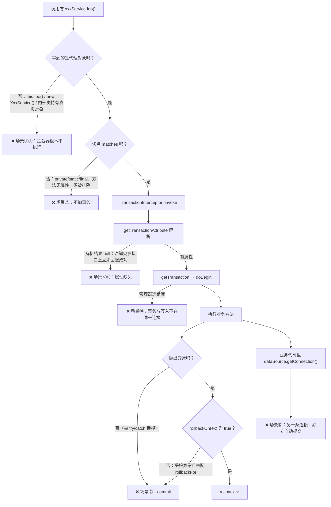
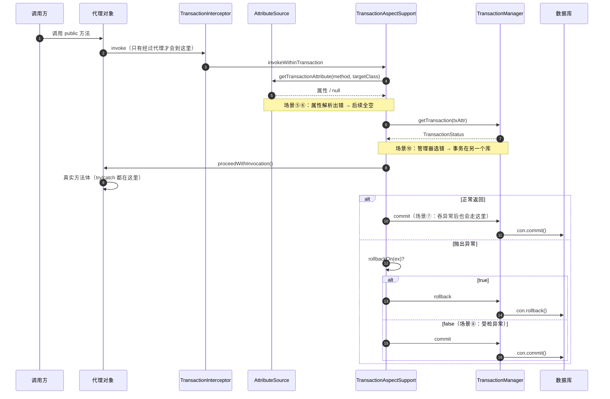

# Spring Framework 源码精读 事务 02：`@Transactional` 失效的 10 种场景与源码原因

> 一句话结论：`@Transactional` **既不是注解处理器、也不是字节码增强**，它完全依赖"调用经过代理"这一个前提；因此凡是绕过代理（自调用 / `private` / `static` / `final` / `new` / 跨线程）、或者绕过了回滚判定（异常被吞 / 非 `RuntimeException` / `readOnly` 的错觉 / 事务管理器选错）的写法都会"失效"，而失效点在源码里**都有唯一确定的位置**。
> 阅读前置：读完 [01-transactional-事务拦截器与传播行为](./01-transactional-事务拦截器与传播行为.md)（需要知道 `TransactionInterceptor` 与 `AbstractPlatformTransactionManager` 的位置），以及 [02-AOP与代理](../02-AOP与代理/README.md)（需要知道 JDK / CGLIB 两种代理的能力边界）。
> 预计阅读：55 分钟 ｜ 源码：`org.springframework:spring-tx:7.1.0`、`org.springframework:spring-aop:7.1.0`（Spring Boot 4.2.0 / `spring-framework@v7.1.0`）

---

## 0. 先看现象

本节解决什么问题：建立"症状 → 可疑点"的对照表，让你看到报错或数据不一致时，能在 30 秒内判断属于哪一类失效。

线上最典型的三种反馈长这样：

1. **"我明明加了 `@Transactional`，报错后数据还在。"** —— 数据没回滚。可能：异常被吞、抛出的是受检异常、方法根本没被代理、或者写操作走的不是事务里的那个连接。
2. **"日志里两个方法都打印了 `Creating new transaction`，但内层失败把外层一起带走了。"** —— 传播行为没生效。几乎总是自调用（内层注解根本没被解析）。
		if (TransactionSynchronizationManager.isSynchronizationActive()) {
3. **"没抛任何异常，但收到 `UnexpectedRollbackException`。"** —— 内层给共享事务打了 `rollback-only`，外层却想提交。这不是失效，而是"隔离级别想错了"。

把 10 种场景按"失效发生在哪一层"归类：

| 失效层 | 场景 | 最直接的源码位置 |
| --- | --- | --- |
| 代理层（根本没进拦截器） | ① 自调用 `this.foo()` ② `private` / `static` / `final` 方法 ③ 对象是 `new` 出来的 / 未被 Spring 管理 ④ `@Async` 等跨线程 | `TransactionAttributeSourcePointcut#matches`、`AbstractFallbackTransactionAttributeSource#computeTransactionAttribute` |
| 属性解析层（进了拦截器但属性丢了） | ⑤ `@Transactional` 只写在接口上 ⑥ 实现类方法上又标了别的注解把方法级属性覆盖 | `computeTransactionAttribute` 的"方法 → 类 → 接口方法 → 接口类"四级回退 |
| 回滚判定层（属性对了但不回滚） | ⑦ 异常被 `try/catch` 吞掉 ⑧ 抛出受检异常 ⑨ `readOnly = true` + 写操作 | `TransactionAspectSupport#completeTransactionAfterThrowing`、`DefaultTransactionAttribute#rollbackOn`、`RuleBasedTransactionAttribute#rollbackOn` |
| 资源层（回滚了但数据还在 / 打到别的库） | ⑩ 多数据源选错管理器、或业务代码自己 `dataSource.getConnection()` | `TransactionAspectSupport#determineTransactionManager`、`DataSourceUtils#doGetConnection` |

> 读法建议：先看现象归到哪一层，再跳到 §3 对应的源码段落。每一节的结构都是"**能复现的最小写法 → 源码为什么这样 → 怎么改 → 改法的新问题**"。

再看一张整体失效地图：



> 读图说明：整张图的判断顺序就是**排查顺序**。前两个菱形（是不是代理、切点是否命中）在 `TransactionInterceptor#invoke` 之前，属于"有没有事务"的问题；中间两个（属性解析、管理器选择）属于"事务打在哪儿"的问题；最后两个（异常是否抛出、是否命中回滚规则）属于"该不该回滚"的问题。**排查时永远从左上往右下走，不要跳步**——绝大多数"事务不生效"的争论，都是因为双方在不同层的结论上互相说服。

---

## 1. 整体地图

本节解决什么问题：把 12 种场景各自钉到一两个具体方法上，形成一张可以随时回查的索引。

```mermaid
flowchart LR
    subgraph 代理层
        P1["AutoProxyCreator<br/>（创建代理）"]
        P2["TransactionAttributeSourcePointcut#matches"]
        P3["AbstractFallbackTransactionAttributeSource<br/>#computeTransactionAttribute"]
    end
    subgraph 拦截层
        I1["TransactionInterceptor#invoke"]
        I2["TransactionAspectSupport#invokeWithinTransaction"]
        I3["#createTransactionIfNecessary"]
        I4["#completeTransactionAfterThrowing"]
    end
    subgraph 管理器层
        M1["#determineTransactionManager"]
        M2["AbstractPlatformTransactionManager#getTransaction"]
        M3["DataSourceTransactionManager#doBegin"]
        M4["DataSourceUtils#doGetConnection"]
    end
    subgraph 规则层
        R1["DefaultTransactionAttribute#rollbackOn"]
        R2["RuleBasedTransactionAttribute#rollbackOn"]
        R3["RollbackRuleAttribute#getDepth"]
    end

    P1 --> P2 --> P3 --> I1 --> I2 --> I3 --> I4
    I2 --> M1 --> M2 --> M3 --> M4
    I4 --> R1 --> R2 --> R3
```



> 读图说明：左边三个方框是"场景 ①~⑥ 的失效点"，中间是"场景 ⑦⑧⑨ 的判定点"，下面是"场景 ⑩ 的资源点"。注意 `completeTransactionAfterThrowing` 同时依赖"异常有没有抛到这里"（回到拦截层）和"规则怎么判"（规则层），这也是为什么"异常被吞"和"受检异常"看起来症状一样、根因却完全不同。

12 种场景一览（每行都能在 §3 找到对应源码）：

| # | 场景 | 一句话原因 | 修复方向 | 修复的新问题 |
| --- | --- | --- | --- | --- |
| ① | 自调用 `this.foo()` | `this` 不是代理，拦截器不执行 | 拆 Bean / 注入自身 / `AopContext.currentProxy()` / 编程式事务 | `exposeProxy` 有额外开销与暴露风险 |
| ② | `private` / `static` / `final` 方法 | 代理无法覆盖，或属性解析直接返回 `null` | 改成 `public` 非 `final`；或提到独立 Bean | 改可见性可能破坏封装 |
| ③ | `new` 出来的对象、未被 Spring 管理 | 无代理可用 | 交给容器管理 | — |
| ④ | `@Async` / 新线程里操作 | 事务上下文是 `ThreadLocal` | 在新线程内自行开事务 | 事务边界分散、连接数上升 |
| ⑤ | `@Transactional` 只写在接口上 | 四级回退里接口注解是最后一档，且要求代理方式与签名匹配 | 在实现类方法上再标一次 | 重复注解需保持同步 |
| ⑥ | 实现类方法上标了别的注解让方法级属性"看起来没生效" | 方法级优先于类级，容易误判 | 显式对齐方法级注解 | — |
| ⑦ | 异常被 `try/catch` 吞掉 | 走到 `commit` 分支 | 不要吞；或 `setRollbackOnly` | 吞异常通常有业务原因，改动影响调用方 |
| ⑧ | 抛受检异常 | `DefaultTransactionAttribute#rollbackOn` 只认 `RuntimeException` / `Error` | `rollbackFor = Exception.class` | 会把业务异常也回滚 |
| ⑨ | `readOnly = true` + 写操作 | 默认只是"提示"，不阻止写；`enforceReadOnly` 才强制 | 去掉 `readOnly`，或开启强制只读 | 强制只读会让违规写入直接抛异常 |
| ⑩ | 多数据源 / 自取连接 | 管理器选错，或连接不在事务里 | `@Transactional("txB")`、统一用 `DataSourceUtils` / `JdbcTemplate` | 多管理器需要 `@Primary` 或显式命名 |
| ⑪ | `@Async` / 多线程方法上的 `@Transactional` | 事务上下文绑在调用线程的 `ThreadLocal` 上，异步线程里没有 | 把事务边界挪进异步线程内部（调另一个 Bean） | 异步事务与调用方完全独立，失败不会回滚主事务 |
| ⑫ | 内层失败被外层 `catch`，提交时抛 `UnexpectedRollbackException` | 内层是参与者，只能 `doSetRollbackOnly` | 不吞异常 / 内层改 `REQUIRES_NEW` / 把逻辑挪出事务 | `REQUIRES_NEW` 多占一条连接 |

---

## 2. 关键类逐个拆

本节解决什么问题：先认识"失效判定"涉及的 8 个类各自管什么，再看源码就不会迷路。

### 2.1 `TransactionAttributeSourcePointcut`（决定"这个方法要不要被事务代理"）

- 它是 `StaticMethodMatcherPointcut` 的子类，只实现 `matches(Method, Class)`，返回值直接来自 `TransactionAttributeSource#hasTransactionAttribute`。
- 另外重写了 `ClassFilter`（`TransactionAttributeSourcePointcut#matches(Class)`），排除 `TransactionalProxy`、`TransactionManager`、`PersistenceExceptionTranslator` 三类，避免把基础设施 Bean 也代理一层。
- **失效含义**：`matches` 返回 `false` 时，代理根本不会生成（或生成了也不挂事务通知），§0 地图里的第一个菱形就断了。

### 2.2 `AbstractFallbackTransactionAttributeSource`（属性解析的骨架 + 缓存 + 四级回退）

- 抽象基类，只留两个钩子：`findTransactionAttribute(Class)` 与 `findTransactionAttribute(Method)`，由 `AnnotationTransactionAttributeSource` 实现。
- 关键点有三处：`getTransactionAttribute` 开头的 `isObjectMethod` 早退、`attributeCache` 缓存（`MethodClassKey`）、以及 `computeTransactionAttribute` 的四级查找。
- **失效含义**：场景 ⑤⑥ 都发生在这里——查不到属性就等价于"这个方法不是事务方法"。

### 2.3 `AnnotationTransactionAttributeSource`（把注解变成 `TransactionAttribute` 的实现）

- `publicMethodsOnly` 默认为 `true`（`allowPublicMethodsOnly()` 返回它），但 `ProxyTransactionManagementConfiguration` 创建时用的是 `new AnnotationTransactionAttributeSource(false)`——**这是 6.0 起允许 `protected` 方法的关键**。
- 内部维护一串 `TransactionAnnotationParser`，`determineTransactionAttribute` 逐个尝试，第一个返回非 `null` 的胜出。
- **失效含义**：场景 ②（`private`）在这里受影响；场景 ⑤（接口注解）取决于回退是否能命中。

### 2.4 `TransactionInterceptor`（AOP 通知，事务执行的真正入口）

- 实现 `MethodInterceptor`，`invoke` 里只有两件事：`AopUtils.getTargetClass(invocation.getThis())` 拿目标类，然后 `invokeWithinTransaction(...)`。
- **失效含义**：`invoke` 没被调用 = 没有事务。这是排查的第一断点。

### 2.5 `TransactionAspectSupport`（事务模板逻辑的持有者）

- `invokeWithinTransaction` 是标准分支：`createTransactionIfNecessary` → `proceedWithInvocation` → `commitTransactionAfterReturning` / `completeTransactionAfterThrowing` → `finally cleanupTransactionInfo`。
- `determineTransactionManager` 负责四级选管理器；`completeTransactionAfterThrowing` 负责"回滚还是提交"的分叉。
- **失效含义**：场景 ⑦⑧⑩ 都在这里或其下游。

### 2.6 `DefaultTransactionAttribute` 与 `RuleBasedTransactionAttribute`（回滚规则）

- 前者只认 `RuntimeException` / `Error`；后者在"有规则命中"时按"最深匹配"胜出，否则回退到前者。
- **失效含义**：场景 ⑧ 是前者导致的；"`noRollbackFor` 写了却没生效"往往是后者被更深/更浅的规则抢了。

### 2.7 `AbstractPlatformTransactionManager`（传播与提交回滚的编排）

- 场景 ④ 的"跨线程丢失事务"体现在这里读 `ThreadLocal` 时拿到 `null`；场景 ⑩ 的"两个管理器"体现为两次调用不同的 `getTransaction`。
- **失效含义**：它不是"失效"的责任方，但它是**观察失效的最佳位置**（日志 `Creating new transaction` / `Participating in existing transaction`）。

### 2.8 `DataSourceUtils` 与 `TransactionSynchronizationManager`（连接与线程绑定）

- `DataSourceUtils#doGetConnection` 先查 `TransactionSynchronizationManager.getResource(dataSource)`；`TransactionSynchronizationManager` 的 `resources` 是 `ThreadLocal<Map<Object, Object>>`。
- **失效含义**：场景 ⑩ 里"自己 `dataSource.getConnection()`"会绕开这张 `ThreadLocal`，拿到另一条处于 `autoCommit = true` 的连接——事务回滚与它无关。

---

## 3. 源码逐段精读

本节解决什么问题：一条一条把场景落到源码行，给出"为什么会这样"的确切证据。

### 3.0 先确认总闸门：注解如何进入拦截器

在看具体场景之前，先确认整条链的入口。`@EnableTransactionManagement` 的 javadoc 已经把本文最重要的一句话写在注释里：

```java (src: EnableTransactionManagement.java#L140-L149)
 * <p>The {@link #mode} attribute controls how advice is applied: If the mode is
 * {@link AdviceMode#PROXY} (the default), then the other attributes control the behavior
 * of the proxying. Please note that proxy mode allows for interception of calls through
 * the proxy only; local calls within the same class cannot get intercepted that way.
 *
 * <p>Note that if the {@linkplain #mode} is set to {@link AdviceMode#ASPECTJ}, then the
 * value of the {@link #proxyTargetClass} attribute will be ignored. Note also that in
 * this case the {@code spring-aspects} module JAR must be present on the classpath, with
 * compile-time weaving or load-time weaving applying the aspect to the affected classes.
 * There is no proxy involved in such a scenario; local calls will be intercepted as well.
```

- **在干什么**：明确 `PROXY` 模式下"只有经过代理的调用才会被拦截"，而 `ASPECTJ` 模式下"没有代理，本地调用也会被拦截"。
- **为什么这么写**：这段注释是官方给出的"自调用失效"权威解释，也是"为什么有人改用 AspectJ 模式"的官方依据。
- **如果改成别的**：如果改成 `AdviceMode.ASPECTJ`，自调用确实会被拦截，但代价是引入 `spring-aspects`、需要编译期/加载期织入、以及 IDE 与构建插件的额外配置；多数团队评估后仍留在 `PROXY`。
- **常见坑**：把这段注释读成"加 `@EnableTransactionManagement(mode = ASPECTJ)` 就够了"——`mode = ASPECTJ` **必须**配合织入（`-javaagent` 或 aspectj-maven-plugin），否则完全没有效果，比自调用失效更难排查。

### 3.1 场景 ①：自调用 —— `this.foo()` 为什么没有事务

先看"能不能被代理命中"的判定代码：

```java (src: TransactionAttributeSourcePointcut.java#L53-L57)
	@Override
	public boolean matches(Method method, Class<?> targetClass) {
		return (this.transactionAttributeSource == null ||
				this.transactionAttributeSource.hasTransactionAttribute(method, targetClass));
	}
```

- **在干什么**：切点只回答一个问题——"这个方法的 `targetClass` 上有没有事务属性"，有就匹配。
- **为什么这么写**：把"要不要加事务"的决策交给 `TransactionAttributeSource`，切点本身保持无状态，方便被多个 Advisor 复用。
- **如果改成别的**：如果切点直接判断"方法上有没有 `@Transactional` 注解"，那么接口注解、类级注解、`@Inherited` 组合等情况全部要重写一遍——这正是把决策抽成 `TransactionAttributeSource` 的原因。
- **常见坑**：注意 `matches` 是在**创建代理时**（`AutoProxyCreator` 遍历候选 Bean 的方法）以及**每次调用时**被询问的；它判断的是"目标类的方法"，与"这次调用是不是从 `this` 发出的"毫无关系。所以自调用时 `matches` 依然返回 `true`——代理对象存在、切点也命中，只是**调用根本没有走代理**。混淆这两件事会导致排查方向完全错误。

> **关键结论**：自调用不是"切点没命中"，而是"方法调用根本没进入代理"。判断方法：在 `TransactionInterceptor#invoke` 打断点，自调用时**断点不会停**。

再看拦截器入口，确认它是整条链上唯一的收口：

```java (src: TransactionInterceptor.java#L122-L134)
	@Override
	public @Nullable Object invoke(MethodInvocation invocation) throws Throwable {
		// Work out the target class: may be {@code null}.
		// The TransactionAttributeSource should be passed the target class
		// as well as the method, which may be from an interface.
		Class<?> targetClass = (invocation.getThis() != null ? AopUtils.getTargetClass(invocation.getThis()) : null);

		// Adapt to TransactionAspectSupport's invokeWithinTransaction...
		return invokeWithinTransaction(invocation.getMethod(), targetClass, new InvocationCallback() {
			@Override
			public @Nullable Object proceedWithInvocation() throws Throwable {
				return invocation.proceed();
			}
```

- **在干什么**：取目标类（不是代理类），把方法、目标类和一个"如何继续调用"的回调交给 `invokeWithinTransaction`。
- **为什么这么写**：事务属性要按**目标类**解析（注解通常写在目标类/接口上，代理类上是没有的）；而"继续调用"必须用 `MethodInvocation#proceed()`，才能在事务开启之后再往下走拦截器链。
- **如果改成别的**：如果用 `invocation.getMethod().invoke(invocation.getThis())` 手写反射，会丢掉后续拦截器链（其他 AOP 通知全部失效），并且异常会被 `InvocationTargetException` 包一层，导致 `rollbackOn` 判定错误。
- **常见坑**：`AopUtils.getTargetClass` 对 JDK 代理会通过 `Advised` 拿到真实目标类；如果手工用 `Proxy.newProxyInstance` 造了一个不带 `Advised` 的代理，这里拿到的是代理类，属性解析将全部落空。

**修复方案与代价**（按推荐度排序）：

1. **拆到另一个 Bean**（首选）：`OrderService` 持有 `LogService`，`LogService#inner()` 走代理。代价：多一个 Bean，需要处理依赖注入顺序（循环依赖时注意）。
2. **注入自身代理**：`@Lazy @Autowired private OrderService self;` 然后 `self.inner()`。代价：`@Lazy` 会注入一个延迟解析的代理，调试时栈帧多一层；构造器注入自己会造成循环依赖需要 `@Lazy` 解决。
3. **`AopContext.currentProxy()`**：`((OrderService) AopContext.currentProxy()).inner()`。代价：**必须**开 `@EnableAspectJAutoProxy(exposeProxy = true)`（或 `@EnableTransactionManagement` 之外另配），否则抛 `IllegalStateException: Cannot find current proxy...`；开启后每次代理调用都会往 `ThreadLocal` 塞/取代理引用，带来额外开销，并把"内部实现"暴露给业务代码。
4. **编程式事务**：用 `TransactionTemplate` 包住 `inner()` 的逻辑。代价：代码侵入、事务边界与注解风格不一致；但**最可控**，尤其是在"只有一半逻辑需要独立事务"时。

### 3.2 场景 ②：`private` / `static` / `final` 方法

代理能力边界决定了这个场景，而属性解析里还有一道硬门槛。先看 `computeTransactionAttribute` 的开头：

```java (src: AbstractFallbackTransactionAttributeSource.java#L161-L174)
	protected @Nullable TransactionAttribute computeTransactionAttribute(Method method, @Nullable Class<?> targetClass) {
		// Don't allow non-public methods, as configured.
		if (allowPublicMethodsOnly() && !Modifier.isPublic(method.getModifiers())) {
			return null;
		}
		// Skip setBeanFactory method on BeanFactoryAware.
		if (method.getDeclaringClass() == BeanFactoryAware.class) {
			return null;
		}

		// The method may be on an interface, but we need attributes from the target class.
		// If the target class is null, the method will be unchanged.
		Method specificMethod = AopUtils.getMostSpecificMethod(method, targetClass);

```

- **在干什么**：① 若"只允许 `public`"且方法不是 `public`，直接返回 `null`；② 排除 `BeanFactoryAware` 的方法；③ 取最具体的实现方法（把 CGLIB 子类的桥接方法还原成用户类的方法）。
- **为什么这么写**：`private` 方法在 JDK 代理里根本不存在，在 CGLIB 子类里也无法覆盖，所以"给它加事务"在 `PROXY` 模式下是无法兑现的承诺——提前返回 `null` 比"给了属性却拦截不到"更诚实。排除 `BeanFactoryAware` 是为了避免"容器初始化 `BeanFactory` 时触发事务解析"的循环。
- **如果改成别的**：如果把 `allowPublicMethodsOnly` 放开（6.0 起默认就是 `false`），`protected` 方法在 CGLIB 代理下确实可以被拦截；但 `private` / `static` 依旧无解，因为它们**不在任何代理的可覆盖范围内**——这是 JVM 层面的限制，不是 Spring 的取舍。
- **常见坑**：`allowPublicMethodsOnly()` 默认返回 `false`（下面这段），因此**很多人以为 `private` 会报错**，其实它只是静默地不生效：

```java (src: AbstractFallbackTransactionAttributeSource.java#L220-L226)
	/**
	 * Should only public methods be allowed to have transactional semantics?
	 * <p>The default implementation returns {@code false}.
	 */
	protected boolean allowPublicMethodsOnly() {
		return false;
	}
```

- **在干什么**：这段 javadoc 说明默认策略——`protected` 允许，`package-visible` 与 `private` 被忽略，且不抛异常。
- **为什么这么写**：6.0 起 CGLIB 代理大量使用（`proxyTargetClass` 常见），`protected` 方法可覆盖，于是放开；`private` 无法覆盖，只能忽略。
- **如果改成别的**：如果改成"非 `public` 就抛异常"，会立即破坏大量存量代码（大量 `private` 辅助方法会被误标），所以选择了"静默忽略 + javadoc 说明"。
- **常见坑**：`static` 方法不仅代理覆盖不到，连 `Method` 对象都不属于实例；`final` 方法在 CGLIB 下不可覆盖（`CglibAopProxy` 会跳过），而 JDK 代理下若在接口里声明成 `default final` 也不可能——总之，**`final` 方法一定要自己测一遍**。

**修复方案**：把需要事务的逻辑提到 `public` 非 `final` 方法；或者抽出到独立 Bean；`private` 方法绝不要期望事务。

### 3.3 场景 ③④：对象不是 Bean、以及跨线程

这两类场景在源码里都体现为"属性解析时 `targetClass` 不对"或"`ThreadLocal` 读不到"。对于场景 ③，`AopUtils.getTargetClass(invocation.getThis())` 那一行已经说明问题：**没有代理就永远不会有 `invocation`**。

场景 ④ 的根因是 `TransactionSynchronizationManager` 里的 6 个 `ThreadLocal`：

```java (src: TransactionSynchronizationManager.java#L77-L93)
	private static final ThreadLocal<Map<Object, Object>> resources =
			new NamedThreadLocal<>("Transactional resources");

	private static final ThreadLocal<Set<TransactionSynchronization>> synchronizations =
			new NamedThreadLocal<>("Transaction synchronizations");

	private static final ThreadLocal<String> currentTransactionName =
			new NamedThreadLocal<>("Current transaction name");

	private static final ThreadLocal<Boolean> currentTransactionReadOnly =
			new NamedThreadLocal<>("Current transaction read-only status");

	private static final ThreadLocal<Integer> currentTransactionIsolationLevel =
			new NamedThreadLocal<>("Current transaction isolation level");

	private static final ThreadLocal<Boolean> actualTransactionActive =
			new NamedThreadLocal<>("Actual transaction active");
```

- **在干什么**：把"当前线程"的资源绑定、同步器集合、事务名、只读标记、隔离级别、"是否有真实事务"全部挂在 `ThreadLocal` 上。
- **为什么这么写**：事务是"隐式上下文"，如果每个方法都多传一个 `TransactionStatus` 参数，业务代码会被污染；`ThreadLocal` 实现了零参数透传，且天然与"一个请求对应一个线程"的 Servlet 模型契合。
- **如果改成别的**：改成显式传参可行但侵入性极强；改成 `InheritableThreadLocal` 可以让子线程继承，但线程池复用线程时继承会失效（线程创建一次，之后不再继承），反而制造幽灵事务——所以 Spring 明确没有这么做。
- **常见坑**：`@Async`、`CompletableFuture.supplyAsync`、`parallelStream()`、自建 `ExecutorService` 里，`actualTransactionActive.get()` 一律为 `null`/`false`。此时若在异步方法里写库，**它是自动提交的**，主事务回滚与它无关。

**修复方案**：在异步方法上单独加 `@Transactional`（它是新线程里的新事务边界），或者把异步操作包在 `TransactionTemplate` 里；如果确实要"主事务提交后才做"，用 `@TransactionalEventListener(phase = AFTER_COMMIT)`——它挂在同步回调上，属于 01 篇 §5.4 的观察者模式。

### 3.4 场景 ⑤⑥：属性解析的四级回退与优先级

`computeTransactionAttribute` 的后半段是场景 ⑤ 的完整答案：

```java (src: AbstractFallbackTransactionAttributeSource.java#L175-L201)
		// First try is the method in the target class.
		TransactionAttribute txAttr = findTransactionAttribute(specificMethod);
		if (txAttr != null) {
			return txAttr;
		}

		// Second try is the transaction attribute on the target class.
		txAttr = findTransactionAttribute(specificMethod.getDeclaringClass());
		if (txAttr != null && ClassUtils.isUserLevelMethod(method)) {
			return txAttr;
		}

		if (specificMethod != method) {
			// Fallback is to look at the original method.
			txAttr = findTransactionAttribute(method);
			if (txAttr != null) {
				return txAttr;
			}
			// Last fallback is the class of the original method.
			txAttr = findTransactionAttribute(method.getDeclaringClass());
			if (txAttr != null && ClassUtils.isUserLevelMethod(method)) {
				return txAttr;
			}
		}

		return null;
	}
```

- **在干什么**：四级查找——① 最具体实现方法；② 该方法的声明类（且要求是用户级别的原始方法，排除桥接方法）；③ 若"最具体方法 ≠ 传入方法"（即传入的是接口/父类方法），再查传入方法本身；④ 查传入方法的声明类（通常是接口）。
- **为什么这么写**：为了同时支持"注解写在实现类上""注解写在接口上""注解写在父类上"三种风格，且保证**实现类优先于接口**（Spring 的长期约定：具体绑定优先）。
- **如果改成别的**：如果先查接口再查实现类，那么"接口统一声明 `REQUIRED`、某个实现想改成 `REQUIRES_NEW`"就会失效——这正是当年 Spring 2.x 争论后确定的顺序。
- **常见坑**：注意第 ③④ 级只在 `specificMethod != method` 时执行。如果通过 JDK 代理调用，`invocation.getMethod()` 拿到的是**接口方法**，与最具体方法不同 → 会走接口回退；如果通过 CGLIB 代理调用，拿到的是实现类方法 → `specificMethod == method`，**接口注解根本不会被查**。这就是"同一个类换成 `proxyTargetClass = true` 后接口注解失效"的原因。

场景 ⑥ 的答案在"第一级优先"：**方法级永远优先于类级**。所以"类上写了 `@Transactional(readOnly = true)`，某个写方法上忘了覆盖"时，写方法会沿用类的 `readOnly = true`——看起来很诡异，但完全符合源码。

注解解析的最后一环是 `SpringTransactionAnnotationParser`，它把注解字段逐个搬到 `RuleBasedTransactionAttribute` 上：

```java (src: SpringTransactionAnnotationParser.java#L71-L85)
		RuleBasedTransactionAttribute rbta = new RuleBasedTransactionAttribute();

		Propagation propagation = attributes.getEnum("propagation");
		rbta.setPropagationBehavior(propagation.value());
		Isolation isolation = attributes.getEnum("isolation");
		rbta.setIsolationLevel(isolation.value());

		rbta.setTimeout(attributes.getNumber("timeout").intValue());
		String timeoutString = attributes.getString("timeoutString");
		Assert.isTrue(!StringUtils.hasText(timeoutString) || rbta.getTimeout() < 0,
				"Specify 'timeout' or 'timeoutString', not both");
		rbta.setTimeoutString(timeoutString);

		rbta.setReadOnly(attributes.getBoolean("readOnly"));
		rbta.setQualifier(attributes.getString("value"));
```

- **在干什么**：把 `propagation` / `isolation` / `timeout` / `timeoutString` / `readOnly` / `value`（qualifier）逐个写入 `RuleBasedTransactionAttribute`，并校验 `timeout` 与 `timeoutString` 互斥。
- **为什么这么写**：`@Transactional` 的 `timeout` 是 `int`（秒），`timeoutString` 是支持占位符的字符串形式；两者语义重叠，必须互斥，否则无法确定优先级。`value` 被当作 qualifier 传给 `determineTransactionManager`，这是多数据源的第一入口。
- **如果改成别的**：如果允许两者同时配置，`resolveAttributeStrings` 解析占位符失败时就会产生难以预测的默认值，所以选择在解析期直接 `Assert` 失败（fail fast）。
- **常见坑**：`timeoutString = "${tx.timeout:30}"` 这类写法，只有在属性占位符能被 `embeddedValueResolver` 解析时才生效；写成裸字符串 `"30s"` 会解析失败或得到意料之外的值。

### 3.5 场景 ⑦：异常被吞 —— 走到了 `commit` 分支

`completeTransactionAfterThrowing` 是"该回滚还是该提交"的唯一分叉点：

```java (src: TransactionAspectSupport.java#L693-L719)
	 * We may commit or roll back, depending on the configuration.
	 * @param txInfo information about the current transaction
	 * @param ex throwable encountered
	 */
	protected void completeTransactionAfterThrowing(
			@Nullable TransactionInfo txInfo, InvocationCallback invocation, Throwable ex) {

		if (txInfo != null && txInfo.getTransactionStatus() != null) {
			if (logger.isTraceEnabled()) {
				logger.trace("Completing transaction for [" + txInfo.getJoinpointIdentification() +
						"] after exception: " + ex);
			}
			if (txInfo.transactionAttribute != null && txInfo.transactionAttribute.rollbackOn(ex)) {
				invocation.onRollback(ex, txInfo.getTransactionStatus());
				try {
					txInfo.getTransactionManager().rollback(txInfo.getTransactionStatus());
				}
				catch (TransactionSystemException ex2) {
					logger.error("Application exception overridden by rollback exception", ex);
					ex2.initApplicationException(ex);
					throw ex2;
				}
				catch (RuntimeException | Error ex2) {
					logger.error("Application exception overridden by rollback exception", ex);
					throw ex2;
				}
			}
```

- **在干什么**：只有当"有事务属性"且"`rollbackOn(ex)` 返回 `true`"时才回滚；回滚本身抛 `TransactionSystemException` 时把原始异常挂上去再抛。
- **为什么这么写**：把"是否回滚"与"回滚动作"解耦成"策略 + 执行"；`TransactionSystemException` 里 `initApplicationException` 保留了业务异常，便于定位"回滚失败 + 原始异常"两个问题。
- **如果改成别的**：如果无条件回滚，`noRollbackFor` 就失去意义；如果只按异常类型硬编码，又无法支持 `rollbackFor` 的层级匹配——所以必须走 `rollbackOn`。
- **常见坑**：**方法内部 `try/catch` 住异常之后，`invokeWithinTransaction` 的 `catch` 根本不会触发**，于是直接走到 `commitTransactionAfterReturning`。从日志看就是"`Initiating transaction commit`"——这是场景 ⑦ 的确诊信号。

如果确实需要"吞掉异常但仍回滚"，正确写法是显式标记（`TransactionStatus#setRollbackOnly`），而不是什么都不做。这也解释了 01 篇里"内层标记 rollback-only、外层提交时爆 `UnexpectedRollbackException`"的机制：`commit(TransactionStatus)` 会检查 `isGlobalRollbackOnly()` 并转向 `processRollback`。

### 3.6 场景 ⑧：受检异常默认不回滚

```java (src: DefaultTransactionAttribute.java#L179-L182)
	@Override
	public boolean rollbackOn(Throwable ex) {
		return (ex instanceof RuntimeException || ex instanceof Error);
	}
```

- **在干什么**：只有 `RuntimeException` 与 `Error` 返回 `true`；任何受检异常（`Exception` 的直接子类但不是 `RuntimeException`）返回 `false`。
- **为什么这么写**：沿用 EJB 的约定——受检异常代表"可预期的业务结果"（如"余额不足""用户已存在"），调用方应当处理而不是回滚；未受检异常代表"程序错误"，应当回滚。这个约定在 Spring 的 javadoc 里有明确说明。
- **如果改成别的**：如果改成"所有异常都回滚"，那么"查询不到用户抛 `NotFound`"这种正常业务流程也会回滚，而调用方往往只是想拿到 `null`——语义会全面错乱。
- **常见坑**：`try { ... } catch (Exception e) { throw new WrappedException(e); }` 这类包装很常见；如果 `WrappedException` 是受检异常，原来运行时的异常语义就丢了。反之，把受检异常包成 `RuntimeException` 又不设置 cause，日志里就看不到根因。

带规则时的判定由 `RuleBasedTransactionAttribute` 负责：

```java (src: RuleBasedTransactionAttribute.java#L122-L143)
	@Override
	public boolean rollbackOn(Throwable ex) {
		RollbackRuleAttribute winner = null;
		int deepest = Integer.MAX_VALUE;

		if (this.rollbackRules != null) {
			for (RollbackRuleAttribute rule : this.rollbackRules) {
				int depth = rule.getDepth(ex);
				if (depth >= 0 && depth < deepest) {
					deepest = depth;
					winner = rule;
				}
			}
		}

		// User superclass behavior (rollback on unchecked) if no rule matches.
		if (winner == null) {
			return super.rollbackOn(ex);
		}

		return !(winner instanceof NoRollbackRuleAttribute);
	}
```

- **在干什么**：遍历所有规则，用 `getDepth(ex)` 计算"规则与异常的亲近度"，取 `depth` **最小**（最具体）的那条作为 `winner`；没有规则命中就回退父类（只认 `RuntimeException` / `Error`）；命中 `NoRollbackRuleAttribute` 则"提交"，否则"回滚"。
- **为什么这么写**：`rollbackFor` 与 `noRollbackFor` 可能同时命中同一异常（父类配回滚、子类配不回滚），必须有确定性仲裁规则；"最具体的规则胜出"最符合直觉，也支持"先粗后细"的声明方式。
- **如果改成别的**：如果改成"第一条命中即返回"，结果就依赖注解数组的顺序，同一份代码在不同 JDK/编译顺序下可能结果不同——不可接受。
- **常见坑**：`getDepth` 还支持**类名子串匹配**（`rule.getDepth` 里用 `exceptionType.getName().contains(...)`），所以 `rollbackForClassName = "IOException"` 会匹配 `java.io.IOException` 也会匹配你自定义的 `MyIOException`；名字起得像的异常容易被误伤。

**修复方案**：显式写 `@Transactional(rollbackFor = Exception.class)`（或更精确的业务异常基类）；或在业务层统一把受检异常包装成运行时异常并保留 cause。

### 3.7 场景 ⑨：`readOnly = true` 为什么挡不住写

`readOnly` 从注解到生效要走好几层，先看它被写进属性对象：

```java (src: SpringTransactionAnnotationParser.java#L88-L104)
		List<RollbackRuleAttribute> rollbackRules = new ArrayList<>();
		for (Class<?> rbRule : attributes.getClassArray("rollbackFor")) {
			rollbackRules.add(new RollbackRuleAttribute(rbRule));
		}
		for (String rbRule : attributes.getStringArray("rollbackForClassName")) {
			rollbackRules.add(new RollbackRuleAttribute(rbRule));
		}
		for (Class<?> rbRule : attributes.getClassArray("noRollbackFor")) {
			rollbackRules.add(new NoRollbackRuleAttribute(rbRule));
		}
		for (String rbRule : attributes.getStringArray("noRollbackForClassName")) {
			rollbackRules.add(new NoRollbackRuleAttribute(rbRule));
		}
		rbta.setRollbackRules(rollbackRules);

		return rbta;
	}
```

- **在干什么**：把四个回滚相关注解属性（`rollbackFor` / `rollbackForClassName` / `noRollbackFor` / `noRollbackForClassName`）统一转成 `RollbackRuleAttribute` / `NoRollbackRuleAttribute` 列表，塞进 `RuleBasedTransactionAttribute`。
- **为什么这么写**：把"类"与"类名字符串"两种写法归一成同一套规则对象，判定时只需遍历一次；`NoRollbackRuleAttribute` 继承自 `RollbackRuleAttribute`，因此能共用 `getDepth` 的匹配逻辑，只靠 `instanceof` 区分"提交/回滚"。
- **如果改成别的**：如果分成两个独立列表分别判定，就要额外定义"两边都命中"时谁优先，反而更复杂。
- **常见坑**：`rollbackFor` 的 `Class<?>[]` 默认值是空数组，`getClassArray` 不会返回 `null`，所以循环安全；但**注解属性里写 `Exception.class` 时，`RuntimeException` 也会命中**（继承链上的匹配），所以在"只要受检异常也回滚"的场景里它是对的，在"只想处理某一种"的场景里就会过宽。

回到 `readOnly` 本身：它在 `DataSourceTransactionManager#doBegin` 里的实际作用是：

```java (src: DataSourceTransactionManager.java#L280-L298)
			txObject.getConnectionHolder().setSynchronizedWithTransaction(true);
			con = txObject.getConnectionHolder().getConnection();

			Integer previousIsolationLevel = DataSourceUtils.prepareConnectionForTransaction(con,
					definition.getIsolationLevel(),
					(definition.isReadOnly() && !isDefaultReadOnly()));
			txObject.setPreviousIsolationLevel(previousIsolationLevel);
			txObject.setReadOnly(definition.isReadOnly());

			// Switch to manual commit if necessary. This is very expensive in some JDBC drivers,
			// so we don't want to do it unnecessarily (for example if we've explicitly
			// configured the connection pool to set it already).
			if (con.getAutoCommit()) {
				txObject.setMustRestoreAutoCommit(true);
				if (logger.isDebugEnabled()) {
					logger.debug("Switching JDBC Connection [" + con + "] to manual commit");
				}
				con.setAutoCommit(false);
			}
```

- **在干什么**：把 `readOnly` 作为参数交给 `prepareConnectionForTransaction`（内部会调 `Connection#setReadOnly`，但仅限于"连接池默认不是只读"的情况），记录 `previousIsolationLevel` 与 `readOnly` 以便事务结束后还原，然后关闭自动提交。
- **为什么这么写**：`Connection#setReadOnly` 只是**给驱动的提示**（很多驱动直接忽略），Spring 不能依赖它来阻止 SQL；真正能保证"只读"的手段是数据库层面的事务只读（如 `SET TRANSACTION READ ONLY`），那是可选加强项而不是默认行为。
- **如果改成别的**：如果 Spring 在 `readOnly = true` 时主动校验 SQL 是否为写操作，就需要解析 SQL——既不可靠（动态 SQL、存储过程）也侵入性强，所以没有做。
- **常见坑**：`readOnly = true` 在 `REQUIRED` 内层会被**静默忽略**：`prepareSynchronization` 只在 `isNewSynchronization()` 为真时才写 `currentTransactionReadOnly`，加入已有事务时不会改写外层的只读标记。因此"内层加了 `readOnly` 却没生效"是正常行为，不是 bug。

**修复方案**：不要在写方法上加 `readOnly = true`；需要强约束时开启 `DataSourceTransactionManager#setEnforceReadOnly(true)`（会在 `doBegin` 里执行 `SET TRANSACTION READ ONLY`），或使用只读数据源/只读账号。

### 3.8 场景 ⑩：多数据源与"自己取连接"

先看管理器选择：

```java (src: TransactionAspectSupport.java#L489-L505)
	protected @Nullable TransactionManager determineTransactionManager(
			@Nullable TransactionAttribute txAttr, @Nullable Class<?> targetClass) {

		TransactionManager tm = determineTransactionManager(txAttr);
		if (tm != null) {
			return tm;
		}

		// Do not attempt to lookup tx manager if no tx attributes are set
		if (txAttr == null || this.beanFactory == null) {
			return getTransactionManager();
		}

		String qualifier = txAttr.getQualifier();
		if (StringUtils.hasText(qualifier)) {
			return determineQualifiedTransactionManager(this.beanFactory, qualifier);
		}
```

- **在干什么**：先看拦截器自己是否被显式设置了管理器；再在"没有事务属性"时直接返回；否则优先使用 `@Transactional("xxx")` 的 `value` 作为 qualifier 去找 Bean。
- **为什么这么写**：`TransactionInterceptor` 可能被手工注册（`setTransactionManager`），这时它的优先级最高；`@Transactional` 的 `value` 是开发者最直观的指定方式，优先于按类型查找。
- **如果改成别的**：如果先按类型查找再考虑 qualifier，多数据源场景下会先抛 `NoUniqueBeanDefinitionException`，qualifier 就永远用不上——顺序不能变。
- **常见坑**：`value` 只有在容器里确实存在名为该 qualifier 的 `PlatformTransactionManager` 时才有效；写错名字会抛 `NoSuchBeanDefinitionException`，而**不是**回退到默认管理器（回退只发生在类型级 `@Qualifier` 那一档）。

资源层的关键在于"连接必须从线程上下文里取"：

```java (src: DataSourceUtils.java#L103-L120)
	public static Connection doGetConnection(DataSource dataSource) throws SQLException {
		Assert.notNull(dataSource, "No DataSource specified");

		ConnectionHolder conHolder = (ConnectionHolder) TransactionSynchronizationManager.getResource(dataSource);
		if (conHolder != null && (conHolder.hasConnection() || conHolder.isSynchronizedWithTransaction())) {
			conHolder.requested();
			if (!conHolder.hasConnection()) {
				logger.debug("Fetching resumed JDBC Connection from DataSource");
				conHolder.setConnection(fetchConnection(dataSource));
			}
			return conHolder.getConnection();
		}
		// Else we either got no holder or an empty thread-bound holder here.

		logger.debug("Fetching JDBC Connection from DataSource");
		Connection con = fetchConnection(dataSource);

		if (TransactionSynchronizationManager.isSynchronizationActive()) {
```

- **在干什么**：先从 `TransactionSynchronizationManager` 的 `ThreadLocal` 里按 `DataSource` 找 `ConnectionHolder`；找到就把引用计数 +1 并返回**同一个** `Connection`；找不到才真正向数据源要新连接。
- **为什么这么写**：这是"同一个事务里所有 DAO 共用一条连接"的实现基础。只有共用连接，`con.rollback()` 才能撤销本事务里所有写的操作；否则每条连接各自自动提交，"回滚"只是撤销最后一条。
- **如果改成别的**：如果每次都 `dataSource.getConnection()`，连接池会分配新连接（且 `autoCommit` 默认 `true`），写操作立刻落库，`doRollback` 对它们无效——这就是"回滚了数据还在"最隐蔽的一种。
- **常见坑**：直接用 `DataSource#getConnection()` 还容易漏 `close()`，把连接池耗尽；`JdbcTemplate` / `MyBatis` 内部都走 `DataSourceUtils`，所以**混用**时只有手写的 `dataSource.getConnection()` 那一部分会脱离事务。

**修复方案**：统一用 `JdbcTemplate` / `NamedParameterJdbcTemplate` / MyBatis，或显式用 `DataSourceUtils.getConnection(dataSource)` 并在 `finally` 里 `DataSourceUtils.releaseConnection(con, dataSource)`；多数据源场景为每个数据源配独立的 `DataSourceTransactionManager`，并用 `@Transactional("txA")` / `@Transactional("txB")` 显式指定（或设置 `@Primary`）。

---

## 4. 一次完整执行时序

本节解决什么问题：用一条时序把"失效"与"正常"的分叉点放在同一张图上，便于对照。



> 读图说明：图上三个 `note` 就是失效的三个断点位置——第一个断点在"属性解析"，错误表现为"方法被调用了但 `txAttr` 是 `null`"；第二个断点在"管理器选择"，错误表现为"日志显示提交成功，但目标库数据没变"；第三个断点在"`rollbackOn` 返回 `false`"，错误表现为"异常抛了、调用方收到了、数据却还在"。最后一个 `else` 分支是场景 ⑦ 与场景 ⑧ 的**共同归宿**：它们都会走到 `commit`，但一个是因为异常没抛到拦截器，另一个是抛到了却被判定为"不该回滚"。

再给一份"按现象倒推"的排查顺序表，这是本文最实用的部分：

| 现象 | 第一个判断 | 断点/日志 | 结论 |
| --- | --- | --- | --- |
| 数据没回滚 | 拦截器有没有执行？ | `TransactionInterceptor#invoke` 是否停 | 不停 → 场景 ①~④ |
| 拦截器执行了，还提交了 | 异常有没有抛到拦截器？ | 搜 `Initiating transaction commit` | 有 → 场景 ⑦（吞异常）或 ⑧（判定为不回滚） |
| 抛了异常也提交了 | `rollbackOn` 返回什么？ | `completeTransactionAfterThrowing` 的 `if` 条件 | `false` → 场景 ⑧，检查 `rollbackFor` |
| 内层失败把外层也带走 | 内层是"新建"还是"参与"？ | 搜 `Creating new transaction` / `Participating in existing transaction` | 参与 → 换成 `REQUIRES_NEW` |
| 没异常却抛 `UnexpectedRollbackException` | 是否有内层打了 rollback-only？ | 搜 `marking existing transaction as rollback-only` | 有 → 边界设计问题，非失效 |
| 提交成功但目标库没数据 | 管理器是不是同一个 Bean？ | `determineTransactionManager` 返回值 | 不同 → 场景 ⑩，用 qualifier 显式指定 |

---

### 3.9 场景 ⑪：`@Transactional` 用在 `@Async` / 多线程方法上

这一节解决一个问题：**为什么异步方法上的 `@Transactional` 看起来"开启了"却什么都没回滚**，以及 `TransactionAspectSupport` 里那段 `Future` 分支是干什么的。

`@Async` 的本质是"把方法体丢给另一个线程执行"，而事务上下文绑在**调用线程**的 `ThreadLocal` 上（见 [03-数据源事务管理器与连接绑定](03-数据源事务管理器与连接绑定.md) 的 §3.11）。所以真正在异步线程里跑的那段代码，进去时是"无事务"状态。

但有两个细节容易被忽略：

1. **`@Async` 与 `@Transactional` 加在同一个方法上时，谁在外面？** 取决于两个 Advisor 的 `order`。`@EnableAsync` 的 `AsyncAnnotationBeanPostProcessor` 默认 `order = Ordered.LOWEST_PRECEDENCE`，`@EnableTransactionManagement` 的 advisor 默认也是 `LOWEST_PRECEDENCE`——此时顺序由 Bean 注册顺序决定，非常脆弱。若异步在外层，事务拦截器在**异步线程内**执行（还能生效，但连接和调用线程无关）；若事务在外层，事务开在调用线程、方法体在异步线程里跑，**事务对方法体完全无效**。
2. **返回 `Future` 的事务方法，异常去哪了？** `invokeWithinTransaction` 有一段专门处理"返回已完成 `Future`"的分支：

```java (src: TransactionAspectSupport.java#L382-L395)
			if (retVal != null && txAttr != null) {
				TransactionStatus status = txInfo.getTransactionStatus();
				if (status != null) {
					if (retVal instanceof Future<?> future && future.isDone()) {
						try {
							future.get();
						}
						catch (ExecutionException ex) {
							Throwable cause = ex.getCause();
							Assert.state(cause != null, "Cause must not be null");
							if (txAttr.rollbackOn(cause)) {
								invocation.onRollback(cause, status);
								status.setRollbackOnly();
							}
```

- **在干什么**：方法返回的是 `Future` 且**已经完成**时，直接 `future.get()` 把执行结果挖出来；如果是 `ExecutionException`（异步体里抛了异常），就把 `cause` 交给 `txAttr.rollbackOn(...)` 判定，需要回滚就 `invocation.onRollback(cause, status)` + `status.setRollbackOnly()`。
- **为什么这么写**：`@Async` 方法返回的 `Future` 里包的异常**不会**从 `proceedWithInvocation()` 抛出来（`invoke` 本身正常返回），如果不拆包，`completeTransactionAfterThrowing` 永远收不到异常，事务照常提交——这是"异步方法抛异常但数据没回滚"最常见的一条源码级解释。
- **如果改成别的**：如果没有这段分支，`CompletableFuture` 链上的失败就完全对事务不可见；反过来说，`future.isDone()` 为 `false` 时（还没跑完）这段也帮不了你——所以**异步方法不要依赖外层事务**，要在异步线程内部自己声明事务边界。
- **常见坑**：`@Async` 方法里 `catch` 住异常后返回正常结果，事务（如果有）会提交；`Thread.currentThread().interrupt()` 只恢复中断标记，不会让事务回滚。排查时先看日志线程名（`task-1` 之类）与 `isActualTransactionActive()`。

**修复方案与副作用**：

| 方案 | 做法 | 会引入的新问题 |
| --- | --- | --- |
| 把事务挪进异步方法 | `@Async` 只加在"无事务的外壳方法"上，异步线程里调用**另一个 Bean** 的事务方法 | 多一层 Bean；异步线程内事务与调用方完全独立，调用方回滚不影响它 |
| 显式指定 Advisor 顺序 | 自定义 `@EnableTransactionManagement(order = ...)` 与 `@EnableAsync` | 需要理解 `order` 语义；调整后其它切面顺序也会变 |
| 不要在异步里用事务 | 异步只做"发消息/写日志"这类幂等操作 | 业务上必须接受最终一致 |

### 3.10 场景 ⑫：两个 `@Transactional` 方法互相调用，异常被内层 `catch` 后外层仍收到 `UnexpectedRollbackException`

这一节解决一个问题：**为什么"内层我明明 catch 了异常，为什么外层提交时报 `Transaction silently rolled back because it has been marked as rollback-only`"**。

这正是 [01-transactional-事务拦截器与传播行为](01-transactional-事务拦截器与传播行为.md) §3.11 里 `processRollback` 的"参与分支"造成的：内层方法发现自己不是事务发起者（`isNewTransaction() == false`），**不能真的回滚**（会连累外层），于是执行 `doSetRollbackOnly(status)` 给整个事务打上"只能回滚"的标记：

```java (src: AbstractPlatformTransactionManager.java#L898-L911)
				else {
					// Participating in larger transaction
					if (status.hasTransaction()) {
						if (status.isLocalRollbackOnly() || isGlobalRollbackOnParticipationFailure()) {
							if (status.isDebug()) {
								logger.debug("Participating transaction failed - marking existing transaction as rollback-only");
							}
							doSetRollbackOnly(status);
						}
						else {
							if (status.isDebug()) {
								logger.debug("Participating transaction failed - letting transaction originator decide on rollback");
							}
						}
```

- **在干什么**：内层回滚请求到达时，如果自己没有独立事务（没有 savepoint、也不是 `newTransaction`），就把 `rollback-only` 标记设到**共享的事务对象**上；随后 `processRollback` 末尾抛出 `UnexpectedRollbackException: Transaction rolled back because it has been marked as rollback-only`（这一步对外层的 `completeTransactionAfterThrowing` 会再走一次判定）。
- **为什么这么写**：一个物理事务只有"提交/回滚"两种结局。内层已经决定"这次业务失败"，唯一不会造成部分提交的做法就是让整个事务回滚；而真正回滚的动作必须由发起者（外层）执行，否则内层回滚后外层接着提交会直接报错。
- **如果改成别的**：`setGlobalRollbackOnParticipationFailure(false)` 可以让内层失败时**不**标记全局回滚（此时内层 `processRollback` 只留一条 debug 日志 "letting transaction originator decide on rollback"），但这样内层已写入的数据会跟着外层一起提交——多数业务不可接受。
- **常见坑**：外层 `catch` 住 `UnexpectedRollbackException` 后继续返回正常结果，调用方会以为成功而日志里只有一条 `Setting JDBC transaction [...] rollback-only`；此外 `REQUIRES_NEW` 能把内层变成独立事务，从而"内层失败不影响外层"，但代价是**多占一条连接**（详见 03 篇 §3.3）。

**排查顺序**：① 搜日志 `rollback-only` 与 `Participating transaction failed` 定位内层方法 → ② 确认内层是否 `REQUIRED`（参与）→ ③ 决定"要么别吞异常、要么内层改 `REQUIRES_NEW`、要么把内层逻辑挪到事务外"。


## 5. 设计模式与设计取舍

本节解决什么问题：理解"为什么这些失效在框架层面无法被自动修复"，从而不再期待"升级 Spring 就能解决"。

### 5.1 代理模式的两个必然边界

`PROXY` 模式下，所有能力都建立在"调用经过代理对象"之上。这条边界来自 JVM 的对象模型，而不是 Spring 的实现缺陷：

- **JDK 动态代理**只能代理接口方法——所以"类内部自调用""`private` 方法""`final` 类"全部无解。
- **CGLIB** 通过生成子类来覆盖方法——所以 `final` 方法、`private` 方法同样无解，且构造函数会被调用两次（`proxyTargetClass` 场景下需要注意）。
- **横切逻辑的插入点是"方法调用"**，不是"方法体内部"——所以方法内部任何 `this.xxx()` 都不在拦截范围内。

对比 `AdviceMode.ASPECTJ`：它用编译期/加载期织入把通知直接写进字节码，因此没有代理，`private` 方法之外的本地调用也能拦截。代价是构建链路复杂、需要 `spring-aspects`、且对 Kotlin/Java 混合、模块化项目不友好。**绝大多数团队选择接受 PROXY 的边界，用编码规范兜住。**

### 5.2 缓存带来的"第一次即永久"

`AbstractFallbackTransactionAttributeSource` 用 `ConcurrentHashMap` 按 `MethodClassKey(method, targetClass)` 缓存解析结果，`null` 也会被缓存（用 `NULL_TRANSACTION_ATTRIBUTE` 哨兵表示）。这意味着：

- 解析结果在**首次调用时确定**，之后即使运行期修改注解（不可能）或改变类结构（不可能），也不会重新解析。
- 因此"属性解析返回 `null`" 是**永久性**的——不会因为"第二次调用时类加载完成"而好转。这排除了"偶发失效"的可能，也让排查更确定：一次不生效，就是永久不生效。

### 5.3 `ThreadLocal` 上下文与"事务边界 = 线程边界"

`TransactionSynchronizationManager` 的六个 `ThreadLocal` 决定了：

- **事务不能跨线程传播**（这是设计，不是缺陷）；
- **线程池复用必须严格配对绑定/解绑**，否则会串事务（`resources` 必须由 `doCleanupAfterCompletion` 清理，`clear()` 不管它）；
- **异步任务要么开启自己的事务，要么明确放弃事务**。

合理的做法是把"是否需要事务"当作异步方法的**设计决策**写进代码，而不是指望上下文自动传递。

### 5.4 回滚策略"默认保守"的取舍

`DefaultTransactionAttribute#rollbackOn` 只认运行时异常，是"默认不误伤业务正常流程"的保守选择。代价是**大量实际项目需要显式 `rollbackFor = Exception.class`**，忘了写就会"异常抛了但数据还在"。同样地，`readOnly` 只是提示而非强制，也是"不阻断既有代码"的保守选择，代价是它拦不住写操作。

这两处设计说明一个规律：**Spring 的默认值偏向"少干预、不报错"**，因此"失效"往往表现为静默的行为偏差，而不是显式的异常——这就是为什么必须知道源码位置。

---

## 6. 踩坑与调试手法

本节解决什么问题：给出线上可直接执行的排查步骤、断点位置、日志关键字与快速验证代码。

### 6.1 五步排查法（针对"事务不生效"）

1. **确认代理存在**：在 `TransactionInterceptor#invoke` 打断点，或用 `AopUtils.isAopProxy(bean)` / `AopUtils.isJdkDynamicProxy(bean)` 在启动后自检。若 Bean 不是代理，直接查场景 ①③④。
2. **确认属性解析成功**：把 `org.springframework.transaction.interceptor` 包开到 `TRACE`，搜 `Adding transactional method`。没有这条日志 = 属性为 `null`，查场景 ②⑤⑥。
3. **确认新建还是参与**：搜 `Creating new transaction with name` 与 `Participating in existing transaction`。预期"新建"却出现"参与"，就是传播行为场景（自调用最常见）。
4. **确认管理器**：在 `determineTransactionManager` 返回处看 `tm` 的 Bean 名；多数据源场景必须逐个方法确认，不要凭直觉。
5. **确认回滚判定**：搜 `Initiating transaction commit` / `Initiating transaction rollback`，并在 `completeTransactionAfterThrowing` 上确认 `rollbackOn(ex)` 的返回值。

### 6.2 常见坑与快速定位

1. **"加了 `@Transactional` 但还是没事务"**：先看是不是 `private` / `final` / `static`；再看是不是自调用；最后看类是不是被别的代理包了一层（例如 `@Scheduled` + 事务同在一个类）。**断点法最快**：`invoke` 不停就是没代理。
2. **"事务回滚了，但某个表的数据还在"**：几乎一定是那张表走了另一个数据源，或那段代码用了 `dataSource.getConnection()` / 独立的 `JdbcTemplate`（未共享事务管理器）。搜日志里两条不同的 `Acquired Connection`。
3. **"`@Transactional` 加在 `@Async` 方法上还报 `Connection is closed`"**：异步方法执行时原线程的连接已经归还；异步方法自己的事务又是新开的。此时如果异步方法里持有原线程的 `Entity`（惰性加载），就会报错。
4. **"`rollbackFor` 写了却没回滚"**：确认抛出的异常**真的到达拦截器**（没被 `catch`），并确认异常类型在规则匹配的层级上（`getDepth` 走继承链）。如果同时有 `noRollbackFor`，注意"最深匹配胜出"。
5. **"`UnexpectedRollbackException` 与业务无关"**：找到 `marking existing transaction as rollback-only` 那一层，把它改成 `REQUIRES_NEW` 或改变异常处理策略。
6. **"`@Transactional` 写在接口上，改成 CGLIB 后就失效了"**：见 §3.4 的 `specificMethod != method` 分支。要么在实现类上再标一次，要么把代理方式统一。

### 6.3 一段可复用的启动自检代码

```java
// 断言：这些 Bean 必须是 AOP 代理，否则事务一定不生效
for (String name : ctx.getBeanNamesForType(OrderService.class)) {
    Object bean = ctx.getBean(name);
    boolean proxy = AopUtils.isAopProxy(bean);
    log.info("bean={} isProxy={} jdk={} cglib={}", name, proxy,
            AopUtils.isJdkDynamicProxy(bean), AopUtils.isCglibProxy(bean));
}
```

> 说明：以上是本篇自拟的**排查辅助代码**（不是框架源码）；它只用 `AopUtils` 的公开方法，可以放在 `ApplicationRunner` 里做启动自检。

---

## 7. ⚠️ 版本差异

本节解决什么问题：避免把旧版本的失效结论套到 7.1.0 上。

| 版本 | 与本篇场景相关的差异 |
| --- | --- |
| 5.x | `AnnotationTransactionAttributeSource` 默认 `publicMethodsOnly = true`，`protected` 方法上的 `@Transactional` 完全无效；`@EnableTransactionManagement` 无 `rollbackOn` 属性 |
| 6.0 | `AbstractTransactionManagementConfiguration` 改为 `new AnnotationTransactionAttributeSource(false)`，**`protected` 方法可被 CGLIB 代理拦截**（`private` / `static` 仍无解）；`computeTransactionAttribute` 里增加了 `ClassUtils.isUserLevelMethod` 判断，避免桥接方法被当成用户方法 |
| 6.2 | `@EnableTransactionManagement(rollbackOn = RollbackOn.ALL_EXCEPTIONS)` 可全局让受检异常也回滚——这是"全局修场景 ⑧"的官方手段，但会改变所有方法的行为，慎用 |
| 6.2 | `TransactionAspectSupport` 新增对已完成 `Future` 的处理：`future.get()` 抛 `ExecutionException` 时，会取 `cause` 按 `rollbackOn` 判定——这让"异步返回的 `Future` 里带异常"也能正确回滚（此前常被误判为提交） |
| 7.0 | `TransactionSynchronizationManager` 新增 `bindSynchronizedResource`；`AbstractPlatformTransactionManager` 引入 `TransactionExecutionListener`（`beforeBegin` / `afterBegin` / `beforeCommit` / `afterCommit` / `beforeRollback` / `afterRollback`），可用于观测事务生命周期（比 `TransactionSynchronization` 更底层，不依赖 `isNewSynchronization`） |
| 7.1.0（本书基线） | 上述行为即当前实现；`readOnly` 依旧只是提示，`enforceReadOnly` 依旧是可选强制 |

---

## 8. 面试高频问与答

本节解决什么问题：把 10 个失效场景压缩成可背诵的答案，每条都指向源码位置。

1. **`@Transactional` 什么情况下会失效？请分类说。**
   → 四类：**代理层**（自调用、`private`/`static`/`final`、对象不是 Bean、跨线程）、**属性解析层**（注解只在接口上且回退不成功、方法级被覆盖）、**回滚判定层**（异常被吞、受检异常、`readOnly` 挡不住写）、**资源层**（多数据源选错管理器、自己 `dataSource.getConnection()`）。

2. **为什么自调用没有事务？**
   → `TransactionInterceptor` 只在调用经过代理时执行；`this.foo()` 直接进入目标对象的方法体，代理与拦截器链都不参与。`@EnableTransactionManagement` 的 javadoc 明确："proxy mode allows for interception of calls through the proxy only; local calls within the same class cannot get intercepted that way"。

3. **`AopContext.currentProxy()` 能解决自调用吗？有什么代价？**
   → 能，但必须先 `@EnableAspectJAutoProxy(exposeProxy = true)`，否则抛 `IllegalStateException: Cannot find current proxy`。代价：每个代理调用都要维护 `ThreadLocal` 里的代理引用（额外开销），业务代码依赖 AOP 基础设施（可测试性变差），且会把内部实现暴露出去。更推荐拆 Bean 或注入自身代理。

4. **`private` 方法加 `@Transactional` 会怎样？**
   → 静默无效。JDK 代理没有 `private` 方法，CGLIB 无法覆盖 `private` 方法；`computeTransactionAttribute` 在 `allowPublicMethodsOnly()` 为 `true` 时直接返回 `null`（5.x 默认如此），6.0 起默认放行 `protected`，但 `private` / `static` 永远无解。不会报错，这也是最难发现的失效之一。

5. **`@Transactional` 加在接口方法上，实现类方法没加，会生效吗？**
   → 分情况。JDK 代理下 `invocation.getMethod()` 是接口方法，与最具体方法不同，会走第 ③④ 级回退，接口注解能生效；CGLIB 代理下拿到的是实现类方法，`specificMethod == method`，回退不执行，**接口注解不生效**。所以生产环境建议在实现类上重复标注。

6. **接口上有 `@Transactional`、实现类上有别的注解（如 `@Async`），会怎样？**
   → 属性解析只认 `@Transactional`（及其元注解），`@Async` 不影响属性解析；但两者组合会让"事务开在异步线程"等语义混乱。正确姿势是把 `@Async` 与 `@Transactional` 放在不同方法（或不同 Bean）上，明确边界。

7. **异常被 `catch` 了还想回滚，怎么办？**
   → 显式 `TransactionAspectSupport.currentTransactionStatus().setRollbackOnly()`，或者抛出运行时异常。注意标记后即使正常返回，`commit` 也会检测 `isGlobalRollbackOnly()` 并转向回滚（外层会收到 `UnexpectedRollbackException`）。

8. **为什么抛 `IOException` 不回滚？怎么让它回滚？**
   → `DefaultTransactionAttribute#rollbackOn` 只认 `RuntimeException` / `Error`，受检异常视为业务结果。修法：方法上 `@Transactional(rollbackFor = Exception.class)`，或把异常包装成 `RuntimeException` 并保留 cause；全局修法是 `@EnableTransactionManagement(rollbackOn = RollbackOn.ALL_EXCEPTIONS)`（6.2+，影响全局）。

9. **`readOnly = true` 为什么还能写成功？**
   → `readOnly` 默认只是提示：`doBegin` 里通过 `prepareConnectionForTransaction` 调 `Connection#setReadOnly`（多数驱动忽略），并写入 `currentTransactionReadOnly` 供回调读取；并不会拦截 SQL。需要强制时开 `setEnforceReadOnly(true)`，或用只读账号。另外内层加入已有事务时 `readOnly` 会被静默忽略。

10. **`@Async` 方法里写库并抛异常，主事务会回滚吗？**
    → 不会。事务上下文在 `ThreadLocal` 里，异步线程读不到；异步方法若自己没加 `@Transactional`，写库就是自动提交。主事务的回滚与异步线程无关。要"主事务成功后异步执行"，用 `@TransactionalEventListener(phase = AFTER_COMMIT)`。

11. **多数据源下事务打到错的库，怎么排查？**
    → 看 `determineTransactionManager` 的四级顺序：拦截器显式设置 → `@Transactional("xxx")` 的 `value` → 类型级 `@Qualifier` → 按类型取唯一 Bean。前两档写错名字会直接抛异常，第三档找不到会静默回退到第四档（这是最坑的）。断点看返回的 Bean 名，或搜日志里 `Acquired Connection` 出现了几个不同的数据源。

12. **为什么"第一次没问题，后面偶发失效"基本不可能？**
    → 属性解析结果缓存在 `ConcurrentHashMap`（`MethodClassKey`），`null` 也被缓存。所以"属性为 `null`"是**永久性**的；偶发失效通常来自资源层（连接池、多数据源、异步线程），而不是属性解析。

---

## 9. 动手练习

本节解决什么问题：把 10 个场景亲手复现一遍，形成判断直觉。

1. **【复现】自调用**
   写 `OrderService`：`public void outer()` 调 `this.inner()`，两者都加 `@Transactional`，`inner` 用 `REQUIRES_NEW` 并抛异常。
   **验收**：日志里只有一条 `Creating new transaction`（外层）；`inner` 的异常导致整体回滚；在 `TransactionInterceptor#invoke` 打条件断点，`inner` 不会停。

2. **【修复】用三种方式让自调用生效**
   分别用：拆到新 Bean、`@Lazy` 注入自身、`AopContext.currentProxy()`。
   **验收**：三种方式都能看到两条 `Creating new transaction`（`REQUIRES_NEW` 场景）或"挂起 + 新建"；未开 `exposeProxy` 时第③种抛 `IllegalStateException`。

3. **【复现】`private` 与 `final`**
   给 `private void doIt()` 加 `@Transactional` 并从 `public` 方法调用；再写一个 `public final void doFinal()` 加注解。
   **验收**：`private` 版本在 `TRACE` 日志里**没有** `Adding transactional method`；`final` 版本在 CGLIB 下同样无拦截，能说出原因（不可覆盖）。

4. **【复现】异常被吞**
   `outer()` 里调用 `inner()` 并 `catch` 住异常正常返回。
   **验收**：日志出现 `Initiating transaction commit`，数据未回滚；若内层是参与者，则外层收到 `UnexpectedRollbackException`。

5. **【复现】受检异常不回滚**
   方法 `throws IOException` 并抛出，不加 `rollbackFor`。
   **验收**：`completeTransactionAfterThrowing` 里 `rollbackOn(ex)` 返回 `false`，走 `commit`；加上 `rollbackFor = Exception.class` 后走 `rollback`。

6. **【复现】注释顺序对回滚判定的影响**
   同时配置 `rollbackFor = ServiceException.class` 与 `noRollbackFor = NotFoundException.class`（后者是前者的子类），抛出两者。
   **验收**：抛 `NotFoundException` 时提交，抛 `ServiceException` 时回滚；在 `RuleBasedTransactionAttribute#rollbackOn` 里确认 `winner` 的取值。

7. **【复现】`readOnly` 挡不住写**
   在写方法上加 `@Transactional(readOnly = true)`。
   **验收**：写入成功；再开 `setEnforceReadOnly(true)`，观察是否变成数据库报错。记录两种模式下的行为差异。

8. **【复现】接口注解 + CGLIB**
   接口方法标注 `@Transactional`，实现类不加；先 `proxyTargetClass = false` 跑一遍，再改 `true` 跑一遍。
   **验收**：前者生效、后者失效；在 `computeTransactionAttribute` 断点确认 `specificMethod != method` 的分支是否被执行。

9. **【复现】`@Async` 脱离事务**
   主事务方法里调用 `@Async` 方法，异步方法写库后抛异常。
   **验收**：异步写入留在库里；异步方法里 `TransactionSynchronizationManager.isActualTransactionActive()` 为 `false`。

10. **【综合】写一份事务检查清单**
    把 §6.1 的五步排查法整理成团队文档，要求每条都对应本篇的具体类与行号，并附上"如何用日志验证"。
    **验收**：覆盖代理 / 属性 / 传播 / 管理器 / 回滚判定五层；每条都能在 5 分钟内执行；能被新同事独立使用。

---

## 小结

- 还有两类"看起来灵异"的失效必须单独记：**异步线程里的 `@Transactional`**（上下文不跨线程）与**内层参与者的回滚传染**（`rollback-only` → `UnexpectedRollbackException`）。前者在 `TransactionAspectSupport#invokeWithinTransaction` 的 `Future` 分支里留有痕迹，后者在 `AbstractPlatformTransactionManager#processRollback` 的参与分支里写得明明白白。
- `@Transactional` 失效**只有四类根因**：调用没经过代理（①~④）、属性没解析到（⑤⑥）、判定为不该回滚（⑦⑧⑨）、资源不在同一事务里（⑩）。排查时按"代理 → 属性 → 传播 → 管理器 → 回滚判定"五步走，一定能落到其中一类。
- 所有"静默失效"都源于 Spring 的保守默认：非 `public` 静默忽略、受检异常静默提交、`readOnly` 静默放行、接口注解在某些代理方式下静默不生效。**它们不会报错，只会让数据不符合预期**，所以必须知道源码位置。
- 修复方案都有代价：`AopContext.currentProxy()` 要开 `exposeProxy`、`rollbackFor = Exception.class` 会误伤业务异常、`REQUIRES_NEW` 要多占连接、`@Async` 让事务边界分散。**选择方案前先把代价想清楚**，不要只追求"看起来生效"。

## 自测题

1. 为什么"自调用"不是切点没命中，而拦截器根本没执行？如何用断点证明？
2. `computeTransactionAttribute` 的"四级查找"具体是哪四级？第 ③④ 级在什么条件下才会执行？
3. 为什么同一个实现类换成 `proxyTargetClass = true` 后，接口上的 `@Transactional` 会失效？
4. `allowPublicMethodsOnly()` 在 5.x 与 6.x 的默认值有什么不同？对 `protected` / `private` 方法意味着什么？
5. `TransactionAttributeSourcePointcut#matches` 判断的是什么？它与"调用是否经过代理"是什么关系？
6. 异常被 `try/catch` 吞掉后，事务最终是提交还是回滚？为什么？
7. `DefaultTransactionAttribute#rollbackOn` 的判定逻辑是什么？它的设计依据来自哪里？
8. `RuleBasedTransactionAttribute#rollbackOn` 如何在多条规则之间仲裁？`getDepth` 的匹配规则有哪些？
9. `readOnly = true` 在 `DataSourceTransactionManager#doBegin` 里做了什么？为什么它挡不住写操作？
10. 多数据源场景下，`determineTransactionManager` 的四级选择顺序是什么？哪一级最容易被静默走到错误的库？
11. 为什么说"属性解析为 `null` 是永久性的"，而"偶发失效"通常来自资源层？
12. 要修"内层失败把外层一起带走"，有哪几种方案？各自的新问题是什么？

13. `@Async` 方法与 `@Transactional` 叠加时，谁在外层由什么决定？`invokeWithinTransaction` 里 `Future` 分支能解决什么、不能解决什么？
14. 内层 `REQUIRED` 方法抛异常、外层 `catch` 后正常返回，最终为什么会抛 `UnexpectedRollbackException`？想让"内层失败但不影响外层"该怎么改、代价是什么？
<details>
<summary>参考答案</summary>

1. 自调用时 `this` 指向真实目标对象，方法调用直接进入方法体，代理的拦截器链完全不参与；切点 `matches` 判断的是"目标类的方法有无事务属性"，与调用来源无关，所以它可能依然返回 `true`。证明方法：在 `TransactionInterceptor#invoke` 打断点，外部调用会停，`this.inner()` 不会停。

2. ① 最具体实现方法（`AopUtils.getMostSpecificMethod`）；② 该方法的声明类（且要求 `ClassUtils.isUserLevelMethod(method)`）；③ 若 `specificMethod != method`，查传入方法本身（通常是接口方法）；④ 查传入方法的声明类（通常是接口）。③④ 只在"最具体方法 ≠ 传入方法"时执行，即通过接口调用（JDK 代理）时。

3. CGLIB 代理下 `invocation.getMethod()` 拿到的是实现类的方法，`getMostSpecificMethod` 返回同一个方法，于是 `specificMethod == method`，第 ③④ 级的接口回退**整个 `if` 块被跳过**，只在实现类与实现类所在包/类上查找注解；实现类没有注解 → 返回 `null`。

4. 5.x 默认 `true`（只允许 `public`，`protected` 上的 `@Transactional` 无效）；6.0 起 `AbstractTransactionManagementConfiguration` 用 `new AnnotationTransactionAttributeSource(false)`，默认 `false`：`protected` 在 CGLIB 代理下可被拦截，`package-visible` 与 `private` 被忽略（javadoc 明确说明），`static` / `final` 因代理能力限制依旧无解。

5. 判断"这个方法的 `targetClass` 上是否存在事务属性"（`transactionAttributeSource.hasTransactionAttribute(...)`），另外类级别还会排除 `TransactionalProxy` / `TransactionManager` / `PersistenceExceptionTranslator`。它是"要不要给这个 Bean 加事务通知"的判断，与"某次调用是否经过代理"是两个正交的问题——自调用时前者为真、后者为假。

6. 提交。因为 `invokeWithinTransaction` 只在 `catch (Throwable)` 里调用 `completeTransactionAfterThrowing`；异常被方法体内部 `catch` 掉后不再冒出，流程正常返回，走 `commitTransactionAfterReturning`。日志里会出现 `Initiating transaction commit`。若该事务是参与者且内层失败过，则外层 `commit` 时会因 `rollback-only` 转向回滚并抛 `UnexpectedRollbackException`。

7. `return (ex instanceof RuntimeException || ex instanceof Error)`。依据是 EJB 约定的"受检异常=业务结果、未受检异常=程序错误"：业务异常应由调用方处理，不应当作系统故障回滚。

8. 遍历所有 `RollbackRuleAttribute`，用 `getDepth(ex)` 计算亲近度（递归沿继承链：类型相等或类名包含 `exceptionPattern` 时返回当前深度，走到 `Throwable.class` 仍不匹配返回 `-1`），只保留 `depth >= 0 && depth < deepest` 的最深者；没有规则命中则回退 `super.rollbackOn(ex)`；命中 `NoRollbackRuleAttribute` 返回 `false`（提交），否则 `true`（回滚）。

9. 通过 `DataSourceUtils.prepareConnectionForTransaction(con, isolationLevel, setReadOnly)` 调 `Connection#setReadOnly`（仅当连接池默认非只读），并记录 `previousIsolationLevel` / `readOnly` 以便结束后还原；同时关闭自动提交。它挡不住写，是因为多数驱动把 `setReadOnly` 当提示、且 Spring 不解析 SQL；只有 `enforceReadOnly = true` 时才会在 `doBegin` 里执行强制只读语句。

10. ① 拦截器显式 `setTransactionManager`；② `@Transactional("name")` 的 `value`（`txAttr.getQualifier()`）；③ 类型级 `@Qualifier`（6.2+，找不到时忽略并继续）；④ `beanFactory.getBean(TransactionManager.class)`（按类型取唯一 Bean）。最容易被静默走错的是第 ③→④ 档：类型级 `@Qualifier` 未命中时不会报错，直接回退到"按类型取唯一 Bean"，多数据源下往往取到 `@Primary` 的那个。

11. `computeTransactionAttribute` 的结果按 `MethodClassKey(method, targetClass)` 缓存，`null` 用 `NULL_TRANSACTION_ATTRIBUTE` 哨兵缓存，首次解析后不再变化；因此"解析不到属性"是永久失效。偶发失效通常来自资源层：连接池状态、线程复用、多数据源、异步线程等运行时因素。

12. ① 内层改用 `REQUIRES_NEW`——代价是一条新连接（连接池压力）、以及"外层回滚不会撤销内层已提交数据"的语义变化；② 内层用 `TransactionTemplate` 显式控制提交/回滚——代价是代码侵入与风格不统一；③ 外层不做 `catch`，让异常正常传播——代价是调用方的错误处理需重写；④ `noRollbackFor` 让内层异常不触发回滚——代价是真正的错误也会被提交，只适合"确知无害"的场景。


13. 由两个 Advisor 的 `order` 决定（`@EnableAsync` 与 `@EnableTransactionManagement` 默认都是 `LOWEST_PRECEDENCE`，此时依赖 Bean 注册顺序）。`Future` 分支只在"返回值是已完成的 `Future`"时 `future.get()` 拆包，把 `ExecutionException#getCause()` 交给 `txAttr.rollbackOn` 判定并 `setRollbackOnly`；它解决"返回 `Future` 且已完成的同步语义"，不能解决"事务被开在调用线程、方法体在异步线程执行"这一结构性问题。

14. 因为内层是参与者（`isNewTransaction() == false`），`processRollback` 走"marking existing transaction as rollback-only"分支调 `doSetRollbackOnly`；外层正常返回后 `commit` 检查到 `isGlobalRollbackOnly()` 转向 `processRollback(defStatus, true)` 并抛 `UnexpectedRollbackException: Transaction rolled back because it has been marked as rollback-only`。改成 `REQUIRES_NEW` 可让内层独立，代价是多占一条连接、且外层回滚不会撤销内层已提交的数据。
</details>
