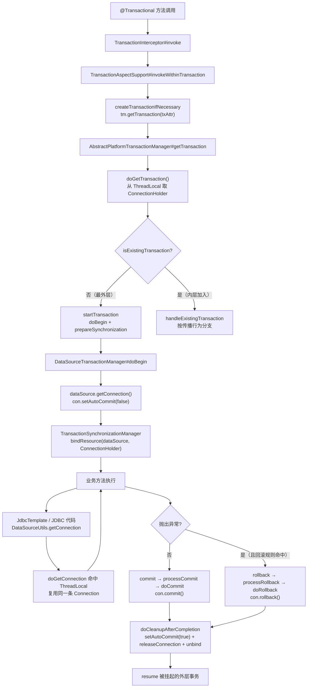
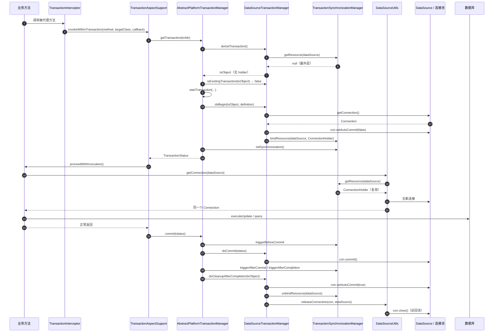

# 数据源事务管理器与连接绑定

> **一句话结论**：`DataSourceTransactionManager` 之所以能让"多次 DAO 调用共用一个事务"，靠的不是数据库魔法，而是把 `ConnectionHolder` 放进 `TransactionSynchronizationManager` 的 `ThreadLocal<Map>` 里；谁能拿到同一个 `ConnectionHolder`，谁就在同一个事务里——所以**任何绕过 `DataSourceUtils` 直接 `dataSource.getConnection()` 的代码，都会拿到另一条连接、另一个事务**。
> **阅读前置**：读完本组 [01-transactional-事务拦截器与传播行为](./01-transactional-事务拦截器与传播行为.md)（至少知道 `TransactionAspectSupport#invokeWithinTransaction` 会调 `getTransaction/commit/rollback`）与 [02-事务失效场景与源码原因](./02-事务失效场景与源码原因.md)（知道 `@Transactional` 失效的几类根因）；另外建议先看 [02-AOP与代理](../02-AOP与代理/README.md) 了解代理。
> **预计阅读**：70–90 分钟。源码版本：`spring-framework@v7.1.0`（`spring-jdbc:7.1.0` + `spring-tx:7.1.0`），运行时基线 Spring Boot 4.2.0。

---

## 0. 先看现象

本节解决一个问题：**"事务"这件事在 JDBC 层面到底长什么样**——先看到 3 个真实会遇到的现场，再决定要不要往源码里钻。

### 现象 1：在事务方法里自己 `getConnection()`，然后手动回滚，数据却还在

```text
@Service
public class AuditService {

    private final DataSource dataSource;
    private final JdbcTemplate jdbcTemplate;

    public AuditService(DataSource dataSource, JdbcTemplate jdbcTemplate) {
        this.dataSource = dataSource;
        this.jdbcTemplate = jdbcTemplate;
    }

    @Transactional  // REQUIRED
    public void record(String msg) throws SQLException {
        // ① 用 JdbcTemplate 写的这一行，会被事务管理
        jdbcTemplate.update("insert into audit_log(msg) values (?)", msg);

        // ② 自己从 DataSource 再拿一条连接写一行
        try (Connection con = dataSource.getConnection();
             PreparedStatement ps = con.prepareStatement("insert into audit_log(msg) values (?)")) {
            ps.setString(1, msg + "-raw");
            ps.executeUpdate();
            // 就算这里 con.rollback() 也只是回滚 ② 自己那条连接
        }

        throw new IllegalStateException("业务失败，希望全部回滚");
    }
}
```

运行时你会看到：`JdbcTemplate` 那一行被回滚了，而 `-raw` 那一行**留在库里**。更糟的是，如果 `②` 里写的是"更新同一行"，还可能和 `①` 抢行锁直到超时——因为它们根本不是同一条连接。

> 说明：以上是本篇自拟的**业务侧示例代码**（不是框架源码），用来复现现象；后面 §3 的每个代码块都来自 `spring-framework@v7.1.0` 原文。

### 现象 2：`TransactionSynchronizationManager.getResource(dataSource)` 返回 `null`，但明明在事务里

```text
@Transactional
public void doWork() {
    Object holder = TransactionSynchronizationManager.getResource(dataSource);
    System.out.println(holder);            // 打印 null 或 ConnectionHolder@xxxx
    System.out.println(TransactionSynchronizationManager.isSynchronizationActive());
    System.out.println(TransactionSynchronizationManager.isActualTransactionActive());
}
```

多数人踩坑的场景是：`@Transactional` 加在了**内层私有方法**上（没被代理），或者方法被 `@Async` 丢到另一个线程执行——此时上面三行的打印结果是 `null / false / false`，因为 `ThreadLocal` 里根本没有东西。

### 现象 3：`@TransactionalEventListener` 里再查数据库，查到了"已经提交"的数据

```text
@Service
public class OrderService {
    private final ApplicationEventPublisher publisher;
    // ...

    @Transactional
    public void createOrder(Order o) {
        orderMapper.insert(o);
        publisher.publishEvent(new OrderCreatedEvent(o.getId()));
    }

    @TransactionalEventListener(phase = TransactionPhase.AFTER_COMMIT)
    public void onOrderCreated(OrderCreatedEvent e) {
        System.out.println(orderMapper.selectById(e.id())); // 这里能查到
        // 但这里再 orderMapper.insert(...) 是"写不进去"的：
        // 事务已提交，连接还没释放，后续 SQL 不会被提交
    }
}
```

`AFTER_COMMIT` 阶段事务已经提交，但**资源（连接）还绑在线程上**，所以这里既能查到数据、又写不进去。要理解为什么，必须看 `TransactionSynchronization` 的回调时机，以及 `ConnectionSynchronization` 什么时候释放连接。

### 症状 → 源码位置对照表

| 你看到的症状 | 直接原因 | 对应源码位置 |
| --- | --- | --- |
| 两条 SQL 不在同一事务，一条回滚一条不回滚 | 直接 `dataSource.getConnection()` 绕过 `ThreadLocal` | `DataSourceUtils#doGetConnection` [[源码:DataSourceUtils.java#L106-L114]] |
| 事务里拿不到连接 / `getResource` 为 `null` | 事务没真正开启（无同步、无连接绑定） | `TransactionSynchronizationManager#isSynchronizationActive` / `#getResource` |
| `CannotGetJdbcConnectionException` | `DataSource` 拿不到连接（池满、库挂） | `DataSourceUtils#getConnection` catch `SQLException` |
| 事务提交了但连接没还回池，池慢慢耗尽 | `releaseConnection` 被 `conHolder.released()` 短路 | `DataSourceUtils#doReleaseConnection` |
| `AFTER_COMMIT` 里写库无效 | 回调时机在 `doCommit` 之后、连接释放之前 | `AbstractPlatformTransactionManager#processCommit` + `ConnectionSynchronization#afterCompletion` |
| 嵌套事务（`NESTED`）没生效，变成"全回滚" | 用 `REQUIRES_NEW` 去实现子事务，或连接池不支持 savepoint | `useSavepointForNestedTransaction` / `ConnectionHolder#createSavepoint` |

---

## 1. 整体地图

本节解决一个问题：**从一个 `@Transactional` 方法调用，到 JDBC `con.commit()`，中间要经过哪些对象、连接在哪一步被绑定到线程上**。



> 读图说明：关键箭头有三条。第一条是 `doBegin → bindResource`，它把 `Connection` 塞进 `ThreadLocal`，这是整个机制的地基；第二条是 `业务代码 → DataSourceUtils.getConnection → 命中 ThreadLocal`，它解释了"为什么 DAO 们共用一个连接"；第三条是 `commit/rollback → doCleanupAfterCompletion`，它负责把连接还回池并把 `ThreadLocal` 擦干净。请注意 `isExistingTransaction` 这个判断：它只看"线程上有没有一个 `transactionActive=true` 的 `ConnectionHolder`"，而不是看有没有 `@Transactional` 注解。

### 12 步主线（每步对应一个可断点的位置）

| 步骤 | 发生了什么 | 关键类/方法 |
| --- | --- | --- |
| 1 | 代理拦截方法调用，进入事务拦截器 | `TransactionInterceptor#invoke` |
| 2 | 解析 `@Transactional` 属性，选定事务管理器 | `TransactionAspectSupport#invokeWithinTransaction` |
| 3 | 询问管理器：现在有没有事务？ | `AbstractPlatformTransactionManager#getTransaction` |
| 4 | 从 `ThreadLocal` 捞 `ConnectionHolder` | `DataSourceTransactionManager#doGetTransaction` |
| 5 | 判断是否"已在事务中" | `DataSourceTransactionManager#isExistingTransaction` |
| 6 | 新事务：拿连接、关自动提交、开同步 | `doBegin` + `prepareSynchronization` |
| 7 | 把 `ConnectionHolder` 绑定到当前线程 | `TransactionSynchronizationManager#bindResource` |
| 8 | 执行目标方法；DAO 用 `DataSourceUtils` 拿连接 | `DataSourceUtils#doGetConnection` |
| 9 | 方法正常返回 → 提交 | `processCommit` → `doCommit` → `con.commit()` |
| 10 | 方法抛异常 → 回滚 | `processRollback` → `doRollback` → `con.rollback()` |
| 11 | 触发 `TransactionSynchronization` 回调 | `triggerBeforeCommit` / `triggerAfterCommit` / `triggerAfterCompletion` |
| 12 | 清理：恢复 autoCommit、释放连接、解绑、恢复外层 | `doCleanupAfterCompletion` + `cleanupAfterCompletion` |

---

## 2. 关键类逐个拆

本节解决一个问题：**先认识这 8 个类的"身份"，后面读源码时就不会被方法名绕晕**。

### 2.1 `PlatformTransactionManager`（事务管理器的统一门面）

- **定位**：事务管理的最高层接口，只有三个方法：`getTransaction`、`commit`、`rollback`。
- **职责**：把"要不要新事务、是加入还是挂起"这类**策略**问题与"具体资源怎么开、怎么提交"这类**资源**问题分开。
- **设计意图**：上层 `TransactionAspectSupport` 只依赖这个接口，因此 JDBC、JPA、JTA 可以互换。

### 2.2 `AbstractPlatformTransactionManager`（模板方法：把传播行为写死，把资源操作留空）

- **定位**：所有管理器的抽象父类，本篇的"流程总调度"。
- **关键抽象方法**：`doGetTransaction`、`doBegin`、`doCommit`、`doRollback`、`doCleanupAfterCompletion`（都由子类实现）。
- **关键模板方法**：`getTransaction`、`commit`、`rollback`、`suspend`、`resume`、`processCommit`、`processRollback`、`cleanupAfterCompletion`。
- **设计意图**：7 种传播行为的分支只写一遍（内存地址级复用），换数据库只需换 `do*` 实现。

### 2.3 `DataSourceTransactionManager`（JDBC 版管理器）

- **定位**：`spring-jdbc` 提供，用于单个 `DataSource`。
- **它额外做的事**：拿连接、`setAutoCommit(false)`、设置隔离级别/只读、提交/回滚、恢复 `autoCommit`、释放连接。
- **注意**：它管的是**每条连接的本地事务**，不是 XA 全局事务。

### 2.4 `ConnectionHolder`（连接句柄 + 事务状态的小盒子）

- **定位**：`ResourceHolderSupport` 的子类，装在 `ThreadLocal` 里的值。
- **它身上的状态**：`transactionActive`（是否真在事务中）、`synchronizedWithTransaction`、`rollbackOnly`、`deadline`（超时截止）、`savepointsSupported`、以及一个**引用计数** `referenceCount`。
- **为什么需要引用计数**：一笔事务里可能有多处代码"借用"这条连接，只有全部还回来（`released()`）才真正关闭。

### 2.5 `TransactionSynchronizationManager`（线程级事务上下文的保管员）

- **定位**：一组 `static ThreadLocal` + 一组静态读写方法。
- **存了什么**：`resources`（资源池，键是 `DataSource`，值是 `ConnectionHolder`）、`synchronizations`（回调集合）、事务名、只读标记、隔离级别、是否真实事务活跃。
- **设计意图**：让"线程"成为事务的天然作用域，从而在**不加参数**的情况下让任意深度的 DAO 都能共享同一资源。

### 2.6 `DataSourceUtils`（拿连接/还连接的唯一正确入口）

- **定位**：`spring-jdbc` 的工具类，`JdbcTemplate` 内部也是通过它拿连接。
- **核心方法**：`getConnection` → `doGetConnection`（先查 `ThreadLocal`，命中则复用）、`releaseConnection` → `doReleaseConnection`（是事务连接就不关，只减引用）。
- **一句话**：**它是"事务感知"的 `DataSource.getConnection()`**。

### 2.7 `TransactionSynchronization`（事务生命周期回调接口）

- **定位**：允许业务代码在事务的各个关键点插一脚。
- **6 个回调**：`beforeCommit(readOnly)`、`beforeCompletion()`、`afterCommit()`、`afterCompletion(status)`、`suspend()`、`resume()`（另有 `flush()`、`savepoint()`、`savepointRollback()`）。
- **设计意图**：ORM 会话刷盘、连接释放、事务事件派发都挂在这里，避免管理器和资源实现互相硬编码。

### 2.8 `TransactionalApplicationListenerSynchronization` / `TransactionalEventListener`（把事件挂到事务生命周期上）

- **定位**：`@TransactionalEventListener` 的实现桥，把一个 `ApplicationListener` 包成 `TransactionSynchronization`。
- **关键点**：注册条件是 `isSynchronizationActive() && isActualTransactionActive()`——光有同步不够，必须有真实事务。
- **它的 phase 映射**：`BEFORE_COMMIT` → `beforeCommit`；`AFTER_COMMIT`/`AFTER_ROLLBACK`/`AFTER_COMPLETION` → `afterCompletion`。

---

## 3. 源码逐段精读

本节解决一个问题：**把"连接从哪里来、绑到哪里去、最后怎么还"这三件事逐行钉死**。

### 3.1 入口：拦截器把活儿交给 `getTransaction`

先确认调用链的起点：事务拦截器不自己管连接，它把"要不要开事务"完全委托给管理器。

```java
	public @Nullable Object invoke(MethodInvocation invocation) throws Throwable {
		// Work out the target class: may be {@code null}.
		// The TransactionAttributeSource should be passed the target class
		// as well as the method, which may be from an interface.
		Class<?> targetClass = (invocation.getThis() != null ? AopUtils.getTargetClass(invocation.getThis()) : null);

		// Adapt to TransactionAspectSupport's invokeWithinTransaction...
		return invokeWithinTransaction(invocation.getMethod(), targetClass, new InvocationCallback() {
```

*(src: TransactionInterceptor.java#L122-L130)*

- **在干什么**：`invoke` 取到目标类（可能是 `null`，例如纯接口代理），然后把 `Method`、目标类和一个"回调"交给父类 `TransactionAspectSupport#invokeWithinTransaction`。
- **为什么这么写**：把 AOP 的 `MethodInvocation` 抽象成 `InvocationCallback`，父类就不依赖 AOP 包，从而能被 `TransactionTemplate`、响应式事务等复用。
- **如果改成别的**：如果在拦截器里直接开连接、直接 `commit`，那么传播行为（`REQUIRED`/`REQUIRES_NEW`…）就得在拦截器里重写一遍，且无法与 JPA/JTA 共用。
- **常见坑**：`targetClass` 为 `null` 时，属性解析只能按方法本身找注解，接口上的 `@Transactional` 行为会受影响（详见 02 篇场景⑩）。

接着看父类如何"问管理器要事务"：

```java (src: TransactionAspectSupport.java#L625-L638)
		TransactionStatus status = null;
		if (txAttr != null) {
			if (tm != null) {
				status = tm.getTransaction(txAttr);
			}
			else {
				if (logger.isDebugEnabled()) {
					logger.debug("Skipping transactional joinpoint [" + joinpointIdentification +
							"] because no transaction manager has been configured");
				}
			}
		}
		return prepareTransactionInfo(tm, txAttr, joinpointIdentification, status);
	}
```

*(src: TransactionAspectSupport.java#L625-L638)*

- **在干什么**：有属性、有管理器时调用 `tm.getTransaction(txAttr)` 拿到 `TransactionStatus`；没管理器就只打一条 debug 日志然后继续执行（**不报错**）。
- **为什么这么写**：`@Transactional` 本身允许在"没有配置事务管理器"的环境下退化为非事务执行，便于单元测试与渐进式接入。
- **如果改成别的**：若这里改成抛异常，那么在未配置管理器的应用里（比如只读查询服务）启动就会炸；这也是为什么很多人"以为加了注解就一定有事务"，实际只打了一行 debug。
- **常见坑**：日志里出现 `Skipping transactional joinpoint ... because no transaction manager has been configured`，说明这一步 `tm == null`，事务根本没开始。

### 3.2 第一层：`getTransaction` 决定"新建 / 加入 / 挂起"

`getTransaction` 是所有传播行为的总入口，它先问子类"当前线程有没有事务"，再决定走向。

```java (src: DataSourceTransactionManager.java#L247-L254)
	protected Object doGetTransaction() {
		DataSourceTransactionObject txObject = new DataSourceTransactionObject();
		txObject.setSavepointAllowed(isNestedTransactionAllowed());
		ConnectionHolder conHolder =
				(ConnectionHolder) TransactionSynchronizationManager.getResource(obtainDataSource());
		txObject.setConnectionHolder(conHolder, false);
		return txObject;
	}
```

*(src: DataSourceTransactionManager.java#L247-L254)*

- **在干什么**：创建一个本次事务的"事务对象" `txObject`，然后从 `TransactionSynchronizationManager` 按 `DataSource` 为键捞 `ConnectionHolder`，挂到 `txObject` 上（第二个参数 `false` 表示"这不是新建的"）。
- **为什么这么写**：`getResource` 读的是 `ThreadLocal`，因此"当前线程是否已有连接"等价于"当前线程是否已在事务中"。把 `DataSource` 本身当 key，天然支持**多数据源**：不同 `DataSource` 各有一份 `ConnectionHolder`。
- **如果改成别的**：若用一个静态 `Connection` 字段缓存连接，多线程会互相串号；若用 `ThreadLocal<Connection>` 而非 `ThreadLocal<Map<DataSource, ConnectionHolder>>`，多数据源就只有一个坑位，第二个数据源会把第一个覆盖掉。
- **常见坑**：`obtainDataSource()` 返回的是 `getDataSource()` 的委托目标（`getResourceFactory` 也返回它），所以**必须用同一个 `DataSource` 实例**去 `getResource`。给 `DataSource` 包了 `TransactionAwareDataSourceProxy` 却用原始 `DataSource` 取连接，就会取不到而重复开连接。

拿到 `txObject` 后，父类问一句"这是不是已存在的事务"：

```java (src: DataSourceTransactionManager.java#L257-L260)
	protected boolean isExistingTransaction(Object transaction) {
		DataSourceTransactionObject txObject = (DataSourceTransactionObject) transaction;
		return (txObject.hasConnectionHolder() && txObject.getConnectionHolder().isTransactionActive());
	}
```

*(src: DataSourceTransactionManager.java#L257-L260)*

- **在干什么**：只有当"有 `ConnectionHolder`"且"它的 `transactionActive` 为 `true`"时，才认为当前线程已经在一个 JDBC 事务里。
- **为什么这么写**：仅仅"线程上绑了连接"不等于"在事务里"——例如 `LazyConnectionDataSourceProxy` 提前绑定了连接但还没开事务；只有 `doBegin` 里显式 `setTransactionActive(true)` 之后才算。
- **如果改成别的**：若只看 `hasConnectionHolder()`，那些"绑定连接但未开事务"的场景会被误判成"已在事务中"，导致 `REQUIRED` 不 `doBegin`、自动提交没关，最终每条 SQL 各自自动提交。
- **常见坑**：自定义 `DataSource` 装饰类如果自己往 `TransactionSynchronizationManager` 里塞了 `ConnectionHolder` 却忘了 `setTransactionActive(true)`，`REQUIRED` 就会静默失效。

### 3.3 新事务：`doBegin` 拿连接、关自动提交、绑定线程

`doBegin` 是 JDBC 层真正"开始事务"的地方，也是最值得逐行读的方法。

```java (src: DataSourceTransactionManager.java#L268-L281)
			if (!txObject.hasConnectionHolder() ||
					txObject.getConnectionHolder().isSynchronizedWithTransaction()) {
				Connection newCon = obtainDataSource().getConnection();
				if (logger.isDebugEnabled()) {
					logger.debug("Acquired Connection [" + newCon + "] for JDBC transaction");
				}
				if (definition.isReadOnly()) {
					checkDefaultReadOnly(newCon);
				}
				txObject.setConnectionHolder(new ConnectionHolder(newCon), true);
			}

			txObject.getConnectionHolder().setSynchronizedWithTransaction(true);
			con = txObject.getConnectionHolder().getConnection();
```

*(src: DataSourceTransactionManager.java#L268-L281)*

- **在干什么**：两种情况下新开连接——① 线程上压根没有 `ConnectionHolder`；② 有，但那个 holder 已经被标记为 `synchronizedWithTransaction`（说明它属于外层事务，本轮要独立开一条）。新连接会包成 `ConnectionHolder(newCon, true)`，第二个参数 `true` 就是"新连接 holder"。
- **为什么这么写**：这就是 `REQUIRES_NEW` 能拿到**第二条物理连接**的根源——外层 `doSuspend` 之后条件②成立，于是这里重新 `getConnection()`。
- **如果改成别的**：若这里不加条件②的判断，`REQUIRES_NEW` 会复用外层连接，两个"事务"共用一个 `con.commit()`，外层回滚会把内层一起带走。
- **常见坑**：条件②意味着 `REQUIRES_NEW` 会额外占用连接池里的连接。嵌套三层 `REQUIRES_NEW` 就会同时占 3 条连接，池小（如 `maximumPoolSize=5`）时容易死锁式等待。

接下来是事务语义的设置：

```java (src: DataSourceTransactionManager.java#L283-L298)
			Integer previousIsolationLevel = DataSourceUtils.prepareConnectionForTransaction(con,
					definition.getIsolationLevel(),
					(definition.isReadOnly() && !isDefaultReadOnly()));
			txObject.setPreviousIsolationLevel(previousIsolationLevel);
			txObject.setReadOnly(definition.isReadOnly());

			// Switch to manual commit if necessary. This is very expensive in some JDBC drivers,
			// so we don't want to do it unnecessarily (for example if we've explicitly
			// configured the connection pool to set it already).
			if (con.getAutoCommit()) {
				txObject.setMustRestoreAutoCommit(true);
				if (logger.isDebugEnabled()) {
					logger.debug("Switching JDBC Connection [" + con + "] to manual commit");
				}
				con.setAutoCommit(false);
			}
```

*(src: DataSourceTransactionManager.java#L283-L298)*

- **在干什么**：按 `TransactionDefinition` 设置隔离级别与只读标记，并把**修改前的隔离级别**保存下来以便事务后还原；如果连接当前是自动提交，就关闭自动提交，并记下"需要恢复"。
- **为什么这么写**：`autoCommit=true` 时每条 SQL 都是独立提交，Spring 的"一次提交"就无从谈起，所以必须关；而 `setAutoCommit` 在部分驱动/池（尤其切到 `false` 再切回 `true`）开销较大，因此只在需要时改、并记录是否需要恢复。
- **如果改成别的**：若每次都无条件 `setAutoCommit(false)` + 事后 `setAutoCommit(true)`，在 HikariCP 这类池上会带来额外往返；若忘了 `setMustRestoreAutoCommit(true)`，连接还回池时会带着 `autoCommit=false`，**下一位使用者会拿到一个"永不自动提交"的连接**，这是经典的"脏连接"事故。
- **常见坑**：自己写 `DataSource` 包装时，如果 `getConnection()` 返回的代理对象不支持 `setAutoCommit`，会在 `doBegin` 抛 `CannotCreateTransactionException`，异常信息里带 `Could not open JDBC Connection for transaction`。

事务活动的标记与线程绑定：

```java (src: DataSourceTransactionManager.java#L300-L312)
			prepareTransactionalConnection(con, definition);
			txObject.getConnectionHolder().setTransactionActive(true);

			int timeout = determineTimeout(definition);
			if (timeout != TransactionDefinition.TIMEOUT_DEFAULT) {
				txObject.getConnectionHolder().setTimeoutInSeconds(timeout);
			}

			// Bind the connection holder to the thread.
			if (txObject.isNewConnectionHolder()) {
				TransactionSynchronizationManager.bindResource(obtainDataSource(), txObject.getConnectionHolder());
			}
		}
```

*(src: DataSourceTransactionManager.java#L300-L312)*

- **在干什么**：先让子类有机会做额外准备（`prepareTransactionalConnection`，默认空实现，`JdbcTransactionManager` 用它），再把 holder 标记为"事务活跃"，按 `determineTimeout` 设置截止时间，最后**把 holder 绑定到当前线程**。
- **为什么这么写**：`setTransactionActive(true)` 是 3.2 中 `isExistingTransaction` 的依据；`bindResource` 是 3.5 中 DAO 能复用连接的前提。两者顺序不能反——先标记活跃再绑定，避免其它线程/回调看到"绑了但未活跃"的中间态。
- **如果改成别的**：如果只 `bindResource` 不 `setTransactionActive(true)`，内层 `REQUIRED` 方法会认为"没有事务"，于是再 `doBegin` 一次；此时条件①不成立、条件②成立（holder 已 `synchronizedWithTransaction`），结果会**再开一条新连接**，形成"两个事务各写各的"。
- **常见坑**：断点打在这里能看到 `resources` 这个 `ThreadLocal` 从 `null` 变成 `{dataSource -> ConnectionHolder}`；如果打完断点发现还是 `null`，说明 `isNewConnectionHolder()` 为 `false`（复用了已有 holder），属于内层加入而非新建。

失败路径也很重要：

```java (src: DataSourceTransactionManager.java#L314-L321)
		catch (Throwable ex) {
			if (txObject.isNewConnectionHolder()) {
				DataSourceUtils.releaseConnection(con, obtainDataSource());
				txObject.setConnectionHolder(null, false);
			}
			throw new CannotCreateTransactionException("Could not open JDBC Connection for transaction", ex);
		}
	}
```

*(src: DataSourceTransactionManager.java#L314-L321)*

- **在干什么**：`doBegin` 中途任何失败，如果是本轮新建的连接，就还回池并清空 holder，然后统一包装成 `CannotCreateTransactionException` 抛出。
- **为什么这么写**：`doBegin` 已经拿到的连接如果不还，就是**泄漏**；包成 `CannotCreateTransactionException` 是为了让上层区分"事务开启失败"和"业务 SQL 失败"。
- **如果改成别的**：如果不 `releaseConnection`，一旦 `setAutoCommit(false)` 之类的调用失败，连接会一直挂在线程（和连接池）上；如果直接抛原始 `SQLException`，`TransactionAspectSupport` 的 `rollbackOn` 判定会把它当受检异常从而**不回滚**（甚至还可能去 `commit` 一个没开成的事务）。
- **常见坑**：看到 `CannotCreateTransactionException: Could not open JDBC Connection for transaction` 时，**先查连接池**（是否耗尽、库是否可达），而不是查 `@Transactional` 写法。这里的 `getConnection()` 就是真正的物理取连接。

### 3.4 提交与回滚：`doCommit` / `doRollback` / `doSetRollbackOnly`

到了提交阶段，JDBC 层面的动作异常简单——因为复杂的"该不该提交"已经在父类的 `processCommit` 里判完了。

```java (src: DataSourceTransactionManager.java#L336-L348)
	protected void doCommit(DefaultTransactionStatus status) {
		DataSourceTransactionObject txObject = (DataSourceTransactionObject) status.getTransaction();
		Connection con = txObject.getConnectionHolder().getConnection();
		if (status.isDebug()) {
			logger.debug("Committing JDBC transaction on Connection [" + con + "]");
		}
		try {
			con.commit();
		}
		catch (SQLException ex) {
			throw translateException("JDBC commit", ex);
		}
	}
```

*(src: DataSourceTransactionManager.java#L336-L348)*

- **在干什么**：从 `status` 里取出 `ConnectionHolder`，再取出连接，调用 `con.commit()`；`SQLException` 被翻译成 `TransactionSystemException`（`translateException` 的实现见 3.4 最后一小段）。
- **为什么这么写**：`status.getTransaction()` 里放的就是 3.3 那个 `txObject`，所以"提交哪个连接"完全由事务对象决定，不会串到别的连接上。
- **如果改成别的**：如果有 `REQUIRES_NEW`，内层 `doCommit` 提交的是内层自己的连接；若这里改成"提交线程上当前的连接"，内层提交就会把外层连接也提交掉。
- **常见坑**：日志出现 `Committing JDBC transaction on Connection [com.zaxxer.hikari.pool.ProxyConnection@...]` 是正常的；如果这个日志和业务日志的线程名不一致，说明提交发生了跨线程/异步穿越，需要回去检查 `@Async`。

```java (src: DataSourceTransactionManager.java#L351-L363)
	protected void doRollback(DefaultTransactionStatus status) {
		DataSourceTransactionObject txObject = (DataSourceTransactionObject) status.getTransaction();
		Connection con = txObject.getConnectionHolder().getConnection();
		if (status.isDebug()) {
			logger.debug("Rolling back JDBC transaction on Connection [" + con + "]");
		}
		try {
			con.rollback();
		}
		catch (SQLException ex) {
			throw translateException("JDBC rollback", ex);
		}
	}
```

*(src: DataSourceTransactionManager.java#L351-L363)*

- **在干什么**：与 `doCommit` 对称，调用 `con.rollback()`。
- **为什么这么写**：回滚是"撤销这条连接上未提交的改动"，所以同样必须用事务对象里的那条连接。
- **如果改成别的**：若改成 `Connection#close()`（很多人以为关连接等于回滚），在连接池实现里 `close()` 会归还连接到池，池通常回滚未提交事务——但那是"碰巧对的"，遇到 `SmartDataSource` 或不回滚的池就会留下脏数据。
- **常见坑**：`doRollback` 抛 `TransactionSystemException` 时，原始异常会被 `TransactionAspectSupport` 用 `initApplicationException` 挂回去，日志里能看到 `Application exception overridden by rollback exception`——它意味着"回滚本身失败了"，比业务异常更严重。

```java (src: DataSourceTransactionManager.java#L366-L373)
	protected void doSetRollbackOnly(DefaultTransactionStatus status) {
		DataSourceTransactionObject txObject = (DataSourceTransactionObject) status.getTransaction();
		if (status.isDebug()) {
			logger.debug("Setting JDBC transaction [" + txObject.getConnectionHolder().getConnection() +
					"] rollback-only");
		}
		txObject.setRollbackOnly();
	}
```

*(src: DataSourceTransactionManager.java#L366-L373)*

- **在干什么**：只设置"只回滚"标记（同时打一条 debug 日志），**不真的回滚**。
- **为什么这么写**：内层方法失败时，外层可能还想继续执行并 `commit`；此时只能先把"全局必须回滚"这件事记在事务对象上，由外层 `commit` 时统一处理（父类 `processCommit` 会抛 `UnexpectedRollbackException`）。
- **如果改成别的**：若 `doSetRollbackOnly` 里直接 `con.rollback()`，那么内层失败会立刻把外层的改动也卷掉，与 `globalRollbackOnParticipationFailure` 的可配置语义冲突。
- **常见坑**：日志里出现 `Setting JDBC transaction [...] rollback-only` 却没有对应异常，说明有人调用了 `TransactionAspectSupport.currentTransactionStatus().setRollbackOnly()`，或者内层方法抛了异常而被外层 `try/catch` 吞掉。此时外层最终会收到 `UnexpectedRollbackException: Transaction silently rolled back because it has been marked as rollback-only`。

`translateException` 是 `doCommit` / `doRollback` 里 `SQLException` 的翻译出口：

```java (src: DataSourceTransactionManager.java#L464-L478)
	/**
	 * Translate the given JDBC commit/rollback exception to a common Spring
	 * exception to propagate from the {@link #commit}/{@link #rollback} call.
	 * <p>The default implementation throws a {@link TransactionSystemException}.
	 * Subclasses may specifically identify concurrency failures etc.
	 * @param task the task description (commit or rollback)
	 * @param ex the SQLException thrown from commit/rollback
	 * @return the translated exception to throw, either a
	 * {@link org.springframework.dao.DataAccessException} or a
	 * {@link org.springframework.transaction.TransactionException}
	 * @since 5.3
	 */
	protected RuntimeException translateException(String task, SQLException ex) {
		return new TransactionSystemException(task + " failed", ex);
	}
```

- **在干什么**：把 `SQLException` 包装成 Spring 的 `TransactionSystemException`（`task + " failed"`，例如 `JDBC commit failed`），再抛给上层。
- **为什么这么写**：提交/回滚是事务管理器的内部动作，失败意味着"事务状态未知"，用 `TransactionException` 这一族（这里是它的子类）表达，而不是伪装成业务 SQL 异常；同时保留原始 `SQLException` 作为 `cause`，不丢栈。
- **如果改成别的**：若在 `doCommit` 里自己 `catch (SQLException e) { log.error(...); }` 吞掉，`AbstractPlatformTransactionManager#processCommit` 就感知不到失败，`afterCompletion` 会收到 `STATUS_COMMITTED`，`@TransactionalEventListener(AFTER_COMMIT)` 会被错误触发——这是"提交失败但事件照发"的典型事故。子类 `JdbcTransactionManager` 覆写了本方法，用 `SQLExceptionTranslator` 把它进一步翻译成 `DataIntegrityViolationException` 等 `DataAccessException`。
- **常见坑**：日志里看到 `TransactionSystemException: JDBC commit failed`，`cause` 才是真正的数据库错误（连接断开、锁等待超时、延迟约束校验失败）。只看外层异常类型容易误判成"Spring 内部 bug"；排查时一定展开 `Caused by`。

- **在干什么**：尽量用 `JdbcTemplate` 的 SQL 异常翻译器（把 `SQLException` 变成 `DataIntegrityViolationException` 等语义异常），翻译不了就退化为 `TransactionSystemException`。
- **为什么这么写**：让"提交失败"也能被上层按 SQL 语义分类，便于重试或告警。
- **如果改成别的**：若直接包 `TransactionSystemException`，业务侧就无法区分唯一键冲突和连接断开。
- **常见坑**：`DataIntegrityViolationException` 出现在 `commit` 阶段时，说明约束是在提交时校验的（例如延迟约束），这类异常**会**导致回滚（它是 `RuntimeException`）。

### 3.5 第二层：`DataSourceUtils#doGetConnection` —— 复用连接的关键

这一节回答"为什么 DAO 不用传 `Connection` 也能进同一事务"。

```java (src: DataSourceUtils.java#L103-L120)
	public static Connection doGetConnection(DataSource dataSource) throws SQLException {
		Assert.notNull(dataSource, "No DataSource specified");

		ConnectionHolder conHolder = (ConnectionHolder) TransactionSynchronizationManager.getResource(dataSource);
		if (conHolder != null && (conHolder.hasConnection() || conHolder.isSynchronizedWithTransaction())) {
			conHolder.requested();
			if (!conHolder.hasConnection()) {
				logger.debug("Fetching resumed JDBC Connection from DataSource");
				conHolder.setConnection(fetchConnection(dataSource));
			}
			return conHolder.getConnection();
		}
		// Else we either got no holder or an empty thread-bound holder here.

		logger.debug("Fetching JDBC Connection from DataSource");
		Connection con = fetchConnection(dataSource);

		if (TransactionSynchronizationManager.isSynchronizationActive()) {
```

*(src: DataSourceUtils.java#L103-L120)*

- **在干什么**：先按 `DataSource` 从 `ThreadLocal` 取 `ConnectionHolder`。如果 holder 存在且"已经有连接"或"被标记为与事务同步"，就 `requested()`（引用计数 +1）并直接返回 holder 里的连接——**这就是复用**。只有取不到时，才真的向 `DataSource` 要新连接（`fetchConnection`），并在"事务同步已激活"的情况下继续走 3.5 后半段把它绑定到线程。
- **为什么这么写**：DAO 层拿到的是"逻辑连接"，它可能是事务连接、也可能是临时连接，调用方无需关心；`requested()` 的引用计数保证"多个 DAO 借、最后一个还"时才真正释放。
- **如果改成别的**：如果直接 `dataSource.getConnection()`（现象 1 的写法），`ThreadLocal` 完全没被查询，一定拿到另一条连接，于是**同一次业务操作里出现两个事务**：`JdbcTemplate` 的走 Spring 事务，手写的那条走自己的自动提交——回滚只影响前者。
- **常见坑**：`conHolder.hasConnection()` 为 `false` 但 `isSynchronizedWithTransaction()` 为 `true` 的情况，是"事务已登记但连接被提前释放"（例如 `suspend` 后 holder 被复用）。此时会打 `Fetching resumed JDBC Connection from DataSource` 并重新取连接——看到这条日志说明连接在事务中途被换过，通常是有人手工 `close()` 了事务连接。

继续看"新连接如何被纳入事务"：

```java (src: DataSourceUtils.java#L121-L137)
			try {
				// Use same Connection for further JDBC actions within the transaction.
				// Thread-bound object will get removed by synchronization at transaction completion.
				ConnectionHolder holderToUse = conHolder;
				if (holderToUse == null) {
					holderToUse = new ConnectionHolder(con);
				}
				else {
					holderToUse.setConnection(con);
				}
				holderToUse.requested();
				TransactionSynchronizationManager.registerSynchronization(
						new ConnectionSynchronization(holderToUse, dataSource));
				holderToUse.setSynchronizedWithTransaction(true);
				if (holderToUse != conHolder) {
					TransactionSynchronizationManager.bindResource(dataSource, holderToUse);
				}
```

*(src: DataSourceUtils.java#L121-L137)*

- **在干什么**：在同步激活（`isSynchronizationActive()`）时，把新连接包装成 `ConnectionHolder`、引用计数 +1、注册一个 `ConnectionSynchronization`（负责事务结束时释放连接）、标记"与事务同步"，并在需要时 `bindResource` 到线程。
- **为什么这么写**：这是"事务不是由 `DataSourceTransactionManager` 开启"时的兜底——例如 JTA 事务里，连接由 `DataSourceUtils` 首次访问时懒绑定，并在事务完成时由同步回调释放。`holderToUse != conHolder` 的判断避免把已有 holder 重复绑定（`bindResource` 对已存在的键会抛 `Already value ... bound to thread`）。
- **如果改成别的**：若这里不注册 `ConnectionSynchronization`，连接就没人释放，池会被慢慢吃光；若条件判断写成 `holderToUse == conHolder`，新建的 holder 永远绑不上去，下次调用又新建一个连接，事务内出现多条连接。
- **常见坑**：`TransactionSynchronizationManager.registerSynchronization` 在同步未激活时抛 `Transaction synchronization is not active`；所以这段必须在 `if (isSynchronizationActive())` 里。反过来，如果发现事务里每次 DAO 调用都打 `Fetching JDBC Connection from DataSource`，说明第一次绑定没成功，要检查 `getResource` 用的 `DataSource` 是否与绑定时的实例**同一引用**。

拿到连接之后的兜底异常处理与返回：

```java (src: DataSourceUtils.java#L139-L147)
			catch (RuntimeException ex) {
				// Unexpected exception from external delegation call -> close Connection and rethrow.
				releaseConnection(con, dataSource);
				throw ex;
			}
		}

		return con;
	}
```

*(src: DataSourceUtils.java#L139-L147)*

- **在干什么**：注册同步/绑定的过程中若抛 `RuntimeException`（比如外部委托调用出错），先还连接再把异常抛出去，避免泄漏。
- **为什么这么写**：异常发生时 holder 可能还没绑上线程，之后没有任何回调会释放这条连接，必须就地释放。
- **如果改成别的**：直接 `throw ex` 会导致连接泄漏——池里少一条连接，且没有任何日志说明原因。
- **常见坑**：这段 catch 只捕获 `RuntimeException`；`SQLException` 在方法签名上抛出，由调用方（`getConnection` 包装层）处理。

### 3.6 `fetchConnection`：唯一真正调用 `dataSource.getConnection()` 的地方

```java (src: DataSourceUtils.java#L159-L165)
	private static Connection fetchConnection(DataSource dataSource) throws SQLException {
		Connection con = dataSource.getConnection();
		if (con == null) {
			throw new IllegalStateException("DataSource returned null from getConnection(): " + dataSource);
		}
		return con;
	}
```

*(src: DataSourceUtils.java#L159-L165)*

- **在干什么**：真正的物理取连接，并对 `null` 做防御。
- **为什么这么写**：把"取连接"收敛到一个私有方法，使得"哪里有物理取连接"只有一个答案；`null` 检查把 NPE 变成可读的 `IllegalStateException`（上层再包成 `CannotGetJdbcConnectionException`）。
- **如果改成别的**：如果允许多处直接 `dataSource.getConnection()`，就再也无法保证"事务内只有一条物理连接"，也无法统一加监控/超时。
- **常见坑**：自定义 `DataSource` 返回 `null` 时，错误信息是 `DataSource returned null from getConnection(): ...`——这通常是 Mock 或包装类写错了，而不是数据库问题。

### 3.7 准备连接语义：隔离级别与只读

`doBegin` 调用的 `prepareConnectionForTransaction` 就在这里：

```java (src: DataSourceUtils.java#L200-L220)
		boolean debugEnabled = logger.isDebugEnabled();
		// Set read-only flag.
		if (setReadOnly) {
			if (debugEnabled) {
				logger.debug("Setting JDBC Connection [" + con + "] read-only");
			}
			setReadOnlyIfPossible(con);
		}

		// Apply specific isolation level, if any.
		Integer previousIsolationLevel = null;
		if (isolationLevel != TransactionDefinition.ISOLATION_DEFAULT) {
			if (debugEnabled) {
				logger.debug("Changing isolation level of JDBC Connection [" + con + "] to " + isolationLevel);
			}
			int currentIsolation = con.getTransactionIsolation();
			if (currentIsolation != isolationLevel) {
				previousIsolationLevel = currentIsolation;
				con.setTransactionIsolation(isolationLevel);
			}
		}
```

*(src: DataSourceUtils.java#L200-L220)*

- **在干什么**：只在 `setReadOnly` 为真时设置只读（`setReadOnlyIfPossible` 会吞掉"不支持只读"的异常）；只有当隔离级别不是 `ISOLATION_DEFAULT` 且与当前连接不同才切换，并**返回切换前的级别**。
- **为什么这么写**：只读是"提示"而非强约束（`Connection#setReadOnly` 的 javadoc 明确说"不保证阻止写"），所以用 `setReadOnlyIfPossible` 容错；隔离级别必须记录旧值，因为连接要还回池，池里的连接会被下一个业务复用。
- **如果改成别的**：若无条件 `con.setTransactionIsolation(...)`，会触发不必要的驱动/网络开销，且在连接池上频繁切换隔离级别可能引起额外往返。若不返回旧值，`doCleanupAfterCompletion` 就无法恢复，**隔离级别会"传染"给下一个使用者**。
- **常见坑**：`@Transactional(isolation = ...)` 在 MySQL 上生效、在 H2 上可能被忽略；如果日志里看不到 `Changing isolation level of JDBC Connection`，说明隔离级别是 `DEFAULT`（没写），不是"没生效"。

### 3.8 还连接：`releaseConnection` / `doReleaseConnection`

很多人以为"关闭连接"就是 `con.close()`，但在事务里这样做会直接毁掉事务。

```java (src: DataSourceUtils.java#L384-L394)
	public static void releaseConnection(@Nullable Connection con, @Nullable DataSource dataSource) {
		try {
			doReleaseConnection(con, dataSource);
		}
		catch (SQLException ex) {
			logger.debug("Could not close JDBC Connection", ex);
		}
		catch (Throwable ex) {
			logger.debug("Unexpected exception on closing JDBC Connection", ex);
		}
	}
```

*(src: DataSourceUtils.java#L384-L394)*

- **在干什么**：对外暴露的释放入口，任何异常都**只记 debug 日志**，不向外抛。
- **为什么这么写**：释放连接发生在事务清理阶段，此时业务结果已定；如果因为关闭失败而抛异常，会把"业务成功"变成"报错"，反而误导排查。
- **如果改成别的**：若这里抛异常，`doCleanupAfterCompletion` 的后续步骤（如 `clear()`、`resume` 外层事务）会被跳过，导致 `ThreadLocal` 残留。
- **常见坑**：连接池泄漏排查时，"`Could not close JDBC Connection`" 只出现在 debug 级别——线上没开 debug 就看不到，这也是为什么连接泄漏往往只能靠池指标发现。

真正的判断在这里：

```java (src: DataSourceUtils.java#L407-L420)
	public static void doReleaseConnection(@Nullable Connection con, @Nullable DataSource dataSource) throws SQLException {
		if (con == null) {
			return;
		}
		if (dataSource != null) {
			ConnectionHolder conHolder = (ConnectionHolder) TransactionSynchronizationManager.getResource(dataSource);
			if (conHolder != null && connectionEquals(conHolder, con)) {
				// It's the transactional Connection: Don't close it.
				conHolder.released();
				return;
			}
		}
		doCloseConnection(con, dataSource);
	}
```

*(src: DataSourceUtils.java#L407-L420)*

- **在干什么**：如果这条 `Connection` 正是当前线程事务 holder 持有的那条，就**只减引用计数** `released()`，绝不关闭；否则才真正关闭（`doCloseConnection`）。
- **为什么这么写**：DAO 里写 `try (Connection con = DataSourceUtils.getConnection(ds)) {...}` 是常见习惯，`try-with-resources` 会调 `close()`。若 `close()` 直接关掉事务连接，事务就废了。所以 Spring 让"事务连接的 close"退化为"归还引用"。
- **如果改成别的**：如果这里直接 `con.close()`，`JdbcTemplate` 每次用完都会关掉事务连接，下一次 DAO 调用只能重新取连接——SQL 会分别提交，事务语义彻底丢失。
- **常见坑**：`connectionEquals` 会解包代理（`ConnectionProxy`），因此把连接包装了一层（如 `ConnectionProxy`、MyBatis 的 `SpringManagedTransaction`）也能正确识别；但如果自己写了 `DataSource` 返回完全新的包装类型且不实现 `ConnectionProxy`，就会识别失败并误关事务连接。

关闭动作本身还考虑了 `SmartDataSource`：

```java (src: DataSourceUtils.java#L430-L434)
	public static void doCloseConnection(Connection con, @Nullable DataSource dataSource) throws SQLException {
		if (!(dataSource instanceof SmartDataSource smartDataSource) || smartDataSource.shouldClose(con)) {
			con.close();
		}
	}
```

*(src: DataSourceUtils.java#L430-L434)*

- **在干什么**：只有当 `DataSource` 不是 `SmartDataSource`，或者它明确表示"这条连接该关"时，才 `close()`。
- **为什么这么写**：`SmartDataSource`（例如某些"单连接共享"的嵌入式数据源）可以声明"别关我的连接"，从而在测试场景保持连接可用。
- **如果改成别的**：无条件 `close()` 会破坏这类数据源的契约；永远不关则泄漏。
- **常见坑**：单元测试里用 `SingleConnectionDataSource` 时，行为差异就来自这里——它不是每次都真关。

### 3.9 清理：`doCleanupAfterCompletion` 恢复了什么

提交/回滚之后，父类 `cleanupAfterCompletion` 会调用子类的 `doCleanupAfterCompletion`：

```java (src: DataSourceTransactionManager.java#L376-L396)
	protected void doCleanupAfterCompletion(Object transaction) {
		DataSourceTransactionObject txObject = (DataSourceTransactionObject) transaction;

		// Remove the connection holder from the thread, if exposed.
		if (txObject.isNewConnectionHolder()) {
			TransactionSynchronizationManager.unbindResource(obtainDataSource());
		}

		// Reset connection.
		Connection con = txObject.getConnectionHolder().getConnection();
		try {
			if (txObject.isMustRestoreAutoCommit()) {
				con.setAutoCommit(true);
			}
			DataSourceUtils.resetConnectionAfterTransaction(con,
					txObject.getPreviousIsolationLevel(),
					(txObject.isReadOnly() && !isDefaultReadOnly()));
		}
		catch (Throwable ex) {
			logger.debug("Could not reset JDBC Connection after transaction", ex);
		}
```

*(src: DataSourceTransactionManager.java#L376-L396)*

- **在干什么**：按顺序做三件事：① 若是本轮新建的 holder，就从线程解绑；② 恢复 `autoCommit=true`（如果当初是我们关的）；③ 恢复隔离级别与只读标记（只恢复"我们改过"的）。
- **为什么这么写**：连接要还回池供下一个业务复用，任何"我们改过的连接状态"都必须还原，否则会污染后续使用者。注意解绑在恢复之前——解绑后其它代码就拿不到这条连接了，避免"正在被复用却又被 reset"的竞争。
- **如果改成别的**：若跳过 `setAutoCommit(true)`，池里会出现"自动提交被关"的连接（现象：某个不相关的定时任务写了数据但永远查不到，重启后才出现）；若跳过隔离级别恢复，后续业务的隔离级别会莫名其妙变成上级事务的值。
- **常见坑**：`isMustRestoreAutoCommit()` 为 `false` 说明连接池配置本身已经把 `autoCommit` 设为 `false`（Spring 什么都没改），此时不要以为是"Spring 忘了恢复"。同理 `(txObject.isReadOnly() && !isDefaultReadOnly())` 说明如果数据源本身就是只读的，Spring 不会把它改成可写。

释放与清理：

```java (src: DataSourceTransactionManager.java#L398-L406)
		if (txObject.isNewConnectionHolder()) {
			if (logger.isDebugEnabled()) {
				logger.debug("Releasing JDBC Connection [" + con + "] after transaction");
			}
			DataSourceUtils.releaseConnection(con, this.dataSource);
		}

		txObject.getConnectionHolder().clear();
	}
```

*(src: DataSourceTransactionManager.java#L398-L406)*

- **在干什么**：只有新建的 holder 才真正释放连接，然后 `clear()` 掉 holder 上的事务状态（`transactionActive`、`savepointsSupported`、`savepointCounter` 等）。
- **为什么这么写**：内层加入外层事务时（`REQUIRES_NEW` 之外的情况），连接属于外层，内层清理**不能**释放它；`clear()` 让 holder 可被安全复用（例如 `doSuspend` 后又 `doResume`）。
- **如果改成别的**：若不论是否新建都 `releaseConnection`，内层方法结束就会把外层事务连接还回池，外层后续 SQL 只能重新取连接——事务被悄悄拆成两个。
- **常见坑**：`clear()` 只清"事务标记"，不重置引用计数；引用计数归零由 `ConnectionHolder#released()` 完成。真正的"连接还回池"日志是 `Releasing JDBC Connection [...] after transaction`。

### 3.10 `ConnectionHolder`：引用计数与"逻辑连接"

`ConnectionHolder` 是 `ThreadLocal` 里的那个值，它的 `released()` 是"什么时候真正放手"的开关：

```java (src: ConnectionHolder.java#L194-L203)
	@Override
	public void released() {
		super.released();
		if (!isOpen() && this.currentConnection != null) {
			if (this.connectionHandle != null) {
				this.connectionHandle.releaseConnection(this.currentConnection);
			}
			this.currentConnection = null;
		}
	}
```

*(src: ConnectionHolder.java#L194-L203)*

- **在干什么**：引用计数减一；当计数归零（`!isOpen()`）且还持有连接时，通过 `connectionHandle` 释放物理连接，并把 `currentConnection` 置空（下次 `getConnection` 会重新取）。
- **为什么这么写**：`requested()/released()` 的配对让"多方借用"成为可能；`currentConnection` 置空保证 holder 可以在 `suspend/resume` 之后继续用（重新取连接）。
- **如果改成别的**：若 `released()` 一减就直接关连接，那么第一个 DAO 归还时事务连接就没了；若不置空 `currentConnection`，`resume` 后会把已关闭的连接再发出去（`Connection is closed` 异常）。
- **常见坑**：日志 `Fetching resumed JDBC Connection from DataSource` 出现，往往就是这里 `setConnection(null)` 之后的重新获取；它本身不报错，但说明连接在事务过程中被释放过一次。

```java (src: ConnectionHolder.java#L156-L162)
	public Connection getConnection() {
		Assert.state(this.connectionHandle != null, "Active Connection is required");
		if (this.currentConnection == null) {
			this.currentConnection = this.connectionHandle.getConnection();
		}
		return this.currentConnection;
	}
```

*(src: ConnectionHolder.java#L156-L162)*

- **在干什么**：懒加载——第一次取时向 `connectionHandle` 要连接并缓存，之后一直返回同一条。
- **为什么这么写**：延迟获取允许"先绑定 holder、后真正连库"（`LazyConnectionDataSourceProxy` 的语义），同时保证事务内始终是同一引用。
- **如果改成别的**：若每次 `getConnection()` 都向 handle 要新连接，事务内的多条 SQL 又会落到不同连接上。
- **常见坑**：`Active Connection is required` 这个断言失败，说明 holder 是用"不带 handle"的构造器创建的（例如 `new ConnectionHolder(Connection)` 之外的路径），通常意味着手动构造 holder 时用错了构造器。

### 3.11 `TransactionSynchronizationManager`：六个 ThreadLocal 与绑定规则

```java (src: TransactionSynchronizationManager.java#L77-L93)
	private static final ThreadLocal<Map<Object, Object>> resources =
			new NamedThreadLocal<>("Transactional resources");

	private static final ThreadLocal<Set<TransactionSynchronization>> synchronizations =
			new NamedThreadLocal<>("Transaction synchronizations");

	private static final ThreadLocal<String> currentTransactionName =
			new NamedThreadLocal<>("Current transaction name");

	private static final ThreadLocal<Boolean> currentTransactionReadOnly =
			new NamedThreadLocal<>("Current transaction read-only status");

	private static final ThreadLocal<Integer> currentTransactionIsolationLevel =
			new NamedThreadLocal<>("Current transaction isolation level");

	private static final ThreadLocal<Boolean> actualTransactionActive =
			new NamedThreadLocal<>("Actual transaction active");
```

*(src: TransactionSynchronizationManager.java#L77-L93)*

- **在干什么**：定义了线程级事务上下文的全部内容：资源表、回调集合、事务名、只读标记、隔离级别、是否真实事务活跃。
- **为什么这么写**：用 `NamedThreadLocal` 而非普通 `ThreadLocal`，是为了在线程 dump / 内存泄漏排查时能看到名字（`Transactional resources` 等）——这对线上问题定位非常重要。
- **如果改成别的**：若改用 `InheritableThreadLocal`，子线程会继承父线程的连接，多线程并发写同一 `Connection` 会导致协议错乱（`Connection is closed` / 数据错乱）；若用 `static Map<Thread, ...>`，线程不结束就永久泄漏。
- **常见坑**：这 6 个 `ThreadLocal` 的生命周期不完全一致：`clear()` 只清后 5 个，**不清 `resources`**（见 3.11 最后一小段），所以"连接"由 `unbindResource` 单独管理。

读取与绑定：

```java (src: TransactionSynchronizationManager.java#L133-L157)
	public static @Nullable Object getResource(Object key) {
		Object actualKey = TransactionSynchronizationUtils.unwrapResourceIfNecessary(key);
		return doGetResource(actualKey);
	}

	/**
	 * Actually check the value of the resource that is bound for the given key.
	 */
	private static @Nullable Object doGetResource(Object actualKey) {
		Map<Object, Object> map = resources.get();
		if (map == null) {
			return null;
		}
		Object value = map.get(actualKey);
		// Transparently remove ResourceHolder that was marked as void...
		if (value instanceof ResourceHolder resourceHolder && resourceHolder.isVoid()) {
			map.remove(actualKey);
			// Remove entire ThreadLocal if empty...
			if (map.isEmpty()) {
				resources.remove();
			}
			value = null;
		}
		return value;
	}
```

*(src: TransactionSynchronizationManager.java#L133-L157)*

- **在干什么**：按 key 查 `ThreadLocal` 里的 `Map`；如果查到的是"void holder"（已被显式废弃），顺手移除并返回 `null`。
- **为什么这么写**：`isVoid()` 的 holder 是一种"墓碑"语义——资源已经不可用，但需要占位防止别人再绑定同名资源（用于 `DataSourceUtils` 的重绑定逻辑）。移除空 `Map` 是为了避免 `ThreadLocal` 在线程池里长期持有一个空 `HashMap`。
- **如果改成别的**：若不判断 `isVoid()`，调用方会拿到一个"看起来存在但不能用"的 holder，`hasConnection()` 为 false 时会走"重新取连接"分支，行为变得难预测。
- **常见坑**：`getResource` 返回 `null` 有两种含义——从没绑定过，或者被标成 void 了。要区分可以看 `isSynchronizationActive()`。

```java (src: TransactionSynchronizationManager.java#L170-L177)
	public static void bindResource(Object key, Object value) throws IllegalStateException {
		Object actualKey = TransactionSynchronizationUtils.unwrapResourceIfNecessary(key);
		Object oldValue = doBindResource(actualKey, value);
		if (oldValue != null) {
			throw new IllegalStateException(
					"Already value [" + oldValue + "] for key [" + actualKey + "] bound to thread");
		}
	}
```

*(src: TransactionSynchronizationManager.java#L170-L177)*

- **在干什么**：绑定资源；如果该 key 已经有值，抛 `IllegalStateException`。
- **为什么这么写**：强约束"一个线程一个数据源只能有一个连接"，从而杜绝"同线程两条连接"的隐式错误；`unwrapResourceIfNecessary` 保证 `TransactionAwareDataSourceProxy` 这类包装的 key 会被统一解包。
- **如果改成别的**：若允许覆盖，第二个 `doBegin` 会把第一个 `ConnectionHolder` 悄悄换掉，第一个事务的连接就永远泄漏（无人解绑）。
- **常见坑**：`Already value [ConnectionHolder@...] for key [...] bound to thread` 这个异常几乎总意味着：同一线程里有人**手动** `bindResource` 了，或者自定义 `DataSource`/事务管理器重复绑定。它不是业务代码的锅，要往基础设施层查。

同步的开关：

```java (src: TransactionSynchronizationManager.java#L307-L321)
	public static boolean isSynchronizationActive() {
		return (synchronizations.get() != null);
	}

	/**
	 * Activate transaction synchronization for the current thread.
	 * Called by a transaction manager on transaction begin.
	 * @throws IllegalStateException if synchronization is already active
	 */
	public static void initSynchronization() throws IllegalStateException {
		if (isSynchronizationActive()) {
			throw new IllegalStateException("Cannot activate transaction synchronization - already active");
		}
		synchronizations.set(new LinkedHashSet<>());
	}
```

*(src: TransactionSynchronizationManager.java#L307-L321)*

- **在干什么**：`isSynchronizationActive` 看的是"回调集合是否存在"；`initSynchronization` 建一个空的 `LinkedHashSet` 表示"可以注册回调了"。
- **为什么这么写**：用 `Set` 而不是 `List`，避免同一个 `TransactionSynchronization` 被重复注册导致回调执行两次；`LinkedHashSet` 保留注册顺序，最终执行时再按 `Ordered` 排序（见 `getSynchronizations`）。
- **如果改成别的**：若用普通 `List`，`ConnectionSynchronization` 被注册两次就会 `released()` 两次，引用计数变成负数，连接提前释放。
- **常见坑**：`Cannot activate transaction synchronization - already active` 表示有人在没有 `clearSynchronization` 的情况下又 `initSynchronization`。典型原因是自定义事务管理器忘了在 `cleanupAfterCompletion` 前清理。

注册与清理：

```java (src: TransactionSynchronizationManager.java#L333-L342)
	public static void registerSynchronization(TransactionSynchronization synchronization)
			throws IllegalStateException {

		Assert.notNull(synchronization, "TransactionSynchronization must not be null");
		Set<TransactionSynchronization> synchs = synchronizations.get();
		if (synchs == null) {
			throw new IllegalStateException("Transaction synchronization is not active");
		}
		synchs.add(synchronization);
	}
```

*(src: TransactionSynchronizationManager.java#L333-L342)*

- **在干什么**：往当前线程的回调集合里加一个回调；同步未激活时抛 `Transaction synchronization is not active`。
- **为什么这么写**：这是所有"事务生命周期扩展"的统一入口（连接释放、ORM 会话、事务事件都走这里），并提供明确的失败语义，便于调用方用 `isSynchronizationActive()` 预先判断。
- **如果改成别的**：若同步未激活时静默忽略，`@TransactionalEventListener` 就会在"非事务"场景下丢掉事件且无任何提示——现在它会打一条 `No transaction is active - skipping` 的 debug 日志。
- **常见坑**：在 `@PostConstruct`、异步线程、`CommandLineRunner` 里注册同步会直接抛这个异常，因为它们不在事务里。

`clear()` 的边界：

```java (src: TransactionSynchronizationManager.java#L513-L519)
	public static void clear() {
		synchronizations.remove();
		currentTransactionName.remove();
		currentTransactionReadOnly.remove();
		currentTransactionIsolationLevel.remove();
		actualTransactionActive.remove();
	}
```

*(src: TransactionSynchronizationManager.java#L513-L519)*

- **在干什么**：清掉 5 个 `ThreadLocal`，**但不清 `resources`**。
- **为什么这么写**：`resources` 里的连接必须由 `doCleanupAfterCompletion` → `unbindResource` + `releaseConnection` 精确释放；如果 `clear()` 顺手把 `resources` 里的 `ConnectionHolder` 扔掉，连接就再也没人释放了（泄漏）。这是一种刻意的职责分离。
- **如果改成别的**：若在 `clear()` 里 `resources.remove()`，连接池会在事务量上来后缓慢耗尽，且日志上毫无痕迹。
- **常见坑**：排查"`ThreadLocal` 泄漏"时，`clear()` 之后 `resources` 仍可能有值——这是**预期行为**，它会在 `doCleanupAfterCompletion` 里被 `unbindResource` 移除。真正的问题是"事务结束后 `resources.get()` 还不为 `null`"，那说明 `doCleanupAfterCompletion` 没执行（例如自定义管理器漏调）。

### 3.12 回调触发点：`triggerBeforeCommit` / `triggerAfterCommit` / `triggerAfterCompletion`

`TransactionSynchronization` 的回调不是凭空的，它们由父类的这三个方法驱动。

```java (src: AbstractPlatformTransactionManager.java#L983-L987)
	protected final void triggerBeforeCommit(DefaultTransactionStatus status) {
		if (status.isNewSynchronization()) {
			TransactionSynchronizationUtils.triggerBeforeCommit(status.isReadOnly());
		}
	}
```

*(src: AbstractPlatformTransactionManager.java#L983-L987)*

- **在干什么**：只有"本次作用域新建了同步"时才触发 `beforeCommit`，并把事务的只读标记传给回调。
- **为什么这么写**：内层加入外层事务时 `isNewSynchronization()` 为 `false`，此时不能重复触发（否则同一次提交会触发多次 `beforeCommit`，ORM 会重复 flush）。
- **如果改成别的**：若不管 `isNewSynchronization()` 都触发，`REQUIRED` 嵌套三层就会 flush 三次，还可能在内层 flush 就抛异常导致本不该失败的事务失败。
- **常见坑**：写了 `beforeCommit` 回调但只在 `REQUIRES_NEW` 方法里生效、`REQUIRED` 方法里不生效——不是 bug，是设计：只有最外层才是"新的同步作用域"。

```java (src: AbstractPlatformTransactionManager.java#L1014-L1030)
	private void triggerAfterCompletion(DefaultTransactionStatus status, int completionStatus) {
		if (status.isNewSynchronization()) {
			List<TransactionSynchronization> synchronizations = TransactionSynchronizationManager.getSynchronizations();
			TransactionSynchronizationManager.clearSynchronization();
			if (!status.hasTransaction() || status.isNewTransaction()) {
				// No transaction or new transaction for the current scope ->
				// invoke the afterCompletion callbacks immediately
				invokeAfterCompletion(synchronizations, completionStatus);
			}
			else if (!synchronizations.isEmpty()) {
				// Existing transaction that we participate in, controlled outside
				// the scope of this Spring transaction manager -> try to register
				// an afterCompletion callback with the existing (JTA) transaction.
				registerAfterCompletionWithExistingTransaction(status.getTransaction(), synchronizations);
			}
		}
	}
```

*(src: AbstractPlatformTransactionManager.java#L1014-L1030)*

- **在干什么**：取出当前所有同步回调、立刻清空同步集合；如果本作用域就是事务的"拥有者"或压根没有事务，就地执行 `afterCompletion`；否则（参与外部 JTA 事务）把回调登记到外部事务上。
- **为什么这么写**：先 `getSynchronizations()` 再 `clearSynchronization()`，保证回调执行期间新注册的回调不会混进本次列表；`!hasTransaction()` 分支覆盖"`SUPPORTS` 无事务但有同步"的场景。
- **如果改成别的**：若先清理再取列表，回调全丢——`@TransactionalEventListener(AFTER_COMMIT)` 会永远不触发。
- **常见坑**：`afterCompletion` 里若再注册新的同步，会因 `Transaction synchronization is not active` 报错；`afterCommit` 里想开新事务必须显式写 `REQUIRES_NEW`（见 3.13 的 javadoc）。

父类清理顺序：

```java (src: AbstractPlatformTransactionManager.java#L1055-L1063)
	private void cleanupAfterCompletion(DefaultTransactionStatus status) {
		status.setCompleted();
		if (status.isNewSynchronization()) {
			TransactionSynchronizationManager.clear();
		}
		if (status.isNewTransaction()) {
			doCleanupAfterCompletion(status.getTransaction());
		}
		if (status.getSuspendedResources() != null) {
```

*(src: AbstractPlatformTransactionManager.java#L1055-L1063)*

- **在干什么**：标记完成 → 若是新同步则 `clear()` 清线程上下文 → 若是新事务则让子类清理资源（3.9）→ 若挂起过外层事务则准备恢复。
- **为什么这么写**：`clear()` 先于 `doCleanupAfterCompletion`，是因为回调已经执行完，此时线程事务上下文应当失效；而连接的解绑/释放必须在 `clear()` 之后单独做（`clear()` 不清 `resources`，见 3.11）。
- **如果改成别的**：若先 `doCleanupAfterCompletion` 再 `clear()`，释放连接时 `ThreadLocal` 还是"活跃事务"状态，某些 `TransactionSynchronization` 实现可能误判。
- **常见坑**：`status.setCompleted()` 之后再调 `commit`/`rollback` 会抛 `Transaction is already completed - do not call commit or rollback more than once per transaction`——这正是"手动提交后又让 Spring 提交"的报错来源。

### 3.13 `ConnectionSynchronization`：连接释放的另一条路径

当连接是由 `DataSourceUtils` 首次访问时绑定（而非 `doBegin`）的，释放要靠这个内部类：

```java (src: DataSourceUtils.java#L501-L509)
	private static class ConnectionSynchronization implements TransactionSynchronization {

		private final ConnectionHolder connectionHolder;

		private final DataSource dataSource;

		private final int order;

		private boolean holderActive = true;
```

*(src: DataSourceUtils.java#L501-L509)*

- **在干什么**：持有 holder、`DataSource`、执行顺序 `order`，以及一个 `holderActive` 状态位。
- **为什么这么写**：`order` 由 `getConnectionSynchronizationOrder` 计算（`CONNECTION_SYNCHRONIZATION_ORDER` 起，每层 `DelegatingDataSource` 减一），保证连接**最后**释放（`Ordered` 排序时 order 越大越靠后）；`holderActive` 记录"我是否还绑在线程上"，避免 `beforeCompletion` 和 `afterCompletion` 重复解绑。
- **如果改成别的**：若不给 order，连接可能在 ORM 会话关闭之前就被释放，Hibernate 会报 "Connection is closed"。
- **常见坑**：`beforeCompletion` 已经释放连接后 `holderActive=false`，`afterCompletion` 就不会再释放——这解释了为什么有时只看到一条 `Releasing JDBC Connection` 日志。

```java (src: DataSourceUtils.java#L544-L558)
		@Override
		public void beforeCompletion() {
			// Release Connection early if the holder is not open anymore
			// (that is, not used by another resource like a Hibernate Session
			// that has its own cleanup via transaction synchronization),
			// to avoid issues with strict JTA implementations that expect
			// the close call before transaction completion.
			if (!this.connectionHolder.isOpen()) {
				TransactionSynchronizationManager.unbindResource(this.dataSource);
				this.holderActive = false;
				if (this.connectionHolder.hasConnection()) {
					releaseConnection(this.connectionHolder.getConnection(), this.dataSource);
				}
			}
		}
```

*(src: DataSourceUtils.java#L544-L558)*

- **在干什么**：在事务完成前，若 holder 已无人引用（引用计数归零），就提前解绑并释放连接；否则什么都不做，留给别人（如 ORM 会话）清理。
- **为什么这么写**：严格的 JTA 实现要求连接在事务完成**之前**关闭；同时"引用计数 > 0"说明还有别的资源（Hibernate Session）在用这条连接，此时不能关。
- **如果改成别的**：若无条件提前释放，Hibernate 在 flush 时会拿到已关闭的连接。
- **常见坑**：`beforeCompletion` 里抛异常只会被记录、不会传播（见 `TransactionSynchronization` 的 javadoc），所以这里的释放失败只能靠日志 `Could not close JDBC Connection` 发现。

```java (src: DataSourceUtils.java#L560-L577)
		@Override
		public void afterCompletion(int status) {
			// If we haven't closed the Connection in beforeCompletion,
			// close it now. The holder might have been used for other
			// cleanup in the meantime, for example by a Hibernate Session.
			if (this.holderActive) {
				// The thread-bound ConnectionHolder might not be available anymore,
				// since afterCompletion might get called from a different thread.
				TransactionSynchronizationManager.unbindResourceIfPossible(this.dataSource);
				this.holderActive = false;
				if (this.connectionHolder.hasConnection()) {
					releaseConnection(this.connectionHolder.getConnection(), this.dataSource);
					// Reset the ConnectionHolder: It might remain bound to the thread.
					this.connectionHolder.setConnection(null);
				}
			}
			this.connectionHolder.reset();
		}
```

*(src: DataSourceUtils.java#L560-L577)*

- **在干什么**：兜底释放：若 `beforeCompletion` 没释放（`holderActive` 还是 `true`），这里用 `unbindResourceIfPossible`（容忍"该线程上没有这个 key"）解绑、释放连接、清空 `currentConnection`，最后 `reset()`（引用计数归零、清事务标记）。
- **为什么这么写**：`afterCompletion` 有可能在**另一个线程**上被调用（例如异步事务/JTA），此时 `unbindResource` 会抛异常，所以用 `unbindResourceIfPossible`；`setConnection(null)` 是因为 holder 可能仍绑在线程上（例如内层参与外层），不清空会把已关闭连接留给后续。
- **如果改成别的**：若用 `unbindResource`，跨线程调用时会抛 `No value for key [...] bound to thread`，把清理流程打断，连接泄漏。
- **常见坑**：这条路径释放的连接，日志 `Releasing JDBC Connection` 出现在 `afterCompletion` 阶段，通常晚于 `doCommit` 日志——如果你在 `afterCommit` 里查库，连接还在、但事务已提交，这正是现象 3。

### 3.14 `@TransactionalEventListener` 如何挂到这些回调上

`@TransactionalEventListener` 的本质是"把一个监听器包成 `TransactionSynchronization`"，注册条件比 `@EventListener` 严：

```java (src: TransactionalApplicationListenerSynchronization.java#L75-L84)
	public static <E extends ApplicationEvent> boolean register(
			E event, TransactionalApplicationListener<E> listener,
			List<TransactionalApplicationListener.SynchronizationCallback> callbacks) {

		if (org.springframework.transaction.support.TransactionSynchronizationManager.isSynchronizationActive() &&
				org.springframework.transaction.support.TransactionSynchronizationManager.isActualTransactionActive()) {
			org.springframework.transaction.support.TransactionSynchronizationManager.registerSynchronization(
					new PlatformSynchronization<>(event, listener, callbacks));
			return true;
		}
```

*(src: TransactionalApplicationListenerSynchronization.java#L75-L84)*

- **在干什么**：只有当"同步已激活"**且**"存在真实事务"时，才把事件监听器注册成同步回调并返回 `true`；否则返回 `false`（后续由调用方决定是否降级执行）。
- **为什么这么写**：两个条件都必须有。`SUPPORTS` 传播在无事务时会有同步但没有真实事务，此时 `AFTER_COMMIT` 语义无意义；只用 `isSynchronizationActive()` 判断会把这类场景误判成"有事务"。
- **如果改成别的**：若只判断 `isSynchronizationActive()`，`@Transactional(propagation = SUPPORTS)` 里的 `AFTER_COMMIT` 监听器会收到事件，但事务其实没提交过（`hasTransaction()==false`），语义混乱。
- **常见坑**：方法里没有事务，`@TransactionalEventListener` 默认**什么都不做**（打一条 debug `No transaction is active - skipping`），除非显式写 `fallbackExecution = true`。

phase 与回调的映射：

```java (src: TransactionalApplicationListenerSynchronization.java#L107-L126)
		@Override
		public void beforeCommit(boolean readOnly) {
			if (getTransactionPhase() == TransactionPhase.BEFORE_COMMIT) {
				processEventWithCallbacks();
			}
		}

		@Override
		public void afterCompletion(int status) {
			TransactionPhase phase = getTransactionPhase();
			if (phase == TransactionPhase.AFTER_COMMIT && status == STATUS_COMMITTED) {
				processEventWithCallbacks();
			}
			else if (phase == TransactionPhase.AFTER_ROLLBACK && status == STATUS_ROLLED_BACK) {
				processEventWithCallbacks();
			}
			else if (phase == TransactionPhase.AFTER_COMPLETION) {
				processEventWithCallbacks();
			}
		}
```

*(src: TransactionalApplicationListenerSynchronization.java#L107-L126)*

- **在干什么**：`BEFORE_COMMIT` 用 `beforeCommit` 回调；`AFTER_COMMIT`/`AFTER_ROLLBACK`/`AFTER_COMPLETION` 都挂在 `afterCompletion` 上，靠 `status`（`STATUS_COMMITTED` / `STATUS_ROLLED_BACK`）区分。
- **为什么这么写**：`afterCompletion` 是唯一"无论提交还是回滚都会调用"的回调，因此既能处理 `AFTER_COMMIT` 也能处理 `AFTER_ROLLBACK`；`BEFORE_COMMIT` 只能挂 `beforeCommit`，因为那之后还有回滚的可能。
- **如果改成别的**：若把 `AFTER_COMMIT` 挂到 `afterCommit`，那么当 `afterCommit` 抛异常（会被传播给提交调用方）时，事件监听器的异常会污染事务结果；挂到 `afterCompletion` 则异常只记录不传播（因为是日志语义）。
- **常见坑**：`AFTER_COMMIT` 里再写数据库**不会提交**（见 `TransactionalEventListener` 的 WARNING javadoc 与 `TransactionSynchronization#afterCompletion` 的 NOTE）：事务已结束、连接仍在，要写库必须用 `REQUIRES_NEW`。

接口本身对这件事有明确警告：

```java (src: TransactionalEventListener.java#L72-L78)
	/**
	 * Phase to bind the handling of an event to.
	 * <p>The default phase is {@link TransactionPhase#AFTER_COMMIT}.
	 * <p>If no transaction is in progress, the event is not processed at
	 * all unless {@link #fallbackExecution} has been enabled explicitly.
	 */
	TransactionPhase phase() default TransactionPhase.AFTER_COMMIT;
```

*(src: TransactionalEventListener.java#L72-L78)*

- **在干什么**：定义 `phase`，默认 `AFTER_COMMIT`；并明确"没有事务时默认不处理"。
- **为什么这么写**：默认 `AFTER_COMMIT` 符合"事务提交后再发通知/发消息"的主流需求；"无事务不处理"避免半成品数据被当成已完成事件发出去。
- **如果改成别的**：若默认 `BEFORE_COMMIT`，监听器里的写操作会和业务写在同一事务里，失败会一起回滚（有时是期望的，但作为默认过于激进）。
- **常见坑**：单元测试里没有事务上下文，监听器"不执行"，很多人以为注解写错了；实际是 `fallbackExecution` 默认 `false`。

### 3.15 传播行为在 JDBC 层落到哪里：`suspend` / `resume`

`REQUIRES_NEW` 与 `NOT_SUPPORTED` 能把外层事务"挂起"，靠的是这两段：

```java (src: AbstractPlatformTransactionManager.java#L614-L625)
	protected final @Nullable SuspendedResourcesHolder suspend(@Nullable Object transaction) throws TransactionException {
		if (TransactionSynchronizationManager.isSynchronizationActive()) {
			List<TransactionSynchronization> suspendedSynchronizations = doSuspendSynchronization();
			try {
				Object suspendedResources = null;
				if (transaction != null) {
					suspendedResources = doSuspend(transaction);
				}
				String name = TransactionSynchronizationManager.getCurrentTransactionName();
				TransactionSynchronizationManager.setCurrentTransactionName(null);
				boolean readOnly = TransactionSynchronizationManager.isCurrentTransactionReadOnly();
				TransactionSynchronizationManager.setCurrentTransactionReadOnly(false);
```

*(src: AbstractPlatformTransactionManager.java#L614-L625)*

- **在干什么**：挂起时先"冻结"当前所有同步回调（`doSuspendSynchronization`），再让子类挂起资源（`doSuspend` → `unbindResource`），然后把事务名、只读标记、隔离级别、活跃标记逐个**取出并存到 `SuspendedResourcesHolder`**，同时把线程上的值清空。
- **为什么这么写**：新事务在同一个线程上执行，必须先把"旧事务的线程上下文"完整挪走（包括只读/隔离级别这种容易被忽略的标记），否则内层事务会"继承"外层的只读属性（`REQUIRED` 嵌套时这个继承是预期的，但 `REQUIRES_NEW` 下必须是全新上下文）。
- **如果改成别的**：若只 `doSuspend` 而不清只读标记，内层 `REQUIRES_NEW` 会误继承外层 `readOnly=true`，导致内层写库被静默忽略或抛异常的诡异现象。
- **常见坑**：`suspend` 之后 `TransactionSynchronizationManager.getResource(dataSource)` 立刻为 `null`——如果你在 `REQUIRES_NEW` 方法里打第一个断点看到 `null`，那是**正确**的，连接是在 `doBegin` 里重新绑的。

对应的 `doSuspend`/`doResume` 在 JDBC 层极简：

```java (src: DataSourceTransactionManager.java#L324-L328)
	protected Object doSuspend(Object transaction) {
		DataSourceTransactionObject txObject = (DataSourceTransactionObject) transaction;
		txObject.setConnectionHolder(null);
		return TransactionSynchronizationManager.unbindResource(obtainDataSource());
	}
```

*(src: DataSourceTransactionManager.java#L324-L328)*

- **在干什么**：把事务对象上的 holder 置空（防止内层误用），并 `unbindResource` 把 `ConnectionHolder` 从线程摘下返回（作为"被挂起的资源"）。
- **为什么这么写**：必须返回被摘下的 holder，否则 `resume` 时无法复原；`setConnectionHolder(null)` 是防御性的——若忘了置空，内层 `doBegin` 的条件①（`hasConnectionHolder()`）就为 false 之外，还可能覆写掉外层引用。
- **如果改成别的**：若不 `unbindResource`，内层 `doBegin` 会命中 3.3 的条件②（holder 已 `synchronizedWithTransaction`）另开连接并 `bindResource` → 抛 `Already value ... bound to thread`。
- **常见坑**：`doSuspend` 抛 `TransactionSuspensionNotSupportedException` 的默认实现（父类）意味着该管理器不支持挂起——`JtaTransactionManager` 之外的自定义管理器常踩这个坑，表现为 `REQUIRES_NEW` 直接失败。

---

## 4. 一次完整执行时序

本节解决一个问题：**把 §3 的碎片按时间顺序拼起来**，形成一张能用于排查的调用序列。



> 读图说明：注意第 2–13 步全部发生在**同一个线程**上，这是 `ThreadLocal` 能起作用的前提。第 15–17 步是"事务内不重复取连接"的关键——`DataSourceUtils` 先问 `TransactionSynchronizationManager`，命中就完全不碰连接池。第 21 步之后才是真正的提交，**任何在提交前就 `close()` 连接的代码都会让第 24 步面对一条正常连接，而中间那些 SQL 早已被驱动判为独立事务**。最后 26–29 步是清理：恢复 `autoCommit`、解绑、还池，顺序不能变。

### 线上问题排查顺序（照这个顺序走，别乱猜）

| 顺序 | 看什么 | 判断 | 下一步 |
| --- | --- | --- | --- |
| 1 | 有没有 `Creating new transaction with name [...]` / `Participating in existing transaction` 日志 | 都没有 → 事务没开 | 回到 02 篇查 `@Transactional` 是否生效（代理、可见性、异常等） |
| 2 | 有没有 `Acquired Connection [...] for JDBC transaction` | 没有但方法号称在事务里 → 没走 `doBegin` | 检查是否 `SUPPORTS`/`NOT_SUPPORTED`，或管理器不是 `DataSourceTransactionManager` |
| 3 | `ThreadLocal`：断点或日志看 `TransactionSynchronizationManager.getResource(dataSource)` | `null` → 未绑定/已解绑/不同 `DataSource` 实例 | 核对 `getResource` 用的 `DataSource` 是否与事务管理器同一个引用 |
| 4 | 连接池指标与 `Releasing JDBC Connection` 日志数量是否配对 | 取多还少 → 泄漏 | 查 `try (Connection c = dataSource.getConnection())` 这类绕过 `DataSourceUtils` 的代码 |
| 5 | 同一业务里是否出现多个连接标识（日志里的 `Connection [...]` 不同） | 不同 → 事务被拆成多段 | 查直接 `getConnection()`、`@Async`、`new Thread`、独立 `DataSource` |
| 6 | 提交阶段日志：`Initiating transaction commit` → `Committing JDBC transaction on Connection [...]` | 缺后者 → 没真正提交 | 查是否 `setRollbackOnly`、是否 `UnexpectedRollbackException` |
| 7 | 回调阶段：`@TransactionalEventListener` 是否打 `No transaction is active - skipping` | 打了 → 注册失败 | 检查是否真的在事务内、是否 `fallbackExecution` 需要开 |
| 8 | 清理阶段：`Could not reset JDBC Connection after transaction` / `Could not close JDBC Connection`（debug 级） | 出现 → 连接状态污染或关闭失败 | 打开对应类的 debug 日志，短期复现 |

---

## 5. 设计模式与设计取舍

本节解决一个问题：**为什么 Spring 要把连接管理做成这样**，而不是"方法里传一个 `Connection` 参数"这么直观的写法。

### 5.1 模板方法：传播行为写一次，资源实现各写一次

- `AbstractPlatformTransactionManager` 把 `getTransaction/commit/rollback/processCommit/processRollback/cleanupAfterCompletion` 全部实现好，只留 `doGetTransaction/doBegin/doCommit/doRollback/doCleanupAfterCompletion` 给子类。
- **取舍**：新增一种资源（比如新数据库驱动）只需实现 5 个钩子方法，代价是所有子类必须遵守"不要在 `do*` 里做流程判断"的隐含约定。
- **收益**：`NESTED`、`REQUIRES_NEW`、`UnexpectedRollbackException` 这些语义在所有事务管理器上完全一致。

### 5.2 策略模式：管理器可以按 `@Transactional` 属性切换

- `TransactionAspectSupport#determineTransactionManager` 支持按 qualifier、`transactionManagerBeanName`、类型级 `@Qualifier` 选择不同管理器。
- **取舍**：多数据源时每个方法要显式指定管理器，否则默认走"唯一的 `TransactionManager` bean"；多管理器共存且都没指定时会抛 `NoUniqueBeanDefinitionException`。

### 5.3 代理 + 拦截器链：事务是"附加"上去的，不是写进业务的

- 业务类完全不知道事务存在，`TransactionInterceptor` 通过 AOP 代理插入。
- **取舍**：代价是自调用（`this.xxx()`）不经过代理、因此不生效；这也解释了为什么 `@Transactional` 只能加在**可被代理的外部调用**上。

### 5.4 观察者模式：`TransactionSynchronization` 一行代码扩展事务生命周期

- 连接释放、ORM 会话、事务事件都注册为 `TransactionSynchronization`，由管理者在固定时点回调。
- **取舍**：回调异常的处理策略不一致——`beforeCommit` 会传播、`afterCompletion` 只记录。这既是灵活性，也是"为什么我的监听器抛异常没回滚"的根源。

### 5.5 `ThreadLocal` 隐式上下文：零参数传递的代价

- 事务上下文不通过参数传递，而是挂在当前线程上；DAO 接口因此可以完全不感知事务。
- **取舍**：隐式上下文带来两个硬约束——**必须同线程**、**必须同 `DataSource` 实例**。跨线程/跨实例时它不会报错，而是静默地"没有事务"，这也是 02 篇与 03 篇大部分故障的共同根因。

---

## 6. 踩坑与调试手法

本节解决一个问题：**真出问题时，看哪些日志、打哪些断点、按什么顺序验证**。

### 6.1 六个高频坑

1. **直接 `dataSource.getConnection()`**：绕过 `ThreadLocal`，拿到另一条连接。修复：改用 `DataSourceUtils.getConnection(dataSource)`，或用 `JdbcTemplate`。
2. **`REQUIRES_NEW` 嵌套过深**：每层一条物理连接。修复：评估是否真的需要独立提交；需要就用传播行为，不需要就退回 `REQUIRED`，并确认连接池 `maximumPoolSize` 足够。
3. **忘了恢复 `autoCommit`**：自定义管理器或手动 `setAutoCommit(false)` 后没恢复，脏连接污染池。修复：统一走 `doBegin`/`doCleanupAfterCompletion`，别自己动连接。
4. **在 `afterCommit` 里写库**：事务已结束，写不进去。修复：用 `REQUIRES_NEW` 另开事务，或改为发消息让下游处理。
5. **`@TransactionalEventListener` 不触发**：没有真实事务（异步线程/无事务方法）。修复：确认调用链在事务内，必要时 `fallbackExecution = true`。
6. **两个 `DataSource` 混用**：连接绑定在 A 上，业务用 B 取连接。修复：确保事务管理器与 `JdbcTemplate` 使用同一个 `DataSource` 实例，或为 B 单独配置管理器并显式指定。

### 6.2 日志关键字速查

| 关键字 | 出处 | 含义 |
| --- | --- | --- |
| `Creating new transaction with name [...]` | `AbstractPlatformTransactionManager#getTransaction` | 新事务开始（最外层） |
| `Participating in existing transaction` | `handleExistingTransaction` | 内层加入外层事务 |
| `Suspending current transaction` | `handleExistingTransaction` | `NOT_SUPPORTED`/`REQUIRES_NEW` 挂起外层 |
| `Acquired Connection [...] for JDBC transaction` | `doBegin` | 物理取连接成功 |
| `Switching JDBC Connection [...] to manual commit` | `doBegin` | 关闭自动提交 |
| `Fetching JDBC Connection from DataSource` | `doGetConnection` | **没有复用**，新取连接（重点怀疑） |
| `Fetching resumed JDBC Connection from DataSource` | `doGetConnection` | holder 在但连接为空，重新取 |
| `Committing JDBC transaction on Connection [...]` | `doCommit` | 真正提交 |
| `Rolling back JDBC transaction on Connection [...]` | `doRollback` | 真正回滚 |
| `Setting JDBC transaction [...] rollback-only` | `doSetRollbackOnly` | 内层失败，标记全局回滚 |
| `Releasing JDBC Connection [...] after transaction` | `doCleanupAfterCompletion` | 连接还池 |
| `Could not reset JDBC Connection after transaction` | `doCleanupAfterCompletion` | 状态恢复失败（debug 级） |
| `Could not close JDBC Connection` | `releaseConnection` | 关闭失败（debug 级，泄漏线索） |
| `No transaction is active - skipping` | `TransactionalApplicationListenerMethodAdapter` | 事务事件被跳过 |

### 6.3 断点与验证剧本

1. **确认事务真的开了**：在 `DataSourceTransactionManager#doBegin` 打断点。命中 → 事务确实开启；不命中但方法上有注解 → 回 02 篇查代理/可见性。
2. **确认连接被绑定**：`doBegin` 返回后，在 `TransactionSynchronizationManager#bindResource` 断点里看 `value` 是不是 `ConnectionHolder`，再在业务方法开头求值 `TransactionSynchronizationManager.getResource(dataSource)`。
3. **确认 DAO 复用连接**：在 `DataSourceUtils#doGetConnection` 打断点，观察是否走到 `if (conHolder != null ...)` 分支并直接 `return conHolder.getConnection()`。若每次都走到 `fetchConnection`，说明事务上下文没传到这里（线程或 `DataSource` 实例不一致）。
4. **确认提交真的发生**：在 `doCommit` 打断点，记录 `con.toString()`；与第 3 步业务里的连接对象比较——**必须是同一个**。
5. **确认清理顺序**：在 `doCleanupAfterCompletion` 与 `DataSourceUtils#doReleaseConnection` 打断点，验证 `setAutoCommit(true)` → `unbindResource` → `close()` 的顺序；若 `close()` 发生在 `doCommit` 之前，就是"提前关连接"的锅。


---

## 7. ⚠️ 版本差异

本节解决一个问题：**照着 7.1.0 的源码学，去看 5.x/6.x 项目时哪些地方会不一样**。

| 版本 | 差异 |
| --- | --- |
| Spring 5.0+ | `DataSourceUtils#prepareConnectionForTransaction` 已支持隔离级别与只读，但 `resetConnectionAfterTransaction` 的只读恢复逻辑是"无条件 `setReadOnly(false)`"（依据 `con.isReadOnly()`），7.x 改为按"我们是否改过"来恢复（`@since 6.2.13` 的 `(con, isolationLevel, setReadOnly)` 重载 + `resetReadOnly` 参数）。 |
| Spring 6.0 | 基线要求 Java 17；`@Transactional` 支持 `protected` 方法（`AnnotationTransactionAttributeSource(false)`）；代理默认仍为 JDK 接口代理（`proxyTargetClass=false`）。 |
| Spring 6.2 | 新增 `@EnableTransactionManagement(rollbackOn = ALL_EXCEPTIONS)`，可让所有异常都回滚；`TransactionSynchronization#savepoint`/`savepointRollback` 回调加入。 |
| Spring 6.2.13+ | `checkDefaultReadOnly`：`@Transactional(readOnly = true)` 时先检查连接的默认只读标记，避免对"数据源本身只读"的场景反复切换。 |
| Spring 6.2.15+ | `setReadOnlyIfPossible`：`setReadOnly` 失败时只忽略"不支持只读"的异常，但**超时类异常照旧抛出**（避免掩盖连接超时）。 |
| Spring 7.0 | 新增 `TransactionSynchronizationManager#bindSynchronizedResource`，可让绑定的资源在事务完成后自动解绑；推荐用它替代手工 `bindResource`。 |
| Spring 7.1.0（本篇基线） | `AbstractPlatformTransactionManager` 增加 `TransactionExecutionListener`（`beforeBegin`/`afterBegin`/`beforeCommit`/`afterCommit`/`beforeRollback`/`afterRollback`），因此 `processCommit`/`processRollback` 里多出 `commitListenerInvoked`/`rollbackListenerInvoked` 等分支；阅读旧版本源码时这些行不存在。 |

---

## 8. 面试高频问与答

本节解决一个问题：**把本篇的机制压缩成面试能讲清、且有源码支撑的答案**。

1. **`@Transactional` 生效时，`Connection` 是怎么被复用的？**
   → `doBegin` 里 `TransactionSynchronizationManager.bindResource(dataSource, ConnectionHolder)` 把它绑到当前线程的 `ThreadLocal<Map>` 上；DAO 通过 `DataSourceUtils#doGetConnection` 先 `getResource` 命中就直接复用（[[源码:DataSourceUtils.java#L106-L114]]）。

2. **为什么必须用 `DataSourceUtils.getConnection` 而不是 `dataSource.getConnection()`？**
   → 前者先查 `ThreadLocal`，能拿到事务连接；后者永远新开物理连接，于是同一业务里出现两个事务，回滚只影响其中一个。

3. **`REQUIRES_NEW` 为什么需要第二条连接？**
   → `doBegin` 的条件 `!hasConnectionHolder() || isSynchronizedWithTransaction()` 成立（外层 holder 已 `synchronizedWithTransaction`），于是重新 `obtainDataSource().getConnection()` 并创建新 holder（[[源码:DataSourceTransactionManager.java#L268-L277]]）。

4. **`NESTED` 和 `REQUIRES_NEW` 在 JDBC 层的区别？**
   → `NESTED` 走 `useSavepointForNestedTransaction()`，只 `createAndHoldSavepoint()`，复用同一连接；`REQUIRES_NEW` 挂起外层并新开连接。

5. **事务结束时连接什么时候还回池？**
   → `cleanupAfterCompletion` → `doCleanupAfterCompletion`：恢复 `autoCommit`、恢复隔离级别/只读、`unbindResource`、`releaseConnection`，最后 `holder.clear()`（[[源码:DataSourceTransactionManager.java#L376-L406]]）。

6. **`doReleaseConnection` 里为什么事务连接"不关"？**
   → `if (conHolder != null && connectionEquals(conHolder, con)) { conHolder.released(); return; }`——事务连接由事务管理器统一释放，DAO 的 `close()` 只能减引用（[[源码:DataSourceUtils.java#L413-L417]]）。

7. **`TransactionSynchronizationManager.clear()` 为什么不清 `resources`？**
   → 连接必须由 `doCleanupAfterCompletion` 精确释放；`clear()` 只管同步集合与 4 个事务特征标记（[[源码:TransactionSynchronizationManager.java#L513-L519]]）。

8. **`beforeCommit` 抛异常会怎样？`afterCompletion` 抛异常呢？**
   → `beforeCommit` 的异常会传播给提交调用方并导致回滚；`afterCompletion` 的异常只记录不传播（见 `TransactionSynchronization` 的 javadoc）。

9. **`@TransactionalEventListener(AFTER_COMMIT)` 里能写库吗？**
   → 不能（不会被提交）。事务已提交但资源仍活跃，必须显式 `REQUIRES_NEW`。

10. **`@TransactionalEventListener` 的注册条件是什么？为什么不是只看 `isSynchronizationActive()`？**
    → `isSynchronizationActive() && isActualTransactionActive()`（[[源码:TransactionalApplicationListenerSynchronization.java#L79-L84]]）。`SUPPORTS` 在无事务时也有同步，但没有真实事务，此时 `AFTER_COMMIT` 无意义。

11. **两个数据源怎么各自有事务？**
    → `resources` 的 key 是 `DataSource` 实例，不同实例各有一份 `ConnectionHolder`；但一个 `@Transactional` 方法默认只用一个管理器，跨数据源需要显式指定多个管理器或使用 JTA/分片方案。

12. **连接池耗尽但代码里看不到泄漏，可能是什么原因？**
    → `REQUIRES_NEW` 层层叠加占用多条连接；或 `afterCommit` 里没开新事务却持有连接做长耗时操作；或自定义 `DataSource` 包装导致 `connectionEquals` 识别失败、`close()` 没被短路。

13. **为什么 `suspend` 要清空只读/隔离级别等标记？**
    → 这些标记存在 `ThreadLocal` 上，若不清空，内层 `REQUIRES_NEW` 会继承外层的 `readOnly`/隔离级别，产生"内层写库被忽略"等诡异现象（[[源码:AbstractPlatformTransactionManager.java#L622-L629]]）。

14. **怎么快速判断某个方法到底有没有走进事务？**
    → 打开 `org.springframework.transaction.interceptor` 与 `org.springframework.jdbc.datasource.DataSourceTransactionManager` 的 debug 日志，看有没有 `Creating new transaction` / `Acquired Connection` / `Committing JDBC transaction` 这三段。

---

## 9. 动手练习

本节解决一个问题：**把"看懂了"变成"能验证"**。每个练习都给出可观测的验收标准。

1. **复现"连接不复用"**：写一个 `@Transactional` 方法，前半用 `JdbcTemplate` 写一行，后半用 `dataSource.getConnection()` 写一行，然后抛异常。
   **验收**：开启 debug 日志，能看到两次 `Fetching JDBC Connection from DataSource`，且只有 `JdbcTemplate` 那行被回滚。

2. **改造成复用**：把练习 1 的后半改成 `DataSourceUtils.getConnection(dataSource)` + `try-with-resources`。
   **验收**：日志里只有一次 `Acquired Connection`，`try` 块结束时没有 `Releasing JDBC Connection`（只有事务结束时有一次），且两行都被回滚。

3. **验证 `doBegin` 的三件事**：在 `DataSourceTransactionManager#doBegin` 上打断点，逐步单步。
   **验收**：能依次观察到 `getConnection()` → `setAutoCommit(false)` → `setTransactionActive(true)` → `bindResource`，并能说出每一步"如果删掉会怎样"。

4. **验证 `REQUIRES_NEW` 用两条连接**：外层 `REQUIRED` 方法调内层 `REQUIRES_NEW` 方法，各写一行。
   **验收**：日志里出现两组 `Acquired Connection`（两个不同连接标识）；外层抛异常后，内层那行**保留**、外层那行回滚。

5. **验证 `NESTED` 用 savepoint**：同样结构但内层改 `NESTED`，再让内层抛异常并被外层 `try/catch` 吞掉。
   **验收**：日志里出现 `Creating nested transaction` 与 `Rolling back transaction to savepoint`，最终外层正常提交，内层那行不见、外层那行保留。

6. **验证 `clear()` 不清 `resources`**：在 `cleanupAfterCompletion` 打断点，观察 `TransactionSynchronizationManager.clear()` 之后 `resources.get()` 是否仍非空。
   **验收**：`clear()` 后 `resources` 仍有当前 `DataSource` 的键，直到 `doCleanupAfterCompletion` 里 `unbindResource` 才为空。

7. **验证 `afterCommit` 写库无效**：注册一个 `TransactionSynchronization`，在 `afterCommit` 里用 `JdbcTemplate` 插一行。
   **验收**：代码不报错，但库里没有这行；把该操作放进 `@Transactional(propagation = REQUIRES_NEW)` 的方法里再调用，则能写入。

8. **验证 `@TransactionalEventListener` 的降级行为**：在**非事务**方法里 `publishEvent`，监听器用默认 `phase`。
   **验收**：监听器不执行，debug 日志出现 `No transaction is active - skipping`；加上 `fallbackExecution = true` 后执行。

9. **构造 `Already value ... bound to thread`**：在事务方法里手动 `TransactionSynchronizationManager.bindResource(dataSource, new ConnectionHolder(con))` 两次。
   **验收**：第二次抛 `IllegalStateException: Already value [...] for key [...] bound to thread`，并能解释为什么 Spring 要禁止覆盖。

10. **写一个"连接泄漏"自检**：在 `try/finally` 里循环 100 次调用自己 `getConnection()` 又不关闭的方法，观察 HikariCP 的 `activeConnections` 指标。
    **验收**：指标持续上升直至超时抛 `CannotCreateTransactionException: Could not open JDBC Connection for transaction`；改用 `DataSourceUtils` 后指标回落。

---

## 小结

- **连接绑定的地基是 `ThreadLocal`**：`doBegin` 把 `ConnectionHolder` 绑到当前线程的 `resources` 上（键是 `DataSource` 实例），`DataSourceUtils#doGetConnection` 优先复用；跨线程或换 `DataSource` 实例就必然"丢事务"。
- **`Connection` 只能通过 `DataSourceUtils` 拿、通过 `releaseConnection` 还**：直接 `dataSource.getConnection()` 会开出第二条连接；直接 `con.close()` 会毁掉事务连接，因为 `doReleaseConnection` 才对"事务连接"做了引用计数短路。
- **回调时机决定行为**：`beforeCommit` 在提交前（异常会传播并回滚）、`afterCommit`/`afterCompletion` 在提交后（资源仍在但写库不提交），`@TransactionalEventListener` 正是挂在这两个点上，注册条件还额外要求"真实事务活跃"。
- **清理顺序不能乱**：恢复 `autoCommit` → 恢复隔离级别/只读 → 解绑 `ThreadLocal` → 还池 → `holder.clear()`；`TransactionSynchronizationManager.clear()` 刻意不清 `resources`，连接释放是 `doCleanupAfterCompletion` 的专属职责。
- **线上排查有固定顺序**：先看有没有 `Creating new transaction`（事务是否开）→ 再看 `Acquired Connection`（是否真开连接）→ 再看 `Fetching JDBC Connection`（是否复用失败）→ 再看提交/回滚日志 → 最后看清理日志与连接池指标。

---

## 自测题

1. `DataSourceUtils#doGetConnection` 里，命中 `ThreadLocal` 的判断条件是什么？为什么要同时判断 `hasConnection()` 和 `isSynchronizedWithTransaction()`？
2. `REQUIRES_NEW` 为什么能在 `doBegin` 里拿到第二条连接？它的判断条件具体是什么？
3. `doReleaseConnection` 中 `conHolder.released(); return;` 这两行避免了什么事故？
4. 事务结束后连接池里出现 `autoCommit=false` 的脏连接，最可能是哪个步骤没执行？
5. `TransactionSynchronizationManager.clear()` 为什么不清 `resources`？
6. `beforeCommit` 与 `afterCompletion` 抛异常的处理策略有何不同？这如何影响 `@TransactionalEventListener` 的选型？
7. `@TransactionalEventListener` 注册成功需要哪两个条件？为什么 `SUPPORTS` 无事务时不该生效？
8. `suspend` 为什么要显式清空 `currentTransactionReadOnly` 与隔离级别？
9. `doCleanupAfterCompletion` 里为什么要先 `unbindResource` 再 `resetConnectionAfterTransaction`？
10. `ConnectionSynchronization#afterCompletion` 为什么用 `unbindResourceIfPossible` 而不是 `unbindResource`？
11. `prepareConnectionForTransaction` 返回的 `previousIsolationLevel` 有什么用途？不保存会怎样？
12. 线上出现"两条 SQL 一条回滚一条不回滚"，你的排查顺序是什么？

<details>
<summary>参考答案</summary>

1. 条件是 `conHolder != null && (conHolder.hasConnection() || conHolder.isSynchronizedWithTransaction())`。`hasConnection()` 表示 holder 上确实有可用连接；`isSynchronizedWithTransaction()` 表示该 holder 属于某个事务（哪怕连接被临时释放、`currentConnection` 为 `null`），此时也应视为"事务连接"，需要重新 `fetchConnection` 后归还给事务，而不是新开一个独立事务。
2. 因为 `doBegin` 的第一段判断 `!txObject.hasConnectionHolder() || txObject.getConnectionHolder().isSynchronizedWithTransaction()`；`REQUIRES_NEW` 会先 `suspend` 外层（`doSuspend` 里 `setConnectionHolder(null)` + `unbindResource`），并且在标记上外层 holder 已 `synchronizedWithTransaction`，于是这里重新 `obtainDataSource().getConnection()` 并 `new ConnectionHolder(newCon, true)`，得到独立的物理连接与独立事务。
3. 避免 DAO 层（尤其 `try-with-resources`）的 `close()` 把"事务连接"真正关闭。若直接 `con.close()`，事务连接被还回池、事务上下文仍在，后续 SQL 会落到新连接上，事务被拆成多段；`released()` 只是引用计数减一，等所有借用方归还后由事务管理器统一释放。
4. `doCleanupAfterCompletion` 里 `if (txObject.isMustRestoreAutoCommit()) con.setAutoCommit(true);` 这一步没执行（或执行时抛异常被 catch 掉，日志 `Could not reset JDBC Connection after transaction`）。也可能是自定义事务管理器/手动 `setAutoCommit(false)` 后没恢复。
5. 因为 `resources` 里的 `ConnectionHolder` 必须由 `doCleanupAfterCompletion` 通过 `unbindResource` + `releaseConnection` 精确释放；若 `clear()` 直接丢弃 `ThreadLocal` 里的 `Map`，连接对象就再也没有引用去关闭，导致连接泄漏。这是刻意的职责分离：`clear()` 管"事务特征与回调"，`doCleanupAfterCompletion` 管"资源"。
6. `beforeCommit` 的异常会传播给提交调用方并导致事务回滚；`afterCommit`/`afterCompletion` 的异常只被记录不传播（因为事务结果已定）。因此 `@TransactionalEventListener` 选择把 `AFTER_COMMIT` 挂在 `afterCompletion` 上，使监听器的异常不污染事务结果；而 `BEFORE_COMMIT` 挂 `beforeCommit`，异常会回滚。
7. 需要 `isSynchronizationActive()` 与 `isActualTransactionActive()` 同时为真。`SUPPORTS` 在外层无事务时只创建一个"空的"同步作用域（有同步、无真实事务），此时 `AFTER_COMMIT` 语义不存在（根本没有提交），若只判断 `isSynchronizationActive()` 就会派发一个"假提交"事件。
8. 因为这些标记存在 `ThreadLocal` 上，属于"当前事务上下文"。若不清理，内层 `REQUIRES_NEW` 会在同一线程上继承外层的 `readOnly=true`、隔离级别等属性，导致内层"以为是只读"而跳过某些写优化或被驱动拒绝；`suspend` 把它们取出存进 `SuspendedResourcesHolder` 并在 `resume` 时还原，保证内外互不污染。
9. 先解绑是为了让其它代码再也拿不到这条连接（避免"正在重置却被复用"的竞争）；再 `resetConnectionAfterTransaction` 恢复隔离级别与只读标记；最后 `releaseConnection` 还池。如果先重置再解绑，理论上其它线程/回调可能在重置期间拿到连接并使用非预期状态。
10. 因为 `afterCompletion` 有可能在**不同的线程**上被调用（异步事务/JTA），该线程的 `ThreadLocal` 里可能压根没有这个 `DataSource` 键，`unbindResource` 会抛 `No value for key [...] bound to thread` 并打断清理流程；`unbindResourceIfPossible` 在找不到时静默返回，保证释放连接与 `reset()` 一定执行。
11. 它保存的是"切换隔离级别之前连接的隔离级别"，用于 `doCleanupAfterCompletion` 里 `resetConnectionAfterTransaction` 恢复。不保存就无法还原，被污染的连接还回池后，下一个业务会带着上一个事务的隔离级别运行（例如别人要 `READ_COMMITTED` 却继承了 `SERIALIZABLE`），造成锁等待或幻读行为异常。
12. ① 先确认日志里是否只有一次 `Acquired Connection`（若两次，说明有两处独立取连接）；② 在 `DataSourceUtils#doGetConnection` 打断点看是否命中 `ThreadLocal` 复用分支；③ 检查业务代码里有没有 `dataSource.getConnection()`、`new JdbcTemplate(anotherDataSource)`、`@Async`/新线程；④ 确认两段 SQL 使用的是同一个 `DataSource` 实例；⑤ 最后看 `doCommit`/`doRollback` 日志里的连接标识是否与业务侧一致。

</details>
