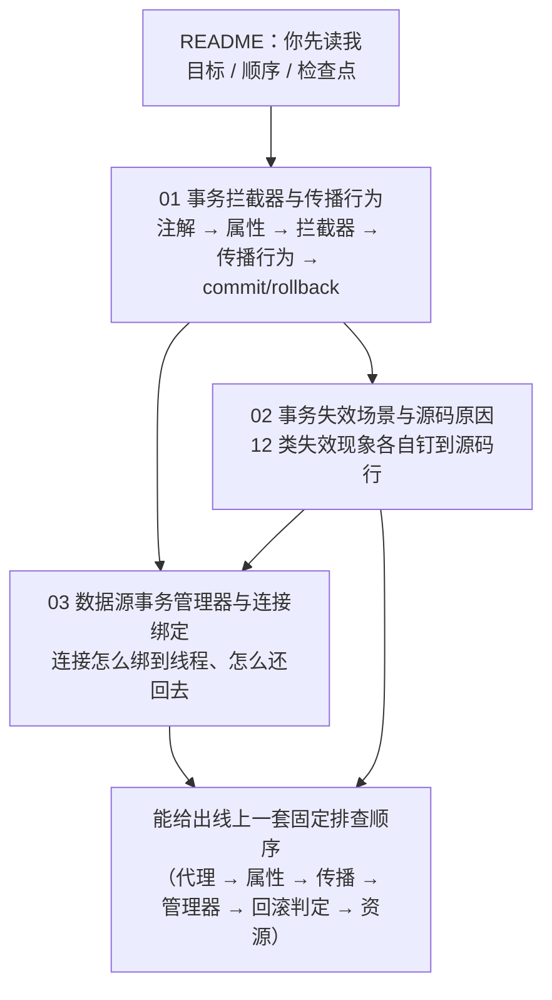

# 03-事务管理：一个 `@Transactional` 从注解到 `Connection#commit()` 的全过程

> 一句话结论：Spring 事务 = **AOP 代理 + 拦截器 + 模板方法事务管理器 + `ThreadLocal` 连接绑定**这四件事的组合；`@Transactional` 本身不产生事务，它只是让代理多挂一条 `TransactionInterceptor`，拦截器把方法调用变成 `PlatformTransactionManager#getTransaction → 业务方法 → commit/rollback` 的一次模板调用，而"事务到底是什么"由具体实现（`DataSourceTransactionManager` 等）决定。**所有"事务失效/事务串库/连接泄漏"都能落回这四个环节之一，因此排查也永远按这个顺序走。**
>
> 阅读前置：读完 [02-AOP与代理](../02-AOP与代理/README.md)（必须：代理何时生成、JDK 与 CGLIB 的区别、拦截器链、自调用为什么不经过代理）；最好先读 [01-IoC容器与Bean生命周期](../01-IoC容器与Bean生命周期/) 里 `refresh` 与 `BeanPostProcessor` 的部分。会用 `@Transactional` + `JdbcTemplate` 写过业务代码。
>
> 预计阅读：本组 3 篇，每篇 40~60 分钟 ｜ 源码基线：`org.springframework:spring-tx:7.1.0` + `org.springframework:spring-jdbc:7.1.0`（配套 `spring-aop:7.1.0`、`spring-context:7.1.0`、Spring Boot 4.2.0，对应 `spring-framework@v7.1.0`）

---

## 学习目标

学完这一组，你应当能**不看源码**讲清下面 10 件事，并且在线上出问题时知道先看哪一行日志：

1. `@EnableTransactionManagement` 只做两件事——注册一个 `AutoProxyRegistrar`（复用 AOP 的自动代理创建器）和一个 `ProxyTransactionManagementConfiguration`（造出事务的"三大件"：`TransactionAttributeSource`、`TransactionInterceptor`、`BeanFactoryTransactionAttributeSourceAdvisor`）。事务**没有独立的一套代理机制**，它就是一个特殊 `Advisor`。
2. `@Transactional` 上的 6 个属性（`propagation`/`isolation`/`timeout`/`readOnly`/`rollbackFor`/`noRollbackFor`）最终被 `SpringTransactionAnnotationParser` 翻译成一个 `RuleBasedTransactionAttribute`，并被 `MethodClassKey(method, targetClass)` **永久缓存**（连 `null` 都缓存）。
3. `AbstractFallbackTransactionAttributeSource#computeTransactionAttribute` 的四级查找顺序（最具体方法 → 声明类 → 原接口方法 → 接口类）、为什么 `Object` 方法直接返回 `null`、为什么 `private` 方法永远拿不到属性。
4. 7 种传播行为在源码里的**唯一分叉点**只有两个方法：无既有事务时的 `getTransaction` 尾部三分支、有既有事务时的 `handleExistingTransaction` 五个分支。`REQUIRES_NEW` = 挂起 + 新连接；`NESTED` = savepoint + 同一连接。
5. `TransactionAspectSupport#invokeWithinTransaction` 的 `try/catch/finally` 结构：`createTransactionIfNecessary` → `proceedWithInvocation` → 异常时 `completeTransactionAfterThrowing` → 正常时 `commitTransactionAfterReturning` → `finally` 里 `cleanupTransactionInfo`（恢复 `ThreadLocal` 栈）。
6. 回滚判定的两级规则：`RuleBasedTransactionAttribute#rollbackOn` 按"最深匹配"选 `winner`，没有规则时回退 `DefaultTransactionAttribute#rollbackOn`——只认 `RuntimeException` / `Error`。
7. 为什么"内层方法异常被外层 `catch`"仍会导致全事务回滚，以及 `UnexpectedRollbackException: Transaction rolled back because it has been marked as rollback-only` 的确切出处（`processRollback` 参与分支 → `commit` 的全局回滚检查）。
8. 连接是怎么被"绑"到线程上的：`DataSourceTransactionManager#doBegin` → `TransactionSynchronizationManager#bindResource(dataSource, ConnectionHolder)`；`DataSourceUtils#doGetConnection` 优先复用 `ThreadLocal` 里的 `ConnectionHolder`；`releaseConnection` 对事务连接只做引用计数而不真关闭。
9. 为什么**必须**用 `DataSourceUtils`（或 `JdbcTemplate`）拿连接，直接 `dataSource.getConnection()` 会开出第二条连接、破坏事务；以及 `ConnectionSynchronization` 如何把连接的释放挂进事务生命周期。
10. `TransactionSynchronization` 的 6 个回调（`suspend`/`resume`/`flush`/`beforeCommit`/`beforeCompletion`/`afterCommit`/`afterCompletion`）的**准确时机与异常策略**，以及 `@TransactionalEventListener` 为什么恰好挂在 `beforeCommit` 与 `afterCompletion` 上。

## 文章顺序



**读图说明**：箭头是**知识依赖**，请沿箭头读。

- **01 是地基**：它把"注解 → `TransactionAttribute` → `TransactionInterceptor` → `AbstractPlatformTransactionManager` → `commit/rollback`"这条主链一次讲完。读完后你脑子里应该有一条**方法名字符串**，而不是一堆概念。
- **02 是"反着用 01"**：它不引入新机制，只是拿 01 的源码去解释 12 个真实故障。**必须读完 01 再读 02**，否则会变成背结论。
- **03 是 01 的下半身**：01 讲到 `PlatformTransactionManager#getTransaction`/`commit` 就停了（那是 `AbstractPlatformTransactionManager` 的模板代码），03 接着往下钻到 `DataSourceTransactionManager#doBegin`、`DataSourceUtils#doGetConnection`、`TransactionSynchronizationManager` 的 6 个 `ThreadLocal`。
- **02 与 03 互相印证**：02 里"多数据源/自取连接/`@Async`"三个场景的根因全在 03；03 里"连接为什么没复用"的排查清单又会回到 02 的五步法。两篇都读完，你才有"**排查顺序**"而不是"知识点列表"。

## 每篇摘要

| 文章 | 主线（源码调用链） | 学完能回答 | 源码依据（主要锚点） |
| --- | --- | --- | --- |
| [01-transactional-事务拦截器与传播行为](01-transactional-事务拦截器与传播行为.md) | `@EnableTransactionManagement` → `TransactionManagementConfigurationSelector#selectImports` → `ProxyTransactionManagementConfiguration` → `BeanFactoryTransactionAttributeSourceAdvisor` + `TransactionAttributeSourcePointcut` → `TransactionInterceptor#invoke` → `TransactionAspectSupport#invokeWithinTransaction` → `AbstractPlatformTransactionManager#getTransaction` / `handleExistingTransaction` → `doCommit`/`doRollback` | 注解怎么变成 `TransactionAttribute`？7 种传播行为分别走到哪一行？`UnexpectedRollbackException` 是谁抛的？`rollbackFor` 与 `noRollbackFor` 冲突时谁赢？ | [[源码:EnableTransactionManagement.java#L159-L163]]、[[源码:TransactionManagementConfigurationSelector.java#L47-L53]]、[[源码:ProxyTransactionManagementConfiguration.java#L44-L56]]、[[源码:TransactionAttributeSourcePointcut.java#L53-L57]]、[[源码:TransactionInterceptor.java#L122-L134]]、[[源码:TransactionAspectSupport.java#L333-L340]]、[[源码:AbstractFallbackTransactionAttributeSource.java#L161-L201]]、[[源码:SpringTransactionAnnotationParser.java#L70-L104]]、[[源码:RuleBasedTransactionAttribute.java#L122-L143]]、[[源码:AbstractPlatformTransactionManager.java#L426-L458]] |
| [02-事务失效场景与源码原因](02-事务失效场景与源码原因.md) | `TransactionAttributeSourcePointcut#matches` → `computeTransactionAttribute` → `TransactionInterceptor#invoke` → `completeTransactionAfterThrowing` → `DefaultTransactionAttribute`/`RuleBasedTransactionAttribute#rollbackOn` → `determineTransactionManager` → `DataSourceUtils#doGetConnection` | 12 类失效各自对应哪一行源码？每种的修复方案和新引入的问题是什么？线上按什么顺序 5 分钟内定位？ | [[源码:EnableTransactionManagement.java#L140-L149]]、[[源码:TransactionInterceptor.java#L122-L134]]、[[源码:AbstractFallbackTransactionAttributeSource.java#L161-L174]]、[[源码:DefaultTransactionAttribute.java#L179-L182]]、[[源码:RuleBasedTransactionAttribute.java#L122-L143]]、[[源码:RollbackRuleAttribute.java#L165-L186]]、[[源码:TransactionAspectSupport.java#L489-L505]]、[[源码:DataSourceUtils.java#L103-L120]] |
| [03-数据源事务管理器与连接绑定](03-数据源事务管理器与连接绑定.md) | `DataSourceTransactionManager#doGetTransaction` → `isExistingTransaction` → `doBegin`（取连接 / `setAutoCommit(false)` / `bindResource`）→ 业务里 `DataSourceUtils#doGetConnection` 复用 → `doCommit`/`doRollback` → `doCleanupAfterCompletion`（`unbindResource` / `releaseConnection`）→ `TransactionSynchronization` 回调 → `@TransactionalEventListener` | 连接为什么必须走 `DataSourceUtils`？事务结束后连接怎么还原？`THREAD` 之外的 6 个 `ThreadLocal` 分别干什么？`AFTER_COMMIT` 里写库为什么不算？ | [[源码:DataSourceTransactionManager.java#L247-L254]]、[[源码:DataSourceTransactionManager.java#L268-L281]]、[[源码:DataSourceTransactionManager.java#L308-L311]]、[[源码:DataSourceUtils.java#L103-L120]]、[[源码:DataSourceUtils.java#L407-L420]]、[[源码:TransactionSynchronizationManager.java#L77-L93]]、[[源码:ConnectionHolder.java#L194-L203]]、[[源码:AbstractPlatformTransactionManager.java#L1014-L1030]]、[[源码:TransactionalApplicationListenerSynchronization.java#L75-L84]] |

## 依赖关系

- **强依赖（必须）**：[02-AOP与代理](../02-AOP与代理/README.md)。具体需要四块知识：
  1. 代理对象是在 `AbstractAutoProxyCreator#postProcessAfterInitialization` 里生成的——事务的 `Advisor` 就是在这里被"捞出来"织进代理的；
  2. `Advisor` = `Pointcut` + `Advice`；`MethodInterceptor` 是 `Advice` 的子类型——`TransactionInterceptor` 就是一个 `MethodInterceptor`；
  3. JDK 代理只能代理接口、CGLIB 不能代理 `final` 类/方法——这直接决定 `protected`、`final`、接口注解这三类失效；
  4. **调用方拿到的是代理，`this` 不是代理**——这是"自调用失效"的唯一原因。
- **弱依赖（建议）**：[01-IoC容器与Bean生命周期](../01-IoC容器与Bean生命周期/)，尤其 `refresh()` 的 `finishBeanFactoryInitialization`、`BeanPostProcessor` 与 `ImportBeanDefinitionRegistrar`（`@EnableXxx` 的通用套路）。
- **本组内部**：`01 → 02`、`01 → 03`（02 与 03 可换序，但都不能跳过 01）。
- **后续**：`04-SpringMVC`（`OpenEntityManagerInViewInterceptor` 与事务边界的关系）、`05-数据访问与测试`（`JdbcTemplate`、`@DataJpaTest`、`@Transactional` 在测试里的回滚语义）。

## 本组涉及的源码文件

| 包 | 文件 | 主要看点 |
| --- | --- | --- |
| `spring-tx` `annotation` | `EnableTransactionManagement`、`TransactionManagementConfigurationSelector`、`ProxyTransactionManagementConfiguration`、`AbstractTransactionManagementConfiguration` | 开关如何变成一个 `Advisor` |
| `spring-tx` `interceptor` | `TransactionInterceptor`、`TransactionAspectSupport`、`BeanFactoryTransactionAttributeSourceAdvisor`、`TransactionAttributeSourcePointcut` | 拦截器入口与事务主流程 |
| `spring-tx` `interceptor` | `AbstractFallbackTransactionAttributeSource`、`AnnotationTransactionAttributeSource`、`SpringTransactionAnnotationParser` | 注解 → `TransactionAttribute` 的解析链与缓存 |
| `spring-tx` `interceptor` | `RuleBasedTransactionAttribute`、`DefaultTransactionAttribute`、`RollbackRuleAttribute`、`NoRollbackRuleAttribute` | 回滚判定的仲裁规则 |
| `spring-tx` `support` | `AbstractPlatformTransactionManager`、`TransactionSynchronizationManager`、`TransactionSynchronization`、`DefaultTransactionStatus`、`ResourceHolderSupport` | 传播行为、提交/回滚流程、`ThreadLocal` 绑定 |
| `spring-tx` `event` | `TransactionalEventListener`、`TransactionalApplicationListenerSynchronization`、`TransactionalApplicationListenerMethodAdapter` | 事务事件与回调的映射 |
| `spring-jdbc` `datasource` | `DataSourceTransactionManager`、`DataSourceUtils`、`ConnectionHolder`、`SmartDataSource` | 连接获取、绑定、释放与状态还原 |

## 源码入库约定（本组共用）

本组所有代码块都来自入库原文，块头写法统一：

~~~~text
​```java (src: DataSourceTransactionManager.java#L268-L281)
	...
​```
~~~~

- `src:` 里的文件名对应 `assets/source/<文件名>.md`（如 `assets/source/DataSourceTransactionManager.java.md`）；
- `#L起-L止` 是**原始 `.java` 文件的行号**（不是本文档行号）；正文里出现的 `[[源码:DataSourceTransactionManager.java#L268-L281]]` 是同一个锚点；
- 块内首行必须正好是 `L起` 那一行；中间省略用**单独一行** `...`；
- 每篇末尾都跑了 `node tools/check-doc.mjs 01-Spring框架/03-事务管理`，**错误 0**（剩余告警仅为"自拟业务示例块未标注 src"与"含省略导致行数差 1"两类，均在正文中已注明非框架源码）。

## 学习检查点

读完 01 篇，检查自己能否：

- [ ] 说出 `@EnableTransactionManagement` 最终注册的三个 Bean 分别是什么、各自职责一句话。
- [ ] 默写 `TransactionInterceptor#invoke` 的两行关键代码（`AopUtils.getTargetClass` + `invokeWithinTransaction(...)`），并解释为什么 `targetClass` 可能为 `null`。
- [ ] 画出 `getTransaction` 的完整分支树（`isExistingTransaction` 两个方向 + 7 种传播行为各自的落点）。
- [ ] 说清 `REQUIRES_NEW` 与 `NESTED` 在 `handleExistingTransaction` 里的三处差别（`suspend`、`doBegin`、`isNewTransaction` 标记）。
- [ ] 解释 `TransactionInfo#bindToThread/restoreThreadLocalStatus` 为什么必须是"栈"结构（`oldTransactionInfo` 字段）。

读完 02 篇，检查自己能否：

- [ ] 给出 12 类失效的"症状 → 源码行 → 修复 → 修复引入的新问题"四列表。
- [ ] 用断点证明"自调用不是切点没命中，而是拦截器根本没执行"。
- [ ] 解释 `AopContext.currentProxy()` 为什么必须配 `exposeProxy = true`，以及它的两个副作用。
- [ ] 说明 `@Transactional` 写在接口上时，JDK 代理与 CGLIB 代理的行为差异及源码原因（`specificMethod != method`）。

读完 03 篇，检查自己能否：

- [ ] 画出 `doBegin` → `bindResource` → `doGetConnection` 复用 → `doCleanupAfterCompletion` → `unbindResource` 的完整连接生命周期。
- [ ] 解释 `doReleaseConnection` 里"`It's the transactional Connection: Don't close it.`"这行的必要性。
- [ ] 说清 `TransactionSynchronization` 6 个回调的时机与异常策略（哪个会传播、哪个只记录）。
- [ ] 解释 `@TransactionalEventListener(phase = AFTER_COMMIT)` 为什么挂在 `afterCompletion` 而不是 `afterCommit`。

综合（三篇合起来），检查自己能否：

- [ ] 给出一份**线上事务问题排查顺序**（代理 → 属性 → 传播 → 管理器 → 回滚判定 → 资源与连接），每一步对应的日志关键字与断点位置。
- [ ] 面对"部分数据没回滚"，在 3 分钟内判断是"两个事务"还是"一个事务但没失败"。
- [ ] 面对"事务偶发失效"，说出为什么"属性解析"不可能是偶发原因（缓存是永久的），从而把注意力放到线程与数据源上。
