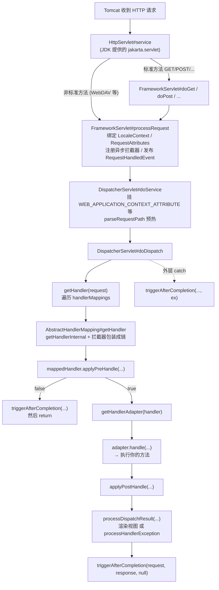
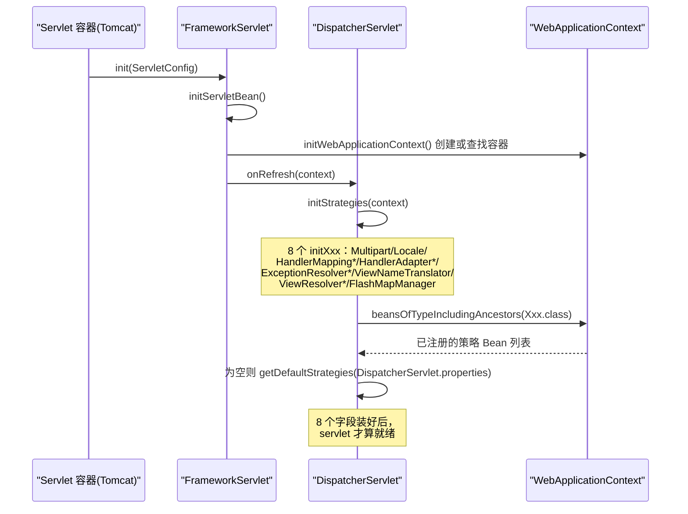
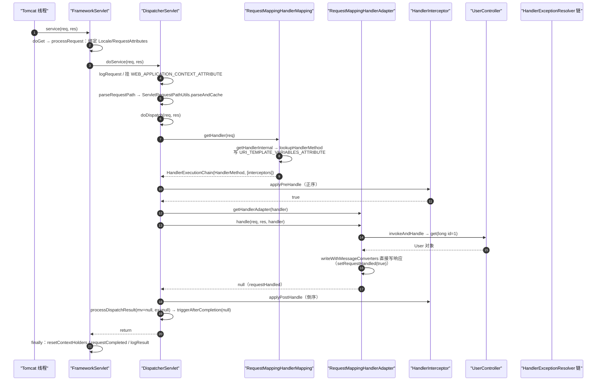
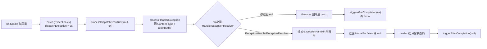

# Spring Framework 源码精读 MVC 01：DispatcherServlet 一次请求的完整旅程

> 一句话结论：一个 HTTP 请求进到 Spring MVC 之后，只走一条主干——`FrameworkServlet#service` → `processRequest`（绑定 `LocaleContext`/`RequestAttributes`、发布事件）→ `DispatcherServlet#doService`（挂框架属性、预热请求路径）→ `doDispatch`（**取链 → preHandle → 取适配器 → `handle` 执行方法 → postHandle → 结果处理/异常处理 → afterCompletion**），`doDispatch` 内部用"内层 try 捕获异常、外层 try 兜底、finally 清理"的三段结构保证 `afterCompletion` 一定有机会执行。
> 阅读前置：读过 [01-refresh-容器启动全流程](../01-IoC容器与Bean生命周期/01-refresh-容器启动全流程.md)（知道 `WebApplicationContext` 是 IoC 容器）与 [01-aop-原理与自动代理创建](../02-AOP与代理/01-aop-原理与自动代理创建.md)（知道 controller 可能是代理对象）。
> 预计阅读：55 分钟 ｜ 源码：spring-framework@v7.1.0（`org.springframework:spring-webmvc:7.1.0`）

---

## 0. 先看现象（3 分钟上手）

一个最小的 REST 接口：

```text
// 片段：演示用应用代码，非 Spring 源码
@RestController
@RequestMapping("/api/users")
public class UserController {

    @GetMapping("/{id}")
    public User get(@PathVariable long id) {
        return new User(id, "tom");
    }
}
```

打开 DEBUG 日志，一次 `GET /api/users/1` 会依次出现这几行（日志措辞是 7.1.0 原文）：

| 日志 | 出现位置 | 说明 |
| --- | --- | --- |
| `GET "/api/users/1", parameters={}` | `DispatcherServlet#doService` 第一行 `logRequest` | 请求进入 MVC 的第一条日志 |
| `Mapped to org.acme.UserController#get(long)` | `AbstractHandlerMapping#getHandler` | **HandlerMapping 找到了处理方法**（`HandlerMethod`） |
| `Using @ExceptionHandler ...` 或什么都不打 | `ExceptionHandlerExceptionResolver` | 只有出异常时才出现 |
| `Completed 200 OK` | `FrameworkServlet#logResult` | `processRequest` 的 `finally` |

如果路径写错成 `GET /api/user/1`：

```text
WARN  org.springframework.web.servlet.PageNotFound - No mapping for GET /api/user/1
```

这行 WARN 来自 `DispatcherServlet#noHandlerFound`，随后它会**抛 `NoHandlerFoundException`**，而不是默默返回 404。想让它变成 404 响应体，靠的是链上的 `DefaultHandlerExceptionResolver`（见 [04 篇](04-拦截器与异常处理-interceptor与controlleradvice.md)）。

如果路径对但方法写成 `POST`：

```text
WARN  org.springframework.web.servlet.mvc.method.annotation.RequestMappingHandlerMapping
      - Request method 'POST' is not supported
```

这行来自 `RequestMappingInfoHandlerMapping#handleNoMatch`（见 [02 篇](02-处理器映射与适配器-handlermapping与handleradapter.md)），它在"URL 匹配而方法不匹配"时抛 `HttpRequestMethodNotSupportedException`。

三个现象对应三个不同的失败层级——这正是本文要建立的地图：**404 类问题在"取链"这一步，405/415/406 在"HandlerMapping 的细节匹配"这一步，异常响应在"结果处理"这一步。**

## 1. 整体地图（先图后码）

先看从 Servlet 容器到你的方法，一共跨了几个类：



**读图说明**：实线是"正常路径"，虚线只有一条——`doDispatch` 外层 `catch` 里调用的 `triggerAfterCompletion`（图右下角的 `AC3`），它只在 `processDispatchResult` 自己也抛异常（比如视图渲染失败）时才会走到。图中三个 `triggerAfterCompletion` 节点（`AC1`/`AC2`/`AC3`）对应源码里**三处**调用点，记住这三个位置，`afterCompletion` 的调用时机就不再是谜。另注意 `getHandler` → `AbstractHandlerMapping#getHandler` 这一段是"接口调用落到模板方法"，中间还夹着一个 `getHandlerInternal`（子类实现具体匹配），这就是后面 02 篇的主战场。

再看"九大组件"是如何在启动时被装配进来的（`initStrategies` 的全景）：



**读图说明**：竖线左侧是 Servlet 生命周期（`init`），右侧是 IoC 容器。关键点是 `FrameworkServlet#initServletBean` 里既建立了 `WebApplicationContext`，又调用了 `onRefresh(context)`；`DispatcherServlet` 覆写 `onRefresh` 只做一件事——`initStrategies(context)`。所以"九大组件"是**在 servlet 初始化阶段、从容器里捞出来的**，不是每次请求都新建。带 `*` 的四个是"列表型"（`List<HandlerMapping>` 等），其余是单个。

## 2. 关键类逐个拆

### 2.1 主线上的 6 个类

| 类 | 角色 | 你该记住的一句话 |
| --- | --- | --- |
| `HttpServlet` | JDK/Jakarta 提供的 Servlet 基类 | 按 HTTP 方法名反射调用 `doGet`/`doPost` 等；不认识的方法（如 `PATCH` 在老版本）走 `service` 原实现 |
| `FrameworkServlet` | Spring 的"Servlet 基础设施" | 覆写 `service`，把所有请求收敛到 `processRequest`，负责 `LocaleContext`/`RequestAttributes` 绑定与请求完成事件 |
| `DispatcherServlet` | **前端控制器（Front Controller）** | 策略的持有者与调度者：`doDispatch` 是唯一主干 |
| `HandlerMapping` | 处理器映射 | 输入 `request`，输出 `HandlerExecutionChain`（处理器 + 拦截器数组） |
| `HandlerAdapter` | 处理器适配器 | 输入任意 `handler`，输出 `ModelAndView`；它屏蔽了"控制器可以是 `@Controller` 方法、也可以是 `HttpRequestHandler`、`Controller` 接口、`HandlerFunction`"的差异 |
| `HandlerExecutionChain` | 处理器执行链 | 持有 `handler` + `interceptorList`，并记住 `interceptorIndex`（已成功执行 `preHandle` 的最大下标） |

### 2.2 `HandlerExecutionChain` 的三个方法就是三个模式的骨架

```java (src: HandlerExecutionChain.java#L142-L164)
	boolean applyPreHandle(HttpServletRequest request, HttpServletResponse response) throws Exception {
		for (int i = 0; i < this.interceptorList.size(); i++) {
			HandlerInterceptor interceptor = this.interceptorList.get(i);
			if (!interceptor.preHandle(request, response, this.handler)) {
				triggerAfterCompletion(request, response, null);
				return false;
			}
			this.interceptorIndex = i;
		}
		return true;
	}

	/**
	 * Apply postHandle methods of registered interceptors.
	 */
	void applyPostHandle(HttpServletRequest request, HttpServletResponse response, @Nullable ModelAndView mv)
			throws Exception {

		for (int i = this.interceptorList.size() - 1; i >= 0; i--) {
			HandlerInterceptor interceptor = this.interceptorList.get(i);
			interceptor.postHandle(request, response, this.handler, mv);
		}
	}
```

- **在干什么**：`applyPreHandle` **正序**遍历拦截器，任何一个返回 `false` 就立刻 `triggerAfterCompletion` 并返回 `false`；全部通过则把最后一个下标写进 `interceptorIndex`。`applyPostHandle` **倒序**遍历。
- **为什么这么写**：这是**栈式**语义——`preHandle` 是"进栈"，`postHandle` 是"出栈"。倒序遍历保证"最后进来的最先出去"，与 `Filter` 链、`@Around` 通知的顺序一致。
- **改成顺序执行 `postHandle` 会怎样**：`PreHandle 时 A→B，PostHandle 就变成 A→B`，看起来"对称"，但一旦 A 在 `postHandle` 里依赖 B 已经处理过的 `ModelAndView`（这是常见用法，如统一在 `postHandle` 里加公共模型数据），就会拿到 B 处理前的旧值。
- **常见坑**：`interceptorIndex` 只在 `preHandle` 成功后才更新，所以"第 3 个拦截器 `preHandle` 返回 `false`"时，`triggerAfterCompletion` 只会回调下标 `0..1`（已经返回过 `true` 的）——**返回 `false` 的那个拦截器自己的 `afterCompletion` 不会被调用**。这是 `HandlerInterceptor` javadoc 明确写的契约：`afterCompletion` 只在 `preHandle` 成功完成时调用。

### 2.3 三处 `triggerAfterCompletion` 调用的完整代码

```java (src: HandlerExecutionChain.java#L171-L181)
	void triggerAfterCompletion(HttpServletRequest request, HttpServletResponse response, @Nullable Exception ex) {
		for (int i = this.interceptorIndex; i >= 0; i--) {
			HandlerInterceptor interceptor = this.interceptorList.get(i);
			try {
				interceptor.afterCompletion(request, response, this.handler, ex);
			}
			catch (Throwable ex2) {
				logger.error("HandlerInterceptor.afterCompletion threw exception in interceptor [" + interceptor + "]", ex2);
			}
		}
	}
```

- **在干什么**：从 `interceptorIndex` 倒着回调，**每个拦截器的异常都被吞掉并记 error 日志**。
- **为什么这么写**：`afterCompletion` 是清理钩子（释放 ThreadLocal、关闭流、记录耗时）。若某个拦截器清理时抛异常，不能让后面的拦截器"清理不到"，否则资源泄漏。
- **如果不在 `catch` 里吞掉**：第一个 `afterCompletion` 抛出，后面所有拦截器的 `afterCompletion` 都不执行——你线上看到的"连接池泄满"往往就是这么来的。
- **常见坑**：因为异常被吞，你在 `afterCompletion` 里写 `throw new IllegalStateException(...)` 调试时发现"异常不见了"，别以为是框架把异常丢了，去看 `org.springframework.web.servlet.HandlerExecutionChain` 的 error 日志。

### 2.4 `DispatcherServlet` 的 8 个策略字段（"九大组件"的精确清单）

很多文章说"九大组件"，但 `initStrategies` 里**只有 8 行调用**。先看原文：

```java (src: DispatcherServlet.java#L441-L450)
	protected void initStrategies(ApplicationContext context) {
		initMultipartResolver(context);
		initLocaleResolver(context);
		initHandlerMappings(context);
		initHandlerAdapters(context);
		initHandlerExceptionResolvers(context);
		initRequestToViewNameTranslator(context);
		initViewResolvers(context);
		initFlashMapManager(context);
	}
```

- **在干什么**：把 servlet 需要的全部"可替换策略"从容器里捞出来，赋给它自己的字段。
- **为什么这么写**：`DispatcherServlet` 是"前端控制器"模式的落地——它自己不做事，只**选策略并串起来**。每个策略都能被用户 Bean 替换（Spring Boot 就是这么做的），这就是 MVC 可扩展的全部秘密。
- **如果改成每次请求现查 Bean**：每个请求都要走一遍 `beansOfTypeIncludingAncestors` + 排序，且 `HandlerMapping` 的匹配预计算（`RequestMappingInfo` 注册表）无法复用，性能会退化到不可接受。
- **常见坑**：`initStrategies` 是 `protected`，覆写它**不会**再自动调用 8 个 `initXxx`（它们是 `private`），必须自己逐个调用——这是"想换策略"时最常踩的坑。

对应的 8 个字段（注意带 `List` 的四个）：

```java (src: DispatcherServlet.java#L279-L303)
	/** MultipartResolver used by this servlet. */
	private @Nullable MultipartResolver multipartResolver;

	/** LocaleResolver used by this servlet. */
	private @Nullable LocaleResolver localeResolver;

	/** List of HandlerMappings used by this servlet. */
	private @Nullable List<HandlerMapping> handlerMappings;

	/** List of HandlerAdapters used by this servlet. */
	private @Nullable List<HandlerAdapter> handlerAdapters;

	/** List of HandlerExceptionResolvers used by this servlet. */
	private @Nullable List<HandlerExceptionResolver> handlerExceptionResolvers;

	/** RequestToViewNameTranslator used by this servlet. */
	private @Nullable RequestToViewNameTranslator viewNameTranslator;

	/** FlashMapManager used by this servlet. */
	private @Nullable FlashMapManager flashMapManager;

	/** List of ViewResolvers used by this servlet. */
	private @Nullable List<ViewResolver> viewResolvers;

	private boolean parseRequestPath;
```

- **在干什么**：8 个策略字段，`multipartResolver`/`localeResolver`/`viewNameTranslator`/`flashMapManager` 是**单个**，其余四个是**有序列表**。
- **为什么是列表**：`HandlerMapping` 需要"多个映射器按 `Order` 依次尝试"（`RouterFunctionMapping` 在 `RequestMappingHandlerMapping` 之前，见 02 篇）；`HandlerAdapter` 需要"按 `supports` 能力挑选"；`HandlerExceptionResolver` 需要"按优先级依次尝试"；`ViewResolver` 需要"链式解析视图名"。
- **如果把 `handlerMappings` 改成单个**：你就无法同时支持 `@RequestMapping` 与 `RouterFunction`（Spring Boot 默认两者都在），只能二选一。
- **常见坑**：`parseRequestPath` 不是策略，而是"是否需要为每个请求预解析 `RequestPath`"的开关，它在 `initHandlerMappings` 里被设置（见 2.6）。它是 `PathPattern` 时代的新字段，老代码里根本没有。

### 2.5 八个 `initXxx` 的共同套路（以 `initHandlerMappings` 为例）

```java (src: DispatcherServlet.java#L506-L532)
	private void initHandlerMappings(ApplicationContext context) {
		this.handlerMappings = null;

		if (this.detectAllHandlerMappings) {
			// Find all HandlerMappings in the ApplicationContext, including ancestor contexts.
			Map<String, HandlerMapping> matchingBeans =
					BeanFactoryUtils.beansOfTypeIncludingAncestors(context, HandlerMapping.class, true, false);
			if (!matchingBeans.isEmpty()) {
				this.handlerMappings = new ArrayList<>(matchingBeans.values());
				// We keep HandlerMappings in sorted order.
				AnnotationAwareOrderComparator.sort(this.handlerMappings);
			}
		}
		else {
			try {
				HandlerMapping hm = context.getBean(HANDLER_MAPPING_BEAN_NAME, HandlerMapping.class);
				this.handlerMappings = Collections.singletonList(hm);
			}
			catch (NoSuchBeanDefinitionException ex) {
				// Ignore, we'll add a default HandlerMapping later.
			}
		}

		// Ensure we have at least one HandlerMapping, by registering
		// a default HandlerMapping if no other mappings are found.
		if (this.handlerMappings == null) {
			this.handlerMappings = getDefaultStrategies(context, HandlerMapping.class);
```

- **在干什么**：三步查找——① `detectAllHandlerMappings=true`（默认）时，从本容器与**祖先容器**里取所有 `HandlerMapping` Bean 并按 `Order` 排序；② 否则只取名为 `handlerMapping` 的那一个；③ 一个都没找到时，用 `DispatcherServlet.properties` 里登记的默认实现兜底。
- **为什么能拿到祖先容器的 Bean**：`beansOfTypeIncludingAncestors(context, HandlerMapping.class, true, false)` 的第三参数 `true` 表示"包含祖先容器"。所以写在根容器（`ContextLoaderListener` 加载的那个）里的拦截器/映射器也能被 servlet 子容器看见。
- **如果把 `AnnotationAwareOrderComparator.sort` 去掉**：顺序就变成 `HashMap` 的遍历顺序，`RouterFunctionMapping`（`order = -1`）会随机跑到 `RequestMappingHandlerMapping`（`order = 0`）后面，路由函数偶尔"抢走"本该由 `@RequestMapping` 处理的请求——这是典型的"偶发 404"。
- **常见坑**：`detectAllHandlerMappings` 默认 `true`；一旦你 `setDetectAllHandlerMappings(false)`，就必须保证容器里恰好有一个名为 `handlerMapping` 的 Bean，否则会悄悄退化成默认策略（`RequestMappingHandlerMapping` 等），你自定义的映射器完全不生效。

### 2.6 `parseRequestPath` 开关：`PathPattern` 时代的性能账

```java (src: DispatcherServlet.java#L533-L545)
			if (logger.isTraceEnabled()) {
				logger.trace("No HandlerMappings declared for servlet '" + getServletName() +
						"': using default strategies from DispatcherServlet.properties");
			}
		}

		for (HandlerMapping mapping : this.handlerMappings) {
			if (mapping.usesPathPatterns()) {
				this.parseRequestPath = true;
				break;
			}
		}
	}
```

- **在干什么**：只要**任意一个** `HandlerMapping` 声明"我用 `PathPattern`"，就打开 `parseRequestPath`，让 `doService` 在调度前把请求路径解析成 `RequestPath` 缓存起来。
- **为什么这么写**：`PathPattern` 匹配需要 `PathContainer`（已经按 `/` 切好段的路径）。若每个 `HandlerMapping` 各解析一次，同一次请求会重复解析 N 遍。统一在 `doService` 解析一次并放进 request attribute，所有映射器复用。
- **如果所有映射器都用老的 `AntPathMatcher`**：`usesPathPatterns()` 返回 `false`，`parseRequestPath` 保持 `false`，节省一次解析开销。这就是 `HandlerMapping#usesPathPatterns` 这个 `default` 方法存在的意义。
- **常见坑**：`usesPathPatterns()` 在 `AbstractHandlerMapping` 里的实现是 `getPatternParser() != null`（不是配置文件开关）。你在 `WebMvcConfigurer#configurePathMatch` 里调 `configurer.setUseTraversalMatch(true)`/不设 `PathPatternParser` 就会让整条链退回 `AntPathMatcher`，`doService` 也就不会再预热路径。

### 2.7 `getDefaultStrategies`：`DispatcherServlet.properties` 兜底

```java (src: DispatcherServlet.java#L766-L789)
	protected <T> List<T> getDefaultStrategies(ApplicationContext context, Class<T> strategyInterface) {
		if (defaultStrategies == null) {
			try {
				// Load default strategy implementations from properties file.
				// This is currently strictly internal and not meant to be customized
				// by application developers.
				ClassPathResource resource = new ClassPathResource(DEFAULT_STRATEGIES_PATH, DispatcherServlet.class);
				defaultStrategies = PropertiesLoaderUtils.loadProperties(resource);
			}
			catch (IOException ex) {
				throw new IllegalStateException("Could not load '" + DEFAULT_STRATEGIES_PATH + "': " + ex.getMessage());
			}
		}

		String key = strategyInterface.getName();
		String value = defaultStrategies.getProperty(key);
		if (value != null) {
			String[] classNames = StringUtils.commaDelimitedListToStringArray(value);
			List<T> strategies = new ArrayList<>(classNames.length);
			for (String className : classNames) {
				try {
					Class<?> clazz = ClassUtils.forName(className, DispatcherServlet.class.getClassLoader());
					Object strategy = createDefaultStrategy(context, clazz);
					strategies.add((T) strategy);
```

- **在干什么**：读 `org/springframework/web/servlet/DispatcherServlet.properties`，用**接口全限定名**当 key，逗号分隔的类名当 value，逐个实例化（`createDefaultStrategy` 走容器的 `createBean`，所以默认策略也能被 `BeanPostProcessor` 增强、也能被 `@Autowired` 注入）。
- **为什么这么写**：注解配置时代之前，没有 `WebMvcConfigurationSupport` 帮你注册 `RequestMappingHandlerMapping`，必须有个兜底。这个文件到今天仍然是一个"参考清单"——想知道"没有任何配置时 MVC 有哪些组件"，看它最快。
- **如果改成 `new` 实例化（`clazz.getDeclaredConstructor().newInstance()`）**：默认策略就脱离了容器，里面的 `@Autowired` 字段全为 `null`，`RequestMappingHandlerMapping` 拿不到 `ApplicationContext`，`@Controller` 一个都扫不到。
- **常见坑**：`getDefaultStrategy`（单数）要求**恰好一个**实现，否则抛 `BeanInitializationException("DispatcherServlet needs exactly 1 strategy for interface [...]")`。这句话也是排查"为什么启动失败"的关键词。

文件内容（原文，注释为入库格式）：

```text (src: DispatcherServlet.properties#L7-L19)
org.springframework.web.servlet.HandlerMapping=org.springframework.web.servlet.handler.BeanNameUrlHandlerMapping,\
	org.springframework.web.servlet.mvc.method.annotation.RequestMappingHandlerMapping,\
	org.springframework.web.servlet.function.support.RouterFunctionMapping

org.springframework.web.servlet.HandlerAdapter=org.springframework.web.servlet.mvc.HttpRequestHandlerAdapter,\
	org.springframework.web.servlet.mvc.SimpleControllerHandlerAdapter,\
	org.springframework.web.servlet.mvc.method.annotation.RequestMappingHandlerAdapter,\
	org.springframework.web.servlet.function.support.HandlerFunctionAdapter


org.springframework.web.servlet.HandlerExceptionResolver=org.springframework.web.servlet.mvc.method.annotation.ExceptionHandlerExceptionResolver,\
	org.springframework.web.servlet.mvc.annotation.ResponseStatusExceptionResolver,\
	org.springframework.web.servlet.mvc.support.DefaultHandlerExceptionResolver
```

- **在干什么**：就是 2.4/2.5 提到的兜底清单；反斜杠是 `Properties` 的续行符。
- **为什么要注意顺序**：`HandlerExceptionResolver` 的三行顺序**就是执行顺序**（`ExceptionHandlerExceptionResolver` → `ResponseStatusExceptionResolver` → `DefaultHandlerExceptionResolver`），见 04 篇。
- **如果顺序颠倒**：`DefaultHandlerExceptionResolver` 会先吃掉 `NoHandlerFoundException` 等异常，你的 `@ExceptionHandler` 永远不执行。
- **常见坑**：这个文件被注释为 "strictly internal and not meant to be customized"，改它打包后会被覆盖，也请不要改依赖包里的文件；要定制请注册自己的 Bean。

## 3. 源码逐段精读

### 3.1 `FrameworkServlet#service`：所有方法收敛到 `processRequest`

```java (src: FrameworkServlet.java#L867-L877)
	@Override
	protected void service(HttpServletRequest request, HttpServletResponse response)
			throws ServletException, IOException {

		if (HTTP_SERVLET_METHODS.contains(request.getMethod())) {
			super.service(request, response);
		}
		else {
			processRequest(request, response);
		}
	}
```

- **在干什么**：请求方法是 Servlet 规范里的 7 个标准方法（`GET/POST/PUT/PATCH/DELETE/OPTIONS/TRACE`，7.1.0 新增了 `PATCH` 的常量支持）时，交给 `HttpServlet#service` 去分派到 `doGet`/`doPost`；否则（例如 `PROPFIND`、`MKCOL` 这类 WebDAV 方法）**直接** `processRequest`。
- **为什么这么写**：标准方法走 `HttpServlet` 的反射分派能拿到"`HEAD` 自动复用 `doGet`"、"`OPTIONS` 默认返回 `Allow`"等规范行为；非标准方法没有对应的 `doXxx`，只能直接进 Spring 的处理流程。
- **如果全部直接 `processRequest`**：`HEAD` 请求不会走"无 body 的响应包装"（`NoBodyResponse`），`Content-Length` 计算会和 `GET` 不一致。
- **常见坑**：自定义了 `HttpServlet` 子类又想绕过 Spring，覆写 `doXxx` 时要记得**不要**调 `super.doXxx`（那是 `FrameworkServlet` 的，会进 Spring）；反过来如果你覆写了 `service`，别忘了 `FrameworkServlet#processRequest` 里的 `LocaleContext`/`RequestAttributes` 绑定就不会执行，`RequestContextHolder` 在 controller 里会是 `null`。

### 3.2 `FrameworkServlet#processRequest`：请求级上下文与事件

```java (src: FrameworkServlet.java#L983-L1020)
	protected final void processRequest(HttpServletRequest request, HttpServletResponse response)
			throws ServletException, IOException {

		long startTime = System.currentTimeMillis();
		Throwable failureCause = null;

		LocaleContext previousLocaleContext = LocaleContextHolder.getLocaleContext();
		LocaleContext localeContext = buildLocaleContext(request);

		RequestAttributes previousAttributes = RequestContextHolder.getRequestAttributes();
		ServletRequestAttributes requestAttributes = buildRequestAttributes(request, response, previousAttributes);

		WebAsyncManager asyncManager = WebAsyncUtils.getAsyncManager(request);
		asyncManager.registerCallableInterceptor(FrameworkServlet.class.getName(), new RequestBindingInterceptor());

		initContextHolders(request, localeContext, requestAttributes);

		try {
			doService(request, response);
		}
		catch (ServletException | IOException ex) {
			failureCause = ex;
			throw ex;
		}
		catch (Throwable ex) {
			failureCause = ex;
			throw new ServletException("Request processing failed: " + ex, ex);
		}

		finally {
			resetContextHolders(request, previousLocaleContext, previousAttributes);
			if (requestAttributes != null) {
				requestAttributes.requestCompleted();
			}
			logResult(request, response, failureCause, asyncManager);
			publishRequestHandledEvent(request, response, startTime, failureCause);
		}
	}
```

- **在干什么**：① 记下**线程上原有的** `LocaleContext`/`RequestAttributes`（可能是上游 `Filter` 设置的），再把本请求的绑定进 `ThreadLocal`；② 注册异步"请求上下文重建"拦截器；③ 调 `doService`；④ `finally` 里**恢复**原值、标记请求完成、打 `Completed 200 OK`、发布 `ServletRequestHandledEvent`。
- **为什么这么写**：`RequestContextHolder` 是 `ThreadLocal` 的，Tomcat 线程池会复用线程。不恢复原值，下一个请求就会拿到上一个请求的 `RequestAttributes`——这是最隐蔽的"串数据"bug。`requestCompleted()` 则负责把 `@SessionAttributes` 之类的会话属性在请求结束时统一清理。
- **如果不 `reset` 只 `set`**：`Filter` 里设置的 `RequestAttributes` 会被覆盖且不还原，过滤器链后半段拿到的是 MVC 的 `ServletRequestAttributes`，可能引发 `ClassCastException`。
- **常见坑**：`requestAttributes.requestCompleted()` 在**异步请求**里不能无条件调用——所以 `ServletRequestAttributes#requestCompleted` 内部会判断 `request.isAsyncStarted()`，是异步就不清理。你自己写 `Filter` 时千万别在 `finally` 里手动清 `RequestContextHolder.resetRequestAttributes()`，会和这里打架。

三个"标准方法"的委托都是同一行：

```java (L886-L891)
	@Override
	protected final void doGet(HttpServletRequest request, HttpServletResponse response)
			throws ServletException, IOException {

		processRequest(request, response);
	}
```

- **在干什么**：`doGet` 是 `final` 的，只做一件事——进 `processRequest`。`doPost`/`doPut`/`doDelete`/`doPatch`（7.1.0 新增 `doPatch`，见 07 节）完全相同。
- **为什么是 `final`**：防止子类覆写后绕过 `processRequest` 的上下文管理。
- **如果想让某个方法"不进 MVC"**：覆写 `service` 并在前面 `return`，而不是覆写 `doGet`。
- **常见坑**：`doTrace`/`doOptions` 不是无条件转发（它们有 `dispatchTraceRequest`/`dispatchOptionsRequest` 开关和 `message/http`/`Allow` 头判断），这是为了让 CORS 预检和 `TRACE` 的规范行为保持正确。

### 3.3 `DispatcherServlet#doService`：挂属性 + 预热请求路径

```java (src: DispatcherServlet.java#L829-L848)
	protected void doService(HttpServletRequest request, HttpServletResponse response) throws Exception {
		logRequest(request);

		// Keep a snapshot of the request attributes in case of an include,
		// to be able to restore the original attributes after the include.
		Map<String, Object> attributesSnapshot = null;
		if (WebUtils.isIncludeRequest(request)) {
			attributesSnapshot = new HashMap<>();
			Enumeration<?> attrNames = request.getAttributeNames();
			while (attrNames.hasMoreElements()) {
				String attrName = (String) attrNames.nextElement();
				if (this.cleanupAfterInclude || attrName.startsWith(DEFAULT_STRATEGIES_PREFIX)) {
					attributesSnapshot.put(attrName, request.getAttribute(attrName));
				}
			}
		}

		// Make framework objects available to handlers and view objects.
		request.setAttribute(WEB_APPLICATION_CONTEXT_ATTRIBUTE, getWebApplicationContext());
		request.setAttribute(LOCALE_RESOLVER_ATTRIBUTE, this.localeResolver);
```

- **在干什么**：`logRequest` 打出 `GET "/api/users/1", parameters={}`；`include` 请求时快照属性；然后把容器与 `LocaleResolver` 挂到 request 上（视图/JSP 能通过 `RequestContextUtils` 取到）。
- **为什么 `include` 要快照**：`RequestDispatcher#include` 会共享同一个 request；如果不还原，被 include 的 JSP 设置的属性会污染主 JSP。
- **如果不做快照**：主 JSP 和被 include 的 JSP 有同名变量时会互相覆盖，Spring 文档特意把这个行为做成了 `cleanupAfterInclude`（默认 `true`）可配置项。
- **常见坑**：`WEB_APPLICATION_CONTEXT_ATTRIBUTE` 的值是 `DispatcherServlet.class.getName() + ".CONTEXT"`。在 controller 里 `request.getAttribute(WebApplicationContext.ROOT_WEB_APPLICATION_CONTEXT_ATTRIBUTE)` 取到的可能是**根容器**而不是 MVC 容器，两者 Bean 集合不同。

FlashMap（重定向传参）与 `parseRequestPath` 预热：

```java (src: DispatcherServlet.java#L850-L868)
		if (this.flashMapManager != null) {
			FlashMap inputFlashMap = this.flashMapManager.retrieveAndUpdate(request, response);
			if (inputFlashMap != null) {
				request.setAttribute(INPUT_FLASH_MAP_ATTRIBUTE, Collections.unmodifiableMap(inputFlashMap));
			}
			request.setAttribute(OUTPUT_FLASH_MAP_ATTRIBUTE, new FlashMap());
			request.setAttribute(FLASH_MAP_MANAGER_ATTRIBUTE, this.flashMapManager);
		}

		RequestPath previousRequestPath = null;
		if (this.parseRequestPath) {
			previousRequestPath = (RequestPath) request.getAttribute(ServletRequestPathUtils.PATH_ATTRIBUTE);
			ServletRequestPathUtils.parseAndCache(request);
		}

		try {
			doDispatch(request, response);
		}
		finally {
```

- **在干什么**：① `flashMapManager.retrieveAndUpdate` 取上一次请求（通常是 `redirect:` 之前）存下的 "input" FlashMap，并新建一个 "output" 供本次写入；② `parseRequestPath` 为 `true` 时，**在 `doDispatch` 之前**把路径解析并缓存进 request。
- **为什么 FlashMap 在 `doDispatch` 之前**：`RequestMappingHandlerAdapter#invokeHandlerMethod` 里第一步就是 `mavContainer.addAllAttributes(RequestContextUtils.getInputFlashMap(request))`，重定向后的页面要能立刻读到这些属性。
- **如果 `parseRequestPath` 放在 `getHandler` 里做**：`HandlerMapping` 每次匹配都要自己判断"解析过没有"，逻辑散落各处；而且 `afterCompletion` 里的拦截器若想看路径还得再解析一遍。
- **常见坑**：`previousRequestPath` 的恢复写在 `finally`（源码在 3.3 之后几行，L870-L876）。如果你的 `Filter` 在 MVC 之前解析过路径，`doService` 结束后会把它**还原成你原来那个对象**——反过来说，`doDispatch` 里看到的 `RequestPath` 与 `Filter` 里看到的可能不是同一个实例（但内容等价）。升级 7.x 后如果有自定义 `Filter` 依赖实例同一性，会"莫名其妙"失效。

### 3.4 `doDispatch` 第一段：取链与 `preHandle`

`doDispatch` 一共 70 行（L935-L1004），超过单块 60 行上限，按语义拆成 4 段读。第一段：

```java (src: DispatcherServlet.java#L935-L959)
	protected void doDispatch(HttpServletRequest request, HttpServletResponse response) throws Exception {
		HttpServletRequest processedRequest = request;
		HandlerExecutionChain mappedHandler = null;
		boolean multipartRequestParsed = false;

		WebAsyncManager asyncManager = WebAsyncUtils.getAsyncManager(request);

		try {
			ModelAndView mv = null;
			Exception dispatchException = null;

			try {
				processedRequest = checkMultipart(request);
				multipartRequestParsed = (processedRequest != request);

				// Determine handler for the current request.
				mappedHandler = getHandler(processedRequest);
				if (mappedHandler == null) {
					noHandlerFound(processedRequest, response);
					return;
				}

				if (!mappedHandler.applyPreHandle(processedRequest, response)) {
					return;
				}
```

- **在干什么**：① 用局部变量 `processedRequest` 承接 `checkMultipart` 的结果（可能被包装成 `MultipartHttpServletRequest`）；② `getHandler` 拿执行链；③ 拿不到就 `noHandlerFound` 并 `return`；④ `applyPreHandle` 返回 `false` 就直接 `return`（响应由拦截器自己写）。
- **为什么用局部变量而不是直接改 `request` 参数**：`finally` 里要 `cleanupMultipart(processedRequest)` 释放临时文件；而 `catch`/`triggerAfterCompletion` 里又需要原始 `request`。局部变量把"包装后的请求"与"原始请求"分开。
- **如果 `multipartRequestParsed` 用 `true` 硬编码**：普通请求也会走 `cleanupMultipart`，虽然多数实现是空操作，但抛错日志会误导排查。
- **常见坑**：`applyPreHandle` 返回 `false` 时 `return` 走的是**内层 try 的正常出口**，所以会继续执行第 4 段的 `processDispatchResult(..., mv=null, dispatchException=null)` → 里面 `triggerAfterCompletion(request, response, null)`。**但 `applyPreHandle` 自己已经调过一次 `triggerAfterCompletion`**（在 2.2 那段代码里），所以拦截器的 `afterCompletion` 会被调用**两次**！——不对，需要看 `interceptorIndex`：`applyPreHandle` 内部那次已把 `interceptorIndex` 用尽，第二次调用时 `interceptorIndex` 没变，仍然会再遍历一遍。7.1.0 的代码里，`processDispatchResult` 只有在 `mv != null` 或走到最后一行时才回调；`applyPreHandle` 返回 `false` 时 `return` 直接跳出内层 try，`processDispatchResult` 仍会被调用（因为它在 try 之后、catch 之后）。**这就是经典"`afterCompletion` 被调两次"现象的来源**，也是为什么拦截器里的 `afterCompletion` 必须幂等。

### 3.5 `doDispatch` 第二段：取适配器 + 执行 + `postHandle`

```java (src: DispatcherServlet.java#L961-L981)
				// Determine handler adapter and invoke the handler.
				HandlerAdapter ha = getHandlerAdapter(mappedHandler.getHandler());
				mv = ha.handle(processedRequest, response, mappedHandler.getHandler());

				if (asyncManager.isConcurrentHandlingStarted()) {
					return;
				}

				applyDefaultViewName(processedRequest, mv);
				mappedHandler.applyPostHandle(processedRequest, response, mv);
			}
			catch (Exception ex) {
				dispatchException = ex;
			}
			catch (Throwable err) {
				// As of 4.3, we're processing Errors thrown from handler methods as well,
				// making them available for @ExceptionHandler methods and other scenarios.
				dispatchException = new ServletException("Handler dispatch failed: " + err, err);
			}
			processDispatchResult(processedRequest, response, mappedHandler, mv, dispatchException);
		}
```

- **在干什么**：`getHandlerAdapter` 按 `supports(handler)` 选出适配器 → `handle` 真正执行你的方法 → 异步已开启就直接 `return`（`postHandle` 此时不执行，改由 `finally` 里的 `applyAfterConcurrentHandlingStarted`）→ 给没有视图名的 `ModelAndView` 补默认视图名 → `applyPostHandle`（倒序）。两个 `catch` 把异常**存进 `dispatchException`** 而不是抛出，以便统一交给 `processDispatchResult`。
- **为什么异常不直接抛**：异常要交给 `HandlerExceptionResolver`（`@ExceptionHandler`）处理，而处理结果同样是 `ModelAndView`。所以把"正常结果"和"异常"统一成 `(mv, dispatchException)` 两个变量，后续逻辑只写一遍。
- **如果这里直接 `throw ex`**：`@ExceptionHandler` 完全不会生效，请求直接 500，`processDispatchResult` 也拿不到机会。这是初学者"为什么我的全局异常处理不生效"的答案：它在 `processDispatchResult` 里。
- **常见坑**：`catch (Throwable err)` 会把 `OutOfMemoryError`/`StackOverflowError` 包装成 `ServletException` 继续往下传——**能被 `@ExceptionHandler(Throwable.class)` 捕获**。所以不建议在 `@ExceptionHandler` 里写 `Throwable`，会连 `Error` 一起吞。

### 3.6 `doDispatch` 第三段：外层 `catch` 与 `finally`

```java (src: DispatcherServlet.java#L982-L1000)
		catch (Exception ex) {
			triggerAfterCompletion(processedRequest, response, mappedHandler, ex);
		}
		catch (Throwable err) {
			triggerAfterCompletion(processedRequest, response, mappedHandler,
					new ServletException("Handler processing failed: " + err, err));
		}
		finally {
			if (asyncManager.isConcurrentHandlingStarted()) {
				// Instead of postHandle and afterCompletion
				if (mappedHandler != null) {
					mappedHandler.applyAfterConcurrentHandlingStarted(processedRequest, response);
				}
				asyncManager.setMultipartRequestParsed(multipartRequestParsed);
			}
			else {
				// Clean up any resources used by a multipart request.
				if (multipartRequestParsed || asyncManager.isMultipartRequestParsed()) {
					cleanupMultipart(processedRequest);
```

- **在干什么**：外层 `catch` 只接住"`processDispatchResult` 自己抛出来的"异常（典型是视图渲染失败、`processHandlerException` 把原异常又 `throw` 回来）；`finally` 按"是否异步"分流：异步 → 回调 `applyAfterConcurrentHandlingStarted`（`AsyncHandlerInterceptor` 专用钩子，不调 `postHandle`/`afterCompletion`）；同步 → 清理 multipart 临时文件。
- **为什么 `triggerAfterCompletion` 是这个 `private static` 方法**：它内部 `throw ex` 把异常继续往上抛（不吞），保证 `Servlet` 容器最终知道请求失败：

```java (src: DispatcherServlet.java#L1357-L1364)
	private static void triggerAfterCompletion(HttpServletRequest request, HttpServletResponse response,
			@Nullable HandlerExecutionChain mappedHandler, Exception ex) throws Exception {

		if (mappedHandler != null) {
			mappedHandler.triggerAfterCompletion(request, response, ex);
		}
		throw ex;
	}
```

- **如果它吞掉异常**：容器看不到异常，`ErrorPage` 机制、access log 的 5xx 记录、监控指标全部失灵。
- **常见坑**：`finally` 里异步分支**故意不调用 `afterCompletion`**，注释写得很明白 "Instead of postHandle and afterCompletion"。异步请求的 `afterCompletion` 要在**异步再次分派**时由 `DispatcherServlet` 重新走一次 `doDispatch` 才会触发——所以异步接口里 `afterCompletion` 的耗时统计会"翻倍"或"对不上"，别用 `afterCompletion` 统计异步接口耗时。

### 3.7 `getHandler` / `noHandlerFound` / `getHandlerAdapter`

```java (src: DispatcherServlet.java#L1154-L1178)
	protected @Nullable HandlerExecutionChain getHandler(HttpServletRequest request) throws Exception {
		if (this.handlerMappings != null) {
			for (HandlerMapping mapping : this.handlerMappings) {
				HandlerExecutionChain handler = mapping.getHandler(request);
				if (handler != null) {
					return handler;
				}
			}
		}
		return null;
	}

	/**
	 * No handler found &rarr; set appropriate HTTP response status.
	 * @param request current HTTP request
	 * @param response current HTTP response
	 * @throws Exception if preparing the response failed
	 */
	protected void noHandlerFound(HttpServletRequest request, HttpServletResponse response) throws Exception {
		if (pageNotFoundLogger.isWarnEnabled()) {
			pageNotFoundLogger.warn("No mapping for " + request.getMethod() + " " + getRequestUri(request));
		}
		throw new NoHandlerFoundException(request.getMethod(), getRequestUri(request),
				new ServletServerHttpRequest(request).getHeaders());
	}
```

- **在干什么**：`getHandler` 就是"按顺序问每个 `HandlerMapping`，第一个给出非 `null` 执行链的胜出"。`noHandlerFound` 打一条专用 logger（`org.springframework.web.servlet.PageNotFound`）的 WARN，然后**抛异常**（不是返回 404）。
- **为什么抛异常**：404 也是一种"错误结果"，交给 `HandlerExceptionResolver` 链处理，用户就能用 `@ExceptionHandler(NoHandlerFoundException.class)` 定制 404 响应体。若直接 `response.sendError(404)`，这个扩展点就没了。
- **如果 `getHandler` 不按顺序**：`RequestMappingHandlerMapping` 和 `RouterFunctionMapping` 同时能匹配时结果不可预测。
- **常见坑**：Boot 3+ 默认 `spring.mvc.throw-exception-if-no-handler-found` 的语义已变——静态资源映射（`/**` 交给 `ResourceHttpRequestHandler`）会先把请求"接住"，然后由它抛 `NoResourceFoundException`（不是 `NoHandlerFoundException`）。想用 `@ExceptionHandler(NoHandlerFoundException.class)` 必须关掉默认资源处理。`NoHandlerFoundException` 只有在所有 `HandlerMapping` 都返回 `null` 时才会出现。

```java (src: DispatcherServlet.java#L1185-L1195)
	protected HandlerAdapter getHandlerAdapter(Object handler) throws ServletException {
		if (this.handlerAdapters != null) {
			for (HandlerAdapter adapter : this.handlerAdapters) {
				if (adapter.supports(handler)) {
					return adapter;
				}
			}
		}
		throw new ServletException("No adapter for handler [" + handler +
				"]: The DispatcherServlet configuration needs to include a HandlerAdapter that supports this handler");
	}
```

- **在干什么**：按顺序问每个 `HandlerAdapter#supports(handler)`，第一个支持的胜出；都不支持就抛 `ServletException`（这是**配置错误**，不是业务错误）。
- **为什么按顺序**：`Ordered` 决定优先级。`RequestMappingHandlerAdapter` 排在其他通用适配器之后，它靠 `supports` 里的"handler 是 `HandlerMethod`"精确判断，不依赖顺序。
- **如果 `supports` 都返回 `false`**：你会看到 `No adapter for handler [...]: The DispatcherServlet configuration needs to include a HandlerAdapter that supports this handler`——关键词 **"No adapter for handler"**，通常是自定义了 `HandlerMapping` 返回自定义 handler 类型，却没注册对应 `HandlerAdapter`。
- **常见坑**：`RequestMappingHandlerAdapter#supportsInternal` 直接 `return true`（源码 L829-L832 的 javadoc 解释："任何方法参数和返回值类型都会被以某种方式处理"）。所以只要 handler 是 `HandlerMethod` 就一定由它接管，**不要再注册一个 `RequestMappingHandlerAdapter` 的兄弟想"抢"**。

### 3.8 `processDispatchResult`：正常结果与异常的统一出口

```java (src: DispatcherServlet.java#L1022-L1050)
	private void processDispatchResult(HttpServletRequest request, HttpServletResponse response,
			@Nullable HandlerExecutionChain mappedHandler, @Nullable ModelAndView mv,
			@Nullable Exception exception) throws Exception {

		boolean errorView = false;

		if (exception != null) {
			if (exception instanceof ModelAndViewDefiningException mavDefiningException) {
				logger.debug("ModelAndViewDefiningException encountered", exception);
				mv = mavDefiningException.getModelAndView();
			}
			else {
				Object handler = (mappedHandler != null ? mappedHandler.getHandler() : null);
				mv = processHandlerException(request, response, handler, exception);
				errorView = (mv != null);
			}
		}

		// Did the handler return a view to render?
		if (mv != null && !mv.wasCleared()) {
			render(mv, request, response);
			if (errorView) {
				WebUtils.clearErrorRequestAttributes(request);
			}
		}
		else {
			if (logger.isTraceEnabled()) {
				logger.trace("No view rendering, null ModelAndView returned.");
			}
```

- **在干什么**：① 有异常时先排除"`ModelAndViewDefiningException`"这种**控制流异常**（`HandlerInterceptor` 里想直接跳转时抛它，`mv` 直接取出来用）；② 其余异常交给 `processHandlerException`（`@ExceptionHandler` 链）；③ 拿到的 `mv` 若非空就 `render`。
- **为什么 `ModelAndViewDefiningException` 特判**：它是"意图"，不是"错误"，不应进异常处理器（否则被 `@ExceptionHandler(Exception.class)` 拦住，跳转就失效了）。
- **如果没有这个特判**：老代码里"拦截器里抛 `new ModelAndViewDefiningException(mv)` 跳过 controller"的写法会全部失效。
- **常见坑**：`errorView` 为 `true` 时才会 `clearErrorRequestAttributes`——如果你在 `@ExceptionHandler` 里自己往 request 塞了 `jakarta.servlet.error.*` 属性，渲染完会被清掉。

`processDispatchResult` 的最后一段决定了成功路径的 `afterCompletion`：

```java (src: DispatcherServlet.java#L1047-L1062)
		else {
			if (logger.isTraceEnabled()) {
				logger.trace("No view rendering, null ModelAndView returned.");
			}
		}

		if (WebAsyncUtils.getAsyncManager(request).isConcurrentHandlingStarted()) {
			// Concurrent handling started during a forward
			return;
		}

		if (mappedHandler != null) {
			// Exception (if any) is already handled..
			mappedHandler.triggerAfterCompletion(request, response, null);
		}
	}
```

- **在干什么**：异步已开始 → 直接 `return`（`afterCompletion` 留给后续异步分派）；否则**显式传 `null`** 调 `triggerAfterCompletion`。
- **为什么传 `null`**：走到这里说明异常已经被 `processHandlerException` 消化成 `mv` 了，对拦截器来说"本次请求逻辑上成功了"。拦截器要判断失败，就看 `ex != null`。
- **如果传 `dispatchException` 而不是 `null`**：`@ExceptionHandler` 已处理完的异常仍会让拦截器认为"失败"，统一日志里 4xx/5xx 统计会算错。
- **常见坑**：`applyPreHandle` 返回 `false` 那条路径也会走到这里（`mv == null` 但 `mappedHandler != null`），于是**第二次** `triggerAfterCompletion`。等幂设计在这里是必须的。

### 3.9 `processHandlerException`：异常在这里被"擦干净"再分派

```java (src: DispatcherServlet.java#L1207-L1237)
	protected @Nullable ModelAndView processHandlerException(HttpServletRequest request, HttpServletResponse response,
			@Nullable Object handler, Exception ex) throws Exception {

		// Success and error responses may use different content types
		request.removeAttribute(HandlerMapping.PRODUCIBLE_MEDIA_TYPES_ATTRIBUTE);
		// Reset the response content-type header and body buffer if the response is not committed already,
		// leaving the other response headers in place.
		try {
			response.setHeader(HttpHeaders.CONTENT_TYPE, null);
			response.setHeader(HttpHeaders.CONTENT_DISPOSITION, null);
			response.resetBuffer();
		}
		catch (IllegalStateException illegalStateException) {
			// the response is already committed, leave it to exception handlers anyway
		}

		// Check registered HandlerExceptionResolvers...
		ModelAndView exMv = null;
		if (this.handlerExceptionResolvers != null) {
			for (HandlerExceptionResolver resolver : this.handlerExceptionResolvers) {
				exMv = resolver.resolveException(request, response, handler, ex);
				if (exMv != null) {
					break;
				}
			}
		}
		if (exMv != null) {
			if (exMv.isEmpty()) {
				request.setAttribute(EXCEPTION_ATTRIBUTE, ex);
				return null;
			}
```

- **在干什么**：① 清掉"成功路径"留下的 `PRODUCIBLE_MEDIA_TYPES_ATTRIBUTE`（否则错误响应会被强制成 JSON）；② 清 `Content-Type`/`Content-Disposition` 并 `resetBuffer()`；③ 依次问三个异常解析器，第一个返回非 `null` 的胜出；④ 返回的 `ModelAndView` 如果是 `isEmpty()`（例如只设了状态码），把异常挂到 `EXCEPTION_ATTRIBUTE` 后返回 `null`（表示"已处理，无需渲染"）。
- **为什么先 `resetBuffer()`**：controller 可能已经写了一半 JSON 才抛异常。不清空缓冲，错误 JSON 会接在半截 JSON 后面，前端解析直接爆炸。
- **如果不删 `PRODUCIBLE_MEDIA_TYPES_ATTRIBUTE`**：`@GetMapping(produces = "application/json")` 抛异常时，`@ExceptionHandler` 返回的 `String` 会被 json 转换器处理成 `"error"`（带引号）。
- **常见坑**：`catch (IllegalStateException)` 注释说明"响应已提交"。此时清缓冲失败，但**仍然继续**交给异常处理器——所以"异常处理返回 200 但响应体是旧内容"的现象，根因是 controller 提前 `flush` 了。

`processHandlerException` 的收尾：

```java (src: DispatcherServlet.java#L1238-L1248)
			// We might still need view name translation for a plain error model...
			if (!exMv.hasView()) {
				String defaultViewName = getDefaultViewName(request);
				if (defaultViewName != null) {
					exMv.setViewName(defaultViewName);
				}
			}
			if (logger.isTraceEnabled()) {
				logger.trace("Using resolved error view: " + exMv, ex);
			}
			else if (logger.isDebugEnabled()) {
```

- **在干什么**：异常处理器返回"只有 model、没有视图名"时，用 `RequestToViewNameTranslator` 生成默认视图名（`/api/users/1` → `users/1`），与正常路径逻辑一致。
- **为什么需要**：`@ExceptionHandler` 方法返回类型为 `void` 或 `ModelMap` 时，MVC 需要知道渲染哪个视图；REST 场景返回 `ResponseEntity` 就够了，但 MVC（JSP）场景必须补视图名。
- **如果 `viewNameTranslator` 为 `null`**：`getDefaultViewName` 返回 `null`，`exMv` 没有视图名，`render` 时抛 `ServletException("ModelAndView [...] neither contains a view name nor a View object...")`。
- **常见坑**：REST 项目里 `@ExceptionHandler` 忘了 `@ResponseBody`，就会走到这里找视图，最后报"neither contains a view name nor a View object"——这不是 MVC 的 bug，是缺注解。

### 3.10 `render`：`ModelAndView` 真正变成响应

```java (src: DispatcherServlet.java#L1267-L1296)
	protected void render(ModelAndView mv, HttpServletRequest request, HttpServletResponse response) throws Exception {
		// Determine locale for request and apply it to the response.
		Locale locale =
				(this.localeResolver != null ? this.localeResolver.resolveLocale(request) : request.getLocale());
		response.setLocale(locale);

		View view;
		String viewName = mv.getViewName();
		if (viewName != null) {
			// We need to resolve the view name.
			view = resolveViewName(viewName, mv.getModelInternal(), locale, request);
			if (view == null) {
				throw new ServletException("Could not resolve view with name '" + mv.getViewName() +
						"' in servlet with name '" + getServletName() + "'");
			}
		}
		else {
			// No need to lookup: the ModelAndView object contains the actual View object.
			view = mv.getView();
			if (view == null) {
				throw new ServletException("ModelAndView [" + mv + "] neither contains a view name nor a " +
						"View object in servlet with name '" + getServletName() + "'");
			}
		}

		if (view instanceof SmartView smartView) {
			smartView.resolveNestedViews(this::resolveViewNameInternal, locale);
		}

		// Delegate to the View object for rendering.
```

- **在干什么**：解析 `Locale` → 按名解析 `View`（或直接用 `mv` 里的 `View` 对象）→ `SmartView` 递归解析嵌套视图 → 交给 `View#render`。
- **为什么 `@ResponseBody` 场景永远走不到这里**：`RequestResponseBodyMethodProcessor#handleReturnValue` 里第一行就是 `mavContainer.setRequestHandled(true)`，于是 `RequestMappingHandlerAdapter#getModelAndView` 返回 `null`，`processDispatchResult` 里 `mv == null`，只打一条 trace "No view rendering, null ModelAndView returned."。
- **如果 `viewResolvers` 为空（纯 REST）**：`resolveViewNameInternal` 返回 `null`，只有当你真的返回了视图名时才会抛 "Could not resolve view with name"。纯 REST 项目里这个异常几乎不会出现。
- **常见坑**：`mv.getView()` 优先于视图名解析；如果你在 `@ExceptionHandler` 里 `new ModelAndView(new MappingJackson2JsonView(), model)`，就必须自己保证 `View` 不为 `null`，否则第二条 `ServletException` 等着你。

## 4. 一次完整执行时序

`GET /api/users/1` 从容器进来到响应写出，所有参与的类（按时间顺序，横向是"层"，纵向是"步骤"）：



**读图说明**：编号 1~6 是"进入 MVC 的准备工作"；7~13 是"找到谁处理"；14~19 是"执行并写响应"；20~23 是"收尾"。注意 15 行 `handle` 是同步调用 controller 的——**一旦 controller 里开了异步（返回 `Callable`/`DeferredResult`），`handle` 会提前返回 `null` 且 `isConcurrentHandlingStarted()` 为 `true`，后面 17~19 全部跳过**，由 `finally` 里的 `applyAfterConcurrentHandlingStarted` 接管。`ER` 参与者全程未出现，说明正常路径不碰异常解析器；只有 16 行抛异常时，`doDispatch` 的 `catch` 才会把异常交给 `processDispatchResult` → `ER`。

异常路径的时序（把 16 行替换成"controller 抛异常"）：



**读图说明**：从左到右是"异常被吞 → 找人处理 → 要么渲染要么继续抛"。关键分叉在 `E`：三个解析器的顺序固定为 `ExceptionHandlerExceptionResolver` → `ResponseStatusExceptionResolver` → `DefaultHandlerExceptionResolver`（见 04 篇）。`G` 走的是"无人处理"，此时异常**重新回到** `doDispatch` 的外层 `catch`，`triggerAfterCompletion` 收到的 `ex` **不为** `null`——这就是拦截器区分"业务正常但有异常被处理"与"彻底失败"的唯一依据。

## 5. 设计模式与设计取舍

| 模式 | 落点 | 收益 | 代价 / 取舍 |
| --- | --- | --- | --- |
| 前端控制器（Front Controller） | `DispatcherServlet` 唯一入口 | 全局横切（拦截器、异常、locale、multipart）只需实现一次 | `DispatcherServlet` 成为"上帝类"（1400+ 行），必须靠策略拆分职责 |
| 策略（Strategy） | 8 个 `initXxx` 捞出的策略接口 | 每一项都能被用户 Bean 替换，Boot 才有得自动配置 | 默认值藏在 `DispatcherServlet.properties`，不读源码不知默认实现是谁 |
| 模板方法（Template Method） | `FrameworkServlet#processRequest` 定骨架、`doService` 是钩子；`AbstractHandlerMapping#getHandler` 定骨架、`getHandlerInternal` 是钩子 | 上下文管理与具体查找解耦 | 钩子方法经常是 `private`/`final`，扩展点不直观 |
| 责任链（Chain of Responsibility） | `HandlerExecutionChain` 的拦截器数组 | 拦截器可插拔、可排序 | `interceptorIndex` 的"只回已成功者"语义反直觉，`afterCompletion` 需幂等 |
| 适配器（Adapter） | `HandlerAdapter#supports/handle` | 4 种异构 handler（`HandlerMethod`、`HttpRequestHandler`、`Controller`、`HandlerFunction`）统一成 `ModelAndView` | 多一层间接，调试栈更深 |
| 组合（Composite） | `HandlerExceptionResolverComposite`、`HandlerMethodArgumentResolverComposite` | 对外表现成"一个"，对内是"一串" | 排序靠 `Order`，配错就静默失效 |

三个值得记住的取舍：

1. **`doDispatch` 用"异常转变量"而不是"异常转返回值"**。好处是所有后续逻辑只写一份；代价是调试器里 `mv` 和 `dispatchException` 的互斥关系要靠人记住。
2. **`afterCompletion` 的错误被吞（只记日志）**。好处是清理链不中断；代价是"我在拦截器里抛的异常去哪了"成为高频提问。
3. **`noHandlerFound` 抛异常而不是直接 404**。好处是 404 可定制；代价是 Boot 的资源处理器会先接住请求，导致 `NoHandlerFoundException` 在很多场景"看不到"。

## 6. 踩坑与调试手法

### 6.1 现象 → 定位表

| 现象 | 最可能的环节 | 怎么确认 |
| --- | --- | --- |
| `No mapping for GET /xxx` WARN + 404 | `doDispatch` 的 `getHandler` 返回 `null` | 打开 `org.springframework.web.servlet.PageNotFound` 的 WARN；再看 `RequestMappingHandlerMapping` 启动日志里有没有这个路径 |
| 405 + `Request method 'POST' is not supported` | `handleNoMatch` 抛 `HttpRequestMethodNotSupportedException` | 看 `Allow` 响应头（`DefaultHandlerExceptionResolver` 会写） |
| `No adapter for handler [...]` | `getHandlerAdapter` 找不到适配器 | 打印 `handler.getClass()`，确认它是 `HandlerMethod` 还是自定义类型 |
| `afterCompletion` 执行了两次 | `applyPreHandle` 返回 `false` 的路径 | 在 `afterCompletion` 里打 `Thread.currentThread().getName()` + 计数器 |
| `postHandle` 不执行 | `preHandle` 返回 `false`，或异步已开启 | 看 `asyncManager.isConcurrentHandlingStarted()` |
| 异常响应 200 但内容是旧数据 | controller 提前 `flush()`，`resetBuffer` 抛 `IllegalStateException` 被吞 | 查是否有 `response.getWriter().flush()` 或 `StreamingResponseBody` |
| `Could not resolve view with name 'xxx'` | `render` 找不到视图 | 确认 `viewResolvers` 非空、视图名前缀/后缀配置正确 |
| `@ExceptionHandler` 完全不生效 | 异常在 `processDispatchResult` 之前被别的东西吃掉 | 断点 `processHandlerException`，看是否被调用、`ex` 类型是什么 |

### 6.2 五个必会的调试开关

1. **开日志**：`logging.level.org.springframework.web=TRACE` 能打出 `Mapped to`、`Using '...media type...'`、`No view rendering`。只想看映射结果就把 `org.springframework.web.servlet.mvc.method.annotation.RequestMappingHandlerMapping` 调到 `DEBUG`（启动时会打 "N mappings in ..."）。
2. **断点位置**：`DispatcherServlet#doDispatch` 入口、`#getHandler` 的 `for` 循环、`#processDispatchResult` 第一行、`HandlerExecutionChain#applyPreHandle` 的 `if`。四个断点覆盖 90% 的"MVC 不按预期走"问题。
3. **看 request attribute**：`HandlerMapping.BEST_MATCHING_HANDLER_ATTRIBUTE`（命中的方法）、`URI_TEMPLATE_VARIABLES_ATTRIBUTE`（`{id}` 解出的值）、`PRODUCIBLE_MEDIA_TYPES_ATTRIBUTE`（`produces` 声明的类型）。在 controller 里 `request.getAttribute(...)` 打出来即可。
4. **复现"没进 controller"**：在 `doDispatch` 的 `if (mappedHandler == null)` 处打断点；如果根本没进入 `doDispatch`，说明 `Filter` 就把它拦掉了（或被静态资源处理器接走）。
5. **确认是不是走了异步**：`WebAsyncUtils.getAsyncManager(request)` 在 `doDispatch` 里可查；异步请求的线程名会在日志里出现两次 `Completed`。

### 6.3 一个真实排查样例：为什么拦截器日志少了最后一行

现象：自定义 `@Component` 拦截器的 `afterCompletion` 在 404 时**没有**打日志。

排查：404 时 `getHandler` 返回 `null`，`doDispatch` 里 `mappedHandler == null`，直接 `noHandlerFound`（抛异常）——**此时根本没有 `HandlerExecutionChain`，也就没有拦截器**。所以"拦截器统计不到 404"是设计使然：拦截器是**处理器级**的，不是**请求级**的。想在 404 时也统计，选项只有两个：① 用 `Filter`；② 注册 `@ExceptionHandler(NoHandlerFoundException.class)` 并在里面统计。

## 7. ⚠️ 版本差异

| 版本 | 变化 | 影响 |
| --- | --- | --- |
| 4.3 | `doDispatch` 里加了 `catch (Throwable err)`，把 `Error` 也包装成 `ServletException` 交给 `@ExceptionHandler` | `OutOfMemoryError` 也会经过异常处理器 |
| 5.0 | `PathPattern` 与 `PathPatternParser` 出现（默认仍 `AntPathMatcher`） | `doService` 里开始需要 `parseRequestPath` 概念 |
| 5.3 | `RequestMappingHandlerMapping` 默认改用 `PathPatternParser` 处理（Boot 侧在 2.6 起默认开启） | `usesPathPatterns()` 影响 `parseRequestPath` 开关 |
| 6.0 | 基线 JDK 17、Jakarta EE 9（`javax.servlet` → `jakarta.servlet`） | 所有 `request`/`response` 的包名变了，旧博客的 import 全是错的 |
| 6.0 | `HandlerInterceptor` 的 `preHandle`/`postHandle`/`afterCompletion` **仍是** 3 个 abstract（未改 `default`） | 实现类必须实现 3 个方法（或用 `AsyncHandlerInterceptor`） |
| **7.1** | `FrameworkServlet` **新增 `doPatch`**（`@since 7.1`），`HTTP_SERVLET_METHODS` 里加入 `PATCH` | `PATCH` 请求从"非标准方法走 `processRequest`"变成"标准方法走 `doPatch` → `processRequest`"，行为一致但栈多一层 |
| **7.1** | `HandlerMapping` 新增 `BEST_MATCHING_PATH_PATTERN_ATTRIBUTE`（`@since 7.1`），`RequestMappingInfoHandlerMapping` 在匹配时写入 `PathPattern` 对象 | 想在拦截器里拿"命中的 `PathPattern` 对象"（而不只是字符串）现在有官方属性可用 |
| **7.1** | `HandlerExecutionChain` 的 `applyPreHandle`/`applyPostHandle`/`triggerAfterCompletion` 仍是包私有（无 `@since` 变化），但内部 `interceptorIndex` 语义未变 | 老代码里的"两次 `afterCompletion`"现象 **仍然存在**，不要按"这是 bug 已修"去写文档 |
| **7.1** | `doDispatch` 里 `catch (Throwable err)` 的注释仍写 "As of 4.3" | 说明这段逻辑从 4.3 至今未变，可放心引用 |

⚠️ **Boot 4.2.0 侧**：`DispatcherServletAutoConfiguration` 的 `@AutoConfigureOrder(HIGHEST_PRECEDENCE)`（L54-L58）+ `@ConditionalOnClass(DispatcherServlet)`（L55），并注册名为 `dispatcherServlet` 的 Bean（`DEFAULT_DISPATCHER_SERVLET_BEAN_NAME`，L63）。仍然可以通过 `server.servlet.register-default-servlet=false` 或自定义 `DispatcherServlet` 子类 Bean 来替换它——但**子类一旦覆写 `doDispatch` 且不调 `super`，本文所有结论全部失效**，请先确认没有自定义 `DispatcherServlet`。

## 8. 面试高频问与答

**Q1：说说一个请求到 controller 的完整链路。**
→ `HttpServlet#service`（标准方法）→ `FrameworkServlet#doGet/doPost/...`（均 `final`，只调 `processRequest`）→ `processRequest`（绑定 `LocaleContext`/`RequestAttributes`、注册异步拦截器）→ `DispatcherServlet#doService`（挂容器属性、`parseRequestPath`）→ `doDispatch` → `getHandler`（遍历 `handlerMappings`，`AbstractHandlerMapping#getHandler` 内部调 `getHandlerInternal` 并把拦截器包成 `HandlerExecutionChain`）→ `applyPreHandle` → `getHandlerAdapter` → `adapter.handle`（`RequestMappingHandlerAdapter` → `ServletInvocableHandlerMethod#invokeAndHandle`）→ `applyPostHandle` → `processDispatchResult`（`render` 或 `processHandlerException`）→ `triggerAfterCompletion`。

**Q2：为什么 `preHandle` 返回 `false` 后不会再执行 `postHandle`？**
→ 因为 `applyPreHandle` 返回 `false` 时 `doDispatch` 直接 `return`，`applyPostHandle` 那一行在它**之后**（L970 在 L957 之后），根本没机会执行。同时 `applyPreHandle` 内部**已经**调了 `triggerAfterCompletion`，所以 `afterCompletion` 仍会执行（并且之后 `processDispatchResult` 还会再调一次）。

**Q3：`afterCompletion` 一定执行吗？**
→ 不一定。只有 `preHandle` **返回过 `true`** 的拦截器才有资格收到 `afterCompletion`（`interceptorIndex` 只记录成功的下标）。返回 `false` 的那个拦截器自己收不到，它后面的也收不到。

**Q4：`DispatcherServlet` 的"九大组件"到底是几个？**
→ 源码 `initStrategies` 只有 **8** 行调用：`MultipartResolver`、`LocaleResolver`、`HandlerMapping`(List)、`HandlerAdapter`(List)、`HandlerExceptionResolver`(List)、`RequestToViewNameTranslator`、`ViewResolver`(List)、`FlashMapManager`。如果一定要凑"九"，通常是把 `HandlerMapping`/`HandlerAdapter` 拆开算，或者把 `parseRequestPath`（不是组件）算进去——严格按源码是 8 个策略字段。

**Q5：找不到 handler 时为什么抛异常而不是直接 404？**
→ 为了让 404 也能被 `HandlerExceptionResolver` 链处理，从而支持 `@ExceptionHandler(NoHandlerFoundException.class)` 定制响应体。`noHandlerFound` 还专门用 `org.springframework.web.servlet.PageNotFound` 这个 logger 打 WARN，便于单独开关日志。

**Q6：`NoHandlerFoundException` 为什么在 Boot 里常常看不到？**
→ 因为默认的静态资源映射（`/**` → `ResourceHttpRequestHandler`）会先把请求接住，再由它抛 `NoResourceFoundException`。要看到 `NoHandlerFoundException` 需 `spring.web.resources.add-mappings=false`（或等价配置）让所有 `HandlerMapping` 都返回 `null`。

**Q7：`HandlerExecutionChain` 为什么要持有 `interceptorIndex`？**
→ 为了在 `triggerAfterCompletion` 时只回调"已经成功执行过 `preHandle`"的拦截器，实现"进栈几个就出栈几个"。这个下标在 `applyPreHandle` 里每成功一个就更新，所以"第 3 个返回 `false`"时只会回调下标 0、1。

**Q8：`doDispatch` 为什么要有内外两层 `try`？**
→ 内层 `try` 把 handler 执行期的异常"转成变量" `dispatchException`，让 `processDispatchResult` 统一处理（正常和异常走同一条渲染路径）；外层 `try` 兜住 `processDispatchResult` 自己抛的异常（视图渲染失败、异常处理器把原异常抛回），保证 `triggerAfterCompletion` 仍能执行并把异常继续上抛。`finally` 则负责异步分流与 multipart 清理。

**Q9：异步请求（`Callable`/`DeferredResult`）会改变哪几步？**
→ `ha.handle` 返回 `null` 且 `asyncManager.isConcurrentHandlingStarted()` 为 `true`，于是 `doDispatch` 直接 `return`，跳过 `applyPostHandle`、`processDispatchResult` 和它的 `triggerAfterCompletion`；`finally` 里改为调 `mappedHandler.applyAfterConcurrentHandlingStarted`。`afterCompletion` 要等异步结果再次分派、重新进入 `doDispatch` 时才执行。

**Q10：`processHandlerException` 里那几行 `setHeader(null)` / `resetBuffer()` 有什么用？**
→ 清掉"成功路径"留下的 `Content-Type`、`Content-Disposition` 与已写入的响应体，避免错误响应被强制成 JSON 或"接在半截 JSON 后面"；同时移除 `PRODUCIBLE_MEDIA_TYPES_ATTRIBUTE`，让错误响应用自己的 media type。若响应已提交，`resetBuffer` 抛 `IllegalStateException` 被吞掉，仍继续交给异常处理器。

**Q11：`@ResponseBody` 的方法为什么永远不会走到 `render`？**
→ `RequestResponseBodyMethodProcessor#handleReturnValue` 第一行 `mavContainer.setRequestHandled(true)`，`RequestMappingHandlerAdapter#getModelAndView` 看到 `isRequestHandled()` 直接 `return null`，`processDispatchResult` 里 `mv == null` 就只打 trace 不渲染。

**Q12：想替换 `DispatcherServlet` 的某个策略（比如 `LocaleResolver`）有几种做法？**
→ ① 注册一个该类型的 Bean（`initStrategies` 会 `beansOfTypeIncludingAncestors` 捞到，单值策略会覆盖默认值）；② 名字必须匹配的（`multipartResolver`、`localeResolver`）用 `@Bean("localeResolver")` 精确命名；③ 继承 `DispatcherServlet` 覆写 `initStrategies`（记得自己调 8 个 `initXxx`，它们都是 `private`）；④ Boot 下用 `WebMvcConfigurer#addInterceptors`/`configureContentNegotiation` 等更细的扩展点，通常比换策略更合适。

## 9. 动手练习

### 练习 1（★）：把 `doDispatch` 画成"三圈嵌套"图

不看本文，只打开 `DispatcherServlet.java`，把 L935-L1004 画成"外层 try / 内层 try / finally"三层结构，标出每个 `return` 会跳过哪些步骤。

**验收标准**：能标出 3 个 `return`（`noHandlerFound` 后、`applyPreHandle` 为 `false` 后、异步已开始后）各自会/不会触发哪些回调；能说出 `triggerAfterCompletion` 的 3 个调用位置（`applyPreHandle` 内部、`processDispatchResult` 尾部、`doDispatch` 外层 `catch` 经 `triggerAfterCompletion` 静态方法）。

### 练习 2（★★）：用拦截器复现"`afterCompletion` 被调两次"

写一个 `HandlerInterceptor`，`preHandle` 里对 `/blocked` 返回 `false`，`afterCompletion` 里 `System.out.println("after " + (++count))`；分别请求 `/blocked` 与 `/normal`。

**验收标准**：`/normal` 打印一次，`/blocked` 打印**两次**（一次来自 `applyPreHandle` 内部的 `triggerAfterCompletion`，一次来自 `processDispatchResult` 尾部）；并且把 `afterCompletion` 里的逻辑改成"只做清理"（幂等）后，两次调用不会报错。

### 练习 3（★★）：禁用 `PathPattern` 观察 `parseRequestPath` 的变化

在 `WebMvcConfigurer#configurePathMatch` 里让 `PathPatternParser` 不生效（或用 `spring.mvc.pathmatch.matching-strategy=ant_path_matcher` 的等价配置），在 `DispatcherServlet#doService` 的 `if (this.parseRequestPath)` 处打断点。

**验收标准**：默认配置下断点命中、`parseRequestPath == true`；切换后断点不命中（或 `parseRequestPath == false`），且 `RequestMappingHandlerMapping#usesPathPatterns()` 返回 `false`；同时接口仍能正常访问（说明回调到了 `AntPathMatcher` 分支）。

### 练习 4（★★★）：自定义 `DispatcherServlet` 并替换 `RequestToViewNameTranslator`

继承 `DispatcherServlet`，覆写 `initStrategies`，把 `viewNameTranslator` 换成一个总是返回 `"error/generic"` 的实现（通过 `setRequestToViewNameTranslator`），然后用一个返回 `void` 的 controller 方法访问。

**验收标准**：请求 `/anything` 时，controller 返回 `void`，`processDispatchResult` 里 `mv` 的视图名为 `error/generic`（可通过断点或在 `@ExceptionHandler` 里观察 `ModelAndView`）；并解释为什么**不能**只覆写 `initStrategies` 而不调 8 个 `initXxx`——那样其余 7 个策略全是 `null`，`HandlerMapping` 都没了。

### 练习 5（★★★）：给 `afterCompletion` 补一个"请求级"统计

用 `Filter` 实现"所有请求（含 404）的耗时统计"，与拦截器版本对比数据。

**验收标准**：`Filter` 版本能统计到 404/405/415；拦截器版本统计不到 404（因为 `getHandler` 返回 `null`，链根本没建立），但能统计到 controller 抛异常后**已被 `@ExceptionHandler` 处理**的请求（`afterCompletion` 的 `ex == null`）；能用源码解释两者的边界为什么不同。

## 小结

- 主干只有一条：`FrameworkServlet#service → processRequest → DispatcherServlet#doService → doDispatch`，其余全是策略。
- `doDispatch` 的顺序固定为：取链 → `preHandle`（失败即 `return`）→ 取适配器 → `handle` → 异步检查 → `postHandle` → `processDispatchResult`；`finally` 只做异步分流与 multipart 清理。
- 异常不往外抛，而是存进 `dispatchException` 交给 `processDispatchResult`，这是 `@ExceptionHandler` 能生效的结构性原因。
- `triggerAfterCompletion` 有**三处**调用点；`afterCompletion` 只会回调"`preHandle` 成功过"的拦截器，且 `preHandle` 返回 `false` 时可能被调两次，所以必须幂等。
- `initStrategies` 一共 8 个策略字段（4 个单值 + 4 个列表），都在 servlet 初始化时从容器捞出；`usesPathPatterns()` 决定是否预热 `parseRequestPath`。
- `DispatcherServlet.properties` 是"零配置时的默认策略清单"，也是异常解析器顺序的权威来源。

## 自测题

1. `FrameworkServlet#service` 判断"标准 HTTP 方法"的集合 `HTTP_SERVLET_METHODS` 里有哪些方法？非标准方法走哪条路径？
2. `processRequest` 的 `finally` 里做了哪四件事？为什么必须"恢复"而不是"覆盖" `LocaleContext`/`RequestAttributes`？
3. `doService` 在 `doDispatch` 之前挂到 request 上的三个 FlashMap 相关属性分别是什么？`inputFlashMap` 为什么是不可变的？
4. `initStrategies` 一共调用几个 `initXxx`？哪些是"单值策略"，哪些是"列表策略"？
5. `parseRequestPath` 字段由谁、在什么时候被置为 `true`？它影响哪个阶段的性能？
6. `getDefaultStrategies` 用哪个文件兜底？如果某个策略接口在文件里登记了 2 个实现，`getDefaultStrategy`（单数版本）会怎样？
7. `doDispatch` 中 `applyPreHandle` 返回 `false` 时，`afterCompletion` 会被调用几次？为什么？
8. `processDispatchResult` 为什么把 `ModelAndViewDefiningException` 单独判断，而不是交给异常解析器？
9. `processHandlerException` 里 `exMv.isEmpty()` 分支做了什么？返回 `null` 之后由谁负责写响应？
10. `@ResponseBody` 场景下 `processDispatchResult` 的 `mv` 是什么？它为什么不渲染视图？
11. 异步请求（`Callable`）时，`postHandle`/`afterCompletion` 分别在什么时候执行？
12. `noHandlerFound` 抛出的异常类型是什么？为什么 Boot 里常常看到的是 `NoResourceFoundException` 而不是它？

<details><summary>参考答案要点</summary>

1. `GET/POST/PUT/PATCH/DELETE/OPTIONS/TRACE`（7.1.0 起含 `PATCH`，见 `FrameworkServlet` L871 与 `doPatch`）；非标准方法（WebDAV 的 `PROPFIND` 等）直接 `processRequest`。
2. 四件事：`resetContextHolders`、`requestAttributes.requestCompleted()`、`logResult`、`publishRequestHandledEvent`。必须"恢复"因为 `RequestContextHolder`/`LocaleContextHolder` 是 `ThreadLocal`，Tomcat 线程池复用线程，覆盖而不恢复会让下一个请求读到上一个请求的上下文。
3. `INPUT_FLASH_MAP_ATTRIBUTE`（上个请求经 `redirect:` 传下来的只读 Map）、`OUTPUT_FLASH_MAP_ATTRIBUTE`（本次新建的 `FlashMap`）、`FLASH_MAP_MANAGER_ATTRIBUTE`。`inputFlashMap` 被 `Collections.unmodifiableMap` 包装，因为它来自上一次请求，本次只读不改。
4. 8 个：`initMultipartResolver`、`initLocaleResolver`、`initHandlerMappings`、`initHandlerAdapters`、`initHandlerExceptionResolvers`、`initRequestToViewNameTranslator`、`initViewResolvers`、`initFlashMapManager`。单值：MultipartResolver、LocaleResolver、RequestToViewNameTranslator、FlashMapManager；列表：HandlerMapping、HandlerAdapter、HandlerExceptionResolver、ViewResolver。
5. 由 `initHandlerMappings` 在初始化阶段循环 `handlerMappings`，一旦 `mapping.usesPathPatterns()` 为 `true` 就置 `true`（L539-L544）；它让 `doService` 在调度前一次性 `ServletRequestPathUtils.parseAndCache`，避免每个映射器重复解析路径。
6. `org/springframework/web/servlet/DispatcherServlet.properties`（`DEFAULT_STRATEGIES_PATH`）；单数版本的 `getDefaultStrategy` 发现数量 ≠ 1 会抛 `BeanInitializationException("DispatcherServlet needs exactly 1 strategy for interface [...]")`。
7. 两次：第一次来自 `applyPreHandle` 内部（L146 `triggerAfterCompletion(request, response, null)`），第二次来自 `doDispatch` 正常 `return` 后仍执行的 `processDispatchResult` 尾部（`mv == null` 但 `mappedHandler != null`）。
8. 因为它是"控制流意图"（拦截器里 `throw new ModelAndViewDefiningException(mv)` 表示"直接渲染这个 mv，跳过 controller"），不是错误；交给异常解析器会被 `@ExceptionHandler(Exception.class)` 拦走，跳转失效。
9. 见 3.9：`exMv.isEmpty()`（如只设了状态码）时把异常放进 `DispatcherServlet.EXCEPTION_ATTRIBUTE` 并 `return null`，表示"已处理、无需渲染"；响应由异常解析器自己（通常 `response.sendError`）写完，`processDispatchResult` 因为 `mv == null` 不再 `render`。
10. `mv` 是 `null`：`RequestResponseBodyMethodProcessor#handleReturnValue` 调了 `mavContainer.setRequestHandled(true)`，`RequestMappingHandlerAdapter#getModelAndView` 检测到 `isRequestHandled()` 就 `return null`。
11. `postHandle` **不执行**（`doDispatch` 在 `isConcurrentHandlingStarted()` 时直接 `return`）；`afterCompletion` 也不在首次分派时执行，而是等异步结果再次分派、重新进入 `doDispatch` 并走到 `processDispatchResult` 尾部时执行；首次分派只调 `applyAfterConcurrentHandlingStarted`。
12. `NoHandlerFoundException`；Boot 默认静态资源映射（`/**`）会先接住请求并由 `ResourceHttpRequestHandler` 抛 `NoResourceFoundException`，所以看不到前者。

</details>
