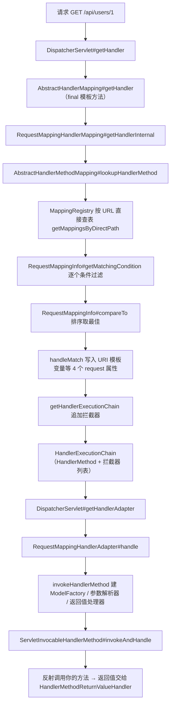
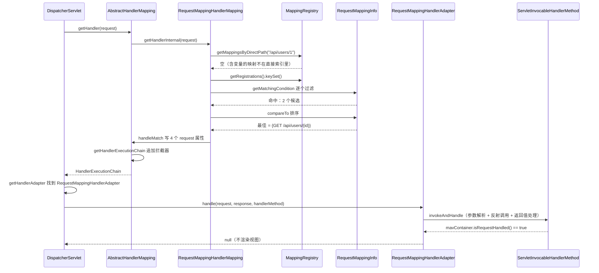

# Spring MVC 源码精读 02：处理器映射与适配器（HandlerMapping / HandlerAdapter）

> 一句话结论：`HandlerMapping` 负责**"这个 URL 该交给谁"**，它的答案是 `HandlerExecutionChain`（一个 `HandlerMethod` + 一组拦截器）；`HandlerAdapter` 负责**"拿到这个谁之后怎么调用它"**，`RequestMappingHandlerAdapter` 是唯一能把 `@RequestMapping` 方法**参数解析 → 反射调用 → 返回值处理**跑完的适配器。
>
> 阅读前置：读完本组 [01-dispatcherservlet-一次请求的完整旅程](01-dispatcherservlet-一次请求的完整旅程.md)（知道 `doDispatch` 的 8 步，知道 `getHandler`/`getHandlerAdapter` 在主干上的位置）；读过 `01-IoC容器与Bean生命周期`（知道 `afterPropertiesSet` 在 Bean 初始化时被调用）。
>
> 预计阅读：55 分钟 ｜ 源码：org.springframework:spring-webmvc:7.1.0

---

## 0. 先看现象（3 分钟上手）

先把四个最常见的"找不到"现象摆出来，本文后面每个都能指回具体代码行。

| 现象 | 异常类型（HTTP 状态） | 抛出位置 |
| --- | --- | --- |
| `POST /api/users` 只写了 `@GetMapping` | `HttpRequestMethodNotSupportedException`（405） | `RequestMappingInfoHandlerMapping#handleNoMatch` |
| `Content-Type: application/xml` 打到 `@PostMapping(consumes="application/json")` | `HttpMediaTypeNotSupportedException`（415） | 同上 |
| `Accept: application/xml` 打到 `produces="application/json"` | `HttpMediaTypeNotAcceptableException`（406） | 同上 |
| 两个方法都能匹配 `/api/users/{id}` | `IllegalStateException: Ambiguous handler methods mapped for '/api/users/1'`（500） | `AbstractHandlerMethodMapping#lookupHandlerMethod` |

再补一个启动期的：

```text
// 片段：你自己写的两个 controller 方法，Spring 启动时就报错，不用等请求
@RestController
class UserController {
	@GetMapping("/api/users/{id}")
	public User byId(@PathVariable Long id) { ... }

	@GetMapping("/api/users/{name}")
	public User byName(@PathVariable String name) { ... }
}
```

- **现象**：应用启动失败，栈顶是 `IllegalStateException: Ambiguous mapping. Cannot map 'userController' method ... to {GET /api/users/{id}}`。
- **原因**：这两个映射的 `RequestMappingInfo` 在 `MappingRegistry#register` 时 `equals` 为真（路径模式串相同），所以启动期就拒绝注册，而不是运行期才 500。**注意和上表最后一行区分**：启动期的 `Ambiguous mapping` 是"注册冲突"，运行期的 `Ambiguous handler methods mapped` 是"多个模式都能匹配同一个真实 URL"，两者是不同代码。

读完本文你要能做到：给定一个 URL + 一堆 `@RequestMapping`，**按库里的排序规则手算出哪个方法赢**。

## 1. 整体地图（先图后码）



**读图说明**：图的**上半部分（B~K）是"找"**，产出物是 `HandlerExecutionChain`；**下半部分（L~P）是"调"**，产出物是 `ModelAndView`（`@ResponseBody` 时是 `null`，因为响应已经在 `P` 里写完了）。注意 `F` 是性能关键：`MappingRegistry` 里维护了 `pathLookup` 索引，能 O(1) 按 URL 反查候选映射，只有查不到时才退化成"遍历全部映射"（图里没画这条退化分支，见 §3.2）。`I` 那一步就是 `@PathVariable` 能拿到值的**全部秘密**——值存在 request attribute 里，不是在方法参数上。

## 2. 关键类逐个拆

| 类 | 一句话职责 | 关键方法 |
| --- | --- | --- |
| `HandlerMapping`（接口） | 把 `HttpServletRequest` 映射成 `HandlerExecutionChain` | `getHandler`；`usesPathPatterns()`（7.1 新增默认方法，返回 `false`） |
| `AbstractHandlerMapping` | 模板方法：`getHandlerInternal` → 包装默认 handler → **拼拦截器** → CORS | `getHandler`（`final`）、`getHandlerExecutionChain` |
| `RequestMappingHandlerMapping` | 判断"这个 Bean 是不是 controller"，扫描其方法生成 `RequestMappingInfo` | `isHandler`、`getMappingForMethod`、`createRequestMappingInfo` |
| `AbstractHandlerMethodMapping` | 启动时建"映射 → 方法"注册表；运行期按 URL 查找 | `initHandlerMethods`、`detectHandlerMethods`、`lookupHandlerMethod` |
| `RequestMappingInfoHandlerMapping` | 真正做**路径匹配细节 + 匹配失败时抛哪种异常** | `handleMatch`、`handleNoMatch` |
| `RequestMappingInfo` | 一个 mapping 的**全部条件**打包：路径、方法、参数、头、consumes、produces、version | `getMatchingCondition`、`combine`、`compareTo` |
| `HandlerMethod` | "Bean + Method"的只读描述对象，外加 `MethodParameter[]` | `createWithResolvedBean` |
| `HandlerExecutionChain` | handler + 拦截器数组 | `applyPreHandle` / `applyPostHandle` / `triggerAfterCompletion` |
| `HandlerAdapter`（接口） | 判断"我能不能执行这个 handler"，能就执行并返回 `ModelAndView` | `supports`、`handle` |
| `RequestMappingHandlerAdapter` | 装配参数解析器、返回值处理器、消息转换器、`@ControllerAdvice` 缓存 | `afterPropertiesSet`、`invokeHandlerMethod`、`getModelAndView` |
| `ServletInvocableHandlerMethod` | 具体执行一次调用，并按返回值决定"要不要渲染视图" | `invokeAndHandle` |

三个容易搞混的点先说清楚：

1. **`HandlerMapping` 返回的是 `HandlerExecutionChain`，不是 handler 本身**。拦截器是在 `AbstractHandlerMapping#getHandlerExecutionChain` 里"贴"上去的，所以拦截器和 `HandlerMapping` 的 `order` 有关。
2. **`HandlerAdapter` 的选择依据是 handler 的"类型"，不是 URL**。`RequestMappingHandlerAdapter#supportsInternal` 直接 `return true`——它是"冠军兜底"，因为排在它前面的 `HttpRequestHandlerAdapter`、`SimpleControllerHandlerAdapter` 认得更具体；而 `HandlerFunctionAdapter` 排在最后（`WebMvcConfigurationSupport` 里 `order = 2`）。这一点见 §3.6。
3. **路径匹配在 6/7 里默认走 `PathPattern`，不是 `AntPathMatcher`**。判断依据是 `AbstractHandlerMapping#usesPathPatterns()` 返回 `getPatternParser() != null`。

## 3. 源码逐段精读

### 3.1 `HandlerMapping` 与 `HandlerAdapter`：两个只有 1~2 个方法的接口

```java (src: HandlerMapping.java#L168-L170)
	default boolean usesPathPatterns() {
		return false;
	}
```

```java (src: HandlerMapping.java#L187-L187)
	@Nullable HandlerExecutionChain getHandler(HttpServletRequest request) throws Exception;
```

```java (src: HandlerAdapter.java#L62-L62)
	boolean supports(Object handler);
```

```java (src: HandlerAdapter.java#L76-L76)
	@Nullable ModelAndView handle(HttpServletRequest request, HttpServletResponse response, Object handler) throws Exception;
```

- **在干什么**：`HandlerMapping#getHandler` = 找 handler；`HandlerAdapter#supports` = 声明"这个 handler 我认识"；`handle` = 执行它。`usesPathPatterns()` 是 7.x 新增的默认方法，`DispatcherServlet` 靠它决定**要不要在 `doService` 里预先 `ServletRequestPathUtils.parseAndCache(request)`**。
- **为什么这么拆**：`HandlerMapping` 产出 `Object`（可以是 `HandlerMethod`、`String` bean 名、`HttpRequestHandler`、`Servlet`……），如果执行逻辑写在 mapping 里，每加一种 handler 就要改 mapping。拆出 `HandlerAdapter` 后，**新增 handler 类型 = 新增一个 adapter**，`doDispatch` 一行不改。
- **如果 `getHandler` 返回 `null`**：`DispatcherServlet` 会走 `noHandlerFound` → 抛 `NoHandlerFoundException`（404 的来源之一）。
- **常见坑**：`HandlerMapping` 的 Javadoc 明确写了**不要把拦截器当安全层**（`HandlerInterceptor` 同样有这条警告），因为拦截器只在 handler 被找到之后才执行，404 路径根本不会经过它。

### 3.2 "为什么我的 `@Controller` 能被找到"：启动期扫描

`HandlerMapping` 的子类都是 `InitializingBean`，容器初始化它们时触发 `afterPropertiesSet`，于是开始扫全容器的 Bean：

```java (src: AbstractHandlerMethodMapping.java#L217-L224)
	protected void initHandlerMethods() {
		for (String beanName : getCandidateBeanNames()) {
			if (!beanName.startsWith(SCOPED_TARGET_NAME_PREFIX)) {
				processCandidateBean(beanName);
			}
		}
		handlerMethodsInitialized(getHandlerMethods());
	}
```

- **在干什么**：遍历"候选 Bean 名"，跳过 `scopedTarget.` 前缀（那是 `@Scope(proxyMode)` 生成的代理壳），逐个 `processCandidateBean`。
- **为什么跳过 `scopedTarget.`**：一个 `@Scope("request")` 的 controller 在容器里有两个名字：`scopedTarget.userController`（真实 Bean）与 `userController`（代理）。只注册一次，否则同一个方法会被注册两次，启动就报 `Ambiguous mapping`。
- **如果不去重**：所有 `@RequestScope` 的 controller 都会重复注册。这是历史真实 bug（见 spring-framework #18089 一类的 issue）。
- **常见坑**：`SCOPED_TARGET_NAME_PREFIX` 是常量 `"scopedTarget."`，别在你自己的 Bean 名前缀里用它。

接下来是"候选从哪来"和"怎么判断是不是 controller"：

```java (src: AbstractHandlerMethodMapping.java#L232-L236)
	protected String[] getCandidateBeanNames() {
		return (this.detectHandlerMethodsInAncestorContexts ?
				BeanFactoryUtils.beanNamesForTypeIncludingAncestors(obtainApplicationContext(), Object.class) :
				obtainApplicationContext().getBeanNamesForType(Object.class));
	}
```

```java (src: RequestMappingHandlerMapping.java#L176-L179)
	@Override
	protected boolean isHandler(Class<?> beanType) {
		return AnnotatedElementUtils.hasAnnotation(beanType, Controller.class);
	}
```

- **在干什么**：`getCandidateBeanNames` 拿到的是**所有 Bean 的名字**（`Object.class` 类型查询），不做任何类型过滤；`isHandler` 才是真正的过滤条件。
- **为什么用 `getBeanNamesForType(Object.class)` 而不是 `getBeanNamesForAnnotation(Controller.class)`**：因为它要支持**用户自定义的 `HandlerMapping` 子类**只重写 `isHandler` 就能识别别的注解（比如 `@HttpExchange`）。`AbstractHandlerMethodMapping` 本身并不知道 `@Controller`。
- **为什么 `@RestController` 也算**：`@RestController` 元注解里带着 `@Controller`，`AnnotatedElementUtils.hasAnnotation` 会做**元注解递归查找**（等价于 `@AliasFor`/组合注解的支持）。
- **如果换成 `beanType.isAnnotationPresent(Controller.class)`**：`@RestController` 直接失效，因为那是**直接注解**查询，不看元注解。这是新手最常见的手改坑。
- **常见坑**：`getBeanNamesForType(Object.class)` **不会实例化 Bean**，所以 `@Lazy` 的 controller 也能被扫到名字；但 `processCandidateBean` 里 `getType(beanName)` 之后如果拿不到类型（例如 `FactoryBean` 未初始化），代码会**吞掉异常**并跳过——见 §3.3。

```java (src: AbstractHandlerMethodMapping.java#L249-L263)
	protected void processCandidateBean(String beanName) {
		Class<?> beanType = null;
		try {
			beanType = obtainApplicationContext().getType(beanName);
		}
		catch (Throwable ex) {
			// An unresolvable bean type, probably from a lazy bean - let's ignore it.
			if (logger.isTraceEnabled()) {
				logger.trace("Could not resolve type for bean '" + beanName + "'", ex);
			}
		}
		if (beanType != null && isHandler(beanType)) {
			detectHandlerMethods(beanName);
		}
	}
```

- **在干什么**：先解析出 Bean 的**类型**（不创建实例），是 controller 才继续扫方法。
- **为什么 catch `Throwable` 并忽略**：懒加载 Bean 的类型解析可能触发 `BeanCreationException`，启动阶段不该因为"暂时用不到的 Bean"而失败。
- **如果这里不吞异常**：一个坏掉的 `@Lazy` Bean 会让整个 MVC 启动失败，即便它跟路由毫无关系。
- **常见坑**：正因为"吞异常 + 只打 trace 日志"，**你的 controller 没被注册时启动日志里往往是静的**——排查时要把 `org.springframework.web` 日志级别调到 `TRACE`，或者直接看 `RequestMappingHandlerMapping` 启动后打印的映射表（`getHandlerMethods()`）。

真正扫方法的是 `detectHandlerMethods`：它对**每个方法**调 `getMappingForMethod`，拿到非 `null` 的 `RequestMappingInfo` 才注册。

```java (src: RequestMappingHandlerMapping.java#L199-L218)
	@Override
	protected @Nullable RequestMappingInfo getMappingForMethod(Method method, Class<?> handlerType) {
		validateCglibProxyMethodVisibility(method, handlerType);

		RequestMappingInfo info = createRequestMappingInfo(method);
		if (info != null) {
			RequestMappingInfo typeInfo = createRequestMappingInfo(handlerType);
			if (typeInfo != null) {
				info = typeInfo.combine(info);
			}
			if (info.isEmptyMapping()) {
				info = info.mutate().paths("", "/").options(this.config).build();
			}
			String prefix = getPathPrefix(handlerType);
			if (prefix != null) {
				info = RequestMappingInfo.paths(prefix).options(this.config).build().combine(info);
			}
		}
		return info;
	}
```

- **在干什么**：先给**方法级**注解建 `RequestMappingInfo`，再把**类级**注解 combine 进去（`typeInfo.combine(info)` —— 类在前、方法在后，所以路径是"类路径 + 方法路径"），最后再合并 `getPathPrefix`（例如 `WebMvcConfigurer#configurePathMatch` 里配的全局前缀）。
- **为什么类级要 `combine` 在方法级前面**：`RequestMappingInfo#combine` 的语义是"其它条件继承 + 路径拼接"，`this` 是类级、`other` 是方法级，方法级的 `methods`/`consumes` 等会**覆盖**类级的默认值。
- **如果 `info == null`**：说明方法上既没有 `@RequestMapping` 也没有 `@HttpExchange`（`@GetMapping` 是 `@RequestMapping` 的元注解），方法直接被忽略，不报错。
- **常见坑**：**方法上的每个注解都能独立生效，但类上的 `@RequestMapping` 不能"补"方法上缺的路径**。也就是说 `@RequestMapping("/api")` 加在类上、方法上只有 `@GetMapping`（无路径）时，实际路径是 `/api`（见 §3.3）。

```java (src: RequestMappingHandlerMapping.java#L364-L382)
	protected RequestMappingInfo createRequestMappingInfo(
			RequestMapping requestMapping, @Nullable RequestCondition<?> customCondition) {

		RequestMappingInfo.Builder builder = RequestMappingInfo
				.paths(resolveEmbeddedValuesInPatterns(requestMapping.path()))
				.methods(requestMapping.method())
				.params(requestMapping.params())
				.headers(requestMapping.headers())
				.consumes(requestMapping.consumes())
				.produces(requestMapping.produces())
				.version(requestMapping.version())
				.mappingName(requestMapping.name());

		if (customCondition != null) {
			builder.customCondition(customCondition);
		}

		return builder.options(this.config).build();
	}
```

- **在干什么**：把注解上的**7 组属性**一一映射成 `RequestMappingInfo` 的 8 个条件对象（`pathPatterns`/`patterns`、`methods`、`params`、`headers`、`consumes`、`produces`、`version`、`custom`）。`resolveEmbeddedValuesInPatterns` 会把 `${...}` 占位符用 `EmbeddedValueResolver` 解析掉。
- **为什么参数里有 `customCondition`**：`@RequestMapping` 与 Spring 7 的 `@HttpExchange` 走同一个构建过程（见 L265-304），后者需要额外条件。
- **如果 `options(this.config)` 少了**：`RequestMappingInfo` 里没有 `PathPatternParser`，`combine`/`compareTo` 时无法预计算路径，6.x 起会直接抛错——`config` 里携带的正是 `PatternParser`（或老的 `PathMatcher`）。
- **常见坑**：`@RequestMapping(method = {})` 是**合法的**（表示"任意方法"），在排序里它会输给显式声明方法的映射（见 §3.5 的 `compareTo`）。

`afterPropertiesSet` 负责把 `config` 准备好：

```java (src: RequestMappingHandlerMapping.java#L140-L155)
	@Override
	@SuppressWarnings("removal")
	public void afterPropertiesSet() {
		this.config = new RequestMappingInfo.BuilderConfiguration();
		this.config.setContentNegotiationManager(getContentNegotiationManager());
		this.config.setApiVersionStrategy(getApiVersionStrategy());

		if (getPatternParser() != null) {
			this.config.setPatternParser(getPatternParser());
		}
		else {
			this.config.setPathMatcher(getPathMatcher());
		}

		super.afterPropertiesSet();
	}
```

- **在干什么**：先构造 `BuilderConfiguration`（决定"用 `PathPatternParser` 还是 `AntPathMatcher`"），再调父类 `afterPropertiesSet` → 触发 §3.2 的扫描。
- **为什么这样写**：7.1 的 `afterPropertiesSet` 只在 `PatternParser`（`PathPattern`）与 `PathMatcher`（`AntPathMatcher`）之间二选一，`useSuffixPatternMatch`/`useTrailingSlashMatch` 两个旧开关已在 5.3 废弃、6.0 移除，源码里没有任何 `Assert` 断言它们。
- **如果 `getPatternParser()` 为 `null`**：退化到 `AntPathMatcher`（`PATH_WITHIN_HANDLER_MAPPING_ATTRIBUTE` 时代的老路径），Boot 里因为 `WebMvcAutoConfiguration` 默认注入了 `PathPatternParser`，所以实际总是走 `PathPattern`。
- **常见坑**：类上 `@RequestMapping` 什么都不写（空 mapping）时，`getMappingForMethod` 会把路径补成 `""` 和 `"/"` 两个（`info.isEmptyMapping()` 分支），这就是"类上写了 `@RequestMapping` 但没路径，方法却能被根路径命中"的原因。

### 3.3 `PathPattern`：6/7 的默认路径匹配规则

```java (src: PathPattern.java#L41-L51)
 * <p>{@code PathPattern} matches URL paths using the following rules:<br>
 * <ul>
 * <li>{@code ?} matches one character</li>
 * <li>{@code *} matches zero or more characters within a path segment</li>
 * <li>{@code **} matches zero or more <em>path segments</em> until the end of the path</li>
 * <li><code>{spring}</code> matches a <em>path segment</em> and captures it as a variable named "spring"</li>
 * <li><code>{spring:[a-z]+}</code> matches the regexp {@code [a-z]+} against a path segment
 * and captures it as a path variable named "spring"</li>
 * <li><code>{*spring}</code> matches zero or more <em>path segments</em> until the end of the path
 * and captures it as a variable named "spring"</li>
 * </ul>
```

```java (src: PathPattern.java#L53-L58)
 * <p><strong>Note:</strong> In contrast to
 * {@link org.springframework.util.AntPathMatcher}, {@code **} is supported only
 * at the end of a pattern. For example {@code /pages/{**}} is valid but
 * {@code /pages/{**}/details} is not. The same applies also to the capturing
 * variant <code>{*spring}</code>. The aim is to eliminate ambiguity when
 * comparing patterns for specificity.
```

- **在干什么**：`PathPattern` 是"预解析成元素链"的路径模式；`**` 只能出现在**末尾**，`{*spring}` 会**捕获剩余整段（带前导 `/`）**。
- **为什么限制 `**` 只能在末尾**：为了"特异性可比较"——`/pages/{**}/details` 与 `/pages/{*path}/details` 无法做安全的优先级比较，会引入歧义。`AntPathMatcher` 允许它，代价是排序不确定。
- **如果从 `AntPathMatcher` 迁过来**：所有 `/a/**/b` 形式的映射在 6.x 起是**启动期报错**（`PatternParseException`），必须改成 `/a/*/b` 或拆成两个映射。
- **常见坑**：`{*path}` 捕获的是**空串以外的 "/x/y"**，而 `{path}` 只匹配**单段**；`/resources/{*path}` 能同时匹配 `/resources` 和 `/resources/css/spring.css`（后者 `path` = `"/css/spring.css"`），`/resources/{path}` 却匹配不了 `/resources`。

### 3.4 `lookupHandlerMethod`：先查"直接路径"索引，再退化全扫描

- **在干什么**：见下方分段代码，这是运行期最热的一段。

```java (src: AbstractHandlerMethodMapping.java#L371-L382)
	@Override
	protected @Nullable HandlerMethod getHandlerInternal(HttpServletRequest request) throws Exception {
		String lookupPath = initLookupPath(request);
		this.mappingRegistry.acquireReadLock();
		try {
			HandlerMethod handlerMethod = lookupHandlerMethod(lookupPath, request);
			return (handlerMethod != null ? handlerMethod.createWithResolvedBean() : null);
		}
		finally {
			this.mappingRegistry.releaseReadLock();
		}
	}
```

- **在干什么**：先算出 `lookupPath`（当前应用上下文内的路径），**加读锁**后查表，查到后 `createWithResolvedBean()` 把 `HandlerMethod` 里的"Bean 名字"换成真正的 Bean 实例。
- **为什么用读写锁**：`MappingRegistry` 支持运行期 `registerMapping`（`RequestMappingHandlerMapping#registerMapping`），注册时加写锁，查询时加读锁；读多写少，`ReentrantReadWriteLock` 正好。
- **如果直接返回 `HandlerMethod` 而不 `createWithResolvedBean`**：`HandlerMethod` 在注册时是"延迟解析"的（只存 beanName），不解析就没法反射调用。这条设计是为了避免启动期**提前实例化**懒加载的 controller（与 §3.2 的 `getType` 呼应）。
- **常见坑**：`initLookupPath` 在 `PathPattern` 模式下会**读取 `ServletRequestPathUtils` 里缓存的 `RequestPath`**；如果你在 Filter 里改写了 `requestURI` 却没更新这个缓存，`lookupPath` 还是旧的——这是"自定义 Filter 重写 URL 后 404"的根因。

```java (src: AbstractHandlerMethodMapping.java#L393-L419)
	protected @Nullable HandlerMethod lookupHandlerMethod(String lookupPath, HttpServletRequest request) throws Exception {
		List<Match> matches = new ArrayList<>();
		List<T> directPathMatches = this.mappingRegistry.getMappingsByDirectPath(lookupPath);
		if (directPathMatches != null) {
			addMatchingMappings(directPathMatches, matches, request);
		}
		if (matches.isEmpty()) {
			addMatchingMappings(this.mappingRegistry.getRegistrations().keySet(), matches, request);
		}
		if (!matches.isEmpty()) {
			Match bestMatch = matches.get(0);
			if (matches.size() > 1) {
				Comparator<Match> comparator = new MatchComparator(getMappingComparator(request));
				matches.sort(comparator);
				bestMatch = matches.get(0);
				if (logger.isTraceEnabled()) {
					logger.trace(matches.size() + " matching mappings: " + matches);
				}
				if (CorsUtils.isPreFlightRequest(request)) {
					if (matches.stream().allMatch(Match::hasCorsConfig)) {
						return PREFLIGHT_AMBIGUOUS_MATCH;
					}
				}
				else {
					Match secondBestMatch = matches.get(1);
					if (comparator.compare(bestMatch, secondBestMatch) == 0) {
						Method m1 = bestMatch.getHandlerMethod().getMethod();
```

- **在干什么**：① 先按**完全相同的字面路径**（`getMappingsByDirectPath`）取候选——这是绝大多数请求命中的快路径；② 快路径空了才遍历全部映射；③ 多候选时排序取最佳；④ 最佳和次佳**比较结果相等**就抛"歧义"。
- **为什么要 `directPathMatches` 快路径**：`/api/users/list` 这种"无变量"路径不需要跑 `PathPattern` 匹配，直接 `Map` 查表返回候选，省掉正则/元素链匹配。
- **如果没有这条快路径**：每个请求都要对**全部**映射跑一次 `getMatchingCondition`，映射上千时 RT 线性上升。
- **常见坑**：`Ambiguous handler methods mapped` 是**运行期**异常（500），触发条件是"两个 mapping 的 `compareTo` 返回 0"，通常意味着**两个方法在 URL、method、params、headers、consumes、produces 上完全相同**——也就是你写重了，只是路径里变量名不同（`{id}` vs `{name}`），`RequestMappingInfo#equals` 认为不等所以启动不报，但 `compareTo` 认为相等。这两个判定的差异是面试常考点。

```java (src: AbstractHandlerMethodMapping.java#L419-L434)
						Method m1 = bestMatch.getHandlerMethod().getMethod();
						Method m2 = secondBestMatch.getHandlerMethod().getMethod();
						String uri = request.getRequestURI();
						throw new IllegalStateException(
								"Ambiguous handler methods mapped for '" + uri + "': {" + m1 + ", " + m2 + "}");
					}
				}
			}
			request.setAttribute(BEST_MATCHING_HANDLER_ATTRIBUTE, bestMatch.getHandlerMethod());
			handleMatch(bestMatch.mapping, lookupPath, request);
			return bestMatch.getHandlerMethod();
		}
		else {
			return handleNoMatch(this.mappingRegistry.getRegistrations().keySet(), lookupPath, request);
		}
	}
```

- **在干什么**：命中后写入 `BEST_MATCHING_HANDLER_ATTRIBUTE`（给 `RequestMappingInfoHandlerMapping` 和可观测性用），然后 `handleMatch` 填路径变量，返回方法。
- **为什么要在 request 上留"最佳 handler"**：`ExceptionHandlerExceptionResolver` 在异常时拿不到 `handler` 的场合（如 `NoHandlerFoundException`）之外，还需要它做**错误归因**；另外 Observation/Micrometer 会用它打 tag。
- **如果 `matches` 为空**：走 `handleNoMatch`，这是 405/415/406 的唯一来源（§3.5）。
- **常见坑**：`handleMatch` 返回前会把 `PATH_WITHIN_HANDLER_MAPPING_ATTRIBUTE` 写成 `lookupPath`——`/a` 与 `/a/`（尾斜杠）在 `PathPattern` 模式下**不是同一个**，除非映射写了两个模式。

### 3.5 `handleMatch` 填了什么、`handleNoMatch` 抛哪种异常

```java (src: RequestMappingInfoHandlerMapping.java#L156-L179)
	private void extractMatchDetails(
			PathPatternsRequestCondition condition, String lookupPath, HttpServletRequest request) {

		PathPattern bestPattern;
		Map<String, String> uriVariables;
		if (condition.isEmptyPathMapping()) {
			bestPattern = condition.getFirstPattern();
			uriVariables = Collections.emptyMap();
		}
		else {
			PathContainer path = ServletRequestPathUtils.getParsedRequestPath(request).pathWithinApplication();
			bestPattern = condition.getFirstPattern();
			PathPattern.PathMatchInfo result = bestPattern.matchAndExtract(path);
			Assert.notNull(result, () ->
					"Expected bestPattern: " + bestPattern + " to match lookupPath " + path);
			uriVariables = result.getUriVariables();
			request.setAttribute(MATRIX_VARIABLES_ATTRIBUTE, result.getMatrixVariables());
		}
		request.setAttribute(BEST_MATCHING_PATH_PATTERN_ATTRIBUTE, bestPattern);
		request.setAttribute(BEST_MATCHING_PATTERN_ATTRIBUTE, bestPattern.getPatternString());
		ServerHttpObservationFilter.findObservationContext(request)
				.ifPresent(context -> context.setPathPattern(bestPattern.getPatternString()));
		request.setAttribute(URI_TEMPLATE_VARIABLES_ATTRIBUTE, uriVariables);
	}
```

- **在干什么**：用**最佳 pattern** 对真实路径跑 `matchAndExtract`，把 4 组结果塞进 request：矩阵变量、最佳 `PathPattern`、最佳 pattern 字符串、**URI 模板变量**（`{id}` 的值就在这里）。
- **为什么变量值不放参数上，放 request attribute**：因为 `PathVariableMethodArgumentResolver` 是**独立策略**，它只认 request attribute；这样"谁解析的"和"谁匹配的"解耦，`Handler` 不是 `HandlerMethod` 的场合（如 `HandlerFunction`）也能复用。
- **如果 `pathPatternsCondition` 为空**：走 `PatternsRequestCondition`（`AntPathMatcher`）分支，行为一致但实现不同；`BEST_MATCHING_PATH_PATTERN_ATTRIBUTE` 只在 `PathPattern` 分支才有值。
- **常见坑**：`BEST_MATCHING_PATTERN_ATTRIBUTE` 的值是 `getPatternString()`，**占位符原样返回**（`/api/users/{id}`），不是展开后的；`@PathVariable` 取的是 `URI_TEMPLATE_VARIABLES_ATTRIBUTE`。

- **在干什么**：见下方分两段读，`handleNoMatch` 是"405/415/406"的**唯一出口**。

```java (src: RequestMappingInfoHandlerMapping.java#L245-L299)
	protected @Nullable HandlerMethod handleNoMatch(
			Set<RequestMappingInfo> infos, String lookupPath, HttpServletRequest request) throws ServletException {

		if (CollectionUtils.isEmpty(infos)) {
			return null;
		}

		PartialMatchHelper helper = new PartialMatchHelper(infos, request);
		if (helper.isEmpty()) {
			return null;
		}

		if (helper.hasMethodsMismatch()) {
			Set<String> methods = helper.getAllowedMethods();
			if (HttpMethod.OPTIONS.matches(request.getMethod())) {
				Set<MediaType> patchMediaTypes = helper.getConsumablePatchMediaTypes();
				Set<MediaType> queryMediaTypes = helper.getConsumableQueryMediaTypes();
				HttpOptionsHandler handler = new HttpOptionsHandler(methods, patchMediaTypes, queryMediaTypes);
				return new HandlerMethod(handler, HTTP_OPTIONS_HANDLE_METHOD);
			}
			if (HttpMethod.HEAD.matches(request.getMethod()) && methods.contains(HttpMethod.QUERY.name())) {
				Set<MediaType> queryMediaTypes = helper.getConsumableQueryMediaTypes();
				HttpHeadQueryHandler handler = new HttpHeadQueryHandler(methods, queryMediaTypes);
				return new HandlerMethod(handler, HTTP_HEAD_QUERY_HANDLE_METHOD);
			}
			throw new HttpRequestMethodNotSupportedException(request.getMethod(), methods);
		}

		if (helper.hasConsumesMismatch()) {
			Set<MediaType> mediaTypes = helper.getConsumableMediaTypes();
			MediaType contentType = null;
			if (StringUtils.hasLength(request.getContentType())) {
				try {
					contentType = MediaType.parseMediaType(request.getContentType());
				}
				catch (InvalidMediaTypeException ex) {
					throw new HttpMediaTypeNotSupportedException(ex.getMessage(), new ArrayList<>(mediaTypes));
				}
			}
			throw new HttpMediaTypeNotSupportedException(
					contentType, new ArrayList<>(mediaTypes), HttpMethod.valueOf(request.getMethod()));
		}

		if (helper.hasProducesMismatch()) {
			Set<MediaType> mediaTypes = helper.getProducibleMediaTypes();
			throw new HttpMediaTypeNotAcceptableException(new ArrayList<>(mediaTypes));
		}

		if (helper.hasParamsMismatch()) {
			List<String[]> conditions = helper.getParamConditions();
			throw new UnsatisfiedServletRequestParameterException(conditions, request.getParameterMap());
		}

		return null;
	}
```

- **在干什么**：`PartialMatchHelper` 收集"**路径能对上、但某个条件对不上**"的映射，然后按 方法 → consumes → produces → params 的顺序，抛**信息量最大**的那个异常。
- **为什么选 `OPTIONS` 特判**：`OPTIONS` 请求要知道"允许哪些方法"；如果同时存在 consumes 不匹配，会返回一个 `HttpOptionsHandler` 来生成 `Allow` 头（Spring 的 CORS 预检也走这条）。
- **如果直接 `return null`**：上层会抛 `NoHandlerFoundException`（404），用户看到"路径不存在"，而实际是"方法不支持"——排查成本大增。也就是说**这条 405/415/406 的分支是为了可诊断性**。
- **常见坑**：`hasMethodsMismatch` 抛的异常里带的 `methods` 是**该路径允许的方法集合**，Spring 会写回 `Allow` 响应头；如果你自己写了 `@ExceptionHandler(HttpRequestMethodNotSupportedException.class)` 并且改写响应，记得手动 `response.setHeader("Allow", ...)`，否则浏览器预检会失败。

### 3.6 `HandlerAdapter`：谁认领这个 handler

```java (src: RequestMappingHandlerAdapter.java#L829-L832)
	@Override
	protected boolean supportsInternal(HandlerMethod handlerMethod) {
		return true;
	}
```

- **在干什么**：`RequestMappingHandlerAdapter` 对**任何 `HandlerMethod`** 都返回 `true`，所以它是 `HandlerMethod` 的"兜底适配器"。
- **为什么可以这么放肆**：`DispatcherServlet#getHandlerAdapter` 是**按 `handlerAdapters` 列表顺序**取第一个 `supports` 为真的；更专一的适配器（`HttpRequestHandlerAdapter` 认 `HttpRequestHandler`、`SimpleControllerHandlerAdapter` 认 `Controller`）排在前面，`RequestMappingHandlerAdapter` 的 `order` 是 0、`HandlerFunctionAdapter` 是 2，所以根本轮不到它去"抢"别人的 handler。
- **如果没有这层"类型 + 顺序"设计**：每加一种 controller 风格都要改 `DispatcherServlet`；有了它，`@RestController`、`RouterFunction`、老 `Controller` 接口可以**同时存在**。
- **常见坑**：自己写 `HandlerAdapter` 时 `supports` 必须**精确**，否则你不知道自己的适配器会在哪个位置抢先认领别人的 handler，导致"我的 handler 被别人的 adapter 执行"。

接下来是 `handle` 的模板：

```java (src: RequestMappingHandlerAdapter.java#L834-L870)
	@Override
	protected @Nullable ModelAndView handleInternal(HttpServletRequest request,
			HttpServletResponse response, HandlerMethod handlerMethod) throws Exception {

		ModelAndView mav;
		checkRequest(request);

		// Execute invokeHandlerMethod in synchronized block if required.
		if (this.synchronizeOnSession) {
			HttpSession session = request.getSession(false);
			if (session != null) {
				Object mutex = WebUtils.getSessionMutex(session);
				synchronized (mutex) {
					mav = invokeHandlerMethod(request, response, handlerMethod);
				}
			}
			else {
				// No HttpSession available -> no mutex necessary
				mav = invokeHandlerMethod(request, response, handlerMethod);
			}
		}
		else {
			// No synchronization on session demanded at all...
			mav = invokeHandlerMethod(request, response, handlerMethod);
		}

		if (!response.containsHeader(HEADER_CACHE_CONTROL)) {
			if (getSessionAttributesHandler(handlerMethod).hasSessionAttributes()) {
				applyCacheSeconds(response, this.cacheSecondsForSessionAttributeHandlers);
			}
			else {
				prepareResponse(response);
			}
		}

		return mav;
	}
```

- **在干什么**：`checkRequest` 做 HTTP 方法合法性检查（比如 `HttpServlet` 的 `TRACE` 不支持时抛 405），`synchronizeOnSession=true` 时按 **session 互斥锁**串行化调用（老 API，现已很少用）。
- **为什么 `synchronizeOnSession` 被边缘化**：它会**串行化同一 session 的所有请求**，性能极差，而且和 WebFlux/异步模型不兼容。Boot 里没有对应的自动配置属性，只能手写 `@Bean`。
- **如果设成 `true`**：同一用户并发两个请求会互相等待；SSE/异步会直接卡住。
- **常见坑**：`checkRequest` 的注释写了"**可能是 HEAD**"——`HttpServlet#doHead` 会复用 `doGet`，所以 `HEAD` 请求也会跑完整的 controller，然后被 `NoBodyResponse` 吞掉 body。

真正干活的 `invokeHandlerMethod`（这一段是 02 与 03 的接力点，本文只讲"装配"，参数/返回值的细节见 [03-参数解析与返回值处理](03-参数解析与返回值处理-argumentresolver与converter.md)）：

```java (src: RequestMappingHandlerAdapter.java#L889-L912)
	protected @Nullable ModelAndView invokeHandlerMethod(HttpServletRequest request,
			HttpServletResponse response, HandlerMethod handlerMethod) throws Exception {

		WebAsyncManager asyncManager = WebAsyncUtils.getAsyncManager(request);
		AsyncWebRequest asyncWebRequest = WebAsyncUtils.createAsyncWebRequest(request, response);
		asyncWebRequest.setTimeout(this.asyncRequestTimeout);

		asyncManager.setTaskExecutor(this.taskExecutor);
		asyncManager.setAsyncWebRequest(asyncWebRequest);
		asyncManager.registerCallableInterceptors(this.callableInterceptors);
		asyncManager.registerDeferredResultInterceptors(this.deferredResultInterceptors);

		// Obtain wrapped response to enforce lifecycle rule from Servlet spec, section 2.3.3.4
		response = asyncWebRequest.getNativeResponse(HttpServletResponse.class);

		ServletWebRequest webRequest = (asyncWebRequest instanceof ServletWebRequest servletWebRequest ?
				servletWebRequest : new ServletWebRequest(request, response));

		WebDataBinderFactory binderFactory = getDataBinderFactory(handlerMethod);
		ModelFactory modelFactory = getModelFactory(handlerMethod, binderFactory);

		ServletInvocableHandlerMethod invocableMethod = createInvocableHandlerMethod(handlerMethod);
		if (this.argumentResolvers != null) {
			invocableMethod.setHandlerMethodArgumentResolvers(this.argumentResolvers);
```

- **在干什么**：为本次调用准备 5 样东西：① `WebAsyncManager`（支持 `Callable`/`DeferredResult`）；② `ServletWebRequest`（`HandlerMethodArgumentResolver` 面向的请求抽象）；③ `DataBinderFactory`（`@ModelAttribute`/类型转换用）；④ `ModelFactory`（`@ModelAttribute` 方法 + `@SessionAttributes`）；⑤ `ServletInvocableHandlerMethod`（真正的执行器）。
- **为什么每次请求都新建 `ServletInvocableHandlerMethod`**：它是有状态的（保存本次的 `argumentResolvers`/`returnValueHandlers`/`binderFactory`/`parameterNameDiscoverer`），不能跨请求共享；而 `RequestMappingHandlerAdapter` 本身是**单例**，这些"每请求状态"必须放请求级对象里。
- **如果不区分**：把参数解析器状态放 adapter 上，多线程并发会**串号**——这是框架层最忌讳的 bug。
- **常见坑**：`WebAsyncUtils.createAsyncWebRequest` 返回的 `asyncRequest` 会包装 `response`，`invokeHandlerMethod` 后续用的是 `nativeResponse`（`getNativeResponse`），但 `ServletWebRequest` 里拿到的仍是包装对象——异步容器下可能拿到 `null`，这就是 6.x 修过的"NPE in async with wrapped response"一类问题的土壤。

```java (src: RequestMappingHandlerAdapter.java#L912-L944)
			invocableMethod.setHandlerMethodArgumentResolvers(this.argumentResolvers);
		}
		if (this.returnValueHandlers != null) {
			invocableMethod.setHandlerMethodReturnValueHandlers(this.returnValueHandlers);
		}
		invocableMethod.setDataBinderFactory(binderFactory);
		invocableMethod.setParameterNameDiscoverer(this.parameterNameDiscoverer);
		invocableMethod.setMethodValidator(this.methodValidator);

		ModelAndViewContainer mavContainer = new ModelAndViewContainer();
		mavContainer.addAllAttributes(RequestContextUtils.getInputFlashMap(request));
		modelFactory.initModel(webRequest, mavContainer, invocableMethod);

		if (asyncManager.hasConcurrentResult()) {
			Object result = asyncManager.getConcurrentResult();
			Object[] resultContext = asyncManager.getConcurrentResultContext();
			Assert.state(resultContext != null && resultContext.length > 0, "Missing result context");
			mavContainer = (ModelAndViewContainer) resultContext[0];
			asyncManager.clearConcurrentResult();
			LogFormatUtils.traceDebug(logger, traceOn -> {
				String formatted = LogFormatUtils.formatValue(result, !traceOn);
				return "Resume with async result [" + formatted + "]";
			});
			invocableMethod = invocableMethod.wrapConcurrentResult(result);
		}

		invocableMethod.invokeAndHandle(webRequest, mavContainer);
		if (asyncManager.isConcurrentHandlingStarted()) {
			return null;
		}

		return getModelAndView(mavContainer, modelFactory, webRequest);
	}
```

- **在干什么**：把 4 个策略对象注入执行器 → 建 `ModelAndViewContainer`（本次调用的输出容器）→ 用 FlashMap 里带过来的属性预填 model → `invokeAndHandle` 执行 → 异步已开始则返回 `null`（响应还没写完）→ 否则把容器转成 `ModelAndView`。
- **为什么 model 要预填 `inputFlashMap`**：重定向后（PRG 模式）的 flash 属性需要在下一个请求里"出现在 model 中"，所以先塞进容器，再让 `ModelFactory` 与 controller 的 `@ModelAttribute` 方法叠加。
- **如果跳过 `getModelAndView`**：`@ResponseBody` 时 `mavContainer.isRequestHandled()` 为 `true`，`getModelAndView` 返回 `null`，`doDispatch` 拿到 `null` 就不会渲染视图——**这就是 `@RestController` 不走 `ViewResolver` 的原因**。
- **常见坑**：`invokeAndHandle` 抛出的是**原始业务异常**（`InvocableHandlerMethod#doInvoke` 里 `InvocationTargetException` 被 unwrap 了），所以 `@ExceptionHandler` 能拿到你抛的那个类型，而不是 `InvocationTargetException`。

`getModelAndView` 是"最后一道判定"：

```java (src: RequestMappingHandlerAdapter.java#L1041-L1058)
	private @Nullable ModelAndView getModelAndView(ModelAndViewContainer mavContainer,
			ModelFactory modelFactory, NativeWebRequest webRequest) throws Exception {

		modelFactory.updateModel(webRequest, mavContainer);
		if (mavContainer.isRequestHandled()) {
			return null;
		}
		ModelMap model = mavContainer.getModel();
		ModelAndView mav = new ModelAndView(mavContainer.getViewName(), model, mavContainer.getStatus());
		if (!mavContainer.isViewReference()) {
			mav.setView((View) mavContainer.getView());
		}
		if (model instanceof RedirectAttributes redirectAttributes) {
			Map<String, ?> flashAttributes = redirectAttributes.getFlashAttributes();
			HttpServletRequest request = webRequest.getNativeRequest(HttpServletRequest.class);
			if (request != null) {
				RequestContextUtils.getOutputFlashMap(request).putAll(flashAttributes);
			}
```

- **在干什么**：先 `modelFactory.updateModel`（把 `@SessionAttributes` 的差异写回 session），`isRequestHandled()` 为真就返回 `null`；否则装出 `ModelAndView`，并把 `RedirectAttributes` 的 flash 属性搬到 `outputFlashMap`。
- **为什么"请求已处理"要单独判断**：`@ResponseBody`、`ResponseEntity`、`void` 加 `@ResponseStatus` 等路径已经在 `ServletInvocableHandlerMethod` 里把响应写完，再让 `doDispatch` 渲染会产生"二次写响应"。
- **如果这里返回 `new ModelAndView()` 而不是 `null`**：`doDispatch` 会调 `render`，`viewName` 为 `null` 时走 `applyDefaultViewName`（用 `RequestToViewNameTranslator` 从 URL 推视图名），于是 `@ResponseBody` 的接口返回 404 式的"视图找不到"错误。
- **常见坑**：`redirect:` 前缀的视图名会先经过 `RedirectView`，flash 属性必须在**这次**被放进 outputFlashMap，否则下个请求读不到。

### 3.7 启动期装配：`afterPropertiesSet` 里的"三件套"

```java (src: RequestMappingHandlerAdapter.java#L550-L575)
	@Override
	public void afterPropertiesSet() {
		// Do this first, it may add ResponseBody advice beans
		initControllerAdviceCache();
		initMessageConverters();

		if (this.argumentResolvers == null) {
			List<HandlerMethodArgumentResolver> resolvers = getDefaultArgumentResolvers();
			this.argumentResolvers = new HandlerMethodArgumentResolverComposite().addResolvers(resolvers);
		}
		if (this.initBinderArgumentResolvers == null) {
			List<HandlerMethodArgumentResolver> resolvers = getDefaultInitBinderArgumentResolvers();
			this.initBinderArgumentResolvers = new HandlerMethodArgumentResolverComposite().addResolvers(resolvers);
		}
		if (this.returnValueHandlers == null) {
			List<HandlerMethodReturnValueHandler> handlers = getDefaultReturnValueHandlers();
			this.returnValueHandlers = new HandlerMethodReturnValueHandlerComposite().addHandlers(handlers);
		}
		if (BEAN_VALIDATION_PRESENT) {
			List<HandlerMethodArgumentResolver> resolvers = this.argumentResolvers.getResolvers();
			this.methodValidator = HandlerMethodValidator.from(
					this.webBindingInitializer, this.parameterNameDiscoverer,
					methodParamPredicate(resolvers, ModelAttributeMethodProcessor.class),
					methodParamPredicate(resolvers, RequestParamMethodArgumentResolver.class));
		}
	}
```

- **在干什么**：初始化顺序非常有讲究——**先** `initControllerAdviceCache`（因为它可能往 `requestResponseBodyAdvice` 里塞 Bean，而这些 Bean 会被 `RequestResponseBodyMethodProcessor` 消费），**再**建三个 `Composite`，**最后** `initMessageConverters`。
- **为什么 `@ControllerAdvice` 必须先初始化**：`getDefaultArgumentResolvers()` 里 `RequestResponseBodyMethodProcessor` 的构造参数是 `this.requestResponseBodyAdvice`，如果 advice 缓存还没建，`ResponseBodyAdvice` 就永远不生效（`beforeBodyWrite` 不会被调用）。
- **如果参数解析器不是 `null`**：说明有人显式 `setArgumentResolvers`（`WebMvcConfigurer#addArgumentResolvers` 不算，它走的是"append custom resolvers"），默认值就会被**完全跳过**——这是"我加了自定义 resolver 后 `@RequestParam` 突然不认了"的根因。
- **常见坑**：`initMessageConverters` 只在 `messageConverters` **为空**时才注册默认值（`ByteArray`/`String`/`Form`/`Multipart`）；Boot 里由 `HttpMessageConvertersAutoConfiguration` 先塞入（含 JSON），所以这一句在 Boot 下通常是空操作。

## 4. 一次完整执行时序



**读图说明**：注意 `MR-->>RHM: 空（含变量的映射不在直接索引里）`——**带 `{id}` 的映射没有"直接路径"**，所以 `/api/users/1` 这类请求会走"遍历全部映射"的慢路径；而 `/api/users/list` 这种纯字面路径走快路径。这就是为什么"海量变量路径"的路由表在 7.1 里仍有性能讨论。最后 `RHA-->>DS: null` 对应 §3.6 的 `getModelAndView`，`null` 意味着响应已写好，`doDispatch` 的 `render` 被跳过。

## 5. 设计模式与设计取舍

| 模式 | 出现位置 | 取舍 |
| --- | --- | --- |
| 模板方法 | `AbstractHandlerMapping#getHandler`（`final`）调 `getHandlerInternal`（抽象） | 固定"查 handler→默认 handler→拼拦截器→CORS"骨架，子类只实现"查"，无法破坏骨架 |
| 策略（Strategy） | `HandlerMapping` / `HandlerAdapter` / `HandlerMethodReturnValueHandler` 全家 | 加一种新 handler 风格只需新增一对 mapping+adapter，`doDispatch` 零改动 |
| 组合（Composite） | `HandlerMethodArgumentResolverComposite`、`HandlerMethodReturnValueHandlerComposite` | 把"顺序 + 缓存"封装起来，`InvocableHandlerMethod` 只看到两个接口 |
| 注册表 + 读写锁 | `MappingRegistry`（`pathLookup` + `mappingLookup`） | 支持启动后动态 `registerMapping`；读多写少用 `ReentrantReadWriteLock` 换并发 |
| 预解析 + 可比性 | `PathPattern` 把模式解析元素链并预计算特异性 | 排序变成 O(1) 比较，代价是禁止 `**` 出现在中间 |

**最大的取舍**：`lookupHandlerMethod` 的"快路径 + 全扫描退化"是**用内存换 CPU**——`pathLookup` 里给每个映射的所有模式建索引，映射多了内存涨；但换来纯字面路径 O(1)。Spring 选了"通用性优先、极端场景交给用户（`RouterFunction` / 网关）"。

## 6. 踩坑与调试手法

### 6.1 我的 controller 根本没被注册

1. 确认类上有 `@Controller`/`@RestController`，且**在组件扫描范围内**（`@SpringBootApplication` 所在包或其子包）。
2. 把 `logging.level.org.springframework.web=TRACE` 打开，找 `RequestMappingHandlerMapping` 的 "Mapped ..." 日志；启动日志里如果有 `Ambiguous mapping`，是注册冲突。
3. 如果是 `@Scope("request")` 的 controller，检查是否被 `SCOPED_TARGET_NAME_PREFIX`（`scopedTarget.`）过滤掉了真实方法。
4. 如果 CGLIB 代理把方法变成 `private`，`validateCglibProxyMethodVisibility` 会抛 `IllegalStateException`（7.0 起）。

### 6.2 405 还是 404，一眼分辨

`handleNoMatch` 只有在"**路径能匹配**但其它条件不匹配"时才抛 405/415/406。若路径模式本身就不匹配，`PartialMatchHelper` 为空 → 返回 `null` → `NoHandlerFoundException`（404）。所以**先用 OPTIONS 打一下**：能返回 `Allow` 头就说明路径是通的，问题在方法/头/媒体类型上。

### 6.3 用 Actuator 的路由表看真相

`/actuator/mappings` 会打印 `RequestMappingHandlerMapping` 里注册的全部 `RequestMappingInfo`（包括 combine 之后的完整路径、methods、produces）。**它比日志可靠**，因为它读的就是 `getHandlerMethods()`。

### 6.4 断点打在哪

- `AbstractHandlerMethodMapping#lookupHandlerMethod`：看 `directPathMatches` 与 `matches` 的大小。
- `RequestMappingInfoHandlerMapping#handleMatch`：看 `URI_TEMPLATE_VARIABLES_ATTRIBUTE` 是否填对。
- `RequestMappingInfo#compareTo`：想搞清"为什么是它赢"就在这里逐个条件看返回值。

## 7. ⚠️ 版本差异

| 项 | 5.3（Boot 2.7） | 6.x（Boot 3.x） | 7.1（Boot 4.x，本文基线） |
| --- | --- | --- | --- |
| 默认路径匹配 | `AntPathMatcher` | `PathPattern`（`PathPatternParser` 默认注入） | `PathPattern` |
| `**` 位置限制 | 任意位置 | 仅末尾 | 仅末尾 |
| `useSuffixPatternMatch` / `useTrailingSlashMatch` | 可用 | `@Deprecated(forRemoval=true)` | 已移除；`afterPropertiesSet` 只选择 `PatternParser` 或 `PathMatcher` |
| `HandlerMapping#usesPathPatterns` | 无 | 有（抽象方法） | `default` 方法返回 `false`，`AbstractHandlerMapping` 返回 `getPatternParser() != null` |
| `BEST_MATCHING_PATH_PATTERN_ATTRIBUTE` | 无 | 有 | 有（`@since 7.1` 补在接口默认常量区） |
| HTTP `PATCH` | `FrameworkServlet` 有 `doPatch` | 同 | `doPatch` 标 `@since 7.1`（正式纳入） |
| CGLIB 代理方法可见性校验 | 无 | 7.0 起新增 | 有 |
| `RequestMappingInfo` 的 `version` 条件 | 无 | 7.0 起（API 版本） | 有 |

另外注意：**Boot 4 里 `@Controller` 的扫描与 `HandlerMapping` 注册完全没变**，变的是"谁把 `PathPatternParser` 注入进来"——由 `WebMvcAutoConfiguration`（`@ConditionalOnMissingBean(WebMvcConfigurationSupport.class)`）完成，所以你一旦自己加 `@EnableWebMvc`，默认注入就消失，需要自己配 `PathPatternParser`。

## 8. 面试高频问与答

**1. `HandlerMapping` 和 `HandlerAdapter` 为什么要分开？**
→ 前者只回答"谁来处理"，产出一个 `Object`；后者回答"怎么调用它"。分开后新增 handler 类型只需加一个 adapter，`DispatcherServlet` 的 `doDispatch` 不需要改，这就是开闭原则在框架主干上的体现。

**2. `@Controller` 是在什么时候被转成 `HandlerMethod` 的？**
→ 容器初始化 `RequestMappingHandlerMapping` 时（`afterPropertiesSet` → `initHandlerMethods`），遍历所有 Bean 名，`isHandler` 用 `AnnotatedElementUtils.hasAnnotation(beanType, Controller.class)`（含元注解）判定，再 `detectHandlerMethods` 对每个方法建 `RequestMappingInfo` 并 `register`。**不是**在第一次请求时。

**3. `@RequestMapping` 到 `RequestMappingInfo` 要经过几次 `combine`？**
→ 通常 2 次：① `typeInfo.combine(methodInfo)`（类级 + 方法级）；② 若有 `pathPrefix`（`configurePathMatch` 的全局前缀）再 `paths(prefix)...combine(info)`。`@HttpExchange` 走同一路径。

**4. 为什么 `@GetMapping` 也能被 `isHandler` 的 `@Controller` 判定覆盖？**
→ `isHandler` 判的是**类**上的 `@Controller`，与方法上写 `@GetMapping` 无关；`@RestController` 是 `@Controller + @ResponseBody` 的组合注解，`AnnotatedElementUtils.hasAnnotation` 会递归元注解，所以也命中。

**5. `Ambiguous mapping`（启动期）和 `Ambiguous handler methods mapped`（运行期）有什么区别？**
→ 前者发生在 `MappingRegistry#register`，判据是 `RequestMappingInfo#equals`（路径模式**字符串**相同）；后者发生在 `lookupHandlerMethod`，判据是 `compareTo == 0`（各条件语义相等，但模式字符串可能不同，如 `{id}` vs `{name}`）。

**6. 一个请求同时能匹配多个映射时，谁赢？**
→ `RequestMappingInfo#compareTo` 的固定顺序：HEAD 请求先比 methods → 路径特异性 → params → headers → consumes → produces → version → methods（隐式 vs 显式）→ custom。全部相等则抛歧义。路径越具体越靠前（`/api/users/list` 胜过 `/api/users/{id}`）。

**7. 为什么 `RequestMappingHandlerAdapter#supportsInternal` 敢直接 `return true`？**
→ 因为适配器按 `order` 排序后逐个 `supports`，`RequestMappingHandlerAdapter` 是 `HandlerMethod` 的兜底；更专一的适配器（`HttpRequestHandlerAdapter`、`SimpleControllerHandlerAdapter`）先被问，`HandlerFunctionAdapter` 排在更后。

**8. `@PathVariable` 的值是从哪来的？**
→ `RequestMappingInfoHandlerMapping#handleMatch` 里 `PathPattern#matchAndExtract` 解析出 `URI_TEMPLATE_VARIABLES_ATTRIBUTE` 写到 request 上，`PathVariableMethodArgumentResolver#resolveName` 从这个 attribute 里按变量名取值。所以**路径匹配阶段就决定了变量值**。

**9. 为什么 `/a/**/b` 在 6.x 起启动就报错？**
→ `PathPattern` 规定 `**` 只能在末尾，目的是消除特异性比较的歧义（`AntPathMatcher` 允许但排序不确定）。见 `PathPattern` 类注释 L53-58。

**10. `HandlerExecutionChain` 里的拦截器是谁加进去的？**
→ `AbstractHandlerMapping#getHandlerExecutionChain`，它遍历 `adaptedInterceptors`（来自 `WebMvcConfigurer#addInterceptors` 与 `MappedInterceptor`），再把它们贴到 handler 上。也就是说拦截器的**装配时机是"找到 handler 之后"**，所以 404 请求不经过拦截器。

**11. `useSuffixPatternMatch` 现在还能用吗？**
→ 这两个开关已经不存在了（5.3 标 `@Deprecated(forRemoval=true)`，6.0 移除）。7.1 的 `RequestMappingHandlerMapping#afterPropertiesSet` 只做一件事：有 `PatternParser` 就用 `PathPattern`，否则回退 `PathMatcher`，不再有后缀匹配相关断言。

**12. 自己写 `HandlerMapping` 要注意什么？**
→ ① 实现 `getHandlerInternal` 而不是 `getHandler`（`getHandler` 是 `final` 模板方法，负责拼拦截器与 CORS）；② 若要 `PathPattern`，重写 `usesPathPatterns()` 返回 `true` 并保证 `initLookupPath` 已把路径缓存好；③ `order` 决定它排在 `RequestMappingHandlerMapping`（0）前还是后。

## 9. 动手练习

**练习 1：手算优先级（10 分钟）**
给定这三个映射，列出 `GET /api/users/list?env=prod` 的匹配结果顺序，并说明谁赢：
```java
@GetMapping("/api/users/{id}")            public Object a(@PathVariable String id) { ... }
@GetMapping("/api/users/list")            public Object b() { ... }
@GetMapping(value = "/api/users/{id}", params = "env") public Object c(@PathVariable String id) { ... }
```
- **验收**：能说出 `matches` 里有几个候选、`compareTo` 在哪一步分出胜负、最终是哪个方法。提示：先看路径特异性，`/api/users/list` 最具体；再看 params。

**练习 2：制造一个 405 并读懂异常（10 分钟）**
只写 `@PostMapping("/api/x")`，用 `GET /api/x` 请求。
- **验收**：能从 `handleNoMatch` 的 `hasMethodsMismatch` 分支解释 `HttpRequestMethodNotSupportedException` 的来源；能解释为什么 `OPTIONS /api/x` 可能返回 200 而不是 405。

**练习 3：制造一个运行期歧义（15 分钟）**
写两个方法分别映射 `/api/u/{id}` 和 `/api/u/{name}`，启动能过，但请求 `/api/u/1` 时报 `Ambiguous handler methods mapped`。
- **验收**：能解释为什么启动期不报、运行期才报（`equals` vs `compareTo`），并给出两种修复方式（改路径 or 加 `params`/`consumes` 区分）。

**练习 4：替换路径匹配器（20 分钟）**
在 `WebMvcConfigurer#configurePathMatch` 里 `configurer.setPatternParser(null)` 并调用 `setPathMatcher(new AntPathMatcher())`，观察 `/a/**/b` 是否能启动。
- **验收**：能说明 6.x 之后这条路是否还走得通（提示：`BuilderConfiguration` 里两者互斥，且 `Assert` 会拦），并指出正确的替代写法。

**练习 5：查看真实注册表（10 分钟）**
启动应用，访问 `/actuator/mappings`（需 `management.endpoints.web.exposure.include=mappings`），找一个你自己写的 controller，把它的 `RequestMappingInfo` 完整打印出来。
- **验收**：能对着输出说出"类级路径 + 方法级路径"是怎么 combine 出来的，以及 `produces` 为什么可能出现两个值。

## 小结

- `HandlerMapping` 产出 `HandlerExecutionChain`，`HandlerAdapter` 执行其中的 handler；两者靠 `order` + `supports` 协作，`doDispatch` 不感知具体类型。
- "`@Controller` 能被找到"靠四步：`getCandidateBeanNames`（全部 Bean 名）→ `isHandler`（元注解查 `@Controller`）→ `detectHandlerMethods`（每个方法建 `RequestMappingInfo`）→ `MappingRegistry#register`。
- `getMappingForMethod` 的关键是**两次 combine**：类级 + 方法级，再叠全局 pathPrefix。
- 运行期查找是"`pathLookup` 快路径 → 全扫描退化 → `compareTo` 排序 → 相等则抛歧义"。
- 405/415/406 全部来自 `RequestMappingInfoHandlerMapping#handleNoMatch` 的 `PartialMatchHelper`；路径都不匹配才是 404。
- 6/7 默认 `PathPattern`：`**` 只能末尾、`{*path}` 捕获剩余段，旧的后缀模式开关在 `PathPatternParser` 下直接断言失败。
- `RequestMappingHandlerAdapter#afterPropertiesSet` 的初始化顺序（advice → resolvers → converters）决定了 `ResponseBodyAdvice` 是否生效。

## 自测题

1. `HandlerMapping#getHandler` 返回的类型是什么？它包含哪两部分？
2. `isHandler` 用什么判断"这是 controller"？为什么 `beanType.isAnnotationPresent(Controller.class)` 不行？
3. `SCOPED_TARGET_NAME_PREFIX` 的值是什么？跳过它是为了避免什么？
4. 类上有 `@RequestMapping("/api")`、方法上有 `@GetMapping`（无路径），最终映射到哪个路径？
5. `pathLookup` 快路径为什么对 `/api/users/{id}` 无效？
6. `lookupHandlerMethod` 中 `Ambiguous handler methods mapped` 的判据是什么？
7. `RequestMappingInfo#compareTo` 的完整比较顺序（7.1）是什么？
8. 405、415、406 分别由哪三个异常对应，在哪一个方法里抛出？
9. 为什么 404 请求不会经过 `HandlerInterceptor`？
10. `RequestMappingHandlerAdapter#supportsInternal` 为什么直接返回 `true`？它凭什么不会抢走别人的 handler？
11. `invokeHandlerMethod` 为什么每次请求都新建 `ServletInvocableHandlerMethod`？
12. 6.x 起 `/a/**/b` 为什么非法？正确的替代写法是什么？
13. `@PathVariable` 的值在哪个方法里被写入 request attribute？attribute 名是什么？
14. `RequestMappingHandlerAdapter#afterPropertiesSet` 里为什么要先 `initControllerAdviceCache()`？
15. 启动期 `Ambiguous mapping` 与运行期 `Ambiguous handler methods mapped` 的判据分别是什么？

<details><summary>参考答案要点</summary>

1. `HandlerExecutionChain`；包含 handler（`Object`，通常是 `HandlerMethod`）与拦截器数组（可空）。
2. `AnnotatedElementUtils.hasAnnotation(beanType, Controller.class)`，它会递归元注解；`isAnnotationPresent` 只查直接注解，`@RestController` 会漏掉。
3. `"scopedTarget."`；避免 `@Scope(proxyMode)` 的代理壳与真实 Bean 被重复注册，导致启动期 `Ambiguous mapping`。
4. `/api`（空方法路径会被补成 `""` 与 `"/"` 两个模式，再与类级 `/api` 拼接）。
5. 因为它没有"字面路径"，`getMappingsByDirectPath` 只索引字面模式，所以命中不到，只能退化为全扫描。
6. 排序后 `comparator.compare(bestMatch, secondBestMatch) == 0`；CORS 预检下则返回 `PREFLIGHT_AMBIGUOUS_MATCH`。
7. HEAD 先比 methods → 路径特异性（`getActivePatternsCondition`）→ params → headers → consumes → produces → version → methods（隐式 vs 显式）→ custom。
8. `HttpRequestMethodNotSupportedException`（405）、`HttpMediaTypeNotSupportedException`（415）、`HttpMediaTypeNotAcceptableException`（406）；都在 `RequestMappingInfoHandlerMapping#handleNoMatch`。
9. 拦截器是在 `AbstractHandlerMapping#getHandlerExecutionChain` 里、**已经找到 handler 之后**才贴上去的；404 时 `getHandler` 返回 `null`，链路根本没到拦截器。
10. 它是 `HandlerMethod` 的兜底适配器；`DispatcherServlet#getHandlerAdapter` 按列表顺序问 `supports`，更专一的适配器（`HttpRequestHandlerAdapter`、`SimpleControllerHandlerAdapter`）排在前面，`HandlerFunctionAdapter` 的 `order` 更靠后。
11. 它是有状态的请求级执行器（保存本次的 argumentResolvers / returnValueHandlers / binderFactory 等），adapter 是单例，不能共享请求级状态。
12. `PathPattern` 规定 `**` 只能在末尾，以保证模式特异性可比较；替代写法：`/a/*/b`、拆成两个映射，或改用 `{*path}` + 自行解析。
13. `RequestMappingInfoHandlerMapping#handleMatch` → `extractMatchDetails`；attribute 名 `HandlerMapping.URI_TEMPLATE_VARIABLES_ATTRIBUTE`。
14. 因为它会把 `ResponseBodyAdvice` 收集进 `requestResponseBodyAdvice`，而这个列表会被 `RequestResponseBodyMethodProcessor` 在构建参数解析器时消费；顺序错了 advice 就失效。
15. 启动期用 `RequestMappingInfo#equals`（路径模式字符串相同）；运行期用 `RequestMappingInfo#compareTo == 0`（各条件语义相等，模式字符串可以不同）。

</details>
