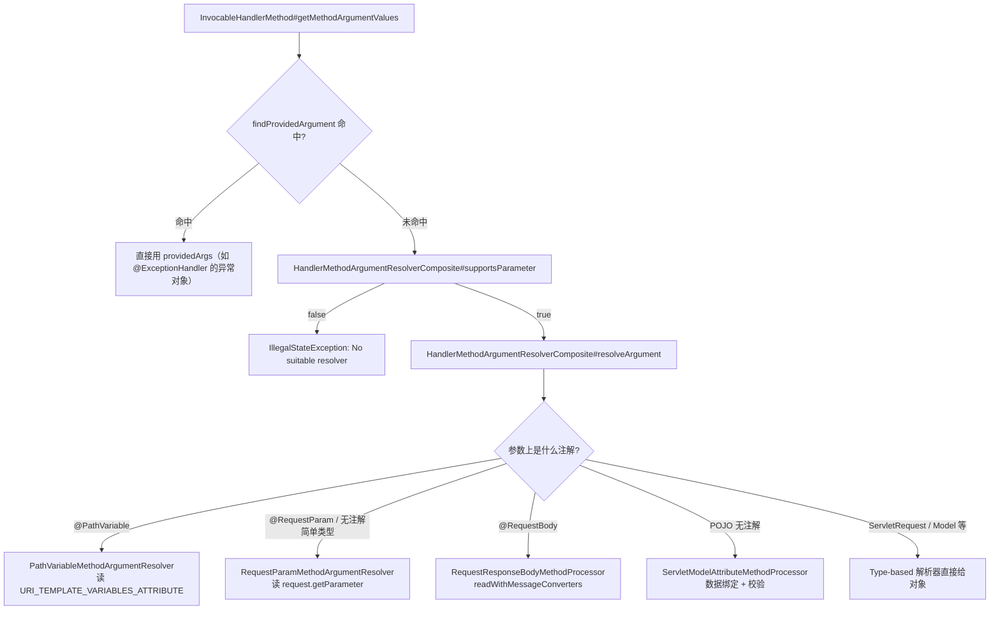
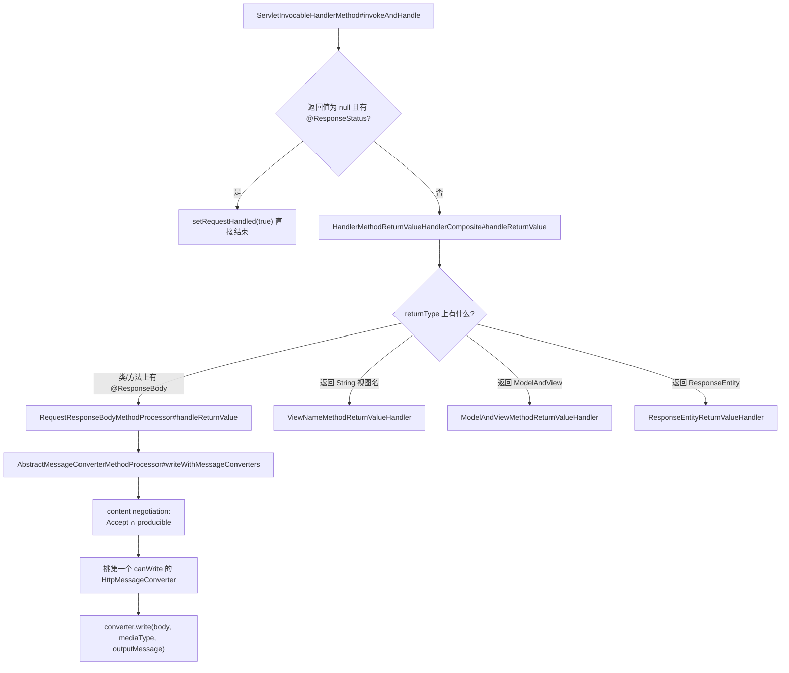
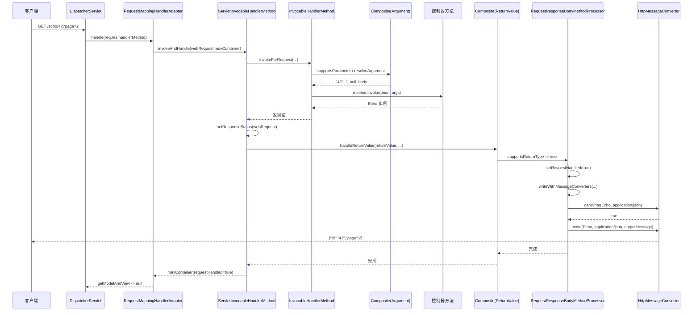

# SpringMVC 03：参数解析与返回值处理 —— 从 `HandlerMethodArgumentResolver` 到 `HttpMessageConverter`

> 一句话结论：一次 `@RequestMapping` 方法调用中，**入参**由 `HandlerMethodArgumentResolverComposite` 里按顺序排列的解析器逐个“认领”，**返回值**由 `HandlerMethodReturnValueHandlerComposite` 里按顺序排列的处理器逐个“认领”；真正把 JSON/字符串写进响应体的，是被 `RequestResponseBodyMethodProcessor` 借用的 `HttpMessageConverter`，而 `Content-Type` 的选择由 `writeWithMessageConverters` 里的 content negotiation 决定。
>
> 阅读前置：读完 [01 请求的完整旅程](./01-dispatcherservlet-一次请求的完整旅程.md) 与 [02 处理器映射与适配器](./02-处理器映射与适配器-handlermapping与handleradapter.md)；知道 `@Controller`/`@RequestMapping` 的用法；了解 `Accept`、`Content-Type` 两个 HTTP 头的基本含义。
>
> 预计阅读：55 分钟 ｜ 源码：spring-framework@v7.1.0（spring-webmvc / spring-web）+ spring-boot@v4.2.0（spring-boot-jackson / spring-boot-http-converter）

---

## 0. 先看现象（3 分钟上手）

先写一个什么都不做的接口，观察它的**入参**和**返回值**分别有什么表现。

```text
// 片段：演示用应用代码，非 Spring 源码（仅为说明结构，不参与原文校验）
@RestController
public class DemoController {

    @GetMapping("/echo/{id}")
    public Echo echo(@PathVariable String id,
                     @RequestParam(defaultValue = "0") int page,
                     @RequestHeader(value = "X-Trace", required = false) String trace,
                     @RequestBody(required = false) Echo body) {
        Echo result = new Echo();
        result.id = id;
        result.page = page;
        result.trace = trace;
        result.echo = (body != null ? body.id : null);
        return result;
    }

    @GetMapping(value = "/text", produces = MediaType.TEXT_PLAIN_VALUE)
    public String text() {
        return "hello";
    }
}
```

发四组请求，现象如下表（假设已用 `curl` 或浏览器/HTTP 客户端测试）：

| 请求 | 结果 | 背后发生了什么 |
| --- | --- | --- |
| `POST /echo/42?page=2`，body 为 `{"id":"A"}`，`Content-Type: application/json` | 返回 `{"id":"42","page":2,"echo":"A"}` 的 JSON | `@RequestBody` 由 `RequestResponseBodyMethodProcessor` 解析；返回值也由它写回，交给 `JacksonJsonHttpMessageConverter` 序列化 |
| `GET /echo/42`（无 body、无参数） | 同样是 JSON，`page=0`、`echo=null` | `@RequestParam` 有默认值，`@RequestBody(required=false)` 允许缺失；缺 body 时走 `handleEmptyBody` 分支返回 `null` |
| `GET /text`，`Accept: application/json` | 返回纯文本 `hello`，`Content-Type: text/plain;charset=UTF-8` | `produces` 限制了可选媒体类型，且返回值是 `String`（`CharSequence`），`writeWithMessageConverters` 直接把它归一化为 `String.class`，只有 `StringHttpMessageConverter` 能写 |
| `GET /echo/42`，`Accept: application/xml` | `406 Not Acceptable` | `determineCompatibleMediaTypes` 找不到交集，抛 `HttpMediaTypeNotAcceptableException` |

三点提醒，后面都会在源码里找到出处：

1. **顺序决定一切**：参数解析器和返回值处理器都是**有序列表**，第一个 `supportsXxx` 返回 `true` 的胜出；列表末尾还有“catch-all”兜底，顺序一旦错位就会出现“本该进 JSON 的参数被当成 `@ModelAttribute` 绑定”的怪现象。
2. **`@ResponseBody` 返回 `String` 不走 Jackson**：源码里对 `CharSequence` 做了特殊处理，直接改成 `String.class`。
3. **媒体类型是“协商”出来的**：`produces`/`Content-Type` 是“我能写什么”，`Accept` 是“客户端能收什么”，两边取交集才开始挑 converter。

> ⚠️ 版本提示：本文按 **Spring Framework 7.1.0** 讲，`spring-web` 里已经出现 `SmartHttpMessageConverter` 这一新接口（converter 循环里有 `GENERIC`/`SMART`/`BASE` 三分支）；Boot 4.2 的 JSON 支持已切到 **Jackson 3（`tools.jackson.*` 包名）**。第 7 节集中讲差异。

---

## 1. 整体地图（先图后码）

### 1.1 入参方向：从方法参数到实参



**读图说明**：左上是入口 `getMethodArgumentValues`（注意它先看 `providedArgs`，这是 `@ExceptionHandler` 能把异常对象直接塞进方法参数的机制）；中间一列是“认领 + 解析”；底部按注解把最常见的四个解析器分开画。任何一条路径最终都返回一个 `Object arg`，交给 `method.invoke` 使用。

### 1.2 返回值方向：从方法返回值到响应体



**读图说明**：这张图从 `invokeAndHandle` 出发（第 4 节会把这段源码完整读一遍），先处理“不写 body 也要设状态码”的特殊情况，然后进入返回值处理器复合体。右下角的四步（`writeWithMessageConverters` → 协商 → 选 converter → `write`）是本文第 3 节的重点。注意箭头不是“先判断注解再调用方法”，而是**处理器自己判断**：`RequestResponseBodyMethodProcessor#supportsReturnType` 会在类上找 `@ResponseBody`（`@RestController` 自带它）。

### 1.3 关键类一览

| 类 | 所属包（jar） | 职责 |
| --- | --- | --- |
| `HandlerMethodArgumentResolver` | `org.springframework.web.method.support`（spring-web） | 入参解析器接口：`supportsParameter` + `resolveArgument` |
| `HandlerMethodArgumentResolverComposite` | 同上 | 把一堆解析器包成一个，带缓存 |
| `HandlerMethodReturnValueHandler` | 同上 | 返回值处理器接口：`supportsReturnType` + `handleReturnValue` |
| `HandlerMethodReturnValueHandlerComposite` | 同上 | 把一堆处理器包成一个，含异步过滤 |
| `InvocableHandlerMethod` | `org.springframework.web.method.support`（spring-web） | 反射调用的最小单元：算参数 → 校验 → `method.invoke` |
| `ServletInvocableHandlerMethod` | `org.springframework.web.servlet.mvc.method.annotation`（spring-webmvc） | 在 `InvocableHandlerMethod` 上补“写响应”一步 |
| `RequestResponseBodyMethodProcessor` | 同上 | `@RequestBody` 与 `@ResponseBody` 双栖处理器 |
| `AbstractMessageConverterMethodProcessor` | 同上 | `writeWithMessageConverters` 所在的基类 |
| `AbstractMessageConverterMethodArgumentResolver` | 同上 | `readWithMessageConverters` 所在的基类 |
| `HttpMessageConverter` | `org.springframework.http.converter`（spring-web） | converter 接口：`canRead` / `canWrite` |
| `RequestMappingHandlerAdapter` | `org.springframework.web.servlet.mvc.method.annotation` | 组装上面这些列表（在 `afterPropertiesSet` 里） |

---

## 2. 关键类逐个拆

### 2.1 `InvocableHandlerMethod`：反射调用的骨架

`InvocableHandlerMethod` 是“能不能调、怎么调”的骨架，`ServletInvocableHandlerMethod` 是它的子类，追加“返回值写进响应”的能力。二者的分工很重要：**前者不碰 `HttpServletResponse`，后者才碰**。

```text
// 片段：演示用应用代码，非 Spring 源码 —— 说明“providedArgs 优先”的含义
Object[] provided = { new IllegalStateException("boom") };
// @ExceptionHandler(IllegalStateException.class) 的方法参数里可以直接写异常对象，
// 因为 EventHandlerExceptionResolver 把异常链当作 providedArgs 传了进来
```

这一点在 `InvocableHandlerMethod#getMethodArgumentValues` 里体现为“先 `findProvidedArgument`，未命中才去问解析器”（详见 §3.2）。

### 2.2 `RequestMappingHandlerAdapter#afterPropertiesSet`：列表是怎么来的

`RequestMappingHandlerAdapter` 在初始化阶段组装三类东西：`ControllerAdvice` 缓存、`HttpMessageConverter`、参数解析器与返回值处理器列表。它们的顺序是写死的（见 §3.1 与 §3.2 的原文），自定义扩展总是插在“Custom”位置，**永远排在 catch-all 之前、注解型之后**。

### 2.3 `HttpMessageConverter`：读写 body 的最后一公里

`HttpMessageConverter` 只回答两个问题：这个 Java 类型 + 这个媒体类型，我能不能读/写？能的话就动手。7.1 还新增了一个默认方法 `canWriteRepeatedly`，用于判断“写完一次还能不能再写”（流式输出场景）。

```java (src: HttpMessageConverter.java#L37-L75)
 * @see SmartHttpMessageConverter
 */
public interface HttpMessageConverter<T> {

	/**
	 * Indicates whether the given class can be read by this converter.
	 * @param clazz the class to test for readability
	 * @param mediaType the media type to read (can be {@code null} if not specified);
	 * typically the value of a {@code Content-Type} header.
	 * @return {@code true} if readable; {@code false} otherwise
	 */
	boolean canRead(Class<?> clazz, @Nullable MediaType mediaType);

	/**
	 * Indicates whether the given class can be written by this converter.
	 * @param clazz the class to test for writability
	 * @param mediaType the media type to write (can be {@code null} if not specified);
	 * typically the value of an {@code Accept} header.
	 * @return {@code true} if writable; {@code false} otherwise
	 */
	boolean canWrite(Class<?> clazz, @Nullable MediaType mediaType);

	/**
	 * Indicates whether this message converter can
	 * {@linkplain #write(Object, MediaType, HttpOutputMessage) write} the
	 * given payload multiple times.
	 * <p>This can be used by HTTP client libraries to know whether a message can be
	 * sent again, for example after an HTTP redirect. The default implementation
	 * returns {@code false}. This typically returns false if the payload can be read
	 * only once.
	 * @param t the object t
	 * @param contentType the content type to use when writing.
	 * @return {@code true} if {@code t} can be written repeatedly;
	 * {@code false} otherwise
	 * @since 7.1
	 */
	default boolean canWriteRepeatedly(T t, @Nullable MediaType contentType) {
		return false;
	}
```

这段代码的四层解释：

1. **在干什么**：定义 converter 的三件套——`canRead(targetClass, mediaType)`、`canWrite(targetClass, mediaType)`、`getSupportedMediaTypes()`；7.1 追加 `canWriteRepeatedly()`。
2. **为什么这么写**：把“能力判断”和“实际 IO”分开，框架就能在不真正读写的条件下做协商（先问 `canWrite` 收集候选，再挑一个执行 `write`）。
3. **改成别的会怎样**：如果让 `canWrite` 里带副作用（比如直接读 stream 探测），那么协商阶段的遍历就会破坏请求体——`readWithMessageConverters` 里 `EmptyBodyCheckingHttpInputMessage` 的存在就是为了防这一类问题。
4. **常见坑**：`canWrite(String.class, null)` 传 `null` 表示“任意媒体类型”，很多实现的语义是“我能写，但你得告诉我要写成 `text/plain` 还是 `application/json`”；自己实现 converter 时不要对 `null` 直接返回 `false`，否则协商阶段会漏掉自己。

### 2.4 两个 Composite：只做“按顺序找第一个”

`HandlerMethodArgumentResolverComposite` 和 `HandlerMethodReturnValueHandlerComposite` 结构几乎一样：内部持有一个 `List`，`supportsXxx` 遍历找第一个命中项并缓存。

```java (src: HandlerMethodArgumentResolverComposite.java#L100-L141)
	 * supported by any registered {@link HandlerMethodArgumentResolver}.
	 */
	@Override
	public boolean supportsParameter(MethodParameter parameter) {
		return getArgumentResolver(parameter) != null;
	}

	/**
	 * Iterate over registered
	 * {@link HandlerMethodArgumentResolver HandlerMethodArgumentResolvers}
	 * and invoke the one that supports it.
	 * @throws IllegalArgumentException if no suitable argument resolver is found
	 */
	@Override
	public @Nullable Object resolveArgument(MethodParameter parameter, @Nullable ModelAndViewContainer mavContainer,
			NativeWebRequest webRequest, @Nullable WebDataBinderFactory binderFactory) throws Exception {

		HandlerMethodArgumentResolver resolver = getArgumentResolver(parameter);
		if (resolver == null) {
			throw new IllegalArgumentException("Unsupported parameter type [" +
					parameter.getParameterType().getName() + "]. supportsParameter should be called first.");
		}
		return resolver.resolveArgument(parameter, mavContainer, webRequest, binderFactory);
	}

	/**
	 * Find a registered {@link HandlerMethodArgumentResolver} that supports
	 * the given method parameter.
	 */
	public @Nullable HandlerMethodArgumentResolver getArgumentResolver(MethodParameter parameter) {
		HandlerMethodArgumentResolver result = this.argumentResolverCache.get(parameter);
		if (result == null) {
			for (HandlerMethodArgumentResolver resolver : this.argumentResolvers) {
				if (resolver.supportsParameter(parameter)) {
					result = resolver;
					this.argumentResolverCache.put(parameter, result);
					break;
				}
			}
		}
		return result;
	}
```

四层解释：

1. **在干什么**：`supportsParameter` 只判断“有没有解析器认识这个参数”；`resolveArgument` 再取出来执行；`getArgumentResolver` 用 `argumentResolverCache` 做 `MethodParameter → Resolver` 的缓存。
2. **为什么这么写**：一次请求里同一个 `MethodParameter` 只会被判断一次 `supportsParameter`（在 `getMethodArgumentValues` 里），随后立刻 `resolveArgument`；缓存让第二次请求省掉整条链的遍历。`resolveArgument` 里显式抛 `IllegalArgumentException` 是防“跳过 `supportsParameter` 直接解析”的误用。
3. **改成别的会怎样**：如果改成“所有 supports 为 true 的都执行”，`@RequestBody` 与 `@ModelAttribute` 就会同时作用于同一个 POJO 参数，请求体被读一次后 stream 已耗尽。
4. **常见坑**：`MethodParameter` 的 `equals` 包含注解信息，所以“同一个位置、不同注解”的两个参数不会误命中同一缓存项；但反过来说，**运行时动态改注解不会刷新缓存**（缓存生命周期与 adapter 相同）。

返回值侧的复合体多了一层“异步过滤”，见下段。

```java (src: HandlerMethodReturnValueHandlerComposite.java#L65-L95)
	/**
	 * Iterate over registered {@link HandlerMethodReturnValueHandler HandlerMethodReturnValueHandlers} and invoke the one that supports it.
	 * @throws IllegalStateException if no suitable {@link HandlerMethodReturnValueHandler} is found.
	 */
	@Override
	public void handleReturnValue(@Nullable Object returnValue, MethodParameter returnType,
			ModelAndViewContainer mavContainer, NativeWebRequest webRequest) throws Exception {

		HandlerMethodReturnValueHandler handler = selectHandler(returnValue, returnType);
		if (handler == null) {
			throw new IllegalArgumentException("Unknown return value type: " + returnType.getParameterType().getName());
		}
		handler.handleReturnValue(returnValue, returnType, mavContainer, webRequest);
	}

	private @Nullable HandlerMethodReturnValueHandler selectHandler(@Nullable Object value, MethodParameter returnType) {
		boolean isAsyncValue = isAsyncReturnValue(value, returnType);
		for (HandlerMethodReturnValueHandler handler : this.returnValueHandlers) {
			if (isAsyncValue && !(handler instanceof AsyncHandlerMethodReturnValueHandler)) {
				continue;
			}
			if (handler.supportsReturnType(returnType)) {
				return handler;
			}
		}
		return null;
	}

	private boolean isAsyncReturnValue(@Nullable Object value, MethodParameter returnType) {
		for (HandlerMethodReturnValueHandler handler : this.returnValueHandlers) {
			if (handler instanceof AsyncHandlerMethodReturnValueHandler asyncHandler &&
```

四层解释：

1. **在干什么**：`handleReturnValue` 先 `selectHandler`，选不到就抛“Unknown return value type”；`selectHandler` 里判断返回值是否“异步值”（`Callable`、`DeferredResult`、`ListenableFuture` 等），若是异步值则**跳过非** `AsyncHandlerMethodReturnValueHandler` 的实现。
2. **为什么这么写**：异步返回值需要注册回调（ConcurrentResult），普通处理器（如 `ViewNameMethodReturnValueHandler`）拿到 `DeferredResult` 毫无意义，先过滤掉可以避免误配。
3. **改成别的会怎样**：去掉过滤，`Callable` 返回值会先被 `ModelAndViewMethodReturnValueHandler` 之类判为不认识，最终落到 catch-all `ServletModelAttributeMethodProcessor(true)`，返回对象被当成 model 属性塞进 ModelAndView——表现为“接口返回 404/空 body，日志里却有渲染尝试”。
4. **常见坑**：`supportsReturnType` 为 `true` 不等于“这个返回值一定归它”；异步场景下真正决定胜负的是 `isAsyncReturnValue` + `AsyncHandlerMethodReturnValueHandler` 两重判断。

---

## 3. 源码逐段精读

### 3.1 参数解析器列表：顺序就是语义

`RequestMappingHandlerAdapter#afterPropertiesSet` 里把默认列表一次性装好；列表内容由 `getDefaultArgumentResolvers` 给出。

```java (src: RequestMappingHandlerAdapter.java#L648-L694)
	private List<HandlerMethodArgumentResolver> getDefaultArgumentResolvers() {
		List<HandlerMethodArgumentResolver> resolvers = new ArrayList<>(30);

		// Annotation-based argument resolution
		resolvers.add(new RequestParamMethodArgumentResolver(getBeanFactory(), false));
		resolvers.add(new RequestParamMapMethodArgumentResolver());
		resolvers.add(new PathVariableMethodArgumentResolver());
		resolvers.add(new PathVariableMapMethodArgumentResolver());
		resolvers.add(new MatrixVariableMethodArgumentResolver());
		resolvers.add(new MatrixVariableMapMethodArgumentResolver());
		resolvers.add(new ServletModelAttributeMethodProcessor(false));
		resolvers.add(new RequestResponseBodyMethodProcessor(getMessageConverters(), this.requestResponseBodyAdvice));
		resolvers.add(new RequestPartMethodArgumentResolver(getMessageConverters(), this.requestResponseBodyAdvice));
		resolvers.add(new RequestHeaderMethodArgumentResolver(getBeanFactory()));
		resolvers.add(new RequestHeaderMapMethodArgumentResolver());
		resolvers.add(new ServletCookieValueMethodArgumentResolver(getBeanFactory()));
		resolvers.add(new ExpressionValueMethodArgumentResolver(getBeanFactory()));
		resolvers.add(new SessionAttributeMethodArgumentResolver());
		resolvers.add(new RequestAttributeMethodArgumentResolver());

		// Type-based argument resolution
		resolvers.add(new ServletRequestMethodArgumentResolver());
		resolvers.add(new ServletResponseMethodArgumentResolver());
		resolvers.add(new HttpEntityMethodProcessor(getMessageConverters(), this.requestResponseBodyAdvice));
		resolvers.add(new RedirectAttributesMethodArgumentResolver());
		resolvers.add(new ModelMethodProcessor());
		resolvers.add(new MapMethodProcessor());
		resolvers.add(new ErrorsMethodArgumentResolver());
		resolvers.add(new SessionStatusMethodArgumentResolver());
		resolvers.add(new UriComponentsBuilderMethodArgumentResolver());
		resolvers.add(new ApiVersionMethodArgumentResolver());
		if (KotlinDetector.isKotlinPresent()) {
			resolvers.add(new ContinuationHandlerMethodArgumentResolver());
		}

		// Custom arguments
		if (getCustomArgumentResolvers() != null) {
			resolvers.addAll(getCustomArgumentResolvers());
		}

		// Catch-all
		resolvers.add(new PrincipalMethodArgumentResolver());
		resolvers.add(new RequestParamMethodArgumentResolver(getBeanFactory(), true));
		resolvers.add(new ServletModelAttributeMethodProcessor(true));

		return resolvers;
	}
```

四层解释：

1. **在干什么**：按四段注释组织列表——注解型（15 个）、类型型（10 余个）、自定义（`getCustomArgumentResolvers()`）、兜底（3 个）。
2. **为什么这么写**：注解型排在最前，因为“用户显式声明”的意图最强；`RequestResponseBodyMethodProcessor` 排在 `ServletModelAttributeMethodProcessor(false)` **之后**，但两者 `supportsParameter` 互补（一个看 `@RequestBody`，一个看“没有注解的简单/复杂类型”），所以顺序不影响正确性，只影响极端组合下的胜者。兜底的 `RequestParamMethodArgumentResolver(beanFactory, true)`（`useDefaultResolution = true`）负责“无注解的简单类型参数按名字当请求参数”，`ServletModelAttributeMethodProcessor(true)` 负责“无注解的复杂类型当表单对象”。
3. **改成别的会怎样**：把兜底项提到最前，所有无注解参数都会被当成请求参数或 model 属性，`@RequestBody` 永远轮不到；把自定义项放到 catch-all 之后，自定义解析器永远不生效——这是最常见的扩展踩坑。
4. **常见坑**：`@RequestParam` 标在 `Map<String,String>` 上会先被 `RequestParamMapMethodArgumentResolver` 拿走（因为它在列表里更靠前）；如果你想要“同名参数合并枚举”，需要自己实现并注册到自定义位置。

### 3.2 一次参数解析的完整路径

参数解析的循环体在 spring-web 的 `InvocableHandlerMethod` 里：

```java (src: InvocableHandlerMethod.java#L196-L240)
	 * argument values and falling back to the configured argument resolvers.
	 * <p>The resulting array will be passed into {@link #doInvoke}.
	 * @since 5.1.2
	 */
	protected @Nullable Object[] getMethodArgumentValues(NativeWebRequest request, @Nullable ModelAndViewContainer mavContainer,
			@Nullable Object... providedArgs) throws Exception {

		MethodParameter[] parameters = getMethodParameters();
		if (ObjectUtils.isEmpty(parameters)) {
			return EMPTY_ARGS;
		}

		@Nullable Object[] args = new Object[parameters.length];
		for (int i = 0; i < parameters.length; i++) {
			MethodParameter parameter = parameters[i];
			parameter.initParameterNameDiscovery(this.parameterNameDiscoverer);
			args[i] = findProvidedArgument(parameter, providedArgs);
			if (args[i] != null) {
				continue;
			}
			if (parameter.getParameterType().equals(HandlerMethod.class) && parameter.isOptional()) {
				args[i] = null;
				continue;
			}
			if (!this.resolvers.supportsParameter(parameter)) {
				throw new IllegalStateException(formatArgumentError(parameter, "No suitable resolver"));
			}
			try {
				args[i] = this.resolvers.resolveArgument(parameter, mavContainer, request, this.dataBinderFactory);
			}
			catch (Exception ex) {
				// Leave stack trace for later, exception may actually be resolved and handled...
				if (logger.isDebugEnabled()) {
					String exMsg = ex.getMessage();
					if (exMsg != null && !exMsg.contains(parameter.getExecutable().toGenericString())) {
						logger.debug(formatArgumentError(parameter, exMsg));
					}
				}
				throw ex;
			}
		}
		return args;
	}

	/**
```

四层解释：

1. **在干什么**：对每个 `MethodParameter`：初始化名字发现（Kotlin/编译期 `-parameters` 影响 `parameterNameDiscoverer`）、先问 `providedArgs`、再问 `resolvers.supportsParameter`、最后 `resolveArgument`；任一步抛异常都会打 `debug` 日志后原样抛出。
2. **为什么这么写**：`providedArgs` 优先是给 `@ExceptionHandler`/`@ModelAttribute` 这类“框架已经拿到对象”的场景用的，避免无谓地走解析链；`initParameterNameDiscovery` 放在循环内是让 `MethodParameter` 自身缓存参数名。
3. **改成别的会怎样**：如果没有 `supportsParameter` 这一步直接调用 `resolveArgument`，复合体内部会抛 `IllegalArgumentException("Unsupported parameter type ... supportsParameter should be called first.")`，而不是友好的 `IllegalStateException("No suitable resolver ...")`。
4. **常见坑**：`IllegalStateException: No suitable resolver for argument N` 的常见原因不是“没有解析器”，而是**参数类型是我们自己写的、且没有加任何注解**，于是被兜底的 `ServletModelAttributeMethodProcessor(true)` 认领后绑定失败；排查时先看参数上有没有注解、有没有 `@RequestBody` 但缺 `Content-Type`。

### 3.3 `@PathVariable` 到底读的是哪个属性

`PathVariableMethodArgumentResolver` 并不自己解析 URL，它只从请求属性里取映射阶段放好的变量表。

```java (src: PathVariableMethodArgumentResolver.java#L71-L97)

	@Override
	public boolean supportsParameter(MethodParameter parameter) {
		if (!parameter.hasParameterAnnotation(PathVariable.class)) {
			return false;
		}
		if (Map.class.isAssignableFrom(parameter.nestedIfOptional().getNestedParameterType())) {
			PathVariable pathVariable = parameter.getParameterAnnotation(PathVariable.class);
			return (pathVariable != null && StringUtils.hasText(pathVariable.value()));
		}
		return true;
	}

	@Override
	protected NamedValueInfo createNamedValueInfo(MethodParameter parameter) {
		PathVariable ann = parameter.getParameterAnnotation(PathVariable.class);
		Assert.state(ann != null, "No PathVariable annotation");
		return new PathVariableNamedValueInfo(ann);
	}

	@Override
	@SuppressWarnings("unchecked")
	protected @Nullable Object resolveName(String name, MethodParameter parameter, NativeWebRequest request) throws Exception {
		Map<String, String> uriTemplateVars = (Map<String, String>) request.getAttribute(
				HandlerMapping.URI_TEMPLATE_VARIABLES_ATTRIBUTE, RequestAttributes.SCOPE_REQUEST);
		return (uriTemplateVars != null ? uriTemplateVars.get(name) : null);
	}
```

四层解释：

1. **在干什么**：`supportsParameter` 只认带 `@PathVariable` 的参数（`Map` 类型必须写 `value()`，因为要区分“取某一个变量”与“取全部变量”）；`resolveName` 从 `HandlerMapping.URI_TEMPLATE_VARIABLES_ATTRIBUTE` 里按名字取值。
2. **为什么这么写**：URL 匹配只做一次（在 `RequestMappingInfoHandlerMapping#handleMatch` 里），解析结果以**请求属性**的形式共享，参数解析器无需重复匹配——这也解释了为什么 `@PathVariable` 只能拿映射阶段匹配到的变量。
3. **改成别的会怎样**：如果解析器自己再匹配一遍 URL，`PathPattern` 的正则与解码规则要与映射阶段完全一致，否则会拿到不同的值（尤其是矩阵变量与 `{*path}`）。
4. **常见坑**：`@PathVariable` 拿到 `null`/缺值 → `MissingPathVariableException`（400/500 由 `DefaultHandlerExceptionResolver` 决定）；用 `@RequestParam` 接路径变量则会拿到 `null`。

`@RequestParam`、`@RequestHeader`、`@CookieValue` 共用同一个模板方法，差别只在 `resolveName` 与缺值策略：

```java (src: AbstractNamedValueMethodArgumentResolver.java#L101-L146)

	@Override
	public final @Nullable Object resolveArgument(MethodParameter parameter, @Nullable ModelAndViewContainer mavContainer,
			NativeWebRequest webRequest, @Nullable WebDataBinderFactory binderFactory) throws Exception {

		NamedValueInfo namedValueInfo = getNamedValueInfo(parameter);
		MethodParameter nestedParameter = parameter.nestedIfOptional();
		boolean hasDefaultValue = KOTLIN_REFLECT_PRESENT && KotlinDetector.isKotlinType(parameter.getDeclaringClass()) &&
				KotlinDelegate.hasDefaultValue(nestedParameter);

		Object resolvedName = resolveEmbeddedValuesAndExpressions(namedValueInfo.name);
		if (resolvedName == null) {
			throw new IllegalArgumentException(
					"Specified name must not resolve to null: [" + namedValueInfo.name + "]");
		}

		Object arg = resolveName(resolvedName.toString(), nestedParameter, webRequest);
		if (arg == null) {
			if (namedValueInfo.defaultValue != null) {
				arg = resolveEmbeddedValuesAndExpressions(namedValueInfo.defaultValue);
			}
			else if (namedValueInfo.required && !nestedParameter.isOptional()) {
				handleMissingValue(resolvedName.toString(), nestedParameter, webRequest);
			}
			if (!hasDefaultValue) {
				arg = handleNullValue(resolvedName.toString(), arg, nestedParameter.getNestedParameterType());
			}
		}
		else if ("".equals(arg) && namedValueInfo.defaultValue != null) {
			arg = resolveEmbeddedValuesAndExpressions(namedValueInfo.defaultValue);
		}

		if (binderFactory != null && (arg != null || !hasDefaultValue)) {
			arg = convertIfNecessary(parameter, webRequest, binderFactory, namedValueInfo, arg);
			// Check for null value after conversion of incoming argument value
			if (arg == null) {
				if (namedValueInfo.defaultValue != null) {
					arg = resolveEmbeddedValuesAndExpressions(namedValueInfo.defaultValue);
					arg = convertIfNecessary(parameter, webRequest, binderFactory, namedValueInfo, arg);
				}
				else if (namedValueInfo.required && !nestedParameter.isOptional()) {
					handleMissingValueAfterConversion(resolvedName.toString(), nestedParameter, webRequest);
				}
			}
		}

```

四层解释：

1. **在干什么**：模板方法 `resolveArgument`：读注解元信息 → 解析名字里的 `${}`/`#{}` → `resolveName` 取值 → 值为 `null` 时依次尝试默认值、`required` 判定、`handleNullValue` → 类型转换（`convertIfNecessary`，走 `WebDataBinder`/`ConversionService`）→ 转换后又为 `null` 则再判一次默认值。
2. **为什么这么写**：把这套“名字解析 + 默认值 + 必填 + 转换”的公共逻辑收进基类，`@PathVariable`/`@RequestParam`/`@RequestHeader`/`@CookieValue`/`@SessionAttribute` 只需实现 `resolveName` 与 `handleMissingValue`。
3. **改成别的会怎样**：把转换放到 `resolveName` 里，就无法复用统一的 `ConversionService` 与错误处理（`TypeMismatchException` → 400）。
4. **常见坑**：`@RequestParam(defaultValue = "0") int page` 与 `@RequestParam(required = false) Integer page` 语义不同：前者缺值变 0，后者缺值变 `null`；`""`（空串）在有默认值时会被替换为默认值，这一条在 `else if ("".equals(arg) && ...)` 分支里。

### 3.4 `@RequestBody`：读 body 的全过程

`@RequestBody` 由 `RequestResponseBodyMethodProcessor` 处理，它的 `resolveArgument` 先读 body，再校验，最后处理 `Optional`。

```java (src: RequestResponseBodyMethodProcessor.java#L142-L191)
	}

	/**
	 * Throws MethodArgumentNotValidException if validation fails.
	 * @throws HttpMessageNotReadableException if {@link RequestBody#required()}
	 * is {@code true} and there is no body content or if there is no suitable
	 * converter to read the content with.
	 */
	@Override
	public @Nullable Object resolveArgument(MethodParameter parameter, @Nullable ModelAndViewContainer mavContainer,
			NativeWebRequest webRequest, @Nullable WebDataBinderFactory binderFactory) throws Exception {

		parameter = parameter.nestedIfOptional();
		Object arg = readWithMessageConverters(webRequest, parameter, parameter.getNestedGenericParameterType());

		if (binderFactory != null) {
			String name = Conventions.getVariableNameForParameter(parameter);
			ResolvableType type = ResolvableType.forMethodParameter(parameter);
			WebDataBinder binder = binderFactory.createBinder(webRequest, arg, name, type);
			if (arg != null) {
				validateIfApplicable(binder, parameter);
				if (binder.getBindingResult().hasErrors() && isBindExceptionRequired(binder, parameter)) {
					throw new MethodArgumentNotValidException(parameter, binder.getBindingResult());
				}
			}
			if (mavContainer != null) {
				mavContainer.addAttribute(BindingResult.MODEL_KEY_PREFIX + name, binder.getBindingResult());
			}
		}

		return adaptArgumentIfNecessary(arg, parameter);
	}

	@Override
	protected @Nullable Object readWithMessageConverters(NativeWebRequest webRequest, MethodParameter parameter,
			Type paramType) throws IOException, HttpMediaTypeNotSupportedException, HttpMessageNotReadableException {

		ServletServerHttpRequest inputMessage = createInputMessage(webRequest);
		Object arg = readWithMessageConverters(inputMessage, parameter, paramType);
		if (arg == null && checkRequired(parameter)) {
			throw new HttpMessageNotReadableException("Required request body is missing: " +
					parameter.getExecutable().toGenericString(), inputMessage);
		}
		return arg;
	}

	protected boolean checkRequired(MethodParameter parameter) {
		RequestBody requestBody = parameter.getParameterAnnotation(RequestBody.class);
		return (requestBody != null && requestBody.required() && !parameter.isOptional());
	}
```

四层解释：

1. **在干什么**：`nestedIfOptional()` 把 `Optional<T>` 拆成 `T`；`readWithMessageConverters` 读 body；有 `binderFactory` 时创建 `WebDataBinder`、执行 `@Valid`/`@Validated` 校验，校验失败抛 `MethodArgumentNotValidException`；最后把 `BindingResult` 放进 `ModelAndViewContainer`（视图渲染时可用）并 `adaptArgumentIfNecessary`（必要时包回 `Optional`）。
2. **为什么这么写**：请求体与表单参数不同，**没有“名字”**，所以校验必须基于整个对象；`checkRequired` 只在 `required()==true` 且参数非可选时抛错，从而支持 `@RequestBody(required = false)` 与 `Optional<T>`。
3. **改成别的会怎样**：如果不做 `nestedIfOptional`，`Optional<Foo>` 会被当成一个普通 POJO 去绑定，字段全空。
4. **常见坑**：`HttpMessageNotReadableException: Required request body is missing: ...` 就是 `checkRequired` 抛的；`HttpMediaTypeNotSupportedException: Content-Type 'text/plain;charset=UTF-8' is not supported` 则是 `readWithMessageConverters` 找不到能读该类型的 converter。

读 body 的实际循环在 `AbstractMessageConverterMethodArgumentResolver` 里：

```java (src: AbstractMessageConverterMethodArgumentResolver.java#L150-L222)
		Class<?> contextClass = parameter.getContainingClass();
		Class<T> targetClass = (targetType instanceof Class clazz ? clazz : null);
		ResolvableType resolvableType = ResolvableType.forMethodParameter(parameter);
		if (targetClass == null) {
			targetClass = (Class<T>) resolvableType.resolve();
		}

		MediaType contentType;
		boolean noContentType = false;
		try {
			contentType = inputMessage.getHeaders().getContentType();
		}
		catch (InvalidMediaTypeException ex) {
			throw new HttpMediaTypeNotSupportedException(
					ex.getMessage(), getSupportedMediaTypes(targetClass != null ? targetClass : Object.class));
		}
		if (contentType == null) {
			noContentType = true;
			contentType = MediaType.APPLICATION_OCTET_STREAM;
		}

		HttpMethod httpMethod = (inputMessage instanceof HttpRequest httpRequest ? httpRequest.getMethod() : null);
		Object body = NO_VALUE;

		EmptyBodyCheckingHttpInputMessage message = null;
		try {
			ResolvableType targetResolvableType = null;
			message = new EmptyBodyCheckingHttpInputMessage(inputMessage);
			for (HttpMessageConverter<?> converter : this.messageConverters) {
				Class<? extends HttpMessageConverter<?>> converterClass = (Class<? extends HttpMessageConverter<?>>) converter.getClass();
				ConverterType converterTypeToUse = null;
				if (converter instanceof GenericHttpMessageConverter<?> genericConverter) {
					if (genericConverter.canRead(targetType, contextClass, contentType)) {
						converterTypeToUse = ConverterType.GENERIC;
					}
				}
				else if (converter instanceof SmartHttpMessageConverter<?> smartConverter) {
					if (targetResolvableType == null) {
						targetResolvableType = getNestedTypeIfNeeded(resolvableType);
					}
					if (smartConverter.canRead(targetResolvableType, contentType)) {
						converterTypeToUse = ConverterType.SMART;
					}
				}
				else if (targetClass != null && converter.canRead(targetClass, contentType)) {
					converterTypeToUse = ConverterType.BASE;
				}
				if (converterTypeToUse != null) {
					if (message.hasBody()) {
						HttpInputMessage msgToUse = this.advice.beforeBodyRead(message, parameter, targetType, converterClass);
						body = switch (converterTypeToUse) {
							case BASE -> ((HttpMessageConverter<T>) converter).read(targetClass, msgToUse);
							case GENERIC -> ((GenericHttpMessageConverter<?>) converter).read(targetType, contextClass, msgToUse);
							case SMART -> ((SmartHttpMessageConverter<?>) converter).read(targetResolvableType, msgToUse,
									this.advice.determineReadHints(parameter, targetType, (Class<SmartHttpMessageConverter<?>>) converterClass));
						};
						body = this.advice.afterBodyRead(body, msgToUse, parameter, targetType, converterClass);
					}
					else {
						body = this.advice.handleEmptyBody(null, message, parameter, targetType, converterClass);
					}
					break;
				}

			}

			if (body == NO_VALUE && noContentType && !message.hasBody()) {
				body = this.advice.handleEmptyBody(
						null, message, parameter, targetType, NoContentTypeHttpMessageConverter.class);
			}
		}
		catch (IOException ex) {
			throw new HttpMessageNotReadableException("I/O error while reading input message", ex, inputMessage);
```

四层解释：

1. **在干什么**：先取 `Content-Type`（解析失败抛不支持）；`null` 时记为 `noContentType` 并假定 `application/octet-stream`；用 `EmptyBodyCheckingHttpInputMessage` 包一层以便判断“有没有 body”；遍历 converters，按 `GENERIC`/`SMART`/`BASE` 判断能否读，能读就 `beforeBodyRead` → `read` → `afterBodyRead`，然后 `break`。
2. **为什么这么写**：`SmartHttpMessageConverter`（7.1 新增）允许带 `readHints`，`RequestBodyAdvice` 的 `beforeBodyRead`/`afterBodyRead` 让“解密/解压/统一包装”能插在序列化前后；`EmptyBodyCheckingHttpInputMessage` 保证空 body 不会被 converter 误读成 `{}` 或异常。
3. **改成别的会怎样**：不包 `EmptyBodyCheckingHttpInputMessage`，空 body + `required=false` 会被 `ObjectMapper` 抛 `MismatchedInputException: No content to map`，表现为 400 而不是 `null`。
4. **常见坑**：`beforeBodyRead` 返回的是**新的** `HttpInputMessage`，如果 advice 里替换了 stream，后续 `afterBodyRead` 拿到的是同一个 message；自己写 advice 时记得处理 `Content-Length`。

收尾部分决定“读不到 body 时是返回 null 还是报 415”：

```java (src: AbstractMessageConverterMethodArgumentResolver.java#L230-L248)
		if (body == NO_VALUE) {
			if (httpMethod == null || !SUPPORTED_METHODS.contains(httpMethod) || (noContentType && !message.hasBody())) {
				return null;
			}
			throw new HttpMediaTypeNotSupportedException(contentType,
					getSupportedMediaTypes(targetClass != null ? targetClass : Object.class), httpMethod);
		}

		MediaType selectedContentType = contentType;
		Object theBody = body;
		LogFormatUtils.traceDebug(logger, traceOn -> {
			String formatted = LogFormatUtils.formatValue(theBody, !traceOn);
			return "Read \"" + selectedContentType + "\" to [" + formatted + "]";
		});

		return body;
	}

	/**
```

四层解释：

1. **在干什么**：`body == NO_VALUE`（没有任何 converter 认领）时，若 HTTP 方法不在 `SUPPORTED_METHODS` 内，或“无 Content-Type 且无 body”，返回 `null`；否则抛 `HttpMediaTypeNotSupportedException`（415）。
2. **为什么这么写**：GET/HEAD 之类请求天然可以没有 body，不能因为“读不出内容”就报 415；而有 `Content-Type` 却没人能读，才是真正的“媒体类型不支持”。
3. **改成别的会怎样**：无条件返回 `null` 会把“客户端发来 `application/xml` 但服务端只有 JSON converter”这种真实错误吞掉，变成难以排查的 200 + 空对象。
4. **常见坑**：`{ "id": }` 这类坏 JSON 抛的是 `HttpMessageNotReadableException`（400），与 415 是两条不同的分支，排查时看异常类型最快。

### 3.5 `writeWithMessageConverters`：返回值怎么写出去

这一段是本文最长也最重要的一段。先看开头：**`CharSequence` 被强制归一化为 `String.class`**。

```java (src: AbstractMessageConverterMethodProcessor.java#L324-L345)
	@SuppressWarnings({"rawtypes", "unchecked", "NullAway"})
	protected <T> void writeWithMessageConverters(@Nullable T value, MethodParameter returnType,
			ServletServerHttpRequest inputMessage, ServletServerHttpResponse outputMessage)
			throws IOException, HttpMediaTypeNotAcceptableException, HttpMessageNotWritableException {

		Object body;
		Class<?> valueType;
		Type targetType;

		if (value instanceof CharSequence) {
			body = value.toString();
			valueType = String.class;
			targetType = String.class;
		}
		else {
			body = value;
			valueType = getReturnValueType(body, returnType);
			targetType = GenericTypeResolver.resolveType(getGenericType(returnType), returnType.getContainingClass());
		}

		if (isResourceType(value, returnType)) {
			outputMessage.getHeaders().set(HttpHeaders.ACCEPT_RANGES, "bytes");
```

四层解释：

1. **在干什么**：`StringBuilder`/`String`/`CharBuffer` 等 `CharSequence` 实现，先 `toString()` 变成 `String`，并把 `valueType`、`targetType` 都设成 `String.class`；其他类型才走 `getReturnValueType` 与 `GenericTypeResolver.resolveType` 计算真实泛型类型。
2. **为什么这么写**：`@ResponseBody` 返回 `String` 时，语义是“原样输出这段文本”，而不是“把字符串序列化成 JSON（`"hello"` 带引号）”。统一成 `String.class` 后，只有 `StringHttpMessageConverter` 会 `canWrite`，天然避开 Jackson。
3. **改成别的会怎样**：去掉这段特判，Jackson 的 `canWrite(String.class, application/json)` 也为 `true`，于是返回 `hello` 会变成 `"hello"`（带引号），前端解析失败；同时 `produces = text/plain` 之外的场景会多出 JSON 候选。
4. **常见坑**：想让 `String` 走 Jackson（例如返回 JSON 字符串字面量）必须显式返回 `ResponseEntity<String>` 或自己用 `ObjectMapper.writeValueAsString` 后再返回 `byte[]`/`ResponseEntity`；直接 `@ResponseBody String` 永远是“原样输出”。

接着是媒体类型协商：

```java (src: AbstractMessageConverterMethodProcessor.java#L366-L431)
		MediaType selectedMediaType = null;
		MediaType contentType = outputMessage.getHeaders().getContentType();
		boolean isContentTypePreset = contentType != null && contentType.isConcrete();
		if (isContentTypePreset) {
			if (logger.isDebugEnabled()) {
				logger.debug("Found 'Content-Type:" + contentType + "' in response");
			}
			selectedMediaType = contentType;
		}
		else {
			HttpServletRequest request = inputMessage.getServletRequest();
			List<MediaType> acceptableTypes;
			try {
				acceptableTypes = getAcceptableMediaTypes(request);
			}
			catch (HttpMediaTypeNotAcceptableException ex) {
				int series = outputMessage.getServletResponse().getStatus() / 100;
				if (body == null || series == 4 || series == 5) {
					if (logger.isDebugEnabled()) {
						logger.debug("Ignoring error response content (if any). " + ex);
					}
					return;
				}
				throw ex;
			}

			List<MediaType> producibleTypes = getProducibleMediaTypes(request, valueType, targetType);
			if (body != null && producibleTypes.isEmpty()) {
				throw new HttpMessageNotWritableException(
						"No converter found for return value of type: " + valueType);
			}

			List<MediaType> compatibleMediaTypes = determineCompatibleMediaTypes(acceptableTypes, producibleTypes);

			// For ProblemDetail, fall back on RFC 9457 format
			if (compatibleMediaTypes.isEmpty() && ProblemDetail.class.isAssignableFrom(valueType)) {
				compatibleMediaTypes = determineCompatibleMediaTypes(PROBLEM_MEDIA_TYPES, producibleTypes);
			}

			if (compatibleMediaTypes.isEmpty()) {
				if (logger.isDebugEnabled()) {
					logger.debug("No match for " + acceptableTypes + ", supported: " + producibleTypes);
				}
				if (body != null) {
					throw new HttpMediaTypeNotAcceptableException(producibleTypes);
				}
				return;
			}

			MimeTypeUtils.sortBySpecificity(compatibleMediaTypes);

			for (MediaType mediaType : compatibleMediaTypes) {
				if (mediaType.isConcrete()) {
					selectedMediaType = mediaType;
					break;
				}
				else if (mediaType.isPresentIn(ALL_APPLICATION_MEDIA_TYPES)) {
					selectedMediaType = MediaType.APPLICATION_OCTET_STREAM;
					break;
				}
			}

			if (logger.isDebugEnabled()) {
				logger.debug("Using '" + selectedMediaType + "', given " +
						acceptableTypes + " and supported " + producibleTypes);
			}
```

四层解释：

1. **在干什么**：`isContentTypePreset`（响应头里已有具体 `Content-Type`）直接用它；否则：取客户端 `Accept`（失败时，若 body 为空或状态码已经是 4xx/5xx 就静默返回）→ 取“可生产类型”（`produces` 或所有 converter 支持的并集）→ 求交集 → `ProblemDetail` 额外回退 RFC 9457 类型 → 排序取第一个具体类型（`*/*` 退化为 `application/octet-stream`）。
2. **为什么这么写**：把“客户端要什么”和“服务端能写什么”显式分离，交集为空才 406；`Accept` 解析失败时对错误响应“闭嘴”是为了避免 404 响应体本身触发 406 的级联错误。
3. **改成别的会怎样**：直接用 `produces` 的第一个而不求交集，客户端 `Accept: application/xml` 时会拿到 JSON，违反 HTTP 语义。
4. **常见坑**：`Accept: */*`（curl 默认）会匹配到第一个具体类型，通常是 `application/json`；`produces` 写了 `text/plain` 但返回值是对象，则会因为 `StringHttpMessageConverter.canWrite(MyDto)` 为 `false` 而落到 406 或 500（取决于 converter 集合）。调试时打开 `debug` 日志能看到 `Using 'application/json', given [...] and supported [...]` 这一行。

然后是按 converter 顺序“认领并写入”：

```java (src: AbstractMessageConverterMethodProcessor.java#L433-L478)

		if (selectedMediaType != null) {
			selectedMediaType = selectedMediaType.removeQualityValue();

			ResolvableType targetResolvableType = null;
			for (HttpMessageConverter converter : this.messageConverters) {
				ConverterType converterTypeToUse = null;
				if (converter instanceof GenericHttpMessageConverter genericConverter) {
					if (genericConverter.canWrite(targetType, valueType, selectedMediaType)) {
						converterTypeToUse = ConverterType.GENERIC;
					}
				}
				else if (converter instanceof SmartHttpMessageConverter smartConverter) {
					targetResolvableType = getNestedTypeIfNeeded(ResolvableType.forType(targetType));
					if (smartConverter.canWrite(targetResolvableType, valueType, selectedMediaType)) {
						converterTypeToUse = ConverterType.SMART;
					}
				}
				else if (converter.canWrite(valueType, selectedMediaType)){
					converterTypeToUse = ConverterType.BASE;
				}
				if (converterTypeToUse != null) {
					body = getAdvice().beforeBodyWrite(body, returnType, selectedMediaType,
							(Class<? extends HttpMessageConverter<?>>) converter.getClass(), inputMessage, outputMessage);
					if (body != null) {
						Object theBody = body;
						LogFormatUtils.traceDebug(logger, traceOn ->
								"Writing [" + LogFormatUtils.formatValue(theBody, !traceOn) + "]");
						addContentDispositionHeader(inputMessage, outputMessage);
						switch (converterTypeToUse) {
							case BASE -> converter.write(body, selectedMediaType, outputMessage);
							case GENERIC -> ((GenericHttpMessageConverter) converter).write(body, targetType, selectedMediaType, outputMessage);
							case SMART -> ((SmartHttpMessageConverter) converter).write(body, targetResolvableType,
									selectedMediaType, outputMessage, getAdvice().determineWriteHints(body, returnType,
											selectedMediaType, (Class<? extends HttpMessageConverter<?>>) converter.getClass()));
						}
					}
					else {
						if (logger.isDebugEnabled()) {
							logger.debug("Nothing to write: null body");
						}
					}
					return;
				}
			}
		}
```

四层解释：

1. **在干什么**：遍历 `this.messageConverters`，按三种接口判 `canWrite`；命中后先过 `ResponseBodyAdvice#beforeBodyWrite`（可改 body 甚至返回 `null` 表示“不写”），再 `addContentDispositionHeader`（RFD 防护），最后按类型调 `write`。
2. **为什么这么写**：`GENERIC` 分支能拿到完整泛型（`List<Foo>`），`SMART` 分支额外给 `writeHints`，`BASE` 分支只认原始类型；`beforeBodyWrite` 放在 `canWrite` 之后是为了让 advice 知道最终是哪个 converter 负责。
3. **改成别的会怎样**：在所有 converter 之前执行 advice，advice 就无法按 converter 类型做区分（例如“只对 Jackson 生效的统一包装”）。
4. **常见坑**：`beforeBodyWrite` 返回 `null` 会走 `"Nothing to write: null body"` 分支并直接 `return`，**响应体为空但状态码仍是 200**；这是“用了统一包装 advice 后接口返回空”的经典原因。

如果没有任何 converter 认领，就是下面两条路径：

```java (src: AbstractMessageConverterMethodProcessor.java#L480-L491)
		if (body != null) {
			Set<MediaType> producibleMediaTypes =
					(Set<MediaType>) inputMessage.getServletRequest()
							.getAttribute(HandlerMapping.PRODUCIBLE_MEDIA_TYPES_ATTRIBUTE);

			if (isContentTypePreset || !CollectionUtils.isEmpty(producibleMediaTypes)) {
				throw new HttpMessageNotWritableException(
						"No converter for [" + valueType + "] with preset Content-Type '" + contentType + "'");
			}
			throw new HttpMediaTypeNotAcceptableException(getSupportedMediaTypes(body.getClass()));
		}
	}
```

四层解释：

1. **在干什么**：`body != null` 且走到这里，说明“有内容但写不出去”：若 `Content-Type` 是预设的、或 `produces` 非空，抛 `HttpMessageNotWritableException`（500）；否则抛 `HttpMediaTypeNotAcceptableException`（406）。
2. **为什么这么写**：区分“服务端配置与内容不匹配（500，服务端问题）”与“客户端要的格式我压根不支持（406，客户端问题）”，状态码语义清晰。
3. **改成别的会怎样**：统一抛 500 会让本该 406 的场景污染错误监控；统一抛 406 则会掩盖真正的序列化失败。
4. **常见坑**：`No converter for [class com.example.Foo] with preset Content-Type 'text/plain'` 一般出现在“接口写了 `produces=text/plain`，但返回的是对象且没有对应的 `toString` converter”。

“可生产类型”的来源如下，它决定了协商的右侧集合：

```java (src: AbstractMessageConverterMethodProcessor.java#L542-L589)
	@SuppressWarnings("unchecked")
	protected List<MediaType> getProducibleMediaTypes(
			HttpServletRequest request, Class<?> valueClass, @Nullable Type targetType) {

		Set<MediaType> mediaTypes =
				(Set<MediaType>) request.getAttribute(HandlerMapping.PRODUCIBLE_MEDIA_TYPES_ATTRIBUTE);
		if (!CollectionUtils.isEmpty(mediaTypes)) {
			return new ArrayList<>(mediaTypes);
		}
		Set<MediaType> result = new LinkedHashSet<>();
		for (HttpMessageConverter<?> converter : this.messageConverters) {
			if (converter instanceof GenericHttpMessageConverter<?> genericConverter && targetType != null) {
				if (genericConverter.canWrite(targetType, valueClass, null)) {
					result.addAll(converter.getSupportedMediaTypes(valueClass));
				}
			}
			else if (converter instanceof SmartHttpMessageConverter<?> smartConverter && targetType != null) {
				ResolvableType resolvableType = ResolvableType.forType(targetType);
				if (smartConverter.canWrite(resolvableType, valueClass, null)) {
					result.addAll(converter.getSupportedMediaTypes(valueClass));
				}
			}
			else if (converter.canWrite(valueClass, null)) {
				result.addAll(converter.getSupportedMediaTypes(valueClass));
			}
		}
		return (result.isEmpty() ? Collections.singletonList(MediaType.ALL) : new ArrayList<>(result));
	}

	private List<MediaType> getAcceptableMediaTypes(HttpServletRequest request)
			throws HttpMediaTypeNotAcceptableException {

		return this.contentNegotiationManager.resolveMediaTypes(new ServletWebRequest(request));
	}

	private List<MediaType> determineCompatibleMediaTypes(
			List<MediaType> acceptableTypes, List<MediaType> producibleTypes) {

		Set<MediaType> compatibleTypes = new LinkedHashSet<>();
		for (MediaType requestedType : acceptableTypes) {
			for (MediaType producibleType : producibleTypes) {
				if (requestedType.isCompatibleWith(producibleType)) {
					compatibleTypes.add(getMostSpecificMediaType(requestedType, producibleType));
				}
			}
		}
		return new ArrayList<>(compatibleTypes);
	}
```

四层解释：

1. **在干什么**：`getProducibleMediaTypes` 优先读映射阶段放好的 `HandlerMapping.PRODUCIBLE_MEDIA_TYPES_ATTRIBUTE`（来自 `@RequestMapping(produces=...)`），否则遍历所有 converter 的 `getSupportedMediaTypes(valueClass)`；`getAcceptableMediaTypes` 委托 `ContentNegotiationManager`（默认看 `Accept`，可通过 `favorParameter` 等改变）；`determineCompatibleMediaTypes` 两两 `isCompatibleWith` 并取更具体的那个。
2. **为什么这么写**：`produces` 是“声明式约束”，一旦写了就必须优先于 converter 的实际能力；`ContentNegotiationManager` 把 `Accept`、URL 后缀、请求参数等多种“客户端偏好来源”统一成一个列表。
3. **改成别的会怎样**：忽略 `produces`，同一路径的多个方法（`produces=json` / `produces=xml`）就无法靠内容协商分流。
4. **常见坑**：`Accept: application/json;q=0.9, text/html;q=0.8` 的 q 值排序由 `MimeTypeUtils.sortBySpecificity` 与 `getMostSpecificMediaType` 共同决定，`removeQualityValue()` 之后才写入响应头；如果客户端发了 `Accept: */*;q=0`，求交集结果为空 → 406。

### 3.6 `@ResponseBody` 是怎么被认出来的

```java (src: RequestResponseBodyMethodProcessor.java#L132-L142)
	@Override
	public boolean supportsParameter(MethodParameter parameter) {
		return parameter.hasParameterAnnotation(RequestBody.class);
	}

	@Override
	public boolean supportsReturnType(MethodParameter returnType) {
		return (this.responseBodyControllerCache.computeIfAbsent(returnType.getContainingClass(),
				clazz -> AnnotatedElementUtils.hasAnnotation(clazz, ResponseBody.class)) ||
				returnType.hasMethodAnnotation(ResponseBody.class));
	}
```

四层解释：

1. **在干什么**：`supportsParameter` 只看 `@RequestBody`；`supportsReturnType` 先查“方法所在类上有没有 `@ResponseBody`”（带 `responseBodyControllerCache` 缓存），再查方法自身。
2. **为什么这么写**：`@RestController` = `@Controller` + `@ResponseBody`，所以类级判断能覆盖整个控制器；缓存避免每个请求都做注解合并。
3. **改成别的会怎样**：只查方法注解，`@RestController` 下的方法就全都不走 JSON（除非每个方法都写 `@ResponseBody`）。
4. **常见坑**：自定义注解想“等价于 `@RestController`”，必须让自定义注解上**元标注** `@ResponseBody`，`AnnotatedElementUtils.hasAnnotation` 才会把它当同类；只是名字相似没用。

写完 body 后，处理器还会把 `ModelAndViewContainer` 标记为“请求已处理”，让 `getModelAndView` 直接返回 `null`：

```java (src: RequestResponseBodyMethodProcessor.java#L193-L212)
	@Override
	public void handleReturnValue(@Nullable Object returnValue, MethodParameter returnType,
			ModelAndViewContainer mavContainer, NativeWebRequest webRequest)
			throws IOException, HttpMediaTypeNotAcceptableException, HttpMessageNotWritableException {

		mavContainer.setRequestHandled(true);
		ServletServerHttpRequest inputMessage = createInputMessage(webRequest);
		ServletServerHttpResponse outputMessage = createOutputMessage(webRequest);

		if (returnValue instanceof ProblemDetail detail) {
			outputMessage.setStatusCode(HttpStatusCode.valueOf(detail.getStatus()));
			invokeErrorResponseInterceptors(detail, null, inputMessage);
			if (resolveErrorView(detail, null, HttpStatusCode.valueOf(detail.getStatus()), mavContainer, webRequest)) {
				return;
			}
		}

		// Try even with null return value. ResponseBodyAdvice could get involved.
		writeWithMessageConverters(returnValue, returnType, inputMessage, outputMessage);
	}
```

四层解释：

1. **在干什么**：`setRequestHandled(true)` 后构造输入/输出消息；若返回值是 `ProblemDetail`，先按 `status` 设状态码、回调 `ErrorResponseInterceptor`、必要时解析错误视图；最后（即使 `returnValue` 为 `null` 也）调用 `writeWithMessageConverters`。
2. **为什么这么写**：`@ResponseBody` 的语义是“我已经自己写好响应了”，必须阻止后续视图渲染；`ProblemDetail` 分支让 `@ExceptionHandler` 返回 `ProblemDetail` 时能走 RFC 9457 的错误视图/拦截器。
3. **改成别的会怎样**：不设 `requestHandled`，`RequestMappingHandlerAdapter#getModelAndView` 会继续用 viewName + model 造 `ModelAndView`，进而触发视图解析（通常是 500 或空白页）。
4. **常见坑**：返回 `null` 且没有 `@ResponseStatus` 时，`ServletInvocableHandlerMethod#invokeAndHandle` 会把请求标记为 handled 并直接返回（见 §4.1），此时 `writeWithMessageConverters` 根本不会被调用——`ResponseBodyAdvice` 也就没机会介入。

### 3.7 返回值处理器列表：为什么 `String` 既可能是视图名也可能是文本

```java (src: RequestMappingHandlerAdapter.java#L734-L777)
	private List<HandlerMethodReturnValueHandler> getDefaultReturnValueHandlers() {
		List<HandlerMethodReturnValueHandler> handlers = new ArrayList<>(20);

		ResponseBodyEmitterReturnValueHandler responseBodyEmitterHandler =
				new ResponseBodyEmitterReturnValueHandler(getMessageConverters(),
						this.reactiveAdapterRegistry, this.taskExecutor, this.contentNegotiationManager,
						initViewResolvers(), initLocaleResolver());

		HttpEntityMethodProcessor httpEntityMethodProcessor = new HttpEntityMethodProcessor(getMessageConverters(),
				this.contentNegotiationManager, this.requestResponseBodyAdvice, this.errorResponseInterceptors);

		// Single-purpose return value types
		handlers.add(new ModelAndViewMethodReturnValueHandler());
		handlers.add(new ModelMethodProcessor());
		handlers.add(new ViewMethodReturnValueHandler());
		handlers.add(responseBodyEmitterHandler);
		handlers.add(new StreamingResponseBodyReturnValueHandler());
		handlers.add(new ResponseEntityReturnValueHandler(httpEntityMethodProcessor, responseBodyEmitterHandler));
		handlers.add(new HttpHeadersReturnValueHandler());
		handlers.add(new CallableMethodReturnValueHandler());
		handlers.add(new DeferredResultMethodReturnValueHandler());
		handlers.add(new AsyncTaskMethodReturnValueHandler(this.beanFactory));

		// Annotation-based return value types
		handlers.add(new ServletModelAttributeMethodProcessor(false));
		handlers.add(new RequestResponseBodyMethodProcessor(getMessageConverters(),
				this.contentNegotiationManager, this.requestResponseBodyAdvice, this.errorResponseInterceptors));

		// Multi-purpose return value types
		handlers.add(new ViewNameMethodReturnValueHandler());
		handlers.add(new MapMethodProcessor());

		// Custom return value types
		if (getCustomReturnValueHandlers() != null) {
			handlers.addAll(getCustomReturnValueHandlers());
		}

		// Catch-all
		if (!CollectionUtils.isEmpty(getModelAndViewResolvers())) {
			handlers.add(new ModelAndViewResolverMethodReturnValueHandler(getModelAndViewResolvers()));
		}
		else {
			handlers.add(new ServletModelAttributeMethodProcessor(true));
		}
```

四层解释：

1. **在干什么**：先建两个“重”处理器（`ResponseBodyEmitterReturnValueHandler`、`HttpEntityMethodProcessor`）以便复用；然后按单用途 → 注解型 → 多用型 → 自定义 → 兜底的顺序组装。
2. **为什么这么写**：`ViewNameMethodReturnValueHandler`（把 `String` 当视图名）排在注解型之后，但 `RequestResponseBodyMethodProcessor` 的 `supportsReturnType` 只在有 `@ResponseBody` 时才 `true`，所以二者能共存：`@Controller` 返回 `String` → 视图名；`@RestController` 返回 `String` → 文本。
3. **改成别的会怎样**：把 `ViewNameMethodReturnValueHandler` 提前到注解型之前，`@RestController` 返回 `"hello"` 就会被当成视图名解析，报 404（找不到名为 `hello` 的视图）。
4. **常见坑**：`ResponseEntity` 由 `ResponseEntityReturnValueHandler` 处理而不是 `RequestResponseBodyMethodProcessor`——但前者内部委托给 `HttpEntityMethodProcessor`，最终仍走 `writeWithMessageConverters`；这也解释了为什么 `ResponseEntity<String>` 会**带引号**（它不被当成 `CharSequence` 吗？——不，`body` 仍是 `String`，所以仍然原样输出；真正带引号的是 `ResponseEntity<Object>` 装 `String` 之外的包装类型）。更准确地说：`ResponseEntity<String>` 的 body 是 `String`，同样命中 `CharSequence` 分支，输出不带引号。

---

## 4. 一次完整执行时序

### 4.1 调用入口 `invokeAndHandle`

`ServletInvocableHandlerMethod` 把“调方法”和“写响应”缝在一起：

```java (src: ServletInvocableHandlerMethod.java#L108-L168)
	 * Invoke the method and handle the return value through one of the
	 * configured {@link HandlerMethodReturnValueHandler HandlerMethodReturnValueHandlers}.
	 * @param webRequest the current request
	 * @param mavContainer the ModelAndViewContainer for this request
	 * @param providedArgs "given" arguments matched by type (not resolved)
	 */
	public void invokeAndHandle(ServletWebRequest webRequest, ModelAndViewContainer mavContainer,
			@Nullable Object... providedArgs) throws Exception {

		Object returnValue = invokeForRequest(webRequest, mavContainer, providedArgs);
		setResponseStatus(webRequest);

		if (returnValue == null) {
			if (isRequestNotModified(webRequest) || getResponseStatus() != null || mavContainer.isRequestHandled()) {
				disableContentCachingIfNecessary(webRequest);
				mavContainer.setRequestHandled(true);
				return;
			}
		}
		else if (StringUtils.hasText(getResponseStatusReason())) {
			mavContainer.setRequestHandled(true);
			return;
		}

		mavContainer.setRequestHandled(false);
		Assert.state(this.returnValueHandlers != null, "No return value handlers");
		try {
			this.returnValueHandlers.handleReturnValue(
					returnValue, getReturnValueType(returnValue), mavContainer, webRequest);
		}
		catch (Exception ex) {
			if (logger.isTraceEnabled()) {
				logger.trace(formatErrorForReturnValue(returnValue), ex);
			}
			throw ex;
		}
	}

	/**
	 * Set the response status according to the {@link ResponseStatus} annotation.
	 */
	private void setResponseStatus(ServletWebRequest webRequest) throws IOException {
		HttpStatusCode status = getResponseStatus();
		if (status == null) {
			return;
		}

		HttpServletResponse response = webRequest.getResponse();
		if (response != null) {
			String reason = getResponseStatusReason();
			if (StringUtils.hasText(reason)) {
				response.sendError(status.value(), reason);
			}
			else {
				response.setStatus(status.value());
			}
		}

		// To be picked up by RedirectView
		webRequest.getRequest().setAttribute(View.RESPONSE_STATUS_ATTRIBUTE, status);
	}
```

四层解释：

1. **在干什么**：先 `invokeForRequest` 拿到返回值（内部走 §3.2 的参数解析与 `doInvoke`），然后 `setResponseStatus`（处理 `@ResponseStatus`）；如果返回值为 `null` 且“304 / 有 `@ResponseStatus` / 已处理”，就直接标记 handled 返回；否则交给 `returnValueHandlers.handleReturnValue`。
2. **为什么这么写**：`@ResponseStatus` 是“方法级状态码”，必须在写 body 之前设好（否则 `sendError` 会提交响应）；`null` 返回值的三种例外避免了“明明只要状态码却去渲染视图”。
3. **改成别的会怎样**：把 `setResponseStatus` 放到写 body 之后，`response.sendError` 会因为响应已提交而抛 `IllegalStateException`。
4. **常见坑**：`@ResponseStatus(reason = "...")` 会调用 `sendError(code, reason)`，**即使方法返回了 body，body 也会被丢弃**（`hasText(reason)` 分支直接 `setRequestHandled(true)` 返回）。

方法调用的异常会在 `doInvoke` 里被“拆包”，这是 `@ExceptionHandler` 能识别业务异常的关键：

```java (src: InvocableHandlerMethod.java#L243-L275)
	protected @Nullable Object doInvoke(@Nullable Object... args) throws Exception {
		Method method = getBridgedMethod();
		try {
			if (KOTLIN_REFLECT_PRESENT && KotlinDetector.isKotlinType(method.getDeclaringClass())) {
				if (KotlinDetector.isSuspendingFunction(method)) {
					return invokeSuspendingFunction(method, getBean(), args);
				}
				return KotlinDelegate.invokeFunction(method, getBean(), args);
			}
			return method.invoke(getBean(), args);
		}
		catch (IllegalArgumentException ex) {
			assertTargetBean(method, getBean(), args);
			String text = (ex.getMessage() == null || ex.getCause() instanceof NullPointerException) ?
					"Illegal argument" : ex.getMessage();
			throw new IllegalStateException(formatInvokeError(text, args), ex);
		}
		catch (InvocationTargetException ex) {
			// Unwrap for HandlerExceptionResolvers ...
			Throwable targetException = ex.getCause();
			if (targetException instanceof RuntimeException runtimeException) {
				throw runtimeException;
			}
			else if (targetException instanceof Error error) {
				throw error;
			}
			else if (targetException instanceof Exception exception) {
				throw exception;
			}
			else {
				throw new IllegalStateException(formatInvokeError("Invocation failure", args), targetException);
			}
		}
```

四层解释：

1. **在干什么**：`method.invoke` 的反射调用会把业务抛出的异常包成 `InvocationTargetException`，这里把它拆开直接抛原异常（`RuntimeException`/`Error`/`Exception` 原样）。
2. **为什么这么写**：如果不拆包，`DispatcherServlet` 侧只能看到 `InvocationTargetException`，`@ExceptionHandler(IllegalArgumentException.class)` 永远匹配不上。
3. **改成别的会怎样**：不拆包且只 `throw ex`，所有业务异常的处理器都会失效，最终落到 500。
4. **常见坑**：`IllegalArgumentException` 被包装成 `IllegalStateException("Illegal argument ...")` 是 `method.invoke` 参数个数/类型不匹配的信号（不是业务代码抛的），排查时看 `formatInvokeError` 生成的描述。

### 4.2 完整时序图



**读图说明**：时序图按真实调用顺序画，重点是 `setResponseStatus` 在 `handleReturnValue` **之前**、`setRequestHandled(true)` 在 `writeWithMessageConverters` **之前**。最后一步 `getModelAndView -> null` 是因为 `mavContainer.isRequestHandled()` 为 `true`，于是 `DispatcherServlet#processDispatchResult` 看到 `mv == null` 直接跳过渲染（对应 01 篇的 `processDispatchResult` 分支）。

### 4.3 一次请求里各列表被遍历了几次

| 阶段 | 遍历对象 | 次数 |
| --- | --- | --- |
| 参数解析 | `argumentResolvers` | 每个参数一次（带缓存，后续请求命中缓存） |
| 返回值处理 | `returnValueHandlers` | 一次 `selectHandler` |
| 读 body | `messageConverters` | 一次（命中即 `break`） |
| 写 body | `messageConverters` | 两次：`getProducibleMediaTypes` 遍历一遍算候选，写入时再遍历一遍找 converter |

**读表说明**：写 body 的“两次遍历”是性能上唯一值得注意的地方；converter 数量大（例如同时装了 Jackson、XML、Gson、Kotlin Serialization）时，每次响应都会多一轮 `canWrite`。这也是为什么 `produces` 属性值得写——它可以把 `producibleTypes` 直接定死，省掉第一轮遍历。

---

## 5. 设计模式与设计取舍

| 设计点 | 采用的手法 | 取舍 |
| --- | --- | --- |
| 参数解析 | 策略模式 + 有序链（`Composite`） | 扩展只需实现接口并注册；代价是顺序敏感，排查必须知道列表顺序 |
| 返回值处理 | 策略模式 + 异步过滤 | 一套接口同时覆盖同步/异步；代价是 `supportsReturnType` 为 `true` 不代表一定命中 |
| 消息读写 | 策略模式（`HttpMessageConverter`）+ 能力协商 | 读写分离、可组合；代价是“两次遍历”与“类型擦除后泛型丢失” |
| 模板方法 | `AbstractNamedValueMethodArgumentResolver#resolveArgument`（`final`） | 子类只填空，行为统一；代价是不能改变解析顺序 |
| 装饰/增强 | `RequestBodyAdvice` / `ResponseBodyAdvice` | 统一加解密、统一包装；代价是 advice 里抛异常要自己考虑异常处理 |
| body 归一化 | `CharSequence → String.class` 特判 | 符合“原样输出字符串”的直觉；代价是无法用同一个注解返回 JSON 字符串字面量 |

还需说明一处“反直觉但有用”的取舍：`writeWithMessageConverters` 在 `Accept` 解析失败时**对空 body 和 4xx/5xx 静默返回**。这不是偷懒，而是为了避免“错误响应本身又出错”的级联（例如客户端发了畸形 `Accept` 头，服务端正想返回 400）。

---

## 6. 踩坑与调试手法

**坑 1：`@ResponseBody` 返回 `String` 走了 `StringHttpMessageConverter`，不是 Jackson。**
现象：期望 `"hello"`（带引号）却得到 `hello`；或期望 `hello` 却得到 `"hello"`。
根因：§3.5 的 `value instanceof CharSequence` 特判。
调试：打开 `logging.level.org.springframework.web=DEBUG`，看 `Using 'text/plain', given [...] and supported [...]`。

**坑 2：`application/json` 与 `text/plain` 的选择不受 `produces` 控制时由 `Accept` 决定。**
现象：同一个 `@RestController` 方法，浏览器访问返回 JSON，`curl` 带 `Accept: text/html` 返回 406。
解法：写 `produces` 明确约束；或让返回值是 `ResponseEntity` 并显式 `contentType(...)`（此时 `isContentTypePreset = true`，跳过协商）。

**坑 3：日期格式不是你以为的样子。**
现象：`LocalDateTime` 输出成 `[2024,1,1,12,0]` 数组或 ISO 字符串，与前端约定不一致。
根因：序列化由 Jackson 的 `JavaTimeModule` 与配置决定，Spring 自身不格式化 body 里的日期；`spring.jackson.date-format` 只对 `java.util.Date` 生效。
解法：在 DTO 字段上加 `@JsonFormat(pattern = "yyyy-MM-dd HH:mm:ss")`，或统一自定义 `JsonMapper`（见 §7.3）。

**坑 4：泛型返回值丢类型。**
现象：`List<Foo>` 能正常序列化，但自定义 `ResponseBodyAdvice` 里 `returnType.getGenericParameterType()` 拿不到元素类型。
根因：`targetType` 由 `GenericTypeResolver.resolveType(getGenericType(returnType), returnType.getContainingClass())` 计算，`returnType` 必须是 `HandlerMethod` 里带泛型上下文的那一个；如果 advice 自己再造一个 `MethodParameter`，泛型就丢了。
调试：在 advice 里打印 `returnType.getGenericParameterType()` 与 `ResolvableType.forMethodParameter(returnType)`。

**坑 5：`@RequestBody` + `@Valid` 失败返回 400 但响应体为空。**
根因：`MethodArgumentNotValidException` 默认由 `DefaultHandlerExceptionResolver#handleMethodArgumentNotValidException` 返回 `null`，再由 `handleErrorResponse` 设置 400；响应体是否为空取决于是否配置了 `ResponseEntityExceptionHandler`（Boot 的 `WebMvcAutoConfiguration` 里有 `@ConditionalOnMissingBean(ResponseEntityExceptionHandler.class)` 分支）。
解法：继承 `ResponseEntityExceptionHandler` 或写 `@RestControllerAdvice` 处理 `MethodArgumentNotValidException`。

**坑 6：自定义 converter 不生效。**
根因：`RequestMappingHandlerAdapter#initMessageConverters` 只在列表为空时装配默认值；如果通过 `WebMvcConfigurer#extendMessageConverters` 之外的方式（例如直接 new 一个 adapter）修改，顺序可能与默认 converter 冲突，`StringHttpMessageConverter` 之类可能先命中。
解法：`configureMessageConverters` 完全接管，或 `extendMessageConverters` 追加（注意追加在末尾可能永远轮不到）。

**调试开关汇总**

| 目的 | 配置 |
| --- | --- |
| 看选中的媒体类型与 converter | `logging.level.org.springframework.web=DEBUG` |
| 看写了什么 body | `logging.level.org.springframework.web=TRACE`（`Writing [...]`） |
| 看读到了什么 body | 同上（`Read "application/json" to [...]`） |
| 看参数解析器/返回值处理器列表 | `RequestMappingHandlerAdapter` 的 debug 日志（`ControllerAdvice beans: ...`）、断点看 `argumentResolvers` |

---

## 7. ⚠️ 版本差异

### 7.1 `HttpMessageConverter` 家族：7.1 新增 `SmartHttpMessageConverter`

`HttpMessageConverter#canWriteRepeatedly()` 是 7.1 新增的默认方法（默认 `false`），配合 `SmartHttpMessageConverter`（带 read/write hints）出现。`AbstractMessageConverterMethodProcessor` 与 `AbstractMessageConverterMethodArgumentResolver` 的 converter 循环都变成了 `GENERIC` / `SMART` / `BASE` 三分支。

| 版本 | 变化 |
| --- | --- |
| 6.x | 只有 `HttpMessageConverter` 与 `GenericHttpMessageConverter` 两条分支 |
| 7.0 | 引入 `ErrorResponse` 体系与 `ApiVersionMethodArgumentResolver`（请求版本参数） |
| 7.1 | `SmartHttpMessageConverter` + hints；`HttpMessageConverter#canWriteRepeatedly`；`BEST_MATCHING_PATH_PATTERN_ATTRIBUTE` |

如果你写过继承 `AbstractMessageConverterMethodProcessor` 的自定义处理器，**升级到 7.1 时必须检查**有没有覆盖 `getNestedTypeIfNeeded` / `determineWriteHints` 相关逻辑（`SMART` 分支会调用它们）。

### 7.2 JSON：Jackson 3（`tools.jackson.*`）

Boot 4.2 的 `JacksonAutoConfiguration` 里导入的是 **`tools.jackson.databind.ObjectMapper`** 与 **`tools.jackson.databind.json.JsonMapper`**，而注解仍是 `com.fasterxml.jackson.annotation.*`（Jackson 3 沿用了注解包）。类路径上若存在 Jackson 2 的 `com.fasterxml.jackson.databind.ObjectMapper`，Boot 4 中它有单独的兼容配置，`JacksonHttpMessageConvertersConfiguration` 里分成 `JacksonJsonHttpMessageConvertersCustomizer` 与 `JacksonXmlHttpMessageConvertersCustomizer` 两个定制器，通过 `ServerBuilder#withJsonConverter` / `withXmlConverter` 注册。

### 7.3 自定义 `ObjectMapper` / `JsonMapper` 的正确姿势（Boot 4）

`JsonMapper.Builder` 是 **prototype** 作用域的 bean，所以“加定制器”比“整个替换”更稳：

```java (src: JacksonAutoConfiguration.java#L101-L125)

	@Bean
	@ConditionalOnMissingBean
	JsonFactory jsonFactory(ObjectProvider<JsonFactoryBuilderCustomizer> customizers) {
		JsonFactoryBuilder builder = JsonFactory.builder();
		customizers.orderedStream().forEach((customizer) -> customizer.customize(builder));
		return builder.build();
	}

	@Bean
	@Scope(ConfigurableBeanFactory.SCOPE_PROTOTYPE)
	@ConditionalOnMissingBean
	JsonMapper.Builder jsonMapperBuilder(ObjectProvider<JsonMapperBuilderCustomizer> customizers,
			JsonFactory jsonFactory) {
		JsonMapper.Builder builder = JsonMapper.builder(jsonFactory);
		customizers.orderedStream().forEach((customizer) -> customizer.customize(builder));
		return builder;
	}

	@Bean
	@Primary
	@ConditionalOnMissingBean
	JsonMapper jacksonJsonMapper(JsonMapper.Builder builder) {
		return builder.build();
	}
```

四层解释：

1. **在干什么**：`JsonFactory` 一个（可被 `JsonFactoryBuilderCustomizer` 定制）；`JsonMapper.Builder` 每次注入都是新实例，并把所有 `JsonMapperBuilderCustomizer` 按顺序应用；最后 `@Primary JsonMapper` 由 builder 构建。
2. **为什么这么写**：`ObjectMapper`/`JsonMapper` 一旦被别处（例如 converter）共享就不能随意改配置，因此把“可变阶段”放在 builder 上，并用 prototype 隔离。
3. **改成别的会怎样**：直接定义 `@Bean JsonMapper` 会因 `@ConditionalOnMissingBean` 让默认配置失效——你得到了完全空白的 mapper（无 `JavaTimeModule`、无 Boot 的属性配置）。
4. **常见坑**：Boot 4 里 `spring.jackson.*` 属性由 `JacksonProperties` + `standardJsonMapperBuilderCustomizer` 应用在 builder 上；自定义 customizer 的顺序影响“谁覆盖谁”（用 `@Order` 或 `Ordered` 控制）。

推荐的两种写法：

```java
// 片段：演示用依赖代码，非 Spring 源码 —— 方式 A：加定制器（推荐）
@Bean
JsonMapperBuilderCustomizer dateFormatCustomizer() {
    return builder -> builder
            .defaultDateFormat(new SimpleDateFormat("yyyy-MM-dd HH:mm:ss"))  // Jackson 3 的 API 以此为准
            .enable(SerializationFeature.INDENT_OUTPUT);
}
```

```java
// 片段：演示用依赖代码，非 Spring 源码 —— 方式 B：整个替换（会丢掉 Boot 默认配置）
@Bean
@Primary
JsonMapper jsonMapper() {
    return JsonMapper.builder().build();
}
```

### 7.4 `writeWithMessageConverters` 相关行为差异

| 版本 | 变化 |
| --- | --- |
| 6.x | `produces` 与 `Accept` 交集为空 → 406；`ProblemDetail` 无回退 |
| 7.0 | `ProblemDetail` 在交集为空时回退 `application/problem+json`（`PROBLEM_MEDIA_TYPES`） |
| 7.1 | `SmartHttpMessageConverter` 分支 + `determineWriteHints`；`canWriteRepeatedly` |

`HandlerMapping.PRODUCIBLE_MEDIA_TYPES_ATTRIBUTE` 在 7.x 依旧是“`produces` 的传递通道”，没有变。

---

## 8. 面试高频问与答

1. **`@RequestBody` 是谁解析的？整个链路？**
   → `RequestResponseBodyMethodProcessor#resolveArgument` → `readWithMessageConverters` → `AbstractMessageConverterMethodArgumentResolver#readWithMessageConverters`（遍历 converter，`canRead` 命中后 `read`）→ `ObjectMapper` 反序列化；随后 `validateIfApplicable` 做校验。

2. **`@ResponseBody` 的返回值怎么变成 JSON？**
   → `RequestResponseBodyMethodProcessor#handleReturnValue` → `writeWithMessageConverters` → content negotiation 选媒体类型 → 找 `canWrite` 的 converter（通常是 `JacksonJsonHttpMessageConverter`）→ `write`。

3. **为什么 `@ResponseBody` 返回 `String` 不走 Jackson？**
   → `writeWithMessageConverters` 开头的 `if (value instanceof CharSequence)` 把类型归一为 `String.class`，于是只有 `StringHttpMessageConverter` 认领。

4. **`Accept: application/xml` 但只有 JSON converter 会怎样？**
   → `determineCompatibleMediaTypes` 交集为空，`body != null` 时抛 `HttpMediaTypeNotAcceptableException`，由 `DefaultHandlerExceptionResolver` 转成 406。

5. **`produces` 与 `Accept` 谁优先？**
   → 两者都不“优先”，求交集；`produces` 决定右侧集合（可生产），`Accept` 决定左侧集合（可接受），交集为空即 406。

6. **参数解析器的顺序为什么重要？**
   → 第一个 `supportsParameter == true` 的胜出；catch-all 在末尾，自定义解析器必须插在 catch-all 之前（`getCustomArgumentResolvers` 位置）。

7. **`@RequestParam` 与 `@ModelAttribute` 什么时候会冲突？**
   → 无注解的简单类型走 catch-all 的 `RequestParamMethodArgumentResolver(true)`，无注解的复杂类型走 `ServletModelAttributeMethodProcessor(true)`；显式注解总能覆盖兜底，冲突只出现在“自定义解析器放错位置”。

8. **`@ResponseBody` 与 `@ResponseStatus` 一起用，谁生效？**
   → 状态码一定生效（`setResponseStatus` 在读返回值之前）；但若写了 `reason`，则走 `sendError`，**body 被丢弃**。

9. **`ResponseEntity` 与 `@ResponseStatus` 谁的优先级高？**
   → `ResponseEntity` 的 status 会写进 `ModelAndView`/输出消息；`@ResponseStatus` 在 `ServletInvocableHandlerMethod#setResponseStatus` 里先执行 `response.setStatus`，之后 `HttpEntityMethodProcessor` 会用 `ResponseEntity` 的 `status` 覆盖（`outputMessage.setStatusCode`）。实践中不要混用，直接用 `ResponseEntity`。

10. **返回 `null` 会发生什么？**
    → `invokeAndHandle` 里：若“304/有 `@ResponseStatus`/已 handled”则标记 handled 直接返回；否则调用 `handleReturnValue(null, ...)`（`RequestResponseBodyMethodProcessor` 注释明确写着“Try even with null return value”），由 converter 决定是否写空 body。

11. **`ResponseBodyAdvice` 能改 body 吗？能阻止写吗？**
    → 能改（`beforeBodyWrite` 返回值即新 body）；返回 `null` 时走 `"Nothing to write: null body"` 分支直接返回，响应体为空。

12. **`ContentNegotiationManager` 干什么？**
    → 统一“客户端偏好媒体类型”的多种来源（`Accept` 头、路径后缀、请求参数 `format`）为一个有序 `List<MediaType>`，`getAcceptableMediaTypes` 就是它的调用方。

13. **怎么样让 `String` 返回值走 Jackson 序列化？**
    → 直接返回 `String` 一定会被归一化；要 JSON 字符串字面量请返回 `ResponseEntity<String>`（body 仍是 `String`，同样不带引号）或用 `ObjectMapper.writeValueAsString` 得到字符串后再包一层对象，或返回 `byte[]`。

14. **为什么自定义的 `HttpMessageConverter` 没有生效？**
    → 检查顺序（默认 converter 在前）、`canWrite` 是否对“目标类 + 选中媒体类型”同时为 `true`、是否被 `configureMessageConverters` 整体替换掉。

---

## 9. 动手练习

**练习 1（基础）**：写一个 `@RestController`，方法签名 `public Object echo(@RequestBody(required = false) Map<String,Object> body)`，用 `curl` 测三种情况：无 body、`{}`、`{"a":1}`。对比返回体，并在 `DEBUG` 日志里找到 `Read "application/json" to [...]` 与 `Writing [...]` 两行。

验收标准：能解释“无 body 时为什么返回 `null` 而不是 400”，并指出源码里对应的分支（`handleEmptyBody` 与 `checkRequired`）。

**练习 2（媒体类型）**：同一个方法加 `produces = {MediaType.APPLICATION_JSON_VALUE, MediaType.APPLICATION_XML_VALUE}`，分别用 `Accept: application/json`、`Accept: application/xml`、`Accept: */*`、无 `Accept` 调用，记录结果与状态码。

验收标准：能画出“`Accept` → `determineCompatibleMediaTypes` → 选中媒体类型”的推导过程，并说明 `*/*` 为什么选中 JSON。

**练习 3（自定义 converter）**：实现一个 `HttpMessageConverter<Foo>` 支持 `text/csv`，通过 `WebMvcConfigurer#extendMessageConverters` 注册；让接口返回 `Foo` 且 `produces = "text/csv"`。

验收标准：接口返回 CSV；把 converter 换成 `configureMessageConverters` 整体接管后，`String` 返回值的行为发生了什么变化（提示：默认的 `StringHttpMessageConverter` 是否还在列表里）。

**练习 4（advice）**：写一个 `ResponseBodyAdvice`，给所有 JSON 响应包一层 `{"code":0,"data":...}`。

验收标准：`@ResponseBody String` 的响应**不会**被包装（因为走的是 `StringHttpMessageConverter`，advice 依然会被调用——请确认实际行为并解释）；`supports` 里用 `selectedConverterType` 判断是否 Jackson 的实现能只包装 JSON。

**练习 5（Jackson 定制）**：用 `JsonMapperBuilderCustomizer` 让所有 `LocalDateTime` 输出 `yyyy-MM-dd HH:mm:ss`。

验收标准：不改任何 DTO 注解即可生效；说出为什么直接定义 `@Bean JsonMapper` 是坏主意。

---

## 小结

- 入参：`InvocableHandlerMethod#getMethodArgumentValues` → `providedArgs` → `HandlerMethodArgumentResolverComposite` → 具体解析器（注解型优先、catch-all 兜底）。
- `@RequestBody`：`RequestResponseBodyMethodProcessor#resolveArgument` → `AbstractMessageConverterMethodArgumentResolver#readWithMessageConverters` → converter 的 `canRead`/`read`，空 body 与 415 是两条不同分支。
- 返回值：`ServletInvocableHandlerMethod#invokeAndHandle`（先 `setResponseStatus`）→ `HandlerMethodReturnValueHandlerComposite` → `RequestResponseBodyMethodProcessor` → `writeWithMessageConverters`。
- `writeWithMessageConverters` 四步：`CharSequence` 归一化 → 媒体类型协商（`Accept` ∩ `produces`）→ 按序找 `canWrite` 的 converter（`GENERIC`/`SMART`/`BASE`）→ `ResponseBodyAdvice#beforeBodyWrite` → `write`。
- 三个高频坑：`String` 不走 Jackson、`produces`/`Accept` 为空即 406、`@ResponseStatus(reason)` 吞掉 body。
- Boot 4.2 + Framework 7.1：JSON 已切 Jackson 3（`tools.jackson.*`），自定义走 `JsonMapperBuilderCustomizer`；converter 家族新增 `SmartHttpMessageConverter` 与 `canWriteRepeatedly`。

---

## 自测题

1. `@RequestBody` 参数解析失败时，`HttpMessageNotReadableException` 与 `HttpMediaTypeNotSupportedException` 分别代表什么情况？
2. `HandlerMethodArgumentResolverComposite` 里的缓存键是什么？缓存的生命周期有多长？
3. 为什么 `RequestParamMethodArgumentResolver` 在列表里出现两次？两次的构造参数有什么不同？
4. `writeWithMessageConverters` 中 `targetType` 是怎么算出来的？为什么需要 `GenericTypeResolver.resolveType`？
5. `@ResponseBody String` 与 `@ResponseBody byte[]` 分别由哪个 converter 写入？
6. `produces` 与 `Accept` 的交集为空时，什么情况下抛 406、什么情况下抛 500？
7. `ResponseBodyAdvice#beforeBodyWrite` 返回 `null` 后响应是什么样子？
8. `@ResponseStatus(reason = "...")` 为什么会丢弃 body？走的是哪个方法？
9. Boot 4.2 里 `JsonMapper.Builder` 为什么是 prototype 作用域？
10. `SmartHttpMessageConverter` 相比 `GenericHttpMessageConverter` 多了什么能力？
11. `@PathVariable` 的值存在哪个请求属性里？由谁写入？
12. 为什么 `ViewNameMethodReturnValueHandler` 不会抢走 `@RestController` 返回的 `String`？

<details><summary>参考答案要点</summary>

1. 前者是“body 读不出来”（JSON 语法错、必填 body 缺失），后者是“Content-Type 没有任何 converter 能读”。
2. 键是 `MethodParameter`；生命周期跟随 `RequestMappingHandlerAdapter`（单例），所以是进程级缓存。
3. 一个是注解型（`useDefaultResolution=false`，只认 `@RequestParam` 等），一个是 catch-all（`true`，无注解简单类型也认）。
4. `GenericTypeResolver.resolveType(getGenericType(returnType), returnType.getContainingClass())`；因为 Java 运行时类型擦除，需要结合方法所在类的泛型上下文才能还原 `List<Foo>` 的元素类型。
5. 都是 `StringHttpMessageConverter` 家族——`String` 走 `CharSequence` 特判；`byte[]` 由 `ByteArrayHttpMessageConverter`。
6. `body != null` 且有 `produces`/预设 `Content-Type` → `HttpMessageNotWritableException`(500)；否则 `HttpMediaTypeNotAcceptableException`(406)。
7. 响应体为空（日志 `Nothing to write: null body`），状态码保持默认 200（除非另外设置）。
8. `ServletInvocableHandlerMethod#setResponseStatus` 里 `StringUtils.hasText(getResponseStatusReason())` 为真 → `sendError(code, reason)` 并 `setRequestHandled(true)`，body 不再写。
9. 因为 builder 是可变的中间态，共享会互相污染配置；prototype 让每个使用者拿到独立 builder。
10. 支持 read/write hints（`determineReadHints`/`determineWriteHints`），可携带额外上下文（例如契约/版本信息）。
11. `HandlerMapping.URI_TEMPLATE_VARIABLES_ATTRIBUTE`，由 `RequestMappingInfoHandlerMapping#extractMatchDetails` 在映射阶段写入。
12. 因为 `RequestResponseBodyMethodProcessor#supportsReturnType` 在类上检测到 `@ResponseBody`（`@RestController` 自带）并排在它之前命中。

</details>
