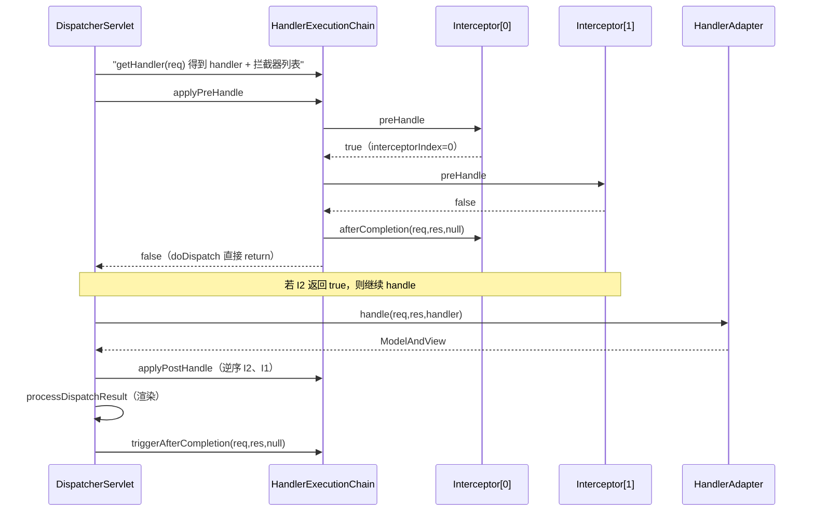
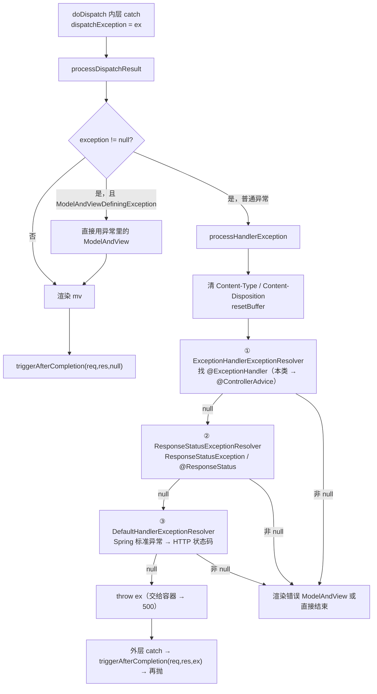
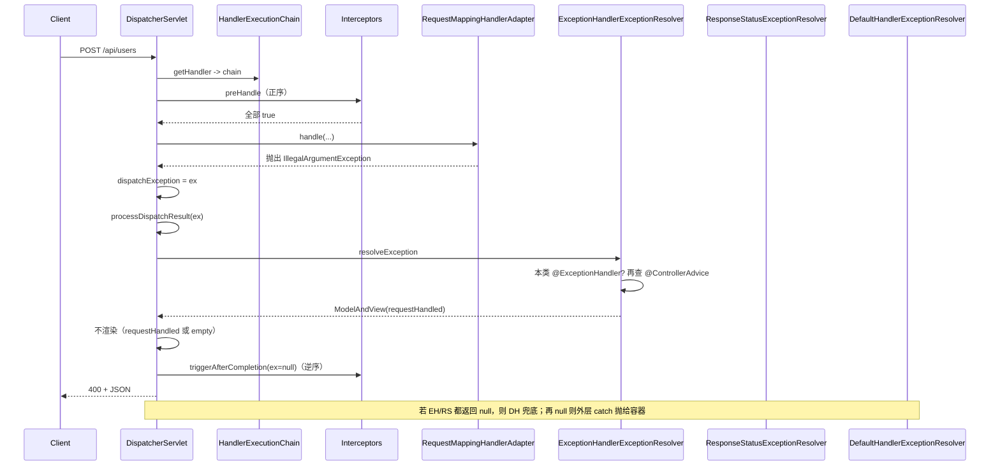

# SpringMVC 04：拦截器与异常处理 —— 从 `HandlerInterceptor` 到 `@ControllerAdvice`

> 一句话结论：拦截器的三个方法在 `DispatcherServlet#doDispatch` 里有**固定坐标**（`preHandle` 在 `handle` 之前、`postHandle` 在 `handle` 之后、`afterCompletion` 在渲染之后），只有 `preHandle` 返回过 `true` 的拦截器才会收到 `afterCompletion`；异常处理则由 `HandlerExceptionResolverComposite` 按 **`ExceptionHandlerExceptionResolver` → `ResponseStatusExceptionResolver` → `DefaultHandlerExceptionResolver`** 的顺序“第一个返回非 `null` 者胜”，`@ControllerAdvice`/`@RestControllerAdvice` 只是前者的“全局处理器缓存”。
>
> 阅读前置：读完 [01 请求的完整旅程](./01-dispatcherservlet-一次请求的完整旅程.md)（尤其 `doDispatch` 与 `processHandlerException`）、[02 处理器映射与适配器](./02-处理器映射与适配器-handlermapping与handleradapter.md)（`HandlerExecutionChain` 从哪来）、[03 参数解析与返回值处理](./03-参数解析与返回值处理-argumentresolver与converter.md)（`@ExceptionHandler` 的参数和返回值同样走解析器/处理器链）。
>
> 预计阅读：55 分钟 ｜ 源码：spring-framework@v7.1.0（spring-webmvc / spring-web）

---

## 0. 先看现象（3 分钟上手）

```text
// 片段：演示用应用代码，非 Spring 源码
@Configuration
public class InterceptorConfig implements WebMvcConfigurer {
    @Override
    public void addInterceptors(InterceptorRegistry registry) {
        registry.addInterceptor(new LogInterceptor()).addPathPatterns("/api/**");
        registry.addInterceptor(new AuthInterceptor()).addPathPatterns("/api/**").order(1);
    }
}

@RestControllerAdvice
public class GlobalExceptionHandler {
    @ExceptionHandler(IllegalArgumentException.class)
    @ResponseStatus(HttpStatus.BAD_REQUEST)
    public Map<String, String> onBadArg(IllegalArgumentException ex) {
        return Map.of("error", ex.getMessage());
    }
}
```

假设 `LogInterceptor`（order 0）与 `AuthInterceptor`（order 1）都是“打印进/出日志”的拦截器，`AuthInterceptor#preHandle` 在未登录时写 401 并返回 `false`。用下面的请求观察日志（`logging.level.org.springframework.web=DEBUG`）：

| 场景 | 打印顺序 | 说明 |
| --- | --- | --- |
| 正常请求 `/api/ok` | `Log.pre` → `Auth.pre` → controller → `Auth.post` → `Log.post` → `Auth.after` → `Log.after` | `post`/`after` 是**逆序** |
| 未登录 `/api/ok` | `Log.pre` → `Auth.pre` → `Log.after` | `Auth.preHandle` 返回 `false`，`Auth` 自己的 `afterCompletion` **不会**被调用，`postHandle` 全部不执行 |
| controller 抛 `IllegalArgumentException` | `Log.pre` → `Auth.pre` → 异常 → 写 400 JSON → `Auth.after` → `Log.after` | 异常被 `@RestControllerAdvice` 处理，`afterCompletion` 的 `Exception` 参数是 `null` |
| 无明显处理器抛错（无人处理） | `Auth.after(ex)` → `Log.after(ex)` → 容器 500 页 | 无人处理的异常从 `doDispatch` 冒泡到外层 `catch`，`afterCompletion` 收到 `ex` 后继续往外抛 |

四个反直觉点，后面都能在源码里找到出处：

1. **`afterCompletion` 的“逆序”只覆盖到“成功过了 `preHandle` 的那些”**——`interceptorIndex` 记的是最后一个成功的下标。
2. **`preHandle` 返回 `false` 时，会立刻对“已经成功的拦截器”调用 `afterCompletion(…, null)`**，注意 `null` 不是异常。
3. **`postHandle` 抛异常会被 `doDispatch` 捕获并进入异常处理**，但此时 `afterCompletion` 只会在 `processDispatchResult` 的成功路径走一遍（`ex = null`），因为异常已经被“处理”了。
4. **`@ExceptionHandler` 方法本身的参数/返回值同样走 03 篇的解析器与 converter 链**，所以它也能 `@ResponseBody`、也能被 `ResponseBodyAdvice` 干预。

> ⚠️ 版本提示：7.1 的 `AbstractHandlerExceptionResolver` 增加了 `mappedHandlerPredicate`（`@since 5.3` 起演进），`ExceptionHandlerExceptionResolver` 增加了 `renderUnhandledExceptionsAsProblemDetails` 与 `problemDetailExceptionHandler`；`DefaultHandlerExceptionResolver` 已改为“先 `ErrorResponse` 体系、再低层异常”的判定结构（7.0 起）。

---

## 1. 整体地图（先图后码）

### 1.1 拦截器在 `doDispatch` 里的三个坐标



**读图说明**：上半部分是“`preHandle` 被拒”的短路路径——`I2` 返回 `false` 后，`applyPreHandle` 立即对**已经成功**的 `I1` 调 `afterCompletion(req,res,null)` 并返回 `false`，`doDispatch` 于是 `return`，`postHandle`、`handle` 都不会执行，`I2` 自己的 `afterCompletion` 也不会执行（它从未成功）。下半部分是正常路径，注意 `postHandle` 与 `afterCompletion` 都是**逆序**执行的。

### 1.2 异常处理链的三段式



**读图说明**：中间竖排的三个方框是 `HandlerExceptionResolverComposite` 内部按顺序尝试的三个解析器，**第一个返回非 `null` 的就赢**（`null` 才继续）。左下角两条分叉：解析成功时 `afterCompletion` 收到 `null`（异常“已被处理”）；全部解析失败时异常冒泡到 `doDispatch` 的外层 `catch`，`afterCompletion` 收到真实异常，随后 `DispatcherServlet#triggerAfterCompletion` 会把异常**再次抛出**给 Servlet 容器。

### 1.3 关键类一览

| 类 | 包（jar） | 职责 |
| --- | --- | --- |
| `HandlerInterceptor` | `org.springframework.web.servlet`（spring-webmvc） | 三方法回调接口 |
| `HandlerExecutionChain` | 同上 | handler + 拦截器列表，负责按序/逆序回调 |
| `MappedInterceptor` | `org.springframework.web.servlet.handler` | 带路径匹配的拦截器包装 |
| `HandlerExceptionResolver` | `org.springframework.web.servlet` | 异常解析器接口 |
| `HandlerExceptionResolverComposite` | `org.springframework.web.servlet.handler` | 有序列表 + 第一个非 null 胜出 |
| `AbstractHandlerExceptionResolver` | `org.springframework.web.servlet.handler` | 模板方法 + `shouldApplyTo` + 日志 |
| `AbstractHandlerMethodExceptionResolver` | 同上 | 把 handler 转成 `HandlerMethod`，再转给 bean |
| `ExceptionHandlerExceptionResolver` | `org.springframework.web.servlet.mvc.method.annotation` | 处理 `@ExceptionHandler` |
| `ExceptionHandlerMethodResolver` | `org.springframework.web.method.annotation`（spring-web） | 一个类里的 `@ExceptionHandler` 索引 |
| `ControllerAdviceBean` | `org.springframework.web.method`（spring-web） | `@ControllerAdvice` bean 的包装 + 适用性判断 |
| `ResponseStatusExceptionResolver` | `org.springframework.web.servlet.mvc.annotation` | 处理 `ResponseStatusException` 与 `@ResponseStatus` |
| `DefaultHandlerExceptionResolver` | `org.springframework.web.servlet.mvc.support` | Spring 标准异常 → HTTP 状态码 |

---

## 2. 关键类逐个拆

### 2.1 `HandlerInterceptor`：三个方法的语义边界

```java (src: HandlerInterceptor.java#L94-L140)
	 * @param request current HTTP request
	 * @param response current HTTP response
	 * @param handler chosen handler to execute, for type and/or instance evaluation
	 * @return {@code true} if the execution chain should proceed with the
	 * next interceptor or the handler itself. Else, DispatcherServlet assumes
	 * that this interceptor has already dealt with the response itself.
	 * @throws Exception in case of errors
	 */
	default boolean preHandle(HttpServletRequest request, HttpServletResponse response, Object handler)
			throws Exception {

		return true;
	}

	/**
	 * Interception point after successful execution of a handler.
	 * Called after HandlerAdapter actually invoked the handler, but before the
	 * DispatcherServlet renders the view. Can expose additional model objects
	 * to the view via the given ModelAndView.
	 * <p>DispatcherServlet processes a handler in an execution chain, consisting
	 * of any number of interceptors, with the handler itself at the end.
	 * With this method, each interceptor can post-process an execution,
	 * getting applied in inverse order of the execution chain.
	 * <p><strong>Note:</strong> special considerations apply for asynchronous
	 * request processing. For more details see
	 * {@link org.springframework.web.servlet.AsyncHandlerInterceptor}.
	 * <p>The default implementation is empty.
	 * @param request current HTTP request
	 * @param response current HTTP response
	 * @param handler the handler (or {@link HandlerMethod}) that started asynchronous
	 * execution, for type and/or instance examination
	 * @param modelAndView the {@code ModelAndView} that the handler returned
	 * (can also be {@code null})
	 * @throws Exception in case of errors
	 */
	default void postHandle(HttpServletRequest request, HttpServletResponse response, Object handler,
			@Nullable ModelAndView modelAndView) throws Exception {
	}

	/**
	 * Callback after completion of request processing, that is, after rendering
	 * the view. Will be called on any outcome of handler execution, thus allows
	 * for proper resource cleanup.
	 * <p>Note: Will only be called if this interceptor's {@code preHandle}
	 * method has successfully completed and returned {@code true}!
	 * <p>As with the {@code postHandle} method, the method will be invoked on each
	 * interceptor in the chain in reverse order, so the first interceptor will be
```

四层解释：

1. **在干什么**：`preHandle` 返回“是否继续”，默认 `true`；`postHandle` 在 handler 执行后、视图渲染前调用，默认空实现；`afterCompletion` 无论成败都会调用（**但只对 `preHandle` 成功过的拦截器**）。
2. **为什么这么写**：三方法覆盖“进入前 / 出来后 / 结束后”三个时机；返回 `boolean` 让拦截器能“自己写完响应就短路”。
3. **改成别的会怎样**：如果 `preHandle` 没有返回值、只能抛异常，就没法优雅地做“未登录直接 401”，只能靠异常 + 异常处理器绕一圈。
4. **常见坑**：`afterCompletion` 的 Javadoc 明确写着“只有 `preHandle` 成功返回 `true` 才会调用”——所以**资源释放不要只写在 `afterCompletion`**，`preHandle` 里 `false` 之前申请的资源要自己释放。

`HandlerInterceptor` 的 Javadoc 还明确声明它**不是安全层**：拦截器运行在 `DispatcherServlet` 内部，只能看到“已经映射到某个 handler 的请求”，静态资源、未映射的 URL 未必经过它；真正的鉴权应该在 `Filter` 里做。

### 2.2 `HandlerExecutionChain`：拦截器列表的执行器

```java (src: HandlerExecutionChain.java#L142-L181)
	boolean applyPreHandle(HttpServletRequest request, HttpServletResponse response) throws Exception {
		for (int i = 0; i < this.interceptorList.size(); i++) {
			HandlerInterceptor interceptor = this.interceptorList.get(i);
			if (!interceptor.preHandle(request, response, this.handler)) {
				triggerAfterCompletion(request, response, null);
				return false;
			}
			this.interceptorIndex = i;
		}
		return true;
	}

	/**
	 * Apply postHandle methods of registered interceptors.
	 */
	void applyPostHandle(HttpServletRequest request, HttpServletResponse response, @Nullable ModelAndView mv)
			throws Exception {

		for (int i = this.interceptorList.size() - 1; i >= 0; i--) {
			HandlerInterceptor interceptor = this.interceptorList.get(i);
			interceptor.postHandle(request, response, this.handler, mv);
		}
	}

	/**
	 * Trigger afterCompletion callbacks on the mapped HandlerInterceptors.
	 * Will just invoke afterCompletion for all interceptors whose preHandle invocation
	 * has successfully completed and returned true.
	 */
	void triggerAfterCompletion(HttpServletRequest request, HttpServletResponse response, @Nullable Exception ex) {
		for (int i = this.interceptorIndex; i >= 0; i--) {
			HandlerInterceptor interceptor = this.interceptorList.get(i);
			try {
				interceptor.afterCompletion(request, response, this.handler, ex);
			}
			catch (Throwable ex2) {
				logger.error("HandlerInterceptor.afterCompletion threw exception in interceptor [" + interceptor + "]", ex2);
			}
		}
	}
```

四层解释：

1. **在干什么**：`applyPreHandle` 正序遍历，任一返回 `false` 就调用 `triggerAfterCompletion(req,res,null)` 并返回 `false`；成功一项就把 `interceptorIndex = i` 记下。`applyPostHandle` 逆序调用 `postHandle`。`triggerAfterCompletion` 从 `interceptorIndex` 递减到 0 调用 `afterCompletion`，并吞掉拦截器自身抛出的异常（只记 `logger.error`）。
2. **为什么这么写**：`interceptorIndex` 是“最后一个成功过的下标”，逆序回退保证“后进入的先退出”（栈语义），与资源获取/释放顺序天然匹配；吞掉 `afterCompletion` 的异常是为了不掩盖原始异常（否则原始异常会被覆盖）。
3. **改成别的会怎样**：如果 `triggerAfterCompletion` 遍历整个列表，未成功的拦截器也会收到 `afterCompletion(ex)`，本该“从未开始”的拦截器会误以为自己需要清理。
4. **常见坑**：`applyPostHandle` 里某个 `postHandle` 抛异常，后面的（更早的）拦截器**不会**再收到 `postHandle`，但会在 `processDispatchResult` 的成功路径收到 `afterCompletion(null)`——因为异常已经进入异常处理链。

### 2.3 拦截器列表从哪来：`AbstractHandlerMapping#getHandlerExecutionChain`

`HandlerExecutionChain` 不是凭空出现，而是 `HandlerMapping` 在返回 handler 时顺手装配的：

```java (src: AbstractHandlerMapping.java#L681-L706)
	protected HandlerExecutionChain getHandlerExecutionChain(Object handler, HttpServletRequest request) {

		HandlerExecutionChain chain = (handler instanceof HandlerExecutionChain handlerExecutionChain ?
				handlerExecutionChain : new HandlerExecutionChain(handler));

		for (HandlerInterceptor interceptor : this.adaptedInterceptors) {
			if (interceptor instanceof MappedInterceptor mappedInterceptor) {
				if (mappedInterceptor.matches(request)) {
					chain.addInterceptor(mappedInterceptor.getInterceptor());
				}
			}
			else {
				chain.addInterceptor(interceptor);
			}
		}

		if (this.versionStrategy != null) {
			ApiVersionHolder versionHolder = (ApiVersionHolder) request.getAttribute(API_VERSION_ATTRIBUTE);
			if (versionHolder.hasVersion()) {
				Comparable<?> version = versionHolder.getVersion();
				chain.addInterceptor(new ApiVersionDeprecationHandlerInterceptor(this.versionStrategy, version));
			}
		}

		return chain;
	}
```

四层解释：

1. **在干什么**：如果 handler 本身已经是 `HandlerExecutionChain` 就复用，否则包装一层；然后遍历 `adaptedInterceptors`：`MappedInterceptor` 走 `matches(request)` 判断是否命中，普通 `HandlerInterceptor` 无条件加入；最后若启用了 API 版本策略，再加一个版本弃用提示拦截器。
2. **为什么这么写**：把“路径匹配”放在 `MappedInterceptor` 里，`AbstractHandlerMapping` 只需一次遍历；顺序由 `adaptedInterceptors` 的排序（`AnnotationAwareOrderComparator`，来自 `WebMvcConfigurationSupport`/`InterceptorRegistry` 的 order）决定，即**先加入的 `preHandle` 先执行**。
3. **改成别的会怎样**：如果每个请求都重新计算“哪些拦截器命中”，性能会退化；`MappedInterceptor` 内部对 `PathPattern` 做了预编译与缓存。
4. **常见坑**：`addPathPatterns("/api/**")` 与 `excludePathPatterns` 都是在 `InterceptorRegistry` 阶段转成 `MappedInterceptor` 的；`MappedInterceptor#matches` 用的是 `PathPattern`/`PathMatcher`，`**` 只能出现在末尾（与 02 篇的 `PathPattern` 限制一致）。

### 2.4 `HandlerExceptionResolver` 与复合体

```java (src: HandlerExceptionResolver.java#L38-L54)
	 * Try to resolve the given exception that got thrown during handler execution,
	 * returning a {@link ModelAndView} that represents a specific error page if appropriate.
	 * <p>The returned {@code ModelAndView} may be {@linkplain ModelAndView#isEmpty() empty}
	 * to indicate that the exception has been resolved successfully but that no view
	 * should be rendered, for instance by setting a status code.
	 * @param request current HTTP request
	 * @param response current HTTP response
	 * @param handler the executed handler, or {@code null} if none chosen at the
	 * time of the exception (for example, if multipart resolution failed)
	 * @param ex the exception that got thrown during handler execution
	 * @return a corresponding {@code ModelAndView} to forward to,
	 * or {@code null} for default processing in the resolution chain
	 */
	@Nullable ModelAndView resolveException(
			HttpServletRequest request, HttpServletResponse response, @Nullable Object handler, Exception ex);

}
```

四层解释：

1. **在干什么**：唯一的 `resolveException`，返回 `ModelAndView`：**空 `ModelAndView` = 已处理但不渲染视图**（比如只设了状态码），**`null` = 我没处理，交给下一个**。
2. **为什么这么写**：用 `null` 与“空对象”区分“不认识这个异常”和“认识了且无需视图”，避免异常被重复处理。
3. **改成别的会怎样**：用 `null` 表示“已处理”，链就无法继续向后尝试，`DefaultHandlerExceptionResolver` 永远轮不到。
4. **常见坑**：自己写 resolver 时返回 `new ModelAndView()` 会让 `DispatcherServlet` 走“返回 null 的 `exMv.isEmpty()` 分支”——`request.setAttribute(EXCEPTION_ATTRIBUTE, ex); return null;`，最终 `processDispatchResult` 看到 `mv == null` 就跳过渲染。

```java (src: HandlerExceptionResolverComposite.java#L66-L85)


	/**
	 * Resolve the exception by iterating over the list of configured exception resolvers.
	 * <p>The first one to return a {@link ModelAndView} wins. Otherwise {@code null} is returned.
	 */
	@Override
	public @Nullable ModelAndView resolveException(
			HttpServletRequest request, HttpServletResponse response, @Nullable Object handler, Exception ex) {

		if (this.resolvers != null) {
			for (HandlerExceptionResolver handlerExceptionResolver : this.resolvers) {
				ModelAndView mav = handlerExceptionResolver.resolveException(request, response, handler, ex);
				if (mav != null) {
					return mav;
				}
			}
		}
		return null;
	}
```

四层解释：

1. **在干什么**：顺序遍历内部 `resolvers`，第一个返回非 `null` 的立即返回；全 `null` 则返回 `null`。
2. **为什么这么写**：把“链式尝试”收在一个 `Ordered` 组件里，`DispatcherServlet` 只需遍历一个元素（实际 `initHandlerExceptionResolvers` 也可能拿到多个 resolver，见 01 篇）。
3. **改成别的会怎样**：如果按 order 排序后仍并行尝试，就会出现“两套 resolver 都写了响应”的冲突。
4. **常见坑**：`WebMvcConfigurationSupport#handlerExceptionResolver` 把 composite 的 `order` 设为 0，而内部三个 resolver 的顺序是装配时写死的（见 §3.4）。

### 2.5 `AbstractHandlerExceptionResolver`：`shouldApplyTo` 与日志

```java (src: AbstractHandlerExceptionResolver.java#L170-L188)
	@Override
	public @Nullable ModelAndView resolveException(
			HttpServletRequest request, HttpServletResponse response, @Nullable Object handler, Exception ex) {

		if (shouldApplyTo(request, handler)) {
			prepareResponse(ex, response);
			ModelAndView result = doResolveException(request, response, handler, ex);
			if (result != null && !disconnectedClientHelper.checkAndLogClientDisconnectedException(ex)) {
				// Print debug message when warn logger is not enabled.
				if (logger.isDebugEnabled() && (this.warnLogger == null || !this.warnLogger.isWarnEnabled())) {
					logger.debug(buildLogMessage(ex, request) + (result.isEmpty() ? "" : " to " + result));
				}
				// Explicitly configured warn logger in logException method.
				logException(ex, request);
			}
			return result;
		}
		else {
			return null;
```

```java (src: AbstractHandlerExceptionResolver.java#L205-L234)
	 */
	protected boolean shouldApplyTo(HttpServletRequest request, @Nullable Object handler) {
		if (this.mappedHandlerPredicate != null) {
			return this.mappedHandlerPredicate.test(handler);
		}
		if (handler != null) {
			if (this.mappedHandlers != null && this.mappedHandlers.contains(handler)) {
				return true;
			}
			if (this.mappedHandlerClasses != null) {
				for (Class<?> handlerClass : this.mappedHandlerClasses) {
					if (handlerClass.isInstance(handler)) {
						return true;
					}
				}
			}
		}
		return !hasHandlerMappings();
	}

	/**
	 * Whether there are any handler mappings registered via
	 * {@link #setMappedHandlers(Set)}, {@link #setMappedHandlerClasses(Class[])}, or
	 * {@link #setMappedHandlerPredicate(Predicate)}.
	 * @since 5.3
	 */
	protected boolean hasHandlerMappings() {
		return (this.mappedHandlers != null || this.mappedHandlerClasses != null ||
				this.mappedHandlerPredicate != null);
	}
```

四层解释：

1. **在干什么**：`resolveException` 先问 `shouldApplyTo`，通过后 `prepareResponse`（设置缓存头等）再 `doResolveException`；成功时打日志。`shouldApplyTo` 先看 `mappedHandlerPredicate`，再看 `mappedHandlers`/`mappedHandlerClasses`，**都没有配置时才返回 `true`**（`!hasHandlerMappings()`）。
2. **为什么这么写**：模板方法把“是否适用”和“怎么处理”分开，子类只写 `doResolveException`；`hasHandlerMappings()` 保证“没限定范围”的 resolver 对任何 handler 都适用。
3. **改成别的会怎样**：如果 `shouldApplyTo` 默认 `false`，`DefaultHandlerExceptionResolver` 就永远不生效（它没有配置任何 `mappedHandlers`）。
4. **常见坑**：`setMappedHandlerClasses` 一旦设置，resolver 就**只**作用于这些类，对其它 handler 返回 `null`——这是“我加了自定义 resolver，结果默认 400/405 全变成 500”的常见原因。

### 2.6 `AbstractHandlerMethodExceptionResolver`：把 handler 变成 bean 类型

```java (src: AbstractHandlerMethodExceptionResolver.java#L44-L55)
	@Override
	protected boolean shouldApplyTo(HttpServletRequest request, @Nullable Object handler) {
		if (handler instanceof HandlerMethod handlerMethod) {
			return super.shouldApplyTo(request, handlerMethod.getBean());
		}
		else if (handler == null || (hasGlobalExceptionHandlers() && hasHandlerMappings())) {
			return super.shouldApplyTo(request, handler);
		}
		else {
			return false;
		}
	}
```

四层解释：

1. **在干什么**：如果 handler 是 `HandlerMethod`，把 `handlerMethod.getBean()` 传给父类去判断；否则（`null` 或“有全局处理器 + 配置了映射范围”）交给父类；其余情况返回 `false`。
2. **为什么这么写**：`mappedHandlerClasses` 里配置的通常是**控制器类**，而不是 `HandlerMethod` 对象，所以必须先换成 bean。
3. **改成别的会怎样**：不换 bean，`@ControllerAdvice` 上的 `basePackages` 判定（`ControllerAdviceBean#isApplicableToBeanType`）就拿不到控制器类型。
4. **常见坑**：`hasGlobalExceptionHandlers()` 默认 `false`，`ExceptionHandlerExceptionResolver` 覆盖成“有 advice 或有 problemDetailHandler”；如果只有一个 controller 内 `@ExceptionHandler`，`shouldApplyTo` 走第一分支，与全局无关。

---

## 3. 源码逐段精读

### 3.1 `dispatcherServlet` 侧：`processHandlerException` 的前置清理

异常处理前要先把“上一次响应可能已有的内容类型”清掉，因为成功响应与错误响应的 `Content-Type` 往往不同：

```java (src: DispatcherServlet.java#L1201-L1248)
	 * @param handler the executed handler, or {@code null} if none chosen at the time of the exception
	 * (for example, if multipart resolution failed)
	 * @param ex the exception that got thrown during handler execution
	 * @return a corresponding ModelAndView to forward to
	 * @throws Exception if no error ModelAndView found
	 */
	protected @Nullable ModelAndView processHandlerException(HttpServletRequest request, HttpServletResponse response,
			@Nullable Object handler, Exception ex) throws Exception {

		// Success and error responses may use different content types
		request.removeAttribute(HandlerMapping.PRODUCIBLE_MEDIA_TYPES_ATTRIBUTE);
		// Reset the response content-type header and body buffer if the response is not committed already,
		// leaving the other response headers in place.
		try {
			response.setHeader(HttpHeaders.CONTENT_TYPE, null);
			response.setHeader(HttpHeaders.CONTENT_DISPOSITION, null);
			response.resetBuffer();
		}
		catch (IllegalStateException illegalStateException) {
			// the response is already committed, leave it to exception handlers anyway
		}

		// Check registered HandlerExceptionResolvers...
		ModelAndView exMv = null;
		if (this.handlerExceptionResolvers != null) {
			for (HandlerExceptionResolver resolver : this.handlerExceptionResolvers) {
				exMv = resolver.resolveException(request, response, handler, ex);
				if (exMv != null) {
					break;
				}
			}
		}
		if (exMv != null) {
			if (exMv.isEmpty()) {
				request.setAttribute(EXCEPTION_ATTRIBUTE, ex);
				return null;
			}
			// We might still need view name translation for a plain error model...
			if (!exMv.hasView()) {
				String defaultViewName = getDefaultViewName(request);
				if (defaultViewName != null) {
					exMv.setViewName(defaultViewName);
				}
			}
			if (logger.isTraceEnabled()) {
				logger.trace("Using resolved error view: " + exMv, ex);
			}
			else if (logger.isDebugEnabled()) {
```

四层解释：

1. **在干什么**：先 `removeAttribute(PRODUCIBLE_MEDIA_TYPES_ATTRIBUTE)`（清掉 `produces` 的限制，让错误响应不受成功分支的 `produces` 约束）；再尝试把 `Content-Type`、`Content-Disposition` 置空并 `resetBuffer()`（响应未提交时），失败则忽略。
2. **为什么这么写**：控制器可能已经把部分 JSON 写进 buffer 后抛异常，若不清 buffer，错误处理器写的内容会接在半截 JSON 后面；`PRODUCIBLE_MEDIA_TYPES_ATTRIBUTE` 不清掉，`@ExceptionHandler` 返回 `ProblemDetail` 时会被旧 `produces` 卡住。
3. **改成别的会怎样**：不清 `PRODUCIBLE_MEDIA_TYPES_ATTRIBUTE`，正文里 `getProducibleMediaTypes` 会优先读它（见 03 篇 §3.5），于是错误体被写成成功接口的媒体类型。
4. **常见坑**：响应已经提交（`flush` 过）时 `resetBuffer` 抛 `IllegalStateException`，这里被 `catch` 忽略，但**后续写错误体仍会失败**——表现为“日志里有异常，客户端收到半截响应”。遇到这种问题要在业务侧避免提前 `flush`。

随后遍历 resolver 并处理结果：

```java (src: DispatcherServlet.java#L1226-L1256)
			for (HandlerExceptionResolver resolver : this.handlerExceptionResolvers) {
				exMv = resolver.resolveException(request, response, handler, ex);
				if (exMv != null) {
					break;
				}
			}
		}
		if (exMv != null) {
			if (exMv.isEmpty()) {
				request.setAttribute(EXCEPTION_ATTRIBUTE, ex);
				return null;
			}
			// We might still need view name translation for a plain error model...
			if (!exMv.hasView()) {
				String defaultViewName = getDefaultViewName(request);
				if (defaultViewName != null) {
					exMv.setViewName(defaultViewName);
				}
			}
			if (logger.isTraceEnabled()) {
				logger.trace("Using resolved error view: " + exMv, ex);
			}
			else if (logger.isDebugEnabled()) {
				logger.debug("Using resolved error view: " + exMv);
			}
			WebUtils.exposeErrorRequestAttributes(request, ex, getServletName());
			return exMv;
		}

		throw ex;
	}
```

四层解释：

1. **在干什么**：循环 `handlerExceptionResolvers`，第一个非 `null` 的 `exMv` 结束循环；`exMv.isEmpty()` → 记录 `EXCEPTION_ATTRIBUTE` 并返回 `null`（`processDispatchResult` 中 `mv == null` 即跳过渲染）；否则补默认视图名、暴露错误请求属性（`jakarta.servlet.error.*`）、返回 `exMv`。全部 `null` 则 `throw ex`。
2. **为什么这么写**：`isEmpty` 的语义是“已处理但不需要视图”，此时必须把 `null` 返回给调用方而不是继续渲染；`exposeErrorRequestAttributes` 让 JSP/错误页能拿到异常信息。
3. **改成别的会怎样**：把 `isEmpty()` 也当作要渲染，会去解析一个空视图名，报“找不到视图”。
4. **常见坑**：`@ResponseStatus` 与 `ResponseStatusException` 返回的都是**空** `ModelAndView`，所以走“返回 null、跳过渲染”这条；这解释了为什么它们“只设置状态码、不渲染页面”。

### 3.2 拦截器的调用位置（对照 `doDispatch`）

第 01 篇完整贴过 `doDispatch`，这里只标出三个坐标：

| 行 | 代码 | 含义 |
| --- | --- | --- |
| L957 | `if (!mappedHandler.applyPreHandle(processedRequest, response)) { return; }` | `preHandle` 阶段；返回 `false` 直接 `return` |
| L962-L963 | `HandlerAdapter ha = getHandlerAdapter(...); mv = ha.handle(...);` | 真正调用控制器 |
| L969-L970 | `applyDefaultViewName(...); mappedHandler.applyPostHandle(...);` | `postHandle` 阶段 |
| L1058-L1061 | `mappedHandler.triggerAfterCompletion(request, response, null);` | 成功（含异常已处理）时 `afterCompletion(null)` |
| L1358-L1365 | `triggerAfterCompletion(request, response, mappedHandler, ex); throw ex;` | 异常未被处理时的 `afterCompletion(ex)` |

最后一段是 `DispatcherServlet` 的静态辅助方法：

```java (src: DispatcherServlet.java#L1358-L1365)
			@Nullable HandlerExecutionChain mappedHandler, Exception ex) throws Exception {

		if (mappedHandler != null) {
			mappedHandler.triggerAfterCompletion(request, response, ex);
		}
		throw ex;
	}

```

四层解释：

1. **在干什么**：先对 `mappedHandler` 调 `triggerAfterCompletion(..., ex)`，然后**原样再抛出** `ex`。
2. **为什么这么写**：`doDispatch` 外层 `catch` 的职责是“清理 + 上报”，清理完必须继续抛，否则异常被吞、容器以为请求成功。
3. **改成别的会怎样**：不抛，客户端拿到 200 但没有内容（因为渲染也没做）。
4. **常见坑**：这里的 `ex` 可能是被包装过的 `ServletException("Handler dispatch failed: ...")` 或 `ServletException("Handler processing failed: ...")`，排查时看 `cause`。

### 3.3 `@ExceptionHandler` 是怎么被找到的

#### 3.3.1 本地（同一个 Controller 里）优先

```java (src: ExceptionHandlerExceptionResolver.java#L532-L536)
		if (exceptionHandlerMethod == null) {
			return null;
		}
		return invokeExceptionHandlerMethod(exceptionHandlerMethod, webRequest, handlerMethod, exception);
	}
```

```java (src: ExceptionHandlerExceptionResolver.java#L655-L684)
		Class<?> handlerType = null;

		if (handlerMethod != null) {
			// Local exception handler methods on the controller class itself.
			// To be invoked through the proxy, even in case of an interface-based proxy.
			handlerType = handlerMethod.getBeanType();
			ExceptionHandlerMethodResolver resolver = this.exceptionHandlerCache.computeIfAbsent(
					handlerType, ExceptionHandlerMethodResolver::new);

			for (MediaType mediaType : acceptedMediaTypes) {
				ExceptionHandlerMappingInfo mappingInfo = resolver.resolveExceptionMapping(exception, mediaType);
				if (mappingInfo != null) {
					if (!mappingInfo.getProducibleTypes().isEmpty()) {
						webRequest.setAttribute(HandlerMapping.PRODUCIBLE_MEDIA_TYPES_ATTRIBUTE, mappingInfo.getProducibleTypes(), RequestAttributes.SCOPE_REQUEST);
					}
					return new ServletInvocableHandlerMethod(handlerMethod.getBean(), mappingInfo.getHandlerMethod(), this.applicationContext);
				}
			}
			// For advice applicability check below (involving base packages, assignable types
			// and annotation presence), use target class instead of interface-based proxy.
			if (Proxy.isProxyClass(handlerType)) {
				handlerType = AopUtils.getTargetClass(handlerMethod.getBean());
			}
		}

		for (Map.Entry<ControllerAdviceBean, ExceptionHandlerMethodResolver> entry : this.exceptionHandlerAdviceCache.entrySet()) {
			ControllerAdviceBean advice = entry.getKey();
			if (advice.isApplicableToBeanType(handlerType)) {
				ExceptionHandlerMethodResolver resolver = entry.getValue();
				for (MediaType mediaType : acceptedMediaTypes) {
```

四层解释：

1. **在干什么**：`doResolveHandlerMethodException` 拿到 `webRequest` 后调用 `getExceptionHandlerMethod`；后者先取可接受的媒体类型（解析失败退化为 `MediaType.ALL`），然后**先找控制器自己的** `@ExceptionHandler`：`exceptionHandlerCache.computeIfAbsent(handlerType, ExceptionHandlerMethodResolver::new)`，对每个媒体类型调 `resolveExceptionMapping`；命中时若 `@ExceptionHandler(produces=...)` 非空，写入 `PRODUCIBLE_MEDIA_TYPES_ATTRIBUTE`，并返回一个 `ServletInvocableHandlerMethod`。
2. **为什么这么写**：控制器内的处理器语义上“最具体”，优先于全局 advice；`PRODUCIBLE_MEDIA_TYPES_ATTRIBUTE` 的写入让 03 篇的 converter 协商能识别 `produces`。
3. **改成别的会怎样**：先找 advice 再找本地，本地处理器就永远不生效（这是很多人“我在 Controller 里写了 `@ExceptionHandler` 为什么没走到”的镜像问题）。
4. **常见坑**：`Proxy.isProxyClass(handlerType)` 时用 `AopUtils.getTargetClass` 换成目标类，否则 advice 的 `basePackages`/`assignableTypes` 判定会以接口为准而匹配失败。

#### 3.3.2 全局（`@ControllerAdvice`）其次

```java (src: ExceptionHandlerExceptionResolver.java#L686-L698)
					if (mappingInfo != null) {
						if (!mappingInfo.getProducibleTypes().isEmpty()) {
							webRequest.setAttribute(HandlerMapping.PRODUCIBLE_MEDIA_TYPES_ATTRIBUTE, mappingInfo.getProducibleTypes(), RequestAttributes.SCOPE_REQUEST);
						}
						return new ServletInvocableHandlerMethod(advice.resolveBean(), mappingInfo.getHandlerMethod(), this.applicationContext);
					}
				}
			}
		}

		return getProblemDetailHandlerMethod(webRequest);
	}

```

四层解释：

1. **在干什么**：遍历 `exceptionHandlerAdviceCache`（顺序即 `ControllerAdviceBean.findAnnotatedBeans` 的排序结果），用 `advice.isApplicableToBeanType(handlerType)` 过滤后，用同样的方式解析映射并包装成 `ServletInvocableHandlerMethod`（bean 是 `advice.resolveBean()`）。
2. **为什么这么写**：缓存把“一个 advice bean 的所有 `@ExceptionHandler`”预先索引成 `ExceptionHandlerMethodResolver`，每次请求只做查表。
3. **改成别的会怎样**：每次请求都重新反射扫描 advice 类，性能大幅下降。
4. **常见坑**：`handlerType == null`（例如异常发生在映射之前）时，本地分支被跳过，但 `advice.isApplicableToBeanType(null)` 的行为取决于 `HandlerTypePredicate`（通常返回 `true`），所以无 handler 的异常也能被全局 advice 处理。

#### 3.3.3 一个类里的索引怎么建

```java (src: ExceptionHandlerMethodResolver.java#L92-L103)
	 */
	public ExceptionHandlerMethodResolver(Class<?> handlerType) {
		for (Method method : MethodIntrospector.selectMethods(handlerType, EXCEPTION_HANDLER_METHODS)) {
			ExceptionHandlerMappingInfo mappingInfo = detectExceptionMappings(method);
			for (Class<? extends Throwable> exceptionType : mappingInfo.getExceptionTypes()) {
				for (MediaType producibleType : mappingInfo.getProducibleTypes()) {
					addExceptionMapping(new ExceptionMapping(exceptionType, producibleType), mappingInfo);
				}
				if (mappingInfo.getProducibleTypes().isEmpty()) {
					addExceptionMapping(new ExceptionMapping(exceptionType, MediaType.ALL), mappingInfo);
				}
			}
```

四层解释：

1. **在干什么**：构造时用 `MethodIntrospector.selectMethods(handlerType, EXCEPTION_HANDLER_METHODS)` 找出所有 `@ExceptionHandler` 方法，为每个异常类型 × 每个可生产媒体类型建一条映射（没写 `produces` 则用 `MediaType.ALL`）。
2. **为什么这么写**：把“方法查找”的时间从请求期挪到启动期，并在同一异常有多个候选时依靠 `ExceptionDepthComparator`（越具体的异常类型优先）与媒体类型具体度做二级选择。
3. **改成别的会怎样**：请求期再遍历方法，且难以稳定地处理“父子异常同时匹配”。
4. **常见坑**：`@ExceptionHandler` 不写 `exception` 属性时，用方法参数里的 `Throwable` 子类推断（`detectExceptionMappings` 的 fallback）；若参数里一个 `Throwable` 都没有，启动期就抛 `IllegalStateException("No exception types mapped to ...")`。

#### 3.3.4 调用 `@ExceptionHandler` 方法

```java (src: ExceptionHandlerExceptionResolver.java#L549-L605)
		}

		ModelAndViewContainer mavContainer = new ModelAndViewContainer();

		ArrayList<Throwable> exceptions = new ArrayList<>();
		try {
			if (logger.isDebugEnabled()) {
				logger.debug("Using @ExceptionHandler " + exceptionHandlerMethod);
			}
			// Expose causes as provided arguments as well
			Throwable exToExpose = exception;
			while (exToExpose != null) {
				exceptions.add(exToExpose);
				Throwable cause = exToExpose.getCause();
				exToExpose = (cause != exToExpose ? cause : null);
			}
			@Nullable Object[] arguments = new Object[exceptions.size() + 1];
			exceptions.toArray(arguments);  // efficient arraycopy call in ArrayList
			arguments[arguments.length - 1] = handlerMethod;
			exceptionHandlerMethod.invokeAndHandle(webRequest, mavContainer, arguments);
		}
		catch (Throwable invocationEx) {
			if (disconnectedClientHelper.checkAndLogClientDisconnectedException(invocationEx)) {
				if (isProblemDetailHandler) {
					recordServerError(exception, webRequest);
				}
				return new ModelAndView();
			}
			// Any other than the original exception (or a cause) is unintended here,
			// probably an accident (for example, failed assertion or the like).
			if (!exceptions.contains(invocationEx) && logger.isWarnEnabled()) {
				logger.warn("Failure in @ExceptionHandler " + exceptionHandlerMethod, invocationEx);
			}
			if (!isProblemDetailHandler) {
				ServletInvocableHandlerMethod problemDetailHandlerMethod = getProblemDetailHandlerMethod(webRequest);
				if (problemDetailHandlerMethod != null) {
					// Producible media types are those of the handler method that did not handle the exception
					request.removeAttribute(HandlerMapping.PRODUCIBLE_MEDIA_TYPES_ATTRIBUTE);
					return invokeExceptionHandlerMethod(problemDetailHandlerMethod, webRequest, handlerMethod, exception);
				}
			}
			// Continue with default processing of the original exception...
			return null;
		}

		if (isProblemDetailHandler) {
			recordServerError(exception, webRequest);
		}

		if (mavContainer.isRequestHandled()) {
			return new ModelAndView();
		}
		else {
			ModelMap model = mavContainer.getModel();
			HttpStatusCode status = mavContainer.getStatus();
			ModelAndView mav = new ModelAndView(mavContainer.getViewName(), model, status);
			mav.setViewName(mavContainer.getViewName());
```

四层解释：

1. **在干什么**：把参数解析器/返回值处理器装到 `ServletInvocableHandlerMethod` 上；把异常**整条 `cause` 链**收集进 `List<Throwable>`，连同 `handlerMethod` 一起作为 `providedArgs` 传入（所以方法参数可以写任意一层 cause）；调用后若 `mavContainer.isRequestHandled()` 返回空 `ModelAndView`，否则构造带 model/status 的 `ModelAndView`。
2. **为什么这么写**：`providedArgs` 机制让 `@ExceptionHandler` 的方法参数既可以是异常本身，也可以是 `HandlerMethod`、`WebRequest` 等；整条 cause 链暴露使“包装异常”场景也能精确匹配。
3. **改成别的会怎样**：只传最外层异常，`@ExceptionHandler(RootCauseException.class)` 就永远匹配不上。
4. **常见坑**：处理器自身抛异常时，若不是原始异常或 cause 之一，会打 `Failure in @ExceptionHandler ...` 警告，然后**返回 `null`** 继续走 `DefaultHandlerExceptionResolver`；若配了 problemDetail 处理器，会改用它再试一次。

### 3.4 三个 resolver 的顺序是怎么固定的

`WebMvcConfigurationSupport#addDefaultHandlerExceptionResolvers` 依次创建三个解析器：

```java (src: WebMvcConfigurationSupport.java#L1035-L1069)
	protected final void addDefaultHandlerExceptionResolvers(List<HandlerExceptionResolver> exceptionResolvers,
			ContentNegotiationManager mvcContentNegotiationManager) {

		ExceptionHandlerExceptionResolver exceptionHandlerResolver = createExceptionHandlerExceptionResolver();
		exceptionHandlerResolver.setContentNegotiationManager(mvcContentNegotiationManager);
		exceptionHandlerResolver.setMessageConverters(getMessageConverters());
		exceptionHandlerResolver.setCustomArgumentResolvers(getArgumentResolvers());
		exceptionHandlerResolver.setCustomReturnValueHandlers(getReturnValueHandlers());
		exceptionHandlerResolver.setErrorResponseInterceptors(getErrorResponseInterceptors());
		ProblemDetailsConfigurer problemDetailsConfigurer = getProblemDetailsConfigurer();
		exceptionHandlerResolver.setRenderUnhandledExceptionsAsProblemDetails(
				problemDetailsConfigurer.isRenderUnhandledExceptions());
		exceptionHandlerResolver.setErrorResponseViewResolver(problemDetailsConfigurer.getViewResolver());
		if (JACKSON_PRESENT || JACKSON_2_PRESENT || KOTLIN_SERIALIZATION_PRESENT) {
			List<ResponseBodyAdvice<?>> responseBodyAdvices = new ArrayList<>(2);
			if (JACKSON_PRESENT || JACKSON_2_PRESENT) {
				responseBodyAdvices.add(new JsonViewResponseBodyAdvice());
			}
			if (KOTLIN_SERIALIZATION_PRESENT) {
				responseBodyAdvices.add(new KotlinResponseBodyAdvice());
			}
			exceptionHandlerResolver.setResponseBodyAdvice(responseBodyAdvices);
		}
		if (this.applicationContext != null) {
			exceptionHandlerResolver.setApplicationContext(this.applicationContext);
		}
		exceptionHandlerResolver.afterPropertiesSet();
		exceptionResolvers.add(exceptionHandlerResolver);

		ResponseStatusExceptionResolver responseStatusResolver = new ResponseStatusExceptionResolver();
		responseStatusResolver.setMessageSource(this.applicationContext);
		exceptionResolvers.add(responseStatusResolver);

		exceptionResolvers.add(new DefaultHandlerExceptionResolver());
	}
```

四层解释：

1. **在干什么**：先建 `ExceptionHandlerExceptionResolver` 并把 `ContentNegotiationManager`、`HttpMessageConverter`、自定义参数/返回值处理器、`ErrorResponseInterceptor`、problemDetail 相关配置与 `ResponseBodyAdvice` 都注入，`afterPropertiesSet()` 后加入列表；再建 `ResponseStatusExceptionResolver`（注入 `MessageSource`）并加入；最后加入 `DefaultHandlerExceptionResolver`。
2. **为什么这么写**：`@ExceptionHandler` 是“用户显式意图”，优先级最高；`@ResponseStatus`/`ResponseStatusException` 是“声明式状态码”，次之；`DefaultHandlerExceptionResolver` 是“框架兜底”，最后。三者的“能力范围”严格递减。
3. **改成别的会怎样**：把 `DefaultHandlerExceptionResolver` 放前面，`@ExceptionHandler` 永远轮不到，所有异常都被翻译成默认状态码。
4. **常见坑**：`ExceptionHandlerExceptionResolver` 也实现了 `Ordered`（默认 `LOWEST_PRECEDENCE`）但这里顺序由列表位置决定，与 `order` 属性无关；自己往 `configureHandlerExceptionResolvers` 里加 resolver 时，**列表非空就不会添加默认三件套**，必须自己补齐。

`ResponseStatusExceptionResolver` 处理两类输入：`ResponseStatusException` 与异常类上的 `@ResponseStatus`：

```java (src: ResponseStatusExceptionResolver.java#L72-L100)

	@Override
	protected @Nullable ModelAndView doResolveException(
			HttpServletRequest request, HttpServletResponse response, @Nullable Object handler, Exception ex) {

		try {
			if (ex instanceof ResponseStatusException rse) {
				ModelAndView mav = resolveResponseStatusException(rse, request, response, handler);
				recordServerError(rse.getStatusCode(), ex, request);
				return mav;
			}

			ResponseStatus status = AnnotatedElementUtils.findMergedAnnotation(ex.getClass(), ResponseStatus.class);
			if (status != null) {
				ModelAndView mav = resolveResponseStatus(status, request, response, handler, ex);
				recordServerError(status.code(), ex, request);
				return mav;
			}

			if (ex.getCause() instanceof Exception cause) {
				return doResolveException(request, response, handler, cause);
			}
		}
		catch (Exception resolveEx) {
			if (logger.isWarnEnabled()) {
				logger.warn("Failure while trying to resolve exception [" + ex.getClass().getName() + "]", resolveEx);
			}
		}
		return null;
```

```java (src: ResponseStatusExceptionResolver.java#L160-L176)
	 */
	protected ModelAndView applyStatusAndReason(int statusCode, @Nullable String reason, HttpServletResponse response)
			throws IOException {

		if (!StringUtils.hasLength(reason)) {
			response.sendError(statusCode);
		}
		else {
			String resolvedReason = (this.messageSource != null ?
					this.messageSource.getMessage(reason, null, reason, LocaleContextHolder.getLocale()) :
					reason);
			response.sendError(statusCode, resolvedReason);
		}
		return new ModelAndView();
	}

}
```

四层解释：

1. **在干什么**：`ResponseStatusException` 先用 `ex.getHeaders()` 把自定义响应头加上，再 `applyStatusAndReason`；普通异常则用 `AnnotatedElementUtils.findMergedAnnotation(ex.getClass(), ResponseStatus.class)` 找合并注解（支持元注解、`@AliasFor`），找到就 `applyStatusAndReason`；都没有则递归检查 `cause`。`applyStatusAndReason` 无 reason 时 `sendError(code)`，有 reason 时用 `MessageSource` 解析后 `sendError(code, reason)`。
2. **为什么这么写**：`sendError` 会触发容器的错误页机制（`/error` 或 `web.xml` 的 error-page），这比 `setStatus` 更符合 Servlet 规范；`MessageSource` 让 reason 可 i18n。
3. **改成别的会怎样**：用 `setStatus` 替代 `sendError`，Boot 的 `/error` 处理不会触发，`BasicErrorController` 风格的统一错误体就失效。
4. **常见坑**：`sendError` 之后响应已提交，**任何后续写入都会失败**——所以 `@ResponseStatus(reason=...)` 与 `@ResponseBody` 返回值同时使用时 body 会被丢弃（03 篇也提过）。

`DefaultHandlerExceptionResolver` 是最后的兜底：

```java (src: DefaultHandlerExceptionResolver.java#L187-L262)
	@Override
	protected @Nullable ModelAndView doResolveException(
			HttpServletRequest request, HttpServletResponse response, @Nullable Object handler, Exception ex) {

		try {
			// ErrorResponse exceptions that expose HTTP response details
			if (ex instanceof ErrorResponse errorResponse) {
				ModelAndView mav = null;
				if (ex instanceof HttpRequestMethodNotSupportedException theEx) {
					mav = handleHttpRequestMethodNotSupported(theEx, request, response, handler);
				}
				else if (ex instanceof HttpMediaTypeNotSupportedException theEx) {
					mav = handleHttpMediaTypeNotSupported(theEx, request, response, handler);
				}
				else if (ex instanceof HttpMediaTypeNotAcceptableException theEx) {
					mav = handleHttpMediaTypeNotAcceptable(theEx, request, response, handler);
				}
				else if (ex instanceof MissingPathVariableException theEx) {
					mav = handleMissingPathVariable(theEx, request, response, handler);
				}
				else if (ex instanceof MissingServletRequestParameterException theEx) {
					mav = handleMissingServletRequestParameter(theEx, request, response, handler);
				}
				else if (ex instanceof MissingServletRequestPartException theEx) {
					mav = handleMissingServletRequestPartException(theEx, request, response, handler);
				}
				else if (ex instanceof ServletRequestBindingException theEx) {
					mav = handleServletRequestBindingException(theEx, request, response, handler);
				}
				else if (ex instanceof MethodArgumentNotValidException theEx) {
					mav = handleMethodArgumentNotValidException(theEx, request, response, handler);
				}
				else if (ex instanceof HandlerMethodValidationException theEx) {
					mav = handleHandlerMethodValidationException(theEx, request, response, handler);
				}
				else if (ex instanceof NoHandlerFoundException theEx) {
					mav = handleNoHandlerFoundException(theEx, request, response, handler);
				}
				else if (ex instanceof NoResourceFoundException theEx) {
					mav = handleNoResourceFoundException(theEx, request, response, handler);
				}
				else if (ex instanceof AsyncRequestTimeoutException theEx) {
					mav = handleAsyncRequestTimeoutException(theEx, request, response, handler);
				}

				return (mav != null ? mav :
						handleErrorResponse(errorResponse, request, response, handler));
			}

			// Other, lower level exceptions

			if (ex instanceof ConversionNotSupportedException theEx) {
				return handleConversionNotSupported(theEx, request, response, handler);
			}
			else if (ex instanceof TypeMismatchException theEx) {
				return handleTypeMismatch(theEx, request, response, handler);
			}
			else if (ex instanceof HttpMessageNotReadableException theEx) {
				return handleHttpMessageNotReadable(theEx, request, response, handler);
			}
			else if (ex instanceof HttpMessageNotWritableException theEx) {
				return handleHttpMessageNotWritable(theEx, request, response, handler);
			}
			else if (ex instanceof MethodValidationException theEx) {
				return handleMethodValidationException(theEx, request, response, handler);
			}
			else if (ex instanceof AsyncRequestNotUsableException) {
				return handleAsyncRequestNotUsableException(
						(AsyncRequestNotUsableException) ex, request, response, handler);
			}
			else if (disconnectedClientHelper.checkAndLogClientDisconnectedException(ex)) {
				return handleDisconnectedClientException(ex, request, response, handler);
			}
		}
		catch (Exception handlerEx) {
			if (logger.isWarnEnabled()) {
```

四层解释：

1. **在干什么**：先判断异常是否实现 `ErrorResponse`（7.0 新增的接口，暴露 `getStatusCode()`、`getBody()`、`getHeaders()`），实现者走一串 `instanceof` 交给各自的 `handleXxx`（默认实现返回 `null`），最后统一落到 `handleErrorResponse(errorResponse, ...)`；非 `ErrorResponse` 的更低层异常（`ConversionNotSupportedException`、`TypeMismatchException`、`HttpMessageNotReadableException`、`HttpMessageNotWritableException` 等）走 `handleXxx`；处理过程本身抛异常时只打 warn 并返回 `null`。
2. **为什么这么写**：`ErrorResponse` 统一了“HTTP 语义异常”的元信息，新增异常只要实现它就能自动获得正确的状态码，无需改 resolver；`handleXxx` 保留为扩展点（子类覆盖即可定制）。
3. **改成别的会怎样**：仍按每个异常写死 `sendError`，新增异常类型就要改框架代码。
4. **常见坑**：`handleXxx` 默认返回 `null` 时由 `handleErrorResponse` 统一设状态码（例如 405 还会设置 `Allow` 头）；如果子类覆盖 `handleXxx` 返回空 `ModelAndView`，就不再走 `handleErrorResponse`，`Allow` 头之类的细节会丢。

举例：`HttpMessageNotReadableException` 的处理是“如果响应未提交就 `sendError(400)`”，响应已提交则只打 warn：

```java (src: DefaultHandlerExceptionResolver.java#L638-L652)
	protected ModelAndView handleHttpMessageNotReadable(HttpMessageNotReadableException ex,
			HttpServletRequest request, HttpServletResponse response, @Nullable Object handler) throws IOException {

		if (DisconnectedClientHelper.isClientDisconnectedException(ex)) {
			return handleDisconnectedClientException(ex, request, response, handler);
		}

		if (!response.isCommitted()) {
			response.sendError(HttpServletResponse.SC_BAD_REQUEST);
		}
		else if (logger.isWarnEnabled()) {
			logger.warn("Ignoring exception, response committed already: " + ex);
		}
		return new ModelAndView();
	}
```

四层解释：

1. **在干什么**：客户端断连时交给 `handleDisconnectedClientException`；否则未提交则 `sendError(SC_BAD_REQUEST)`，已提交只记日志；返回空 `ModelAndView`。
2. **为什么这么写**：响应已提交时再 `sendError` 会抛 `IllegalStateException`，所以必须先判断。
3. **改成别的会怎样**：不判断就 `sendError`，日志里会出现大量“Response already committed”噪声。
4. **常见坑**：`isClientDisconnectedException` 判断的是 `IOException` 类断连（如 `EofException`），这类异常被静默处理以避免监控告警。

### 3.5 `@ControllerAdvice` 怎么被找到、怎么排序

```java (src: ControllerAdviceBean.java#L247-L268)
	 */
	public static List<ControllerAdviceBean> findAnnotatedBeans(ListableBeanFactory beanFactory) {
		if (beanFactory instanceof ConfigurableApplicationContext cac) {
			// Use internal BeanFactory for potential downcast to ConfigurableBeanFactory in getOrder().
			beanFactory = cac.getBeanFactory();
		}
		List<ControllerAdviceBean> adviceBeans = new ArrayList<>();
		for (String name : BeanFactoryUtils.beanNamesForTypeIncludingAncestors(beanFactory, Object.class)) {
			if (!ScopedProxyUtils.isScopedTarget(name)) {
				ControllerAdvice controllerAdvice = beanFactory.findAnnotationOnBean(name, ControllerAdvice.class);
				if (controllerAdvice != null) {
					// Use the @ControllerAdvice annotation found by findAnnotationOnBean()
					// in order to avoid a subsequent lookup of the same annotation.
					adviceBeans.add(new ControllerAdviceBean(name, beanFactory, controllerAdvice));
				}
			}
		}
		OrderComparator.sort(adviceBeans);
		return adviceBeans;
	}

	private static @Nullable Class<?> getBeanType(String beanName, BeanFactory beanFactory) {
```

四层解释：

1. **在干什么**：遍历 `BeanFactoryUtils.beanNamesForTypeIncludingAncestors(beanFactory, Object.class)`（含祖先上下文），跳过 `ScopedProxyUtils.isScopedTarget(name)` 的 scoped target，用 `findAnnotationOnBean(name, ControllerAdvice.class)` 找注解（**不需要实例化 bean**），命中就包成 `ControllerAdviceBean`；最后 `OrderComparator.sort(adviceBeans)`。
2. **为什么这么写**：按“类型 + 注解”扫描，避免为了找 advice 而提前实例化所有 bean（尤其是懒加载的）；`@RestControllerAdvice` 元标注了 `@ControllerAdvice`，所以同样被找到。
3. **改成别的会怎样**：先 `getBean` 再判断注解，会在启动时实例化大量无关 bean，甚至触发循环依赖。
4. **常见坑**：排序只看每项的 `getOrder()`（bean 上是否有 `Ordered` 或 `@Order`），**没有 order 的项默认 `LOWEST_PRECEDENCE`**，多个无 order 的 advice 之间的顺序不稳定（依赖 bean 名/扫描顺序），所以**同一异常被多个 advice 处理时一定显式写 `@Order`**。

适用性判断来自注解属性：

```java (src: ControllerAdviceBean.java#L198-L206)
	 * {@code ControllerAdviceBean}.
	 * @param beanType the type of the bean to check
	 * @since 4.0
	 * @see ControllerAdvice
	 */
	public boolean isApplicableToBeanType(@Nullable Class<?> beanType) {
		return this.beanTypePredicate.test(beanType);
	}

```

四层解释：

1. **在干什么**：`isApplicableToBeanType` 直接委托 `beanTypePredicate.test(beanType)`，谓词由 `HandlerTypePredicate.builder().basePackage(...).basePackageClass(...).assignableType(...).annotation(...)` 在构造时生成。
2. **为什么这么写**：`@ControllerAdvice` 的四个过滤器（`basePackages`、`basePackageClasses`、`assignableTypes`、`annotations`）语义统一成“AND”关系的谓词。
3. **改成别的会怎样**：不封装谓词，判断逻辑会散落在 resolver 里，且注解元数据每次都要重新合并。
4. **常见坑**：`@RestControllerAdvice(basePackages="com.foo")` 只对 `com.foo` 下的控制器生效；如果控制器在 `com.foo.api`、而配置写成 `com.foo.`（带点）或大小写不一致，会静默不生效。

`@RestControllerAdvice` 与 `@ControllerAdvice` 的差别只有一条：多了 `@ResponseBody`。

```java (src: RestControllerAdvice.java#L45-L56)
 */
@Target(ElementType.TYPE)
@Retention(RetentionPolicy.RUNTIME)
@Documented
@ControllerAdvice
@ResponseBody
public @interface RestControllerAdvice {

	/**
	 * Alias for {@link ControllerAdvice#name}.
	 * @since 6.1
	 */
```

四层解释：

1. **在干什么**：`@RestControllerAdvice` 是组合注解 = `@ControllerAdvice` + `@ResponseBody`。
2. **为什么这么写**：让 advice 里的 `@ExceptionHandler` 方法返回值默认走 JSON 序列化（03 篇的 `RequestResponseBodyMethodProcessor#supportsReturnType` 会检测类上 `@ResponseBody`）。
3. **改成别的会怎样**：用 `@ControllerAdvice` 又忘记给方法加 `@ResponseBody`，返回值会被当作视图名，报“找不到视图”。
4. **常见坑**：`@ControllerAdvice` + 返回 `ResponseEntity` 时不需要 `@ResponseBody`（`ResponseEntityReturnValueHandler` 直接处理），这是唯一“不加 `@ResponseBody` 也能写 body”的组合。

---

## 4. 一次完整执行时序

### 4.1 正常 + 拦截器 + 异常处理的合并时序



**读图说明**：异常在 `handle` 内部（控制器或参数解析/converter）抛出后被 `doDispatch` 的内层 `catch` 捕获，只记录到 `dispatchException`，**不在原地处理**；真正的处理发生在 `processDispatchResult` → `processHandlerException`。因此拦截器的 `postHandle` 被跳过（异常分支不进 `applyPostHandle`），而 `afterCompletion` 收到 `null`（异常已被处理）。

### 4.2 `preHandle` 返回 `false` 的完整走法

| 步骤 | 代码位置 | 结果 |
| --- | --- | --- |
| 1 | `DispatcherServlet` L957 | `applyPreHandle` 返回 `false` |
| 2 | `HandlerExecutionChain#applyPreHandle` L144-L147 | 对已成功拦截器 `triggerAfterCompletion(req,res,null)` |
| 3 | `DispatcherServlet` L957-L959 | `return`（**不进入** `catch`，也不调 `processDispatchResult`） |
| 4 | `FrameworkServlet#processRequest` finally | `resetContextHolders`、`requestCompleted`、`publishRequestHandledEvent` |

**读表说明**：这是“静默短路”，不产生异常、不渲染视图、`postHandle` 不执行；响应完全由那个返回 `false` 的拦截器负责。第 4 步说明请求级 ThreadLocal（`RequestContextHolder`、`LocaleContextHolder`）仍会被正确清理——这也是为什么 `FrameworkServlet#processRequest` 的 `finally` 不可省。

### 4.3 一条异常穿过三层 resolver 的判定表

| 异常 | 第 ① 层（`@ExceptionHandler`） | 第 ② 层（`ResponseStatus`） | 第 ③ 层（`DefaultHandlerExceptionResolver`） | 最终 |
| --- | --- | --- | --- | --- |
| 业务 `IllegalArgumentException` + 有 advice | 命中 | — | — | advice 决定 |
| `ResponseStatusException(NOT_FOUND)` | 无命中（除非用户写） | 命中 | — | 404 |
| 自定义 `@ResponseStatus(409)` 异常 | 无命中 | 命中 | — | 409 |
| `HttpRequestMethodNotSupportedException` | 无命中 | 无命中 | 命中（`ErrorResponse`） | 405 + `Allow` 头 |
| `HttpMessageNotReadableException` | 无命中 | 无命中 | 命中（低层分支） | 400 |
| `NoHandlerFoundException` | （handler 为 null，仍可能命中全局 advice） | 无命中 | 命中 | 404 |
| 未知 `RuntimeException` 且有 advice | 命中 | — | — | advice 决定 |
| 未知 `RuntimeException` 且无 advice | 无命中 | 无命中 | 无命中 | 抛出 → 容器 500 |

**读表说明**：判定顺序就是列表顺序，所以“想接管 405/415/404 的统一错误体”有两条路：写 `@ExceptionHandler(HttpRequestMethodNotSupportedException.class)` 等（第 ① 层抢先），或覆盖 `DefaultHandlerExceptionResolver#handleXxx`（第 ③ 层改写法）。前者是 Boot 应用里的常规做法（`ResponseEntityExceptionHandler` 就是这么干的）。

---

## 5. 设计模式与设计取舍

| 设计点 | 手法 | 取舍 |
| --- | --- | --- |
| 拦截器链 | 责任链 + 栈式回退（`interceptorIndex`） | 顺序可控、资源逆序释放；代价是“成功后才有 after”容易踩 |
| 异常处理 | 责任链（`null` 表示继续） | 可自由组合三层；代价是“返回 `null` 与空对象语义不同”，易写错 |
| 扩展点 | 模板方法（`AbstractHandlerExceptionResolver#doResolveException`） | 子类只写判定+处理；代价是 `shouldApplyTo` 容易被误配置 |
| 全局 advice | 缓存 + 谓词过滤（`ControllerAdviceBean`） | 启动期一次扫描；代价是运行期改动注解无效，顺序依赖 `@Order` |
| HTTP 语义异常 | `ErrorResponse` 接口统一元信息 | 新增异常自动获得状态码；代价是老代码里“按异常类型硬编码状态码”的做法要迁移 |
| 与 Filter 的分工 | 拦截器只管“已映射的 handler” | 简单；代价是不能替代安全层，静态资源/未映射路径需用 `Filter` |

有一个值得注意的取舍：`ExceptionHandlerExceptionResolver` 在处理 advice 顺序时，**先看本地控制器，再按 `exceptionHandlerAdviceCache` 的迭代顺序**。也就是说“advice 的顺序”决定了谁赢，而 `ControllerAdviceBean.findAnnotatedBeans` 只按 `OrderComparator` 排序，无 `@Order` 的项顺序不确定。框架没有做“最具体优先”的二次排序，把决定权交给了用户。

---

## 6. 踩坑与调试手法

**坑 1：`preHandle` 返回 `false` 后，自己的 `afterCompletion` 没执行。**
根因：`interceptorIndex` 只在成功时更新（`this.interceptorIndex = i` 在 `if` 之后），返回 `false` 的拦截器下标大于当前 `interceptorIndex`，`triggerAfterCompletion` 到不了它。
解法：在返回 `false` 前自己清理资源；或在 `preHandle` 里用 `try/finally`。

**坑 2：`afterCompletion` 收到的 `ex` 为 `null`，但确实有异常。**
根因：异常被 `@ExceptionHandler`/`ResponseStatus`/`DefaultHandlerExceptionResolver` 处理了，`processDispatchResult` 正常收尾，`triggerAfterCompletion(…, null)`。
解法：需要“原始异常”时用 `request.getAttribute(RequestDispatcher.ERROR_EXCEPTION)` 或 `EXCEPTION_ATTRIBUTE`；或者记录在 `@ExceptionHandler` 里。

**坑 3：`@ControllerAdvice` 不生效。**
排查顺序：① 类上是否真有 `@ControllerAdvice`/`@RestControllerAdvice`（元注解是否被 `findAnnotationOnBean` 识别）；② `basePackages`/`assignableTypes` 是否把目标控制器排除了；③ 是否有多个 advice 抢同一个异常，且别的 advice 没写 `@Order` 抢先命中；④ 是否用了 `@ControllerAdvice` 但方法返回值没有 `@ResponseBody`（被当视图名）。
调试：`logging.level.org.springframework.web=DEBUG` 会产生 `ControllerAdvice beans: N @ExceptionHandler, M ResponseBodyAdvice` 与 `Using @ExceptionHandler ...` 两行日志。

**坑 4：`@ResponseStatus(reason=...)` 让 `@ExceptionHandler` 的 JSON 变成空。**
根因：`ServletInvocableHandlerMethod#setResponseStatus` 里 `hasText(reason)` → `sendError(code, reason)` + `setRequestHandled(true)`（03 篇 §4.1）。
解法：不要用 `reason`，改用 `ResponseEntity`/`ProblemDetail` 携带错误体。

**坑 5：405 的 `Allow` 头丢了。**
根因：自定义 `DefaultHandlerExceptionResolver` 子类覆盖了 `handleHttpRequestMethodNotSupported` 并返回空 `ModelAndView`，于是不再走 `handleErrorResponse`。
解法：覆盖时把 `ex.getSupportedHttpMethods()` 写进响应头，或干脆保留返回 `null`。

**坑 6：异步请求的拦截器行为异常。**
根因：`postHandle`/`afterCompletion` 的调用时机与 `AsyncHandlerInterceptor` 的 `afterConcurrentHandlingStarted` 交错（见 01 篇 `doDispatch` 的 `finally`）。
解法：异步场景实现 `AsyncHandlerInterceptor`，并假设 `preHandle` 返回 `false` 时 `afterCompletion` 不一定被调用。

**坑 7：异常发生在“映射阶段”，`@ControllerAdvice` 收不到 `HandlerMethod`。**
根因：映射失败时 handler 为 `null`，`AbstractHandlerMethodExceptionResolver#shouldApplyTo` 走 `handler == null || (hasGlobalExceptionHandlers() && hasHandlerMappings())` 分支；只有“有全局处理器且配置了映射范围”时才 `true`。
解法：确认 advice 有 `@ExceptionHandler`（`hasGlobalExceptionHandlers()` 为 `true`），并且不要在 advice 上写会排除目标的过滤器。

**调试开关汇总**

| 目的 | 手段 |
| --- | --- |
| 看 advice 缓存 | DEBUG 日志 `ControllerAdvice beans: ...` |
| 看命中的处理器 | DEBUG 日志 `Using @ExceptionHandler ...` |
| 看最终 resolver | 断点在 `DispatcherServlet#processHandlerException` 循环里观察 `exMv` |
| 看拦截器顺序 | 断点在 `HandlerExecutionChain#applyPreHandle`，打印 `interceptorList` |
| 看异常链 | `@ExceptionHandler` 方法参数里加 `Throwable` 或用 `ex.getCause()` 逐层打印 |

---

## 7. ⚠️ 版本差异

### 7.1 异常处理的 7.x 变化

| 版本 | 变化 |
| --- | --- |
| 5.3 | `setMappedHandlerPredicate` 引入（`AbstractHandlerExceptionResolver`） |
| 6.0 | 移除 `WebMvcConfigurerAdapter` 等旧抽象；`ProblemDetail` 在 `RequestResponseBodyMethodProcessor` 中开始特判 |
| 7.0 | 引入 `ErrorResponse` 体系；`DefaultHandlerExceptionResolver#doResolveException` 改为“`ErrorResponse` 链 + 低层异常”两段结构；`ApiVersionDeprecationHandlerInterceptor` 可被链自动追加 |
| 7.1 | `ExceptionHandlerExceptionResolver` 支持 `renderUnhandledExceptionsAsProblemDetails`（`ProblemDetailsConfigurer`）；`HandlerMethodValidator` 用于参数校验（03 篇提到的 `methodValidator`） |

### 7.2 拦截器相关变化

- 6.0 起 `HandlerInterceptor#postHandle`/`afterCompletion` 的参数 `Object handler` 语义不变，但 `HandlerMethod` 成为唯一常见实现；7.1 的 `AbstractHandlerMapping#getHandlerExecutionChain` 会在启用版本策略时追加 `ApiVersionDeprecationHandlerInterceptor`。
- `MappedInterceptor` 的路径匹配在 6.0 起默认使用 `PathPatternParser`（与 `RequestMappingHandlerMapping` 一致，见 02 篇 §7）。
- 拦截器**不参与** CORS 预检的最终处理：`doOptions` 在 `dispatchOptionsRequest=false` 时先走 `super.doOptions`（见 01 篇），只有 `CorsUtils.isPreFlightRequest` 或 `dispatchOptionsRequest=true` 才进 `processRequest`。

### 7.3 Boot 4.2 的相关默认值

- `WebMvcAutoConfiguration` 里 `@ConditionalOnMissingBean(ResponseEntityExceptionHandler.class)`：一旦你继承 `ResponseEntityExceptionHandler`，Boot 就不再注册它自己的 `ProblemDetailsExceptionHandler`（7.0 后错误响应默认带 `ProblemDetail` body 的依据之一）。
- `spring.mvc.problemdetails.enabled`（6.x 起）与 `ProblemDetailsConfigurer#isRenderUnhandledExceptions()` 控制“未被处理的异常是否渲染成 `ProblemDetail`”；它是 `ExceptionHandlerExceptionResolver#renderUnhandledExceptionsAsProblemDetails` 的开关来源（见 §3.4 的 `setRenderUnhandledExceptionsAsProblemDetails`）。

---

## 8. 面试高频问与答

1. **`HandlerInterceptor` 与 `Filter` 的区别？**
   → `Filter` 属于 Servlet 规范，在 `DispatcherServlet` 之外，对静态资源与未映射请求也生效，能包装 `request`/`response`；拦截器在 `DispatcherServlet` 内部，只对映射到 handler 的请求生效，能拿到 `HandlerMethod`，且 `postHandle` 能改 `ModelAndView`。鉴权、审计、跨域优先用 `Filter`。

2. **`preHandle` 返回 `false` 后会发生什么？**
   → `applyPreHandle` 立即对已成功的拦截器 `triggerAfterCompletion(req,res,null)`，返回 `false`，`doDispatch` 直接 `return`；`handle`/`postHandle` 不执行。

3. **为什么 `postHandle` 逆序？**
   → 栈语义：进入时 A→B，退出时 B→A，后进入者先处理，便于“外层包内层”的模型加工。

4. **`afterCompletion` 一定会执行吗？**
   → 只要该拦截器的 `preHandle` 成功返回过 `true`，就一定会执行（成功、异常被处理、异常未被处理三种情况都会）；`preHandle` 返回 `false` 的那个拦截器自己不会收到。

5. **`afterCompletion` 的 `ex` 什么时候非空？**
   → 只有当异常从 `doDispatch` 外层 `catch (Exception ex)` / `catch (Throwable err)` 走 `DispatcherServlet#triggerAfterCompletion` 时才非空；被 resolver 处理掉的异常这里是 `null`。

6. **三个异常解析器的顺序与依据？**
   → `ExceptionHandlerExceptionResolver` → `ResponseStatusExceptionResolver` → `DefaultHandlerExceptionResolver`，在 `WebMvcConfigurationSupport#addDefaultHandlerExceptionResolvers` 里写死；`HandlerExceptionResolverComposite` 只是顺序遍历、第一个非 `null` 胜出。

7. **`@ControllerAdvice` 与 `@RestControllerAdvice` 的区别？**
   → 后者多一个 `@ResponseBody`，使 `@ExceptionHandler` 的返回值走 JSON；`@ControllerAdvice` 需自己加 `@ResponseBody` 或用 `ResponseEntity`。

8. **多个 `@ControllerAdvice` 处理同一异常，谁生效？**
   → 本地控制器内的 `@ExceptionHandler` 优先；其次是 advice 中按 `OrderComparator` 排序后第一个 `isApplicableToBeanType` 且能解析该异常/媒体类型的；无 `@Order` 时顺序不确定。

9. **`@ExceptionHandler` 方法能拿到几层 cause？**
   → 整条 cause 链都作为参数暴露（`exceptions.toArray(arguments)`），所以方法参数可以写 `(RuntimeException ex, RootCauseException root, HandlerMethod hm)` 之类组合。

10. **`ResponseStatusException` 与 `@ResponseStatus` 谁更常用/优先级？**
    → 二者都在第 ② 层；`ResponseStatusException` 是“运行时携带状态码”，能带 headers/body（7.x 的 `ProblemDetail` 支持更好）；`@ResponseStatus` 适合“声明式”自定义异常类。同一异常上都有时，`ResponseStatusException` 分支先判断。

11. **`@ResponseStatus` 与 `ResponseEntity` 谁赢？**
    → `@ResponseStatus` 在 `ServletInvocableHandlerMethod#setResponseStatus` 里先 `setStatus`；若方法返回 `ResponseEntity`，`HttpEntityMethodProcessor` 会用 `ResponseEntity` 的 status 覆盖（写入 output message 的状态码）。因此**返回值本身的 status 最终生效**；`reason` 则是 `sendError` 直接提交响应，谁也无法覆盖。

12. **为什么 `@ExceptionHandler` 抛异常会导致 500 而不是原异常的状态码？**
    → `invokeExceptionHandlerMethod` 捕获 `invocationEx`，若它不是原始异常/cause 会打 warn，然后返回 `null`（继续链上后续 resolver 或最终抛出原异常）；因此原异常的状态码仍由后续 resolver 决定。

13. **异步请求里拦截器的执行顺序？**
    → `preHandle` 同步执行；`postHandle` 在“并发处理开始”时不执行；`afterCompletion` 在异步结果最终处理完后执行；实现 `AsyncHandlerInterceptor` 可收到 `afterConcurrentHandlingStarted`。

14. **`HandlerExceptionResolver` 返回空 `ModelAndView` 与返回 `null` 的区别？**
    → 空对象 = 已处理、无需视图（例如只设状态码），`DispatcherServlet` 记 `EXCEPTION_ATTRIBUTE` 后返回 `null` 给调用方（跳过渲染）；`null` = 我不处理，继续下一个 resolver。

---

## 9. 动手练习

**练习 1（拦截器顺序）**：写三个拦截器 A/B/C（order 0/1/2），在 `preHandle` 里 `B` 返回 `false`，记录日志。

验收标准：日志顺序为 `A.pre → B.pre → A.after(null)`，并解释为什么 `C` 与 `B` 的 `afterCompletion` 都没执行（对照 `interceptorIndex`）。

**练习 2（异常分级）**：写一个异常层次 `AppException extends RuntimeException`、`NotFoundAppException extends AppException`，在 advice 里同时处理 `AppException` 与 `NotFoundAppException`，抛出子类。

验收标准：子类处理器命中（`ExceptionDepthComparator` 选更具体者）；把子类处理器注释掉后，父类处理器接管。

**练习 3（三层 resolver）**：让控制器抛 `ResponseStatusException(HttpStatus.CONFLICT, "duplicate")`，再加一个 `@ExceptionHandler(ResponseStatusException.class)`。

验收标准：能判断此时由第 ① 层还是第 ② 层处理，并在 debug 日志里找到 `Using @ExceptionHandler ...` 是否出现。

**练习 4（405 的 Allow 头）**：`@PostMapping("/api/x")` 只允许 POST，用 `GET` 访问。

验收标准：返回 405 且 `Allow: POST`；然后写一个 `@ExceptionHandler(HttpRequestMethodNotSupportedException.class)` 返回自定义 JSON，确认 `Allow` 头是否还在（不在就说明第 ① 层绕过了 `handleErrorResponse`，需要自己补）。

**练习 5（异步拦截器）**：写一个返回 `Callable<String>` 的接口 + 一个实现 `AsyncHandlerInterceptor` 的拦截器。

验收标准：`preHandle` → `afterConcurrentHandlingStarted` → （异步完成）`postHandle`/`afterCompletion` 的日志顺序正确；能说出 `doDispatch` 的 `finally` 分支在这里的作用。

**练习 6（ProblemDetail）**：开启 `spring.mvc.problemdetails.enabled=true`，抛一个未处理的 `IllegalStateException`。

验收标准：响应体是 RFC 9457 的 `ProblemDetail` JSON；指出是 `ExceptionHandlerExceptionResolver#getProblemDetailHandlerMethod` 兜底生效。

---

## 小结

- 拦截器三方法的位置：`preHandle` 在 `ha.handle` 之前、`postHandle` 在其之后、`afterCompletion` 在渲染之后；`postHandle`/`afterCompletion` 逆序，`afterCompletion` 只覆盖“成功过 `preHandle` 的”下标区间（`interceptorIndex`）。
- `preHandle` 返回 `false` → 立即对已成功者 `afterCompletion(null)` → `doDispatch` 直接 `return`，不渲染、不抛异常。
- 异常处理链：`HandlerExceptionResolverComposite` 顺序遍历，`ExceptionHandlerExceptionResolver` → `ResponseStatusExceptionResolver` → `DefaultHandlerExceptionResolver`，第一个非 `null` 胜出；空 `ModelAndView` = 已处理无视图，`null` = 交给下一个。
- `@ExceptionHandler` 查找顺序：控制器本地 → `@ControllerAdvice`（按 `OrderComparator` 排序 + `HandlerTypePredicate` 过滤）→ `ProblemDetail` 兜底；异常整条 cause 链作为 `providedArgs` 暴露。
- `@ControllerAdvice` 通过 `ControllerAdviceBean.findAnnotatedBeans` 扫描（不实例化），`@RestControllerAdvice` = `@ControllerAdvice` + `@ResponseBody`。
- 优先级记忆：`@ResponseStatus(reason)` 用 `sendError` 提交响应，body 会被丢弃；`ResponseEntity` 的 status 最终生效；405 的 `Allow` 头由 `DefaultHandlerExceptionResolver#handleErrorResponse` 设置。

---

## 自测题

1. `interceptorIndex` 的初值是什么？它在什么时机更新？这如何决定 `afterCompletion` 的覆盖范围？
2. `applyPreHandle` 里返回 `false` 时，为什么 `triggerAfterCompletion` 传的异常是 `null`？
3. `postHandle` 抛异常后，哪些拦截器会收到 `afterCompletion`，参数是什么？
4. `DispatcherServlet#processHandlerException` 在遍历 resolver 之前做了哪三件清理动作？为什么要清 `PRODUCIBLE_MEDIA_TYPES_ATTRIBUTE`？
5. `HandlerExceptionResolver` 返回空 `ModelAndView` 与返回 `null` 分别代表什么？
6. 三个默认 resolver 的注册顺序在哪里写死？为什么是这个顺序？
7. `ExceptionHandlerExceptionResolver` 为什么先找控制器本地再找 advice？
8. `@ExceptionHandler` 方法参数里除了异常对象还能写什么？异常对象有几层可用？
9. `@ControllerAdvice` 的适用性由哪四个属性决定？它们之间是 AND 还是 OR？
10. `@RestControllerAdvice` 与 `@ControllerAdvice` 的源码差别在哪一行？
11. `@ResponseStatus(reason="x")` 为什么会让响应体为空？
12. `DefaultHandlerExceptionResolver` 为什么会丢失 405 的 `Allow` 头？如何避免？
13. 异步请求时 `postHandle` 会不会执行？`AsyncHandlerInterceptor` 多了什么回调？
14. 未被任何 resolver 处理的异常，`afterCompletion` 收到什么？之后异常去了哪里？

<details><summary>参考答案要点</summary>

1. 初值 `-1`；在 `applyPreHandle` 成功执行完一个拦截器后设为该下标；因此只覆盖“成功过 `preHandle` 的前缀”。
2. 因为此时并没有异常，只是“主动短路”，语义是“正常结束（未开始处理）”。
3. 已成功 `preHandle` 的拦截器都会收到（异常被异常处理器消化后，`processDispatchResult` 走成功路径 `triggerAfterCompletion(..., null)`）；`ex` 为 `null`。
4. `removeAttribute(PRODUCIBLE_MEDIA_TYPES_ATTRIBUTE)`、`setHeader(CONTENT_TYPE, null)` + `setHeader(CONTENT_DISPOSITION, null)`、`resetBuffer()`；清 `produces` 限制是为了让错误响应按自己的媒体类型协商，不被成功分支的 `produces` 卡住。
5. 空对象 = 已处理但无需视图（`DispatcherServlet` 记 `EXCEPTION_ATTRIBUTE` 后返回 `null`）；`null` = 未处理，继续下一个 resolver。
6. `WebMvcConfigurationSupport#addDefaultHandlerExceptionResolvers`；顺序体现“用户显式意图 > 声明式状态码 > 框架兜底”。
7. 认为控制器内声明的处理器最具体、优先级最高；避免全局 advice 抢走本地定制行为。
8. 任意一层 cause、`HandlerMethod`、`WebRequest`/`NativeWebRequest` 等；异常整条 cause 链。
9. `basePackages`、`basePackageClasses`、`assignableTypes`、`annotations`；彼此 AND。
10. 类声明上的 `@ResponseBody`（`@RestControllerAdvice` = `@ControllerAdvice` + `@ResponseBody`）。
11. `ServletInvocableHandlerMethod#setResponseStatus` 检测到 reason 非空 → `response.sendError(code, reason)` 并 `setRequestHandled(true)`，不再写 body。
12. 因为覆盖了 `handleHttpRequestMethodNotSupported` 并返回非 `null`（不再走 `handleErrorResponse`）；覆盖时自行写 `Allow` 头或返回 `null`。
13. 并发处理开始时 `postHandle` 不执行；`AsyncHandlerInterceptor` 增加 `afterConcurrentHandlingStarted` 回调。
14. 真实异常；`DispatcherServlet#triggerAfterCompletion` 清理后**再抛出**，由 Servlet 容器决定 500 错误页。

</details>
