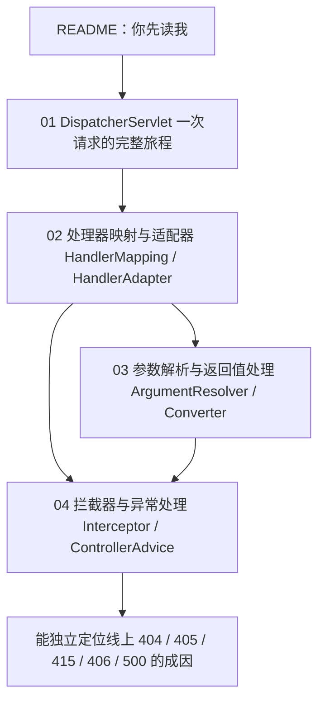

# 04-SpringMVC：一个 HTTP 请求如何落到你的 `@GetMapping`

> 一句话结论：Spring MVC 没有"魔法"，它只在 `DispatcherServlet#doDispatch` 这一条主干上把六件事串起来——**找处理器（HandlerMapping）→ 找适配器（HandlerAdapter）→ 执行拦截器前置 → 调你的方法 → 处理返回值 → 渲染/写响应**；其余所有类都是这六步的可替换策略（Strategy）。
>
> 阅读前置：读完 `01-IoC容器与Bean生命周期`（知道 Bean 从哪来）与 `02-AOP与代理`（知道 `@Controller` 可能是代理对象）；会用 `@RestController`/`@GetMapping` 写接口。
>
> 预计阅读：本组 4 篇，每篇 40~70 分钟 ｜ 源码：spring-framework@v7.1.0（配套 Spring Boot 4.2.0）

## 学习目标

学完这一组，你应当能**不看源码**讲出下面 6 件事：

1. 从 `HttpServlet#service` 到你的 `@GetMapping` 方法，**每一层方法名**（`FrameworkServlet#service → processRequest → doService → doDispatch`）。
2. `doDispatch` 里 **8 个关键步骤**的先后顺序，以及 `HandlerExecutionChain`（处理器 + 拦截器链）在每一步被怎么用。
3. `DispatcherServlet` 启动时初始化的 **8 个策略集合**（常被口口相传为"九大组件"，本篇给出精确清单与来历），以及"为什么我的 `@Controller` 能被找到"。
4. `@RequestMapping` 如何变成 `RequestMappingInfo`，请求如何被 `PathPattern` 匹配出"最佳方法"，以及 `Ambiguous handler methods` 是怎么抛出来的。
5. `@RequestParam`/`@PathVariable`/`@RequestBody` 分别由哪个 `HandlerMethodArgumentResolver` 解，`@ResponseBody` 返回值如何一路走到 `HttpMessageConverter`。
6. 异常从 controller 抛出来后，`HandlerExceptionResolver` 三兄弟按什么顺序、依据什么规则接手；`@ControllerAdvice` 凭什么"全局"。

## 文章顺序



**读图说明**：箭头表示**知识依赖**，读的顺序请按箭头走。01 是主干（`doDispatch` 全流程），必须先读；02 展开主干里的"找 handler / 找 adapter"两步；03 展开"调你的方法 + 写响应"两步，并依赖 02 里"方法参数/返回值是怎么描述出来的"；04 站在 `doDispatch` 的异常分支与拦截器钩子上，依赖 01 的步骤编号与 03 的返回值链。虚线箭头不存在——四篇之间没有反向依赖，读 04 时不需回头改 03 的理解。

## 每篇摘要

| 文章 | 主线（源码调用链） | 学完能回答 |
| --- | --- | --- |
| [01-dispatcherservlet-一次请求的完整旅程](01-dispatcherservlet-一次请求的完整旅程.md) | `HttpServlet#service` → `FrameworkServlet#service` → `processRequest` → `doService` → `DispatcherServlet#doDispatch` → `getHandler` → `getHandlerAdapter` → `handle` → `processDispatchResult` | 为什么返回 `false` 的 `preHandle` 会让 `postHandle` 不执行？`@Controller` 在什么时候被扫成 `HandlerMethod`？ |
| [02-处理器映射与适配器](02-处理器映射与适配器-handlermapping与handleradapter.md) | `RequestMappingHandlerMapping#getHandlerInternal` → `AbstractHandlerMethodMapping#lookupHandlerMethod` → `RequestMappingInfo#getMatchingCondition/compareTo`；`RequestMappingHandlerAdapter#invokeHandlerMethod` → `ServletInvocableHandlerMethod#invokeAndHandle` | `@GetMapping("/a")` 与 `@RequestMapping(value="/a", method=GET)` 谁优先？`@RequestMapping` 到 `RequestMappingInfo` 要经过几次 `combine`？ |
| [03-参数解析与返回值处理](03-参数解析与返回值处理-argumentresolver与converter.md) | `HandlerMethodArgumentResolverComposite#resolveArgument`、`HandlerMethodReturnValueHandlerComposite#handleReturnValue`、`AbstractMessageConverterMethodProcessor#writeWithMessageConverters` | `@ResponseBody String` 为什么不走 Jackson？`Accept: application/xml` 为什么 406？Jackson 3 换了包名后 `ObjectMapper` 怎么定制？ |
| [04-拦截器与异常处理](04-拦截器与异常处理-interceptor与controlleradvice.md) | `HandlerExecutionChain#applyPreHandle/applyPostHandle/triggerAfterCompletion`；`HandlerExceptionResolverComposite#resolveException` → `ExceptionHandlerExceptionResolver#getExceptionHandlerMethod` | `@ControllerAdvice` 与 controller 内部的 `@ExceptionHandler` 谁先执行？`@ResponseStatus` 与 `ResponseEntity` 谁赢？ |

## 依赖关系

- **前置**：`01-IoC容器与Bean生命周期`（`WebApplicationContext` 就是 IoC 容器；`DispatcherServlet` 自己也是一个 Bean）、`02-AOP与代理`（`@Controller` 被 AOP 代理后，`ClassUtils.getUserClass` 与 `AopUtils.selectInvocableMethod` 才有意义）。可直接参考同级文章：[01-refresh-容器启动全流程](../01-IoC容器与Bean生命周期/01-refresh-容器启动全流程.md)、[01-aop-原理与自动代理创建](../02-AOP与代理/01-aop-原理与自动代理创建.md)。
- **本组内部**：01 → 02 → 03 → 04，见上图的读图说明。
- **后续**：`02-SpringBoot`（`DispatcherServletAutoConfiguration`/`WebMvcAutoConfiguration` 只是把这套策略"自动装好"）、`03-MyBatis`（Mapper 接口在 MVC 里作为 `@Controller` 的依赖出现）。

## 源码入库约定（本组共用）

本组所有代码块都来自入库原文，块头写法一致：

```text
​```java (src: DispatcherServlet.java#L935-L943)
		...
​```
```

- `src:` 里的文件名对应 `assets/source/<文件名>.md`；
- `#L起-L止` 是**原始 .java 文件的行号**（不是文档行号），正文里出现的 `[[源码:DispatcherServlet.java#L935-L943]]` 是同样的锚点；
- 块内首行必须是 `L起` 那一行，中间省略用单独一行 `...`。

## 学习检查点

- [ ] 能在纸上画出 `doDispatch` 的 try/catch/finally 三段结构，并指出 `triggerAfterCompletion` 可能被调用的**三处**位置。
- [ ] 能解释 `annotatedElement` 级别的 `@Controller` 与 `@RestController` 在 `isHandler` 判断上的关系。
- [ ] 能说出"请求 `/api/users/1` 命中 `@GetMapping("/api/users/{id}")`"这条链上 `HandlerMapping` 写了哪 4 个 request attribute（提示：`URI_TEMPLATE_VARIABLES_ATTRIBUTE` 等）。
- [ ] 能列举至少 4 个 `HandlerMethodArgumentResolver` 实现及其对应注解。
- [ ] 能解释 `HttpMediaTypeNotAcceptableException`（406）与 `HttpMediaTypeNotSupportedException`（415）分别在哪一步抛出。
- [ ] 能说出 `@ControllerAdvice` 的排序依据（`Ordered`/`@Order`），以及为什么"advice 里的 `@ExceptionHandler` 比 controller 内部的优先级低"。
- [ ] 能写一个自定义 `JsonMapperBuilderCustomizer`（Boot 4 / Jackson 3）并验证日期格式生效。
