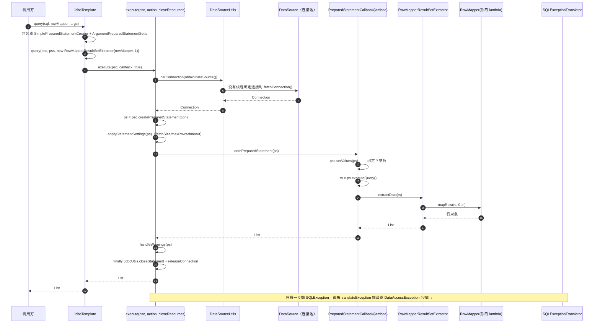
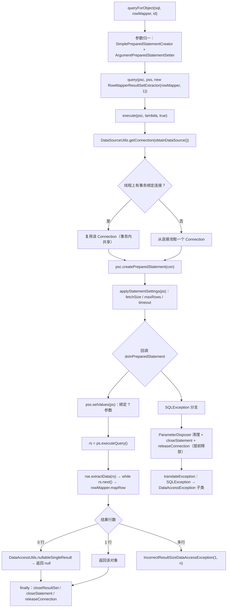

# 01 · JdbcTemplate：模板方法与回调，把 JDBC 样板代码收进框架

> 一句话结论：`JdbcTemplate` 的所有查询最终都收敛到 `execute(PreparedStatementCreator, PreparedStatementCallback, boolean)` 这一个方法里——**"开关资源 + 翻译异常"这段永远不变的代码由模板写，"SQL 与参数 + 行映射"这段每次都变的代码由回调写**，`RowMapper` 只是回调的一种。
> 阅读前置：会写 `DriverManager.getConnection` / `PreparedStatement` / `ResultSet` 的手工 JDBC 代码；知道 `@FunctionalInterface` 与 lambda；读过本组 `README.md`。
> 预计阅读：45 分钟｜源码：`org.springframework:spring-jdbc:7.1.0`，`JdbcTemplate`（约 1820 行）、`JdbcAccessor`、`RowMapper`、`PreparedStatementCallback`、`SQLExceptionTranslator`、`SQLErrorCodeSQLExceptionTranslator`、`DataSourceUtils`、`DataAccessUtils`

---

## 0. 先看现象

先看两种写法。第一种是很多人手写的 JDBC，第二种是 `JdbcTemplate`。

```text
// 手工 JDBC：一个查询要写 6 段样板（伪代码）
public List<String> names(long deptId) {
    Connection con = null;
    PreparedStatement ps = null;
    ResultSet rs = null;
    try {
        con = dataSource.getConnection();
        ps = con.prepareStatement("select name from emp where dept_id = ?");
        ps.setLong(1, deptId);
        rs = ps.executeQuery();
        List<String> list = new ArrayList<>();
        while (rs.next()) {
            list.add(rs.getString(1));
        }
        return list;
    }
    // ... 5 行：catch 里只能包成 RuntimeException，异常类型信息全部丢失
    finally {
        // ... 9 行：rs / ps / con 三重 null 判断 + 三重 try-catch 忽略
    }
}
```

```java
// JdbcTemplate：只留下"会变"的部分
List<String> names = jdbcTemplate.query(
        "select name from emp where dept_id = ?",
        (rs, rowNum) -> rs.getString(1),
        deptId);
```

你能观察到三件事：

1. `try/catch/finally`、`rs.close()`、`ps.close()`、`con.close()` **全部消失了**，但它并没有被"隐藏"——而是被搬进了 `JdbcTemplate` 的固定代码里。
2. `SQLException` 也消失了：调用方拿到的是 `DataAccessException`（一个 `RuntimeException` 家族），而且是被"翻译"过的具体子类，比如 `BadSqlGrammarException`。
3. 你只提供了两样东西：**SQL（含参数）** 与 **一行结果怎么变成对象**。其余都由框架兜底。

这一篇就是回答：这两样东西分别被哪个接口承载、`JdbcTemplate` 在这个中间位置到底做了哪些事、以及为什么它敢"替你把 Connection 关掉"。

---

## 1. 整体地图

下图是一条 `jdbcTemplate.query(sql, rowMapper, args)` 的完整调用链。注意所有箭头最终都汇入右下角那个 `execute(...)`。



> 读图说明：关键箭头是 **`JT->>EX: execute(psc, callback, true)`** 之后的那一段——`execute` 负责"拿连接、建语句、下发设置、收尾释放"，`CB`（回调）只负责"绑参数 + 执行 + 取数据"。另外注意最后那条 `Note`：`SQLException` 从不会原样冒到你的代码里，它在 `execute` 的 `catch` 块被换成了 `DataAccessException`。

各层职责对照表（先记住这张表，后面源码逐段精读时对照）：

| 角色 | 具体类型 | 谁写的 | 职责 | 生命周期由谁管 |
| --- | --- | --- | --- | --- |
| 模板 | `JdbcTemplate` | 框架 | 取连接、开关 `Statement`、处理警告、翻译异常、释放连接 | 单例 Bean |
| 语句工厂 | `PreparedStatementCreator` | 框架（`SimplePreparedStatementCreator`）或你 | 用 `Connection` 造出 `PreparedStatement` | `execute` 负责关闭 |
| 参数绑定 | `PreparedStatementSetter` | 框架（`ArgumentPreparedStatementSetter`）或你 | 往 `?` 里塞值（含 SQL 类型） | 一般无状态 |
| 动作回调 | `PreparedStatementCallback` | 你/框架内部 lambda | 绑参数 + `executeQuery`/`executeUpdate` + 取结果 | 由 `execute` 调用一次 |
| 行映射 | `RowMapper` | 你 | 把"当前这一行"变成一个对象 | 无状态，可复用 |
| 结果抽取 | `ResultSetExtractor` | 框架（`RowMapperResultSetExtractor`）或你 | 遍历整个 `ResultSet` 并产出结果对象 | 无状态 |
| 异常翻译 | `SQLExceptionTranslator` | 框架 | `SQLException` → `DataAccessException` 具体子类 | `JdbcAccessor` 中懒加载缓存 |

> 术语先对齐：**模板方法（Template Method）**在这里不是"父类留抽象方法给子类实现"那个经典形态，而是"把不变流程写死在一个方法里，把可变步骤作为**参数**（回调对象）传进来"——业界常叫 *Callback + Template* 或"回调式模板方法"。Spring 的 `*Template` 家族、`TransactionTemplate`、`RestTemplate`、`JmsTemplate` 都是这个套路。

---

## 2. 关键类逐个拆

### 2.1 `JdbcAccessor`——所有 JDBC 模板的公共地基

- **职责**：持有 `DataSource` 与 `SQLExceptionTranslator`，并保证 `DataSource` 非空。
- **字段**：`private @Nullable DataSource dataSource;`、`private volatile @Nullable SQLExceptionTranslator exceptionTranslator;`、`private boolean lazyInit = true;`（`volatile` 是为了无锁读脏检查，下面 3.1 会讲）。
- **设计意图**：把"数据源 + 异常翻译器"这两个横切关注点从 `JdbcTemplate`/`NamedParameterJdbcTemplate` 里抽出来。`JdbcTemplate` 继承它，于是两个子类共享同一份翻译器创建逻辑；同时它实现 `InitializingBean`，可以在容器启动时就校验 `dataSource` 是否漏配。

### 2.2 `JdbcTemplate`——模板本体

- **职责**：`JdbcOperations` 接口的默认实现，把 JDBC 的全部"固定开销"收进 `execute` 系列方法。
- **字段**：除父类的 `dataSource`/`exceptionTranslator` 外，还有 `ignoreWarnings`（是否忽略 `SQLWarning`）、`fetchSize`、`maxRows`、`queryTimeout` 四个"语句级设置"——它们最终都会在 `applyStatementSettings` 里写到 `Statement` 上。
- **设计意图**：**线程安全、可复用**。所有可变状态都是配置态（构造后一般不再变化），每次调用的临时变量都是方法局部变量，因此一个单例 `JdbcTemplate` 可以被任意线程并发使用。

### 2.3 `PreparedStatementCreator`——"用连接造语句"

- **职责**：唯一方法 `createPreparedStatement(Connection con)`；实现者负责 SQL 与参数。
- **字段**：无（函数式接口）。
- **设计意图**：把"造语句"从"执行与收尾"里剥出来。日常你几乎不会用到它，因为 `JdbcTemplate` 提供了 `SimplePreparedStatementCreator(sql)` 这个内置实现；只有需要 `Statement.RETURN_GENERATED_KEYS` 之类的特殊 `prepareStatement` 重载时才需要自己写。

### 2.4 `PreparedStatementCallback`——本篇的主角回调

- **职责**：唯一方法 `doInPreparedStatement(PreparedStatement ps)`，在 `JdbcTemplate` 保证 `ps` 可用的前提下执行任意操作。
- **字段**：无（函数式接口，所以可以写成 lambda）。
- **设计意图**：它的 Javadoc 把"分工边界"写得非常清楚——**不要关 `Statement`、不要关 `Connection`、不要自己开事务**；但 **`ResultSet` 必须自己关**（原因见 3.4 的"常见坑"）。这是一份"契约"，而不是一句客套话。

### 2.5 `RowMapper`——"一行 → 一个对象"

- **职责**：`T mapRow(ResultSet rs, int rowNum)`，把 **当前行** 映射成对象。
- **字段**：无。注意 Javadoc 明确要求 **不要调用 `rs.next()`**，游标位置由调用方维护。
- **设计意图**：让业务代码只关心"列 → 字段"的对应关系，把 `while (rs.next())` 这类循环下沉成可复用的 `RowMapperResultSetExtractor`。

### 2.6 `ResultSetExtractor` 与 `RowMapperResultSetExtractor`

- **职责**：`ResultSetExtractor.extractData(ResultSet rs)` 一次拿到整个结果集，任意组织返回值。
- **字段**（`RowMapperResultSetExtractor`）：`rowMapper`、`rowsExpected`（预估行数，只用于 `ArrayList` 初始容量）、`maxRows`。
- **设计意图**：`rowsExpected` 只是性能提示（`rowsExpected > 0` 时预分配容量），不参与正确性；真正的"只能有一行"约束是由 `queryForObject` 用 `1` 作为期望值再做二次校验完成的（见 6.1）。

### 2.7 `SQLExceptionTranslator` / `SQLErrorCodeSQLExceptionTranslator`

- **职责**：把 JDBC 的 `SQLException` 翻译成 Spring 的 `DataAccessException` 具体子类（`BadSqlGrammarException`、`DuplicateKeyException`……）。
- **字段**（错误码版）：`SQLErrorCodes`（从 `sql-error-codes.xml` 加载的"错误码 → 语义"映射表）、`fallbackTranslator`（兜底翻译器）、静态的 `userProvidedErrorCodesFilePresent`（判断用户是否提供了自定义错误码文件）。
- **设计意图**：**让上层代码不依赖具体数据库**。业务代码写 `catch (DuplicateKeyException)` 就能同时兼容 MySQL、Oracle、PostgreSQL——因为差异全部被收敛在这张"错误码表 + 翻译器"里。

### 2.8 `DataSourceUtils`——连接的"租借处"

- **职责**：`getConnection(DataSource)` / `releaseConnection(Connection, DataSource)` 这一对静态方法，是 `JdbcTemplate` 唯一获取与归还连接的入口。
- **字段**：无状态（全部依赖 `TransactionSynchronizationManager` 的线程绑定资源）。
- **设计意图**：让"要不要复用当前事务的连接"这件事与 `JdbcTemplate` 解耦。`JdbcTemplate` 只说"给我一个连接、我按规矩还回去"，具体是新建还是复用事务连接，由 `DataSourceUtils` 决定。**为什么必须走它而不是 `dataSource.getConnection()`：因为只有它能感知线程上已绑定的事务连接，从而让同一次事务里的多条 SQL 复用同一个 `Connection`（否则 `@Transactional` 对 `JdbcTemplate` 根本不起作用）；完整机制见同组 `01-Spring框架/03-事务管理`（`TransactionSynchronizationManager` 与 `DataSourceTransactionManager`）。**

---

## 3. 源码逐段精读

下面按"从外到内"的顺序读：先看 `query` 的几个重载怎么一路收窄到唯一入口，再看 `execute` 的固定骨架，再看回调里做了什么，最后看两个"意外的部分"——语句设置代理与异常翻译。

### 3.1 最外层的两个 `query` 重载：它们只是"外壳"

调用方最常写的是 `query(sql, rowMapper)` 与 `query(sql, rowMapper, args)`。前者直接委托给 `ResultSetExtractor` 形态：

```java (src: JdbcTemplate.java#L464-L502)
	@Override
	public <T extends @Nullable Object> T query(String sql, ResultSetExtractor<T> rse) throws DataAccessException {
		Assert.notNull(sql, "SQL must not be null");
		Assert.notNull(rse, "ResultSetExtractor must not be null");
		if (logger.isDebugEnabled()) {
			logger.debug("Executing SQL query [" + sql + "]");
		}

		// Callback to execute the query.
		class QueryStatementCallback implements StatementCallback<T>, SqlProvider {
			@Override
			public T doInStatement(Statement stmt) throws SQLException {
				ResultSet rs = null;
				try {
					rs = stmt.executeQuery(sql);
					return rse.extractData(rs);
				}
				finally {
					JdbcUtils.closeResultSet(rs);
				}
			}
			@Override
			public String getSql() {
				return sql;
			}
		}

		return execute(new QueryStatementCallback(), true);
	}

	@Override
	public void query(String sql, RowCallbackHandler rch) throws DataAccessException {
		query(sql, new RowCallbackHandlerResultSetExtractor(rch, this.maxRows));
	}

	@Override
	public <T extends @Nullable Object> List<T> query(String sql, RowMapper<T> rowMapper) throws DataAccessException {
		return result(query(sql, new RowMapperResultSetExtractor<>(rowMapper, 0, this.maxRows)));
	}
```

- **在干什么**：`query(sql, rowMapper)` 把 `RowMapper` 包成 `RowMapperResultSetExtractor`，再交给 `query(sql, rse)`；后者写了一个**局部类** `QueryStatementCallback`（实现了 `StatementCallback` 与 `SqlProvider`），然后调用 `execute(callback, true)`。`result(...)` 只是断言"不该为 null"。
- **为什么这么写**：`RowMapper` 是"按行"的语义，`ResultSetExtractor` 是"按整个结果集"的语义，两者之间只差一个 `while (rs.next())` 循环；把它下沉到 `RowMapperResultSetExtractor`，就等于让**所有** `RowMapper` 重载自动共享同一套遍历逻辑。局部类 `QueryStatementCallback` 而不是匿名类，是因为它需要 `getSql()` 来给异常翻译提供上下文（`SqlProvider`），用局部类可读性更好。
- **如果改成**把 `while (rs.next())` 直接写在 `query(sql, rowMapper)` 里：那 `queryForObject`、`queryForList`、`queryForMap` 等十几个方法都得各写一遍循环和 `finally`——这正是 `JdbcTemplate` 想消灭的东西。
- **常见坑**：这里的 `try/finally` 只关了 `ResultSet`，**没有**关 `Statement`/`Connection`——因为 `execute(..., true)` 的第二个参数 `closeResources=true` 会让它们在外面被关。你若自己写 `StatementCallback`，也必须遵守同样的分工，否则会双重关闭或漏关。

### 3.2 唯一入口：`execute(PreparedStatementCreator, PreparedStatementCallback, boolean)`

所有带参数绑定的查询/更新最终都落到这个方法（`query(psc, pss, rse)`、`update(psc, pss)`、`batchUpdate` 全都是它的调用者）。这是全篇最重要的一段代码：

```java (src: JdbcTemplate.java#L658-L700)
		Assert.notNull(psc, "PreparedStatementCreator must not be null");
		Assert.notNull(action, "Callback object must not be null");
		if (logger.isDebugEnabled()) {
			String sql = getSql(psc);
			logger.debug("Executing prepared SQL statement" + (sql != null ? " [" + sql + "]" : ""));
		}

		Connection con = DataSourceUtils.getConnection(obtainDataSource());
		PreparedStatement ps = null;
		try {
			ps = psc.createPreparedStatement(con);
			applyStatementSettings(ps);
			T result = action.doInPreparedStatement(ps);
			handleWarnings(ps);
			return result;
		}
		catch (SQLException ex) {
			// Release Connection early, to avoid potential connection pool deadlock
			// in the case when the exception translator hasn't been initialized yet.
			if (psc instanceof ParameterDisposer parameterDisposer) {
				parameterDisposer.cleanupParameters();
			}
			if (ps != null) {
				handleWarnings(ps, ex);
			}
			String sql = getSql(psc);
			psc = null;
			JdbcUtils.closeStatement(ps);
			ps = null;
			DataSourceUtils.releaseConnection(con, getDataSource());
			con = null;
			throw translateException("PreparedStatementCallback", sql, ex);
		}
		finally {
			if (closeResources) {
				if (psc instanceof ParameterDisposer parameterDisposer) {
					parameterDisposer.cleanupParameters();
				}
				JdbcUtils.closeStatement(ps);
				DataSourceUtils.releaseConnection(con, getDataSource());
			}
		}
	}
```

- **在干什么**：五步固定流程 —— ① `DataSourceUtils.getConnection(...)` 拿连接；② `psc.createPreparedStatement(con)` 造语句；③ `applyStatementSettings(ps)` 把 `fetchSize`/`maxRows`/`queryTimeout` 写到语句上；④ `action.doInPreparedStatement(ps)` **执行你给的回调**；⑤ `finally` 里按 `ps → con` 的顺序关闭/归还。中间任何一步抛 `SQLException`，都会先"提前释放"再 `translateException` 抛出。
- **为什么这么写**：这就是"模板方法"的骨架——**①②③⑤ 与你无关，④ 才是你的代码**。三个值得注意的细节：
  1. `catch` 里主动 `releaseConnection` 并把 `con` 置 `null`，是为了**尽早还连接给池**：翻译异常时可能要访问数据库元数据（错误码表），若此时连接还占着，池子小的话会互相等待（注释里直说了"avoid potential connection pool deadlock"）。置 `null` 是为了让 `finally` 变成幂等操作。
  2. `ParameterDisposer.cleanupParameters()`：某些参数类型（如 `Stream`/`Blob` 相关）持有临时资源，需要在语句关闭前释放。
  3. `closeResources` 参数：`queryForStream` 传 `false`，因为流式读取时 `ResultSet`/`Statement` 必须活到流关闭为止，此时由返回的 `Stream#onClose` 负责收尾。
- **如果改成**把 `closeResources` 去掉、一律关闭：`queryForStream` 返回的 `Stream` 会在方法返回瞬间失效，`Spliterator` 一读就 `SQLException`。
- **常见坑**：注意 `catch` 里只捕获 `SQLException`。你在回调查询里自己 `throw new IllegalStateException(...)` **不会**被翻译，会原样冒泡——这是设计而非遗漏（`DataAccessException` 本来就是 `RuntimeException`，不该被当成"需要翻译的 JDBC 异常"）。

### 3.3 `query(psc, pss, rse)`：几乎全部查询的"标准实现"

`JdbcTemplate` 里几乎所有带 `?` 参数的查询，最终都调用这一个方法。它的 Javadoc 甚至写了"Most other query methods use this method"。

```java (src: JdbcTemplate.java#L725-L748)
	public <T extends @Nullable Object> T query(
			PreparedStatementCreator psc, @Nullable PreparedStatementSetter pss, ResultSetExtractor<T> rse)
			throws DataAccessException {

		Assert.notNull(rse, "ResultSetExtractor must not be null");
		logger.debug("Executing prepared SQL query");

		return execute(psc, (PreparedStatementCallback<T>) ps -> {
			ResultSet rs = null;
			try {
				if (pss != null) {
					pss.setValues(ps);
				}
				rs = ps.executeQuery();
				return rse.extractData(rs);
			}
			finally {
				JdbcUtils.closeResultSet(rs);
				if (pss instanceof ParameterDisposer parameterDisposer) {
					parameterDisposer.cleanupParameters();
				}
			}
		}, true);
	}
```

- **在干什么**：把"绑参数 → `executeQuery` → 抽取结果 → 关 `ResultSet`"这段**每次查询都一样**的动作，塞进一个 lambda 形式的 `PreparedStatementCallback`，然后交给 3.2 的 `execute`。
- **为什么这么写**：这一段是"回调"的教科书位置——`execute` 只认识 `PreparedStatementCallback` 这个接口，不知道什么是查询、什么是更新。查询语义完全由这个 lambda 决定；`update` 的对应 lambda 里写的则是 `ps.executeUpdate()`。**同一个骨架，靠不同的回调表达不同语义**。
- **如果改成**让 `execute` 内部判断"这次是查询还是更新"：接口会退化成 `execute(String sql, String type, ...)` 这类"字符串模式匹配"的写法，且每个新操作都要改 `execute`。回调让 `execute` 对扩展封闭。
- **常见坑**：lambda 里 `finally` 关 `ResultSet` 是**必须**的。`PreparedStatementCallback` 的 Javadoc 专门警告：`Statement` 可能被连接池复用，`close()` 只是"还回池"，**不会**物理关闭它持有的 `ResultSet`。所以在回调里漏掉 `closeResultSet`，在高压下会看到游标/内存泄漏。

### 3.4 `RowMapper` 与它的循环：`RowMapperResultSetExtractor`

`RowMapper` 只有一行声明，却是最常被业务代码实现的接口：

```java (src: RowMapper.java#L51-L66)
@FunctionalInterface
public interface RowMapper<T extends @Nullable Object> {

	/**
	 * Implementations must implement this method to map each row of data in the
	 * {@code ResultSet}. This method should not call {@code next()} on the
	 * {@code ResultSet}; it is only supposed to map values of the current row.
	 * @param rs the {@code ResultSet} to map (pre-initialized for the current row)
	 * @param rowNum the number of the current row
	 * @return the result object for the current row (may be {@code null})
	 * @throws SQLException if an SQLException is encountered while getting
	 * column values (that is, there's no need to catch SQLException)
	 */
	T mapRow(ResultSet rs, int rowNum) throws SQLException;

}
```

`while (rs.next())` 到底在哪？在 `RowMapperResultSetExtractor` 里：

```java (src: RowMapperResultSetExtractor.java#L105-L113)
	@Override
	public List<T> extractData(ResultSet rs) throws SQLException {
		List<T> results = (this.rowsExpected > 0 ? new ArrayList<>(this.rowsExpected) : new ArrayList<>());
		int rowNum = 0;
		while (rs.next() && (this.maxRows == -1 || rowNum < this.maxRows)) {
			results.add(this.rowMapper.mapRow(rs, rowNum++));
		}
		return results;
	}
```

- **在干什么**：先按 `rowsExpected` 预分配 `ArrayList`（`0` 表示"不知道"，就不预分配），然后 `rs.next()` 推进游标、逐行调用你的 `mapRow`，`maxRows` 到位就停。
- **为什么这么写**：`rowsExpected` 只在 `queryForObject` 之类"我知道最多一行"的场景传 `1`，省掉一次扩容；`maxRows` 是 `JdbcTemplate#setMaxRows` 的全局限制，在这里再兜一层，保证即使驱动忽略 `setMaxRows` 也不会无限读。
- **如果改成**用 `stream` + `forEach`：`SQLException` 是受检异常，lambda 里不好抛，会被迫包成 `RuntimeException`，从而破坏"回调里抛 `SQLException` 由外层统一翻译"的约定。
- **常见坑**：`rowNum` 从 `0` 开始且**只在成功映射后**自增；如果你在 `mapRow` 里抛异常，`rowNum` 不会前进，日志里的行号就是出错的那一行的下标（从 0 计），排查时别用 1 去对。

### 3.5 语句设置与"连接代理"：`applyStatementSettings` + `CloseSuppressingInvocationHandler`

`execute` 第 ③ 步调用的 `applyStatementSettings`，除了写 `fetchSize`/`maxRows`，还会把**事务剩余超时**写到语句上：

```java (src: JdbcTemplate.java#L1439-L1449)
	protected void applyStatementSettings(Statement stmt) throws SQLException {
		int fetchSize = getFetchSize();
		if (fetchSize != -1) {
			stmt.setFetchSize(fetchSize);
		}
		int maxRows = getMaxRows();
		if (maxRows != -1) {
			stmt.setMaxRows(maxRows);
		}
		DataSourceUtils.applyTimeout(stmt, getDataSource(), getQueryTimeout());
	}
```

而 `DataSourceUtils.applyTimeout` 的取舍是"事务超时优先于语句超时"：

```java (src: DataSourceUtils.java#L359-L373)
	public static void applyTimeout(Statement stmt, @Nullable DataSource dataSource, int timeout) throws SQLException {
		Assert.notNull(stmt, "No Statement specified");
		ConnectionHolder holder = null;
		if (dataSource != null) {
			holder = (ConnectionHolder) TransactionSynchronizationManager.getResource(dataSource);
		}
		if (holder != null && holder.hasTimeout()) {
			// Remaining transaction timeout overrides specified value.
			stmt.setQueryTimeout(holder.getTimeToLiveInSeconds());
		}
		else if (timeout >= 0) {
			// No current transaction timeout -> apply specified value.
			stmt.setQueryTimeout(timeout);
		}
	}
```

- **在干什么**：若当前线程上有事务且事务设了超时，就用"事务剩余秒数"覆盖 `JdbcTemplate#setQueryTimeout` 配置；否则才用模板配置。
- **为什么这么写**：事务超时是"整段业务最多跑 N 秒"的硬承诺，单条 SQL 不能把它冲破。
- **如果改成**永远用模板配置：一个设了 30 秒事务超时的批处理，可能因为某条 SQL 的 5 分钟语句超时硬撑着不结束。
- **常见坑**：`holder.getTimeToLiveInSeconds()` 是"剩余时间"，可能变成 0 甚至负数（已超时），此时 `setQueryTimeout(0)` 在某些驱动上等价于"无超时"，反而更危险——排查"事务超时不生效"时要往这里看。事务超时本身的实现属于事务篇范围。

那 `Connection` 是怎么"不能被关"的？`execute(ConnectionCallback)` 里会先用动态代理包一层：

```java (src: JdbcTemplate.java#L1649-L1684)
	private class CloseSuppressingInvocationHandler implements InvocationHandler {

		private final Connection target;

		public CloseSuppressingInvocationHandler(Connection target) {
			this.target = target;
		}

		@Override
		public @Nullable Object invoke(Object proxy, Method method, Object[] args) throws Throwable {
			// Invocation on ConnectionProxy interface coming in...

			return switch (method.getName()) {
				// Only consider equal when proxies are identical.
				case "equals" -> (proxy == args[0]);
				// Use hashCode of Connection proxy.
				case "hashCode" -> System.identityHashCode(proxy);
				// Handle close method: suppress, not valid.
				case "close" -> null;
				case "isClosed" -> false;
				// Handle getTargetConnection method: return underlying Connection.
				case "getTargetConnection" -> this.target;
				case "unwrap" ->
						(((Class<?>) args[0]).isInstance(proxy) ? proxy : this.target.unwrap((Class<?>) args[0]));
				case "isWrapperFor" ->
						(((Class<?>) args[0]).isInstance(proxy) || this.target.isWrapperFor((Class<?>) args[0]));
				default -> {
					try {
						// Invoke method on target Connection.
						Object retVal = method.invoke(this.target, args);

						// If return value is a JDBC Statement, apply statement settings
						// (fetch size, max rows, transaction timeout).
						if (retVal instanceof Statement statement) {
							applyStatementSettings(statement);
						}
```

- **在干什么**：给 `Connection` 套一个实现 `ConnectionProxy` 接口的 JDK 动态代理，`close()` 变成空操作、`isClosed()` 永远 `false`，`getTargetConnection()` 拿回真身；其余方法转发给真实连接（并且返回的 `Statement` 会顺手 `applyStatementSettings`，见 3.2 提到的 L1682-1684）。
- **为什么这么写**：用户回调里随手写 `con.close()` 是很常见的误用。模板"礼貌地"把这个动作吞掉，而不是抛异常责怪你。
- **如果改成**直接暴露真实 `Connection`：一次误关就会让整个连接池的连接处于"已关闭但仍在池里"的错乱状态，症状是后续请求随机报 `Connection is closed`。
- **常见坑**：代理只对 `execute(ConnectionCallback)` 生效；你通过 `query(`...`)` 等高级方法拿不到 `Connection`，也就没有这个保护。另外 `equals` 被改成"同一代理对象才相等"，拿代理去和真实连接 `equals` 会得到 `false`。

### 3.6 异常翻译：`translateException` → `SQLExceptionTranslator`

`execute` 的 `catch` 里那一行 `throw translateException("PreparedStatementCallback", sql, ex);`，展开后是两个方法：

```java (src: JdbcTemplate.java#L1549-L1552)
	protected DataAccessException translateException(String task, @Nullable String sql, SQLException ex) {
		DataAccessException dae = getExceptionTranslator().translate(task, sql, ex);
		return (dae != null ? dae : new UncategorizedSQLException(task, sql, ex));
	}
```

翻译器接口本身只有一个方法，且明确允许返回 `null` 表示"我认不出来，交给下一层"：

```java (src: SQLExceptionTranslator.java#L38-L58)
@FunctionalInterface
public interface SQLExceptionTranslator {

	/**
	 * Translate the given {@link SQLException} into a generic {@link DataAccessException}.
	 * <p>The returned DataAccessException is supposed to contain the original
	 * {@code SQLException} as root cause. However, client code may not generally
	 * rely on this due to DataAccessExceptions possibly being caused by other resource
	 * APIs as well. That said, a {@code getRootCause() instanceof SQLException}
	 * check (and subsequent cast) is considered reliable when expecting JDBC-based
	 * access to have happened.
	 * @param task readable text describing the task being attempted
	 * @param sql the SQL query or update that caused the problem (if known)
	 * @param ex the offending {@code SQLException}
	 * @return the DataAccessException wrapping the {@code SQLException},
	 * or {@code null} if no specific translation could be applied
	 * @see org.springframework.dao.DataAccessException#getRootCause()
	 */
	@Nullable DataAccessException translate(String task, @Nullable String sql, SQLException ex);

}
```

错误码版翻译器真正干活的是 `doTranslate`，它按"错误码分组"逐组二分查找：

```java (src: SQLErrorCodeSQLExceptionTranslator.java#L242-L281)
				if (Arrays.binarySearch(sqlErrorCodes.getBadSqlGrammarCodes(), errorCode) >= 0) {
					logTranslation(task, sql, sqlEx, false);
					return new BadSqlGrammarException(task, (sql != null ? sql : ""), sqlEx);
				}
				else if (Arrays.binarySearch(sqlErrorCodes.getInvalidResultSetAccessCodes(), errorCode) >= 0) {
					logTranslation(task, sql, sqlEx, false);
					return new InvalidResultSetAccessException(task, (sql != null ? sql : ""), sqlEx);
				}
				else if (Arrays.binarySearch(sqlErrorCodes.getDuplicateKeyCodes(), errorCode) >= 0) {
					logTranslation(task, sql, sqlEx, false);
					return new DuplicateKeyException(buildMessage(task, sql, sqlEx), sqlEx);
				}
				else if (Arrays.binarySearch(sqlErrorCodes.getDataIntegrityViolationCodes(), errorCode) >= 0) {
					logTranslation(task, sql, sqlEx, false);
					return new DataIntegrityViolationException(buildMessage(task, sql, sqlEx), sqlEx);
				}
				else if (Arrays.binarySearch(sqlErrorCodes.getPermissionDeniedCodes(), errorCode) >= 0) {
					logTranslation(task, sql, sqlEx, false);
					return new PermissionDeniedDataAccessException(buildMessage(task, sql, sqlEx), sqlEx);
				}
				else if (Arrays.binarySearch(sqlErrorCodes.getDataAccessResourceFailureCodes(), errorCode) >= 0) {
					logTranslation(task, sql, sqlEx, false);
					return new DataAccessResourceFailureException(buildMessage(task, sql, sqlEx), sqlEx);
				}
				else if (Arrays.binarySearch(sqlErrorCodes.getTransientDataAccessResourceCodes(), errorCode) >= 0) {
					logTranslation(task, sql, sqlEx, false);
					return new TransientDataAccessResourceException(buildMessage(task, sql, sqlEx), sqlEx);
				}
				else if (Arrays.binarySearch(sqlErrorCodes.getCannotAcquireLockCodes(), errorCode) >= 0) {
					logTranslation(task, sql, sqlEx, false);
					return new CannotAcquireLockException(buildMessage(task, sql, sqlEx), sqlEx);
				}
				else if (Arrays.binarySearch(sqlErrorCodes.getDeadlockLoserCodes(), errorCode) >= 0) {
					logTranslation(task, sql, sqlEx, false);
					return new org.springframework.dao.DeadlockLoserDataAccessException(buildMessage(task, sql, sqlEx), sqlEx);
				}
				else if (Arrays.binarySearch(sqlErrorCodes.getCannotSerializeTransactionCodes(), errorCode) >= 0) {
					logTranslation(task, sql, sqlEx, false);
					return new org.springframework.dao.CannotSerializeTransactionException(buildMessage(task, sql, sqlEx), sqlEx);
				}
```

- **在干什么**：从 `SQLErrorCodes` 里取出各组错误码数组（每组是从 `sql-error-codes.xml` 读来、已排序的 `int[]`），用二分查找判断当前错误码是否属于某一语义组，命中就 `new` 出对应的具体异常。
- **为什么这么写**：二分查找是 O(log n)，且错误码表是"启动时读一次、之后只读"的静态数据；用数组 + 二分而不是 `Map`，是 Spring 早期为了减少启动期对象数量的取舍，也避免了装箱。
- **如果改成**用 `switch (errorCode)`：错误码数是几十到上百个，且每个数据库一整套，`switch` 无法做到"按数据库热插拔配置"。
- **常见坑**：这段代码是**按顺序**逐组判断的，因此同一个错误码若同时出现在两组的配置里，**先判断的赢**；自有 `sql-error-codes.xml` 覆盖时尤其容易踩到。另外四个例外类（`DeadlockLoserDataAccessException` 等）因为与 `org.springframework.dao` 包内某些类同名，这里必须写全限定名。

### 3.7 翻译器从哪来：`JdbcAccessor#getExceptionTranslator` 的双重检查

```java (src: JdbcAccessor.java#L114-L132)
	public SQLExceptionTranslator getExceptionTranslator() {
		SQLExceptionTranslator exceptionTranslator = this.exceptionTranslator;
		if (exceptionTranslator != null) {
			return exceptionTranslator;
		}
		synchronized (this) {
			exceptionTranslator = this.exceptionTranslator;
			if (exceptionTranslator == null) {
				if (SQLErrorCodeSQLExceptionTranslator.hasUserProvidedErrorCodesFile()) {
					exceptionTranslator = new SQLErrorCodeSQLExceptionTranslator(obtainDataSource());
				}
				else {
					exceptionTranslator = new SQLExceptionSubclassTranslator();
				}
				this.exceptionTranslator = exceptionTranslator;
			}
			return exceptionTranslator;
		}
	}
```

- **在干什么**：经典的**双重检查锁**懒加载。若用户提供了 `sql-error-codes.xml` 覆盖文件，就用"错误码版"翻译器（需要 `DataSource` 才能识别数据库产品）；否则用轻量的 `SQLExceptionSubclassTranslator`（只按 `SQLException` 子类如 `SQLTimeoutException` 判断）。
- **为什么这么写**：字段是 `volatile`（见 2.1），读路径不加锁；构造翻译器可能要读文件，属于相对重的操作，放 synchronized 块里做一次。`JdbcAccessor` 还提供 `setLazyInit(false)`，配合 `afterPropertiesSet()` 在启动期就把它建好，避免第一条 SQL 请求时才做初始化（也顺带校验 `dataSource` 非空）。
- **如果改成**每次都 `new`：既丢缓存（每次翻译都要读错误码表），又在并发下产生大量临时对象。
- **常见坑**：`hasUserProvidedErrorCodesFile()` 判断的是 `SQLErrorCodesFactory` 的 `SQL_ERROR_CODE_OVERRIDE_PATH`（`org/springframework/jdbc/support/sql-error-codes.xml`）是否存在。你把这文件放在自己工程的同名路径下却"没生效"，通常是打包后类路径顺序或资源被覆盖的问题。

### 3.8 批量更新：`batchUpdate` 的两条路径

`batchUpdate` 也复用同一套骨架，只是回调换成了一个"循环 `addBatch` + `executeBatch`"的实现：

```java (src: JdbcTemplate.java#L1592-L1615)
	private PreparedStatementCallback<int[]> getPreparedStatementCallback(BatchPreparedStatementSetter pss,
			@Nullable KeyHolder generatedKeyHolder) {
		return ps -> {
			try {
				int batchSize = pss.getBatchSize();
				InterruptibleBatchPreparedStatementSetter ipss =
						(pss instanceof InterruptibleBatchPreparedStatementSetter ibpss ? ibpss : null);
				if (generatedKeyHolder != null) {
					generatedKeyHolder.getKeyList().clear();
				}
				if (JdbcUtils.supportsBatchUpdates(ps.getConnection())) {
					for (int i = 0; i < batchSize; i++) {
						pss.setValues(ps, i);
						if (ipss != null && ipss.isBatchExhausted(i)) {
							break;
						}
						ps.addBatch();
					}
					int[] results = ps.executeBatch();
					if (generatedKeyHolder != null) {
						storeGeneratedKeys(generatedKeyHolder, ps, batchSize);
					}
					return results;
				}
```

- **在干什么**：先问驱动支不支持批量（`JdbcUtils.supportsBatchUpdates` 最终调 `DatabaseMetaData.supportsBatchUpdates()`），支持就 `for + setValues + addBatch` 然后 `executeBatch()`；不支持则退化为逐行 `executeUpdate`（在 `else` 分支）。
- **为什么这么写**：批量是"能力探测 + 降级"的经典组合。很多国产库/老驱动并不真的支持 `executeBatch`，硬用会抛 `UnsupportedOperationException`，因此必须探测。
- **如果改成**永远走批量：上述驱动直接不可用；`supportsBatchUpdates` 自身内部还会 `catch` 异常并返回 `false`，就是为了"探测失败也不能让业务挂掉"。
- **常见坑**：`batchSize == 0` 时 `batchUpdate(String, BatchPreparedStatementSetter)` 会**直接返回空数组、一条 SQL 都不执行**（`execute` 根本不被调用）。这在"按条件动态生成批任务"的代码里极容易被忽略：调试时打了日志 `Executing SQL batch update`，但数据库毫无动静。

---

## 4. 一次完整执行时序

把前面几段串起来，看 `jdbcTemplate.queryForObject(sql, rowMapper, id)` 从进到出的完整时序（含异常分支）：



> 读图说明：关键分支有两个。**`F`** 是"连接从哪来"，它决定了同一次事务里的多条 SQL 是不是共享同一个物理连接——判断逻辑在 `DataSourceUtils`，机制细节属于事务篇。**`K → S → U`** 是异常分支：`catch` 里先**提前**归还连接（`T`），再翻译异常（`U`），最后 `finally` 仍会执行但因为引用已置 `null` 而变成空操作。另外注意 `O` 这个三岔口：`queryForObject` 只做了"最多一行"的限制（`rowsExpected=1`），"0 行"和"多行"分别走 `P` 与 `R`，而**并非所有重载都报错**——见 6.1。

---

## 5. 设计模式与设计取舍

| 模式 | 体现 | 学到什么 |
| --- | --- | --- |
| 模板方法（回调式变体） | `execute(psc, action, closeResources)` 写死"取连接→建设置→执行→收尾"，把执行体以 `PreparedStatementCallback` 参数传入 | 可变部分不一定要靠继承覆写；**把可变部分做成参数**往往比开子类更灵活，也更好测 |
| 策略 | `SQLExceptionTranslator` 是策略接口，`SQLExceptionSubclassTranslator` / `SQLErrorCodeSQLExceptionTranslator` 是两种策略，可在 `JdbcAccessor#setExceptionTranslator` 替换 | 更换"错误码映射规则"不需要动 `JdbcTemplate` 一行代码 |
| 回调 / 函数式接口 | `RowMapper`、`ResultSetExtractor`、`PreparedStatementSetter`、`PreparedStatementCallback` 全是 `@FunctionalInterface` | 回调一旦收缩成单方法接口，调用方就能用 lambda 表达，样板代码降到最低 |
| 代理 | `CloseSuppressingInvocationHandler` 抑制 `close()` | 提供"受限视图"比"教育用户不要这么写"更可靠 |
| 适配器 | `SimplePreparedStatementCreator`（SQL → `PreparedStatementCreator`）、`RowMapperResultSetExtractor`（`RowMapper` → `ResultSetExtractor`） | 一个接口的多个重载之间，用适配器互相转换，避免逻辑重复 |
| 能力探测 + 降级 | `JdbcUtils.supportsBatchUpdates` 探测失败即走逐行执行 | 面对不可控的外部设施（第三方驱动），"先探测、再降级"比"假定支持"稳健 |

**取舍**：`JdbcTemplate` 选择了"控制反转"而不是"薄封装"。它没有把 `Connection`/`Statement` 暴露给你，代价是**你失去了对资源生命周期的细粒度控制**（比如流式读取要额外的 `queryForStream`、需要 `RETURN_GENERATED_KEYS` 要另写 `PreparedStatementCreator`）；换来的是"不可能忘记关闭资源"和"异常一律被翻译"这两条硬保障。另一个取舍是**异常翻译的准确性依赖配置**：`SQLExceptionSubclassTranslator` 只认标准 SQLState 子类，能区分的语义比错误码版少得多，所以生产上若要 `catch (DuplicateKeyException)`，通常需要在工程里放入自定义 `sql-error-codes.xml`。

---

## 6. 踩坑与调试手法

1. **`queryForObject` 空结果**：`queryForObject(sql, rowMapper, args)` 走的是 `nullableSingleResult`，**0 行返回 `null`，不抛异常**；而 `queryForObject(sql, Class, args)` / `requiredSingleResult` 那条路会抛 `EmptyResultDataAccessException(1)`。两者行为不同，别混着记。
2. **`queryForObject` 多行**：两条路**都**抛 `IncorrectResultSizeDataAccessException(1, actual)`。修法是补 `where` 条件或加 `limit 1`，**不要**用 `try/catch` 吞掉——它 99% 意味着你的唯一性假设错了（比如关联字段没建唯一索引）。
3. **动态 `IN` 参数**：`where id in (?)` 传一个 `List` 给 `?` **不行**（JDBC 没有数组参数语义）。两条正路：① `NamedParameterJdbcTemplate` 的 `in (:ids)` 会自动展开成 `in (?, ?, ?)`（见 `NamedParameterUtils`）；② 手工按 `list.size()` 拼 `?, ?, ...` 占位符（占位符个数来自数据，**值必须仍由 `?` 传**，绝不能把值拼进 SQL）。
4. **动态 `IN` 的空集合**：`in ()` 是语法错误。必须特判 `list.isEmpty()`，直接返回空结果或改写为 `1 = 0`。
5. **批量 `batchUpdate` 静默不执行**：`BatchPreparedStatementSetter#getBatchSize()` 返回 0 时，`batchUpdate` 直接 `return new int[0]`。日志里只有一行 `Executing SQL batch update`，看代码以为执行了。排查时先打印 `getBatchSize()`。
6. **`batchUpdate` 返回值含义**：`int[]` 每个元素是"该行受影响行数"，但驱动可能返回 `Statement.SUCCESS_NO_INFO`（-2）或 `EXECUTE_FAILED`（-3）。用 `> 0` 判断"成功"会把 -2 误判为失败。
7. **`queryForStream` 必须关流**：`execute(..., false)` 不关资源，`Statement`/`Connection` 的释放挂在 `Stream#onClose` 上。忘记 `try (Stream<...> s = ...)` 就是连接泄漏，症状是压测几轮后池耗尽。
8. **`DataAccessException` 的 root cause 才是 `SQLException`**：想看数据库原始错误码，用 `ex.getRootCause()` 或 `ex.getMostSpecificCause()`，不要 `instanceof SQLException` 判 `ex` 本身。
9. **调试手法：打开 SQL 日志**。`org.springframework.jdbc.core.JdbcTemplate` 的 `DEBUG` 会打出 `Executing prepared SQL statement [sql]`，直接复制到客户端跑，能快速区分"SQL 错"还是"映射错"。
10. **调试手法：`BadSqlGrammarException#getSql()`**。这个异常专门保留了 SQL 文本，比 `UncategorizedSQLException` 友好得多；如果你只拿到 `UncategorizedSQLException`，说明错误码没命中任何一组，去检查 `sql-error-codes.xml` 是否覆盖了当前数据库。

---

## 7. ⚠️ 版本差异

| 版本 / 位置 | 差异 |
| --- | --- |
| Spring Framework 5.3 起 | `query(String, Object[], ResultSetExtractor)`、`queryForObject(String, Object[], RowMapper)` 等"位置参数数组"重载被标记 `@Deprecated(since = "5.3")`；新代码请用 `varargs` 重载或 `NamedParameterJdbcTemplate`。 |
| Spring Framework 6.0 / 7.x | 全量迁移到 JSpecify 空安全注解（`T extends @Nullable Object`、`@Nullable`），本篇源码块里的泛型签名就是这个形态；5.x 的 `<T> T` 签名在 7.1.0 中已不可见。 |
| `JdbcTemplate` 7.0 | 新增拷贝构造 `JdbcTemplate(JdbcAccessor)`（`@since 7.0`），便于在保留 `DataSource`/翻译器配置的前提下派生新模板。 |
| `JdbcTemplate` 7.1 | `batchUpdate(String, Collection<T>, int batchSize, ParameterizedPreparedStatementSetter<T>)` 被标记 `@Deprecated(since = "7.1")`（源码 L1090-L1093），批处理请优先用 `batchUpdate(String, List<Object[]>)` 或 `BatchPreparedStatementSetter`。 |
| `RowMapperResultSetExtractor` 7.0 | 新增三参构造（`rowMapper, rowsExpected, maxRows`，`@since 7.0`），`JdbcTemplate` 内部用它统一实现 `maxRows` 限制。 |
| Spring Boot 4.2.0 | `JdbcTemplate` 由 `JdbcTemplateAutoConfiguration`（`@ConditionalOnSingleCandidate(DataSource.class)`）自动注册；`JdbcClient` 成为官方推荐的门面（`JdbcClientAutoConfiguration`），底层仍是本篇的 `JdbcTemplate`。 |
| 本仓库归档 | `JdbcAccessor.java.md`、`JdbcTemplate.java.md` 等均来自 `org.springframework:spring-jdbc:7.1.0`；`DataAccessUtils.java.md` 来自 `org.springframework:spring-tx:7.1.0`（它虽被 JDBC 使用，但物理位置在 `spring-tx`）。 |

---

## 8. 面试高频问与答

1. **问：`JdbcTemplate` 为什么线程安全？**
   答：它没有"每次调用会变"的成员状态。`dataSource`、`exceptionTranslator`、`fetchSize/maxRows/queryTimeout` 都是配置态；一条 SQL 执行过程中的 `Connection`、`PreparedStatement`、`ResultSet` 全是方法局部变量。所以单例可被并发使用。

2. **问：`RowMapper` 和 `RowCallbackHandler` 有什么区别？**
   答：`RowMapper` 是"一行进、一个对象出"，必须返回值，由 `RowMapperResultSetExtractor` 收集成 `List`；`RowCallbackHandler` 是"一行进、没有返回值"，由你在回调里自己往外部集合写。需要"边读边处理、不想在内存里攒整个 List"时用后者。

3. **问：`RowMapper` 里为什么不能调 `rs.next()`？**
   答：游标推进由 `RowMapperResultSetExtractor` 统一负责（`while (rs.next())`），`mapRow` 只映射"当前行"。你调一次 `next()` 就跳过一行，还会让外层循环的终止条件错乱。详见 `RowMapper` 的 Javadoc。

4. **问：`JdbcTemplate` 怎么把 `SQLException` 变成 `DataAccessException`？**
   答：`execute` 的 `catch (SQLException)` 里调 `translateException(task, sql, ex)` → `getExceptionTranslator().translate(...)`；翻译器返回 `null` 时兜底成 `UncategorizedSQLException`。默认翻译器是懒加载的（用户提供 `sql-error-codes.xml` 时用错误码版，否则用 `SQLExceptionSubclassTranslator`）。

5. **问：连接为什么必须从 `DataSourceUtils` 拿，而不是 `dataSource.getConnection()`？**
   答：只有 `DataSourceUtils` 会先查线程上是否已绑定事务连接：有就复用，没有才去池里取，并按需把新连接绑到线程上。走 `dataSource.getConnection()` 会绕过这层，导致一个事务里的多条 SQL 各用一个连接、各自提交——等于没有事务。

6. **问：`JdbcTemplate` 的 `try/finally` 到底替你做了什么？**
   答：`finally` 里按顺序做三件事：`ParameterDisposer` 清理参数资源、`JdbcUtils.closeStatement(ps)`、`DataSourceUtils.releaseConnection(con, dataSource)`。`releaseConnection` 内部还会判断"这连接是不是事务连接"，是事务连接就只 `released()` 不真正 `close()`。

7. **问：`queryForObject` 查不到数据会怎样？**
   答：取决于你调哪个重载。以 `RowMapper` 为参数的那条（内部 `nullableSingleResult`）返回 `null`；以 `requiredType` 为参数、走 `requiredSingleResult` 的那条抛 `EmptyResultDataAccessException(1)`。查到多行则两者都抛 `IncorrectResultSizeDataAccessException(1, actual)`。

8. **问：`in (?)` 传 List 为什么报错？怎么解决？**
   答：JDBC 的 `?` 只能表示"一个值"，`IN` 后面需要的是"若干个占位符"。`JdbcTemplate` 不会替你展开。解决：用 `NamedParameterJdbcTemplate`（`NamedParameterUtils.substituteNamedParameters` 会把 `Iterable` 值展开成 `?, ?, ?`），或自己按集合大小生成占位符——但**值仍然必须走参数绑定**，绝不能字符串拼接（SQL 注入）。

9. **问：`batchUpdate` 有哪些实现？怎么选？**
   答：`batchUpdate(String, BatchPreparedStatementSetter)`（最灵活，可中断、可拿生成主键）、`batchUpdate(String, List<Object[]>)`（最省事，内部包了一个匿名 `BatchPreparedStatementSetter`）、以及 7.1 起被 `@Deprecated` 的 `batchUpdate(String, Collection<T>, int batchSize, ParameterizedPreparedStatementSetter<T>)`。它们最终都调 `getPreparedStatementCallback(...)` → `execute(...)`。

10. **问：为什么 `close()` 会被代理吞掉？**
    答：`createConnectionProxy` 给 `Connection` 套了 `CloseSuppressingInvocationHandler`，`close` 返回 `null`、`isClosed` 返回 `false`。这是为了容忍用户在 `ConnectionCallback` 里误关连接——模板必须保证"连接的释放权只在自己手里"。

11. **问：`JdbcTemplate` 支持事务吗？它自己开事务吗？**
    答：不支持也不开。它只做"借用/归还连接"；事务由 `@Transactional` + `DataSourceTransactionManager` 或 `TransactionTemplate` 建立。`JdbcTemplate` 之所以能"加入"事务，全靠 `DataSourceUtils` 能发现线程上已绑定的连接。

12. **问：为什么 `applyStatementSettings` 里事务超时会覆盖语句超时？**
    答：事务超时是业务级承诺（"这段逻辑最多 30 秒"），单条 SQL 的 `setQueryTimeout` 只能是兜底。`DataSourceUtils.applyTimeout` 优先取 `ConnectionHolder` 上的剩余时间，没有再退回模板配置。

---

## 9. 动手练习

1. **写出"手工版"和"模板版"的对比**：用 H2/MySQL 各写一个按 id 查单条记录的 DAO，一份用原始 JDBC，一份用 `JdbcTemplate#query`。数一数前者有多少行是纯粹的"资源管理样板"。
   （验收：能指出模板版删掉的每一段样板各由 `JdbcTemplate` 的哪个方法承担，例如 `finally` 中的 `rs.close()` → `JdbcUtils.closeResultSet`。）

2. **自己实现一个 `StatementCallback`**：用 `jdbcTemplate.execute((StatementCallback<Integer>) stmt -> { ... })` 执行 `select count(*)`。
   （验收：回调里**不要**关 `Statement`、也**不要** catch `SQLException`；故意写一条错误 SQL，确认抛出的异常类型是 `BadSqlGrammarException` 而不是 `SQLException`。）

3. **复现 `IN` 陷阱**：先写 `select * from t where id in (?)` 并传 `List.of(1,2,3)`，记录报错；再用 `NamedParameterJdbcTemplate` 的 `in (:ids)` 修好。
   （验收：能解释 `NamedParameterUtils.substituteNamedParameters` 里"`value instanceof Iterable` 就展开成多个 `?`"的分支为什么存在，以及空集合为什么要特判。）

4. **制造一次 `IncorrectResultSizeDataAccessException`**：造两条重复数据，调 `queryForObject(sql, rowMapper, args)`。
   （验收：能不看源码说出异常里的 `expected`/`actual` 分别是多少，并说明它是先由 `rowsExpected=1` 的 `RowMapperResultSetExtractor` 收齐、再由 `nullableSingleResult` 校验得出的。）

5. **零批量的静默**：写一个 `BatchPreparedStatementSetter`，让 `getBatchSize()` 返回 0，调用 `batchUpdate` 并观察数据库无变化。
   （验收：能指出源码里 `if (batchSize == 0) { return new int[0]; }` 的位置，并说明此时 `execute` 完全没有被调用。）

6. **换掉异常翻译器**：自定义一个 `SQLExceptionTranslator`，用 `jdbcTemplate.setExceptionTranslator(...)` 装进去，让任何错误都返回 `DataIntegrityViolationException`。
   （验收：验证 `translateException` 里"翻译器返回非 null 就直接用"的分支生效；然后再返回 `null`，确认兜底成 `UncategorizedSQLException`。）

7. **只读流式查询**：用 `queryForStream` 读 10 万行并在中途 `break`，配合连接池监控观察连接数。
   （验收：能解释"为什么忘了 `close()` 会泄漏"，并指出 `execute(..., closeResources=false)` 与 `Stream#onClose` 的分工。）

8. **断点验证骨架**：在 `JdbcTemplate#execute(PreparedStatementCreator, PreparedStatementCallback, boolean)` 的三个位置打断点（`getConnection` 之后、`doInPreparedStatement` 之前、`finally` 内），走一次 `queryForObject`。
   （验收：能画出每个断点处的局部变量表关键值：`con`、`ps`、`closeResources`；并能解释为什么 `catch` 分支里 `con` 会被置 `null`。）

---

## 小结

- `JdbcTemplate` 的实质是**回调式模板方法**：`execute(psc, action, closeResources)` 写死"取连接 → 建语句 → 下发设置 → 执行回调 → 收尾释放"，可变部分全部从参数进。
- 所有查询的重载最终收敛到 `query(psc, pss, rse)` → `execute(...)`，`RowMapper` 只是被 `RowMapperResultSetExtractor` 适配成 `ResultSetExtractor` 的一种便捷写法。
- `PreparedStatementCallback` 的分工契约是：**你管 `ResultSet`，模板管 `Statement`/`Connection`**；这也解释了为什么回调里必须 `finally` 关 `ResultSet`。
- 连接统一从 `DataSourceUtils` 取还，因此 `JdbcTemplate` 能自动复用线程上绑定的事务连接；这块机制归 `01-Spring框架/03-事务管理`（`TransactionSynchronizationManager`、`DataSourceTransactionManager`）讲。
- 异常一律被 `SQLExceptionTranslator` 翻译为 `DataAccessException` 具体子类；漏译则兜底 `UncategorizedSQLException`，原始的 `SQLException` 在 root cause 里。
- 三个高频坑：`queryForObject` 的"空返回 null / 多行抛异常"两条重载语义不同、`IN` 参数必须展开而不能靠 `?`、`batchUpdate` 在 `batchSize == 0` 时静默不执行。

## 自测题

1. `JdbcTemplate#query(String, RowMapper)` 内部把 `RowMapper` 包装成了什么？它的哪个参数负责"最多读几行"？
2. `execute(PreparedStatementCreator, PreparedStatementCallback, boolean)` 中第三个参数 `closeResources` 什么时候会传 `false`？为什么？
3. `catch (SQLException)` 分支里为什么要把 `con` 置为 `null`？这两件事分别解决了什么问题？
4. 为什么 `JdbcTemplate` 不直接调用 `dataSource.getConnection()`？
5. `PreparedStatementCallback` 的 Javadoc 要求你在回调里自己关什么？为什么 `Statement#close()` 不足以关掉它？
6. `translateException` 里如果 `getExceptionTranslator().translate(...)` 返回 `null`，最终抛什么？
7. `JdbcAccessor#getExceptionTranslator` 用了什么并发技巧？`exceptionTranslator` 为什么声明成 `volatile`？
8. `SQLErrorCodeSQLExceptionTranslator` 判定错误码属于哪一类时用了什么算法？为什么？
9. `queryForObject(sql, rowMapper, args)` 查不到数据返回什么？换成 `requiredType` 版本呢？
10. `batchUpdate(String, BatchPreparedStatementSetter)` 在 `getBatchSize() == 0` 时的行为是什么？
11. 事务超时与 `JdbcTemplate#setQueryTimeout` 同时存在时，谁生效？在哪一行代码体现？
12. `CloseSuppressingInvocationHandler` 对 `close()`、`isClosed()`、`getTargetConnection()` 分别怎么处理？为什么 `equals` 被改成"同一代理才相等"？

<details><summary>参考答案要点</summary>

1. 包装成 `RowMapperResultSetExtractor<>(rowMapper, 0, this.maxRows)`；`maxRows`（构造参数第三位）加上 `rs.next()` 的循环条件共同限制最多读几行，`rowsExpected` 只影响 `ArrayList` 初始容量。
2. `queryForStream` 会传 `false`。因为流式读取要求 `ResultSet`/`Statement` 活到流关闭，此时由 `Stream#onClose` 触发释放，模板不能提前关闭。
3. 提前 `releaseConnection` 是为了在翻译异常（可能要访问数据库元数据）**之前**把连接还给池，避免小连接池互相等待造成死锁；把 `con` 置 `null` 是让 `finally` 的释放变成幂等空操作，避免重复释放。
4. 因为 `DataSourceUtils.getConnection` 会先查线程上是否已绑定事务连接：有就复用，没有才去池里取并（在同步激活时）绑定到线程。绕过它就无法加入 `@Transactional` 事务。
5. 自己关 `ResultSet`（`finally` 里）。因为 `Statement` 可能被连接池回收复用，`close()` 只是"还回池"，未必物理关闭其持有的 `ResultSet` 资源。
6. 兜底抛 `UncategorizedSQLException(task, sql, ex)`。
7. 双重检查锁（先无锁读、再 `synchronized(this)` 内二次判空）。`volatile` 保证"写引用"对其他线程可见且不被指令重排，避免读到半构造对象。
8. 对每个语义组的 `int[]` 错误码数组做 `Arrays.binarySearch`。错误码表启动时加载且已排序，二分是 O(log n)，也避免装箱。
9. `RowMapper` 版返回 `null`（`nullableSingleResult`）；`requiredType` 版抛 `EmptyResultDataAccessException(1)`（`requiredSingleResult`）。多行两者都抛 `IncorrectResultSizeDataAccessException(1, actual)`。
10. 直接 `return new int[0]`，`execute` 根本不会被调用，即"一条 SQL 都不执行且不报错"。
11. 事务超时优先。体现在 `DataSourceUtils.applyTimeout` 中先判断 `holder != null && holder.hasTimeout()` 并 `stmt.setQueryTimeout(holder.getTimeToLiveInSeconds())`，只有没有事务超时才用模板配置。
12. `close()` → 返回 `null`（吞掉）；`isClosed()` → 恒返回 `false`（假装仍打开）；`getTargetConnection()` → 返回被代理的真实 `Connection`；`equals` 改为引用相等，是为了让代理身份唯一，避免"代理与真实连接相等但行为不同"的困惑。

</details>
