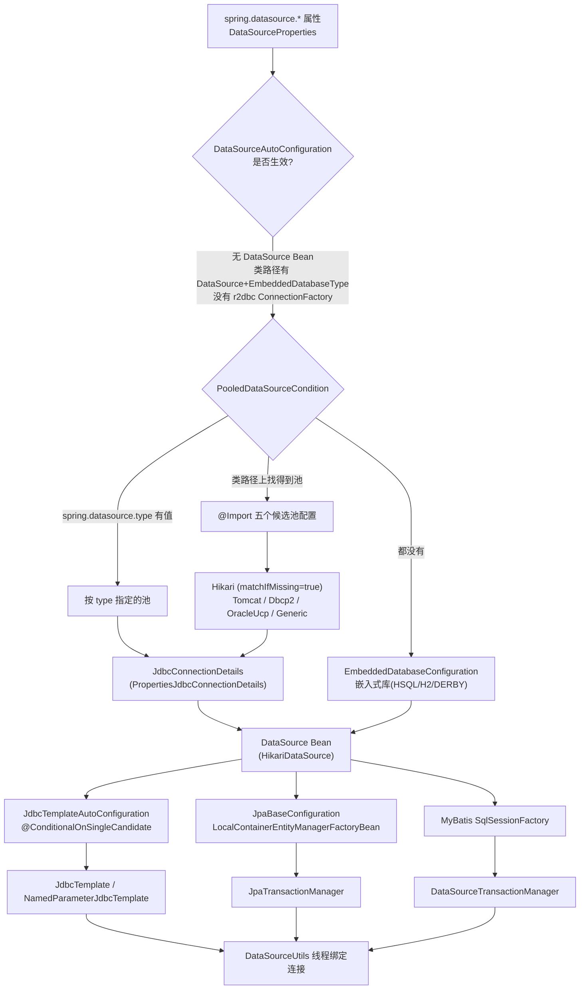
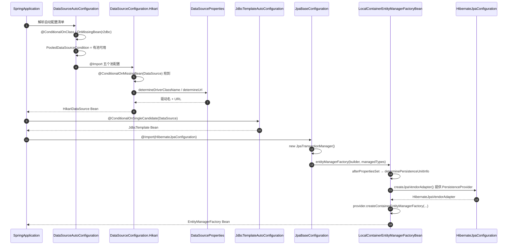

# 02 · 声明式数据访问：从 DataSource 到 JPA / MyBatis

> **一句话结论**：Spring 生态里"数据访问"的起点永远是同一个 `javax.sql.DataSource` Bean——Boot 用 `DataSourceAutoConfiguration` 按"条件装配"从 Hikari / Tomcat / DBCP2 / UCP 中挑一个建出来，`JdbcTemplate`、`JpaTransactionManager`、MyBatis 的 `SqlSessionFactory` 全都围着它转；理解这一点，`@Transactional` 在 JDBC、JPA、MyBatis 三种栈里的表现差异就都能推导出来。
> **阅读前置**：[01-jdbctemplate-模板方法与回调](./01-jdbctemplate-模板方法与回调.md)（`JdbcTemplate` 如何用 `DataSourceUtils` 取连接）、`01-Spring框架/03-事务管理`（`PlatformTransactionManager`、`TransactionSynchronizationManager` 的机制，本组不重复讲）、[01-springapplication-run-启动全流程](../../02-SpringBoot/01-启动原理/01-springapplication-run-启动全流程.md)（自动配置类是怎么被加载进来的）。
> **预计阅读 60–75 分钟 / 源码**：`org.springframework.boot:spring-boot-jdbc:4.2.0`、`org.springframework.boot:spring-boot-jpa:4.2.0`、`org.springframework.boot:spring-boot-hibernate:4.2.0`、`org.springframework:spring-orm:7.1.0`（全部已入库 `assets/source/`）。

---

## 0. 先看现象

一个最小的 Boot 数据访问应用，`pom.xml` 里只加了 `spring-boot-starter-jdbc` 和 `mysql-connector-j`，`application.yml` 里只写了三行：

```text
spring:
  datasource:
    url: jdbc:mysql://127.0.0.1:3306/demo
    username: root
    password: 123456
```

然后写这样一个测试：

```text
@SpringBootTest
class DsTest {
    @Autowired DataSource dataSource;      // 打印它的 getClass()
    @Test void dump() { ... }
}
```

你能观察到三件事：

1. `dataSource.getClass()` 打印出来的**不是**你自己写的类，而是 `com.zaxxer.hikari.HikariDataSource`——你一行 `@Bean` 都没写，它却出现了。
2. 把 `spring.datasource.url` 删掉再启动，报错信息不是"缺少 DataSource"，而是 `Failed to determine a suitable driver class` 或者 `Failed to determine suitable jdbc url`——这说明有个地方**主动**去"推断"驱动和 URL。
3. 如果同时引入 `spring-boot-starter-data-jpa`，`JdbcTemplate` 和 `EntityManager` 会共享同一个 `DataSource`、同一个事务；而引入 MyBatis 后，`@Transactional` 的语义又变了一点。

这三件事背后是同一套机制：**条件装配（`@Conditional*`）+ `JdbcConnectionDetails` 抽象 + 统一的 `DataSource` Bean**。本篇把这条链路走完。

## 1. 整体地图



> **读图说明**：从上往下三条主线——先看 A→B→C 这层"要不要装配 `DataSource`"的判断，再看 D/E/F 这层"装配哪一个池"，最后看 H 分叉出的三条数据访问栈（JdbcTemplate / JPA / MyBatis）。最关键的箭头是 **G→H**：无论最终是哪个池，`url/username/password/driver` 都不是直接从 `spring.datasource.*` 读的，而是先被包装成 `JdbcConnectionDetails`，再交给 `DataSourceBuilder` 去 build。最底部的 P 是本组的公共底座——三条栈最终都通过 `DataSourceUtils` 从同一个 `DataSource` 上拿线程绑定连接，这也是"同一个 `@Transactional` 能同时覆盖 JDBC 和 JPA 写操作"的物理原因。

各参与者的职责一览：

| 类 / 注解 | 所在模块 | 职责 |
| --- | --- | --- |
| `DataSourceAutoConfiguration` | spring-boot-jdbc | 决定"要不要有 `DataSource`"，以及用池还是嵌入式库 |
| `DataSourceConfiguration` | spring-boot-jdbc | 五个池的内部配置类，`Hikari` 是 `matchIfMissing` 默认 |
| `JdbcConnectionDetails` / `PropertiesJdbcConnectionDetails` | spring-boot-jdbc | 把 `spring.datasource.*` 适配成"驱动/URL/账号"三类问题 |
| `DataSourceProperties` | spring-boot-jdbc | 属性绑定 + 驱动与 URL 的**推断**逻辑 |
| `JdbcTemplateAutoConfiguration` | spring-boot-jdbc | 有且仅有一个 `DataSource` 时，创建 `JdbcTemplate` |
| `JpaBaseConfiguration` | spring-boot-jpa | 创建 `EntityManagerFactoryBuilder`、`LocalContainerEntityManagerFactoryBean`、`JpaTransactionManager` |
| `HibernateJpaConfiguration` | spring-boot-hibernate | 把 Hibernate 特有的 vendor 属性、异常翻译器塞进去 |
| `JpaTransactionManager` | spring-orm | JPA 事务管理器：管理 `EntityManager`，并把 JDBC `Connection` 暴露给 Spring |
| `LocalContainerEntityManagerFactoryBean` | spring-orm | `FactoryBean`，真正调用 `PersistenceProvider` 建 `EntityManagerFactory` |

## 2. 关键类逐个拆

### 2.1 DataSourceAutoConfiguration

- **职责**：Boot 里"`DataSource` 从哪来"的唯一总闸。它不是"创建 `DataSource`"，而是"**决定由谁来创建**"。
- **字段/结构**：本体只有三层嵌套——`EmbeddedDatabaseConfiguration`（嵌入式）、`PooledDataSourceConfiguration`（连接池）、以及两个 `Condition` 实现。
- **设计意图**：把所有判断都放进 `@Conditional`，让"用户自己声明了 `DataSource`"这件事自动胜出（`@ConditionalOnMissingBean`），而不需要写 `if (userDefined) return;` 这种命令式代码。

### 2.2 DataSourceConfiguration.Hikari

- **职责**：`HikariDataSource` 的工厂。
- **字段/结构**：一个嵌套 `static class Hikari`，内含 `dataSource(...)` `@Bean` 方法和一个 `HikariJdbcConnectionDetailsBeanPostProcessor`。
- **设计意图**：`@ConfigurationProperties("spring.datasource.hikari")` 直接把 `spring.datasource.hikari.*` 绑到 `HikariDataSource` 的 setter 上，所以 Hikari 的所有参数（`maximum-pool-size`、`connection-timeout`……）都是零代码支持；而 url/账号走 `JdbcConnectionDetails`，保证与其它池一致。

### 2.3 JdbcConnectionDetails / PropertiesJdbcConnectionDetails

- **职责**：一个只有五个方法的适配器接口，回答"驱动类名、URL、用户名、密码、XA 类名"。
- **字段**：只有一个 `DataSourceProperties properties`。
- **设计意图**：这是 Boot 4 里非常重要的一次解耦。以前 `DataSourceProperties.initializeDataSourceBuilder()` 直接把属性塞进 `DataSourceBuilder`，导致 Testcontainers、Docker Compose、自定义连接信息无处插入；现在只要提供一个自己的 `JdbcConnectionDetails` Bean，就能完全接管连接参数，而不必替换整个 `DataSource`。

### 2.4 JdbcTemplateAutoConfiguration

- **职责**：创建 `JdbcTemplate` 与 `NamedParameterJdbcTemplate`。
- **字段/结构**：本体是空的 `final class`，全部工作靠 `@Import` 进来的 `JdbcTemplateConfiguration`。
- **设计意图**：注意它用的是 `@ConditionalOnSingleCandidate(DataSource.class)` 而不是 `@ConditionalOnBean`——当你有两个 `DataSource`（多数据源）时，它**故意不装配**，逼你手写 `JdbcTemplate`，避免"猜错库"。

### 2.5 JpaBaseConfiguration

- **职责**：JPA 栈的"骨架"，把 `DataSource`、`EntityManagerFactory`、`JpaTransactionManager` 三件套串起来。
- **字段**：`dataSource`、`properties`（`JpaProperties`）、`jtaTransactionManager`。
- **设计意图**：它被声明为 `abstract`，子类 `HibernateJpaConfiguration` 只实现 `createJpaVendorAdapter()`——典型的**模板方法**：换 JPA 实现（Hibernate / EclipseLink）只需要换 vendor adapter。

### 2.6 LocalContainerEntityManagerFactoryBean

- **职责**：一个 `FactoryBean<EntityManagerFactory>`。Spring 容器调用 `getObject()` 时，它返回真正的 `EntityManagerFactory`。
- **字段**：`persistenceUnitManager`、`internalPersistenceUnitManager`、`persistenceUnitInfo`。
- **设计意图**：把"容器管理的 EMF"（container-managed，事务由 Spring 控制）与"应用管理的 EMF"（自己 `createEntityManager` + `begin`）区分开。`LocalContainer` 前缀就是这个意思。它实现了 `InitializingBean`，所以 `afterPropertiesSet()` 会在 Bean 初始化阶段被调用，容器启动时就建好 EMF。

### 2.7 JpaTransactionManager

- **职责**：`PlatformTransactionManager` 的 JPA 实现——一个事务 = 一个 `EntityManager` + 一个 `EntityTransaction`。
- **字段**：`entityManagerFactory`、`dataSource`、`jpaDialect`（默认 `DefaultJpaDialect`）。
- **设计意图**：`JpaDialect` 是"实现方言"抽象层，负责三件供应商相关的事：开启事务、拿到 JDBC `Connection`、翻译异常。这样 `JpaTransactionManager` 本身完全不依赖 Hibernate 的类。

## 3. 源码逐段精读

### 3.1 总闸：谁来负责创建 DataSource

```java (src: DataSourceAutoConfiguration.java#L45-L50)
@AutoConfiguration(before = DataSourceInitializationAutoConfiguration.class)
@ConditionalOnClass({ DataSource.class, EmbeddedDatabaseType.class })
@ConditionalOnMissingBean(type = "io.r2dbc.spi.ConnectionFactory")
@EnableConfigurationProperties(DataSourceProperties.class)
@Import({ DataSourcePoolMetadataProvidersConfiguration.class, DataSourceCheckpointRestoreConfiguration.class })
public final class DataSourceAutoConfiguration {
```

- **在干什么**：给整个自动配置加了四道门：①它必须排在建表/初始化数据（`DataSourceInitializationAutoConfiguration`）之前；②类路径上得有 `DataSource` 和 `EmbeddedDatabaseType`；③如果这是 R2DBC 应用（有 `io.r2dbc.spi.ConnectionFactory`）就整个跳过；④顺带绑定 `DataSourceProperties`。
- **为什么这么写**：`@ConditionalOnMissingBean(type = "...")` 用的是**字符串**而不是 `Class`——因为 `io.r2dbc.spi.ConnectionFactory` 在纯 JDBC 应用的类路径上根本不存在，直接写 `.class` 会 `NoClassDefFoundError`。这是 Spring Boot 条件注解最常用的技巧："用字符串写可能不存在的类"。
- **如果改成 `@ConditionalOnMissingBean(DataSource.class)` 呢**：语义会退化，且会漏掉 `XADataSource`（XA 场景下 `DataSource` 不一定存在）。真正的兜底判断放在了嵌套类上（见下一段）。
- **常见坑**：同时引入 `spring-boot-starter-jdbc` 和 `spring-boot-starter-data-r2dbc` 时，`DataSource` 自动配置整体不生效——这就是很多人"加了 JDBC 依赖却拿不到 `JdbcTemplate`"的原因。

### 3.2 连接池分支：五个候选池 + JdbcConnectionDetails

```java (src: DataSourceAutoConfiguration.java#L60-L75)
	@Configuration(proxyBeanMethods = false)
	@Conditional(PooledDataSourceCondition.class)
	@ConditionalOnMissingBean({ DataSource.class, XADataSource.class })
	@Import({ DataSourceConfiguration.Hikari.class, DataSourceConfiguration.Tomcat.class,
			DataSourceConfiguration.Dbcp2.class, DataSourceConfiguration.OracleUcp.class,
			DataSourceConfiguration.Generic.class, DataSourceJmxConfiguration.class,
			LazyConnectionDataSourceConfiguration.class })
	protected static class PooledDataSourceConfiguration {

		@Bean
		@ConditionalOnMissingBean(JdbcConnectionDetails.class)
		PropertiesJdbcConnectionDetails jdbcConnectionDetails(DataSourceProperties properties) {
			return new PropertiesJdbcConnectionDetails(properties);
		}

	}
```

- **在干什么**：`@Import` 把五个池配置一起拉进来（它们是**互相竞争**的：每个都有 `@ConditionalOnMissingBean(DataSource.class)`，先赢的那个建出 `DataSource`，后面的全部落空）；同时提供一个"兜底"的 `JdbcConnectionDetails`，但允许用户覆盖。
- **为什么这么写**：`@Conditional` 用自定义 `PooledDataSourceCondition` 而不是 `@ConditionalOnProperty`，因为这里要表达的是"要么你指定了 type，要么类路径上有池"这种或逻辑（见 3.3）。`@ConditionalOnMissingBean(JdbcConnectionDetails.class)` 让 Testcontainers、Docker Compose、自定义 `@Bean JdbcConnectionDetails` 能优雅接管连接信息。
- **如果没有兜底的 JdbcConnectionDetails**：`DataSourceConfiguration.createDataSource(...)` 里的 `connectionDetails.getJdbcUrl()` 会 NPE——所以这个 `@Bean` 必须和池配置在同一个 `@Configuration` 内，共享同样的生效条件。
- **常见坑**：`@ConditionalOnMissingBean` 只在**自动配置类**里可靠（用户配置类先解析、自动配置后解析）。在自己的 `@Configuration` 里写它，行为不稳定。

### 3.3 判断"有没有可用的池"

```java (src: DataSourceAutoConfiguration.java#L102-L113)
	static class PooledDataSourceAvailableCondition extends SpringBootCondition {

		@Override
		public ConditionOutcome getMatchOutcome(ConditionContext context, AnnotatedTypeMetadata metadata) {
			ConditionMessage.Builder message = ConditionMessage.forCondition("PooledDataSource");
			if (DataSourceBuilder.findType(context.getClassLoader()) != null) {
				return ConditionOutcome.match(message.foundExactly("supported DataSource"));
			}
			return ConditionOutcome.noMatch(message.didNotFind("supported DataSource").atAll());
		}

	}
```

- **在干什么**：调用 `DataSourceBuilder.findType(classLoader)`，用反射在类路径上按固定顺序（Hikari → Tomcat → DBCP2 → UCP）找"有没有任何一个池实现"。
- **为什么这么写**：`SpringBootCondition` 而不是普通的 `Condition`，因为 `ConditionOutcome` + `ConditionMessage` 能在 `--debug` 的 `ConditionEvaluationReport` 里输出**人类可读**的原因（"did not find supported DataSource at all"）。这是 Boot 条件诊断的核心体验。
- **如果自己写 `Condition` 呢**：你只能返回 `true/false`，`--debug` 报告里只会出现类名，排查"为什么我的自动配置没生效"时几乎不可用。
- **常见坑**：`findType` 是**类路径探测**，不是"Bean 探测"。所以只要 `pom` 里带了 `HikariCP`，即使配置文件里写错 URL，也不会退回嵌入式库——只会直接报错。

### 3.4 于是 Hikari 成为默认

```java (src: DataSourceConfiguration.java#L98-L109)
	@Configuration(proxyBeanMethods = false)
	@ConditionalOnClass(HikariDataSource.class)
	@ConditionalOnMissingBean(DataSource.class)
	@ConditionalOnProperty(name = "spring.datasource.type", havingValue = "com.zaxxer.hikari.HikariDataSource",
			matchIfMissing = true)
	static class Hikari {

		@Bean
		static HikariJdbcConnectionDetailsBeanPostProcessor jdbcConnectionDetailsHikariBeanPostProcessor(
				ObjectProvider<JdbcConnectionDetails> connectionDetailsProvider) {
			return new HikariJdbcConnectionDetailsBeanPostProcessor(connectionDetailsProvider);
		}
```

- **在干什么**：三重条件——类路径上有 `HikariDataSource`、还没有 `DataSource` Bean、且 `spring.datasource.type` 要么等于 `HikariDataSource` 要么**没配**（`matchIfMissing = true`）。最后这个是关键：不配 type 时 Hikari 直接胜出。
- **为什么这么写**：`@ConditionalOnProperty(matchIfMissing = true)` 是"声明默认值"的优雅写法——不需要额外 `@Order` 或 `@Primary`：默认者声明 `matchIfMissing = true`，非默认者声明具体值，于是用户显式指定的一定赢。Tomcat 池的对应注解写着 `havingValue = "org.apache.tomcat.jdbc.pool.DataSource"` 且没有 `matchIfMissing`，所以只有显式配置才生效。
- **如果 `spring.datasource.type` 写错类名**：五个池配置全部不匹配，`PooledDataSourceCondition` 却仍然匹配（属性有值就算 match），于是 `PooledDataSourceConfiguration` 装配成功但没有 `DataSource`——最终报 `No qualifying bean of type 'javax.sql.DataSource'`。这是排查时最容易误判的场景。
- **常见坑**：`dataSource(...)` `@Bean` 方法上的 `@ConfigurationProperties("spring.datasource.hikari")` 会把该前缀**直接绑定**到返回的 `HikariDataSource` 上，所以 `maximum-pool-size` 这类属性不需要任何转换代码；但如果你自己 new 一个 `HikariDataSource` 注册成 `@Bean`，本自动配置整体让位（`@ConditionalOnMissingBean`），绑定也不会发生。

### 3.5 JdbcConnectionDetails：连接参数的唯一入口

```java (src: PropertiesJdbcConnectionDetails.java#L14-L35)
final class PropertiesJdbcConnectionDetails implements JdbcConnectionDetails {

	private final DataSourceProperties properties;

	PropertiesJdbcConnectionDetails(DataSourceProperties properties) {
		this.properties = properties;
	}

	@Override
	public @Nullable String getUsername() {
		return this.properties.determineUsername();
	}

	@Override
	public @Nullable String getPassword() {
		return this.properties.determinePassword();
	}

	@Override
	public String getJdbcUrl() {
		return this.properties.determineUrl();
	}
```

- **在干什么**：把四个问题（用户名、密码、URL、驱动）转交给 `DataSourceProperties` 的 `determineXxx()` 方法。
- **为什么这么写**：`determine*` 这个命名表示"如果没配，就要推断"。这正是删除 `spring.datasource.url` 后报错来自 `determineUrl()` 而不是"缺少必填属性"的原因。
- **如果直接返回 `properties.getUrl()` 呢**：你就失去了嵌入式库的自动 URL 生成能力（测试里不配 url 也能起 H2），也失去了 `generate-unique-name` 这种能力。
- **常见坑**：方法上的 `@Nullable` 是给静态分析看的；真正的"可空"语义在 JDBC 层——嵌入式库确实不需要账号密码。

### 3.6 驱动和 URL 的推断逻辑

```java (src: DataSourceProperties.java#L173-L187)
	@Nullable String findDriverClassName() {
		if (StringUtils.hasText(this.driverClassName)) {
			Assert.state(driverClassIsLoadable(this.driverClassName),
					() -> "Cannot load driver class: " + this.driverClassName);
			return this.driverClassName;
		}
		String driverClassName = null;
		if (StringUtils.hasText(this.url)) {
			driverClassName = DatabaseDriver.fromJdbcUrl(this.url).getDriverClassName();
		}
		if (!StringUtils.hasText(driverClassName)) {
			driverClassName = this.embeddedDatabaseConnection.getDriverClassName();
		}
		return driverClassName;
	}
```

- **在干什么**：三级回退——①显式配置了 `spring.datasource.driver-class-name` 就用它（并校验能被类加载，否则 `Assert.state` 抛 `IllegalStateException`）；②否则解析 URL 协议前缀（`jdbc:mysql:` → MySQL 驱动类名）；③再否则用嵌入式库的驱动。
- **为什么这么写**：`DatabaseDriver.fromJdbcUrl` 维护了"URL 前缀 → 驱动类名"的表，这就是你只写 url 就能跑起来的原因。而 `Assert.state(..., Supplier<String>)` 用 lambda 延迟构造消息，避免每次调用都拼字符串。
- **如果跳过第 ① 步的校验**：写错驱动类名时，错误会推迟到建连接时以 `SQLException` 出现，栈里看不到你自己的配置项名；而这个 `Assert.state` 让错误在**启动阶段**就带上 "Cannot load driver class: xxx"。
- **常见坑**：`DatabaseDriver.fromJdbcUrl` 匹配失败会返回 `DatabaseDriver.UNKNOWN`，其 `getDriverClassName()` 返回 `null`，于是流程落到嵌入式库分支；嵌入式库也不可用时才抛 `Failed to determine a suitable driver class`。排查时不要只盯着 url 格式。

### 3.7 JdbcTemplate 只在"唯一候选"时装配

```java (src: JdbcTemplateAutoConfiguration.java#L29-L35)
@AutoConfiguration(after = DataSourceAutoConfiguration.class)
@ConditionalOnClass({ DataSource.class, JdbcTemplate.class })
@ConditionalOnSingleCandidate(DataSource.class)
@EnableConfigurationProperties(JdbcProperties.class)
@Import({ DatabaseInitializationDependencyConfigurer.class, JdbcTemplateConfiguration.class,
		NamedParameterJdbcTemplateConfiguration.class })
public final class JdbcTemplateAutoConfiguration {
```

- **在干什么**：`after = DataSourceAutoConfiguration.class` 保证顺序，`@ConditionalOnSingleCandidate` 要求"恰好一个（或有 `@Primary` 的）`DataSource`"。
- **为什么这么写**：`@ConditionalOnSingleCandidate` 是 `@ConditionalOnBean` 的加强版，它判断"能不能唯一确定"。多数据源时它自动让位，避免给用户一个"连到不知道哪个库"的 `JdbcTemplate`。
- **如果改成 `@ConditionalOnBean(DataSource.class)`**：多数据源场景下 `JdbcTemplate` 会装配出来并绑定到某个不确定的 `DataSource`，注入点要么歧义、要么静默连错库。
- **常见坑**：`@AutoConfiguration(after = ...)` 只影响**自动配置之间**的顺序；用户 `@Configuration` 总是先于自动配置解析。

### 3.8 JPA 三件套之一：事务管理器

```java (src: JpaBaseConfiguration.java#L87-L94)
	@Bean
	@ConditionalOnMissingBean(TransactionManager.class)
	public PlatformTransactionManager transactionManager(
			ObjectProvider<TransactionManagerCustomizers> transactionManagerCustomizers) {
		JpaTransactionManager transactionManager = new JpaTransactionManager();
		transactionManagerCustomizers.ifAvailable((customizers) -> customizers.customize(transactionManager));
		return transactionManager;
	}
```

- **在干什么**：注册 `JpaTransactionManager`。方法返回类型声明为 `PlatformTransactionManager` 但实际返回 `JpaTransactionManager`——Spring 按**实际返回类型**推断 Bean 类型，所以 `getBean(JpaTransactionManager.class)` 依然拿得到。
- **为什么这么写**：`@ConditionalOnMissingBean(TransactionManager.class)`（`TransactionManager` 是 Spring 的**标记接口**，不是 `PlatformTransactionManager`）——只要用户配置了任何事务管理器（`DataSourceTransactionManager`、`JtaTransactionManager`…），这里就让位。这是"JPA 事务不会和你自己的事务管理器打架"的保证。
- **如果这里不判断**：同时引入 JPA 与 MyBatis 时会出现两个 `PlatformTransactionManager`，`@Transactional` 因无法唯一确定而抛 `NoUniqueBeanDefinitionException`。
- **常见坑**：`TransactionManagerCustomizers` 用 `ObjectProvider` 注入 + `ifAvailable`，是空安全的；它不是必填依赖。

### 3.9 JPA 三件套之二：EMF 本身是个 FactoryBean

```java (src: JpaBaseConfiguration.java#L141-L151)
	@Bean
	@Primary
	@ConditionalOnMissingBean({ LocalContainerEntityManagerFactoryBean.class, EntityManagerFactory.class })
	public LocalContainerEntityManagerFactoryBean entityManagerFactory(EntityManagerFactoryBuilder factoryBuilder,
			PersistenceManagedTypes persistenceManagedTypes) {
		return factoryBuilder.dataSource(this.dataSource)
			.managedTypes(persistenceManagedTypes)
			.mappingResources(getMappingResources())
			.jta(isJta())
			.build();
	}
```

- **在干什么**：用 `EntityManagerFactoryBuilder`（建造者）产出 `LocalContainerEntityManagerFactoryBean`，把 `DataSource`、扫描到的实体（`PersistenceManagedTypes`）、`orm.xml` 映射文件、是否 JTA 一次性配好。`@Primary` 保证多 EMF 场景下 `EntityManager` 注入不歧义。
- **为什么这么写**：`@ConditionalOnMissingBean` 同时排除 `LocalContainerEntityManagerFactoryBean` 与 `EntityManagerFactory`——因为前者是 `FactoryBean`，"Bean 定义类型"是前者、"实际类型"是后者，两种写法都要防。
- **如果直接 new 一个 `LocalContainerEntityManagerFactoryBean`**：你必须自己 `setDataSource`、`setJpaVendorAdapter`、`setPackagesToScan`，还要处理 `PersistenceUnitManager` 与 `JpaProperties` 的 vendor 属性——这正是 builder 帮你做的。
- **常见坑**：`@Primary` 在这里是必要的；否则多数据源/多持久化单元时 `@Autowired EntityManager` 会失败。但如果你自己定义 EMF，这里的 `@Primary` 也一起消失——需要自己补。

### 3.10 容器启动时真正建 EMF

```java (src: LocalContainerEntityManagerFactoryBean.java#L383-L391)
	@Override
	public void afterPropertiesSet() throws PersistenceException {
		PersistenceUnitManager managerToUse = this.persistenceUnitManager;
		if (managerToUse == null) {
			this.internalPersistenceUnitManager.afterPropertiesSet();
			managerToUse = this.internalPersistenceUnitManager;
		}

		this.persistenceUnitInfo = determinePersistenceUnitInfo(managerToUse);
```

- **在干什么**：`InitializingBean` 回调——先确保 `PersistenceUnitManager` 初始化好（它负责扫描 `META-INF/persistence.xml` 与实体），再确定 `PersistenceUnitInfo`（持久化单元元数据）。
- **为什么这么写**：`persistenceUnitManager` 可注入（多持久化单元时共享一个 manager），没注入才 fallback 到内部的 `internalPersistenceUnitManager`。这就是"默认能用、也能扩展"。
- **如果不实现 `InitializingBean`**：EMF 的创建会被推迟到第一次 `getObject()`，也就是第一次注入 `EntityManagerFactory` 时——错误发生点从"容器启动"漂移到"第一次用 JPA"，排查成本大幅上升。
- **常见坑**：本方法末尾还有 `super.afterPropertiesSet();`，真正的 EMF 创建发生在父类 `AbstractEntityManagerFactoryBean` 里，通过 `createNativeEntityManagerFactory()` 回调（见下一段）。只看本方法会以为 EMF 还没建。

### 3.11 调用 JPA 供应商

```java (src: LocalContainerEntityManagerFactoryBean.java#L422-L436)
	@Override
	protected EntityManagerFactory createNativeEntityManagerFactory() throws PersistenceException {
		Assert.state(this.persistenceUnitInfo != null, "PersistenceUnitInfo not initialized");

		PersistenceProvider provider = getPersistenceProvider();
		if (provider == null) {
			String providerClassName = this.persistenceUnitInfo.getPersistenceProviderClassName();
			if (providerClassName == null) {
				throw new IllegalArgumentException(
						"No PersistenceProvider specified in EntityManagerFactory configuration, " +
						"and chosen PersistenceUnitInfo does not specify a provider class name either");
			}
			Class<?> providerClass = ClassUtils.resolveClassName(providerClassName, getBeanClassLoader());
			provider = (PersistenceProvider) BeanUtils.instantiateClass(providerClass);
		}
```

- **在干什么**：确定用哪个 JPA 供应商（Hibernate / EclipseLink）：优先用 `jpaVendorAdapter.getPersistenceProvider()`，否则读 `persistence.xml` 里的 `<provider>` 类名并反射实例化。
- **为什么这么写**：这是 JPA 规范的"引导"逻辑——规范允许 `persistence.xml` 声明 provider，也允许编程式指定；Spring 两者都支持，只要能从任一处得到答案。
- **如果两处都没有**：直接 `IllegalArgumentException`，而不是抛一个含糊的 `NullPointerException`。这条消息是排查"忘记加 Hibernate 依赖"的经典线索。
- **常见坑**：用 Boot 时不写 `persistence.xml` 也能工作，因为 `JpaBaseConfiguration` 通过 `HibernateJpaVendorAdapter` 提供了 provider，`PersistenceUnitInfo` 由 `internalPersistenceUnitManager` 动态构造。

### 3.12 JpaTransactionManager：先收集线程上的既有资源

```java (src: JpaTransactionManager.java#L356-L378)
	@Override
	protected Object doGetTransaction() {
		JpaTransactionObject txObject = new JpaTransactionObject();
		txObject.setSavepointAllowed(isNestedTransactionAllowed());

		EntityManagerHolder emHolder = (EntityManagerHolder)
				TransactionSynchronizationManager.getResource(obtainEntityManagerFactory());
		if (emHolder != null) {
			if (logger.isDebugEnabled()) {
				logger.debug("Found thread-bound EntityManager [" + emHolder.getEntityManager() +
						"] for JPA transaction");
			}
			txObject.setEntityManagerHolder(emHolder, false);
		}

		if (getDataSource() != null) {
			ConnectionHolder conHolder = (ConnectionHolder)
					TransactionSynchronizationManager.getResource(getDataSource());
			txObject.setConnectionHolder(conHolder);
		}

		return txObject;
	}
```

- **在干什么**：`doGetTransaction()` 是 `AbstractPlatformTransactionManager` 模板方法的第一步——"把当前线程上已存在的事务资源收集成一个 transaction object"。这里查两样东西：以 EMF 为 key 的 `EntityManagerHolder`，以及以 `DataSource` 为 key 的 `ConnectionHolder`。
- **为什么这么写**：两个 key 对应两套资源。`EntityManagerHolder` 是 JPA 层、`ConnectionHolder` 是 JDBC 层；它们被分别绑定到 `TransactionSynchronizationManager` 上（见 3.14），于是 `JdbcTemplate` 与 JPA 能共用同一个物理连接。
- **如果只查 `EntityManager`**：`JdbcTemplate` 在 `@Transactional` 方法里就会另开连接，出现"JPA 写入在事务内、JDBC 写入在事务外"的经典 bug。
- **常见坑**：`TransactionSynchronizationManager.getResource(key)` 的 key 是 **Bean 实例**（这里是 EMF 实例），不是类名——所以多 EMF 时资源不会串。

### 3.13 begin：把"开事务"委托给 JpaDialect

```java (src: JpaTransactionManager.java#L407-L419)
			EntityManager em = txObject.getEntityManagerHolder().getEntityManager();

			// Delegate to JpaDialect for actual transaction begin.
			int timeoutToUse = determineTimeout(definition);
			Object transactionData = getJpaDialect().beginTransaction(em,
					new JpaTransactionDefinition(definition, timeoutToUse, txObject.isNewEntityManagerHolder()));
			txObject.setTransactionData(transactionData);
			txObject.setReadOnly(definition.isReadOnly());

			// Register transaction timeout.
			if (timeoutToUse != TransactionDefinition.TIMEOUT_DEFAULT) {
				txObject.getEntityManagerHolder().setTimeoutInSeconds(timeoutToUse);
			}
```

- **在干什么**：把 `TransactionDefinition`（隔离级别、只读、超时）包装成 `JpaTransactionDefinition` 交给 `JpaDialect.beginTransaction`；返回的 `transactionData` 存起来供 commit/rollback 使用。
- **为什么这么写**：JPA 标准 API 的 `EntityTransaction.begin()` 无法表达隔离级别与只读（Hibernate 需要 `Session` 的底层 API 才能做到）。`JpaDialect` 就是那个"实现相关的后门"：`DefaultJpaDialect` 只做最基础的 `begin`，`HibernateJpaDialect` 会额外设置 flush mode、隔离级别。
- **如果直接调 `em.getTransaction().begin()`**：`@Transactional(isolation = ...)`、`readOnly = true` 会被静默忽略，这是最隐蔽的性能/一致性坑之一。
- **常见坑**：`determineTimeout(definition)` 会取事务定义超时与剩余时间的较小值；`TIMEOUT_DEFAULT` 表示没有超时，不要当成 0 秒。

### 3.14 把 JPA 事务"伪装"成 JDBC 事务

```java (src: JpaTransactionManager.java#L421-L434)
			// Register the JPA EntityManager's JDBC Connection for the DataSource, if set.
			if (getDataSource() != null) {
				ConnectionHandle conHandle = getJpaDialect().getJdbcConnection(em, definition.isReadOnly());
				if (conHandle != null) {
					ConnectionHolder conHolder = new ConnectionHolder(conHandle);
					if (timeoutToUse != TransactionDefinition.TIMEOUT_DEFAULT) {
						conHolder.setTimeoutInSeconds(timeoutToUse);
					}
					if (logger.isDebugEnabled()) {
						logger.debug("Exposing JPA transaction as JDBC [" + conHandle + "]");
					}
					TransactionSynchronizationManager.bindResource(getDataSource(), conHolder);
					txObject.setConnectionHolder(conHolder);
				}
```

- **在干什么**：从 `EntityManager` 里"掏出"底层 JDBC `Connection`（`HibernateJpaDialect` 通过 `Session` 的 `ConnectionHandle` 实现），包装成 `ConnectionHolder`，然后**以 `DataSource` 为 key 绑定到当前线程**。
- **为什么这么写**：这是整个 Spring 数据访问体系最关键的一步设计。一旦 `DataSource` 上绑定了 `ConnectionHolder`，`DataSourceUtils.getConnection(dataSource)`（`JdbcTemplate` 用的就是它，见 [01 篇 §3.12](./01-jdbctemplate-模板方法与回调.md)）会发现"已有连接"，直接复用而不是新开——于是 JPA 与 JDBC 共享同一个事务、同一条连接。
- **如果 `getJdbcConnection` 返回 `null`**：说明 `JpaDialect` 不支持暴露连接，日志会打印 "does not support JDBC Connection retrieval"，此时 `JdbcTemplate` 会另开连接。这是 MyBatis / JPA 混用时"读到未提交数据"的根源之一。
- **常见坑**：这段只在 `getDataSource() != null` 时执行——如果给 `JpaTransactionManager` 只设了 EMF 没设 `DataSource`，JPA 事务就不再向 JDBC 层暴露连接，`JdbcTemplate` 行为会悄悄退化。

### 3.15 Hibernate 侧：vendor adapter 与异常翻译器复用

```java (src: HibernateJpaConfiguration.java#L111-L120)
	@Override
	protected HibernateJpaVendorAdapter createJpaVendorAdapter() {
		HibernateJpaVendorAdapter adapter = new HibernateJpaVendorAdapter();
		this.sqlExceptionTranslator.ifUnique(adapter.getJpaDialect()::setJdbcExceptionTranslator);
		JtaTransactionManager jtaTransactionManager = getJtaTransactionManager();
		if (jtaTransactionManager != null) {
			adapter.setJtaTransactionManager(jtaTransactionManager);
		}
		return adapter;
	}
```

- **在干什么**：实现父类 `JpaBaseConfiguration` 的抽象方法 `createJpaVendorAdapter()`——创建 `HibernateJpaVendorAdapter`，并把容器里**唯一**的 `SQLExceptionTranslator` 交给 Hibernate 的 `JpaDialect` 复用。
- **为什么这么写**：`ifUnique` 只在恰好一个候选时执行，避免自定义多翻译器时的歧义。复用同一个翻译器意味着 JPA 抛出的 SQL 异常与 `JdbcTemplate` 抛出的会映射成**同一套** `DataAccessException` 子类（`DuplicateKeyException` 等），业务代码的 `catch` 才能统一。
- **如果不设置**：Hibernate 会用自身的 `SQLExceptionConverter`，映射结果与 `SQLErrorCodeSQLExceptionTranslator` 不完全一致，同一个约束冲突在两条栈上可能抛出不同异常。
- **常见坑**：`adapter.getJpaDialect()` 返回 `HibernateJpaDialect`，方法引用 `::setJdbcExceptionTranslator` 必须在拿到 adapter 之后才可用，顺序不能颠倒。

### 3.16 一个小优化：provider_disables_autocommit

```java (src: HibernateJpaConfiguration.java#L130-L147)
	@Override
	protected void customizeVendorProperties(Map<String, Object> vendorProperties) {
		super.customizeVendorProperties(vendorProperties);
		if (!vendorProperties.containsKey(PROVIDER_DISABLES_AUTOCOMMIT)) {
			configureProviderDisablesAutocommit(vendorProperties);
		}
	}

	private void configureProviderDisablesAutocommit(Map<String, Object> vendorProperties) {
		if (isDataSourceAutoCommitDisabled() && !isJta()) {
			vendorProperties.put(PROVIDER_DISABLES_AUTOCOMMIT, "true");
		}
	}

	private boolean isDataSourceAutoCommitDisabled() {
		DataSourcePoolMetadata poolMetadata = this.poolMetadataProvider.getDataSourcePoolMetadata(getDataSource());
		return poolMetadata != null && Boolean.FALSE.equals(poolMetadata.getDefaultAutoCommit());
	}
```

- **在干什么**：如果连接池的默认 `autoCommit` 已经是 `false`（Hikari 可用 `spring.datasource.hikari.auto-commit: false` 配），就告诉 Hibernate"连接本来就是手动提交的，不用再关一次"，从而**少一次 JDBC 往返**。
- **为什么这么写**：`!vendorProperties.containsKey(...)` 允许用户显式覆盖；`!isJta()` 因为 JTA 场景下连接由 JTA 管理，语义不同；`DataSourcePoolMetadata` 是 Boot 的池元数据抽象，不依赖具体池类型。
- **如果不做这个优化**：每次事务开始 Hibernate 都会执行 `connection.setAutoCommit(false)`，在低延迟链路上是可见开销；功能上无害。
- **常见坑**：常量 `PROVIDER_DISABLES_AUTOCOMMIT` 的值是 `hibernate.connection.provider_disables_autocommit`，可以在 `spring.jpa.properties.*` 里手工覆盖。

## 4. 一次完整执行时序



> **读图说明**：时序分成上半段（1–10 步）与下半段（11–18 步）——上半段解决"`DataSource` 与 `JdbcTemplate` 从哪来"，下半段解决"`EntityManagerFactory` 与事务管理器从哪来"。最关键的交叉点在第 6–7 步：`DataSourceProperties` 同时服务于建池与所有后续栈，它是全篇的"数据源单点真相"。第 15–18 步展示了模板方法协作：`JpaBaseConfiguration` 决定流程，`HibernateJpaConfiguration` 只提供 vendor adapter，最后由 `LocalContainerEntityManagerFactoryBean` 拿着 provider 去调 JPA 规范的 SPI。

## 5. 设计模式与设计取舍

| 模式 | 体现 | 学到什么 |
| --- | --- | --- |
| 条件装配（策略选择） | `@ConditionalOnClass` + `@ConditionalOnProperty(matchIfMissing)` + `@ConditionalOnMissingBean` | "默认值"应该由**声明**表达，而不是由 `@Order` 表达 |
| 适配器 | `JdbcConnectionDetails` / `PropertiesJdbcConnectionDetails` | 把一堆松散属性收敛成一个小接口，所有池与外部来源都只依赖接口 |
| 模板方法 | `JpaBaseConfiguration`（abstract）→ `HibernateJpaConfiguration` | 流程固定、实现可换；换 JPA 供应商不用改事务/Bean 结构 |
| 工厂 + 建造者 | `LocalContainerEntityManagerFactoryBean`、`EntityManagerFactoryBuilder` | 复杂对象分两步造：builder 收集意图，FactoryBean 在容器回调里真正创建 |
| 桥接（资源暴露） | `JpaDialect#getJdbcConnection` + `TransactionSynchronizationManager.bindResource` | 两套资源体系（JPA/JDBC）能共享一个物理连接，只要用同一把 key 暴露 |
| Bean 后处理 | `HikariJdbcConnectionDetailsBeanPostProcessor` | 连接信息可以在后处理阶段被改写，不必改配置类 |

**取舍分析**：Boot 把 `DataSource` 的创建完全交给"类路径探测 + 属性"，好处是零配置起步；代价是**隐式性极强**——很多人不知道 `HikariDataSource` 是怎么冒出来的，也不知道为什么多数据源时 `JdbcTemplate` 突然消失。`@ConditionalOnSingleCandidate` 是"安全优先"的典型取舍：宁可让你手写，也不猜你要连哪个库。JPA 侧则相反——`@ConditionalOnMissingBean(TransactionManager.class)` 让位得很彻底，而 `@Primary` 的 EMF 又保证单库场景零阻力；两处方向不同，因为"猜错事务管理器"的后果（跨栈事务失效、静默丢数据）远大于"猜错 JdbcTemplate"（启动即报错）。

## 6. 踩坑与调试手法

1. **`No qualifying bean of type javax.sql.DataSource`**：先看 `spring.datasource.url` 是否为空（`determineUrl()` 会抛 `DataSourceBeanCreationException`），再看是否配了 `spring.datasource.type` 但类名写错——此时五个池配置全不匹配，`PooledDataSourceConfiguration` 装配成功却没有 `DataSource`。用 `--debug` 看 `DataSourceAutoConfiguration` 的条件报告最快。
2. **`Failed to determine a suitable driver class`**：`findDriverClassName()` 三级回退全失败。依次检查 `driver-class-name` 是否写错（会先得到 `Cannot load driver class: xxx`）、url 前缀是否被 `DatabaseDriver` 识别、`spring-boot-starter-jdbc` 是否真在类路径上。
3. **多数据源时 `JdbcTemplate` 注入失败**：`JdbcTemplateAutoConfiguration` 上是 `@ConditionalOnSingleCandidate`，两个 `DataSource` 直接让它不生效。解决：给一个 `DataSource` 加 `@Primary`，或自己 `@Bean JdbcTemplate`。
4. **`@Transactional` 里 `JdbcTemplate` 与 JPA 看到的数据不一致**：说明 `JpaTransactionManager` 没把连接暴露给 `DataSource`（见 3.14）。检查是否给 `JpaTransactionManager` 设了 `dataSource`，以及 `JpaDialect` 是否支持 `getJdbcConnection`。
5. **`NoUniqueBeanDefinitionException: PlatformTransactionManager`**：JPA 与 MyBatis 同时引入，各自提供一个事务管理器。按需 `@Primary`，或在 `@Transactional(transactionManager = "xxx")` 上显式指定。
6. **`EntityManagerFactory` 启动慢**（几秒到几十秒）：Hibernate 启动时要扫描实体、做 DDL 校验、初始化二级缓存。测试里这正是"上下文缓存"存在的最大理由，见 [03-测试支持-spring-test与mock](./03-测试支持-spring-test与mock.md)。
7. **`IllegalTransactionStateException: Pre-bound JDBC Connection found!`**：已有别的 `TransactionManager` 在同一个 `DataSource` 上绑了连接，而你又让 `JpaTransactionManager` 管理这个 `DataSource`。要么统一用一个管理器，要么别让 `JpaTransactionManager` 管这个 `DataSource`。
8. **Hikari 连接池参数不生效**：检查属性前缀是否为 `spring.datasource.hikari.*`（不是 `spring.datasource.*`），且没有自己 new `HikariDataSource` 注册成 Bean（否则 `@ConfigurationProperties` 绑定不发生）。

## 7. ⚠️ 版本差异

| 版本 | 差异 |
| --- | --- |
| Boot 4.2.0 | `DataSourceAutoConfiguration` 位于 `spring-boot-jdbc` 模块，包名 `org.springframework.boot.jdbc.autoconfigure`（Boot 3.x 在 `org.springframework.boot.autoconfigure.jdbc`） |
| Boot 4.2.0 | 新增 `JdbcConnectionDetails` 抽象与 `PropertiesJdbcConnectionDetails` 默认实现；`DataSourceProperties.initializeDataSourceBuilder()` 仍在，但已不是自动配置主路径 |
| Boot 4.2.0 | `spring-boot-hikaricp` 模块无源码包，`HikariJdbcConnectionDetailsBeanPostProcessor` 的具体实现未入库，本篇只从其调用点（`DataSourceConfiguration.Hikari`）说明作用 |
| Boot 4.2.0 | JPA 相关拆到 `spring-boot-jpa`（`JpaBaseConfiguration`，`@since 4.0.0`）与 `spring-boot-hibernate`（`HibernateJpaAutoConfiguration` / `HibernateJpaConfiguration`）两个模块 |
| Spring Framework 7.1 | `JpaTransactionManager` 构造后自动 `afterPropertiesSet()`；`obtainEntityManagerFactory()` 用 `Assert.state(emf != null, "No EntityManagerFactory set")` |
| Spring Framework 6.x | `doBegin` 中失败统一包装为 `CannotCreateTransactionException("Could not open JPA EntityManager for transaction", ex)` |
| 旧版 Boot（2.x） | 默认连接池在 2.0 起就是 HikariCP（1.x 是 Tomcat JDBC）；`JdbcConnectionDetails` 不存在，连接参数由 `DataSourceProperties.initializeDataSourceBuilder()` 直接写入 `DataSourceBuilder` |

## 8. 面试高频问与答

1. **Q：Boot 里 `DataSource` 是谁创建的？** A：`DataSourceAutoConfiguration` 通过 `@Import` 引入 `DataSourceConfiguration` 的五个嵌套类（Hikari/Tomcat/Dbcp2/OracleUcp/Generic），Hikari 因 `@ConditionalOnProperty(matchIfMissing = true)` 成为默认；真正"创建"动作由 `DataSourceBuilder` 完成。
2. **Q：为什么 Hikari 是默认的？** A：三项条件叠加——类路径上有 `HikariDataSource`（starter 传递依赖）、`@ConditionalOnMissingBean(DataSource.class)` 未被占用、`spring.datasource.type` 未配置（`matchIfMissing = true`）。
3. **Q：`JdbcConnectionDetails` 有什么用？** A：把 `spring.datasource.*` 适配成五个连接参数，让所有池实现以及 Testcontainers / Docker Compose 等外部来源用同一套接口提供连接信息，而不必替换整个 `DataSource`。
4. **Q：为什么删了 url 报的是 "Failed to determine suitable jdbc url"？** A：因为 url 不是"必填属性"而是"推断结果"：`DataSourceProperties.determineUrl()` 先看显式 url，再看嵌入式库能否生成，都没有才抛 `DataSourceBeanCreationException`。
5. **Q：`@ConditionalOnSingleCandidate` 与 `@ConditionalOnBean` 的区别？** A：前者要求"恰好一个，或有一个 `@Primary`"，后者只要"存在"。`JdbcTemplateAutoConfiguration` 用前者避免多数据源时装配出有歧义的 `JdbcTemplate`。
6. **Q：`LocalContainerEntityManagerFactoryBean` 为什么叫 LocalContainer？** A：`Local` = 不使用 JTA/JNDI 的远程资源；`Container` = EMF 由 Spring 容器管理、事务由 `PlatformTransactionManager` 控制（相对 `LocalEntityManagerFactoryBean` 的应用管理语义）。
7. **Q：`JpaTransactionManager` 如何让 `JdbcTemplate` 加入同一个事务？** A：`doBegin` 里通过 `JpaDialect#getJdbcConnection` 取到 EntityManager 底层的 JDBC `Connection`，包装成 `ConnectionHolder` 后以 `DataSource` 为 key `bindResource`；`DataSourceUtils.getConnection` 先查这个 key，命中就复用。
8. **Q：`JpaDialect` 是干什么的？** A：JPA 规范的实现方言适配层，负责开启事务（支持隔离级别/只读）、取得 JDBC 连接、翻译异常。默认 `DefaultJpaDialect`，Hibernate 用 `HibernateJpaDialect`。
9. **Q：JPA 与 MyBatis 混用时 `@Transactional` 要注意什么？** A：两者的事务管理器是不同实现（`JpaTransactionManager` vs `DataSourceTransactionManager`），一山不容二虎；要么统一交给 JDBC 事务管理器并让 JPA 共享连接，要么显式指定 `transactionManager`；同时要保证 `JpaDialect` 能暴露 JDBC 连接，否则一致性无从谈起。
10. **Q：`spring.jpa.properties.*` 是怎么生效的？** A：`JpaBaseConfiguration.buildJpaProperties(dataSource)` 合并 `JpaProperties.getProperties()`（即 `spring.jpa.properties.*`）与 vendor 属性（`HibernateJpaConfiguration.getVendorProperties`），最终作为 `createContainerEntityManagerFactory` 的第二个参数传给供应商。
11. **Q：为什么多数据源场景下 `@Primary` 这么重要？** A：`JdbcTemplateAutoConfiguration` 依赖 `@ConditionalOnSingleCandidate`，`@Primary` 是它认定为"唯一候选"的方式；EMF 上的 `@Primary` 同理，保证 `EntityManager` 注入不歧义。
12. **Q：`DataSourceAutoConfiguration` 类上为什么要 `@ConditionalOnMissingBean(type = "io.r2dbc.spi.ConnectionFactory")`？** A：避免在响应式（R2DBC）应用里同时装配 JDBC 的 `DataSource`，造成"两种数据库访问技术同时激活"的混乱。

## 9. 动手练习

1. **验证条件装配**：以 `--debug` 启动应用，找到 `DataSourceAutoConfiguration` 段落，记录 `PooledDataSourceCondition` 与 `EmbeddedDatabaseCondition` 各自的匹配结果。（验收：能指出 `PooledDataSourceAvailable` 是 matched 还是 did not match，并说明原因）
2. **替换连接信息**：自定义一个 `@Bean JdbcConnectionDetails`，让 url 在运行期从环境变量读取，观察 `spring.datasource.url` 是否被忽略。（验收：`HikariDataSource#getJdbcUrl()` 返回环境变量的值）
3. **强制使用 Tomcat 池**：设置 `spring.datasource.type=org.apache.tomcat.jdbc.pool.DataSource`，打印 `dataSource.getClass()`。（验收：打印 `org.apache.tomcat.jdbc.pool.DataSource`，且 Hikari 不再创建）
4. **制造 `Failed to determine suitable jdbc url`**：删掉 url 并排除所有嵌入式库依赖，观察异常栈。（验收：能说出异常是在 `determineUrl()` 的哪个分支抛出的）
5. **观察 JPA 与 JDBC 共享连接**：在 `@Transactional` 方法里先 `jdbcTemplate.update(...)`，再用 `entityManager.createNativeQuery("select connection_id()")` 验证。（验收：两次查询得到的 `connection_id()` 一致，证明是同一条物理连接）
6. **多数据源试验**：配置两个 `DataSource`，先不加 `@Primary` 观察 `JdbcTemplate` 注入失败，再加 `@Primary`。（验收：能解释失败原因指向 `@ConditionalOnSingleCandidate`）

## 小结

- 一切数据访问栈的公共底座是 **`DataSource` Bean**；Boot 用条件装配决定"要不要有、用哪个池"。
- `JdbcConnectionDetails` 是连接参数的统一入口，`DataSourceProperties.determineXxx()` 是"没配就推断"的地方。
- `JdbcTemplateAutoConfiguration` 用 `@ConditionalOnSingleCandidate` 保护多数据源场景。
- JPA 三件套：`LocalContainerEntityManagerFactoryBean`（建 EMF）、`JpaTransactionManager`（管事务）、`JpaDialect`（实现方言）。
- `JpaTransactionManager.doBegin` 把 JDBC `Connection` 以 `DataSource` 为 key 绑定到线程，这是 JPA 与 `JdbcTemplate` 共享事务的**唯一**机制。
- 事务传播、失效场景、`TransactionSynchronizationManager` 的全部细节见 `01-Spring框架/03-事务管理`；MyBatis 的集成差异见 `03-MyBatis/05-Spring集成与Boot自动配置`。

## 自测题

1. `DataSourceAutoConfiguration` 类上的 `@ConditionalOnMissingBean(type = "io.r2dbc.spi.ConnectionFactory")` 为什么用字符串？
2. 为什么加了 `spring-boot-starter-data-r2dbc` 之后 `JdbcTemplate` 就注入不到了？
3. 说出 `DataSourceConfiguration` 中 Hikari 胜出的三个条件。
4. `spring.datasource.type` 写成不存在的类名会发生什么？
5. `DataSourceProperties.findDriverClassName()` 的三级回退顺序是什么？
6. `JdbcTemplateAutoConfiguration` 为什么用 `@ConditionalOnSingleCandidate`？
7. `LocalContainerEntityManagerFactoryBean` 在什么时机创建 EMF？`createNativeEntityManagerFactory` 由谁调用？
8. 找不到 `PersistenceProvider` 时抛什么异常、消息是什么？
9. `JpaTransactionManager.doBegin` 里 `bindResource(getDataSource(), conHolder)` 的作用是什么？
10. `JpaDialect` 负责哪三件事？`DefaultJpaDialect` 与 `HibernateJpaDialect` 有何差别？
11. `provider_disables_autocommit` 这个优化省掉了什么？
12. JPA 与 MyBatis 同时使用时，为什么要小心 `PlatformTransactionManager`？

<details><summary>参考答案要点</summary>

1. 该类在纯 JDBC 应用类路径上不存在，直接引用 `.class` 会 `NoClassDefFoundError`；字符串形式在条件评估时才解析，解析不到视为不匹配。
2. 因为有 `io.r2dbc.spi.ConnectionFactory` Bean，`@ConditionalOnMissingBean(type = ...)` 不匹配，整个 `DataSourceAutoConfiguration`（含 JDBC 的 `DataSource`）都不装配，`JdbcTemplateAutoConfiguration` 的 `@ConditionalOnSingleCandidate(DataSource.class)` 随之失败。
3. `@ConditionalOnClass(HikariDataSource.class)`；`@ConditionalOnMissingBean(DataSource.class)`；`@ConditionalOnProperty(name = "spring.datasource.type", havingValue = "com.zaxxer.hikari.HikariDataSource", matchIfMissing = true)`。
4. `PooledDataSourceCondition` 仍匹配（属性有值），`PooledDataSourceConfiguration` 装配成功，但五个池配置全不匹配——有 `jdbcConnectionDetails` 却没有 `DataSource`，最终注入 `DataSource` 时报无候选 Bean。
5. ①显式 `spring.datasource.driver-class-name`（并校验可加载，失败抛 "Cannot load driver class"）；②`DatabaseDriver.fromJdbcUrl(url)`；③`embeddedDatabaseConnection.getDriverClassName()`。
6. 多数据源时 `@ConditionalOnBean` 会装配出有歧义的 `JdbcTemplate`；`@ConditionalOnSingleCandidate` 要求唯一候选（或 `@Primary`），否则让位给用户手写。
7. 在 `afterPropertiesSet()` 末尾的 `super.afterPropertiesSet()`（父类 `AbstractEntityManagerFactoryBean`）阶段；`createNativeEntityManagerFactory()` 是父类在同一次初始化中回调的受保护方法。
8. `IllegalArgumentException`，消息 "No PersistenceProvider specified in EntityManagerFactory configuration, and chosen PersistenceUnitInfo does not specify a provider class name either"。
9. 把 JPA 事务底层的 JDBC 连接以 `DataSource` 为 key 绑定到当前线程，使 `DataSourceUtils.getConnection(dataSource)`（`JdbcTemplate` 使用）能发现并复用同一连接，从而 JPA 与 JDBC 共享事务。
10. 开启事务（含隔离级别/只读）、取得 JDBC `ConnectionHandle`、翻译异常。`DefaultJpaDialect` 只做最基础的 `begin`/commit 且不支持取得连接；`HibernateJpaDialect` 支持隔离级别、flush mode、连接暴露与异常翻译。
11. 省掉每次事务开始时 `connection.setAutoCommit(false)` 的那次 JDBC 往返（前提是连接池默认 autoCommit=false 且非 JTA）。
12. 两者各自提供 `PlatformTransactionManager`（`JpaTransactionManager` / `DataSourceTransactionManager`），`@Transactional` 无法唯一确定会抛 `NoUniqueBeanDefinitionException`；需要 `@Primary` 或显式 `transactionManager` 属性。

</details>
