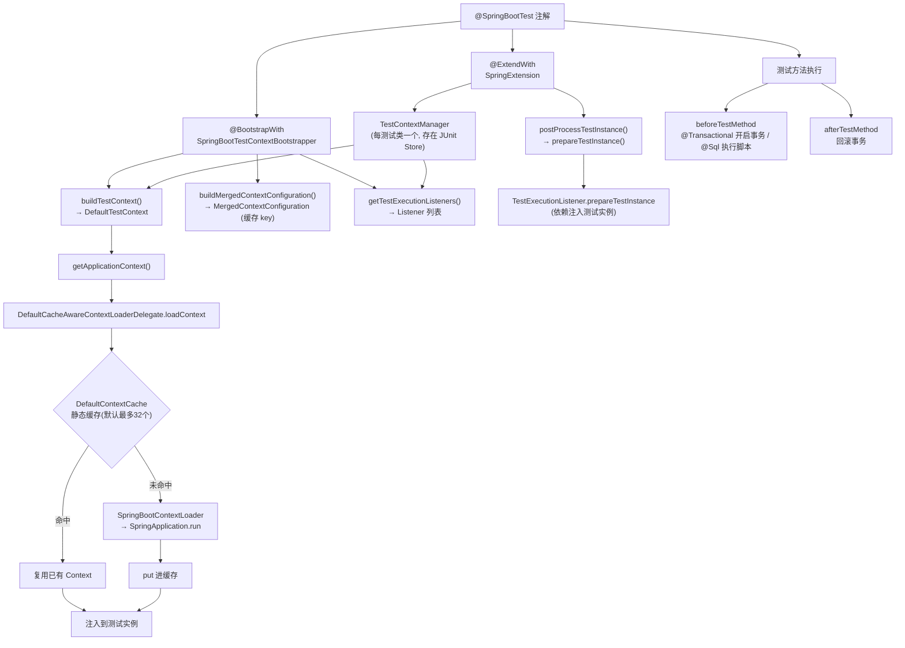
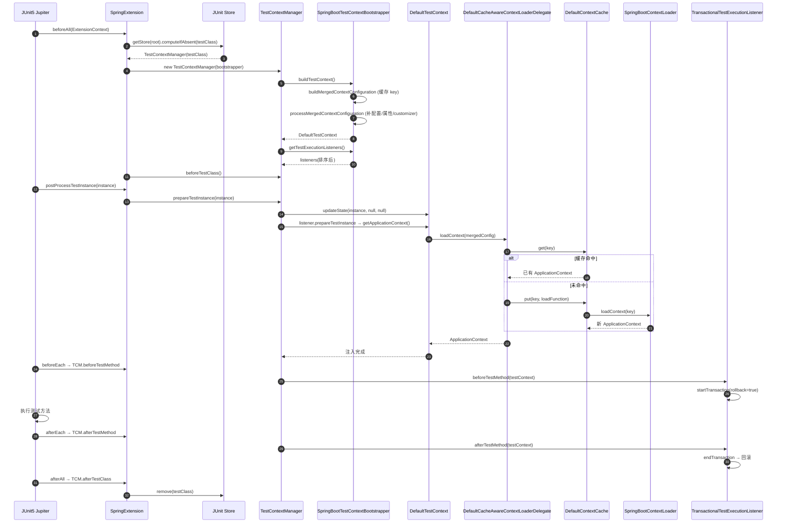

# 03 · 测试支持：@SpringBootTest 背后的上下文缓存与 Mock

> **一句话结论**：`@SpringBootTest` 只是一张"票"——`@BootstrapWith` 指定用哪个 Bootstrapper、`@ExtendWith` 指定用哪个 JUnit 5 扩展；真正的魔法是 `TestContextManager` 把"加载 `ApplicationContext`"这件事变成了**以 `MergedContextConfiguration` 为 key 的静态缓存查找**，所以几百个测试类只启动一个 Spring 容器，而任何"改容器"的行为（`@MockitoBean`、`@DirtiesContext`、`@TestPropertySource`）都会改变 key 或主动清缓存——这就是"上下文复用"与"脏上下文"的全部来源。
> **阅读前置**：[01-jdbctemplate-模板方法与回调](./01-jdbctemplate-模板方法与回调.md) 与 [02-声明式数据访问-jdbc与orm集成](./02-声明式数据访问-jdbc与orm集成.md)（理解 `DataSource`/JPA 启动有多贵，才理解缓存为什么重要）、[01-springapplication-run-启动全流程](../../02-SpringBoot/01-启动原理/01-springapplication-run-启动全流程.md)（`SpringApplication.run` 做什么）。
> **预计阅读 75–90 分钟 / 源码**：`org.springframework:spring-test:7.1.0`（`TestContextManager`、`SpringExtension`、`MergedContextConfiguration`、`DefaultContextCache`、`TransactionalTestExecutionListener`、`MockitoBean`）、`org.springframework.boot:spring-boot-test:4.2.0`（`SpringBootTest`、`SpringBootTestContextBootstrapper`）、`spring-boot-webmvc-test:4.2.0`（`WebMvcTest`）。全部已入库 `assets/source/`。

---

## 0. 先看现象

三个测试类，写在同一个测试包里：

```java
@SpringBootTest
class ATest {
    @Autowired ApplicationContext ctx;

    @Test void a() { System.out.println(System.identityHashCode(ctx)); }
}
```

```java
@SpringBootTest
class BTest {
    @Autowired ApplicationContext ctx;

    @Test void b() { System.out.println(System.identityHashCode(ctx)); }
}
```

```java
@SpringBootTest
@DirtiesContext
class CTest {
    @Autowired ApplicationContext ctx;

    @Test void c() { System.out.println(System.identityHashCode(ctx)); }
}
```

再加一个用了 `@MockitoBean` 的类：

```java
@SpringBootTest
class DTest {
    @MockitoBean OrderService orderService;

    @Test void d() { /* 只关心 OrderService 的行为 */ }
}
```

依次运行时你观察到：

1. `ATest` 与 `BTest` 打印出**同一个** identity hash——它们复用了同一个 `ApplicationContext`，Spring 只启动了一次，第二次测试几乎是瞬间开始。
2. `CTest` 打印出**不同**的 hash，而且它跑完之后，后面的测试又会重新启动一次容器。
3. `DTest` 的 context 与 `ATest`/`BTest` **不是**同一个，即使它的 `@SpringBootTest` 属性完全一样。
4. 把 `ATest` 改成 `@SpringBootTest(properties = "foo=bar")`，它立刻变成一个新容器。

这四件事分别对应四个机制：**上下文缓存**、**`@DirtiesContext` 清缓存**、**`ContextCustomizer` 参与缓存 key**、**内联属性参与缓存 key**。本篇把它们拆开看。

## 1. 整体地图



> **读图说明**：图分成三大块。左上角是**注解层**：`@SpringBootTest` 自己什么都不干，只是把"用哪个 Bootstrapper"和"用哪个 JUnit 扩展"声明出来。中间是**框架层**：Bootstrapper 负责"造 key"（`MergedContextConfiguration`）和"找监听器"，`SpringExtension` 负责把 JUnit 5 的生命周期回调转给 `TestContextManager`。右侧与下方是**缓存层**：`getApplicationContext()` 永远先问 `DefaultContextCache`，命中就直接返回，未命中才走 `SpringApplication.run`。最关键的箭头是 **B2→CACHE**：Bootstrapper 造出的 `MergedContextConfiguration` 直接就是缓存的 Map key，所以"改一行属性"就等于"换一个容器"。最下方的 BEFORE/AFTER 是 `@Transactional` 测试回滚与 `@Sql` 的挂载点——它们是 `TestExecutionListener`，与缓存层完全解耦。

关键角色分工：

| 角色 | 来源 | 职责 |
| --- | --- | --- |
| `@SpringBootTest` | spring-boot-test | 声明 Bootstrapper、`WebEnvironment`、内联属性、`args` |
| `SpringBootTestContextBootstrapper` | spring-boot-test | 找 `@SpringBootConfiguration`、拼属性、造 `MergedContextConfiguration` |
| `SpringExtension` | spring-test | JUnit 5 扩展，把 Jupiter 回调转给 `TestContextManager` |
| `TestContextManager` | spring-test | 每个测试类一个，持有 `TestContext` 与 `TestExecutionListener` 列表 |
| `TestContext` / `DefaultTestContext` | spring-test | "当前测试"的上下文视图，负责加载/缓存 `ApplicationContext` |
| `MergedContextConfiguration` | spring-test | 缓存 key：locations/classes/profiles/属性/customizers/loader/parent |
| `DefaultCacheAwareContextLoaderDelegate` | spring-test | 查缓存、未命中就加载、累计失败次数 |
| `DefaultContextCache` | spring-test | `LinkedHashMap`（access-order）+ LRU 淘汰 + 引用计数 |
| `TestExecutionListener` | spring-test | `@Transactional` 回滚、`@Sql`、依赖注入等横切逻辑 |
| `@MockitoBean` | spring-test 6.2+ | 用 `BeanOverride` 机制替换/新增 Bean，通过 `ContextCustomizer` 影响缓存 key |

## 2. 关键类逐个拆

### 2.1 @SpringBootTest

- **职责**：一个"元注解"，把 Spring Test 与 Spring Boot 装配到一起。
- **关键成员**：`@BootstrapWith(SpringBootTestContextBootstrapper.class)`、`@ExtendWith(SpringExtension.class)`、`properties/args/classes/webEnvironment/useMainMethod`。
- **设计意图**：把"如何引导测试上下文"做成可替换的注解属性，而不是硬编码在某个基类里——这就是为什么 `@WebMvcTest`、`@DataJpaTest` 能复用同一套机制却换掉 Bootstrapper 与过滤规则。

### 2.2 SpringBootTestContextBootstrapper

- **职责**：Boot 侧的 Bootstrapper，继承 `DefaultTestContextBootstrapper`（再上溯 `AbstractTestContextBootstrapper`）。
- **关键行为**：`buildTestContext`（造 `TestContext`）、`getDefaultContextLoaderClass`（返回 `SpringBootContextLoader`）、`processMergedContextConfiguration`（补 `@SpringBootConfiguration`、拼属性、换 Web 专用配置）、`createModifiedConfig`（把 `@SpringBootTest` 的参数塞进 `contextCustomizers`）。
- **设计意图**：模板方法——父类定"造 key 的流程"，子类只改"key 里放什么"。

### 2.3 SpringExtension

- **职责**：JUnit 5 扩展入口，实现 7 个回调接口 + `ParameterResolver`。
- **关键字段**：`TEST_CONTEXT_MANAGER_NAMESPACE`——一个 JUnit `Store` 命名空间，用来"每个测试类缓存一个 `TestContextManager`"。
- **设计意图**：不在扩展里保存状态（扩展实例可能被 JUnit 复用），而是把状态放进 JUnit 的 `Store`，以测试类为 key——这样并行执行、嵌套类都不会串。

### 2.4 TestContextManager

- **职责**：一个测试类的"调度中心"：持有 `TestContext` 与排好序的 `TestExecutionListener`，在 `beforeTestClass`/`prepareTestInstance`/`beforeTestMethod`/`afterTestMethod`/`afterTestClass` 各时点依次回调监听器。
- **关键字段**：`testContext`、`testContextHolder`（`ThreadLocal`，用于并行）、`testExecutionListeners`（`ArrayList(8)`）。
- **设计意图**：把"测试生命周期"与"具体框架（JUnit4/JUnit5/TestNG）"解耦，`SpringExtension` 只是薄薄一层适配。

### 2.5 TestContext / DefaultTestContext

- **职责**：暴露"当前测试"的信息（测试类、实例、方法、异常）并提供 `getApplicationContext()`。
- **关键实现**：`DefaultTestContext.getApplicationContext()` 调 `cacheAwareContextLoaderDelegate.loadContext(mergedConfig)`，然后 `Assert.state(cac.isActive(), ...)` 检查是否已被关闭。
- **设计意图**：把"缓存/加载"这个重活交给 delegate，`TestContext` 自己只做"视图 + 校验"。

### 2.6 MergedContextConfiguration

- **职责**：**缓存 key**。由 `@ContextConfiguration`、`@ActiveProfiles`、`@TestPropertySource`、`ContextCustomizer`、`ContextLoader`、父配置等合并而成。
- **关键细节**：`equals`/`hashCode` **故意不包含 `testClass`**。
- **设计意图**：让多个测试类共享同一个上下文——这正是"上下文缓存"能生效的前提。

### 2.7 DefaultCacheAwareContextLoaderDelegate

- **职责**：缓存门面：`loadContext` 先查 `ContextCache`，未命中才真正加载并 `put`。
- **关键逻辑**：局部 `synchronized (contextCache)`、失败次数阈值（防止"坏上下文"被反复重试）、`finally` 里 `logStatistics()`。
- **设计意图**：默认使用**静态** `DefaultContextCache`，所以整个 JVM 进程（一次 Gradle/Maven test 任务）共享同一个缓存。

### 2.8 DefaultContextCache

- **职责**：真正的 Map 实现，`LinkedHashMap(32, 0.75f, true)`（access-order）+ LRU 淘汰 + 引用计数 + 层级关系。
- **关键常量**：`DEFAULT_MAX_CONTEXT_CACHE_SIZE = 32`，可通过 `spring.test.context.cache.maxSize` 调整。
- **设计意图**：access-order 的 `LinkedHashMap` 天然给出 LRU；`remove` 时对 `ConfigurableApplicationContext` 调 `close()`，保证被淘汰/被标脏的容器不会泄漏连接池和线程。

### 2.9 TransactionalTestExecutionListener

- **职责**：让测试方法跑在事务里并**默认回滚**。
- **关键字段**：`attributeSource = new AnnotationTransactionAttributeSource(false)`（不要求 `@Transactional` 方法是 public）、`ORDER = 4000`。
- **设计意图**：把"事务"实现为一个**监听器**而不是硬编码在 `TestContextManager` 里，于是你可以通过 `@TestExecutionListeners` 换掉/关掉它。

### 2.10 MockitoBean

- **职责**：声明式地用一个 Mockito mock 替换（或新增）容器里的 Bean。
- **关键元数据**：`@BeanOverride(MockitoBeanOverrideProcessor.class)`、`@Repeatable(MockitoBeans.class)`、`@since 6.2`。
- **设计意图**：走 `BeanOverride` 基础设施（`BeanOverrideContextCustomizer`），所以它天然参与缓存 key——同一个测试类不同 mock 组合会得到不同上下文。

## 3. 源码逐段精读

### 3.1 两个注解属性定义了一切

```java (src: SpringBootTest.java#L58-L64)
@Target(ElementType.TYPE)
@Retention(RetentionPolicy.RUNTIME)
@Documented
@Inherited
@BootstrapWith(SpringBootTestContextBootstrapper.class)
@ExtendWith(SpringExtension.class)
public @interface SpringBootTest {
```

- **在干什么**：用两个元注解把"怎么引导上下文"和"怎么接进 JUnit 5"都声明出来，注解本身没有任何逻辑。
- **为什么这么写**：`@BootstrapWith` 是 Spring Test 的 SPI——`BootstrapUtils.resolveTestContextBootstrapper(testClass)` 读它来决定用哪个 Bootstrapper；`@ExtendWith` 是 JUnit 5 的 SPI——Jupiter 引擎据此注册扩展。两个框架通过注解"接线"，谁也不用依赖对方。
- **如果把 `@ExtendWith(SpringExtension.class)` 去掉**：`@Autowired` 不会报错，但字段是 `null`——因为根本没人执行依赖注入；测试仍然能跑，只是失败得很莫名。
- **常见坑**：自己写一个组合注解（如 `@MyIntegrationTest`）时，必须同时带上 `@BootstrapWith` 与 `@ExtendWith`（或让 `@SpringBootTest` 作为元注解），否则注解"看起来生效"其实没接上。

### 3.2 WebEnvironment 决定要不要真的起服务器

```java (src: SpringBootTest.java#L103-L116)
	/**
	 * The type of web environment to create when applicable. Defaults to
	 * {@link WebEnvironment#MOCK}.
	 * @return the type of web environment
	 */
	WebEnvironment webEnvironment() default WebEnvironment.MOCK;

	/**
	 * The type of main method usage to employ when creating the {@link SpringApplication}
	 * under test.
	 * @return the type of main method usage
	 * @since 3.0.0
	 */
	UseMainMethod useMainMethod() default UseMainMethod.NEVER;
```

- **在干什么**：`webEnvironment` 默认 `MOCK`（`MockServletContext`，不起真服务器）；`useMainMethod` 默认 `NEVER`（Boot 4 里推荐显式设成 `ALWAYS` 以获得与生产一致的行为）。
- **为什么这么写**：`MOCK` 是"能用 `MockMvc` 就够了"的默认值，起真服务器（`RANDOM_PORT`/`DEFINED_PORT`）慢且需要 web server 依赖。
- **如果设成 `RANDOM_PORT`**：Bootstrapper 会往属性里加 `server.port=0`（见 3.7），这改变了缓存 key——所以同一个测试类的 `MOCK` 版和 `RANDOM_PORT` 版绝不共享容器。
- **常见坑**：`@WebAppConfiguration` 不能和 `RANDOM_PORT`/`DEFINED_PORT` 混用，否则 Bootstrapper 的 `verifyConfiguration` 直接抛 `IllegalStateException`。

### 3.3 Bootstrapper 继承链

```java (src: SpringBootTestContextBootstrapper.java#L88-L100)
	@Override
	public TestContext buildTestContext() {
		TestContext context = super.buildTestContext();
		verifyConfiguration(context.getTestClass());
		WebEnvironment webEnvironment = getWebEnvironment(context.getTestClass());
		if (webEnvironment == WebEnvironment.MOCK && WebApplicationType.deduce() == WebApplicationType.SERVLET) {
			context.setAttribute(ACTIVATE_SERVLET_LISTENER, true);
		}
		else if (webEnvironment != null && webEnvironment.isEmbedded()) {
			context.setAttribute(ACTIVATE_SERVLET_LISTENER, false);
		}
		return context;
	}
```

- **在干什么**：先让父类造 `TestContext`，然后在 `TestContext` 的 attribute 里放一个开关，告诉 `ServletTestExecutionListener` 要不要"激活"Servlet 环境（mock 模式下要，真服务器模式下不要）。
- **为什么这么写**：`TestContext` 实现了 `AttributeAccessor`，本质是一个"随上下文走的 Map"，用 attribute 传递"框架内部开关"比加字段更灵活，也允许第三方监听器读取。
- **如果父类 `buildTestContext` 直接返回而不走子类**：就没人校验 `@WebAppConfiguration` 与端口配置的冲突，错误会推迟到运行期。
- **常见坑**：`ACTIVATE_SERVLET_LISTENER` 这个属性名是一个字符串常量 `org.springframework.test.context.web.ServletTestExecutionListener.activateListener`——`@WebMvcTest` 的切片测试同样依赖它。

### 3.4 父类只写固定的三步

```java (src: AbstractTestContextBootstrapper.java#L106-L110)
	@Override
	public TestContext buildTestContext() {
		return new DefaultTestContext(getBootstrapContext().getTestClass(), buildMergedContextConfiguration(),
				getCacheAwareContextLoaderDelegate());
	}
```

- **在干什么**：`TestContext` = 测试类 + **合并后的配置** + **缓存感知的加载委托**。三者一组合，"这个测试要用哪个上下文"就被钉死了。
- **为什么这么写**：这是整个测试支持里最关键的一行。它把"缓存 key"（第二个参数）与"缓存实现"（第三个参数）显式注入 `TestContext`，于是所有加载都必然经过缓存，没有"绕过缓存"的路径。
- **如果这里直接 `new AnnotationConfigApplicationContext(...)`**：每个测试类都会新建容器，几百个测试就要启动几百次 Spring——这正是 JUnit 4 时代用 `@RunWith(SpringJUnit4ClassRunner.class)` 却忘记上下文缓存时的灾难。
- **常见坑**：`getCacheAwareContextLoaderDelegate()` 返回的是 `getBootstrapContext().getCacheAwareContextLoaderDelegate()`（见 3.5），而默认实现用的是**静态**缓存——所以"同一次 JVM 里所有测试共享缓存"这件事是在这里决定的。

### 3.5 缓存委托从哪里来

```java (src: AbstractTestContextBootstrapper.java#L584-L586)
	protected CacheAwareContextLoaderDelegate getCacheAwareContextLoaderDelegate() {
		return getBootstrapContext().getCacheAwareContextLoaderDelegate();
	}
```

- **在干什么**：把"缓存委托"委托给 `BootstrapContext`（引导上下文），而不是自己 new 一个。
- **为什么这么写**：`BootstrapContext` 是"每次测试引导过程的共享状态容器"；`DefaultBootstrapContext` 在构造时就创建了一个 `DefaultCacheAwareContextLoaderDelegate`。这样同一个测试类里的 `TestContext`、`MergedContextConfiguration`、父配置加载都指向**同一个** delegate 实例。
- **如果每个 TestContext 各自 new 一个 delegate**：每个 delegate 会拿到同一个静态 `DefaultContextCache`（默认构造走静态缓存），所以缓存仍能命中——但失败计数与引用计数会被分裂，`@DirtiesContext` 的语义也可能不一致。
- **常见坑**：`DefaultCacheAwareContextLoaderDelegate()` 无参构造是 `this(defaultContextCache)`，而 `defaultContextCache` 是 `static` 字段——这就是"同 JVM 进程内缓存共享"的实现点（见 3.8）。

### 3.6 父类的"空钩子"

```java (src: AbstractTestContextBootstrapper.java#L610-L612)
	protected MergedContextConfiguration processMergedContextConfiguration(MergedContextConfiguration mergedConfig) {
		return mergedConfig;
	}
```

- **在干什么**：默认什么都不做，原样返回——这是给子类（Boot、`@WebMvcTest` 等）改写配置的钩子。
- **为什么这么写**：Spring Test 是**框架无关**的，它不应该知道 Boot 的存在；所以只提供钩子，谁需要谁覆盖。
- **如果子类不覆盖**：Boot 应用里就不会有"自动向上搜索 `@SpringBootConfiguration`"的能力，`@SpringBootTest` 会因找不到配置类而失败。
- **常见坑**：这个方法是 `protected`，且**返回新对象**才是正确用法（Boot 就是 `return createModifiedConfig(...)`）——如果就地修改 `mergedConfig`，由于 `MergedContextConfiguration` 不可变（字段全 `final`），你根本改不动。

### 3.7 Boot 改写配置：补配置类 + 补属性

```java (src: SpringBootTestContextBootstrapper.java#L193-L201)
	protected Class<?>[] getOrFindConfigurationClasses(MergedContextConfiguration mergedConfig) {
		Class<?>[] classes = mergedConfig.getClasses();
		if (containsNonTestComponent(classes) || mergedConfig.hasLocations()) {
			return classes;
		}
		Class<?> found = findConfigurationClass(mergedConfig.getTestClass());
		logger.info("Found @SpringBootConfiguration " + found.getName() + " for test " + mergedConfig.getTestClass());
		return merge(found, classes);
	}
```

- **在干什么**：如果测试已经显式给了"非 `@TestConfiguration` 的配置类"或 `locations`，就用用户的；否则从测试类所在包**向上搜索** `@SpringBootConfiguration`（即 `@SpringBootApplication`），并放在数组首位。
- **为什么这么写**：`containsNonTestComponent` 用 `MergedAnnotations.isPresent(TestConfiguration.class)` 判断——`@TestConfiguration` 是"只给测试用的补充配置"，不能代表整个应用，所以它不算"用户指定了配置类"。`merge(found, classes)` 把真实配置放在**最前**，保证它优先级最高。
- **如果找不到 `@SpringBootConfiguration`**：`findConfigurationClass` 抛 `IllegalStateException`，消息明确提示可以用 `@ContextConfiguration` 或 `@SpringBootTest(classes = ...)`。
- **常见坑**：搜索是"从测试类所在包往上找"，所以测试类放错包（比如放在 `src/test/java` 的孤立包）会找不到配置类；此时 `@SpringBootTest(classes = XxxApplication.class)` 是最快的救火方案。

### 3.8 缓存 key 的"区分属性"

```java (src: SpringBootTestContextBootstrapper.java#L237-L246)
	private List<String> getAndProcessPropertySourceProperties(MergedContextConfiguration mergedConfig) {
		List<String> propertySourceProperties = new ArrayList<>(
				Arrays.asList(mergedConfig.getPropertySourceProperties()));
		String differentiator = getDifferentiatorPropertySourceProperty();
		if (differentiator != null) {
			propertySourceProperties.add(differentiator);
		}
		processPropertySourceProperties(mergedConfig, propertySourceProperties);
		return propertySourceProperties;
	}
```

- **在干什么**：在属性列表末尾追加一个"区分标记"，然后再补 `@SpringBootTest` 的 `properties`、`server.port=0` 等。
- **为什么这么写**：这个标记的值是 `getClass().getName() + "=true"`（即 `org.springframework.boot.test.context.SpringBootTestContextBootstrapper=true`）。javadoc 说得很直白：**没有这个属性，一个不是由本 Bootstrapper 创建的缓存上下文可能被错误地返回**。也就是说它把"用 SpringBoot 引导"这件事编码进了缓存 key。
- **如果没有它**：同一个测试类如果既被 `@ContextConfiguration` 直接跑过、又被 `@SpringBootTest` 跑过，可能互相拿到对方的上下文（一个没有 Boot 的自动配置，一个有）。
- **常见坑**：因为属性列表参与 `equals`，这个标记的顺序也必须稳定——所以它是 `add`（追加）而不是 `add(0, ...)`；而 `@SpringBootTest(properties=...)` 用的是 `addAll(0, ...)`，以保证内联属性优先。

### 3.9 把 @SpringBootTest 的参数塞进 key

```java (src: SpringBootTestContextBootstrapper.java#L341-L349)
	protected final MergedContextConfiguration createModifiedConfig(MergedContextConfiguration mergedConfig,
			Class<?>[] classes, String[] propertySourceProperties) {
		Set<ContextCustomizer> contextCustomizers = new LinkedHashSet<>(mergedConfig.getContextCustomizers());
		contextCustomizers.add(new SpringBootTestAnnotation(mergedConfig.getTestClass()));
		return new MergedContextConfiguration(mergedConfig.getTestClass(), mergedConfig.getLocations(), classes,
				mergedConfig.getContextInitializerClasses(), mergedConfig.getActiveProfiles(),
				mergedConfig.getPropertySourceDescriptors(), propertySourceProperties, contextCustomizers,
				mergedConfig.getContextLoader(), getCacheAwareContextLoaderDelegate(), mergedConfig.getParent());
	}
```

- **在干什么**：用原配置的绝大部分字段 + 新的 `classes`、`properties`、"`SpringBootTestAnnotation` 这个 customizer" 造一个新的 `MergedContextConfiguration`。
- **为什么这么写**：`args`、`webEnvironment`、`useMainMethod` 这三个值不体现在 locations/classes/properties 里，但**必须**影响缓存，否则 `MOCK` 与 `RANDOM_PORT` 会共享容器。做法就是造一个 `ContextCustomizer` 承载它们，而 `ContextCustomizer` 是 `equals` 的一部分（见 3.11）。
- **如果省略这一步**：`@SpringBootTest(webEnvironment = RANDOM_PORT)` 和默认 `MOCK` 的测试会拿到同一个缓存容器，随之出现"端口明明随机了却连不上"的诡异问题。
- **常见坑**：`createModifiedConfig` 是 `final` 的——子类（如 `TestSliceTestContextBootstrapper`）只能改"属性"和"类"，不能改"如何造这个对象"。

### 3.10 缓存 key 到底由哪些维度组成

```java (src: MergedContextConfiguration.java#L86-L105)
	private final Class<?> testClass;

	private final String[] locations;

	private final Class<?>[] classes;

	@SuppressWarnings("serial")
	private final Set<Class<? extends ApplicationContextInitializer<?>>> contextInitializerClasses;

	private final String[] activeProfiles;

	@SuppressWarnings("serial")
	private final List<PropertySourceDescriptor> propertySourceDescriptors;

	private final String[] propertySourceLocations;

	private final String[] propertySourceProperties;

	@SuppressWarnings("serial")
	private final Set<ContextCustomizer> contextCustomizers;
```

- **在干什么**：列出 `MergedContextConfiguration` 的全部字段——这就是"一个测试上下文需要知道的所有事"。注意 `testClass` 也在其中，但它**不参与** `equals`。
- **为什么这么写**：把 key 的维度显式写成字段，比在构造函数里拼一个字符串更容易维护；而 `@SuppressWarnings("serial")` 说明这些集合类型不可序列化，这在 Spring 7 里已被接受（不再支持序列化上下文 key）。
- **如果 `testClass` 参与 equals**：每个测试类都会有独立上下文，缓存命中率归零——这就是"为什么多个测试类可以复用同一个 ApplicationContext"的答案。
- **常见坑**：`propertySourceDescriptors`（Spring 6.1+，来自 `@TestPropertySource(sources=...)`）与 `propertySourceProperties`（内联 key=value）是两个独立维度，改其中任一都会换容器。

### 3.11 equals 的最后一锤

```java (src: MergedContextConfiguration.java#L486-L531)
	public boolean equals(@Nullable Object other) {
		if (this == other) {
			return true;
		}
		if (other == null || other.getClass() != getClass()) {
			return false;
		}

		MergedContextConfiguration otherConfig = (MergedContextConfiguration) other;
		if (!Arrays.equals(this.locations, otherConfig.locations)) {
			return false;
		}
		if (!Arrays.equals(this.classes, otherConfig.classes)) {
			return false;
		}
		if (!this.contextInitializerClasses.equals(otherConfig.contextInitializerClasses)) {
			return false;
		}
		if (!Arrays.equals(this.activeProfiles, otherConfig.activeProfiles)) {
			return false;
		}
		if (!this.propertySourceDescriptors.equals(otherConfig.propertySourceDescriptors)) {
			return false;
		}
		if (!Arrays.equals(this.propertySourceProperties, otherConfig.propertySourceProperties)) {
			return false;
		}
		if (!this.contextCustomizers.equals(otherConfig.contextCustomizers)) {
			return false;
		}

		if (this.parent == null) {
			if (otherConfig.parent != null) {
				return false;
			}
		}
		else if (!this.parent.equals(otherConfig.parent)) {
			return false;
		}

		if (!nullSafeClassName(this.contextLoader).equals(nullSafeClassName(otherConfig.contextLoader))) {
			return false;
		}

		return true;
	}
```

- **在干什么**：逐维度比较，最后比 `contextLoader` 的**类名**（用 `nullSafeClassName` 避免 null）。
- **为什么这么写**：`getClass()` 先比较，保证 `WebMergedContextConfiguration` 与普通 `MergedContextConfiguration` 即便字段相同也不等价——因为 web 版本还带 `resourceBasePath`；`contextLoader` 比类名而不是实例，因为同一个加载器可能被多次 new，比实例会永远不相等。
- **如果比 `contextLoader` 实例**：缓存永远 miss，缓存直接失效。
- **常见坑**：`nullSafeClassName` 意味着"两个不同的 `ContextLoader` 类名相同（不同类加载器加载）"会被认为相等——在隔离类加载器（如某些容器化测试）场景下要小心。

### 3.12 缓存门面

```java (src: DefaultCacheAwareContextLoaderDelegate.java#L94-L104)
	/**
	 * Construct a new {@code DefaultCacheAwareContextLoaderDelegate} using a
	 * static {@link DefaultContextCache}.
	 * <p>The default cache is static so that each context can be cached and
	 * reused for all subsequent tests that declare the same unique context
	 * configuration within the same JVM process.
	 * @see #DefaultCacheAwareContextLoaderDelegate(ContextCache)
	 */
	public DefaultCacheAwareContextLoaderDelegate() {
		this(defaultContextCache);
	}
```

- **在干什么**：无参构造使用静态 `defaultContextCache`；javadoc 明确说明目的是"同一 JVM 进程内复用"。
- **为什么这么写**：测试执行器（Surefire、Gradle Test）默认在**同一个 JVM**里跑多个测试类，静态缓存让"第一个测试启动容器、其余复用"。如果每个测试类 fork 一个 JVM（`forkCount`），缓存就失效——这是很多人发现"并行/fork 后测试变慢"的真实原因。
- **如果改成实例字段缓存**：`BootstrapUtils` 每次都会造新 `BootstrapContext`，于是每个测试类各自一个缓存，几乎不再命中。
- **常见坑**：`spring.test.context.cache.maxSize` 是**系统属性**（读 `ContextCacheUtils.retrieveMaxCacheSize()`），不是 `application.properties`——写在配置文件里没用。

### 3.13 命中判断与"失败阈值"

```java (src: DefaultCacheAwareContextLoaderDelegate.java#L138-L158)
	@Override
	public ApplicationContext loadContext(MergedContextConfiguration mergedConfig) {
		mergedConfig = replaceIfNecessary(mergedConfig);
		synchronized (this.contextCache) {
			try {
				ApplicationContext context = this.contextCache.get(mergedConfig);
				if (context != null) {
					if (logger.isTraceEnabled()) {
						logger.trace("Retrieved ApplicationContext [%s] from cache with key %s".formatted(
								System.identityHashCode(context), mergedConfig));
					}
					return context;
				}

				int failureCount = this.contextCache.getFailureCount(mergedConfig);
				if (failureCount >= this.failureThreshold) {
					throw new IllegalStateException("""
							ApplicationContext failure threshold (%d) exceeded: \
							skipping repeated attempt to load context for %s"""
								.formatted(this.failureThreshold, mergedConfig));
				}
```

- **在干什么**：先查缓存命中直接返回；未命中时看"这个 key 已经失败过几次"，超过阈值就**不再重试**，直接抛错。
- **为什么这么写**：一个坏掉的配置（比如端口被占、库连不上）会在几十个测试类上重复触发，每次都等满超时；一旦达到阈值（默认 1，可通过 `spring.test.context.failure.threshold` 调整），后续测试快速失败，日志更干净、构建更快。
- **如果没有这个阈值**：一个坏配置能让 CI 卡上十几分钟，日志被几十份相同的堆栈淹没。
- **常见坑**：看到 "failure threshold exceeded" 时，真正的首个异常在**第一个**失败的测试里，而不是这条消息所在的测试。

### 3.14 未命中才真正加载

```java (src: DefaultCacheAwareContextLoaderDelegate.java#L160-L173)
				return this.contextCache.put(mergedConfig, key -> {
					try {
						ApplicationContext newContext;
						if (key instanceof AotMergedContextConfiguration aotMergedConfig) {
							newContext = loadContextInAotMode(aotMergedConfig);
						}
						else {
							newContext = loadContextInternal(key);
						}
						if (logger.isTraceEnabled()) {
							logger.trace("Storing ApplicationContext [%s] in cache under key %s".formatted(
									System.identityHashCode(newContext), key));
						}
						return newContext;
```

- **在干什么**：未命中缓存后，把"真正创建容器"的动作包成一个 lambda 交给 `contextCache.put(key, LoadFunction)`；创建成功后打一条 trace（"存进缓存"），然后返回。
- **为什么这么写**：`put(key, LoadFunction)`（`@since 7.0`）把"查缓存 / 判断失败阈值 / 创建 / 存入 / 失败计数 / 收尾日志"合成一个原子动作，由缓存实现决定何时调用 `loadContext`。这样缓存实现可以按 key 加锁，避免两个线程同时为同一份配置创建两个容器。
- **如果直接 `contextCache.put(key, context)`**：旧 API（`put(key, ApplicationContext)`，7.0 起标记 `@Deprecated`）要求调用方先创建好容器，再放进去——创建发生在锁外，并发时会重复建容器，且失败时无法为这个 key 计数。
- **常见坑**：lambda 里只处理"成功路径"，异常由外层 `catch` 统一处理并 `incrementFailureCount`；若你在自定义 `ContextCache` 里吞掉异常，失败阈值机制就失效了。

### 3.15 加载失败：计数、诊断与统一包装

```java (src: DefaultCacheAwareContextLoaderDelegate.java#L175-L197)
					catch (Exception ex) {
						if (logger.isTraceEnabled()) {
							logger.trace("Incrementing ApplicationContext failure count for " + key);
						}
						this.contextCache.incrementFailureCount(key);
						Throwable cause = ex;
						if (ex instanceof ContextLoadException cle) {
							cause = cle.getCause();
							for (ApplicationContextFailureProcessor contextFailureProcessor : this.contextFailureProcessors) {
								try {
									contextFailureProcessor.processLoadFailure(cle.getApplicationContext(), cause);
								}
								catch (Throwable throwable) {
									if (logger.isDebugEnabled()) {
										logger.debug("Ignoring exception thrown from ApplicationContextFailureProcessor [%s]: %s"
												.formatted(contextFailureProcessor, throwable));
									}
								}
							}
						}
						throw new IllegalStateException("Failed to load ApplicationContext for " + key, cause);
					}
				});
```

- **在干什么**：失败计数 +1；如果是 `ContextLoadException`（表示"容器建了但初始化失败"），取出真实 cause，并依次通知所有 `ApplicationContextFailureProcessor`（典型用途：把失败容器的日志/SQL 脚本打印出来），最后统一包装抛 `IllegalStateException`。
- **为什么这么写**：`ApplicationContextFailureProcessor` 是 Spring 6.1 加入的诊断扩展点：上下文加载失败时，容器可能已经创建了一半（甚至可能是 `ConfigurableApplicationContext`），此时让你有机会"抢救"出有用信息（例如 `spring.sql.init` 失败时打印脚本内容）。每个 processor 的异常都被吞掉，避免诊断逻辑再引发新错误。
- **如果不做这层包装**：Spring Boot 的启动异常会以 `BeanCreationException` 直接冒出来，虽然更"原生"，但测试框架就没法统一做失败计数与诊断。
- **常见坑**：`catch (Exception ex)` 不含 `Error`——`OutOfMemoryError`、`NoClassDefFoundError` 不会被计数，会直接向上抛。

### 3.16 缓存本体：LRU + 关闭

```java (src: DefaultContextCache.java#L224-L233)
	private void evictLruContextIfNecessary() {
		if (this.contextMap.size() >= this.maxSize) {
			Iterator<MergedContextConfiguration> iterator = this.contextMap.keySet().iterator();
			Assert.state(iterator.hasNext(), "Failed to retrieve LRU context");
			// The least recently used (LRU) key is the first/head in a LinkedHashMap
			// configured for access-order iteration order.
			MergedContextConfiguration lruKey = iterator.next();
			remove(lruKey, HierarchyMode.CURRENT_LEVEL);
		}
	}
```

- **在干什么**：缓存满了（`size >= maxSize`，默认 32）就取 `LinkedHashMap` 迭代器的第一个 key——在 access-order 模式下那就是"最久没被访问的"——移除它。
- **为什么这么写**：`LinkedHashMap(32, 0.75f, true)` 的 `true` 代表 access-order，`get` 会把条目移到尾部，于是"头部 = LRU"。不需要自己实现链表，这是 JDK 给的免费午餐。
- **如果换成 `HashMap`**：没有顺序，无法淘汰，缓存会无限增长——每个容器都持有连接池、线程池，最终 OOM 或耗尽数据库连接数。
- **常见坑**：`remove` 会 `contextMap.remove(key)` 并对 `ConfigurableApplicationContext` 调 `close()`。所以"上下文被淘汰"和"上下文被 `@DirtiesContext` 关闭"在现象上一样，日志里要看清是 eviction 还是 dirty。

### 3.17 SpringExtension 的接线

```java (src: SpringExtension.java#L208-L215)
	 * Delegates to {@link TestContextManager#beforeTestClass}.
	 */
	@Override
	public void beforeAll(ExtensionContext context) throws Exception {
		TestContextManager testContextManager = getTestContextManager(context);
		registerMethodInvoker(testContextManager, context);
		testContextManager.beforeTestClass();
	}
```

- **在干什么**：JUnit 5 的 `@BeforeAll` 阶段回调——拿到（或创建）`TestContextManager`，注册 `MethodInvoker`（Spring 7 新增，用于支持非公开的 `@BeforeAll`/`@AfterAll` 方法），然后交给 `TestContextManager.beforeTestClass()`。
- **为什么这么写**：`SpringExtension` 自身不保存任何状态，只是"查表 + 转发"。所有生命周期语义都在 `TestContextManager` 里，所以同一套语义可以被 JUnit 4 的 `SpringRunner`、TestNG 的 `AbstractTestNGSpringContextTests` 复用。
- **如果直接在扩展里加载上下文**：JUnit 的扩展实例生命周期与测试类实例不同（可能被复用），会引发难以复现的串状态问题。
- **常见坑**：`@BeforeAll` 方法默认必须是 `static`（JUnit 5 规则）；Spring 7 的 `MethodInvoker` 只解决"可见性"，解决不了"静态"——要非静态 `@BeforeAll` 得配 `@TestInstance(PER_CLASS)`。

### 3.18 每个测试类一个 TestContextManager

```java (src: SpringExtension.java#L478-L487)
	static TestContextManager getTestContextManager(ExtensionContext context) {
		Assert.notNull(context, "ExtensionContext must not be null");
		Class<?> testClass = context.getRequiredTestClass();
		Store store = getStore(context);
		return store.computeIfAbsent(testClass, TestContextManager::new, TestContextManager.class);
	}

	private static Store getStore(ExtensionContext context) {
		return context.getRoot().getStore(TEST_CONTEXT_MANAGER_NAMESPACE);
	}
```

- **在干什么**：在**根** `ExtensionContext` 的 `Store` 里，以测试类为 key 缓存 `TestContextManager`；没命中就用 `TestContextManager::new`（即 `TestContextManager(Class)` 构造，内部 `BootstrapUtils.resolveTestContextBootstrapper`）。
- **为什么这么写**：`getRoot()` 确保同一个测试类无论嵌套多深、跑多少个方法，都只有**一个** manager（于是也只有一个 `TestContext`，一次上下文查找）；`computeIfAbsent` 保证并发下也只创建一次。
- **如果每个测试方法 new 一个 manager**：每个方法都要重新走 `buildTestContext` → `buildMergedContextConfiguration`（包括反射扫描注解），开销剧增；更糟的是 `TestContext` 里的 attribute 与 `ThreadLocal` 状态会不断重建。
- **常见坑**：`afterAll` 里会 `getStore(context).remove(context.getRequiredTestClass())`——所以同一个测试类在**不同执行批次**（如 IDE 里单独重跑）会重新建 manager，但**上下文**仍可能从静态缓存命中。

### 3.19 TestContextManager 的构造

```java (src: TestContextManager.java#L141-L152)
	public TestContextManager(TestContextBootstrapper testContextBootstrapper) {
		this.testContext = testContextBootstrapper.buildTestContext();
		this.testContextHolder = ThreadLocal.withInitial(() -> copyTestContext(this.testContext));
		registerTestExecutionListeners(testContextBootstrapper.getTestExecutionListeners());
	}

	/**
	 * Get the {@link TestContext} managed by this {@code TestContextManager}.
	 */
	public final TestContext getTestContext() {
		return this.testContextHolder.get();
	}
```

- **在干什么**：三步——造 `TestContext`、准备 `ThreadLocal` 副本、注册监听器。之后所有 `getTestContext()` 都返回**当前线程**的副本。
- **为什么这么写**：`ThreadLocal.withInitial(copyTestContext)` 为并行测试服务：每个线程拿一个 `TestContext` 副本（共享同一个 `MergedContextConfiguration`，但 `testInstance`/`testMethod` 各自独立），避免并行跑方法时状态互相覆盖。
- **如果直接用 `this.testContext`**：JUnit 5 并行执行同一测试类的多个方法时，`testInstance` 字段会被并发写，`@Sql`、`@Transactional` 等监听器可能读到别的测试的状态。
- **常见坑**：因为 `getTestContext()` 返回的是线程局部副本，你在一个线程里 `setAttribute` 不会自动被另一个线程看到——跨线程共享请用 `TestContext` 的 `MergedContextConfiguration` 或静态缓存。

### 3.20 prepareTestInstance：依赖注入的入口

```java (src: TestContextManager.java#L251-L260)
	public void prepareTestInstance(Object testInstance) throws Exception {
		try {
			if (logger.isTraceEnabled()) {
				logger.trace("prepareTestInstance(): instance [" + testInstance + "]");
			}
			getTestContext().updateState(testInstance, null, null);

			for (TestExecutionListener testExecutionListener : getTestExecutionListeners()) {
				try {
					testExecutionListener.prepareTestInstance(getTestContext());
```

- **在干什么**：先把"当前测试实例"写进 `TestContext`（`updateState(testInstance, null, null)`，此时没有方法也没有异常），再依次通知监听器——`DependencyInjectionTestExecutionListener` 会在这里做 `@Autowired` 注入，而注入 `ApplicationContext` 时就会触发 3.12 的缓存查找。
- **为什么这么写**：`updateState` 先于监听器回调，保证监听器看到的 `TestContext` 是最新的（有 `testInstance`，但 `testMethod` 为 `null`）。这是"状态更新与回调分离"的典型写法：状态由 manager 统一维护，监听器只读。
- **如果先回调再 updateState**：`DependencyInjectionTestExecutionListener` 里的 `testContext.getTestInstance()` 会是 `null`，注入直接失败。
- **常见坑**：`prepareTestInstance` 是**每个测试实例**调用一次（JUnit 5 默认 `PER_METHOD` 时每个方法一个实例），所以它也会被调用很多次——但内部的上下文加载只有第一次真的走 `SpringApplication.run`。

### 3.21 测试方法前的"状态切换"

```java (src: TransactionalTestExecutionListener.java#L206-L217)
	@Override
	@SuppressWarnings("NullAway") // Dataflow analysis limitation
	public void beforeTestMethod(final TestContext testContext) throws Exception {
		Method testMethod = testContext.getTestMethod();
		Class<?> testClass = testContext.getTestClass();
		Assert.notNull(testMethod, "Test method of supplied TestContext must not be null");

		TransactionContext txContext = TransactionContextHolder.removeCurrentTransactionContext();
		Assert.state(txContext == null, "Cannot start new transaction without ending existing transaction");

		PlatformTransactionManager tm = null;
		TransactionAttribute transactionAttribute = this.attributeSource.getTransactionAttribute(testMethod, testClass);
```

- **在干什么**：每个测试方法开始前，先清掉"上一个事务的残留"（并用 `Assert.state` 断言确实清干净了），再用 `AnnotationTransactionAttributeSource` 从方法（其次类）上解析 `@Transactional` 属性。
- **为什么这么写**：`removeCurrentTransactionContext()` 而不是 `get()`——测试监听器是有状态的（`TransactionContextHolder` 是 `ThreadLocal`），必须显式清理，否则一个测试里的事务如果没被结束，会污染下一个测试。`Assert.state` 把"上一个测试的事务没关闭"这种 bug 变成明确报错。
- **如果不清**：JUnit 执行多个方法时，第二个方法可能拿到第一个方法的事务上下文，出现"事务已结束/连接已关闭"的随机错误。
- **常见坑**：`attributeSource` 构造时传 `false`（`AnnotationTransactionAttributeSource(false)`），意思是"不要求 `@Transactional` 方法是 public"（注释原文：Do not require @Transactional test methods to be public）——所以包私有测试方法也能用。

### 3.22 开启事务并默认回滚

```java (src: TransactionalTestExecutionListener.java#L237-L248)
			tm = getTransactionManager(testContext, transactionAttribute.getQualifier());
			Assert.state(tm != null,
					() -> "Failed to retrieve PlatformTransactionManager for @Transactional test: " + testContext);
		}

		if (tm != null) {
			txContext = new TransactionContext(testContext, tm, transactionAttribute, isRollback(testContext));
			runBeforeTransactionMethods(testContext);
			txContext.startTransaction();
			TransactionContextHolder.setCurrentTransactionContext(txContext);
		}
	}
```

- **在干什么**：按 `qualifier` 找到 `PlatformTransactionManager`（找不到就报错），创建 `TransactionContext`，先跑 `@BeforeTransaction` 方法，再 `startTransaction()`，最后放进 `ThreadLocal`。
- **为什么这么写**：顺序很关键——`@BeforeTransaction` 必须在事务**之外**执行（它的语义就是"事务开始前"），所以放在 `startTransaction()` 之前；`setCurrentTransactionContext` 放在最后，保证只有真正开了事务才让 `ThreadLocal` 有值。
- **如果先 `startTransaction` 再跑 `@BeforeTransaction`**：`@BeforeTransaction` 方法里的 JDBC 操作就会意外进入事务，且它的 `@Autowired` 事务性 Bean 调用会加入事务——与 JUnit 文档承诺的语义不符。
- **常见坑**：`getTransactionManager(testContext, qualifier)` 内部是 `TestContextTransactionUtils.retrieveTransactionManager`——它按"类型 + `@Transactional("qualifier")`"查找，多数据源时必须写 qualifier，否则抛 `NoSuchBeanDefinitionException`。

### 3.23 测试方法后：结束事务（默认回滚）

```java (src: TransactionalTestExecutionListener.java#L257-L276)
	@Override
	public void afterTestMethod(TestContext testContext) throws Exception {
		Method testMethod = testContext.getTestMethod();
		Assert.notNull(testMethod, "The test method of the supplied TestContext must not be null");

		TransactionContext txContext = TransactionContextHolder.removeCurrentTransactionContext();
		// If there was (or perhaps still is) a transaction...
		if (txContext != null) {
			TransactionStatus transactionStatus = txContext.getTransactionStatus();
			try {
				// If the transaction is still active...
				if (transactionStatus != null && !transactionStatus.isCompleted()) {
					txContext.endTransaction();
				}
			}
			finally {
				runAfterTransactionMethods(testContext);
			}
		}
	}
```

- **在干什么**：方法结束后从 `ThreadLocal` 取走事务上下文；若事务仍活动就 `endTransaction()`（回滚或提交由 `TransactionContext` 里记录的 rollback 标记决定）；无论成功失败都执行 `@AfterTransaction` 方法。
- **为什么这么写**：`finally` 保证 `@AfterTransaction` 一定被执行（javadoc 原文："@AfterTransaction methods are guaranteed to be invoked even if an error occurs while ending the transaction"）；`!transactionStatus.isCompleted()` 的判断则处理"测试方法自己已经把事务提交/回滚"的情况。
- **如果无条件 `endTransaction()`**：测试方法里手动 `TransactionAspectSupport.currentTransactionStatus().setRollbackOnly()` 后又提前完成的事务，会被二次结束，抛 `IllegalTransactionStateException`。
- **常见坑**：**默认回滚**的语义在 `isRollback`/`isDefaultRollback` 里：类上没写 `@Rollback` 就返回 `true`（见 3.24）。所以 `@Transactional` 测试里 `jdbcTemplate.update` 的修改不会留在库里——想留下数据要加 `@Commit` 或 `@Rollback(false)`。

### 3.24 回滚是"默认值"，不是"硬编码"

```java (src: TransactionalTestExecutionListener.java#L424-L441)
	@SuppressWarnings("NullAway")
	protected final boolean isDefaultRollback(TestContext testContext) throws Exception {
		Class<?> testClass = testContext.getTestClass();
		Rollback rollback = TestContextAnnotationUtils.findMergedAnnotation(testClass, Rollback.class);
		boolean rollbackPresent = (rollback != null);

		if (rollbackPresent) {
			boolean defaultRollback = rollback.value();
			if (logger.isDebugEnabled()) {
				logger.debug(String.format("Retrieved default @Rollback(%s) for test class [%s].",
						defaultRollback, testClass.getName()));
			}
			return defaultRollback;
		}

		// else
		return true;
	}
```

- **在干什么**：类级 `@Rollback` 存在就取其 `value()`，否则返回 `true`。`isRollback`（方法级）在它之上再允许方法级 `@Rollback` 覆盖。
- **为什么这么写**：把"默认值"落在一个方法里，语义清晰；`findMergedAnnotation` 支持组合注解与继承，所以自定义 `@MyTest` 元注解上的 `@Rollback(false)` 也生效。
- **如果默认返回 `false`**：每个 `@Transactional` 测试都会真的提交，测试之间互相污染数据，CI 上会看到"单独跑通过、一起跑失败"。
- **常见坑**：注意 `@Rollback` 只影响**测试管理的事务**；如果你的业务代码用 `REQUIRES_NEW` 开了新事务（传播行为细节见 `01-Spring框架/03-事务管理`），那部分数据依然会提交。

### 3.25 上下文"是否还活着"的检查

```java (src: DefaultTestContext.java#L126-L141)
	@Override
	public ApplicationContext getApplicationContext() {
		ApplicationContext context = this.cacheAwareContextLoaderDelegate.loadContext(this.mergedConfig);
		if (context instanceof ConfigurableApplicationContext cac) {
			Assert.state(cac.isActive(), () -> """
					The ApplicationContext loaded for %s is not active. \
					This may be due to one of the following reasons: \
					1) the context was closed programmatically by user code; \
					2) the context was closed during parallel test execution either \
					according to @DirtiesContext semantics or due to automatic eviction \
					from the ContextCache due to a maximum cache size policy."""
						.formatted(this.mergedConfig));
		}
		this.cacheAwareContextLoaderDelegate.registerContextUsage(this.mergedConfig, this.testClass);
		return context;
	}
```

- **在干什么**：拿到上下文后检查 `isActive()`；不活跃就抛出一条**枚举了全部三种原因**的错误；最后登记"本测试类正在使用这个上下文"。
- **为什么这么写**：这是排查"`ApplicationContext` 已关闭"类问题的说明书。三种原因分别是：用户代码 `close()`、`@DirtiesContext`、缓存 LRU 淘汰。`registerContextUsage`（Spring 7.0 新增）用于并行场景下的引用计数，配合 `pause()` 实现"没人用就暂停"的优化。
- **如果只抛 `IllegalStateException` 不写原因**：你会花几个小时猜"为什么容器被关了"。
- **常见坑**：`@DirtiesContext(AFTER_CLASS)` 会让**后续**使用相同配置的测试类重新加载；如果它恰好在并行执行时关掉了另一个测试类正在用的容器，就会命中这条断言。

### 3.26 @MockitoBean 走的是 BeanOverride

```java (src: MockitoBean.java#L115-L126)
 * @author Sam Brannen
 * @since 6.2
 * @see org.springframework.test.context.bean.override.mockito.MockitoBeans @MockitoBeans
 * @see org.springframework.test.context.bean.override.mockito.MockitoSpyBean @MockitoSpyBean
 * @see org.springframework.test.context.bean.override.convention.TestBean @TestBean
 */
@Target({ElementType.FIELD, ElementType.PARAMETER, ElementType.TYPE})
@Retention(RetentionPolicy.RUNTIME)
@Documented
@Repeatable(MockitoBeans.class)
@BeanOverride(MockitoBeanOverrideProcessor.class)
public @interface MockitoBean {
```

- **在干什么**：`@MockitoBean` 是一个字段/参数/类型级注解，通过 `@BeanOverride` 元注解把自己交给 `MockitoBeanOverrideProcessor` 处理；`@since 6.2` 说明它从 Spring Framework 6.2 才有。
- **为什么这么写**：`@BeanOverride` 是 Spring 6.2 引入的通用"Bean 覆盖"基础设施（同族还有 `@TestBean`、`@MockitoSpyBean`），核心是 `BeanOverrideContextCustomizer` + `BeanOverrideBeanFactoryPostProcessor`：在**容器刷新阶段**替换或新增 Bean 定义，而不是在测试实例上做反射注入。所以被 mock 的 Bean 对所有依赖方都可见，"整条链路"都拿到 mock。
- **如果还是用老 `@MockBean`**：Boot 4 已**移除** `@MockBean`（在 `spring-boot-test:4.2.0` 中检索不到任何 `MockBean` 类）。继续写 `@MockBean` 会直接编译失败，必须迁移到 `@MockitoBean`（替换）或 `@MockitoSpyBean`（部分替换）。
- **常见坑**：`@MockitoBean` **改变了缓存 key**——因为 `BeanOverrideContextCustomizer` 会进入 `contextCustomizers` 集合，进而参与 `MergedContextConfiguration.equals`。所以"用了 `@MockitoBean` 的测试类"总是得到独立容器；这也是它比"反射注入 mock"更贵但更正确的原因。

### 3.27 切片测试：WebMvcTest 的注解三件套

```java (src: WebMvcTest.java#L85-L96)
@Target(ElementType.TYPE)
@Retention(RetentionPolicy.RUNTIME)
@Documented
@Inherited
@BootstrapWith(WebMvcTestContextBootstrapper.class)
@ExtendWith(SpringExtension.class)
@OverrideAutoConfiguration(enabled = false)
@TypeExcludeFilters(WebMvcTypeExcludeFilter.class)
@AutoConfigureWebMvc
@AutoConfigureMockMvc
@ImportAutoConfiguration
public @interface WebMvcTest {
```

- **在干什么**：换一个 Bootstrapper（`WebMvcTestContextBootstrapper`，继承 `TestSliceTestContextBootstrapper`，再继承 `SpringBootTestContextBootstrapper`）；关掉"自动配置全部开启"（`@OverrideAutoConfiguration(enabled = false)`）；用 `@TypeExcludeFilters(WebMvcTypeExcludeFilter.class)` 限定组件扫描范围（只保留 `@Controller`、`@ControllerAdvice`、`WebMvcConfigurer`、`Converter`、`Filter` 等）；通过 `@ImportAutoConfiguration` 只导入 MVC 相关的自动配置。
- **为什么这么写**：`@ImportAutoConfiguration` 的过滤器（`AutoConfigurationImportSelector` 内部的 `TYPE_EXCLUDE` 一类机制）会把"不在本切片清单里的自动配置类"排除掉，于是 `@WebMvcTest` 启动的容器里**没有** `DataSource`、**没有** `JpaTransactionManager`——这正是"切片测试快"的原因：它只装配 MVC 那几十个 Bean。具体过滤细节见 `02-SpringBoot/05-Actuator运维与测试`，本篇不展开。
- **如果直接用 `@SpringBootTest`**：整个应用（数据库、消息队列、JPA）都会启动，一个 Controller 测试要花几秒到几十秒。
- **常见坑**：切片里没有 `@Service`/`@Repository` Bean，所以必须在测试类上 `@MockitoBean` 声明依赖——否则启动时报 `NoSuchBeanDefinitionException`；而一旦加了 mock，该测试类的缓存 key 就与别的类不同（见 3.26）。

## 4. 一次完整执行时序



> **读图说明**：从 `beforeAll` 到 `prepareTestInstance` 是"**引导阶段**"——只做一次，负责造 key、造 `TestContext`、注册监听器；从 `loadContext` 开始进入"**缓存阶段**"——`get(key)` 命中则几毫秒返回，未命中才真正 `SpringApplication.run`（图中 alt 分支）。最关键的箭头是 **TC→DEL→CC**：所有上下文获取都必须经过 `DefaultContextCache`，没有任何旁路。最后的 `beforeTestMethod`/`afterTestMethod` 是"**用例阶段**"——`@Transactional` 在这里开事务、在这里回滚，与上下文缓存完全正交（所以一个 `@Transactional` 测试并不会让容器变脏）。`afterAll` 的 `Store.remove` 只清 `TestContextManager`，**不清上下文缓存**——这正是下一个测试类仍能复用的原因。

## 5. 设计模式与设计取舍

| 模式 | 体现 | 学到什么 |
| --- | --- | --- |
| 模板方法 | `AbstractTestContextBootstrapper.buildTestContext` → `SpringBootTestContextBootstrapper` | 固定流程（造 key、造 TestContext、拿监听器），子类只改"内容" |
| 策略 + SPI | `@BootstrapWith`、`ContextLoader`、`ContextCustomizer` | 用注解声明策略，而不是在代码里 `if (type == BOOT)` |
| 备忘录 / 缓存键 | `MergedContextConfiguration`（不可变 + `equals`/`hashCode`） | 把"配置的等价性"显式建模成值对象，缓存才能正确命中 |
| 享元（Flyweight） | 静态 `DefaultContextCache` + 多个 `TestContext` 共享一个 `ApplicationContext` | 昂贵资源全局唯一，轻量视图按需创建 |
| 观察者 / 责任链 | `TestExecutionListener` 列表（`ORDER` 排序） | 横切逻辑（事务、SQL 脚本、依赖注入）插拔自由 |
| 代理 / 后处理 | `@MockitoBean` → `BeanOverrideBeanFactoryPostProcessor` | 在容器层替换 Bean 比反射注入更彻底 |
| 局部副本（Copy-on-Write） | `TestContextManager` 的 `ThreadLocal` 副本 | 并行执行时"读共享、写隔离" |

**取舍分析**：上下文缓存是本组所有设计的核心取舍——用"key 必须精确"换取"启动只一次"。这让 `@MockitoBean`、`@TestPropertySource`、`@DirtiesContext` 这些"改容器"的操作必须付出"新建容器"的代价，是刻意的正确性优先。反过来，`DefaultContextCache` 用 32 的上限 + LRU 做兜底：宁可让第 33 个上下文重启，也不让内存和数据库连接无上限增长。而 `SpringExtension` 把状态全部外置到 JUnit `Store`，是"框架适配层必须无状态"的经典示范——同一个原则也解释了为什么 `SpringExtension` 能同时服务 JUnit 5 的 `PER_METHOD` 与 `PER_CLASS` 两种生命周期。

## 6. 踩坑与调试手法

1. **想确认"到底复用了几次"**：把日志级别调到 `TRACE`（category `org.springframework.test.context.cache`），会看到 `Retrieved ApplicationContext [...] from cache with key ...` 与最终的统计（hit/miss/size）。这是判断缓存是否生效最快的方法。
2. **"上下文被关了"**：`DefaultTestContext.getApplicationContext()` 的断言消息已经列出三种原因（用户 close、`@DirtiesContext`、LRU 淘汰）。如果测试类数量多且每个都 `@MockitoBean`，很可能是**超过 32 个不同配置**导致 LRU 淘汰，可把 `spring.test.context.cache.maxSize` 调大（系统属性）。
3. **`@MockBean` 编译不过**：Boot 4 已移除该注解，改用 Spring Framework 的 `@MockitoBean`（`org.springframework.test.context.bean.override.mockito`）。语义差别：`@MockitoBean` 默认 `reset = AFTER`，且必须显式 `enforceOverride = true` 才允许"Bean 不存在时新增"。
4. **`failure threshold exceeded`**：第一个失败测试里有真实原因；这条消息只表示"同类配置不再重试"。别在这里找根因。
5. **`Unable to find a @SpringBootConfiguration`**：`findConfigurationClass` 从测试类所在包向上找不到 `@SpringBootApplication`。检查测试类是否放错包，或用 `@SpringBootTest(classes = ...)`。
6. **`@Sql` 脚本不执行**：`@Sql` 由 `SqlScriptsTestExecutionListener` 处理，其 `ORDER` 在 `TransactionalTestExecutionListener`（4000）**之后**——也就是说脚本在测试管理的事务**内部**执行，随事务一起回滚；如果需要脚本在事务外执行，用 `@Sql(executionPhase = BEFORE_TEST_CLASS)` 或 `@Commit`。
7. **`@Transactional` 测试里数据"查不到"**：可能是业务代码用了 `REQUIRES_NEW`（新事务提交了但外层回滚），或者查询走了另一个 `DataSource`/`EntityManager`。传播行为的完整分析见 `01-Spring框架/03-事务管理`。
8. **测试并行后随机失败**：检查是否有静态可变状态、`ThreadLocal` 泄漏；Spring 7 的 `spring.test.context.cache.pause`（`on_context_switch`/`always`/`never`）会影响并行时的上下文暂停行为，可用来排查。

## 7. ⚠️ 版本差异

| 版本 | 差异 |
| --- | --- |
| Spring Framework 7.1 | `ContextCache#put(key, ApplicationContext)` 已 `@Deprecated(since = "7.0")`，推荐 `put(key, LoadFunction)`（加载动作下沉到缓存内部） |
| Spring Framework 7.1 | 新增 `ContextCache#CONTEXT_CACHE_PAUSE_PROPERTY_NAME`（`spring.test.context.cache.pause`，`@since 7.0.3`）与 `registerContextUsage`/`unregisterContextUsage` 引用计数 |
| Spring Framework 7.1 | `SpringExtension` 新增 `EXTENSION_CONTEXT_SCOPE_PROPERTY_NAME`（`spring.test.extension.context.scope`，`@since 7.0.7`）与 `registerMethodInvoker`（支持非 public 的 `@BeforeAll`/`@AfterAll`） |
| Spring Framework 6.2 | `@MockitoBean`、`@MockitoSpyBean`、`@TestBean` 与 `@BeanOverride` 基础设施引入（`@since 6.2`） |
| Spring Framework 6.2+ | `@MockBean` / `@SpyBean`（原属 spring-boot-test）被标记为过渡 API，最终移除 |
| Boot 4.2.0 | `spring-boot-test:4.2.0` 中已**不存在** `MockBean`/`TestRestTemplate` 等类（检索不到）；Mock 支持统一由 spring-test 的 `@MockitoBean` 提供 |
| Boot 4.2.0 | 端点/RestClient 测试支持拆分到 `spring-boot-restclient-test`、`spring-boot-resttestclient`（`@AutoConfigureRestTestClient`，`@since 4.0.0`）、`spring-boot-webmvc-test`（`@WebMvcTest`、`MockMvcTester`）等独立模块 |
| Boot 4.2.0 | `SpringBootTest.java` 中的 `UseMainMethod`（`@since 3.0.0`）默认 `NEVER`；推荐显式 `useMainMethod = ALWAYS` 以便测试走与生产一致的入口 |

## 8. 面试高频问与答

1. **Q：为什么多个测试类能复用同一个 `ApplicationContext`？** A：因为 `MergedContextConfiguration` 是缓存 key，而它的 `equals`/`hashCode` **不包含测试类**；`DefaultCacheAwareContextLoaderDelegate` 默认用**静态** `DefaultContextCache`，所以同 JVM 内"配置相同"的测试类共享容器。
2. **Q：缓存 key 由哪些维度组成？** A：`locations`、`classes`、`contextInitializerClasses`、`activeProfiles`、`propertySourceDescriptors`、`propertySourceLocations`、`propertySourceProperties`、`contextCustomizers`、`parent`（递归）、`contextLoader` 的类名，以及配置类的 `getClass()`（区分 web 与非 web 版本）。`testClass` 不参与。
3. **Q：`@DirtiesContext` 做了什么？** A：标记上下文为脏；测试结束后 `DefaultTestContext.markApplicationContextDirty` → delegate `closeContext` → 缓存 `remove` 并对 `ConfigurableApplicationContext` 调 `close()`，后续测试重新加载。
4. **Q：`@MockBean` 为什么现在不能用了？** A：Boot 4 移除了它；Spring Framework 6.2 起提供 `@MockitoBean`（基于 `@BeanOverride`），更彻底（在 Bean 定义层替换）且成为唯一正解。
5. **Q：`@MockitoBean` 会让缓存失效吗？** A：会让**那个测试类**得到独立上下文的待遇——因为 `BeanOverrideContextCustomizer` 进入 `contextCustomizers` 集合，参与 key 比较。这不是"失效"，而是"key 不同"。
6. **Q：`@Transactional` 测试为什么默认回滚？** A：`TransactionalTestExecutionListener.beforeTestMethod` 里 `isRollback(testContext)` 的值来自 `isDefaultRollback`，类上没写 `@Rollback` 就 `return true`；`afterTestMethod` 的 `endTransaction()` 因此回滚。`@Commit` / `@Rollback(false)` 可覆盖。
7. **Q：`SpringExtension` 与 `TestContextManager` 的关系？** A：`SpringExtension` 是 JUnit 5 适配层，只负责把 Jupiter 的回调（`beforeAll`/`postProcessTestInstance`/`beforeEach`/`afterEach`…）转发给 `TestContextManager`；后者是框架无关的调度中心，按 `ORDER` 依次回调 `TestExecutionListener`。
8. **Q：`TestContextManager` 存在哪里？为什么？** A：存在 JUnit 根 `ExtensionContext` 的 `Store` 里，命名空间 `TEST_CONTEXT_MANAGER_NAMESPACE`，以测试类为 key（`computeIfAbsent`）。这样扩展本身无状态、并行安全，且每个测试类只造一次。
9. **Q：上下文加载失败后被反复重试吗？** A：不会超过阈值——`DefaultCacheAwareContextLoaderDelegate` 在未命中时先读 `getFailureCount`，达到 `failureThreshold` 就抛 `IllegalStateException("ApplicationContext failure threshold ... exceeded")`。
10. **Q：缓存会无限增长吗？** A：不会。`DefaultContextCache` 默认 `DEFAULT_MAX_CONTEXT_CACHE_SIZE = 32`，`evictLruContextIfNecessary` 在加载前淘汰最久未使用的条目（access-order `LinkedHashMap` 头部），并 `close()` 被淘汰的容器。
11. **Q：`@WebMvcTest` 为什么快？** A：它换用 `WebMvcTestContextBootstrapper`、关闭全局自动配置（`@OverrideAutoConfiguration(enabled = false)`）、用 `@TypeExcludeFilters` 收窄组件扫描、并用 `@ImportAutoConfiguration` 的过滤机制只导入 MVC 相关自动配置——因此不启动数据源、JPA、消息等。
12. **Q：`@SpringBootTest` 找不到配置类的常见原因？** A：`findConfigurationClass` 从测试类所在包向上找 `@SpringBootConfiguration`；测试类放错包、或在测试里已经显式提供了 `@TestConfiguration`（不算"非测试组件"）、或用了 `@ContextConfiguration(locations=...)` 覆盖，都可能让搜索行为不同。

## 9. 动手练习

1. **观察缓存命中**：写两个 `@SpringBootTest` 类，各自 `System.out.println(System.identityHashCode(ctx))`，把 `org.springframework.test.context.cache` 开到 TRACE。（验收：两个 hash 相同，日志中出现 "Retrieved ApplicationContext ... from cache"）
2. **拆掉缓存**：给其中一个类加 `@DirtiesContext(classMode = AFTER_CLASS)`。（验收：第三个类的上下文 hash 变化，日志中命中变成 miss）
3. **验证 key 维度**：把两个类之一加上 `@SpringBootTest(properties = "demo.flag=true")`。（验收：两个类不再共享上下文，能解释原因指向 `propertySourceProperties`）
4. **验证 @MockitoBean 影响 key**：给一个类加 `@MockitoBean` 依赖，对比它的上下文 hash 与同类配置无 mock 的 hash。（验收：不同，并能说明 `BeanOverrideContextCustomizer` 参与 `contextCustomizers`）
5. **验证默认回滚**：写 `@SpringBootTest @Transactional` 测试，在方法里 `jdbcTemplate.update("insert ...")`，方法外再查。（验收：数据不存在；再加 `@Commit` 后数据存在）
6. **制造失败阈值**：故意把 `spring.datasource.url` 配错，跑多个同配置测试类。（验收：只有第一个抛真实原因，后续抛 "ApplicationContext failure threshold ... exceeded"）
7. **切片对比**：给同一个 Controller 分别写 `@WebMvcTest` 与 `@SpringBootTest` 测试，比较耗时与容器里的 Bean 数量。（验收：切片容器里没有 `DataSource`，耗时显著更低）

## 小结

- `@SpringBootTest` 只是"声明用哪个 Bootstrapper、哪个 JUnit 扩展"的注解；真正的工作在 `AbstractTestContextBootstrapper.buildTestContext` 那一行：`TestContext` = 测试类 + **key** + **缓存委托**。
- 缓存 key 是 `MergedContextConfiguration`，`equals` 不含 `testClass`——这是"多个测试类复用一个容器"的根因。
- 默认缓存是**静态**的 `DefaultContextCache`，最多 32 个，LRU 淘汰并 `close()`；失败有阈值，避免重复等待。
- `SpringExtension` 无状态，`TestContextManager` 存于 JUnit `Store`，每测试类一个；`TestContext` 通过 `ThreadLocal` 副本支持并行。
- `@Transactional` 测试的默认回滚来自 `TransactionalTestExecutionListener.isDefaultRollback` 的 `return true`；`@Sql` 等也是监听器，与缓存正交。
- `@MockBean` 在 Boot 4 已移除；改用 spring-test 的 `@MockitoBean`，它通过 `@BeanOverride` 在 Bean 定义层替换，并因此参与缓存 key。
- `@WebMvcTest` 用 `@BootstrapWith` + `@OverrideAutoConfiguration` + `@TypeExcludeFilters` + `@ImportAutoConfiguration` 收窄容器；过滤细节见 `02-SpringBoot/05-Actuator运维与测试`。

## 自测题

1. `@SpringBootTest` 上的 `@BootstrapWith` 与 `@ExtendWith` 分别被谁读取？
2. `AbstractTestContextBootstrapper.buildTestContext()` 做的关键一件事是什么？
3. 为什么 `MergedContextConfiguration.equals` 不比较 `testClass`？不这样做会怎样？
4. 列出决定缓存 key 的至少六个维度。
5. `DefaultCacheAwareContextLoaderDelegate` 的无参构造为什么用静态缓存？什么情况下缓存会失效？
6. 缓存默认上限是多少？超限时的淘汰策略与清理动作是什么？
7. "ApplicationContext failure threshold exceeded" 是什么意思？真实根因在哪里看？
8. `SpringExtension` 为什么把 `TestContextManager` 放进 JUnit `Store` 而不是自己持有？
9. `TestContextManager.getTestContext()` 为什么返回 `ThreadLocal` 的值而不是字段本身？
10. `@Transactional` 测试的默认回滚是在哪两个方法里实现的？如何改成提交？
11. `@Sql` 与 `@Transactional` 在测试里的执行顺序关系如何？（提示：看监听器 `ORDER`）
12. Boot 4 中 `@MockitoBean` 取代 `@MockBean` 的原因是什么？它会影响上下文缓存吗？
13. `@WebMvcTest` 为什么不会创建 `DataSource`？

<details><summary>参考答案要点</summary>

1. `@BootstrapWith` 由 Spring Test 的 `BootstrapUtils.resolveTestContextBootstrapper(testClass)` 读取；`@ExtendWith` 由 JUnit 5 Jupiter 引擎读取并注册 `SpringExtension`。
2. `new DefaultTestContext(测试类, buildMergedContextConfiguration(), getCacheAwareContextLoaderDelegate())`——把"缓存 key"和"缓存委托"注入 `TestContext`，从而所有上下文获取都必然走缓存。
3. 因为要让"配置相同的不同测试类"共享同一个容器；若比较 `testClass`，每个测试类都是独立 key，缓存命中率降为零，测试套件会为每个类重新启动容器。
4. `locations`、`classes`、`contextInitializerClasses`、`activeProfiles`、`propertySourceDescriptors`、`propertySourceLocations`、`propertySourceProperties`、`contextCustomizers`、`parent`、`contextLoader` 类名（外加配置类 `getClass()`）。
5. 因为 Surefire/Gradle 默认在同一 JVM 里执行所有测试，静态缓存让"第一个测试启动、其余复用"；若测试被 fork 到不同 JVM（`forkCount`/`reuseForks=false`），或每类都被 `@DirtiesContext`/LRU 淘汰，缓存就失效。
6. `DEFAULT_MAX_CONTEXT_CACHE_SIZE = 32`（可用系统属性 `spring.test.context.cache.maxSize` 调整）；`evictLruContextIfNecessary` 在加载前淘汰 access-order `LinkedHashMap` 的头部（最久未用），并对 `ConfigurableApplicationContext` 调 `close()`。
7. 表示该 key 的上下文已失败达到 `failureThreshold` 次，框架不再重试以免重复耗时；真实根因在**第一次**失败的测试里（`cause` 链），本消息只是"跳过重试"的提示。
8. 因为 JUnit 可能复用扩展实例、且并行执行时需要按测试类隔离状态；放进根 `ExtensionContext` 的 `Store` 并 `computeIfAbsent(testClass, ...)` 可以保证"每测试类一个且并发只创建一次"，扩展自身无状态。
9. 为了让并行执行时每个线程拥有独立的 `testInstance`/`testMethod`/`testException` 视图（共享同一个 `MergedContextConfiguration`），避免并发写冲突。
10. `TransactionalTestExecutionListener.beforeTestMethod` 里 `isRollback(testContext)`（其默认值来自 `isDefaultRollback` 的 `return true`）决定回滚；`afterTestMethod` 的 `txContext.endTransaction()` 执行回滚。加 `@Commit` 或 `@Rollback(false)` 即改为提交。
11. `TransactionalTestExecutionListener.ORDER = 4000`，`SqlScriptsTestExecutionListener` 在其之后，因此 `@Sql` 在测试管理的事务**内部**执行，随事务一起回滚（欲在事务外执行需用 `executionPhase` 指定阶段）。
12. `@MockBean` 在 Boot 4 已被移除；`@MockitoBean`（spring-test，`@since 6.2`）基于通用 `@BeanOverride` 基础设施在 Bean 定义层替换/新增 Bean，更彻底、与 Boot 解耦。会——`BeanOverrideContextCustomizer` 进入 `contextCustomizers`，参与缓存 key 比较。
13. 因为 `@WebMvcTest` 关闭了全局自动配置（`@OverrideAutoConfiguration(enabled = false)`），并通过 `@ImportAutoConfiguration` 的排除机制只导入 MVC 相关自动配置，`DataSourceAutoConfiguration` 不在其中；同时 `@TypeExcludeFilters` 把组件扫描限制在 Web 层类。

</details>
