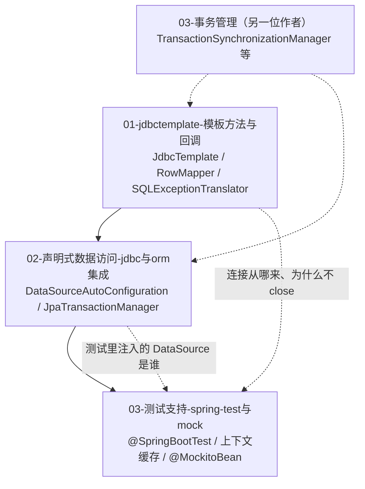

# 05 · 数据访问与测试

> 一句话结论：Spring 的数据访问栈是"**一个 `DataSource` + 一个模板（`JdbcTemplate`）+ 一套异常翻译**"的三层结构，而测试支持栈是"**一个注解 → 一个 Bootstrapper → 一个 `TestContextManager` → 一个带缓存的 `TestContext`**"的四层结构；两者之所以能在 Boot 里"零配置"跑起来，靠的都是同一招：**条件装配 + 可替换的委托对象**。

> 阅读前置：读完 `01-IoC容器与Bean生命周期`（知道 `BeanPostProcessor`、`FactoryBean`、`@ConditionalOn*` 大致是什么）、`02-AOP与代理`（知道 JDK 动态代理怎么拦方法），并且写过 `@SpringBootTest` 和 `JdbcTemplate`。

> 预计阅读：每篇 40–60 分钟 / 源码：`spring-jdbc:7.1.0`、`spring-test:7.1.0`、`spring-orm:7.1.0`、`spring-tx:7.1.0`、`spring-boot-jdbc:4.2.0`、`spring-boot-jpa:4.2.0`、`spring-boot-hibernate:4.2.0`、`spring-boot-test:4.2.0`、`spring-boot-test-autoconfigure:4.2.0`、`spring-boot-webmvc-test:4.2.0`

---

## 1. 学习目标

读完这一组，你应该能做到下面这些事，而不是"知道有这些类"：

1. 能画出 `jdbcTemplate.query(sql, rowMapper)` 的完整调用链，并指出**哪一行真正执行了 SQL**、**哪一行真正关闭了 `Connection`**、**哪一行把 `SQLException` 变成了 `DataAccessException`**。
2. 能解释为什么 `JdbcTemplate` 的方法里几乎看不到 `try/finally`——样板代码被搬到了哪个方法里，以及"回调"在其中扮演什么角色。
3. 能用一句 SQL 说明为什么 `queryForObject` 返回空结果会抛 `EmptyResultDataAccessException`，而返回两行会抛 `IncorrectResultSizeDataAccessException`。
4. 能说清 Boot 里 `DataSource` 这个 Bean 是谁创建的、为什么默认是 `com.zaxxer.hikari.HikariDataSource`、删掉 `spring.datasource.url` 时异常消息为何是 "Failed to determine suitable jdbc url"。
5. 能解释 JPA 的 `EntityManagerFactory` 为什么是个 `FactoryBean`，以及 `JpaTransactionManager.doBegin` 里那一句 `bindResource(getDataSource(), conHolder)` 到底解决了什么问题。
6. 能解释"为什么多个测试类可以复用同一个 `ApplicationContext`"，并列出参与缓存 key 比较的维度。
7. 能解释 `@MockBean` 为什么"污染缓存"、Spring Framework 6.2 起 `@MockitoBean` 为什么能避免这个问题。
8. 能说出 `@Transactional` 测试默认回滚是哪一行代码决定的（`isDefaultRollback` 里的 `return true`），以及 `@Sql` 与它的执行先后。

## 2. 本篇顺序

> 读图说明：关键箭头是 `A → B → C` 这条主线——先搞懂"一次 SQL 是怎么被执行的"（01），再搞懂"执行 SQL 用到的 `DataSource` 是谁给的、事务是谁管的"（02），最后才可能理解"测试框架如何把一个 Boot 应用装起来并复用"（03）。虚线箭头表示"被引用但不展开"的关系：01 和 02 都会碰到线程绑定连接（`TransactionSynchronizationManager`），但那部分完整内容在 `01-Spring框架/03-事务管理`，本组只用一句话带过并给出指路；`A -.-> C` 表示测试篇会回头用到 01 的"连接不 close"结论来解释"为什么测试事务能回滚"。左下角灰色节点是外部依赖，不属于本组交付范围。

## 3. 每篇摘要

| 文件 | 主线（源码级） | 你会带走什么 |
| --- | --- | --- |
| `01-jdbctemplate-模板方法与回调.md` | `JdbcTemplate#query(sql, RowMapper)` → `query(sql, ResultSetExtractor)` → `execute(StatementCallback, true)` / `query(PreparedStatementCreator, PreparedStatementSetter, ResultSetExtractor)` → `execute(psc, action, true)` → `PreparedStatementCallback#doInPreparedStatement` → `RowMapperResultSetExtractor#extractData` → `RowMapper#mapRow`；异常在 `execute` 的 `catch (SQLException)` 里经 `translateException` → `SQLExceptionTranslator#translate` 转成 `DataAccessException` | 模板方法 + 回调如何消灭 `try/finally`；`DataSourceUtils.getConnection` 为什么让连接"不能 close"；`queryForObject` 空结果/多行的差异化异常；`IN` 参数动态拼接与 `batchUpdate` 三条路径的坑 |
| `02-声明式数据访问-jdbc与orm集成.md` | `DataSourceAutoConfiguration` 的 `@ConditionalOnMissingBean(type = "io.r2dbc.spi.ConnectionFactory")` → `PooledDataSourceConfiguration` 的 `@Import` 五个池 → `DataSourceConfiguration.Hikari` 的 `@ConditionalOnProperty(matchIfMissing = true)` → `DataSourceBuilder` 真正 `build()`；JPA 侧 `JpaBaseConfiguration#entityManagerFactory` → `LocalContainerEntityManagerFactoryBean#afterPropertiesSet/createNativeEntityManagerFactory`，`#transactionManager` → `JpaTransactionManager#doBegin` → `JpaDialect#beginTransaction` + `bindResource(dataSource, conHolder)` | Boot 如何"零配置"造出 `DataSource`；`JdbcConnectionDetails` 这个新抽象的作用；EMF 作为 `FactoryBean` 的创建时机；JPA 与 JDBC 共享同一物理连接的机制；MyBatis 集成的差异点及其指路 |
| `03-测试支持-spring-test与mock.md` | `@SpringBootTest`（`@BootstrapWith(SpringBootTestContextBootstrapper.class)` + `@ExtendWith(SpringExtension.class)`）→ `SpringBootTestContextBootstrapper#buildTestContext/processMergedContextConfiguration` → `SpringExtension#beforeAll/postProcessTestInstance` → `TestContextManager#prepareTestInstance` → `DefaultTestContext#getApplicationContext` → `DefaultCacheAwareContextLoaderDelegate#loadContext` → `ContextCache`（`MergedContextConfiguration#equals` 决定命中）；事务回滚走的 `TransactionalTestExecutionListener#beforeTestMethod/afterTestMethod` | 上下文缓存的 key 由哪些维度组成、为什么 `testClass` 不参与比较；`@MockitoBean` 如何通过 `BeanOverrideContextCustomizer` 进入 key；`@Transactional` 测试回滚的源码落点；`@Sql` 的执行顺序；`@WebMvcTest` 切片过滤的两层机制；`TestRestTemplate` 在 Boot 4 的去向 |

## 4. 依赖关系

**前置依赖（必须已读）**

- `../01-IoC容器与Bean生命周期/01-refresh-容器启动全流程.md`——没有它，读不懂 `DataSourceAutoConfiguration` 为什么"能被自动发现"、`LocalContainerEntityManagerFactoryBean` 为什么"能在 `afterPropertiesSet` 阶段创建 EMF"。
- `../02-AOP与代理/01-aop-原理与自动代理创建.md`——03 篇里 `@Transactional` 测试回滚要靠事务拦截器，01 篇里 `CloseSuppressingInvocationHandler` 是一个手写的 JDK 动态代理，两者都建立在这篇之上的直觉。

**同组内依赖**

- 01 → 02：01 只关心"拿到 `Connection` 之后干什么"，02 才回答"`Connection` 从哪个 `DataSource` 来"。顺序反了会一直有个空洞："`DataSourceUtils.getConnection(obtainDataSource())` 里的 `dataSource` 到底是谁"。
- 02 → 03：03 里 `@SpringBootTest` 装配出来的正是 02 描述的那套自动配置；不理解条件装配，就会觉得"缓存 key 里为什么要塞一个 `SpringBootTestAnnotation`"。

**跨组引用（不重复展开）**

- `01-Spring框架/03-事务管理`——`TransactionSynchronizationManager`、`DataSourceTransactionManager`、事务传播与失效场景全在那里。本组只在必要处给出**一句话结论 + 指路**，例如"连接由 `DataSourceUtils` 获取，是为了让线程上已绑定的事务连接被复用"。
- `03-MyBatis/05-Spring集成与Boot自动配置`——`SqlSessionFactoryBean`、`SqlSessionTemplate` 与 `MapperScannerConfigurer` 的细节。
- `02-SpringBoot/05-Actuator运维与测试`——`@WebMvcTest` 那一条只在此处一句话点出 `AutoConfigurationImportSelector` 的 `TYPE_EXCLUDE` 过滤，完整流程在那篇。

## 5. 检查点

读完每一篇后，用下面这些"能动手验证"的问题自查；答不上来就回到对应小节。括号里是对应的文章与小节。

**读完 01 之后**

1. 在 `JdbcTemplate` 里指出唯一真正执行 `executeQuery()` 的那一行，并说明它属于哪个回调接口的实现。（01 §3.3）
2. `PreparedStatementCallback` 的 javadoc 明确要求"回调内部自己关 `ResultSet`"，为什么 `Statement` 和 `Connection` 却由 `JdbcTemplate` 关？（01 §2.4 / §3.2）
3. 如果 `getExceptionTranslator()` 拿到的翻译器返回 `null`，`translateException` 会退化成什么异常？（01 §3.6）
4. 同一句 SQL 用 `queryForObject` 查到 0 行、2 行分别抛什么异常，异常消息里的数字含义是什么？（01 §3.4 / §6）
5. `batchUpdate(String, List<Object[]>)` 与 `batchUpdate(String, Collection<T>, int, ParameterizedPreparedStatementSetter)` 中，哪个在 7.1 被标记 `@Deprecated`？（01 §3.8 / §7）

**读完 02 之后**

6. 用 `--debug` 启动应用，说出 `DataSourceAutoConfiguration.PooledDataSourceCondition` 的匹配链结果，以及 Hikari 胜出的三个条件。（02 §3.1–§3.4）
7. 为什么 `DataSourceAutoConfiguration` 类上写的是 `@ConditionalOnMissingBean(type = "io.r2dbc.spi.ConnectionFactory")` 而不是直接引用 `ConnectionFactory.class`？（02 §3.1）
8. `LocalContainerEntityManagerFactoryBean` 的 `createNativeEntityManagerFactory()` 是在哪个生命周期回调里被调用的？（02 §3.10）
9. `JpaTransactionManager.doBegin` 里 `bindResource(getDataSource(), conHolder)` 之后，`JdbcTemplate` 为什么能拿到同一个 `Connection`？（02 §3.14）
10. 同时引入 JPA 与 MyBatis 时，`@Transactional` 为什么会"找不到唯一的事务管理器"？（02 §8）

**读完 03 之后**

11. 两个测试类的配置完全一样，只有一个 `@MockitoBean` 不同——它们会共享上下文吗？为什么？（03 §3.9 / §3.10）
12. `MergedContextConfiguration#equals` 里为什么**没有**比较 `testClass`？（03 §3.11）
13. 缓存最多放多少个上下文？超出后按什么策略淘汰？用哪个属性调整？（03 §3.16）
14. `@Transactional` 测试默认回滚是在哪一行决定的？方法上加 `@Rollback(false)` 后又走哪条分支？（03 §3.24）
15. Boot 4.2.0 里 `@MockBean` 还能用吗？替代品是什么、从哪个版本开始提供？（03 §7）
