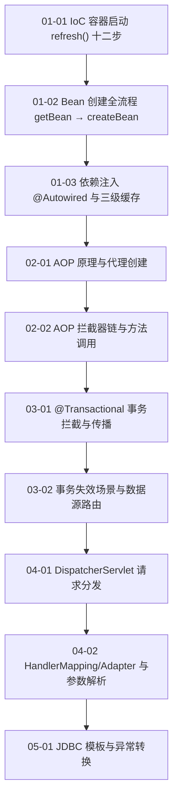

# 01 Spring 框架（IoC / AOP / 事务 / MVC / 数据访问）

> 目标：读完这一大块，你能**不看源码讲出 Spring 启动、Bean 创建、AOP 代理、事务拦截、MVC 分发**这五条主线的完整调用链。
> 版本基线：`spring-framework@v7.1.0`（JDK 17+）

## 学习目标

- 知道 `BeanDefinition`（Bean 的"图纸"：类名、作用域、属性、初始化方法等元信息，此时对象还没创建）到底存在哪、谁往里写。
- 能画出 `new AnnotationConfigApplicationContext(AppConfig.class)` 到"Bean 可用"的全过程。
- 能解释 `@Autowired` 在哪一行代码被注入、`@Transactional` 为什么在同类内部调用会失效。
- 能说清一个 HTTP 请求进 Tomcat 后，经过哪些方法最终落到你的 `@GetMapping`。

## 文章顺序（建议严格按序读）

> 读图说明：箭头表示**知识依赖**——`refresh()` 是地基，AOP 依赖 Bean 创建阶段的 `BeanPostProcessor`，事务依赖 AOP，MVC 依赖 IoC 容器中的 `DispatcherServlet`。

## 子目录

| 目录 | 内容 | 学完能做到 |
| --- | --- | --- |
| `01-IoC容器与Bean生命周期` | `refresh()` 十二步、`getBean` 三级缓存、循环依赖、`@Autowired` 注入 | 定位"Bean 什么时候被创建/注入失败在哪一步" |
| `02-AOP与代理` | `@EnableAspectJAutoProxy`、`AbstractAutoProxyCreator`、JDK/CGLIB、拦截器链 | 解释为什么自调用失效、代理对象为什么会 `ClassCastException` |
| `03-事务管理` | `TransactionInterceptor`、传播行为、`DataSourceTransactionManager` | 讲清 `REQUIRES_NEW` 到底做了什么、事务为何不回滚 |
| `04-SpringMVC` | `DispatcherServlet#doDispatch`、九大组件、参数解析、返回值处理 | 给出"一个请求 → 你的方法"的逐行路径 |
| `05-数据访问与测试` | `JdbcTemplate`、`RowMapper`、异常转换、`@SpringBootTest` 上下文缓存 | 明白模板方法模式在这里的落地 |

## 依赖关系

- 前置：Java 反射、动态代理（`java.lang.reflect.Proxy`）、Servlet 规范基础。
- 后续：`02-SpringBoot`（Boot 只是把这些能力"自动装好"）、`03-MyBatis`（Spring 集成层用到这里的 `FactoryBean`/`SqlSessionFactory` 概念）。

## 学习检查点

- [ ] 能说出 `refresh()` 12 步各自的作用，并指出 Bean 实例化发生在第 11 步。
- [ ] 能解释两级缓存 + 三级（`singletonFactories`）如何解决循环依赖，以及为什么构造器注入的循环依赖解决不了。
- [ ] 能解释 `@Transactional` 失效的 5 种常见原因，并落到源码位置。
- [ ] 能画出 `DispatcherServlet#doDispatch` 的 8 个关键步骤。
