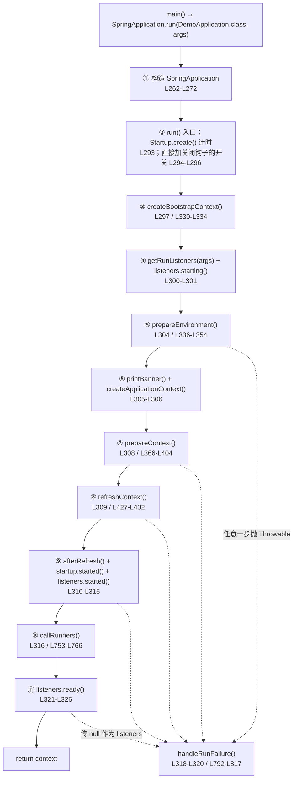
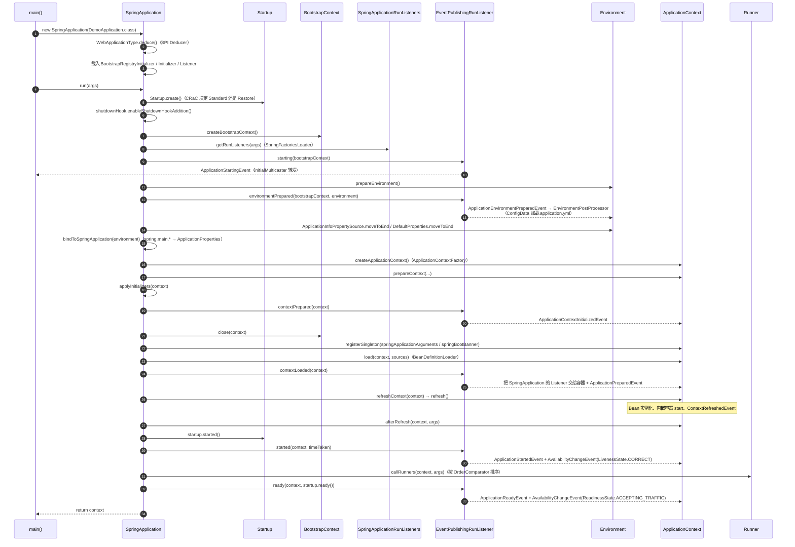

# SpringApplication#run 启动全流程（`spring-boot 4.2.0` 逐段精读）

> 面向读者：写过 `@SpringBootApplication`、跑过 `SpringApplication.run(...)`，但说不清 `main` 里那一行到底发生了什么的人。
> 版本基线：`org.springframework.boot:spring-boot:4.2.0`（依赖 `spring-framework@7.1.0`）。文中所有结论都以 `assets/source/` 入库原文为准。
> 阅读方式：每个 Java 代码块都是入库原文的**逐字符摘录**，块头 `(src: 文件名#L起-L止)` 可以回查原文；正文的 `[[源码:SpringApplication.java#L262-L272]]` 锚点是"某句话说自哪几行"的凭据。
> 范围声明：本文只讲 `SpringApplication` 这一层的**编排**。`refresh()` 内部（`BeanFactoryPostProcessor` → `BeanPostProcessor` → 单例实例化）属于 Spring 框架 IOC 的领域，见 `01-Spring框架` 相关篇目；本文只在 3.7 节说明"`refresh()` 被调用的位置"。

## 0. 先看现象：一个 `main` 方法背后藏着什么

先列几个每个 Boot 使用者都遇到过、但很少有人能完整解释的现象。读完本文，这 6 条应该都能讲出源码位置。

**现象 1：一个空项目，`main` 里只有一行，启动却打印了 banner、"Tomcat started on port 8080"、最后一行 `Started DemoApplication in 1.234 seconds`。**
打印 banner 的是 `printBanner(environment)`（[[源码:SpringApplication.java#L305-L305]]）；"Started … in …" 里那个时长来自 `Startup` 的计时（[[源码:SpringApplication.java#L311-L314]]）；而"进程为什么不退出"，一路追下去会落到 `refreshContext` 里注册的 JVM 关闭钩子（[[源码:SpringApplication.java#L427-L432]]）。

**现象 2：同样是这一行 `main`，加一个 `spring-boot-starter-web` 依赖，它就从"跑完就退出"变成"监听 8080 端口"。谁决定的？**
`SpringApplication` 构造器里的 `this.properties.setWebApplicationType(WebApplicationType.deduce())` 决定了"这个应用是 SERVLET / REACTIVE / NONE"，`createApplicationContext()` 再按这个类型造出不同的 `ApplicationContext` 实现类（[[源码:SpringApplication.java#L565-L570]]）。注意：**决定者是 `deduce()`，不是那个 starter**（第 2 节、3.1 节会给出源码依据）。

**现象 3：`ApplicationRunner` 的 `run(ApplicationArguments args)` 里能拿到 `--server.port=9090` 这种启动参数。这些参数是怎么从 `String[] args` 变成对象的？**
`run()` 第 303 行 `new DefaultApplicationArguments(args)` 把 `String[]` 包成对象，一路传到 `callRunners`（[[源码:SpringApplication.java#L753-L766]]），再作为**单例 bean** `springApplicationArguments` 注入容器（[[源码:SpringApplication.java#L387-L387]]）。

**现象 4：启动失败时屏幕上那一段 `***************************` / `APPLICATION FAILED TO START` / `Description:` / `Action:` 报告，是谁打印的？**
`handleRunFailure(...)` 在 `finally` 里调用了 `reportFailure(getExceptionReporters(context), exception)`（[[源码:SpringApplication.java#L792-L817]]）。真正的排版输出在 `SpringBootExceptionReporter` 的实现类里，不在 `SpringApplication` 里。

**现象 5：自定义 `ApplicationContextInitializer` 里调 `context.getBean(Xxx.class)`，有时拿到对象、有时抛 `NoSuchBeanDefinitionException`、有时拿到的对象里 `@Autowired` 字段是 `null`。**
这时候 BeanFactory 已经存在，但 `refresh()` 还没跑，BeanDefinition 可能尚未注册、`BeanPostProcessor` 也还没就位。3.6 节会把这两种失败原因分开讲。

**现象 6：`@Value("${my.key}")` 在 `EnvironmentPostProcessor` 里永远拿不到值。**
因为 `EnvironmentPostProcessor` 的触发点在 `listeners.environmentPrepared(...)`（[[源码:SpringApplication.java#L342-L342]]），而它正在处理的就是"环境还没定型"这一瞬间。顺序在 3.4 节逐行展开。

本文要回答 6 个问题：

1. `run()` 一共分几步？每步的输入、输出、失败后果是什么？
2. `ApplicationContext` 是**谁**造出来的？为什么不是 `SpringFactoriesLoader`？
3. `Environment` 里的属性源顺序是怎么排的，为什么 `defaultProperties` 必须排最末？
4. 7 个启动事件分别在哪一刻发布、能不能在里面拿到 Bean、失败了会怎样？
5. `Runner` 是怎么排序、怎么被调用的？为什么有时候 `Runner` 不执行？
6. 启动失败时框架做了哪几件事？为什么 `ready` 阶段失败要传 `null` 给 `handleRunFailure`？

## 1. 整体地图：`run()` 的十二步



> 读图说明：主干是"①构造 → ②③④准备 → ⑤环境 → ⑥容器 → ⑦装填 → ⑧刷新 → ⑨⑩启动后 → ⑪就绪"，虚线表示异常出口。注意三处细节：
> 1. **⑪ `ready` 不在主干 `try` 块里**——它是独立的第二个 `try`（[[源码:SpringApplication.java#L321-L326]]），所以 `ready` 阶段失败时 `handleRunFailure` 的第三个参数传的是 `null`。
> 2. **`handleRunFailure` 出现在 5 条虚线的终点**，说明"失败处理"只有一套。
> 3. 图中每步都标了源码行号，可以按编号顺序去 `assets/source/SpringApplication.java.md` 对照原文读，markdown 行号 = 源码行号 + 15。

| 步 | 做什么 | 源码行 | 关键产出 / 副作用 |
| --- | --- | --- | --- |
| ① | 构造 `SpringApplication` | L262-L272 | 推断应用类型、加载 `Initializer`/`Listener`/`BootstrapRegistryInitializer`、找到 main 类 |
| ② | `Startup` 计时 + 关闭钩子开关 | L293-L296 | 启动耗时的起点 |
| ③ | 建 `BootstrapContext` | L297、L330-L334 | 启动期共享对象袋（2.4 引入） |
| ④ | 取 `RunListener` 并广播 `starting` | L300-L301 | `ApplicationStartingEvent` |
| ⑤ | 准备 `Environment` | L304、L336-L354 | `ApplicationEnvironmentPreparedEvent`、属性源就位 |
| ⑥ | 打印 banner、造 `ApplicationContext` | L305-L306、L565-L570 | 一个空的 `AnnotationConfigServletWebServerApplicationContext`（或 Flux/非 Web 版本） |
| ⑦ | 装填容器（**最重的一步**） | L308、L366-L404 | `ApplicationContextInitializedEvent`、`ApplicationPreparedEvent`、BeanDefinition 全部注册 |
| ⑧ | `refresh()` | L309、L427-L432 | Bean 实例化、内嵌容器启动、`ContextRefreshedEvent` |
| ⑨ | 刷新后收尾 + `started` | L310-L315 | `ApplicationStartedEvent`、`LivenessState.CORRECT` |
| ⑩ | 调 `Runner` | L316、L753-L766 | 业务"启动即执行"逻辑 |
| ⑪ | `ready` | L322 | `ApplicationReadyEvent`、`ReadinessState.ACCEPTING_TRAFFIC` |
| — | 失败处理 | L318-L320、L792-L817 | `ApplicationFailedEvent` + 失败分析报告 + 关容器 |

## 2. 关键类一览：谁在指挥，谁在干活

`run()` 本身只有 30 多行，因为它把活儿分给了 9 个协作者。先把它们认全，后面读源码就不会"越读越多类"。

| 类 | 一句话职责 | 生活化类比 | 入库原文 |
| --- | --- | --- | --- |
| `SpringApplication` | 总编排者，就是 `run()` 那 30 行 | 婚礼总导演：只喊"第几步该谁上" | `SpringApplication.java` |
| `ApplicationProperties` | `spring.main.*` 这组开关的绑定目标 | 导演手里的流程单（"要不要放礼花"） | `ApplicationProperties.java` |
| `ApplicationContextFactory` | 按 `WebApplicationType` 造 `Environment` 和 `ApplicationContext` | 装修公司：给住宅配住宅图纸、给商铺配商铺图纸 | `ApplicationContextFactory.java` |
| `WebApplicationType` + `Deducer` | 推断"这是 Web 还是非 Web、Servlet 还是 Reactive" | 开工前先看图纸判性质 | `WebApplicationType.java` |
| `BootstrapContext` / `DefaultBootstrapContext` | 启动早期就能共享对象（此时还没有 BeanFactory） | 施工期共用的工具箱，交房（context 准备好）后就封箱 | `BootstrapContext.java`、`DefaultBootstrapContext.java` |
| `SpringApplicationRunListener` | 阶段回调接口，每个启动阶段一个方法 | 现场监督员，每道工序前喊一声 | `SpringApplicationRunListener.java` |
| `SpringApplicationRunListeners` | 批量转发器：把一次阶段调用转发给**所有**监听器，并包 `StartupStep` | 广播站，一个通知全工地 | `SpringApplicationRunListeners.java` |
| `EventPublishingRunListener` | 唯一的核心实现：把阶段调用翻译成 `ApplicationEvent` | 翻译官：把"工序口令"翻译成"广播稿" | `EventPublishingRunListener.java` |
| `Runner`（`ApplicationRunner` / `CommandLineRunner`） | 容器就绪后的业务回调 | 开业后第一张任务清单 | `Runner.java` |

三个容易被记错的点，先在这里钉死，后面都有源码块兜底：

1. **`SpringApplication` 的 setter 全是 `void`，不是链式**。`setWebApplicationType`（[[源码:SpringApplication.java#L956-L959]]）与 `setBanner`（[[源码:SpringApplication.java#L1018-L1020]]）签名都是 `public void ...`。想要链式，用 `SpringApplicationBuilder`（Boot 1.0 起就有的独立类），它才是 `builder.sources(...).bannerMode(...).run()` 那种写法。
2. **`ApplicationContext` 与 `Environment` 都不是 `SpringFactoriesLoader` 现挑的**，而是 `ApplicationContextFactory` 造的（[[源码:SpringApplication.java#L565-L570]]、[[源码:SpringApplication.java#L461-L471]]）。`SpringFactoriesLoader` 在这条链上负责的是 `Initializer` / `Listener` / `RunListener` / `BootstrapRegistryInitializer` / `SpringBootExceptionReporter` / `WebApplicationType.Deducer` 这几类 SPI。
3. **`WebApplicationType.deduce()` 不直接判断 `DispatcherServlet` 或 `DispatcherHandler`**。它把判断权交给 SPI `WebApplicationType.Deducer`（[[源码:WebApplicationType.java#L51-L59]]），Servlet 与 Reactive 的具体判据分别在 `spring-boot-webmvc` / `spring-boot-webflux` 两个模块里。旧版常见表格"有 DispatcherServlet 就是 SERVLET、有 DispatcherHandler 就是 REACTIVE"其实把两件事混成了一件，而且漏掉了"都不匹配时是 `NONE` 而不是 `REACTIVE`"。

## 3. 源码逐段精读

本节按 `run()` 的真实执行顺序展开，每小节固定四层：**在干什么 → 为什么这么写 → 不这样会怎样 → 常见坑**。每小节的代码块都是原文摘录，块头行号可回查；正文引用原始行号时用 `[[源码:...]]` 锚点，方便你按"markdown 行号 = 源码行号 + 15"直接打开 `assets/source/SpringApplication.java.md` 对照。

### 3.1 构造器：`new SpringApplication(...)` 做的 9 件事（L262-L272）

`SpringApplication.run(DemoApplication.class, args)` 是个静态方法，它内部第一件事就是 `new SpringApplication(primarySources).run(args)`。所以"启动"其实从构造器就开始了。

```java (src: SpringApplication.java#L262-L272)
	public SpringApplication(@Nullable ResourceLoader resourceLoader, Class<?>... primarySources) {
		this.resourceLoader = resourceLoader;
		Assert.notNull(primarySources, "'primarySources' must not be null");
		this.primarySources = new LinkedHashSet<>(Arrays.asList(primarySources));
		this.properties.setWebApplicationType(WebApplicationType.deduce());
		this.bootstrapRegistryInitializers = new ArrayList<>(
				getSpringFactoriesInstances(BootstrapRegistryInitializer.class));
		setInitializers((Collection) getSpringFactoriesInstances(ApplicationContextInitializer.class));
		setListeners((Collection) getSpringFactoriesInstances(ApplicationListener.class));
		this.mainApplicationClass = deduceMainApplicationClass();
	}
```

**在干什么**（按行数一遍）：

1. L262 方法签名：`@Nullable ResourceLoader resourceLoader` 允许为 `null`（默认用类加载器资源），`Class<?>... primarySources` 就是你的 `DemoApplication.class`；上一行 L261 是 `@SuppressWarnings({ "unchecked", "rawtypes" })`，所以如果你看到"L262 上面还有个注解"，那不算在构造器方法体内。
2. `this.resourceLoader = resourceLoader;`——记下资源加载器。
3. `Assert.notNull(primarySources, ...)`——**主配置类不能为 null**，这是"没有源码可加载"的最早防线。
4. `this.primarySources = new LinkedHashSet<>(Arrays.asList(primarySources));`——用 `LinkedHashSet` 去重且保持顺序（同一个类写两次不会注册两次）。
5. `this.properties.setWebApplicationType(WebApplicationType.deduce());`——**推断应用类型**，写进 `ApplicationProperties`。注意它写的是 `properties`（`spring.main.*` 的绑定对象），不是 `SpringApplication` 的字段。
6. `this.bootstrapRegistryInitializers = new ArrayList<>(getSpringFactoriesInstances(BootstrapRegistryInitializer.class));`——加载启动期注册器（2.4 起的能力，`addBootstrapRegistryInitializer` 的 javadoc 标 `@since 2.4.5`）。
7. `setInitializers((Collection) getSpringFactoriesInstances(ApplicationContextInitializer.class));`——从 `spring.factories`/`.imports` 载入所有 `ApplicationContextInitializer`。
8. `setListeners((Collection) getSpringFactoriesInstances(ApplicationListener.class));`——载入所有 `ApplicationListener`，这批监听器稍后会被 `EventPublishingRunListener` 用来转发早期事件。
9. `this.mainApplicationClass = deduceMainApplicationClass();`——用 `StackWalker` 顺着调用栈找到方法名叫 `main` 的那一帧的类（[[源码:SpringApplication.java#L274-L284]]），留作日志与 CRaC 支持用。

**为什么这么写**：构造器只做"读配置 + 找 SPI 实现"，不做任何重活（不建 Environment、不建 context）。因为 `SpringApplication` 允许被 `SpringApplicationBuilder`、测试框架、`SpringApplicationHook` 反复配置后再 `run()`——构造期保持"纯数据收集"，才能被安全地二次修改。

**不这样会怎样**：假设把"建 Environment"也塞进构造器，那么 `builder.environment(xxx)`、`setEnvironment(...)`、甚至 `spring.main.*` 这些"构造后才生效"的定制就全部失效，因为环境已经定型。

**常见坑**：

- 见到"构造器里有 `@SuppressWarnings` 上一行"，就不该把它算进方法体——写文档、贴代码时最容易把区间定成 L261-L272。
- `setWebApplicationType` 是 `void`（[[源码:SpringApplication.java#L956-L959]]），`new SpringApplication(X.class).setWebApplicationType(...)` 的返回值是 `void`，不能继续点下去。要链式只能换 `SpringApplicationBuilder`。
- 第 5 步写的是 `properties` 而不是 `SpringApplication` 自己的字段，这是 Boot 2.x 之后的一次重构（把 `spring.main.*` 统一收到 `ApplicationProperties`），所以你在 3.4 节会看到 `bindToSpringApplication(environment)` 把 `spring.main.*` 再绑回来。

### 3.2 `run()` 骨架：十步编排（L292-L328）

这是全文最重要的一段：**30 多行就是整个 Boot 启动流程**。先整体贴出来，再逐行拆。

```java (src: SpringApplication.java#L292-L328)
	public ConfigurableApplicationContext run(String... args) {
		Startup startup = Startup.create();
		if (this.properties.isRegisterShutdownHook()) {
			SpringApplication.shutdownHook.enableShutdownHookAddition();
		}
		DefaultBootstrapContext bootstrapContext = createBootstrapContext();
		ConfigurableApplicationContext context = null;
		configureHeadlessProperty();
		SpringApplicationRunListeners listeners = getRunListeners(args);
		listeners.starting(bootstrapContext, this.mainApplicationClass);
		try {
			ApplicationArguments applicationArguments = new DefaultApplicationArguments(args);
			ConfigurableEnvironment environment = prepareEnvironment(listeners, bootstrapContext, applicationArguments);
			Banner printedBanner = printBanner(environment);
			context = createApplicationContext();
			context.setApplicationStartup(this.applicationStartup);
			prepareContext(bootstrapContext, context, environment, listeners, applicationArguments, printedBanner);
			refreshContext(context);
			afterRefresh(context, applicationArguments);
			Duration timeTakenToStarted = startup.started();
			if (this.properties.isLogStartupInfo()) {
				new StartupInfoLogger(this.mainApplicationClass, environment).logStarted(getApplicationLog(), startup);
			}
			listeners.started(context, timeTakenToStarted);
			callRunners(context, applicationArguments);
		}
		catch (Throwable ex) {
			throw handleRunFailure(context, ex, listeners);
		}
		try {
			listeners.ready(context, startup.ready());
		}
		catch (Throwable ex) {
			throw handleRunFailure(context, ex, null);
		}
		return context;
	}
```

**在干什么**（按行号对号入座）：

- L293 `Startup startup = Startup.create();`——创建计时器。`Startup` 会根据 classpath 上有没有 CRaC（`jdk.crac.management.CRaCMXBean` / `org.crac.management.CRaCMXBean`）选 `StandardStartup` 或 `CoordinatedRestoreAtCheckpointStartup`，后者在"从检查点恢复"场景下把动作名从 `Started` 改成 `Restored`（[[源码:SpringApplication.java#L1742-L1776]]）。
- L294-L296 只有 `isRegisterShutdownHook()` 为 `true`（默认 `true`）时，才让 `SpringApplication.shutdownHook` 允许"随时追加要关闭的上下文"。
- L297 `createBootstrapContext()`——建启动期共享对象袋。
- L298 `context = null;`——注意这个 `null`：后面 `catch` 里 `handleRunFailure(context, ...)` 拿到的可能就是 `null`，说明"容器还没造出来就挂了"。
- L299 `configureHeadlessProperty()`——设 `java.awt.headless`，服务器上没有显示器跑图形库不报错。
- L300-L301 取一批 `RunListener` 并广播 `starting`。
- L302 `try {`——**主干分界线**：从这里到 L317 结束。
- L303 `new DefaultApplicationArguments(args)`——把 `String[]` 包成 `ApplicationArguments`。
- L304 `prepareEnvironment(...)`——环境准备好。
- L305 `printBanner(environment)`——此时才能打印 banner（banner 的开关来自 `Environment`）。
- L306 `createApplicationContext()`——容器造出来。
- L307 `context.setApplicationStartup(this.applicationStartup);`——把 `StartupStep` 记录器塞进容器，`refresh()` 内部的步骤才能被 `ApplicationStartup` 采集到（`/actuator/startup` 就靠它）。
- L308 `prepareContext(...)`——装填容器。
- L309 `refreshContext(context)`——`refresh()`。
- L310 `afterRefresh(context, applicationArguments)`——空钩子，留给子类。
- L311 `Duration timeTakenToStarted = startup.started();`——记下"到 started 为止"的耗时。
- L312-L314 按 `isLogStartupInfo()`（默认 `true`）打印 `Started DemoApplication in X seconds`。
- L315 `listeners.started(context, timeTakenToStarted);`——广播 `started`。
- L316 `callRunners(context, applicationArguments);`——调 `Runner`。
- L317 `}` 主干 `try` 结束。
- L318-L320 `catch (Throwable ex) { throw handleRunFailure(context, ex, listeners); }`——**记住这个 `listeners`**，它是非 `null` 的。
- L321-L326 **第二个独立 `try`**：`listeners.ready(context, startup.ready())`，失败时 `throw handleRunFailure(context, ex, null)`——**第三个参数是 `null`**。
- L327 `return context;`——`run()` 返回的是 `ConfigurableApplicationContext`，你可以继续 `getBean`。

**为什么这么写**：

- **两段 `try`**：`ready` 之前的失败意味着"应用没启动成功"，需要通知所有 `RunListener`（`failed` 事件）；而 `ready` 阶段失败意味着"应用其实已经启动成功，只是就绪广播过程中有个监听器抛了异常"，这时候再广播一次 `failed` 反而会让监听器收到矛盾信号（先 ready 后 failed），所以传 `null` 表示"不要再通知 RunListener 了"。
- **`handleRunFailure` 返回异常**：它不自己 `throw`，而是把异常（或包装后的 `IllegalStateException`）返回给 `run()` 去 `throw`。这样"处理失败"和"抛出"解耦，`handleRunFailure` 里的 `finally` 可以保证先关容器再抛。
- **`context` 只声明不初始化**：正因为"容器可能造不出来"，所以 L298 才有必要显式写 `= null`，否则 `catch` 块里无法编译。

**不这样会怎样**：

- 如果 `ready` 也放进主干 `try`，那么 `ready` 阶段监听器抛异常时会触发第二次 `failed` 广播，而 `SpringApplicationRunListeners.started/ready` 内部有 `if (context.isRunning())` 守卫（[[源码:SpringApplicationRunListeners.java#L65-L75]]），一旦某个监听器在 `started` 阶段把容器关了，`ready` 就会被静默跳过——这种"事件发了但没人收到"的行为只有看到守卫才能理解。
- 如果不在 L307 设置 `applicationStartup`，`refresh()` 内部所有 `StartupStep` 都不会被记录，`/actuator/startup` 只能看到 Boot 自己的步骤、看不到 Spring 框架内部的步骤。

**常见坑**：

- **在 `ApplicationStartedEvent` 监听器里 `context.close()`**：`callRunners` 第一行就是 `if (!context.isRunning()) { return; }`（[[源码:SpringApplication.java#L754-L756]]），于是你的 `Runner` 会被**静默跳过**，日志里一句提示都没有。
- **以为 `run()` 返回之后才"启动完"**：`ready` 事件是在 L322 发的，此时 `run()` 还没返回，但在 `Runner` 之后。顺序是 `started` → `Runner` → `ready`，不是 `Runner` → `started`。
- **在 `main` 里 `catch` 不到原始异常类型**：`handleRunFailure` 可能把异常原样返回，也可能包成 `IllegalStateException`（例如容器已关闭导致无法再处理），排查时先看 `Caused by`。

### 3.3 `createBootstrapContext()`：启动早期的"共享工具箱"（L330-L334）

```java (src: SpringApplication.java#L330-L334)
	private DefaultBootstrapContext createBootstrapContext() {
		DefaultBootstrapContext bootstrapContext = new DefaultBootstrapContext();
		this.bootstrapRegistryInitializers.forEach((initializer) -> initializer.initialize(bootstrapContext));
		return bootstrapContext;
	}
```

**在干什么**：创建一个 `DefaultBootstrapContext`，然后依次调用构造器阶段收集到的每个 `BootstrapRegistryInitializer` 的 `initialize(bootstrapContext)`，让它们往里面注册对象；最后返回。

**为什么这么写**：有些对象（比如自定义的 `ConversionService`、属性加载用的注册器）需要在 `Environment` 还没准备好、`ApplicationContext` 还不存在的时刻就能被多方共享。此时没有 BeanFactory，`BootstrapContext` 就是唯一的"共享袋子"。它在 `prepareContext` 里被关闭：`bootstrapContext.close(context)`（[[源码:SpringApplication.java#L381-L381]]），`DefaultBootstrapContext.close` 的实现就是发一个 `BootstrapContextClosedEvent`（[[源码:DefaultBootstrapContext.java#L127-L129]]），让关心的人把寄存器里的东西搬到真正的容器里。

**不这样会怎样**：没有它，所有"启动早期需要单例"的需求只能靠静态字段或线程局部变量，既不能测试也不能隔离，多应用上下文并存时会互相污染。

**常见坑**：

- `BootstrapContext.get(Xxx.class)` 在对象还没注册时抛 `IllegalStateException("... has not been registered")`，**不是** `NoSuchBeanDefinitionException`——它跟 Spring 容器不是一套语义。
- 它是 **Boot 2.4 引入**的能力（`BootstrapContext` 的 javadoc 同时带 `@since 4.0.0` 与 `@since 2.4.0`：接口 2.4 就有了，4.0 只是把包从 `org.springframework.boot` 迁到 `org.springframework.boot.bootstrap`）。别写成"Boot 4 新特性"。
- 想从容器里拿这些对象，用 `BootstrapRegistryInitializer` 里 `bootstrapContext.register(...)` 注册后，在 `prepareContext` 之后通过 `context.getBean(...)` 拿不到——它们不是 Bean，除非你自己在 `close` 事件里搬过去。

### 3.4 `prepareEnvironment()`：环境是怎么"备齐"的（L336-L354）

`Environment` 是启动期所有配置的入口。它要装下：命令行参数、`application.yml`、系统属性、环境变量、随机端口……而"优先级"就藏在这些属性源的**顺序**里。下面这 19 行决定了顺序。

```java (src: SpringApplication.java#L336-L354)
	private ConfigurableEnvironment prepareEnvironment(SpringApplicationRunListeners listeners,
			DefaultBootstrapContext bootstrapContext, ApplicationArguments applicationArguments) {
		// Create and configure the environment
		ConfigurableEnvironment environment = getOrCreateEnvironment();
		configureEnvironment(environment, applicationArguments.getSourceArgs());
		ConfigurationPropertySources.attach(environment);
		listeners.environmentPrepared(bootstrapContext, environment);
		ApplicationInfoPropertySource.moveToEnd(environment);
		DefaultPropertiesPropertySource.moveToEnd(environment);
		Assert.state(!environment.containsProperty("spring.main.environment-prefix"),
				"Environment prefix cannot be set via properties.");
		bindToSpringApplication(environment);
		if (!this.isCustomEnvironment) {
			EnvironmentConverter environmentConverter = new EnvironmentConverter(getClassLoader());
			environment = environmentConverter.convertEnvironmentIfNecessary(environment, deduceEnvironmentClass());
		}
		ConfigurationPropertySources.attach(environment);
		return environment;
	}
```

**在干什么**（一步步走）：

1. **L339 `getOrCreateEnvironment()`**——如果用户用 `setEnvironment(...)` 指定过就直接用；否则交给 `ApplicationContextFactory.createEnvironment(webApplicationType)` 造（[[源码:SpringApplication.java#L461-L471]]），兜底 `new ApplicationEnvironment()`。注意：**环境也是工厂造的**，Servlet 应用会拿到 Servlet 版的环境实现。
2. **L340 `configureEnvironment(environment, args)`**——三件事：设置 `ApplicationConversionService`（字符串 → 类型的转换）、`configurePropertySources`（把 `defaultProperties` 合并进去、把命令行参数包成一个**优先级更高**的 `CompositePropertySource` 加进去、把 `ApplicationInfoPropertySource` 加到末尾）、`configureProfiles`（处理 `spring.profiles.active` 命令行参数）。
3. **L341 `ConfigurationPropertySources.attach(environment)`**——把 `Environment` 包装成 Spring Boot 的 `ConfigurationPropertySources` 适配层。**没有这一步，`@ConfigurationProperties` 的 `Binder` 读不到属性**。
4. **L342 `listeners.environmentPrepared(bootstrapContext, environment)`**——广播 `ApplicationEnvironmentPreparedEvent`。所有 `EnvironmentPostProcessor`（`application.yml` 的加载就住在这里，`ConfigDataEnvironmentPostProcessor`）都在这一刻被触发。**此刻属性源还没定型**。
5. **L343 `ApplicationInfoPropertySource.moveToEnd(environment)`**——把"应用元信息"属性源压到末尾。
6. **L344 `DefaultPropertiesPropertySource.moveToEnd(environment)`**——把 `defaultProperties`（`SpringApplication.setDefaultProperties(...)` 塞进去的那份）压到最末尾，即**优先级最低**。
7. **L345-L346** 断言：不允许通过属性设置 `spring.main.environment-prefix`，否则直接启动失败，报 `Environment prefix cannot be set via properties.`。
8. **L347 `bindToSpringApplication(environment)`**——把环境里的 `spring.main.*` 绑定到 `ApplicationProperties` 对象上（[[源码:SpringApplication.java#L536-L543]]）。**这是"用户在配置文件里改启动行为"的唯一通道**：`spring.main.banner-mode=off`、`spring.main.lazy-initialization=true`、`spring.main.allow-bean-definition-overriding=true` 都是在这里生效的。
9. **L348-L351** 如果你没自定义环境，就用 `EnvironmentConverter` 把环境"升级"成 `deduceEnvironmentClass()` 推出的类型（[[源码:SpringApplication.java#L356-L364]]：优先问 `applicationContextFactory.getEnvironmentType(...)`，拿不到就用 `ApplicationEnvironment`）。
10. **L352 再 attach 一次**——因为第 4 步的 `EnvironmentPostProcessor` 可能整体替换/重排了属性源，必须重新适配一次，否则 `Binder` 看到的是旧结构。

`configureEnvironment` 本身只有 7 行，但它是"属性从哪来"的总闸：

```java (src: SpringApplication.java#L484-L490)
	protected void configureEnvironment(ConfigurableEnvironment environment, String[] args) {
		if (this.addConversionService) {
			environment.setConversionService(new ApplicationConversionService());
		}
		configurePropertySources(environment, args);
		configureProfiles(environment, args);
	}
```

**为什么这么写**：

- **为什么 `defaultProperties` 必须移到末尾（= 优先级最低）？** `defaultProperties` 的语义是"**默认值**"——用户没配才用它。Spring 的 `PropertySources` 是**顺序敏感的有序列表，越靠前优先级越高**。如果在第 2 步它被合并进来时没有排到最后（`addOrMerge` 的行为），那么后面 `EnvironmentPostProcessor` 加载 `application.yml` 时新加的属性源有可能被插到它前面或后面，最终导致"我明明在 `application.yml` 里改了，却没生效，还是走了 `setDefaultProperties` 里的旧值"。`moveToEnd()` 就是把这条不变式**强制做死**：无论中间有谁插队，`defaultProperties` 永远是最后一名。这是典型的"用一次显式搬移换取顺序确定性"。
- **为什么 `environmentPrepared` 要发在第 5、6 步搬移**之前**？** 因为 `EnvironmentPostProcessor` 们自己也要加属性源，它们加完才轮到框架统一做"收尾排序"——先让所有人交卷，再统一排座次。
- **为什么 `bindToSpringApplication` 在第 8 步而不是构造器里？** 因为 `spring.main.*` 只能来自 `Environment`（命令行、配置文件、环境变量都行），而 `Environment` 到这一步才齐。构造器里那次 `setWebApplicationType(deduce())` 只是"默认推断值"，一旦配置文件里写了 `spring.main.web-application-type=servlet`，第 8 步会把它覆盖掉。
- **为什么第 7 步要禁止 `spring.main.environment-prefix`？** 这个前缀一旦能被外部配置改，`Environment` 的属性源名、`@ConfigurationProperties` 的绑定前缀就全乱套（等于让人从配置里改"配置系统的命名规则"），所以直接禁用。这是个很好的"防御性断言"范例。

**不这样会怎样**：

- 少了第 3 步的 `attach`：`@ConfigurationProperties(prefix="app")` 全部绑定失败（`Binder` 依赖 `ConfigurationPropertySources` 这个可迭代属性源）。
- 少了第 10 步的再 `attach`：如果某个 `EnvironmentPostProcessor` 用 `MutablePropertySources` 整体替换了属性源列表，`Binder` 仍然盯着旧的 `ConfigurationPropertySources` 实例，表现为"部分 `@ConfigurationProperties` 字段明明是默认值"。
- 少了第 8 步 `bindToSpringApplication`：`spring.main.banner-mode=off` 完全无效——这是"配置项不生效"类 bug 最常见的根因之一。

**常见坑**：

- **在 `EnvironmentPostProcessor` 里 `environment.getProperty("spring.application.name")` 拿到 `null`**：要看你的 processor 是否在 `ConfigDataEnvironmentPostProcessor` **之后**执行（`@Order` / `spring.factories` 顺序）。`application.yml` 里的值在你的 processor 跑的时候可能还没加载。
- **在 `ApplicationEnvironmentPreparedEvent` 监听器里用 `@Value`**：监听器此刻不是 Bean（`refresh()` 还没跑），`@Value` 不会被处理；只能读 `event.getEnvironment()`。
- **以为 `spring.main.*` 只能在配置文件里写**：其实命令行 `--spring.main.lazy-initialization=true`、环境变量 `SPRING_MAIN_LAZY_INITIALIZATION=true` 都走同一条绑定路径，因为绑定的是 `Environment` 而不是某个文件。

**再往下挖一层：属性源的"座次表"是怎么排出来的（`configurePropertySources`，L499-L519）**

上面第 2 步说 `configureEnvironment` 干三件事，其中最要紧的就是排座次。把这 21 行读完，你就掌握了"我配的值为什么不生效"的通用排查法。

```java (src: SpringApplication.java#L499-L519)
	protected void configurePropertySources(ConfigurableEnvironment environment, String[] args) {
		MutablePropertySources sources = environment.getPropertySources();
		if (!CollectionUtils.isEmpty(this.defaultProperties)) {
			DefaultPropertiesPropertySource.addOrMerge(this.defaultProperties, sources);
		}
		if (this.addCommandLineProperties && args.length > 0) {
			String name = CommandLinePropertySource.COMMAND_LINE_PROPERTY_SOURCE_NAME;
			PropertySource<?> source = sources.get(name);
			if (source != null) {
				CompositePropertySource composite = new CompositePropertySource(name);
				composite
					.addPropertySource(new SimpleCommandLinePropertySource("springApplicationCommandLineArgs", args));
				composite.addPropertySource(source);
				sources.replace(name, composite);
			}
			else {
				sources.addFirst(new SimpleCommandLinePropertySource(args));
			}
		}
		environment.getPropertySources().addLast(new ApplicationInfoPropertySource(this.mainApplicationClass));
	}
```

**在干什么**（三步）：

1. **L501-L503**：`defaultProperties` 非空就 `DefaultPropertiesPropertySource.addOrMerge(this.defaultProperties, sources)` 合并进去——它是以"默认属性源"的**固定名字**加入的，正因为名字固定，第 6 步才有东西可以 `moveToEnd`。
2. **L504-L517**：`addCommandLineProperties`（默认 `true`，[[源码:SpringApplication.java#L203-L203]]）且 `args.length > 0` 时，把 `args` 包成 `SimpleCommandLinePropertySource`。若容器里**已有**同名属性源，就新建一个 `CompositePropertySource` 把"新的"和"旧的"串起来再 `replace`；否则 `addFirst`（**优先级最高**）。
3. **L518**：把 `ApplicationInfoPropertySource`（应用元信息）`addLast` 放到末尾。

典型座次（从高到低）：

| 位置 | 属性源 | 谁放进来的 |
| --- | --- | --- |
| 最前 | `commandLineArgs`（或它的 composite） | 本方法 L515 / L512 |
| … | `systemProperties`、`systemEnvironment` | JVM / Spring 默认环境 |
| … | `applicationConfig: [classpath:/application.yml]` 等 | `ConfigDataEnvironmentPostProcessor`，在 `environmentPrepared` 阶段 |
| … | `applicationInfo` | 本方法 L518（随后被 L343 `moveToEnd` 再挪一次） |
| 最后 | `defaultProperties` | 本方法 L502（随后被 L344 `moveToEnd`） |

> 读表提醒：中间几行的相对顺序由各个 `EnvironmentPostProcessor` 与 `DefaultPropertiesPropertySource` 的插入策略决定，不同版本可能不同；**被源码硬保证的只有两端**——命令行 `addFirst` 最前，`defaultProperties` `moveToEnd` 最后。

**为什么这么写**：`addFirst` 保证命令行永远压得住配置文件（运维现场临时改参数不用重新打包）；用 `CompositePropertySource` 而不是 `replace` 成裸的新源，是为了"保留原有那份、同时让命令行参数优先"，避免别人注册的属性源凭空消失；`ApplicationInfoPropertySource` 只放 `spring.application.*` 元信息，天然不该覆盖用户配置，所以 `addLast`。

**不这样会怎样**：如果命令行不是 `addFirst`，那 `--server.port=0`、`--spring.profiles.active=dev` 这类"临时覆盖"就压不住 `application.yml`，本地调试与线上排障都会变得极其别扭。

**常见坑**：

- **`setAddCommandLineProperties(false)` 之后 `--spring.profiles.active=dev` 也失效**：这个开关控制的是"命令行参数**整包**要不要进环境"，不是"选择性禁用某几个参数"。
- **误以为 `defaultProperties` 比配置文件优先**：恰好相反，它优先级最低（3.4 第 6 步的 `moveToEnd` 就是在把这个语义钉死）。
- **自定义属性源重名**：L506 的 `sources.get(name)` 一旦命中就会走 composite 分支，所以自定义属性源别起名 `commandLineArgs`。

### 3.5 `createApplicationContext()`：容器是工厂造出来的（L565-L570）

```java (src: SpringApplication.java#L565-L570)
	protected ConfigurableApplicationContext createApplicationContext() {
		ConfigurableApplicationContext context = this.applicationContextFactory
			.create(this.properties.getWebApplicationType());
		Assert.state(context != null, "ApplicationContextFactory created null context");
		return context;
	}
```

**在干什么**：把 `this.properties.getWebApplicationType()` 交给 `this.applicationContextFactory.create(...)`，得到一个**尚未 refresh** 的 `ConfigurableApplicationContext`；如果工厂返回 `null` 就直接报 `ApplicationContextFactory created null context`。

**为什么这么写**：

- 里氏替换 + 工厂模式：`ApplicationContextFactory` 是一个函数式接口，`ApplicationContextFactory.DEFAULT` 是内置的 `DefaultApplicationContextFactory`（[[源码:ApplicationContextFactory.java#L33-L33]]），它按类型返回 Servlet / Reactive / 非 Web 三种上下文。你在**非 Web 应用**里能拿到 `AnnotationConfigApplicationContext`，在 **Servlet 应用**里能拿到 `AnnotationConfigServletWebServerApplicationContext`，差别就在这一行。
- 这条链**不经过** `SpringFactoriesLoader`。Boot 早期版本（1.x）是用 `SpringFactoriesLoader` 按 `org.springframework.context.ApplicationContext` 挑实现的，2.4 之后换成 `ApplicationContextFactory`，好处是"类型判断 + 构造"集中一处、且可被 `setApplicationContextFactory(...)` 整体替换（测试里就是用这个办法塞 mock 上下文）。
- `Assert.state(context != null, ...)` 是防御式编程：工厂是你可替换的扩展点，必须校验契约。

**不这样会怎样**：如果直接 `new AnnotationConfigApplicationContext()` 写死，那么 `WebApplicationType` 的推断结果就完全没用，Reactive 与 Servlet 两条路线也没法分流，测试里更是无法替换容器实现。

**常见坑**：

- **以为"有 `spring-boot-starter-web` 就一定自动变成 Web 应用"**：真正的判据是 `WebApplicationType.deduce()` 的结果，而它依赖 SPI `Deducer`（`spring-boot-webmvc` 与 `spring-boot-webflux` 两个模块各自提供，[[源码:WebApplicationType.java#L51-L59]]）。如果依赖树被 exclusions 切掉关键类，即使有 starter 也会退化成 `NONE`。
- **想换容器实现**：`SpringApplication#setApplicationContextFactory` 是 `void`，不是链式；要么先 `new SpringApplication(...)` 再 set，要么用 `SpringApplicationBuilder.applicationContextFactory(...)`。

### 3.6 `prepareContext()`：`refresh()` 之前的 14 步装填（L366-L404）

这是全文**最重**的一段。把它读懂，你就明白为什么"Bean 还没创建但配置类已经注册好了"。

```java (src: SpringApplication.java#L366-L404)
	private void prepareContext(DefaultBootstrapContext bootstrapContext, ConfigurableApplicationContext context,
			ConfigurableEnvironment environment, SpringApplicationRunListeners listeners,
			ApplicationArguments applicationArguments, @Nullable Banner printedBanner) {
		context.setEnvironment(environment);
		postProcessApplicationContext(context);
		addAotGeneratedInitializerIfNecessary(this.initializers);
		ConfigurableListableBeanFactory beanFactory = context.getBeanFactory();
		if (beanFactory instanceof AbstractAutowireCapableBeanFactory autowireCapableBeanFactory) {
			autowireCapableBeanFactory.setAllowCircularReferences(this.properties.isAllowCircularReferences());
			if (beanFactory instanceof DefaultListableBeanFactory listableBeanFactory) {
				listableBeanFactory.setAllowBeanDefinitionOverriding(this.properties.isAllowBeanDefinitionOverriding());
			}
		}
		applyInitializers(context);
		listeners.contextPrepared(context);
		bootstrapContext.close(context);
		if (this.properties.isLogStartupInfo()) {
			logStartupInfo(context);
			logStartupProfileInfo(context);
		}
		// Add boot specific singleton beans
		beanFactory.registerSingleton("springApplicationArguments", applicationArguments);
		if (printedBanner != null) {
			beanFactory.registerSingleton("springBootBanner", printedBanner);
		}
		if (this.properties.isLazyInitialization()) {
			context.addBeanFactoryPostProcessor(new LazyInitializationBeanFactoryPostProcessor());
		}
		if (this.properties.isKeepAlive()) {
			context.addApplicationListener(new KeepAlive(context));
		}
		context.addBeanFactoryPostProcessor(new PropertySourceOrderingBeanFactoryPostProcessor(context));
		if (!AotDetector.useGeneratedArtifacts()) {
			// Load the sources
			Set<Object> sources = getAllSources();
			Assert.state(!ObjectUtils.isEmpty(sources), "No sources defined");
			load(context, sources.toArray(new Object[0]));
		}
		listeners.contextLoaded(context);
```

**在干什么**（14 步，逐行）：

| # | 行号 | 动作 | 为什么在这一格 |
| --- | --- | --- | --- |
| 1 | L369 | `context.setEnvironment(environment)` | 把 3.4 备齐的环境挂到容器上 |
| 2 | L370 | `postProcessApplicationContext(context)` | 把构造期收集的定制（`beanNameGenerator`、`resourceLoader`、`ConversionService`）装到容器/BeanFactory 上 |
| 3 | L371 | `addAotGeneratedInitializerIfNecessary(this.initializers)` | 走 AOT/原生镜像时，把生成的 initializer 补进列表，保证生成的 BeanDefinition 被注册 |
| 4 | L372 | `getBeanFactory()` | 拿到 `ConfigurableListableBeanFactory`，后面所有注册都通过它 |
| 5 | L373-L378 | `setAllowCircularReferences` / `setAllowBeanDefinitionOverriding` | 把 `spring.main.allow-circular-references`（默认 `false`）、`spring.main.allow-bean-definition-overriding`（默认 `false`）落到 BeanFactory |
| 6 | L379 | `applyInitializers(context)` | 跑所有 `ApplicationContextInitializer`（[[源码:SpringApplication.java#L602-L611]]：会校验泛型参数类型匹配，不匹配直接报 `Unable to call initializer`） |
| 7 | L380 | `listeners.contextPrepared(context)` | 广播 `ApplicationContextInitializedEvent`——**在 initializer 跑完之后**，所以监听器能看到 initializer 的成果 |
| 8 | L381 | `bootstrapContext.close(context)` | 关闭启动期共享袋子，发 `BootstrapContextClosedEvent`，让注册过的东西能迁到容器 |
| 9 | L382-L385 | `logStartupInfo` / `logStartupProfileInfo` | 打印 "No active profile set, falling back to default profiles: default" 这类日志（受 `spring.main.log-startup-info` 控制） |
| 10 | L387-L390 | `registerSingleton("springApplicationArguments", ...)` / `registerSingleton("springBootBanner", ...)` | 把 `ApplicationArguments` 和 banner 作为**单例 bean** 放进去，之后任何 Bean 都能 `@Autowired ApplicationArguments` |
| 11 | L391-L393 | `LazyInitializationBeanFactoryPostProcessor` | `spring.main.lazy-initialization=true` 时给所有 BeanDefinition 打上懒加载标记 |
| 12 | L394-L396 | `KeepAlive` 监听器 | `spring.main.keep-alive` 场景下阻止 JVM 提前退出（具体引入版本以官方 release notes 为准） |
| 13 | L397 | `PropertySourceOrderingBeanFactoryPostProcessor` | 把 `Environment` 的属性源顺序同步到 BeanFactory 层，保证 `@Value`/占位符解析看到的顺序与 `Environment` 一致（实现细节见该类源码，本文不展开） |
| 14 | L398-L403 | `load(context, sources.toArray(...))` | **非 AOT 才执行**：把主配置类交给 `BeanDefinitionLoader.load()`（[[源码:SpringApplication.java#L669-L684]]），`@Configuration`/`@ComponentScan` 的解析由此开始 |
| — | L404 | `listeners.contextLoaded(context)` | 广播 `ApplicationPreparedEvent`；同时 `EventPublishingRunListener` 会把 `SpringApplication` 收集的监听器**交给容器**（[[源码:EventPublishingRunListener.java#L79-L88]]） |

**为什么这么写**：

- **顺序的因果链**：`initializer`（第 6 步）跑在 `load()`（第 14 步）**之前**。也就是说，当你的 `ApplicationContextInitializer` 执行时，主配置类**还没被注册成 BeanDefinition**。这不是 bug，而是设计：initializer 的职责是"调整容器本身"（注册 `BeanPostProcessor`、加属性源、改 `Environment`），不是"从容器里取业务 Bean"。
- **`contextPrepared` 在第 7 步、`contextLoaded` 在最后**：两个事件名很像，语义差很多——`contextPrepared` = "容器对象装配好了，但业务 BeanDefinition 还没加载"；`contextLoaded` = "业务 BeanDefinition 全部注册完了，可以直接 `getBeanNamesForType` 了"。这是排查"监听器里取 Bean 取不到"类问题的关键区分点。
- **`bootstrapContext.close(context)` 放在 initializer 之后**：initializer 可能仍然需要启动期注册的对象，所以关袋子必须等它们跑完。
- **`registerSingleton` 用字符串 bean 名而不是注册 BeanDefinition**：因为这两个对象是"已经造好的实例"（`ApplicationArguments` 在 L303 就 new 出来了），直接注册单例最省事，也避免了"BeanDefinition 还要经过 `refresh()` 才能实例化"的时序问题。
- **AOT 分支**：`AotDetector.useGeneratedArtifacts()` 为 `true` 时，源码里的 `load()` 会被跳过——因为生成的代码（`_ApplicationContextInitializer`）在第 3 步已经把 BeanDefinition 注册了，再扫一遍 `@ComponentScan` 反而会重复。

**不这样会怎样**：

- **没有第 5 步**：`spring.main.allow-bean-definition-overriding=true` 无效，Spring 6/7 默认禁止覆盖，`@Bean` 重名直接启动失败。
- **没有第 10 步**：`@Autowired ApplicationArguments` 注入失败（`NoSuchBeanDefinitionException`）。
- **第 9 步和第 10 步顺序颠倒**：问题不大，但 `logStartupProfileInfo` 需要环境已经 attach 完成（第 1 步已保证）。
- **把 `load()` 提前到 `applyInitializers` 之前**：所有依赖"先注册 BPP 再解析配置类"的 initializer 都会失效，且 `@ComponentScan` 解析时会缺少 initializer 注册的过滤规则。

**常见坑（重点纠正一个流传很广的错误说法）**：

很多资料写"在 `ApplicationContextInitializer` 里 `getBean()` 会触发 Bean 提前创建"。这句话**不准确**，真实情况分两类：

1. **抛 `NoSuchBeanDefinitionException`**——最常见的一类。因为 `applyInitializers`（L379）在 `load()`（L402）之前，你的 `@Component`/`@Configuration` 还没被注册成 BeanDefinition，容器里根本没有它。此时"取不到"，不是"提前创建"。
2. **拿到了实例但 `@Autowired` 字段为 `null`、`@PostConstruct` 没执行**——只有当 BeanDefinition 已经存在（比如你刚刚自己用 `registerBeanDefinition` 注册的，或 AOT 场景生成的）时才会发生。此时 `refresh()` 还没跑，`BeanPostProcessor`（负责 `@Autowired`、`@PostConstruct`）**尚未注册生效**，`getBean` 走的是"裸创建"路径；而且这个实例已经被缓存进单例池，`refresh()` 之后也不会再被后处理一遍——这才是"提前创建绕过 BPP"的真实后果。

所以正确的使用姿势是：initializer 里只操作 **容器设施**（`environment`、`beanFactory`、`registerSingleton`、`addBeanFactoryPostProcessor`），要业务 Bean 请等 `ApplicationReadyEvent` 或 `CommandLineRunner`。

**单独看第 6 步的 `applyInitializers`（L602-L611）：扩展点也要验契约**

这是"调用别人的扩展点之前先验一遍契约"的范例，值得逐行读：

```java (src: SpringApplication.java#L602-L611)
	protected void applyInitializers(ConfigurableApplicationContext context) {
		for (ApplicationContextInitializer initializer : getInitializers()) {
			Class<?> requiredType = GenericTypeResolver.resolveTypeArgument(initializer.getClass(),
					ApplicationContextInitializer.class);
			Assert.state(requiredType != null,
					() -> "No generic type found for initializr of type " + initializer.getClass());
			Assert.state(requiredType.isInstance(context), "Unable to call initializer");
			initializer.initialize(context);
		}
	}
```

**在干什么**：遍历所有 `ApplicationContextInitializer`，先用 `GenericTypeResolver.resolveTypeArgument(initializer.getClass(), ApplicationContextInitializer.class)` 从**类的泛型声明**里解析出它想接收的上下文类型（即 `ApplicationContextInitializer<X>` 里的 `X`）；解析不出就断言失败；`X` 与真正传进来的 `context` 类型不匹配也断言失败；两道都过了才 `initializer.initialize(context)`。

**为什么这么写**：

- **把"类型不匹配"提前到启动期报清楚**。initializer 是第三方/业务方写的，如果不校验，一个声明成 `ApplicationContextInitializer<GenericWebApplicationContext>` 的类被用在非 Web 应用里，就会在 `initialize` 内部深处抛 `ClassCastException`，堆栈里全是框架代码，非常难定位；这里直接给一句 `Unable to call initializer`。
- **`Assert.state(condition, Supplier)` 用 lambda 传消息**（L606-L607）：消息只在断言失败时才求值，正常启动路径零字符串拼接开销。看到 `() -> "..."` 这种写法，就该想起"这是热路径上的防御"。

**不这样会怎样**：initializer 与上下文的类型契约变成"口头约定"，只能在运行时炸；AOT 生成的 initializer（第 3 步补进来的那批）也都是走这条路进来的，没有校验就等于把生成代码的正确性也交给运气。

**常见坑**：

- **写成裸类型 `implements ApplicationContextInitializer`**：启动直接失败，报 `No generic type found for initializr of type ...`（原文这里把 initializer 拼成了 `initializr`，是源码里的拼写）。
- **想写"通用 initializer"**：用 `implements ApplicationContextInitializer<ConfigurableApplicationContext>`，它对所有上下文实现都成立。
- **在 initializer 里 `getBean()`**：见下一节结论与本文 3.6 末尾的"两类失败"说明——这时业务 Bean 通常还不存在。

### 3.7 `refreshContext()`：先注册关闭钩子，再 `refresh()`（L427-L432）

```java (src: SpringApplication.java#L427-L432)
	private void refreshContext(ConfigurableApplicationContext context) {
		if (this.properties.isRegisterShutdownHook()) {
			shutdownHook.registerApplicationContext(context);
		}
		refresh(context);
	}
```

**在干什么**：两件事，顺序不能换——① 如果 `spring.main.register-shutdown-hook=true`（默认），把当前上下文登记到 `SpringApplication.shutdownHook`；② 调用 `refresh(context)`，而 `refresh(...)` 内部只有一行 `applicationContext.refresh()`（[[源码:SpringApplication.java#L741-L743]]）。

**为什么这么写**：

- **为什么钩子要在 `refresh()` 之前注册？** 因为 `refresh()` 是启动过程中最容易抛异常的一步（Bean 实例化失败、端口占用、数据源连不上都在这里炸）。如果先 `refresh()` 再注册钩子，那么 `refresh()` 中途失败时容器里已经创建的资源（连接池、线程池、内嵌 Tomcat）就没有任何统一的关闭入口——`handleRunFailure` 虽然会 `context.close()`，但那只覆盖"上下文已经进入可关闭状态"的情况；先登记钩子能让 JVM 退出时兜底。
- **为什么 `refreshContext` 这么短？** 因为 `SpringApplication` 的定位是"编排者"，不是"实现者"。它只负责"在正确时机调用框架的 `refresh()`"，`refresh()` 里那 12 个模板方法（`invokeBeanFactoryPostProcessors`、`onRefresh`、`registerListeners`、`finishBeanFactoryInitialization`、`finishRefresh`）全是 Spring 框架的事。这也是 Boot 与 Spring 的**接缝**：内嵌 Tomcat 就是在 Servlet 容器的 `onRefresh()` 里被创建并 `start()` 的。
- **`spring.main.register-shutdown-hook=false` 的意义**：在测试或多上下文并存的进程里，JVM 钩子会把所有登记过的上下文一起关掉，可能干扰别的上下文；关掉它就能自己控制关闭时机。

**不这样会怎样**：钩子注册晚于 `refresh()`，一旦 `refresh()` 失败，`handleRunFailure` 的 `finally` 里虽然会 `context.close()` 并 `shutdownHook.deregisterFailedApplicationContext(context)`（[[源码:SpringApplication.java#L792-L817]]），但"context 为 `null`"和"close 抛异常"两条路径就没兜底了。

**常见坑**：

- **`refresh()` 抛异常时你以为 `ApplicationStartedEvent` 发过**：没有。`started` 在 L315，`refreshContext` 在 L309，中间炸了就走 `handleRunFailure`，只会发 `ApplicationFailedEvent`。
- **在 `@PostConstruct` 里写"启动完成"日志**：那是 `refresh()` 内部，`Runner` 还没跑，`ready` 事件还没发，告警系统可能因此误判。
- **想让"关容器"变成优雅停机**：`register-shutdown-hook` 只保证 `close()` 被调用；真正的"等请求处理完"靠 Web 容器的优雅停机配置（见 `03-内嵌容器与Web开发`）。
### 3.8 `afterRefresh()` + `started`：刷新后的收尾（L750-L751、L310-L315）

`refresh()` 成功后，`run()` 还剩三件事：给子类一个扩展点、记录耗时、广播 `started`。

```java (src: SpringApplication.java#L750-L751)
	protected void afterRefresh(ConfigurableApplicationContext context, ApplicationArguments args) {
	}
```

```java (src: SpringApplication.java#L311-L315)
			Duration timeTakenToStarted = startup.started();
			if (this.properties.isLogStartupInfo()) {
				new StartupInfoLogger(this.mainApplicationClass, environment).logStarted(getApplicationLog(), startup);
			}
			listeners.started(context, timeTakenToStarted);
```

**在干什么**：

- `afterRefresh(context, args)` 是个**空的 `protected` 方法**（Boot 1.0 就有的老扩展点），本意是"刷新之后、`Runner` 之前做点事"，需要子类覆盖才有行为。
- `startup.started()` 返回"从 `Startup.create()` 到此刻"的 `Duration`（[[源码:SpringApplication.java#L1742-L1776]]：`Duration.ofMillis(now - startTime())`，并把结果存进 `timeTakenToStarted` 字段，之后 `timeTakenToStarted()` 取值时会断言"必须先调过 `started()`"）。
- `startup.started()` 只是**记录**，打印"Started … in X seconds"是下一行 `StartupInfoLogger.logStarted(...)` 干的，且受 `spring.main.log-startup-info` 控制。
- `listeners.started(context, timeTakenToStarted)` 广播 `ApplicationStartedEvent`（[[源码:EventPublishingRunListener.java#L90-L94]]：`context.publishEvent(new ApplicationStartedEvent(...))` 之后紧跟 `AvailabilityChangeEvent.publish(context, LivenessState.CORRECT)`）。

**为什么这么写**：

- **耗时为什么在 `started` 处掐一次，`ready` 处再算一次？** 因为 `Runner` 是在两者之间执行的。`ApplicationStartedEvent` 里报告的是"容器可用"的耗时，而 `ready` 报告的是"含业务预热完成"的耗时——两个数字排查性能问题时含义不同。
- **`LivenessState.CORRECT` 为什么在 `started` 阶段就被标记为"活着"？** 探针语义：只要容器 refresh 成功、内嵌容器在监听端口，"活着"就成立（可以接受重启），但"能不能接流量"要等 `Runner` 跑完，那是 `ReadinessState.ACCEPTING_TRAFFIC`（第 3.10 节）。这就是 K8s 里 `liveness` 与 `readiness` 分离的框架侧依据。
- **`afterRefresh` 保持空实现**：这是典型的"模板方法 + 空钩子"，比起让你去继承整个 `SpringApplication` 并复制 `run()` 逻辑，留一个空钩子成本最低。

**不这样会怎样**：若把 `started` 事件放在 `Runner` 之后，监听器里就看不到"容器已就绪但业务预热未完成"的窗口；而某些框架（如 Actuator 的启动指标）恰好需要这个窗口。

**常见坑**：

- **在 `ApplicationStartedEvent` 监听器里直接 `System.exit(1)`**：`callRunners` 会因 `context.isRunning()` 为假而整体跳过，且 `ready` 事件（`SpringApplicationRunListeners.ready` 里有 `if (context.isRunning())` 守卫，[[源码:SpringApplicationRunListeners.java#L65-L75]]）也不会发。
- **以为 `afterRefresh` 能拿到 `ApplicationArguments` 的原始 `String[]`**：它拿到的是 `ApplicationArguments` 对象，原始数组要用 `args.getSourceArgs()`。
- **在子类里覆盖 `afterRefresh` 依赖返回值**：它是 `void`，且 `run()` 不检查任何结果，写失败也无法中断启动——需要中断请抛异常。

### 3.9 `callRunners()`：`Runner` 的排序规则与调用（L753-L766）

```java (src: SpringApplication.java#L753-L766)
	private void callRunners(ConfigurableApplicationContext context, ApplicationArguments args) {
		if (!context.isRunning()) {
			return;
		}
		ConfigurableListableBeanFactory beanFactory = context.getBeanFactory();
		String[] beanNames = beanFactory.getBeanNamesForType(Runner.class);
		Map<Runner, String> instancesToBeanNames = new IdentityHashMap<>();
		for (String beanName : beanNames) {
			instancesToBeanNames.put(beanFactory.getBean(beanName, Runner.class), beanName);
		}
		Comparator<Object> comparator = getOrderComparator(beanFactory)
			.withSourceProvider(new FactoryAwareOrderSourceProvider(beanFactory, instancesToBeanNames));
		instancesToBeanNames.keySet().stream().sorted(comparator).forEach((runner) -> callRunner(runner, args));
	}
```

**在干什么**（四步）：

1. **L754-L756 守卫**：`context.isRunning()` 为 `false` 直接 `return`——容器没在运行就一个 `Runner` 都不调。
2. **L758-L761 收集**：`getBeanNamesForType(Runner.class)` 找出所有 `Runner` 类型的 Bean，再用 `beanFactory.getBean(beanName, Runner.class)` **真正实例化**，放进 `IdentityHashMap<Runner, String>`（key 用 `Runner` 实例，`IdentityHashMap` 用引用相等，避免 `equals` 重写导致覆盖）。
3. **L763-L764 造比较器**：`getOrderComparator(beanFactory)` 再 `.withSourceProvider(new FactoryAwareOrderSourceProvider(beanFactory, instancesToBeanNames))`。
4. **L765 排序后逐个调**：`instancesToBeanNames.keySet().stream().sorted(comparator).forEach(runner -> callRunner(runner, args))`。

排序规则要分两层看，先看比较器从哪来：

```java (src: SpringApplication.java#L768-L773)
	private OrderComparator getOrderComparator(ConfigurableListableBeanFactory beanFactory) {
		Comparator<?> dependencyComparator = (beanFactory instanceof DefaultListableBeanFactory defaultListableBeanFactory)
				? defaultListableBeanFactory.getDependencyComparator() : null;
		return (dependencyComparator instanceof OrderComparator orderComparator) ? orderComparator
				: AnnotationAwareOrderComparator.INSTANCE;
	}
```

再看单个 `Runner` 怎么被调用：

```java (src: SpringApplication.java#L775-L783)
	private void callRunner(Runner runner, ApplicationArguments args) {
		if (runner instanceof ApplicationRunner) {
			callRunner(ApplicationRunner.class, runner, (applicationRunner) -> applicationRunner.run(args));
		}
		if (runner instanceof CommandLineRunner) {
			callRunner(CommandLineRunner.class, runner,
					(commandLineRunner) -> commandLineRunner.run(args.getSourceArgs()));
		}
	}
```

**排序规则汇总**（这是面试高频）：

1. 比较器优先用 BeanFactory 自己的 `getDependencyComparator()`（`DefaultListableBeanFactory` 才有），如果它本身就是 `OrderComparator` 就直接用；否则退回 `AnnotationAwareOrderComparator.INSTANCE`。
2. **`AnnotationAwareOrderComparator` 的排序依据**：`@Order` 注解 → `Ordered` 接口 → `@Priority`；值越小越靠前；**没标注的视为 `Ordered.LOWEST_PRECEDENCE`（`Integer.MAX_VALUE`），排在有标注的后面**。
3. **`FactoryAwareOrderSourceProvider`** 解决了 `@Bean` 方法的经典问题：当 `Runner` 是 `@Bean` 方法返回的实例、而 `@Order` 写在**工厂方法**上时，普通比较器看实例上的注解是看不到的。这个 provider 用 `getMergedBeanDefinition(beanName)` 拿到工厂方法与目标类型，把它们也当作"排序来源"，于是 `@Bean @Order(1) MyRunner myRunner()` 能正确排序。它还会吞掉 `NoSuchBeanDefinitionException`（比如 `@Bean` 是原型/延迟注册的情况）。

**`callRunner` 的分派规则**：一个 Bean 同时实现 `ApplicationRunner` 与 `CommandLineRunner` 时，**两个方法都会被调用**（两个独立 `if`，不是 `else if`），且 `ApplicationRunner` 先。参数分别是 `ApplicationArguments`（可 `getOptionNames()`、`getNonOptionArgs()`）与 `args.getSourceArgs()`（原始 `String[]`）。任一 `run` 抛异常，会被包成 `IllegalStateException("Failed to execute CommandLineRunner", ex)`（[[源码:SpringApplication.java#L786-L790]]）冒到 `handleRunFailure`。

**为什么这么写**：

- **为什么先判 `isRunning()`？** 防止"监听器已经把容器关了还去调业务代码"，也顺带兜住"`close()` 之后 `getBean` 会抛 `IllegalStateException`"的场景。
- **为什么要 `IdentityHashMap` 而不是 `HashMap`？** 同一类型的两个 `Runner` 若 `equals` 被重写成"相等"，用 `HashMap` 会丢一个。用引用相等才安全。
- **为什么排序要延后到所有 Bean 都取出来之后？** 因为排序依据可能来自 BeanDefinition（工厂方法注解），必须拿到 bean 名与实例的对应关系才能查。

**不这样会怎样**：没有 `FactoryAwareOrderSourceProvider`，`@Bean` 方法上的 `@Order` 会被**静默忽略**——这是"我明明写了 `@Order` 却没生效"的头号原因。

**常见坑**：

- **`Runner` 里 `@Async` 不生效**：`Runner` 在 `refresh()` 之后、`ready` 之前同步执行，此时 `@Async` 代理已就绪，但如果你的类是从 `getBean` 直接拿的实例而不是代理（例如同类内部调用），依旧不异步。
- **`Runner` 里抛异常**：会走 `handleRunFailure`，`ApplicationFailedEvent` 被发出，容器被 `close()`，但**此时 `ready` 已经不会发**（因为异常从 L316 冒到 L318）。
- **`@Order` 写在接口实现类上但不生效**：检查是不是 `@Bean` 方法的场景（需要 provider）或类被 `@Lazy` 代理（比较器看到的是代理类型）。
- **`Runner` 一个都不执行**：先查 `context.isRunning()`——`started` 阶段被 `close()` 就会这样；再查 Bean 是否真的是 `Runner` 类型（`CommandLineRunner` 与 `ApplicationRunner` 是**两个不同接口**，都继承空标记接口 `Runner`，[[源码:Runner.java#L1-L1]]）。

### 3.10 `ready` 与 `handleRunFailure()`：就绪广播与失败处理（L792-L817）

```java (src: SpringApplication.java#L321-L326)
		try {
			listeners.ready(context, startup.ready());
		}
		catch (Throwable ex) {
			throw handleRunFailure(context, ex, null);
		}
```

**在干什么**：独立 `try`，把 `startup.ready()` 的耗时交给 `listeners.ready(...)`，广播 `ApplicationReadyEvent` 并标记 `ReadinessState.ACCEPTING_TRAFFIC`（[[源码:EventPublishingRunListener.java#L96-L100]]）。失败时 `handleRunFailure(context, ex, null)`——**第三个参数显式为 `null`**。

```java (src: SpringApplication.java#L792-L817)
	private RuntimeException handleRunFailure(@Nullable ConfigurableApplicationContext context, Throwable exception,
			@Nullable SpringApplicationRunListeners listeners) {
		if (exception instanceof AbandonedRunException abandonedRunException) {
			return abandonedRunException;
		}
		try {
			try {
				handleExitCode(context, exception);
				if (listeners != null) {
					listeners.failed(context, exception);
				}
			}
			finally {
				reportFailure(getExceptionReporters(context), exception);
				if (context != null) {
					context.close();
					shutdownHook.deregisterFailedApplicationContext(context);
				}
			}
		}
		catch (Exception ex) {
			logger.warn("Unable to close ApplicationContext", ex);
		}
		return (exception instanceof RuntimeException runtimeException) ? runtimeException
				: new IllegalStateException(exception);
	}
```

**在干什么**（按执行顺序）：

1. **签名先看清楚**：`private RuntimeException handleRunFailure(@Nullable ConfigurableApplicationContext context, Throwable exception, @Nullable SpringApplicationRunListeners listeners)`。第三个参数类型是 **`SpringApplicationRunListeners`（批量转发器）**，**不是** `ExceptionReporter`，也不是单个 `RunListener`。这一点网上大量二手资料写错。
2. `AbandonedRunException` 直接原样返回——这是"用户主动放弃启动"的专用异常（例如 `SpringApplicationExitCode` 之类的受控退出流程），不该再走失败分析。
3. `try { try { handleExitCode(...); if (listeners != null) { listeners.failed(context, exception); } } finally { reportFailure(getExceptionReporters(context), exception); ... } }`：
   - 内层 `try` 负责**通知**：先算退出码，再**仅当 `listeners != null`** 时广播 `ApplicationFailedEvent`。
   - `finally` 负责**善后**：打印失败分析报告（`reportFailure`），然后 `context.close()`、`shutdownHook.deregisterFailedApplicationContext(context)`。
   - 外层 `catch (Exception ex)` 只记一条 `Unable to close ApplicationContext` 警告——**关闭容器失败不能掩盖原始异常**。
4. 返回值：原始异常原样返回，否则包成 `new IllegalStateException(exception)`；`run()` 收到后 `throw` 出去。

**为什么 `ready` 阶段失败要传 `null`？** 两个原因叠在一起：

1. **语义上不该再通知**：`ready` 阶段意味着"应用已经启动成功、正在广而告之"。此时某个 `ready` 监听器抛异常，应用状态仍是"已启动"，如果再广播 `failed`，监听器会收到"先 ready 后 failed"的矛盾序列，监控会误判成"启动失败"。
2. **结构上也允许传 `null`**：因为 `reportFailure(...)` 需要的东西不来自 `listeners`，而是 `getExceptionReporters(context)` **内部自己获取**的：

```java (src: SpringApplication.java#L819-L829)
	private Collection<SpringBootExceptionReporter> getExceptionReporters(
			@Nullable ConfigurableApplicationContext context) {
		try {
			ArgumentResolver argumentResolver = (context != null)
					? ArgumentResolver.of(ConfigurableApplicationContext.class, context) : ArgumentResolver.none();
			return getSpringFactoriesInstances(SpringBootExceptionReporter.class, argumentResolver);
		}
		catch (Throwable ex) {
			return Collections.emptyList();
		}
	}
```

它用 `ArgumentResolver.of(ConfigurableApplicationContext.class, context)`（context 为 `null` 时用 `ArgumentResolver.none()`）从 `spring.factories` 里取出所有 `SpringBootExceptionReporter`，让它们按构造器参数注入 context，然后才逐个 `reportFailure`。所以你看到的那份 `APPLICATION FAILED TO START` 报告，是 `SpringBootExceptionReporter`（如 `FailureAnalyzers` 的 `FailureAnalysisReport`）产的，不是 `SpringApplication` 写的。

**不这样会怎样**：

- **如果 `handleRunFailure` 自己 `throw` 而不是 `return`**：`finally` 里的 `context.close()` 会被后续的 `throw` 覆盖，且 `run()` 无法统一 `throw`，异常栈会多一层无意义包装。
- **如果 `finally` 里不 `deregisterFailedApplicationContext`**：失败的上下文仍留在 JVM 关闭钩子的登记表里，进程退出时会对一个已关闭的 context 再 `close()` 一次，日志里出现莫名其妙的重复关闭。
- **如果 `getExceptionReporters` 不在内部 catch `Throwable`**：失败分析报告本身出错会抛出新异常，把原始异常彻底盖掉——排查启动问题最痛的就是这个。

**常见坑**：

- **只看到 `APPLICATION FAILED TO START` 却找不到堆栈**：`reportFailure` 把分析结果打到日志，原始异常在 `Caused by` 里；如果报告本身失败，`getExceptionReporters` 返回空列表并静默跳过。
- **`context` 为 `null` 时报告信息很少**：说明失败发生在 `createApplicationContext()` 之前（比如 `prepareEnvironment` 阶段），此时没有容器可供分析器检查，报告自然简略。
- **在 `ApplicationFailedEvent` 监听器里再抛异常**：`SpringApplicationRunListeners.callFailedListener` 会吞掉它并只打一条 `Error handling failed (...)` 警告（[[源码:SpringApplicationRunListeners.java#L88-L106]]）——失败链路上的异常不会中断善后流程。
- **以为 `ready` 失败会触发 `ApplicationFailedEvent`**：不会，第三个参数是 `null`。
### 3.11 补充：`run()` 里被一笔带过的 5 个辅助方法

主干讲完了，还剩 5 个方法在 `run()` 的必经路径上、各自只有几行，新手最容易在这里"看过但不理解"。每个都附原文，讲解按四层压缩成两三层。

#### ① `configureHeadlessProperty()`：为什么启动前先设一个 AWT 开关（L434-L437）

```java (src: SpringApplication.java#L434-L437)
	private void configureHeadlessProperty() {
		System.setProperty(SYSTEM_PROPERTY_JAVA_AWT_HEADLESS,
				System.getProperty(SYSTEM_PROPERTY_JAVA_AWT_HEADLESS, Boolean.toString(this.headless)));
	}
```

**在干什么**：如果 JVM 里**还没设置** `java.awt.headless` 这个系统属性（常量定义在 [[源码:SpringApplication.java#L191-L191]]），就用 `this.headless`（默认 `true`，[[源码:SpringApplication.java#L215-L215]]）作为值写进去。**在干什么**就这一句。

生活化类比：进机房前先在门上贴"本机没有显示器"的纸条——后面谁想弹窗口都会先看到这张纸条，于是乖乖走无界面路线。

**为什么这么写**：服务器（尤其容器）里没有 X11/显示设备。AWT 在无头环境下若被触发（生成验证码、算字体度量、导出图表），会尝试连 DISPLAY，抛出 `java.awt.HeadlessException` 或 `Can't connect to X11 window server` 这类错误。提前把属性设成 `true`，让 AWT 走纯内存实现。

**不这样会怎样**：某个 `Runner` 或定时任务里用了一次 `java.awt.Font`/`BufferedImage`，本地跑得好好的，一上容器就报错——而且报错点离真正的原因很远。

**常见坑**：因为用的是 `System.getProperty(KEY, 默认值)`（**两参**版本），所以 `-Djava.awt.headless=false` 能覆盖它——这是刻意的，"显式指定的系统属性优先于框架默认值"。注意它在 `getRunListeners` **之前**执行（L299 早于 L300），因此任何启动监听器里用到 AWT 都已受益。

#### ② `getRunListeners(args)`：监听器是怎么被造出来并注入参数的（L439-L451）

```java (src: SpringApplication.java#L439-L451)
	private SpringApplicationRunListeners getRunListeners(String[] args) {
		ArgumentResolver argumentResolver = ArgumentResolver.of(SpringApplication.class, this);
		argumentResolver = argumentResolver.and(String[].class, args);
		List<SpringApplicationRunListener> listeners = getSpringFactoriesInstances(SpringApplicationRunListener.class,
				argumentResolver);
		SpringApplicationHook hook = applicationHook.get();
		SpringApplicationRunListener hookListener = (hook != null) ? hook.getRunListener(this) : null;
		if (hookListener != null) {
			listeners = new ArrayList<>(listeners);
			listeners.add(hookListener);
		}
		return new SpringApplicationRunListeners(logger, listeners, this.applicationStartup);
	}
```

**在干什么**：① 用 `ArgumentResolver.of(SpringApplication.class, this).and(String[].class, args)` 组装一个"按类型注入构造参数"的解析器；② 用 `getSpringFactoriesInstances(SpringApplicationRunListener.class, ...)` 从 `spring.factories` 取出所有实现并实例化；③ 若存在 `SpringApplicationHook`（Boot 3.4 起引入的实验性钩子，精确版本以官方 release notes 为准），把它提供的 listener 追加进去；④ 最后统一包成 `SpringApplicationRunListeners` 这个**批量转发器**（[[源码:SpringApplicationRunListeners.java#L28-L40]]）。

类比：`run()` 像导演，`SpringApplicationRunListeners` 像"场记组组长"——导演只喊一句"第二场开始"，组长挨个通知每个场记（listener）。

**为什么这么写**：自定义 listener 常常需要"是哪个应用在启动""启动参数是什么"，但它们由 `SpringFactoriesLoader` 用反射实例化，框架不可能知道你的构造器长什么样。`ArgumentResolver` 就是那根"按类型找参数"的线：你的构造器声明 `(SpringApplication, String[])`，框架就按类型喂进去。

**不这样会怎样**：每个 listener 只能靠静态字段/ThreadLocal 去偷上下文，既难看又不可测；而 `SpringApplicationRunListeners` 这层封装还额外提供了"统一包 `StartupStep` 埋点"和"失败时吞异常只记日志"的能力。

**常见坑**：

- **自定义 listener 的构造器签名必须是 `(SpringApplication, String[])`**（顺序与类型都要对）。写成无参或只收 `SpringApplication`，启动期会直接报找不到构造器。
- **listener 列表是"一次性快照"**：`SpringApplicationRunListeners` 内部用 `List.copyOf` 拷贝，运行期再往 `spring.factories` 里"加"是无效的，只能通过 `SpringApplication#addListeners(...)` 在 `run()` 之前加。

#### ③ `printBanner(environment)`：为什么它要"返回" banner（L545-L556）

```java (src: SpringApplication.java#L545-L556)
	private @Nullable Banner printBanner(ConfigurableEnvironment environment) {
		if (this.properties.getBannerMode(environment) == Banner.Mode.OFF) {
			return null;
		}
		ResourceLoader resourceLoader = (this.resourceLoader != null) ? this.resourceLoader
				: new DefaultResourceLoader(null);
		SpringApplicationBannerPrinter bannerPrinter = new SpringApplicationBannerPrinter(resourceLoader, this.banner);
		if (this.properties.getBannerMode(environment) == Mode.LOG) {
			return bannerPrinter.print(environment, this.mainApplicationClass, logger);
		}
		return bannerPrinter.print(environment, this.mainApplicationClass, System.out);
	}
```

**在干什么**：先看 `getBannerMode(environment)`：为 `OFF` 就直接 `return null`；否则用 `SpringApplicationBannerPrinter` 打印（`Mode.LOG` 走 `logger`，其余走 `System.out`），并把打印出来的 `Banner` **对象返回**。

**为什么这么写**：返回值的用途在 `prepareContext` 第 10 步——`registerSingleton("springBootBanner", printedBanner)`。也就是说 banner 不只是"打一行彩色字"，它同时作为**单例 Bean** 供业务代码注入（例如启动后把版本号写进健康检查）。打印与持有是同一件事，所以要返回。

**不这样会怎样**：想在"启动时打 logo"和"程序里引用同一份 banner"之间复用，就得把资源读两遍，且"到底打没打"无法判断（`OFF` 时返回 `null`，注册那步会跳过）。

**常见坑**：没显式配置 `spring.main.banner-mode`、又开了结构化日志（`LoggingSystemProperty.CONSOLE_STRUCTURED_FORMAT`）时，`getBannerMode` 会返回 `Mode.OFF`（[[源码:ApplicationProperties.java#L92-L100]]）——这就是"开了 JSON 日志后 banner 莫名其妙消失"的真正原因，不是 bug。另外 `spring.main.banner-mode` 是**从 `Environment` 绑进来的**（3.4 第 8 步），所以配置文件里的值在这时已生效，但你在 `ApplicationStartingEvent` 里改它没用。

#### ④ `load(context, sources)`：主配置类是怎么变成 BeanDefinition 的（L669-L684）

```java (src: SpringApplication.java#L669-L684)
	protected void load(ApplicationContext context, Object[] sources) {
		if (logger.isDebugEnabled()) {
			logger.debug("Loading source " + StringUtils.arrayToCommaDelimitedString(sources));
		}
		BeanDefinitionLoader loader = createBeanDefinitionLoader(getBeanDefinitionRegistry(context), sources);
		if (this.beanNameGenerator != null) {
			loader.setBeanNameGenerator(this.beanNameGenerator);
		}
		if (this.resourceLoader != null) {
			loader.setResourceLoader(this.resourceLoader);
		}
		if (this.environment != null) {
			loader.setEnvironment(this.environment);
		}
		loader.load();
	}
```

**在干什么**：`createBeanDefinitionLoader(getBeanDefinitionRegistry(context), sources)` 造一个加载器，随后把三样定制塞进去（`beanNameGenerator`、`resourceLoader`、`environment`），最后一行 `loader.load()` 真正开始解析。

**为什么这么写**：主配置类可以是 `Class`、可以是包名字符串（`"com.example"`）、也可以是 XML `Resource`。`BeanDefinitionLoader` 内部按来源类型分派到 `AnnotatedBeanDefinitionReader` / `ClassPathBeanDefinitionScanner` / `XmlBeanDefinitionReader`——所以 `SpringApplication` 只需要交"来源"和"注册表"，不必关心解析细节。

类比：`load()` 是"把书交给图书管理员"，至于这本书是纸质的、扫描件还是目录清单，管理员自己认。

**不这样会怎样**：`run(Class)` 与 `run("com.example")` 就得写两套判定逻辑，且 `beanNameGenerator` 这类定制无处可传。

**常见坑**：`Assert.state(!ObjectUtils.isEmpty(sources), "No sources defined")` 就在调用 `load` 之前（L401），忘了给主配置类时错误出现在**这里**，先别怀疑自动配置。

#### ⑤ `Startup`：`Started … in …` 这行日志背后的计时器（L1742-L1776）

```java (src: SpringApplication.java#L1742-L1776)
	abstract static class Startup {

		private @Nullable Duration timeTakenToStarted;

		protected abstract long startTime();

		protected abstract @Nullable Long processUptime();

		protected abstract String action();

		final Duration started() {
			long now = System.currentTimeMillis();
			this.timeTakenToStarted = Duration.ofMillis(now - startTime());
			return this.timeTakenToStarted;
		}

		Duration timeTakenToStarted() {
			Assert.state(this.timeTakenToStarted != null,
					"timeTakenToStarted is not set. Make sure to call started() before this method");
			return this.timeTakenToStarted;
		}

		private Duration ready() {
			long now = System.currentTimeMillis();
			return Duration.ofMillis(now - startTime());
		}

		static Startup create() {
			ClassLoader classLoader = Startup.class.getClassLoader();
			return (ClassUtils.isPresent("jdk.crac.management.CRaCMXBean", classLoader)
					&& ClassUtils.isPresent("org.crac.management.CRaCMXBean", classLoader))
							? new CoordinatedRestoreAtCheckpointStartup() : new StandardStartup();
		}

	}
```

**在干什么**：把"启动计时"抽象成一个匿名家族——子类提供 `startTime()`（起点）、`processUptime()`、`action()`（日志动词）；基类提供 `started()`（算出 `Started` 耗时并缓存）、`timeTakenToStarted()`（读缓存，未调用过 `started()` 就断言失败）、`ready()`（算到 ready 的耗时）；`create()` 用 `ClassUtils.isPresent` 检测 CRaC 两个类是否都在，决定返回 `CoordinatedRestoreAtCheckpointStartup` 还是 `StandardStartup`（L1769-L1773）。

**为什么这么写**：① 把"计时"和"日志文案"解耦，`run()` 里只留 `startup.started()`、`startup.ready()` 两次调用（3.2 的 L311、L322），主干就干净了；② Checkpoint/Restore（CRaC）场景下，进程是从快照恢复的，"启动耗时"不能按进程 uptime 算，只能算恢复之后的耗时，所以需要两个实现、两种动词（`Started` / `Restored`）。`timeTakenToStarted` 被缓存而不是每次现算，是为了让日志、`ApplicationStartedEvent`、`/actuator/startup` 三处看到**同一个数**。

**不这样会怎样**：想支持 CRaC 就得在 `run()` 主干里到处 `if (crac)`；而且"Started 耗时"会在不同观察点被算出不同值，排障时自相矛盾。

**常见坑**：① `timeTakenToStarted()` 有 `Assert.state(..., "timeTakenToStarted is not set. Make sure to call started() before this method")`（L1758-L1762），自己写子类/钩子时别在 `started()` 之前读；② `started()` 与 `ready()` 都从 `startTime()` 算，**不是**"从 `started` 到 `ready` 的差值"——所以 `ready` 耗时总大于 `started` 耗时，看日志时别误判。
## 4. 时序图与 7 个事件时刻

### 4.1 一次成功启动的调用顺序



> 读图说明：竖线是"参与者的一生"，箭头是调用方向，`-->` 是事件广播（不是普通调用）。三个观察点：
> 1. **`EventPublishingRunListener` 是唯一的"翻译官"**：`SpringApplication` 从来不发 `ApplicationEvent`，它只调 `RunListener` 的阶段方法；把阶段方法变成事件的是 `EventPublishingRunListener`。所以在 `refresh()` 之前，事件是由 `initialMulticaster` 这个"临时广播器"发的——因为容器还不具备事件能力；`refresh()` 之后（`started`/`ready`）就改用 `context.publishEvent(...)` 了。
> 2. **`Runner` 在 `started` 之后、`ready` 之前**：这是全图最容易记错的一格。
> 3. **`BootstrapContext` 只在 `starting` → `contextPrepared` 之间活着**，第 8 步 `close(context)` 之后它就只是历史了。

### 4.2 7 类事件：谁发布、谁监听、能用来做什么

| 事件 | 发布者（源码位置） | 这一刻容器状态 | 典型监听者 | 能用它做什么 |
| --- | --- | --- | --- | --- |
| `ApplicationStartingEvent` | `EventPublishingRunListener.starting`（[[源码:EventPublishingRunListener.java#L62-L65]]） | 无 Environment、无 context，只有 `BootstrapContext` | 很少；框架内部与"极早期初始化"场景 | 在日志系统初始化之前打点、注册 `BootstrapContext` 里的对象。**不能**读配置 |
| `ApplicationEnvironmentPreparedEvent` | `EventPublishingRunListener.environmentPrepared`（[[源码:EventPublishingRunListener.java#L67-L72]]） | `Environment` 可用，context 还没有 | `EnvironmentPostProcessorApplicationListener`（驱动所有 `EnvironmentPostProcessor`，如 `ConfigData` 加载） | 追加属性源、解密配置、改 profile。**不能** `getBean` |
| `ApplicationContextInitializedEvent` | `EventPublishingRunListener.contextPrepared`（[[源码:EventPublishingRunListener.java#L74-L77]]） | context 已创建、initializer 已跑，**业务 BeanDefinition 还没加载** | 少数需要"提前摸到 BeanFactory"的基础设施 | 检查/修改 `BeanFactory`、注册 BPP。**不能**取业务 Bean |
| `ApplicationPreparedEvent` | `EventPublishingRunListener.contextLoaded`（[[源码:EventPublishingRunListener.java#L79-L88]]） | BeanDefinition **全部注册完毕**，但 Bean 还没实例化 | 需要"看见所有定义"的框架代码 | 按类型枚举 BeanDefinition、动态加定义。取 Bean 仍不安全（BPP 未生效） |
| `ApplicationStartedEvent` | `EventPublishingRunListener.started`（[[源码:EventPublishingRunListener.java#L90-L94]]） | `refresh()` 已完成，所有单例可用，内嵌容器在监听 | 常见：启动耗时统计、`LivenessState` 相关 | 安全地 `getBean`；但**业务预热还没跑**（`Runner` 在后面） |
| `ApplicationReadyEvent` | `EventPublishingRunListener.ready`（[[源码:EventPublishingRunListener.java#L96-L100]]） | 应用完全就绪，`ReadinessState.ACCEPTING_TRAFFIC` | 最常见的业务监听点：缓存预热、注册中心上报、发"服务上线"通知 | 做"启动后第一件事"；对外声明可接流量 |
| `ApplicationFailedEvent` | `EventPublishingRunListener.failed`（[[源码:EventPublishingRunListener.java#L102-L121]]） | 可能连 context 都没有（`@Nullable`） | 告警、写"启动失败"标记、上报启动失败率 | 失败善后。注意 `ready` 阶段失败**不会**发这个事件 |

三个补充事实：

- **`SpringApplicationRunListeners` 是"批量转发器"，本身不产事件**。它持有 `List<SpringApplicationRunListener>`，每个阶段方法都只是"遍历所有监听器 + 包一个 `StartupStep`"（[[源码:SpringApplicationRunListeners.java#L108-L120]]），`started`/`ready` 还额外有 `if (context.isRunning())` 守卫（[[源码:SpringApplicationRunListeners.java#L65-L75]]）。
- **`SpringApplicationRunListener` 是可扩展 SPI**：在 `META-INF/spring.factories` 里注册自定义实现，就能在 7 个阶段插桩（构造器参数支持 `SpringApplication` 与 `String[] args` 注入，见 `getRunListeners` 里的 `ArgumentResolver`，[[源码:SpringApplication.java#L439-L451]]）。
- **`failed` 事件的发布路径是"两段式"**：容器还活着就用 `context.publishEvent(...)`；容器不可用（`null` 或 `!isActive()`）就把容器的监听器倒进 `initialMulticaster` 用 `LoggingErrorHandler` 补发（[[源码:EventPublishingRunListener.java#L102-L121]]）。这就是为什么"启动早期失败"时你依然能收到告警。

## 5. 设计模式：`run()` 里的 8 个套路

读懂模式，比背行号有用——因为在别的框架里你会再见到它们。

| 模式 | 在 `SpringApplication` 里的体现 | 好处 | 你要记住的判据 |
| --- | --- | --- | --- |
| **模板方法** | `run()` 定义骨架，`createApplicationContext()`、`afterRefresh()`、`getSpringFactoriesInstances()` 等 `protected` 方法留给子类覆盖 | 流程稳定、扩展点明确 | 看到 `protected void xyz()` 空实现就是钩子 |
| **工厂** | `ApplicationContextFactory.create(WebApplicationType)`、`createEnvironment(...)` | 按类型分流、可整体替换 | `setApplicationContextFactory` 是扩展入口 |
| **SPI / 服务发现** | `SpringFactoriesLoader.forDefaultResourceLocation().load(...)`（[[源码:SpringApplication.java#L453-L459]]） | 无需改框架代码即可插入实现 | 找 `META-INF/spring.factories` / `AutoConfiguration.imports` |
| **观察者（事件驱动）** | 7 个 `ApplicationEvent` + `EventPublishingRunListener` | 解耦"启动流程"与"业务关注点" | `ApplicationListener<XxxEvent>` |
| **构建器** | `SpringApplicationBuilder`（**不是** `SpringApplication` 的 setter） | 链式可读 | `SpringApplication` 的 setter 全是 `void`（[[源码:SpringApplication.java#L956-L959]]、[[源码:SpringApplication.java#L1018-L1020]]） |
| **空标记接口** | `interface Runner { }`（[[源码:Runner.java#L14-L14]]） | 用类型做"收集器"，不约束方法签名 | `getBeanNamesForType(Runner.class)` 一把捞 |
| **策略 + 排序链** | `OrderComparator` / `AnnotationAwareOrderComparator` + `FactoryAwareOrderSourceProvider` | 同一批组件按声明顺序执行 | `@Order` 值越小越先 |
| **注册表（Registry）** | `BootstrapContext` / `DefaultBootstrapContext` 的 `register`/`get` | 在"还没有容器"时提供共享单例 | `@since 2.4`，4.0 迁包 |

一句提醒：**不要把"工厂模式"和"SPI"混为一谈**。`ApplicationContextFactory` 是接口 + 默认实现（可替换）；`SpringFactoriesLoader` 是"从 classpath 扫描实现列表"（可扩展）。`run()` 里两者都在用，但用途不同。

## 6. 踩坑与调试：从症状倒推源码位置

### 6.1 四个立刻可用的调试开关

| 目的 | 手段 | 看什么 |
| --- | --- | --- |
| 看"到底自动配了什么/为什么没配" | 启动参数 `--debug` 或 `debug=true` | `CONDITIONS EVALUATION REPORT`（与启动流程无关，但常混在一起查） |
| 看启动各阶段真实耗时 | `spring.startup.tracking=true` + `/actuator/startup` | `StartupStep` 树：`spring.boot.application.*` 是 Boot 的阶段，`spring.context.*` 是框架内部 |
| 看事件到底发了没 | 注册一个 `ApplicationListener<ApplicationEvent>` 打日志 | 事件顺序即启动顺序 |
| 看 Bean 从哪来 | `--debug` 里的 bean 定义来源，或 `BeanDefinitionLoader` 断点 | `load(context, sources)`（[[源码:SpringApplication.java#L398-L403]]） |

### 6.2 症状 → 原因 → 动作

| 症状 | 最可能原因（源码依据） | 怎么做 |
| --- | --- | --- |
| 启动日志停在 banner 之后、`Started` 之前 | 卡在 `refresh()`（内嵌容器绑定端口、数据源连接） | 线程栈里找 `TomcatWebServer.start`、`HikariPool`；确认端口占用 |
| `Runner` 完全不执行，日志也无异常 | `context.isRunning()` 为 `false`（[[源码:SpringApplication.java#L754-L756]]），通常是 `started` 阶段监听器关了容器 | 检查 `ApplicationStartedEvent` 监听器/`SpringApplicationHook` |
| `@Order` 对 `@Bean` 定义的 `Runner` 无效 | 排序需要 `FactoryAwareOrderSourceProvider`（[[源码:SpringApplication.java#L763-L764]]）才能读到工厂方法上的注解；某些代理场景仍会丢失 | 把 `@Order` 移到类上，或用 `Ordered` 接口 |
| `ApplicationContextInitializer` 里 `getBean` 报 `NoSuchBeanDefinitionException` | initializer（L379）在 `load()`（L402）之前执行，主配置类还没注册 | 别在 initializer 里取业务 Bean，改用 `ApplicationReadyEvent` |
| `ApplicationContextInitializer` 里 `getBean` 拿到实例但 `@Autowired` 为 `null` | `refresh()` 未执行，`BeanPostProcessor` 未生效，且实例已入单例池 | 同上；这类"半个 Bean"最难查 |
| `ApplicationReadyEvent` 之后仍然报"端口未监听" | `ready` 与容器真正 ready 的区别：Web 容器的 `start()` 在 `refresh()` 内的 `onRefresh` 已完成，但负载均衡/注册中心可能还没刷新 | 用 `ReadinessState` 探针，不要用固定 sleep |
| 自定义 `spring.main.xxx` 不生效 | 该配置项没写进 `ApplicationProperties`（[[源码:ApplicationProperties.java#L25-L148]]），或绑定发生在 `prepareEnvironment` 之前 | 检查配置名是否属于 `spring.main.*`；参考 3.4 节第 8 步 |
| 启动早期失败，报告里几乎没信息 | `context` 为 `null`，`getExceptionReporters` 拿不到容器（[[源码:SpringApplication.java#L819-L829]]） | 看 `Caused by` 原始堆栈；在 `ApplicationStartingEvent`/`EnvironmentPostProcessor` 里加日志 |

### 6.3 建议的断点位置

1. `SpringApplication#run` 的 L302（`try {`）——确认走到了主干。
2. `prepareEnvironment` 的 L352（第二次 `attach`）——在这里打印 `environment.getPropertySources()`，属性顺序一眼看全。
3. `prepareContext` 的 L379（`applyInitializers`）与 L402（`load`）——验证"initializer 早于 BeanDefinition 注册"。
4. `refreshContext` 的 L432（`refresh(context)`）——进入框架世界前的最后一站。
5. `callRunners` 的 L765（`forEach`）——确认排序结果与预期一致。

### 6.4 一次真实的排查走查："`Runner` 没执行"

新手最常问的就是这个。按这 5 步走，10 分钟内必定位：

| 步 | 看什么 | 结论 |
| --- | --- | --- |
| 1 | 日志里有没有 `Started XxxApplication in N seconds`（L313 打的） | **没有** ⇒ 根本没走到 `started`，问题在更早（`refresh` 阶段），去 3.7 节 |
| 2 | 有没有 `APPLICATION FAILED TO START` 横幅 | **有** ⇒ `listeners.started(...)`（L315）抛了异常被 `catch`（L318）接到 `handleRunFailure`；异常堆栈里通常能直接看到是哪个 `ApplicationStartedEvent` 监听器干的 |
| 3 | 既没有 `Started`、也没有失败横幅 | 看是否被 `SpringApplicationHook` 提前接管（特殊环境），否则回到第 1 步查更早阶段 |
| 4 | 有 `Started`、无失败横幅、`Runner` 仍不跑 | 只剩一个解释：`callRunners` 开头的 `if (!context.isRunning()) return;`（[[源码:SpringApplication.java#L754-L756]]）命中了——某个监听器在 `started` 阶段把容器 `close()` 了。在 `callRunners` 打断点看 `context.isRunning()` 即可确认 |
| 5 | `Runner` 跑了但顺序不对 | 这条链路没问题，去 3.9 节查排序：`@Order` 是否在 `@Bean` 方法上、是否被代理丢失、是否混用 `Ordered` 与 `@Order` |

一句总结：**`Runner` 不执行不是"没被扫描到"，而是"被两个守卫挡在门外"**——`started` 阶段的异常（第一个 `try` 直接跳到 `catch`）和 `context.isRunning()`。这两个守卫都在 3.2 与 3.9 的源码里明写着。

## 7. ⚠️ 版本差异与易错认知

### 7.1 版本时间线（只写有源码依据的）

| 能力 | 引入/变化 | 依据 |
| --- | --- | --- |
| `WebApplicationType`（NONE/SERVLET/REACTIVE） | 2.0 起 | javadoc `@since 2.0.0`（[[源码:WebApplicationType.java#L51-L59]] 所在类） |
| `setWebApplicationType(...)` | 2.0 起，且是 `void` | javadoc `@since 2.0.0`（[[源码:SpringApplication.java#L956-L959]]） |
| `spring.main.lazy-initialization` | 2.2 起 | `setLazyInitialization` javadoc `@since 2.2` |
| **`BootstrapContext` / 启动期注册表** | **2.4 引入**；4.0 把包迁到 `org.springframework.boot.bootstrap` | javadoc 同时带 `@since 2.4.0` 与 `@since 4.0.0` |
| `addBootstrapRegistryInitializer` | 2.4.5 起 | javadoc `@since 2.4.5` |
| **`Startup` 计时抽象** | **2.4 起**（本文按题面与源码存在性记录；精确引入版本以官方 release notes 为准） | `SpringApplication.Startup`（[[源码:SpringApplication.java#L1742-L1776]]） |
| `ApplicationContextFactory` | 2.4.0 起；`getEnvironmentType`/`createEnvironment` 2.6.14 起 | javadoc `@since` |
| `spring.main.allow-circular-references` | 2.6.0 起，默认 `false` | `setAllowCircularReferences` javadoc `@since 2.6.0` + `ApplicationProperties` 字段默认值 |
| `WebApplicationType.deduce()` 改走 SPI `Deducer` | 4.0.1 起 | javadoc `@since 4.0.1`（[[源码:WebApplicationType.java#L51-L59]]） |
| `AvailabilityChangeEvent` + `LivenessState`/`ReadinessState` | 2.3 起（本文未逐行核对注解，**以官方 release notes 为准**） | `EventPublishingRunListener` 中的调用（[[源码:EventPublishingRunListener.java#L90-L100]]） |

**必须纠正的两个常见错记**：

1. **"`BootstrapContext` / `Startup` 是 Boot 3 或 Boot 4 才有的新特性"**——错。它们是 **2.4** 的产物，4.0 只是改了包名（`org.springframework.boot.bootstrap`）。判断依据是 javadoc 里同时存在的 `@since 2.4.0` 与 `@since 4.0.0`。
2. **"`WebApplicationType.deduce()` 里判断 `DispatcherServlet` / `DispatcherHandler`"**——错，且错得很有代表性。4.2.0 的 `deduce()` 只做两件事：遍历 SPI `Deducer` 取第一个非 `null` 结果；都不给就判 `isServletApplication() ? SERVLET : NONE`（[[源码:WebApplicationType.java#L51-L59]]）。具体判据在模块里：

```java (src: WebMvcWebApplicationTypeDeducer.java#L29-L38)
	@Override
	public @Nullable WebApplicationType deduceWebApplicationType() {
		// Guard in case the classic module is being used and dependencies are excluded
		for (String indicatorClass : INDICATOR_CLASSES) {
			if (!ClassUtils.isPresent(indicatorClass, null)) {
				return null;
			}
		}
		return WebApplicationType.SERVLET;
	}
```

```java (src: WebFluxWebApplicationTypeDeducer.java#L28-L37)
	@Override
	public @Nullable WebApplicationType deduceWebApplicationType() {
		// Guard in case the classic module is being used and dependencies are excluded
		for (String indicatorClass : INDICATOR_CLASSES) {
			if (!ClassUtils.isPresent(indicatorClass, null)) {
				return null;
			}
		}
		return WebApplicationType.REACTIVE;
	}
```

注意两点：Servlet 判据要求 `jakarta.servlet.Servlet`、`DispatcherServlet`、`ConfigurableWebApplicationContext` **全部存在**；Reactive 判据要求 `Mono`、`DispatcherHandler` **全部存在**。而且**兜底是 `NONE`，不是 `REACTIVE`**——"只要不是 Web 就是 Reactive"是错的。

### 7.2 关于 starter 拆分：只写 Maven 依赖事实

网上流传一句"`spring-boot-starter-web` 不足以引入 MVC，必须用 `spring-boot-starter-webmvc`"。**这句话在 4.2.0 上不成立**：查 `spring-boot-starter-web:4.2.0` 的 POM，它的 `dependencies` 里就有 `spring-boot-webmvc`。

可以核实的真实结论是：**4.2.0 起 `spring-boot-starter-web` 已在描述中标注 deprecated in favor of `spring-boot-starter-webmvc`**，新项目建议直接用 `spring-boot-starter-webmvc`（它的依赖是 `spring-boot-starter` + `starter-jackson` + `starter-tomcat` + `spring-boot-http-converter` + `spring-boot-webmvc`）。想自己验证，直接看仓库里这两个 POM 的 `<description>` 与 `<dependencies>` 即可，不要凭记忆断言。

### 7.3 4.2.0 里与本文相关的三个"读源码才知道"的点

1. `WebApplicationType.deduce()` 把"判据"外包给 SPI（4.0.1+），意味着**你可以自己写一个 `WebApplicationType.Deducer` 实现并通过 `spring.factories` 注册**，从而接管应用类型判定。
2. `deduceEnvironmentClass()` 也走工厂：`applicationContextFactory.getEnvironmentType(...)`，自定义工厂拿不到就回退到 `ApplicationContextFactory.DEFAULT`，再不行才用 `ApplicationEnvironment`（[[源码:SpringApplication.java#L356-L364]]）。
3. `failed` 事件在容器不可用时会"把容器的监听器偷出来补发"（[[源码:EventPublishingRunListener.java#L102-L121]]），所以"启动失败也能收到告警"是有源码保证的，不是巧合。
## 8. 面试高频问答（都给了源码位置，答不上来时能自证）

**Q1：`SpringApplication.run()` 一共做了哪些事？**
答：按本文第 1 节的十二步答即可，重点是三句——`prepareEnvironment` 备环境、`prepareContext` 装填容器、`refreshContext` 刷新；前后各有事件广播，失败统一走 `handleRunFailure`。别只答"启动 Spring 容器"，那等于没答。

**Q2：`ApplicationContext` 是谁创建、怎么决定创建哪一种的？**
答：`createApplicationContext()` 调 `this.applicationContextFactory.create(this.properties.getWebApplicationType())`（[[源码:SpringApplication.java#L565-L570]]）。`ApplicationContextFactory.DEFAULT` 是内置的 `DefaultApplicationContextFactory`（[[源码:ApplicationContextFactory.java#L33-L33]]），按 `WebApplicationType` 分流出 Servlet / Reactive / 非 Web 三种上下文。**不是** `SpringFactoriesLoader` 挑的——那是 1.x 的老做法，2.4 起换成了工厂，好处是可被 `setApplicationContextFactory` 整体替换。

**Q3：`WebApplicationType` 是怎么推断的？**
答：`deduce()` 先遍历 SPI `WebApplicationType.Deducer`，返回第一个非 `null` 结果；都没有就 `isServletApplication() ? SERVLET : NONE`（[[源码:WebApplicationType.java#L51-L59]]）。Servlet 判据在 `spring-boot-webmvc` 模块的 `WebMvcWebApplicationTypeDeducer`（`Servlet` + `DispatcherServlet` + `ConfigurableWebApplicationContext` 全都在），Reactive 判据在 `spring-boot-webflux` 模块的 `WebFluxWebApplicationTypeDeducer`（`Mono` + `DispatcherHandler` 全都在）。**兜底是 `NONE`，不是 `REACTIVE`。**

**Q4：`handleRunFailure` 的第三个参数是什么？`ready` 阶段为什么传 `null`？**
答：类型是 `@Nullable SpringApplicationRunListeners`（批量转发器），不是 `ExceptionReporter`（[[源码:SpringApplication.java#L792-L817]]）。传 `null` 的原因：`ready` 阶段说明应用"已经启动成功"，此时再发 `ApplicationFailedEvent` 会让监听器收到"先 ready 后 failed"的矛盾序列；而失败报告并不依赖这个参数——`getExceptionReporters(context)` 会自己从 `spring.factories` 取 `SpringBootExceptionReporter`（[[源码:SpringApplication.java#L819-L829]]）。

**Q5：`SpringApplication` 的 setter 能链式调用吗？**
答：不能，全是 `void`。例如 `public void setWebApplicationType(WebApplicationType)`（[[源码:SpringApplication.java#L956-L959]]）、`public void setBanner(Banner)`（[[源码:SpringApplication.java#L1018-L1020]]）。要链式请用 `SpringApplicationBuilder`（独立类，`builder.sources(...).web(WebApplicationType.NONE).run()`）。

**Q6：`BootstrapContext` 是哪个版本引入的？**
答：**2.4**。`BootstrapContext` 的 javadoc 同时带 `@since 2.4.0` 与 `@since 4.0.0`（接口 2.4 就有，4.0 只是把包迁到 `org.springframework.boot.bootstrap`）；`addBootstrapRegistryInitializer` 标 `@since 2.4.5`。`Startup`（启动计时抽象）也是 2.4 起步（精确版本以官方 release notes 为准）。

**Q7：7 个启动事件分别在哪一刻、能干什么？**
答：见 4.2 节的表。三个最容易搞混的：`contextPrepared`（initializer 跑完、BeanDefinition 还没加载）vs `contextLoaded`（BeanDefinition 全注册完但 Bean 没实例化）；`ApplicationStartedEvent` 在 `Runner` 之前；`ApplicationReadyEvent` 在 `Runner` 之后。

**Q8：`Runner` 是怎么排序、怎么调用的？**
答：`callRunners` 先在 `context.isRunning()` 为真时收集所有 `Runner` 类型 Bean，用 `getOrderComparator(beanFactory)`（BeanFactory 的 `dependencyComparator` 若是 `OrderComparator` 就用它，否则 `AnnotationAwareOrderComparator.INSTANCE`）+ `FactoryAwareOrderSourceProvider` 排序，然后逐个 `callRunner`；`ApplicationRunner` 收到 `ApplicationArguments`，`CommandLineRunner` 收到 `getSourceArgs()`；同时实现两个接口时两个都调（[[源码:SpringApplication.java#L753-L783]]）。`@Bean` 方法上的 `@Order` 之所以能生效，靠的就是那个 provider。

**Q9：`Environment` 的属性源顺序谁决定的？为什么 `defaultProperties` 要移到最后？**
答：`configurePropertySources` 先装配，再在 `prepareEnvironment` 里 `ApplicationInfoPropertySource.moveToEnd` + `DefaultPropertiesPropertySource.moveToEnd`（[[源码:SpringApplication.java#L343-L344]]）。移到最后 = 优先级最低，符合"默认值"语义：用户只要在 `application.yml`/命令行/环境变量里配了，就必须覆盖它。属性源是顺序敏感的有序列表，越靠前优先级越高。

**Q10：在 `ApplicationContextInitializer` 里 `getBean()` 会发生什么？**
答：两种，别混为一谈。① 抛 `NoSuchBeanDefinitionException`——`applyInitializers`（L379）在 `load()`（L402）之前，主配置类还没注册；② 拿到实例但 `@Autowired` 为 `null`、`@PostConstruct` 没跑——此时 `refresh()` 还没执行，`BeanPostProcessor` 没生效，实例被"裸创建"后进了单例池，之后也不会再被后处理。所以 initializer 只该动容器设施，不该取业务 Bean。

**Q11：Spring Cloud 的 `RefreshScope` 刷新是 `RefreshScopeRefreshedEvent` 触发的吗？**
答**不是**。事件是在刷新**之后**发布的：`refresh(String name)` 先 `super.destroy(name)` 销毁旧实例，成功后才 `publishEvent(new RefreshScopeRefreshedEvent(name))`；`refreshAll()` 也是先 `super.destroy()` 再发事件（[[源码:RefreshScope.java#L151-L170]]）。它是"刷新完成"的通知，触发者是外部的 `ContextRefresher`/`/actuator/refresh`。记成"事件驱动刷新"是因果颠倒。

**Q12：`spring-boot-starter-web` 够不够引入 Spring MVC？**
答：够。4.2.0 的 `spring-boot-starter-web` POM 里就依赖 `spring-boot-webmvc`。能核实的真实变化是：该 starter 在 4.2.0 的描述里已标注 deprecated in favor of `spring-boot-starter-webmvc`，新项目建议直接用后者。凡说"starter-web 不足以引入 MVC"的说法，在 4.2.0 上不成立。

**Q13：为什么 `started` 和 `ready` 要分成两个 `try`？**
答：`started` 之前的任何失败都意味着"应用没启动成功"，需要广播 `ApplicationFailedEvent`；`ready` 阶段的失败意味着"启动是成功的，只是就绪广播坏了"，再广播 `failed` 会造成状态矛盾，所以第二个 `try` 里 `handleRunFailure(..., null)`（[[源码:SpringApplication.java#L318-L326]]）。

**Q14：AOT 场景下为什么跳过 `load()`？**
答：`if (!AotDetector.useGeneratedArtifacts())`（[[源码:SpringApplication.java#L398-L403]]）。走 AOT 时，生成的 initializer（通过 `addAotGeneratedInitializerIfNecessary` 补进列表）已经注册了全部 BeanDefinition，再扫 `@ComponentScan` 会重复注册甚至改坏顺序。

**Q15：为什么关闭钩子要在 `refresh()` 之前注册？**
答：`refresh()` 是启动最容易抛异常的一步，先登记才能保证"容器已部分初始化"时 JVM 退出仍有统一关闭入口；`handleRunFailure` 里还会 `shutdownHook.deregisterFailedApplicationContext(context)` 避免重复关闭（[[源码:SpringApplication.java#L427-L432]]、[[源码:SpringApplication.java#L792-L817]]）。

## 9. 练习：把"读过的"变成"能用的"

1. **事件顺序实验**：写一个 `ApplicationListener<ApplicationEvent>` 打日志，启动一次，把实际顺序与 4.2 节的表对照。再在 `ApplicationStartedEvent` 里 `context.close()`，观察 `Runner` 与 `ready` 是否被跳过（用 3.2 节的两个守卫解释现象）。
2. **属性源体检**：在 `ApplicationContextInitializer` 里（或 `EnvironmentPostProcessor` 末尾）打印 `environment.getPropertySources()`，找出 `defaultProperties`、`applicationConfig: [classpath:/application.yml]`、`commandLineArgs`、`systemEnvironment` 的相对位置；再用 `--my.key=cli` 与 `application.yml` 里的 `my.key: file` 验证优先级。
3. **`spring.main.*` 生效路径**：不写配置文件，用命令行 `--spring.main.banner-mode=off --spring.main.lazy-initialization=true` 启动，验证 banner 消失、Bean 变懒加载；然后用 3.4 节第 8 步解释为什么命令行也能改。
4. **Runner 排序赛**：写 3 个 `CommandLineRunner`：一个用 `@Order(1)` 类注解、一个实现 `Ordered`、一个是 `@Bean` 方法上标 `@Order(0)`。观察执行顺序；再把 `@Order` 从 `@Bean` 方法移到返回类型上，对比差异（`FactoryAwareOrderSourceProvider` 的作用）。
5. **失败分析实验**：故意让某个 `@Bean` 依赖一个不存在的属性（或让端口冲突），对比"`context` 非空"与"`context` 为 `null`"两种失败下报告的信息量，理解 `getExceptionReporters` 的 `ArgumentResolver` 为什么依赖 context。
6. **自定义 `RunListener`**：实现 `SpringApplicationRunListener`，在 `META-INF/spring.factories` 里注册，打印 7 个阶段的时间戳。注意构造器签名必须是 `(SpringApplication, String[])`——这正是 `getRunListeners` 里 `ArgumentResolver` 的作用（[[源码:SpringApplication.java#L439-L451]]）。

## 10. 小结

- **一句话记忆**：`run()` 就是"准备环境（5）→ 造容器（6）→ 装填容器（7）→ refresh（8）→ 收尾（9-11）"，每道工序前后各有一个事件，失败只有一条出口 `handleRunFailure`。
- 三条最容易被二手资料带偏的事实：**① `ApplicationContext`/`Environment` 由 `ApplicationContextFactory` 造，不是 `SpringFactoriesLoader`；② `BootstrapContext`/`Startup` 是 2.4 的产物，不是 Boot 3/4 新特性；③ `WebApplicationType.deduce()` 走 SPI `Deducer`，兜底是 `NONE`，且判据里没有"DispatcherServlet/DispatcherHandler 二选一"。**
- 两个"顺序即语义"的细节：`applyInitializers`（L379）**早于** `load`（L402），所以 initializer 里没有业务 Bean；`Runner` 在 `started` **之后**、`ready` **之前**，所以 `started` 监听器关容器会让 `Runner` 静默跳过。
- 三个"看现象就能定位"的入口：banner 打印 → L305；`Started … in …` → L311-L314；`APPLICATION FAILED TO START` → L792-L817 的 `finally`。
- 一句方法论：**`SpringApplication` 只做编排，不做实现**。凡是"Bean 怎么造的""端口怎么绑的"，答案都在 `refresh()` 之后的框架/容器代码里。

## 11. 自测题（先答再看）

**1. `new SpringApplication(Demo.class)` 的构造器里，第 5 件事是什么？它写在哪个对象上？**

<details><summary>答案</summary>

`this.properties.setWebApplicationType(WebApplicationType.deduce());`——推断应用类型，写在 `ApplicationProperties`（`spring.main.*` 的绑定对象）上，不是 `SpringApplication` 自己的字段（[[源码:SpringApplication.java#L262-L272]]）。后面 `prepareEnvironment` 里的 `bindToSpringApplication` 会用环境里的 `spring.main.*` 覆盖它。
</details>

**2. `SpringApplication#setWebApplicationType(...)` 的返回类型是什么？如果想要链式怎么写？**

<details><summary>答案</summary>

`void`（[[源码:SpringApplication.java#L956-L959]]）。链式用 `SpringApplicationBuilder`，例如 `new SpringApplicationBuilder(Demo.class).web(WebApplicationType.NONE).run(args)`。
</details>

**3. `prepareEnvironment` 里为什么要把 `DefaultPropertiesPropertySource` 移到末尾？**

<details><summary>答案</summary>

因为属性源越靠前优先级越高，而 `defaultProperties` 是"用户没配才用"的默认值，必须优先级最低（[[源码:SpringApplication.java#L344-L344]]）。移到末尾才能保证不会出现"配置文件里改了却被默认值盖住"的诡异现象。
</details>

**4. `spring.main.allow-circular-references=false` 是在哪一步落到 BeanFactory 上的？**

<details><summary>答案</summary>

`prepareContext` 里：`beanFactory instanceof AbstractAutowireCapableBeanFactory` 时调 `setAllowCircularReferences(...)`（[[源码:SpringApplication.java#L372-L378]]），值来自 `ApplicationProperties`（默认 `false`，`setAllowCircularReferences` 标 `@since 2.6.0`）。而这个值本身是 `prepareEnvironment` 里 `bindToSpringApplication` 从 `Environment` 绑进来的。
</details>

**5. `handleRunFailure` 的第三个参数类型是什么？`ready` 阶段传了什么？为什么？**

<details><summary>答案</summary>

`@Nullable SpringApplicationRunListeners`；`ready` 阶段传 `null`（[[源码:SpringApplication.java#L321-L326]]、[[源码:SpringApplication.java#L792-L817]]）。因为应用已启动成功，不该再广播 `ApplicationFailedEvent`；失败报告靠 `getExceptionReporters(context)` 内部获取，不依赖该参数。
</details>

**6. `WebApplicationType.deduce()` 里，如果所有 `Deducer` 都返回 `null`、且 Servlet 的指示类不齐全，结果是什么？**

<details><summary>答案</summary>

`NONE`（[[源码:WebApplicationType.java#L51-L59]]：`return isServletApplication() ? WebApplicationType.SERVLET : WebApplicationType.NONE;`）。不是 `REACTIVE`。
</details>

**7. Servlet 与 Reactive 的判据分别在哪个模块、依赖哪几个类？**

<details><summary>答案</summary>

Servlet：`spring-boot-webmvc` 的 `WebMvcWebApplicationTypeDeducer`，要求 `jakarta.servlet.Servlet`、`org.springframework.web.servlet.DispatcherServlet`、`org.springframework.web.context.ConfigurableWebApplicationContext` **全部存在**（[[源码:WebMvcWebApplicationTypeDeducer.java#L29-L38]]）。Reactive：`spring-boot-webflux` 的 `WebFluxWebApplicationTypeDeducer`，要求 `reactor.core.publisher.Mono`、`org.springframework.web.reactive.DispatcherHandler` **全部存在**（[[源码:WebFluxWebApplicationTypeDeducer.java#L28-L37]]）。
</details>

**8. `ApplicationContextInitializer` 里 `getBean(MyService.class)` 报 `NoSuchBeanDefinitionException`，根本原因是什么？**

<details><summary>答案</summary>

`applyInitializers`（L379）在 `load(context, sources)`（L402）之前执行，主配置类与 `@ComponentScan` 的结果**还没注册成 BeanDefinition**（[[源码:SpringApplication.java#L379-L403]]）。不是"Bean 被提前创建"，是"Bean 根本还不存在"。
</details>

**9. 一个 Bean 同时实现 `ApplicationRunner` 和 `CommandLineRunner`，会被调用几次？参数分别是什么？**

<details><summary>答案</summary>

两次。`callRunner` 里是两个独立 `if`：`ApplicationRunner` 收到 `ApplicationArguments`，`CommandLineRunner` 收到 `args.getSourceArgs()`（[[源码:SpringApplication.java#L775-L783]]）。
</details>

**10. `@Bean` 方法上写 `@Order(1)` 为什么也能影响 `Runner` 顺序？**

<details><summary>答案</summary>

因为 `callRunners` 给比较器挂了 `FactoryAwareOrderSourceProvider`（[[源码:SpringApplication.java#L763-L764]]），它用 `getMergedBeanDefinition(beanName)` 找到工厂方法与目标类型，把它们作为排序依据；否则实例上看不到方法上的注解。
</details>

**11. `RefreshScopeRefreshedEvent` 是刷新原因还是刷新结果？**

<details><summary>答案</summary>

结果。`refresh(String name)` 先 `super.destroy(name)` 销毁旧实例，成功后才发布事件；`refreshAll()` 先 `super.destroy()` 再发布（[[源码:RefreshScope.java#L151-L170]]）。
</details>

**12. 为什么 `SpringApplicationRunListeners.started/ready` 里要判断 `context.isRunning()`？**

<details><summary>答案</summary>

防止在容器已经关闭的情况下继续广播（例如某个监听器在 `started` 阶段 `close()` 了容器），否则后续事件会打到一个不可用的容器上（[[源码:SpringApplicationRunListeners.java#L65-L75]]）。副作用是 `Runner` 与 `ready` 会被静默跳过。
</details>

**13. `ApplicationEnvironmentPreparedEvent` 与 `ApplicationContextInitializedEvent` 之间，`environment` 还可能被改吗？**

<details><summary>答案</summary>

会。`environmentPrepared`（L342）之后还有 `ApplicationInfoPropertySource.moveToEnd`、`DefaultPropertiesPropertySource.moveToEnd`、`bindToSpringApplication`，以及可能的环境类型转换与第二次 `ConfigurationPropertySources.attach`（[[源码:SpringApplication.java#L342-L352]]）。所以"事件里看到的属性顺序"不一定等于最终的属性顺序。
</details>

**14. 想在不改框架代码的前提下插入"应用类型判定"逻辑，怎么做？**

<details><summary>答案</summary>

实现 `WebApplicationType.Deducer`（`@Nullable WebApplicationType deduceWebApplicationType()`），在 `META-INF/spring.factories` 里注册，并注意 `@Order`（Servlet 的 deducer 是 `@Order(10)`，Reactive 的是 `@Order(20)`，谁先给出非 `null` 就用谁）。依据：`deduce()` 通过 `SpringFactoriesLoader.forDefaultResourceLocation().load(Deducer.class)` 加载（[[源码:WebApplicationType.java#L51-L59]]）。
</details>

**15. 启动失败但 `context` 打印出来是 `null`，说明失败发生在哪一段？报告为什么信息很少？**

<details><summary>答案</summary>

说明失败在 `createApplicationContext()`（L306）之前，典型是 `prepareEnvironment` 阶段（例如 `spring.main.environment-prefix` 被非法设置、`EnvironmentPostProcessor` 抛异常）。此时 `getExceptionReporters` 只能用 `ArgumentResolver.none()` 取报告器，拿不到容器做检查，所以报告信息少（[[源码:SpringApplication.java#L819-L829]]）。
</details>
