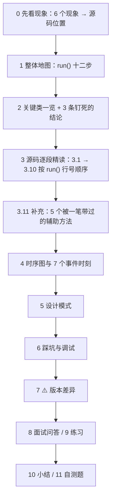

# 01 启动原理（`SpringApplication#run` 那一行到底做了什么）

> 目标：把 `SpringApplication.run(...)` 从"一行魔法"拆成十二步——能复述、能打断点、能排障。
> 版本基线：`org.springframework.boot:spring-boot:4.2.0`（依赖 `spring-framework@7.1.0`）；文中结论均以 `assets/source/` 入库原文为准。
> ⚠️ 本目录只有 1 篇，但它假设你已能画出 `refresh()` 的骨架（见 `01-Spring框架`），否则会在 3.7 节卡住；`refresh()` 内部细节本文不讲。

## 学习目标

- 能按顺序复述 `run()` 的十二步，并说出每一步的输入、输出、失败后果。
- 能说清 `ApplicationContext` 与 `Environment` 都是 `ApplicationContextFactory` 造出来的（**不是** `SpringFactoriesLoader`）。
- 能按"谁发布、谁监听、此刻能不能取 Bean"讲清 7 个启动事件时刻。
- 能解释 `prepareEnvironment` 里属性源的座次，以及 `defaultProperties` 为什么必须排最末。
- 能区分 `ApplicationContextInitializer` 里 `getBean()` 的两种失败，不再笼统说"会提前创建 Bean"。
- 能定位三类现场问题：banner 没打印、`Runner` 没执行、启动失败报告信息为空。

## 本文栈顺序（读这一篇的顺序）

> 读图说明：0 和 1 是"先建坐标系"，别跳——直接读 3.1 的源码容易迷路。3 节必须按 3.1→3.10 的顺序读：它严格按 `run()` 的行号排，前一小节的输出就是后一小节的输入。3.11 是补充的 5 个辅助方法（`configureHeadlessProperty`、`getRunListeners`、`printBanner`、`load`、`Startup`），可以跳读，但 `Runner` 没执行/`Started` 耗时这类问题要靠它。4.2 的事件表建议边读 3 节边对照。11 是自检闸门：答不上来就回到对应小节，别硬背。

## 文章

| 文章 | 核心内容 | 主要源码依据 | 规模 |
| --- | --- | --- | --- |
| [SpringApplication#run 启动全流程](01-springapplication-run-启动全流程.md) | 构造器 9 件事 → `run()` 十二步 → `prepareEnvironment`/`prepareContext` 逐行 → `callRunners` → 7 个事件 → `handleRunFailure`；每小节 4 层讲解 | `SpringApplication.java`（L262-L829、L1742-L1776）、`WebApplicationType.java`（L51-L59）、`ApplicationContextFactory.java`、`EventPublishingRunListener.java`、`SpringApplicationRunListeners.java`、`WebMvc/WebFluxWebApplicationTypeDeducer.java` | 约 1280 行、25 个原文代码块 |

## 与其他 Boot 章节的依赖关系

- **前置**：`01-Spring框架`——`refresh()` 十二步、`BeanDefinition`、`BeanFactoryPostProcessor`/`BeanPostProcessor`。缺了这块，3.7 与 3.6 的最后一步只能死记。
- **本篇输出给后续章节**：
  - `02-自动配置`：`prepareContext` 里 `load()` 注册主配置类之后 `AutoConfigurationImportSelector` 才工作；`@Conditional` 求值用的 `Environment` 来自本篇 3.4。
  - `03-内嵌容器与Web开发`：Tomcat 在 `refresh()` 的 `onRefresh()` 里创建，而"是不是 Web 应用"由本篇 3.1/3.5 的 `WebApplicationType` 决定。
  - `04-配置与属性绑定`：`ConfigurationPropertySources.attach`、`ConfigDataEnvironmentPostProcessor`、`spring.main.*` 的 `bindToSpringApplication` 都在本篇 3.4。
  - `05-Actuator运维与测试`：`/actuator/startup` 读的是本篇 3.11 的 `Startup`/`StartupStep`；`AvailabilityChangeEvent` 的 Liveness/Readiness 在 4.2 的事件表里。
  - `06-AOT与GraalVM`：`AotDetector.useGeneratedArtifacts()` 决定 `prepareContext` 是否跳过 `load()`（3.6 第 14 步）。

## 学习检查点

- [ ] 不看笔记，按顺序说出 `run()` 的十二步，并指出哪一步最容易失败。
- [ ] 指出 `ApplicationContext` 与 `Environment` 各自被哪一行、由哪个对象创建。
- [ ] 说清 7 个事件里最容易混的两个（`contextPrepared` / `contextLoaded`）差在哪、各能干什么。
- [ ] 解释 `defaultProperties` 为什么必须 `moveToEnd`。
- [ ] 给出 `Runner` 不执行的两个源码级原因（`started` 阶段异常 / `context.isRunning()` 为 `false`）。
- [ ] 说出 `handleRunFailure` 第三个参数的类型，以及 `ready` 阶段为什么传 `null`。
- [ ] 用 `--spring.main.banner-mode=off` 验证绑定路径，并说出它在哪一步生效。

## 常见误解

1. **"`SpringApplication` 的 setter 可以链式调用"** —— 不能，`setWebApplicationType`、`setBanner` 等全是 `void`；链式是 `SpringApplicationBuilder`。
2. **"`BootstrapContext`/`Startup` 是 Boot 3/4 的新特性"** —— Boot **2.4** 就有；4.0 只是把包迁到 `org.springframework.boot.bootstrap`。
3. **"`WebApplicationType.deduce()` 里判断有没有 `DispatcherServlet`"** —— 它按 SPI `Deducer` 顺序取第一个非 `null` 结果，兜底 `NONE`；`DispatcherServlet` 的判据藏在 `spring-boot-webmvc` 模块的 `WebMvcWebApplicationTypeDeducer` 里，不在 `deduce()` 里。
4. **"在 `ApplicationContextInitializer` 里 `getBean()` 会提前创建 Bean"** —— 多数情况是 `NoSuchBeanDefinitionException`（`applyInitializers` 早于 `load`，BeanDefinition 还没注册）；只有 BeanDefinition 已存在时才会"裸创建"并绕过 `BeanPostProcessor`。
5. **"`spring-boot-starter-web` 不足以引入 Spring MVC"** —— 4.2.0 的 POM 里它仍依赖 `spring-boot-webmvc`；可核实的只有"它已在描述里标注 deprecated in favor of `spring-boot-starter-webmvc`"。
