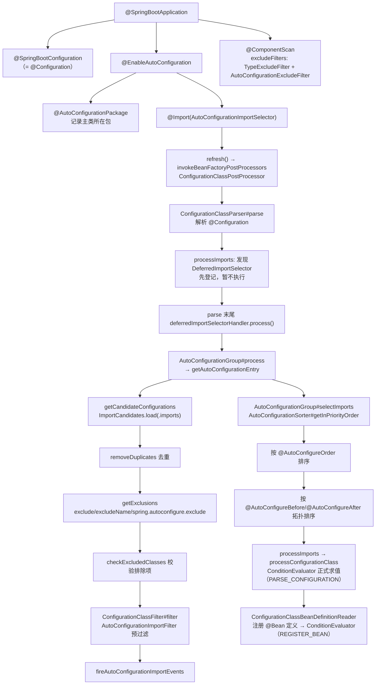
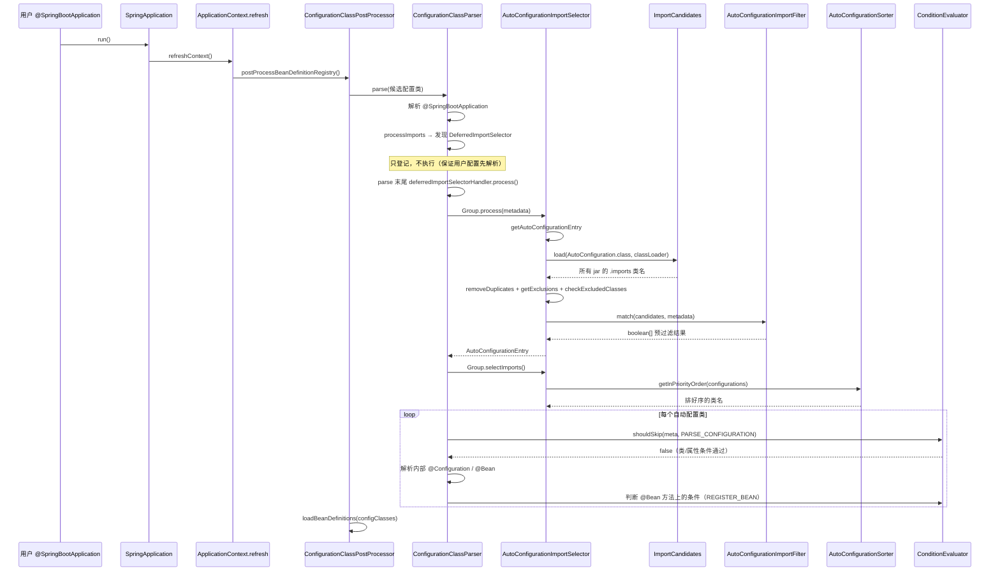

# Spring Boot 源码精读 02-01：`@EnableAutoConfiguration` 自动配置全链路

> 一句话结论：`@SpringBootApplication` 上的 `@EnableAutoConfiguration` 只是挂了一个 `@Import(AutoConfigurationImportSelector.class)`；真正干活的是 `refresh()` 里 `ConfigurationClassPostProcessor` 解析配置类时，这个**延迟**选择器读取各 jar 的 `META-INF/spring/org.springframework.boot.autoconfigure.AutoConfiguration.imports`，做"**预过滤 → 排除 → 排序**"，再把剩下的类当成普通 `@Configuration` 逐个解析——那时条件注解才被 `ConditionEvaluator` 真正求值。
> 阅读前置：`02-SpringBoot/01-启动原理/01-springapplication-run-启动全流程.md`（`refreshContext` 段）
> 预计阅读：45 分钟 ｜ 源码：`org.springframework.boot:spring-boot-autoconfigure:4.2.0` + `org.springframework:spring-context:7.1.0`

---

## 0. 先看现象

新建一个只依赖 `spring-boot-starter-webmvc` 的工程：

```java
@SpringBootApplication
public class DemoApplication{
    public static void main(String[] args) {
        SpringApplication.run(DemoApplication.class, args);
    }
}
```

我们没写一行 `@Bean`，但启动日志里出现了：

```text
Tomcat initialized with port 8080 (http)
Root WebApplicationContext: initialization completed in 231 ms
Tomcat started on port 8080 (http) with context path ''
... (共 N 个) positive matches
... (共 M 个) negative matches
```

同时控制台里 `ConditionEvaluationReport` 把自动配置分成三类：`Positive matches`、`Negative matches`、`Exclusions`、`Unconditional classes`。

三个原始疑问：

1. **哪些类被"自动"注册成了 Bean？** 它们不是 `@Component`，也不在我们自己的包里，`@ComponentScan` 扫不到。
2. **为什么有的自动配置被跳过了？** 日志里的 `Negative matches` 依据是什么？
3. **为什么我自己的 `@Bean` 能覆盖自动配置的 Bean？** 是"后注册覆盖"还是有别的机关？

## 1. 整体地图



> **读图说明**：注意图的"上下分层"。上半部分是**准备清单**（哪些自动配置类值得一试），发生在 `DeferredImportSelectorGroupingHandler` 里，只依赖 `.imports` 文件、`spring.factories`、类路径和 `@AutoConfigure*` 元数据，**不创建任何 Bean**；下半部分才是**真正解析**每个自动配置类，此时 `@ConditionalOnMissingBean` 这类"依赖已有 Bean"的条件才第一次被求值。全链路都发生在 `refresh()` 的 `invokeBeanFactoryPostProcessors` 中，也就是 `01-启动原理` 里 `refreshContext` 那句之内。

## 2. 关键类逐个拆

| 类 | 所在坐标 | 职责 | 一句话记忆 |
| --- | --- | --- | --- |
| `SpringBootApplication` | `spring-boot-autoconfigure` | 三合一组合注解 | `@Configuration` + `@EnableAutoConfiguration` + `@ComponentScan` |
| `EnableAutoConfiguration` | `spring-boot-autoconfigure` | 自动配置开关 | 只做 `@Import(AutoConfigurationImportSelector)` |
| `AutoConfigurationImportSelector` | `spring-boot-autoconfigure` | 延迟导入器 + 过滤器 | 算出"装配候选清单" |
| `ImportCandidates` | `spring-boot` | `.imports` 文件解析器 | `META-INF/spring/<注解全名>.imports` |
| `AutoConfigurationImportFilter` | `spring-boot-autoconfigure` | 预过滤器接口 | 不读字节码先删掉一批 |
| `OnClassCondition` / `OnBeanCondition` / `OnWebApplicationCondition` | `spring-boot-autoconfigure` | 三个内置预过滤器 | 类存在？Bean 存在？Web 类型？ |
| `AutoConfigurationSorter` | `spring-boot-autoconfigure` | 排序器 | 字母序 → `@AutoConfigureOrder` → before/after 拓扑 |
| `AutoConfigurations` | `spring-boot-autoconfigure` | 排序器的公开门面 | 给测试/工具用的 API |
| `ConfigurationClassParser` / `ConditionEvaluator` | `spring-context` | 正式解析 + 条件求值 | 分 `PARSE_CONFIGURATION` / `REGISTER_BEAN` 两阶段 |

## 3. 源码逐段精读

### 3.1 `@SpringBootApplication`：三合一，其中两个是"开关"

[[源码:SpringBootApplication.java#L38-L46]]

```java (src: SpringBootApplication.java#L38-L46)
@Target(ElementType.TYPE)
@Retention(RetentionPolicy.RUNTIME)
@Documented
@Inherited
@SpringBootConfiguration
@EnableAutoConfiguration
@ComponentScan(excludeFilters = { @Filter(type = FilterType.CUSTOM, classes = TypeExcludeFilter.class),
		@Filter(type = FilterType.CUSTOM, classes = AutoConfigurationExcludeFilter.class) })
public @interface SpringBootApplication {
```

- **在干什么**：把"这是一个配置类"（`@SpringBootConfiguration`，元注解是 `@Configuration`）、"打开自动配置"（`@EnableAutoConfiguration`）、"扫描当前包及子包"（`@ComponentScan`）三个动作合成一个注解。
- **为什么这么写**：三个注解缺一不可。少 `@SpringBootConfiguration` 就没有配置类、`@Bean` 不生效；少 `@EnableAutoConfiguration` 就没有自动配置；少 `@ComponentScan` 就没有组件扫描。
- **`excludeFilters` 的作用**：`AutoConfigurationExcludeFilter` 让 `@ComponentScan` **不要去扫那些同时被列在 `.imports` 文件里的类**。否则一个恰好放在你主包下（或你 `@ComponentScan` 到别人的包）的自动配置类会被当作普通组件扫到，绕开排序逻辑。
- **常见坑**：`@SpringBootApplication` 会"继承"属性，`@SpringBootApplication(exclude = DataSourceAutoConfiguration.class)` 是通过 `@AliasFor` 转发给 `@EnableAutoConfiguration#exclude` 的（见 3.2），不是自己的属性。

### 3.2 `@EnableAutoConfiguration`：一个 `@Import` + 两个属性

[[源码:EnableAutoConfiguration.java#L60-L72]]

```java (src: EnableAutoConfiguration.java#L60-L72)
@Target(ElementType.TYPE)
@Retention(RetentionPolicy.RUNTIME)
@Documented
@Inherited
@AutoConfigurationPackage
@Import(AutoConfigurationImportSelector.class)
public @interface EnableAutoConfiguration {

	/**
	 * Environment property that can be used to override when auto-configuration is
	 * enabled.
	 */
	String ENABLED_OVERRIDE_PROPERTY = "spring.boot.enableautoconfiguration";
```

- **在干什么**：`@Import` 挂上选择器；`@AutoConfigurationPackage` 把主类所在包注册成"自动配置包"（供 JPA 实体扫描、`AutoConfigurationPackages` 使用）；提供一个全局开关 `spring.boot.enableautoconfiguration`。
- **为什么用 `@Import`**：`@Import` 是"把一个类加入配置类集合"的标准方式；`ImportSelector` 则是"动态决定导入哪些类"。自动配置的类清单在编译期不可知（取决于 classpath 上有哪些 jar），所以必须动态。
- **设计意图（javadoc 里写得很直白）**：

[[源码:EnableAutoConfiguration.java#L31-L49]]

```java (src: EnableAutoConfiguration.java#L31-L49)
 * Auto-configuration tries to be as intelligent as possible and will back-away as you
 * define more of your own configuration. You can always manually {@link #exclude()} any
 * configuration that you never want to apply (use {@link #excludeName()} if you don't
 * have access to them). You can also exclude them through the
 * {@code spring.autoconfigure.exclude} property. Auto-configuration is always applied
 * after user-defined beans have been registered.
 * <p>
 * The package of the class that is annotated with {@code @EnableAutoConfiguration},
 * usually through {@code @SpringBootApplication}, has specific significance and is often
 * used as a 'default'. For example, it will be used when scanning for {@code @Entity}
 * classes. It is generally recommended that you place {@code @EnableAutoConfiguration}
 * (if you're not using {@code @SpringBootApplication}) in a root package so that all
 * sub-packages and classes can be searched.
 * <p>
 * Auto-configuration classes are regular Spring {@link Configuration @Configuration}
 * beans. They are located using {@link ImportCandidates}. Generally auto-configuration
 * beans are {@link Conditional @Conditional} beans (most often using
 * {@link ConditionalOnClass @ConditionalOnClass} and
 * {@link ConditionalOnMissingBean @ConditionalOnMissingBean} annotations).
```

- **"back-away"**：自动配置会主动让位给用户配置，机制是 `@ConditionalOnMissingBean`（3.8 会讲清它为什么可靠）。
- **"located using `ImportCandidates`"**：源码里明确写了候选来源是 `ImportCandidates` 而不是 `SpringFactoriesLoader`——这是 Boot 3 起的关键迁移。

### 3.3 `AutoConfigurationImportSelector#selectImports` / `getAutoConfigurationEntry`：六步

[[源码:AutoConfigurationImportSelector.java#L106-L143]]

```java (src: AutoConfigurationImportSelector.java#L106-L143)
	@Override
	public String[] selectImports(AnnotationMetadata annotationMetadata) {
		if (!isEnabled(annotationMetadata)) {
			return NO_IMPORTS;
		}
		AutoConfigurationEntry autoConfigurationEntry = getAutoConfigurationEntry(annotationMetadata);
		return StringUtils.toStringArray(autoConfigurationEntry.getConfigurations());
	}

	@Override
	public Predicate<String> getExclusionFilter() {
		return this::shouldExclude;
	}

	private boolean shouldExclude(String configurationClassName) {
		return getConfigurationClassFilter().filter(Collections.singletonList(configurationClassName)).isEmpty();
	}

	/**
	 * Return the {@link AutoConfigurationEntry} based on the {@link AnnotationMetadata}
	 * of the importing {@link Configuration @Configuration} class.
	 * @param annotationMetadata the annotation metadata of the configuration class
	 * @return the auto-configurations that should be imported
	 */
	protected AutoConfigurationEntry getAutoConfigurationEntry(AnnotationMetadata annotationMetadata) {
		if (!isEnabled(annotationMetadata)) {
			return EMPTY_ENTRY;
		}
		AnnotationAttributes attributes = getAttributes(annotationMetadata);
		List<String> configurations = getCandidateConfigurations(annotationMetadata, attributes);
		configurations = removeDuplicates(configurations);
		Set<String> exclusions = getExclusions(annotationMetadata, attributes);
		checkExcludedClasses(configurations, exclusions);
		configurations.removeAll(exclusions);
		configurations = getConfigurationClassFilter().filter(configurations);
		fireAutoConfigurationImportEvents(configurations, exclusions);
		return new AutoConfigurationEntry(configurations, exclusions);
	}
```

<!-- 原 3.3 块结束 -->

- **为什么先 `checkExcludedClasses` 再 `removeAll`**：校验需要"候选清单"还包含被排除的类，这样才能判断"你排除的这个类到底是不是自动配置类"。写错类名会直接抛 `IllegalStateException`：

[[源码:AutoConfigurationImportSelector.java#L200-L211]]

```java (src: AutoConfigurationImportSelector.java#L200-L211)
	private void checkExcludedClasses(List<String> configurations, Set<String> exclusions) {
		List<String> invalidExcludes = new ArrayList<>(exclusions.size());
		ClassLoader classLoader = (this.beanClassLoader != null) ? this.beanClassLoader : getClass().getClassLoader();
		for (String exclusion : exclusions) {
			if (ClassUtils.isPresent(exclusion, classLoader) && !configurations.contains(exclusion)) {
				invalidExcludes.add(exclusion);
			}
		}
		if (!invalidExcludes.isEmpty()) {
			handleInvalidExcludes(invalidExcludes);
		}
	}
```

注意 `ClassUtils.isPresent(exclusion, classLoader)` 这个前置判断：**类不在 classpath 上的排除项会被静默放过**（这是为了写法安全：`excludeName` 允许写可能不存在的类）。只有"类存在、但不是自动配置类"才算非法。

- **`isEnabled` 的微妙之处**：

[[源码:AutoConfigurationImportSelector.java#L150-L155]]

```java (src: AutoConfigurationImportSelector.java#L150-L155)
	protected boolean isEnabled(AnnotationMetadata metadata) {
		if (getClass() == AutoConfigurationImportSelector.class) {
			return getEnvironment().getProperty(EnableAutoConfiguration.ENABLED_OVERRIDE_PROPERTY, Boolean.class, true);
		}
		return true;
	}
```

只有"自身就是 `AutoConfigurationImportSelector`"时才读 `spring.boot.enableautoconfiguration`；如果你写子类，`getClass()` 不等于它，就永远为 `true`——所以子类想受开关控制必须自己重写 `isEnabled`。

- **`getExclusionFilter()`**：把 `shouldExclude` 作为 `Predicate` 交给 `ConfigurationClassParser`，用于**二次过滤**（3.9 会看到它被 `filter.or(...)` 合并）。

- **常见坑**：`spring.boot.enableautoconfiguration=false` 之后不是"少几个 Bean"，而是**一个自动配置都不加载**（`EMPTY_ENTRY`），包括 `DispatcherServlet` 的注册，应用基本等于裸 Spring。

### 3.4 候选从哪来：`ImportCandidates.load`

[[源码:AutoConfigurationImportSelector.java#L188-L198]]

```java (src: AutoConfigurationImportSelector.java#L188-L198)
	protected List<String> getCandidateConfigurations(AnnotationMetadata metadata,
			@Nullable AnnotationAttributes attributes) {
		ImportCandidates importCandidates = ImportCandidates.load(this.autoConfigurationAnnotation,
				getBeanClassLoader());
		List<String> configurations = importCandidates.getCandidates();
		Assert.state(!CollectionUtils.isEmpty(configurations),
				() -> "No auto configuration classes found in " + "META-INF/spring/"
						+ this.autoConfigurationAnnotation.getName() + ".imports. If you "
						+ "are using a custom packaging, make sure that file is correct.");
		return configurations;
	}
```

- **在干什么**：用**注解类 + 类加载器**去加载 `META-INF/spring/org.springframework.boot.autoconfigure.AutoConfiguration.imports`。
- **注意**：`this.autoConfigurationAnnotation` 在无参构造器里默认是 `AutoConfiguration.class`，不是 `EnableAutoConfiguration.class`（见 L101-L104）。所以文件名里的 `<注解全名>` 是 `org.springframework.boot.autoconfigure.AutoConfiguration`。
- **错误信息就是最好的一课**：`No auto configuration classes found in META-INF/spring/....imports. If you are using a custom packaging, make sure that file is correct.`——Boot 4 里这句断言仍然是排查"自动配置完全没生效"的第一线索。

[[源码:ImportCandidates.java#L35-L37]]

```java (src: ImportCandidates.java#L35-L37)
	private static final String LOCATION = "META-INF/spring/%s.imports";

	private static final String COMMENT_START = "#";
```

[[源码:ImportCandidates.java#L69-L80]]

```java (src: ImportCandidates.java#L69-L80)
	public static ImportCandidates load(Class<?> annotation, @Nullable ClassLoader classLoader) {
		Assert.notNull(annotation, "'annotation' must not be null");
		ClassLoader classLoaderToUse = decideClassloader(classLoader);
		String location = String.format(LOCATION, annotation.getName());
		Enumeration<URL> urls = findUrlsInClasspath(classLoaderToUse, location);
		List<String> importCandidates = new ArrayList<>();
		while (urls.hasMoreElements()) {
			URL url = urls.nextElement();
			importCandidates.addAll(readCandidateConfigurations(url));
		}
		return new ImportCandidates(importCandidates);
	}
```

- **关键点 1**：`getResources(location)` 是**复数**——每个 jar 都可以有一个同名 `.imports` 文件，全部被收集，顺序由类加载器决定（→ 这就是为什么必须有 3.6 的排序器）。
- **关键点 2**：文件格式极简，每行一个类全名，`#` 之后是注释：

[[源码:ImportCandidates.java#L98-L124]]

```java (src: ImportCandidates.java#L98-L124)
	private static List<String> readCandidateConfigurations(URL url) {
		try (BufferedReader reader = new BufferedReader(
				new InputStreamReader(new UrlResource(url).getInputStream(), StandardCharsets.UTF_8))) {
			List<String> candidates = new ArrayList<>();
			String line;
			while ((line = reader.readLine()) != null) {
				line = stripComment(line);
				line = line.trim();
				if (line.isEmpty()) {
					continue;
				}
				candidates.add(line);
			}
			return candidates;
		}
		catch (IOException ex) {
			throw new IllegalArgumentException("Unable to load configurations from location [" + url + "]", ex);
		}
	}

	private static String stripComment(String line) {
		int commentStart = line.indexOf(COMMENT_START);
		if (commentStart == -1) {
			return line;
		}
		return line.substring(0, commentStart);
	}
```

- **UTF-8 硬编码**：文件必须以 UTF-8 保存；写成 GBK 且含中文注释就会乱码（虽然注释本来会被剥掉，但读取期可能报错或写出脏行）。
- **常见坑**：`.imports` 文件必须放在 `src/main/resources/META-INF/spring/` 下，**目录名 `spring` 不能少**；Maven 默认会把 `resources` 打进去，但如果你自定义了 `maven-jar-plugin` 的 `excludes`，可能整个 `META-INF` 被漏掉。

### 3.5 预过滤：`AutoConfigurationImportFilter`

[[源码:AutoConfigurationImportSelector.java#L266-L281]]

```java (src: AutoConfigurationImportSelector.java#L266-L281)
	protected List<AutoConfigurationImportFilter> getAutoConfigurationImportFilters() {
		return SpringFactoriesLoader.loadFactories(AutoConfigurationImportFilter.class, this.beanClassLoader);
	}

	private ConfigurationClassFilter getConfigurationClassFilter() {
		ConfigurationClassFilter configurationClassFilter = this.configurationClassFilter;
		if (configurationClassFilter == null) {
			List<AutoConfigurationImportFilter> filters = getAutoConfigurationImportFilters();
			for (AutoConfigurationImportFilter filter : filters) {
				invokeAwareMethods(filter);
			}
			configurationClassFilter = new ConfigurationClassFilter(this.beanClassLoader, filters);
			this.configurationClassFilter = configurationClassFilter;
		}
		return configurationClassFilter;
	}
```

- **在干什么**：过滤器仍然通过 `spring.factories` 加载（注意：**这里没被废弃**，`spring.factories` 只是不再承载 EnableAutoConfiguration 键），并把 `BeanClassLoader/BeanFactory/Environment/ResourceLoader` 注入给过滤器使用。
- **为什么要"预"过滤**：每个自动配置类都要读字节码、解析注解、实例化 `Condition`，代价不小。预过滤只需要判断"类在不在 classpath 上"，能用几十毫秒删掉上百个候选。

[[源码:AutoConfigurationImportSelector.java#L387-L415]]

```java (src: AutoConfigurationImportSelector.java#L387-L415)
		List<String> filter(List<String> configurations) {
			long startTime = System.nanoTime();
			@Nullable String[] candidates = StringUtils.toStringArray(configurations);
			boolean skipped = false;
			for (AutoConfigurationImportFilter filter : this.filters) {
				boolean[] match = filter.match(candidates, this.autoConfigurationMetadata);
				for (int i = 0; i < match.length; i++) {
					if (!match[i]) {
						candidates[i] = null;
						skipped = true;
					}
				}
			}
			if (!skipped) {
				return configurations;
			}
			List<String> result = new ArrayList<>(candidates.length);
			for (String candidate : candidates) {
				if (candidate != null) {
					result.add(candidate);
				}
			}
			if (logger.isTraceEnabled()) {
				int numberFiltered = configurations.size() - result.size();
				logger.trace("Filtered " + numberFiltered + " auto configuration class in "
						+ TimeUnit.NANOSECONDS.toMillis(System.nanoTime() - startTime) + " ms");
			}
			return result;
		}
```

- **在干什么**：多个过滤器**串联**作用在同一个数组上，被否掉的置 `null`；全部通过时直接返回原列表（零拷贝小优化）。
- **顺序靠 `@Order`**：三个内置过滤器的顺序是 `OnClassCondition(HIGHEST_PRECEDENCE)` → `OnWebApplicationCondition(HIGHEST_PRECEDENCE+20)` → `OnBeanCondition(LOWEST_PRECEDENCE)`。这个顺序不是随意排的：先按"类在不在"，再按"Web 类型对不对"，最后按"Bean 在不在"。

#### 3.5.1 `OnClassCondition`：只查类的存在性

[[源码:OnClassCondition.java#L33-L50]]

```java (src: OnClassCondition.java#L33-L50)
@Order(Ordered.HIGHEST_PRECEDENCE)
class OnClassCondition extends FilteringSpringBootCondition {

	@Override
	protected final @Nullable ConditionOutcome[] getOutcomes(@Nullable String[] autoConfigurationClasses,
			AutoConfigurationMetadata autoConfigurationMetadata) {
		// Split the work and perform half in a background thread if more than one
		// processor is available. Using a single additional thread seems to offer the
		// best performance. More threads make things worse.
		if (autoConfigurationClasses.length > 1 && Runtime.getRuntime().availableProcessors() > 1) {
			return resolveOutcomesThreaded(autoConfigurationClasses, autoConfigurationMetadata);
		}
		else {
			OutcomesResolver outcomesResolver = new StandardOutcomesResolver(autoConfigurationClasses, 0,
					autoConfigurationClasses.length, autoConfigurationMetadata, getBeanClassLoader());
			return outcomesResolver.resolveOutcomes();
		}
	}
```

- **在干什么**：用一个额外的线程做"后半段"，主线程做前半段，然后合并结果。注释明确说"只用一个额外线程最好，更多线程会更慢"。
- **为什么可以并行**：`Class.forName(name, false, cl)` 是幂等只读操作，不创建实例。

#### 3.5.2 `OnBeanCondition`：预过滤阶段只能"查类"

[[源码:OnBeanCondition.java#L76-L101]]

```java (src: OnBeanCondition.java#L76-L101)
@Order(Ordered.LOWEST_PRECEDENCE)
class OnBeanCondition extends FilteringSpringBootCondition implements ConfigurationCondition {

	@Override
	public ConfigurationPhase getConfigurationPhase() {
		return ConfigurationPhase.REGISTER_BEAN;
	}

	@Override
	protected final @Nullable ConditionOutcome[] getOutcomes(@Nullable String[] autoConfigurationClasses,
			AutoConfigurationMetadata autoConfigurationMetadata) {
		@Nullable ConditionOutcome[] outcomes = new ConditionOutcome[autoConfigurationClasses.length];
		for (int i = 0; i < outcomes.length; i++) {
			String autoConfigurationClass = autoConfigurationClasses[i];
			if (autoConfigurationClass != null) {
				Set<String> onBeanTypes = autoConfigurationMetadata.getSet(autoConfigurationClass, "ConditionalOnBean");
				outcomes[i] = getOutcome(onBeanTypes, ConditionalOnBean.class);
				if (outcomes[i] == null) {
					Set<String> onSingleCandidateTypes = autoConfigurationMetadata.getSet(autoConfigurationClass,
							"ConditionalOnSingleCandidate");
					outcomes[i] = getOutcome(onSingleCandidateTypes, ConditionalOnSingleCandidate.class);
				}
			}
		}
		return outcomes;
	}
```

- **在干什么**：`implements ConfigurationCondition` 且 `getConfigurationPhase() == REGISTER_BEAN`——它决定了**这个条件只在 `REGISTER_BEAN` 阶段才参与 `ConditionEvaluator` 的判断**。
- **预过滤阶段它做什么**：只从元数据里读出 `@ConditionalOnBean` 声明的**类名**，如果"这个类型本身都不在 classpath 上"，那么"Bean 肯定不存在"，可以安全地提前否掉。

[[源码:OnBeanCondition.java#L103-L113]]

```java (src: OnBeanCondition.java#L103-L113)
	private @Nullable ConditionOutcome getOutcome(@Nullable Set<String> requiredBeanTypes,
			Class<? extends Annotation> annotation) {
		List<String> missing = filter(requiredBeanTypes, ClassNameFilter.MISSING, getBeanClassLoader());
		if (!missing.isEmpty()) {
			ConditionMessage message = ConditionMessage.forCondition(annotation)
				.didNotFind("required type", "required types")
				.items(Style.QUOTE, missing);
			return ConditionOutcome.noMatch(message);
		}
		return null;
	}
```

- **关键**：返回 `null` 表示"预过滤无法判断，交给后面正式求值"。`FilteringSpringBootCondition#match` 里 `match[i] = (outcome == null || outcome.isMatch());`，`null` 是"放行"。
- **这就是"两轮评估"的核心设计**：预过滤只能做**保守否定**，不能做肯定结论。

- **这些元数据从哪来**：`AutoConfigurationMetadataLoader.loadMetadata(classLoader)` 加载自动配置注解处理器（`spring-boot-autoconfigure-processor`）在编译期生成的 `META-INF/spring-autoconfigure-metadata.properties`。没有这个文件时 `getSet` 返回空集合，预过滤退化为"不删任何东西"，功能仍正确、只是慢。

### 3.6 排序：`AutoConfigurations` / `AutoConfigurationSorter`

`AutoConfigurations` 是排序器的门面（给测试与工具用）：

[[源码:AutoConfigurations.java#L26-L55]]

```java (src: AutoConfigurations.java#L26-L55)
public class AutoConfigurations extends Configurations implements Ordered {

	private static final SimpleMetadataReaderFactory metadataReaderFactory = new SimpleMetadataReaderFactory();

	private static final int ORDER = AutoConfigurationImportSelector.ORDER;

	static final AutoConfigurationReplacements replacements = AutoConfigurationReplacements
		.load(AutoConfiguration.class, null);

	private final UnaryOperator<String> replacementMapper;

	protected AutoConfigurations(Collection<Class<?>> classes) {
		this(replacements::replace, classes);
	}

	AutoConfigurations(UnaryOperator<String> replacementMapper, Collection<Class<?>> classes) {
		super(sorter(replacementMapper), classes, Class::getName);
		this.replacementMapper = replacementMapper;
	}

	private static UnaryOperator<Collection<Class<?>>> sorter(UnaryOperator<String> replacementMapper) {
		AutoConfigurationSorter sorter = new AutoConfigurationSorter(metadataReaderFactory, null, replacementMapper);
		return (classes) -> {
			List<String> names = classes.stream().map(Class::getName).map(replacementMapper).toList();
			List<String> sorted = sorter.getInPriorityOrder(names);
			return sorted.stream()
				.map((className) -> ClassUtils.resolveClassName(className, null))
				.collect(Collectors.toCollection(ArrayList::new));
		};
	}
```

排序算法本体：

[[源码:AutoConfigurationSorter.java#L53-L70]]

```java (src: AutoConfigurationSorter.java#L53-L70)
	List<String> getInPriorityOrder(Collection<String> classNames) {
		// Initially sort alphabetically
		List<String> alphabeticallyOrderedClassNames = new ArrayList<>(classNames);
		Collections.sort(alphabeticallyOrderedClassNames);
		// Then sort by order
		AutoConfigurationClasses classes = new AutoConfigurationClasses(this.metadataReaderFactory,
				this.autoConfigurationMetadata, alphabeticallyOrderedClassNames);
		List<String> orderedClassNames = new ArrayList<>(classNames);
		Collections.sort(orderedClassNames);
		orderedClassNames.sort((o1, o2) -> {
			int i1 = classes.get(o1).getOrder();
			int i2 = classes.get(o2).getOrder();
			return Integer.compare(i1, i2);
		});
		// Then respect @AutoConfigureBefore @AutoConfigureAfter
		orderedClassNames = sortByAnnotation(new LinkedHashSet<>(orderedClassNames), classes);
		return orderedClassNames;
	}
```

- **三步排序**：① 先字母序（保证"没有约束时结果稳定、可复现"）② 按 `@AutoConfigureOrder` 的整数值 ③ 再按 before/after 做拓扑排序。**后面一步不看前面一步的"数值"，只把它们当初始顺序**。
- **为什么要字母序**：多 jar 的 `.imports` 顺序由类加载器决定，不同机器可能不同；先字母序把"不确定性"消灭掉。

[[源码:AutoConfigurationSorter.java#L72-L83]]

```java (src: AutoConfigurationSorter.java#L72-L83)
	private List<String> sortByAnnotation(Set<String> classNames, AutoConfigurationClasses classes) {
		Map<String, Integer> sortOrder = new LinkedHashMap<>();
		classNames.forEach((className) -> sortOrder.putIfAbsent(className, sortOrder.size()));
		classes.getAllNames().forEach((className) -> sortOrder.putIfAbsent(className, sortOrder.size()));
		Set<String> sorted = new LinkedHashSet<>();
		Set<String> processing = new LinkedHashSet<>();
		for (String className : sortOrder.keySet()) {
			doSortByAfterAnnotation(classes, sortOrder, sorted, processing, className);
		}
		sorted.retainAll(classNames);
		return new ArrayList<>(sorted);
	}
```

[[源码:AutoConfigurationSorter.java#L85-L106]]

```java (src: AutoConfigurationSorter.java#L85-L106)
	private void doSortByAfterAnnotation(AutoConfigurationClasses classes, Map<String, Integer> sortOrder,
			Set<String> sorted, Set<String> processing, String current) {
		if (sorted.contains(current)) {
			return;
		}
		processing.add(current);
		Set<String> afters = new TreeSet<>(Comparator.comparingInt((String name) -> sortOrder.getOrDefault(name, -1)));
		afters.addAll(classes.getClassesRequestedAfter(current));
		for (String after : afters) {
			checkForCycles(processing, current, after);
			if (sortOrder.containsKey(after)) {
				doSortByAfterAnnotation(classes, sortOrder, sorted, processing, after);
			}
		}
		processing.remove(current);
		sorted.add(current);
	}

	private void checkForCycles(Set<String> processing, String current, String after) {
		Assert.state(!processing.contains(after),
				() -> "AutoConfigure cycle detected between " + current + " and " + after);
	}
```

- **在干什么**：这是经典的 **DFS 拓扑排序**：先递归处理"我必须排在它后面"的类，再把自己加入结果。
- **`@AutoConfigureBefore` 怎么处理**：注意函数名只有 `After`——`X before Y` 在实现里被等价转换为"`Y` 的 after 集合里有 `X`"（`AutoConfigurationClasses#getClassesRequestedAfter` 同时收集 after 与反向的 before）。
- **环检测**：两个类互相 `@AutoConfigureAfter` 会立刻抛 `AutoConfigure cycle detected between A and B`，这是白屏式错误，必须从两个类的注解里找。
- **常见坑 1**：注解里写的是"类"，如果那个类不在 classpath（`isAvailable()` 为 `false`），依赖会被忽略，不会报错——所以"我写了 `after = XxxAutoConfiguration.class` 但没生效"通常是**那个类没引进来**。
- **常见坑 2**：`@AutoConfigureOrder` 只在"两组类之间没有 before/after 约束"时起作用；一旦有 after 约束，注解顺序优先。

### 3.7 谁在什么时候调用：`ConfigurationClassParser` 的延迟导入

上面 3.3~3.6 都发生在"解析配置类"期间。入口在 `ConfigurationClassPostProcessor`（`spring-context` 的 `BeanDefinitionRegistryPostProcessor`），它由 `refresh()` 的 `invokeBeanFactoryPostProcessors` 调用：

[[源码:ConfigurationClassPostProcessor.java#L443-L453]]

```java (src: ConfigurationClassPostProcessor.java#L443-L453)
		// Parse each @Configuration class
		ConfigurationClassParser parser = new ConfigurationClassParser(
				this.metadataReaderFactory, this.problemReporter, this.environment,
				this.resourceLoader, this.componentScanBeanNameGenerator, registry);

		Set<BeanDefinitionHolder> candidates = new LinkedHashSet<>(configCandidates);
		Set<ConfigurationClass> alreadyParsed = CollectionUtils.newHashSet(configCandidates.size());
		do {
			StartupStep processConfig = this.applicationStartup.start("spring.context.config-classes.parse");
			parser.parse(candidates);
			parser.validate();
```

解析 `@Import` 时发现 `AutoConfigurationImportSelector` 是 `DeferredImportSelector`，于是**不立即执行**，只登记：

[[源码:ConfigurationClassParser.java#L594-L612]]

```java (src: ConfigurationClassParser.java#L594-L612)
				for (SourceClass candidate : importCandidates) {
					if (candidate.isAssignable(ImportSelector.class)) {
						// Candidate class is an ImportSelector -> delegate to it to determine imports
						Class<?> candidateClass = candidate.loadClass();
						ImportSelector selector = ParserStrategyUtils.instantiateClass(candidateClass, ImportSelector.class,
								this.environment, this.resourceLoader, this.registry);
						Predicate<String> selectorFilter = selector.getExclusionFilter();
						if (selectorFilter != null) {
							filter = filter.or(selectorFilter);
						}
						if (selector instanceof DeferredImportSelector deferredImportSelector) {
							this.deferredImportSelectorHandler.handle(configClass, deferredImportSelector);
						}
						else {
							String[] importClassNames = selector.selectImports(currentSourceClass.getMetadata());
							Collection<SourceClass> importSourceClasses = asSourceClasses(importClassNames, filter);
							processImports(configClass, currentSourceClass, importSourceClasses, filter, false);
						}
					}
```

- **为什么延迟**：用户自己的 `@Configuration` 都在同一个"解析批次"里。等所有用户的配置类都解析完，再让自动配置进来，才能保证"**用户 Bean 先注册**"——这正是 `@ConditionalOnMissingBean` 可靠的前提（3.9）。
- **`filter.or(selectorFilter)`**：把 `AutoConfigurationImportSelector#getExclusionFilter`（内部用预过滤器判断）合并进 `SourceClass` 的可见性过滤，相当于"被预过滤/被排除的类，后续即使被人手工 `@Import` 也会被挡掉"。

[[源码:ConfigurationClassParser.java#L825-L839]]

```java (src: ConfigurationClassParser.java#L825-L839)
		void process() {
			List<DeferredImportSelectorHolder> deferredImports = this.deferredImportSelectors;
			this.deferredImportSelectors = null;
			try {
				if (deferredImports != null) {
					DeferredImportSelectorGroupingHandler handler = new DeferredImportSelectorGroupingHandler();
					deferredImports.sort(DEFERRED_IMPORT_COMPARATOR);
					deferredImports.forEach(handler::register);
					handler.processGroupImports();
				}
			}
			finally {
				this.deferredImportSelectors = new ArrayList<>();
			}
		}
```

`parse()` 的最后一行（L200）就是 `this.deferredImportSelectorHandler.process();`——所以"延迟"的边界是**一次 `parse` 调用**。

[[源码:ConfigurationClassParser.java#L849-L869]]

```java (src: ConfigurationClassParser.java#L849-L869)
		void register(DeferredImportSelectorHolder deferredImport) {
			Class<? extends Group> group = deferredImport.getImportSelector().getImportGroup();
			DeferredImportSelectorGrouping grouping = this.groupings.computeIfAbsent(
					(group != null ? group : deferredImport),
					key -> new DeferredImportSelectorGrouping(createGroup(group)));
			grouping.add(deferredImport);
			this.configurationClasses.put(deferredImport.getConfigurationClass().getMetadata(),
					deferredImport.getConfigurationClass());
		}

		void processGroupImports() {
			for (DeferredImportSelectorGrouping grouping : this.groupings.values()) {
				Predicate<String> filter = grouping.getCandidateFilter();
				grouping.getImports().forEach(entry -> {
					ConfigurationClass configurationClass = this.configurationClasses.get(entry.getMetadata());
					Assert.state(configurationClass != null, "ConfigurationClass must not be null");
					try {
						processImports(configurationClass, asSourceClass(configurationClass, filter),
								Collections.singleton(asSourceClass(entry.getImportClassName(), filter)),
								filter, false);
					}
```

- **`getImportGroup()` 的作用**：`AutoConfigurationImportSelector` 返回 `AutoConfigurationGroup.class`，所以**所有**用到它的 `@EnableAutoConfiguration`（包括被 `@Import` 多次）共享同一个 `Group` → 候选合并去重 → 只排序一次。这就是 `AutoConfigurationGroup#selectImports` 里那句 `processedConfigurations.removeAll(allExclusions)` 的意义。

[[源码:AutoConfigurationImportSelector.java#L454-L493]]

```java (src: AutoConfigurationImportSelector.java#L454-L493)
		@Override
		public void process(AnnotationMetadata annotationMetadata, DeferredImportSelector deferredImportSelector) {
			Assert.state(deferredImportSelector instanceof AutoConfigurationImportSelector,
					() -> String.format("Only %s implementations are supported, got %s",
							AutoConfigurationImportSelector.class.getSimpleName(),
							deferredImportSelector.getClass().getName()));
			AutoConfigurationImportSelector autoConfigurationImportSelector = (AutoConfigurationImportSelector) deferredImportSelector;
			AutoConfigurationReplacements autoConfigurationReplacements = autoConfigurationImportSelector
				.getAutoConfigurationReplacements();
			Assert.state(
					this.autoConfigurationReplacements == null
							|| this.autoConfigurationReplacements.equals(autoConfigurationReplacements),
					"Auto-configuration replacements must be the same for each call to process");
			this.autoConfigurationReplacements = autoConfigurationReplacements;
			AutoConfigurationEntry autoConfigurationEntry = autoConfigurationImportSelector
				.getAutoConfigurationEntry(annotationMetadata);
			this.autoConfigurationEntries.add(autoConfigurationEntry);
			for (String importClassName : autoConfigurationEntry.getConfigurations()) {
				this.entries.putIfAbsent(importClassName, annotationMetadata);
			}
		}

		@Override
		public Iterable<Entry> selectImports() {
			if (this.autoConfigurationEntries.isEmpty()) {
				return Collections.emptyList();
			}
			Set<String> allExclusions = this.autoConfigurationEntries.stream()
				.map(AutoConfigurationEntry::getExclusions)
				.flatMap(Collection::stream)
				.collect(Collectors.toSet());
			Set<String> processedConfigurations = this.autoConfigurationEntries.stream()
				.map(AutoConfigurationEntry::getConfigurations)
				.flatMap(Collection::stream)
				.collect(Collectors.toCollection(LinkedHashSet::new));
			processedConfigurations.removeAll(allExclusions);
			return sortAutoConfigurations(processedConfigurations, getAutoConfigurationMetadata()).stream()
				.map(this::getEntry)
				.toList();
		}
```

- **在干什么**：`process` 负责"算清单"（多次调用就多次 `getAutoConfigurationEntry`，结果累加），`selectImports` 负责"合并 + 排序 + 输出"。`entries.putIfAbsent` 保证同一个类只出现一次。

[[源码:AutoConfigurationImportSelector.java#L508-L515]]

```java (src: AutoConfigurationImportSelector.java#L508-L515)
		private List<String> sortAutoConfigurations(Set<String> configurations,
				AutoConfigurationMetadata autoConfigurationMetadata) {
			Assert.state(this.autoConfigurationReplacements != null,
					"'autoConfigurationReplacements' must not be null");
			return new AutoConfigurationSorter(getMetadataReaderFactory(), autoConfigurationMetadata,
					this.autoConfigurationReplacements::replace)
				.getInPriorityOrder(configurations);
		}
```

### 3.8 第二轮：`ConditionEvaluator` 正式求值

自动配置类被 `processImports` → `processConfigurationClass` 解析时，第一个动作就是条件判断：

[[源码:ConfigurationClassParser.java#L248-L251]]

```java (src: ConfigurationClassParser.java#L248-L251)
	protected void processConfigurationClass(ConfigurationClass configClass, Predicate<String> filter) {
		if (this.conditionEvaluator.shouldSkip(configClass.getMetadata(), ConfigurationPhase.PARSE_CONFIGURATION)) {
			return;
		}
```

[[源码:ConditionEvaluator.java#L81-L106]]

```java (src: ConditionEvaluator.java#L81-L106)
	public boolean shouldSkip(@Nullable AnnotatedTypeMetadata metadata, @Nullable ConfigurationPhase phase) {
		if (metadata == null || !metadata.isAnnotated(Conditional.class.getName())) {
			return false;
		}

		if (phase == null) {
			if (metadata instanceof AnnotationMetadata annotationMetadata &&
					ConfigurationClassUtils.isConfigurationCandidate(annotationMetadata)) {
				return shouldSkip(metadata, ConfigurationPhase.PARSE_CONFIGURATION);
			}
			return shouldSkip(metadata, ConfigurationPhase.REGISTER_BEAN);
		}

		List<Condition> conditions = collectConditions(metadata);
		for (Condition condition : conditions) {
			ConfigurationPhase requiredPhase = null;
			if (condition instanceof ConfigurationCondition configurationCondition) {
				requiredPhase = configurationCondition.getConfigurationPhase();
			}
			if ((requiredPhase == null || requiredPhase == phase) && !condition.matches(this.context, metadata)) {
				return true;
			}
		}

		return false;
	}
```

逐层解释：

1. `metadata.isAnnotated(Conditional.class.getName())`：`isAnnotated` 是**元注解递归查找**，所以 `@ConditionalOnClass`（它自己带 `@Conditional(OnClassCondition.class)`）也算。
2. `phase == null`：没指定阶段时，先判断"这是不是一个配置类候选"（`@Configuration`/`@Component`/`@ComponentScan`/`@Import`/`@ImportResource`/带 `@Bean` 方法），是则按 `PARSE_CONFIGURATION`，否则按 `REGISTER_BEAN`。
3. 循环里最关键的一行：`(requiredPhase == null || requiredPhase == phase)`。**不实现 `ConfigurationCondition` 的普通条件在每个阶段都会求值；实现了的只在它声明的阶段求值。**
4. `!condition.matches(...)` → 跳过这个配置类。

[[源码:ConditionEvaluator.java#L114-L128]]

```java (src: ConditionEvaluator.java#L114-L128)
	List<Condition> collectConditions(@Nullable AnnotatedTypeMetadata metadata) {
		if (metadata == null || !metadata.isAnnotated(Conditional.class.getName())) {
			return Collections.emptyList();
		}

		List<Condition> conditions = new ArrayList<>();
		for (String[] conditionClasses : getConditionClasses(metadata)) {
			for (String conditionClass : conditionClasses) {
				Condition condition = getCondition(conditionClass, this.context.getClassLoader());
				conditions.add(condition);
			}
		}
		AnnotationAwareOrderComparator.sort(conditions);
		return conditions;
	}
```

- **每次调用都 new 一个 `Condition` 实例**（`BeanUtils.instantiateClass`）：所以 `Condition` 必须是无状态/轻量的，不能指望它缓存状态。
- `AnnotationAwareOrderComparator.sort`：条件的执行顺序受 `@Order` 影响，`OnClassCondition` 最前（最便宜）。

于是同一条链路上出现了两个阶段：

| 阶段 | 谁触发 | 谁会参与 | 典型条件 |
| --- | --- | --- | --- |
| 预过滤 | `AutoConfigurationImportSelector#getAutoConfigurationEntry` | `AutoConfigurationImportFilter` 实现（三个内置） | 只看"类是否存在" |
| `PARSE_CONFIGURATION` | `processConfigurationClass` 第一行 | 所有**未声明**阶段的 `Condition` + 声明 `PARSE_CONFIGURATION` 的 | `@ConditionalOnClass`、`@ConditionalOnProperty`、`@ConditionalOnWebApplication` |
| `REGISTER_BEAN` | `ConfigurationClassBeanDefinitionReader` 读取 `@Bean` 方法时 | 声明 `REGISTER_BEAN` 的 `ConfigurationCondition` | `@ConditionalOnMissingBean`、`@ConditionalOnBean`、`@ConditionalOnSingleCandidate` |

> 注意：`OnBeanCondition` 虽然是 `AutoConfigurationImportFilter`（3.5.2），但它的 `getConfigurationPhase()` 是 `REGISTER_BEAN`，所以在 `PARSE_CONFIGURATION` 阶段它**不参与**判断，只有到了注册 `@Bean` 定义时才真正判断 Bean 是否存在。

### 3.9 为什么 `@ConditionalOnMissingBean` 只在自动配置类里可靠

这是本篇文章最值得背下来的结论。三个原因，任何一个都足以让它失效：

**原因 1：用户配置先解析、自动配置后解析。** 3.7 已经看到：`DeferredImportSelector` 的 `process()` 在 `parse()` 的**最后一行**才执行。用户在 `@Configuration`/`@Component` 类里声明的 `@Bean` 方法，在自动配置类被解析之前，就已经由 `ConfigurationClassBeanDefinitionReader` 注册为 BeanDefinition。所以 `@ConditionalOnMissingBean` 看到的"已有 Bean 定义"是完整的。

**原因 2：条件只在 `REGISTER_BEAN` 阶段求值，且只看"已注册的 BeanDefinition"。** `OnBeanCondition` 的判定：

[[源码:OnBeanCondition.java#L190-L198]]

```java (src: OnBeanCondition.java#L190-L198)
	private ConditionOutcome evaluateConditionalOnMissingBean(Spec<ConditionalOnMissingBean> spec,
			ConditionMessage matchMessage) {
		MatchResult matchResult = getMatchingBeans(spec);
		if (matchResult.isAnyMatched()) {
			String reason = createOnMissingBeanNoMatchReason(matchResult);
			return ConditionOutcome.noMatch(spec.message().because(reason));
		}
		return ConditionOutcome.match(spec.message(matchMessage).didNotFind("any beans").atAll());
	}
```

它查的是 `BeanFactory` 里**当前的** Bean 定义/单例（`getBeanNamesForType` / `containsBean`），而不是"最终会不会有"。所以：
- 在**自动配置类**里，前面的用户类已经注册完毕 → 判断可靠。
- 在**用户自己的 `@Configuration`** 里写 `@ConditionalOnMissingBean`，它和别的用户配置类是"同一批"解析的，**谁先被解析取决于 `@Order` 和扫描顺序**，可靠性与运气相关。这正是 Spring 官方文档反复强调"只在自动配置类上用"的原因。

**原因 3：定义顺序 ≠ 实例化顺序。** `@ConditionalOnMissingBean` 判断的是"定义"，不会触发 Bean 提前实例化（源码里 `getBeanNamesForType(type, true, false)` 第三个参数 `false` 表示 `allowEagerInit=false`）。这保证判断本身不会引发循环依赖，但也意味着它判断不到"运行期才通过 `BeanDefinitionRegistry` 动态注册的 Bean"。

用一张表总结：

| 写法 | 是否可靠 | 原因 |
| --- | --- | --- |
| 自动配置类里 `@ConditionalOnMissingBean` | ✅ | 用户配置已全部注册 |
| 用户 `@Configuration` 里 `@ConditionalOnMissingBean` | ❌ | 同批解析，顺序不定 |
| `@ConditionalOnBean(DataSource.class)` 在自动配置类里 | ✅ | 依赖的自动配置通过 `after` 保证先注册 |
| `@ConditionalOnBean` 依赖的类没有 `after` 约束 | ⚠️ | 见 3.6 排序，可能"看不见"对方 |

## 4. 时序图



> **读图说明**：看两条平行的时间线——"清单准备期"（`ImportCandidates` → 预过滤 → 排序）和"解析注册期"（`ConditionEvaluator` 两阶段）。`ConditionEvaluator` 在循环里被反复调用，每次都重新实例化 `Condition`；预过滤器只调一次批量接口（`match(String[], metadata)`），这也是它快的原因。另外注意 `refresh()` 里这一步发生在**内嵌 Tomcat 创建之前**（`onRefresh` 在其后），所以"自动配置算完才开始建容器"。

## 5. 设计模式与取舍

| 模式 | 体现 | 目的 |
| --- | --- | --- |
| 模板方法 | `SpringBootCondition#matches` 是 `final`，子类只实现 `getMatchOutcome` | 统一日志与 `ConditionEvaluationReport` 记录 |
| 策略 + 工厂 | `ImportSelector`、`AutoConfigurationImportFilter`、`ConfigurationClassParser` 按类型分派 | 扩展点彼此独立 |
| 延迟执行 | `DeferredImportSelector` | 保证用户配置先注册，`OnMissingBean` 才可靠 |
| 门面 | `AutoConfigurations` 包装 `AutoConfigurationSorter` | 给外部提供稳定 API |
| 两级缓存 | `ConfigurationClassFilter` 用 `volatile` 字段缓存 | 一次启动只加载一次过滤器与元数据 |
| 责任链 | 多个 `AutoConfigurationImportFilter` 串行 `match` | 便宜的检查先做 |

**取舍**：

1. **为什么不用 `spring.factories` 一把梭？** `spring.factories` 是一个大 Properties 文件，"谁能读它"变成了隐含契约；`.imports` 用"注解全名"做文件名，天然按用途分文件，也方便 IDE 与 AOT 处理。
2. **为什么要预过滤而不全靠 `ConditionEvaluator`？** 因为读字节码 + 实例化 `Condition` 太贵；预过滤只用类名，能省下几百毫秒启动时间。代价是"两套逻辑要保持语义一致"，所以 `FilteringSpringBootCondition` 被设计成同时是 `Condition` 和 `AutoConfigurationImportFilter`。
3. **为什么排序要三级？** 字母序保证稳定，`@AutoConfigureOrder` 提供粗粒度调序，before/after 提供精确依赖。只用 before/after 容易成环；只用数字容易撞车。

## 6. 踩坑与调试手法

1. **`--debug` 或 `debug=true`**：启动后打印 `ConditionEvaluationReport`，四段分别是 `Positive matches`（生效）、`Negative matches`（条件不满足，附原因）、`Exclusions`（排除）、`Unconditional classes`。**排查自动配置的第一件事就是看这里**。
2. **打开 trace 日志**：`logging.level.org.springframework.boot.autoconfigure=TRACE`，可以看到 `Condition OnClassCondition on xxx did not match due to ...` 以及 `Filtered N auto configuration class in M ms`。
3. **断点位置**：`AutoConfigurationImportSelector#getAutoConfigurationEntry` 打条件断点 `configurations.size() > 0`；`ConfigurationClassFilter#filter` 看预过滤删了谁。
4. **别把自动配置类放主包**：`@ComponentScan` 会把它们当普通组件扫描（`AutoConfigurationExcludeFilter` 只挡被 `.imports` 列出的类，你自己写的没登记就挡不住），导致"没排序、条件不生效"的怪象。
5. **`spring.autoconfigure.exclude` 写错类名**：类在 classpath 但不在候选里 → 抛 `The following classes could not be excluded because they are not auto-configuration classes`。用 `excludeName` 时类不存在则静默通过。
6. **`@AutoConfigureAfter` 目标类不存在**：静默忽略，不报错。排查时先确认依赖是否引入。
7. **两个自动配置互相 after**：`AutoConfigure cycle detected between A and B`，这个异常信息里直接给出两个类名，改其中一个即可。
8. **看启动耗时**：`spring.boot.webserver.create`、`spring.context.config-classes.parse` 都是 `StartupStep`，配合 Actuator `/actuator/startup` 可看到"配置类解析"占了多久——如果很久，多半是预过滤没生成元数据。

## 7. ⚠️ 版本差异（Boot 2.x / 3.x / 4.x）

| 维度 | Boot 2.x | Boot 3.x | Boot 4.x（本文基线） |
| --- | --- | --- | --- |
| 候选来源 | `SpringFactoriesLoader.loadFactoryNames(EnableAutoConfiguration.class)` 读 `META-INF/spring.factories` | 改为 `ImportCandidates.load(...)` 读 `META-INF/spring/org.springframework.boot.autoconfigure.AutoConfiguration.imports`；`spring.factories` 里的 `EnableAutoConfiguration` 键**被废弃并移除了支持** | 同 3.x，且 `AutoConfigurationImportSelector` 支持"任意自定义注解"（`autoConfigurationAnnotation`）与 `AutoConfigurationReplacements` 重命名映射 |
| 自动配置类注解 | `@Configuration(proxyBeanMethods = false)` | 新增 `@AutoConfiguration`（2.7 引入，3.x 成为规范） | `@AutoConfiguration` 为唯一推荐写法，`WebMvcAutoConfiguration` 等都改用它 |
| 包路径 | `org.springframework.boot.autoconfigure.web.servlet.*` | 同 2.x | MVC 自动配置迁到 `org.springframework.boot.webmvc.autoconfigure.*`；Servlet 容器迁到 `spring-boot-tomcat` 模块的 `org.springframework.boot.tomcat.*` |
| 排除项来源 | `exclude` / `excludeName` / 属性 | 同，且 2.3.2 起支持 `spring.autoconfigure.exclude` 的 `Binder` 绑定 | 同，代码中是 `Binder.bind(PROPERTY_NAME_AUTOCONFIGURE_EXCLUDE, String[].class)` |
| 消息处理器定制 | `WebMvcConfigurer#extendMessageConverters` | 同 | 改为 `configureMessageConverters(ServerBuilder)` + `ServerHttpMessageConvertersCustomizer`（见 03-02） |
| 预过滤机制 | `AutoConfigurationImportFilter`（自 1.5） | 同 | 同；`FilteringSpringBootCondition` 仍是三合一基类 |

**证据**（源码里能直接看到的）：

- `.imports` 后缀与位置：`ImportCandidates` 的 `private static final String LOCATION = "META-INF/spring/%s.imports";`[[源码:ImportCandidates.java#L35-L35]]
- 候选必须存在，否则断言失败：`Assert.state(!CollectionUtils.isEmpty(configurations), ... META-INF/spring/....imports ...)`[[源码:AutoConfigurationImportSelector.java#L188-L198]]
- `@AutoConfiguration` 自带 `@Configuration(proxyBeanMethods = false)`：[[源码:AutoConfiguration.java#L43-L49]]

```java (src: AutoConfiguration.java#L43-L49)
@Target(ElementType.TYPE)
@Retention(RetentionPolicy.RUNTIME)
@Documented
@Configuration(proxyBeanMethods = false)
@AutoConfigureBefore
@AutoConfigureAfter
public @interface AutoConfiguration {
```

- 过滤器仍走 `spring.factories`：`SpringFactoriesLoader.loadFactories(AutoConfigurationImportFilter.class, this.beanClassLoader)`[[源码:AutoConfigurationImportSelector.java#L266-L268]]——所以"`spring.factories` 废弃"**只针对 `EnableAutoConfiguration` 键**，其他扩展点（`ApplicationListener`、`EnvironmentPostProcessor`、`AutoConfigurationImportFilter` 等）仍在用。

> 一句话记：**Boot 2 靠"一个大 Properties"，Boot 3/4 靠"注解名字命名的清单文件 + 注解标记 + 元数据预过滤"。**

## 8. 面试高频问与答

1. **`@SpringBootApplication` 由哪几个注解组成？** → `@SpringBootConfiguration`（`@Configuration`）、`@EnableAutoConfiguration`、`@ComponentScan(excludeFilters = TypeExcludeFilter + AutoConfigurationExcludeFilter)`。
2. **`@EnableAutoConfiguration` 怎么"打开"自动配置？** → 只有 `@Import(AutoConfigurationImportSelector.class)` + `@AutoConfigurationPackage`；真正逻辑在选择器里。
3. **自动配置类清单从哪读？** → `META-INF/spring/org.springframework.boot.autoconfigure.AutoConfiguration.imports`，用 `ImportCandidates.load` 通过 `classLoader.getResources(...)` 汇总所有 jar。
4. **为什么 `spring.factories` 被 `.imports` 取代？** → 职责分离、按用途分文件、避免"大 Properties 文件"隐含契约、AOT 友好；`EnableAutoConfiguration` 键在 Boot 3 已废弃。
5. **`DeferredImportSelector` 与 `ImportSelector` 的区别？** → 前者等所有配置类解析完再执行，保证用户 Bean 先注册（`OnMissingBean` 可靠）；后者在 `processImports` 里立即执行。
6. **自动配置一定生效吗？** → 不一定，两轮条件：预过滤（`AutoConfigurationImportFilter`，只看类）+ 正式求值（`ConditionEvaluator`，按 `PARSE_CONFIGURATION`/`REGISTER_BEAN`）。
7. **`@ConditionalOnMissingBean` 为什么只在自动配置类可靠？** → 用户配置先解析并注册了 BeanDefinition，`REGISTER_BEAN` 阶段的条件能看到完整结果；用户类之间是同批解析，顺序不定。
8. **`@AutoConfigureOrder`、`@AutoConfigureBefore/After` 谁优先？** → `AutoConfigurationSorter` 先字母序 → `@AutoConfigureOrder` 数值 → before/after 拓扑排序，最后一步覆盖前面的顺序。
9. **排序成环会怎样？** → `checkForCycles` 断言失败，抛 `AutoConfigure cycle detected between X and Y`。
10. **怎么彻底关掉自动配置？** → `spring.boot.enableautoconfiguration=false`（`isEnabled` 返回 `false` → `EMPTY_ENTRY`），或 `@SpringBootApplication(exclude=...)`，或 `spring.autoconfigure.exclude`。
11. **排除了一个"不是自动配置类"的类会怎样？** → 抛 `IllegalStateException: The following classes could not be excluded...`（类不存在时静默通过）。
12. **预过滤凭什么能删掉一个自动配置类？** → 只读 `spring-autoconfigure-metadata.properties` 里的 `@ConditionalOnClass`/`@ConditionalOnBean` 类名，做保守否定；无法判断时返回 `null` 放行。
13. **`@AutoConfigurationPackage` 有什么用？** → 把主类所在包注册到 `AutoConfigurationPackages`，供 JPA/Kafka 等需要"扫实体/注解"的自动配置使用。

## 9. 动手练习

1. **打印候选清单**：在 `AutoConfigurationImportSelector#getAutoConfigurationEntry` 打断点，或者在 `ApplicationRunner` 里 `inject AutoConfigurationPackages`，把 `configurations` 与最终 `BeanDefinitionNames` 对比，回答"候选 200 个，为什么只注册了 80 个"。
   *验收*：能指出被预过滤掉的类（看 trace 日志 `Filtered N auto configuration class`）与在 `PARSE_CONFIGURATION` 被跳过（`--debug` 的 `Negative matches`）的类各占多少。
2. **故意制造"两轮不一致"**：给某个自动配置类加上 `@ConditionalOnClass(name = "com.foo.NotExists")`，确认它在 `Negative matches` 里、且**没有**进入 `ConfigurationClassParser`（断点验证）。
   *验收*：能说清 `Did not find required class` 出现在报告中的哪个分组。
3. **验证排序**：新建两个自动配置类 `AaaAutoConfiguration`、`BbbAutoConfiguration`，只用 `@AutoConfigureOrder` 调换顺序，观察日志中 Bean 的初始化顺序。
   *验收*：能解释为什么把 `@AutoConfigureOrder(-1)` 给 `Bbb` 后它跑到 `Aaa` 前面（字母序被数值序覆盖）。
4. **验证排序的稳定性**：删除 `@AutoConfigureOrder`，比较两者顺序——应回到字母序 `Aaa` 在 `Bbb` 之前。
5. **制造环**：让 `Aaa` `@AutoConfigureAfter(Bbb)`、`Bbb` `@AutoConfigureAfter(Aaa)`，观察异常文本。
   *验收*：异常信息给出两个类名，且应用启动失败。

## 小结

- `@SpringBootApplication` = 配置类 + 自动配置开关 + 组件扫描；自动配置的入口是 `@Import(AutoConfigurationImportSelector.class)`。
- 自动配置清单来自各 jar 的 `META-INF/spring/org.springframework.boot.autoconfigure.AutoConfiguration.imports`，由 `ImportCandidates.load` 用 `getResources` 汇总；`getAutoConfigurationEntry` 依次做"去重 → 排除 → 校验 → 预过滤 → 发事件"。
- 条件是**两轮**评估：`AutoConfigurationImportFilter` 在清单准备期做保守预过滤（只看类名字符串），`ConditionEvaluator` 在配置类解析期按 `PARSE_CONFIGURATION`/`REGISTER_BEAN` 正式求值。
- 排序三级：字母序 → `@AutoConfigureOrder` → `@AutoConfigureBefore/@AutoConfigureAfter` 拓扑排序，成环直接报错。
- `@ConditionalOnMissingBean` 可靠的根本原因是 `DeferredImportSelector` 的**延迟**：用户配置先注册，自动配置后判断。
- Boot 3/4 用 `.imports` + `@AutoConfiguration` + 元数据预过滤取代了 Boot 2 的 `spring.factories`。

## 自测题

1. `@SpringBootApplication` 上的 `exclude` 属性是谁定义的？靠什么机制转发？
2. `AutoConfigurationImportSelector` 无参构造时 `autoConfigurationAnnotation` 是什么？这决定了哪个文件名？
3. `getAutoConfigurationEntry` 中 `checkExcludedClasses` 为什么必须放在 `configurations.removeAll(exclusions)` 之前？
4. `ImportCandidates.load` 为什么用 `getResources` 而不是 `getResource`？
5. 预过滤返回 `null` 的 `ConditionOutcome` 意味着什么？
6. `OnBeanCondition` 已经是 `AutoConfigurationImportFilter` 了，为什么在 `PARSE_CONFIGURATION` 阶段不参与判断？
7. `DeferredImportSelector` 的 "deferred" 边界精确到哪一步？
8. `AutoConfigurationSorter` 的三级排序各解决什么问题？为什么先字母序？
9. `getImportGroup()` 返回同一个 `Group` 类，带来的两个好处是什么？
10. 为什么 `@ConditionalOnMissingBean` 在用户自己的 `@Configuration` 里不可靠？
11. `spring.boot.enableautoconfiguration=false` 与 `spring.autoconfigure.exclude` 的区别是什么？
12. `.imports` 文件里能不能写注释？用什么符号？

<details><summary>参考答案要点</summary>

1. `@EnableAutoConfiguration#exclude`，通过 `@AliasFor(annotation = EnableAutoConfiguration.class)` 从 `@SpringBootApplication` 转发。
2. `AutoConfiguration.class`（不是 `EnableAutoConfiguration`），所以文件是 `META-INF/spring/org.springframework.boot.autoconfigure.AutoConfiguration.imports`。
3. 校验需要"候选清单"仍包含被排除项才能判断"这个类是不是自动配置类"；先删就永远判断不到。
4. 每个 jar 都可能提供一份同名 `.imports`，必须枚举 classpath 上所有 URL 并合并。
5. 表示"预过滤无法判断，放行"，真正判断留给 `ConditionEvaluator`；`FilteringSpringBootCondition#match` 把 `null` 当成 `true`。
6. 因为它 `implements ConfigurationCondition` 且 `getConfigurationPhase()` 返回 `REGISTER_BEAN`，`ConditionEvaluator` 里 `requiredPhase == phase` 才求值；预过滤阶段它只查"Bean 类型对应的类名是否存在"。
7. 精确到一次 `ConfigurationClassParser#parse(Set)` 调用结束时的 `deferredImportSelectorHandler.process()`。
8. 字母序保证跨机器稳定；`@AutoConfigureOrder` 提供粗粒度调序；before/after 提供精确依赖。若不做字母序，类加载器返回顺序不同会导致结果不同。
9. ① 多次 `@EnableAutoConfiguration` 的候选合并去重，只排序一次；② 排除项在所有调用间全局生效（`allExclusions`）。
10. 用户配置类与它处于同一解析批次，谁先解析取决于 `@Order`/扫描顺序，`OnMissingBean` 可能看不到对方已注册的定义。
11. 前者是总开关（所有自动配置都不加载），后者只剔除指定类，其余照常。
12. 能，`#` 之后为注释（`ImportCandidates` 的 `COMMENT_START`）。

</details>
