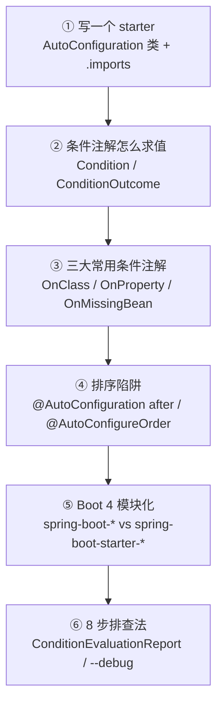
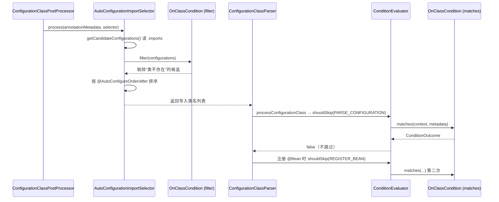
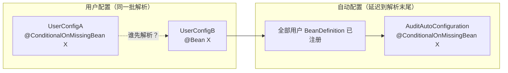
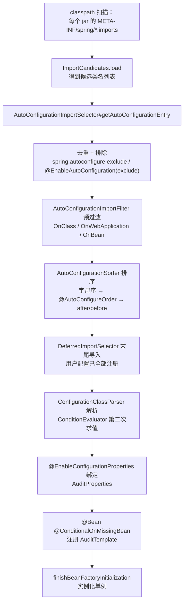

# 02-02 自定义 starter 与条件注解
	}
> 本文是《Spring 源码解析教程》Spring Boot 篇「02 自动配置」的第二篇。
> 上一篇 `01-enableautoconfiguration-自动配置全链路.md` 讲了"框架自己的自动配置是怎么被加载进来的"；
> 这一篇换个视角：**自己写一个 starter**，并且把"条件注解内部到底怎么判断"逐条拆开。
>
> 版本基线：**Spring Boot 4.2.0 / Spring Framework 7.1.0**。文中的行号都对应 `assets/source/` 下通过 Maven `-sources.jar` 入库的源码，
> 你可以打开同名文件对照阅读。

---

## 0. 现象：一个"怎么看都对"的 starter，就是不生效

先看一段真实的、几乎每个团队都会踩一遍的代码。假设我们做了一个审计日志 starter：

```text
audit-spring-boot-autoconfigure/
  src/main/java/com/example/audit/AuditAutoConfiguration.java
  src/main/resources/META-INF/spring/org.springframework.boot.autoconfigure.AutoConfiguration.imports
```

`AuditAutoConfiguration` 写得"很规范"：

示例（示意代码，非 Spring 源码）：

```text
@AutoConfiguration
@ConditionalOnClass(AuditClient.class)
@EnableConfigurationProperties(AuditProperties.class)
public class AuditAutoConfiguration {

    @Bean
    @ConditionalOnMissingBean
    public AuditTemplate auditTemplate(AuditProperties properties) {
```
        return new AuditTemplate(properties.getEndpoint());
    }
}
```
```

`.imports` 文件里也写了：

```text
com.example.audit.AuditAutoConfiguration
```

但把 jar 加到业务工程后，`@Autowired AuditTemplate` 报 `NoSuchBeanDefinitionException`。控制台除了一行 `APPLICATION FAILED TO START` 之外什么都没说。

新手会依次怀疑：`@Bean` 漏了？`@ConditionalOnClass` 的类不在 classpath？`.imports` 路径不对？——**这些怀疑都对，但顺序错了**。Boot 其实早就在**启动日志的 debug 报告**里把答案写好了：

```text
============================
CONDITIONS EVALUATION REPORT
============================

Positive matches:
-----------------
   None

Negative matches:
-----------------
   AuditAutoConfiguration:
      Did not match:
         - @ConditionalOnClass did not find required class 'com.example.audit.AuditClient' (OnClassCondition)
```

也就是说：**90% 的"自动配置不生效"都能靠 `ConditionEvaluationReport` 一句话定位**。本文 6.3 节会把这个报告彻底讲透。

除此之外，本篇还要回答三个"知其所以然"的问题：

1. 条件注解是怎么被**求值**的？`Condition` 接口只有 6 行，`@ConditionalOnClass` 凭什么生效？
2. 为什么 `@ConditionalOnMissingBean` 在**自动配置类**里可靠，在**自己的 `@Configuration`** 里就"时灵时不灵"？
3. Boot 4 把 jar 拆成了几十个模块，**starter 该怎么拆、依赖该怎么引**？

---

## 1. 地图：本篇的阅读路径



**读图说明**：

- 图从左到右是"**先会写 → 再懂原理 → 再会排错**"的顺序。零基础读者请按 ①→⑥ 顺序读，不要跳。
- ① 是"上手"，你会得到一个能跑通的最小 starter，把"自动配置"从抽象概念变成 jar 里的两个文件。
- ②③ 是"原理"，对应源码 `SpringBootCondition`、`OnClassCondition`、`OnPropertyCondition`、`OnBeanCondition`。这四个类加起来的核心代码不超过 200 行，非常值得读。
- ④ 是"排序"，它决定了 ① 里那个 `.imports` 文件中多个类的**先后**，也是 `@ConditionalOnMissingBean` 可靠性的物理基础。
- ⑤ 是"Boot 4 现实"，如果你照着 Boot 2 的教程写 starter，一定会在这里翻车。
- ⑥ 是"应急手册"，不求甚解也能用，但理解 ②③④ 后你会用得更快。

---

## 2. 关键类：先认人，再看戏

| 类 / 注解 | 所在模块 | 一句话职责 |
| --- | --- | --- |
| `@AutoConfiguration` | `spring-boot-autoconfigure` | 标记"我是自动配置类"，代替 `@Configuration`，自带 `before/after` 属性 |
| `.imports` 文件 | 你的 jar 的 `META-INF/spring/` 下 | **登记表**，每行一个自动配置类全名 |
| `ImportCandidates` | `spring-boot` | 读取所有 jar 里的 `.imports` 文件 |
| `AutoConfigurationImportSelector` | `spring-boot-autoconfigure` | 把候选清单筛选、排除、**预过滤**、排序 |
| `AutoConfigurationImportFilter` | `spring-boot-autoconfigure` | 预过滤接口，`OnClassCondition` 等实现它 |
| `Condition` | `spring-context` | 条件求值的**唯一入口**（`matches`） |
| `SpringBootCondition` | `spring-boot-autoconfigure` | Boot 的条件基类，负责日志与 `ConditionEvaluationReport` 记录 |
| `ConditionOutcome` | `spring-boot-autoconfigure` | 求值结果（匹配/不匹配 + 人类可读原因） |
| `ConditionEvaluator` | `spring-context` | 配置类解析阶段的"守门人"，调用 `Condition#matches` |
| `AutoConfigurationSorter` | `spring-boot-autoconfigure` | 按 `@AutoConfigureBefore/After/Order` 排序 |
| `ConditionEvaluationReport` | `spring-boot-autoconfigure` | `--debug` 打印的那张报告 |

> 提示：`ConditionOutcome`、`ConditionMessage` 也在 `spring-boot-autoconfigure` 的 `condition` 包下。本文不逐一贴它们的源码（它们是纯数据类），重点是**谁在什么时候调用它们**。

---

## 3. 源码逐段：从"写"到"为什么生效"

### 3.1 `@AutoConfiguration`：为什么它比 `@Configuration` 更适合自动配置

```java (src: AutoConfiguration.java#L43-L49)
@Target(ElementType.TYPE)
@Retention(RetentionPolicy.RUNTIME)
@Documented
@Configuration(proxyBeanMethods = false)
@AutoConfigureBefore
@AutoConfigureAfter
public @interface AutoConfiguration {
```

[[源码:AutoConfiguration.java#L43-L49]]

- **在干什么**：`@AutoConfiguration` 是"元注解组合"——它自己又标了 `@Configuration(proxyBeanMethods = false)`，所以标了 `@AutoConfiguration` 的类就是一个配置类。
- **为什么 `proxyBeanMethods = false`**：`@Configuration(proxyBeanMethods = true)`（默认值）会让 Spring 用 CGLIB 生成子类，从而让 `@Bean` 方法之间互相调用仍返回单例。这个代理在**启动期**有成本，而自动配置类通常是几十个 `@Bean` 方法、彼此不互相调用，所以 Boot 统一关掉代理。这带来一个副作用：**自动配置类里不要写 `a()` 去调 `b()`**，那样 `b()` 会被真的执行两次，产生两个对象。
- **为什么还要 `@AutoConfigureBefore/@AutoConfigureAfter`**：这两个是"空壳注解"（没有属性值），作用是让 `@AutoConfiguration` 能带 `before`/`after` 属性并做 `@AliasFor` 映射。看下一段：

```java (src: AutoConfiguration.java#L90-L111)
	/**
	 * The auto-configuration classes that should have already been applied.
	 * <p>
	 * Since this annotation is parsed by loading class bytecode, it is safe to specify
	 * classes here that may ultimately not be on the classpath, but only if this
	 * annotation is directly on the affected component and <b>not</b> if this annotation
	 * is used as a composed, meta-annotation. In order to use this annotation as a
	 * meta-annotation, only use the {@link #afterName} attribute.
	 * @return the classes
	 */
	@AliasFor(annotation = AutoConfigureAfter.class, attribute = "value")
	Class<?>[] after() default {};

	/**
	 * The names of the auto-configuration classes that should have already been applied.
	 * In the unusual case that an auto-configuration class is not a top-level class, its
	 * class name should use {@code $} to separate it from its containing class, for
	 * example {@code com.example.Outer$NestedAutoConfiguration}.
	 * @return the class names
	 */
	@AliasFor(annotation = AutoConfigureAfter.class, attribute = "name")
	String[] afterName() default {};
```

[[源码:AutoConfiguration.java#L90-L111]]

- **在干什么**：`after()` 与 `value()` 互为别名。所以 `@AutoConfiguration(after = X.class)` 和 `@AutoConfiguration(value = X.class)` 等价，而 `@AutoConfiguration(X.class)` 这种"位置简写"也是写给 `value()` 的。
- **踩坑**：`@AutoConfiguration` **不能**同时标 `@Configuration`，会报重复注解。从 Boot 2.7 起（`@since 2.7.0`）官方推荐新代码一律用 `@AutoConfiguration`。
- **踩坑 2**：`@AutoConfiguration` 标在**别的 jar** 里的类上没用，必须同时出现在 `.imports` 中——注解只是"自我介绍"，`.imports` 才是"报名表"。

### 3.2 `.imports` 文件：两行文本胜过一切配置

上一篇已经讲过读取逻辑（`ImportCandidates#load`）。这里补充**写文件时的真实格式要求**：

```text
# 注释行以 # 开头，允许空行
com.example.audit.AuditAutoConfiguration
com.example.audit.AuditMetricsAutoConfiguration
```

[[源码:ImportCandidates.java#L35-L37]]

```java (src: ImportCandidates.java#L35-L37)
	private static final String LOCATION = "META-INF/spring/%s.imports";

	private static final String COMMENT_START = "#";
```

- **文件名是模板拼出来的**：`META-INF/spring/` + 注解全限定名 + `.imports`。对自动配置来说就是 `META-INF/spring/org.springframework.boot.autoconfigure.AutoConfiguration.imports`，**一个字符都不能错**。
- **为什么不用 `spring.factories`**：`spring.factories` 是"一个文件装所有扩展点"的大杂烩，任何 jar 改动都会让缓存失效、也容易冲突。Boot 2.7 引入 `.imports`，Boot 3.0 起 `spring.factories` 中的 `EnableAutoConfiguration` 键**正式废弃**（保留兼容会打 `IllegalArgumentException` 或告警），Boot 4 完全不看它。
- **常见错法**：
  - 放到 `META-INF/spring.factories` → Boot 4 直接忽略。
  - 放到 `META-INF/org.springframework.boot.autoconfigure.AutoConfiguration.imports`（少了 `spring/`）。
  - 文件名写成 `AutoConfiguration.imports`（少了包名）。
  - 用了 `src/main/java` 目录（资源必须放 `resources`）。

### 3.3 `Condition`：只有 6 行代码的扩展点

`@ConditionalOnClass`、`@ConditionalOnBean`……最终都归结到 Spring Framework 的 `Condition` 接口。它在 `spring-context` 里：

```
```java (src: ConditionEvaluator.java#L81-L95)
	public boolean shouldSkip(@Nullable AnnotatedTypeMetadata metadata, @Nullable ConfigurationPhase phase) {
		if (metadata == null || !metadata.isAnnotated(Conditional.class.getName())) {
			return false;
		}

		if (phase == null) {
			if (metadata instanceof AnnotationMetadata annotationMetadata &&
					ConfigurationClassUtils.isConfigurationCandidate(annotationMetadata)) {
				return shouldSkip(metadata, ConfigurationPhase.PARSE_CONFIGURATION);
			}
			return shouldSkip(metadata, ConfigurationPhase.REGISTER_BEAN);
		}
...
		return false;
	}
```
[[源码:ConditionEvaluator.java#L81-L99]]

上面这段是 `shouldSkip` 的核心（省略号处是 `collectConditions` 前后的循环头与空行）：一句话——**先按 `phase` 分流，再按 `@Order` 顺序逐条件求值，任一失败即跳过**。

- **在干什么**：`ConditionEvaluator#shouldSkip` 是"要不要跳过这个配置类/这个 `@Bean`"的唯一判定入口。它先把注解元数据里所有 `@Conditional` 收集成 `Condition` 实例，再逐个 `matches`。
- **`phase` 是什么**：`ConfigurationPhase` 有两个值——
  - `PARSE_CONFIGURATION`：解析配置类阶段（决定"这个类要不要进来"）。
  - `REGISTER_BEAN`：注册 Bean 定义阶段（决定"这个 `@Bean` 方法要不要注册"）。
  某些条件只在某个阶段生效，这就是"条件注解有两个求值时机"的原因（详见 3.7）。

```java (src: ConditionEvaluator.java#L114-L128)
	List<Condition> collectConditions(@Nullable AnnotatedTypeMetadata metadata) {
		if (metadata == null || !metadata.isAnnotated(Conditional.class.getName())) {
			return Collections.emptyList();
		}

		List<Condition> conditions = new ArrayList<>();
		for (String[] conditionClasses : getConditionClasses(metadata)) {
			for (String conditionClass : conditionClasses) {
				Condition condition = getCondition(conditionClass, this.context.getClassLoader());
				conditions.add(condition);
			}
		}
		AnnotationAwareOrderComparator.sort(conditions);
		return conditions;
	}
```

[[源码:ConditionEvaluator.java#L114-L129]]
- **在干什么**：把 `@Conditional({A.class, B.class})` 里的类都实例化成对象，然后**按 `@Order` 排序**再逐个求值。
- **为什么要排序**：`@ConditionalOnBean` 这类条件在求值时可能需要读别的 Bean；顺序不对会读到"还没注册"的 Bean 定义。`OnBeanCondition` 的 `@Order` 是 `LOWEST_PRECEDENCE`（最晚），`OnClassCondition` 是 `HIGHEST_PRECEDENCE`（最早）——先做便宜且无副作用的类检查，最后做贵的 Bean 检查。
- 排序后一旦有**任意一个** `matches` 返回 `false`，`shouldSkip` 就返回 `true`（短路），后面的条件不再求值。这也是排查时的坑：报告里只显示"第一个失败的条件"，你可能要修完一层才看到下一层。

### 3.4 `SpringBootCondition`：把 `true/false` 变成"为什么"

Spring 原生的 `Condition#matches` 只返回布尔值。Boot 觉得不够，于是包了一层：

```java (src: SpringBootCondition.java#L31-L50)
	@Override
	public final boolean matches(ConditionContext context, AnnotatedTypeMetadata metadata) {
		String classOrMethodName = getClassOrMethodName(metadata);
		try {
			ConditionOutcome outcome = getMatchOutcome(context, metadata);
			logOutcome(classOrMethodName, outcome);
			recordEvaluation(context, classOrMethodName, outcome);
			return outcome.isMatch();
		}
		catch (NoClassDefFoundError ex) {
			throw new IllegalStateException("Could not evaluate condition on " + classOrMethodName + " due to "
					+ ex.getMessage() + " not found. Make sure your own configuration does not rely on "
					+ "that class. This can also happen if you are "
					+ "@ComponentScanning a springframework package (e.g. if you "
					+ "put a @ComponentScan in the default package by mistake)", ex);
		}
		catch (RuntimeException ex) {
			throw new IllegalStateException("Error processing condition on " + getName(metadata), ex);
		}
	}
```

[[源码:SpringBootCondition.java#L32-L50]]

- **在干什么**：三步固定套路——① `getMatchOutcome` 得到"结果 + 原因"；② `logOutcome` 打日志；③ `recordEvaluation` 写进 `ConditionEvaluationReport`；最后把结果转成 `boolean`。
- **关键信息**：`matches` 是 `final` 的。子类只能实现 `getMatchOutcome`。这保证了**每一个**条件求值都必然被记录，`--debug` 报告才会完整。
- **为什么 `catch NoClassDefFoundError`**：条件求值经常要"试加载"一个类。如果那个类的依赖缺了，抛的是 `NoClassDefFoundError`（不是 `ClassNotFoundException`），属于 `Error` 不是 `Exception`。Boot 把它翻译成一条带**排查建议**的异常——那条建议"你是不是在默认包里写了 `@ComponentScan`"非常经典，值得背下来。
- **`catch RuntimeException`**：条件实现里任何异常都会被包一层 `IllegalStateException("Error processing condition on ...")`，所以看到这个日志不要慌，看 `Caused by` 才是真因。

```java (src: SpringBootCondition.java#L90-L95)
	private void recordEvaluation(ConditionContext context, String classOrMethodName, ConditionOutcome outcome) {
		if (context.getBeanFactory() != null) {
			ConditionEvaluationReport.get(context.getBeanFactory())
				.recordConditionEvaluation(classOrMethodName, this, outcome);
		}
	}
```

[[源码:SpringBootCondition.java#L90-L95]]

- **在干什么**：把"哪个类/方法 → 哪个条件 → 结果 → 原因"记进注册在 `BeanFactory` 里的 `ConditionEvaluationReport`。
- **由此推出一个重要事实**：`ConditionEvaluationReport` 依赖 `context.getBeanFactory()`。所以在 **BeanFactory 还没创建**时（比如 `AutoConfigurationImportFilter` 预过滤阶段）不会正式记录——那一步用的是 `OnClassCondition` 的 `filter()` 方法（3.6 节）。

### 3.5 `ConditionOutcome` 与"原因文案"

`getMatchOutcome` 的返回类型是 `ConditionOutcome`，它由"布尔结果 + `ConditionMessage`"组成。构造方式有三种：

```text
ConditionOutcome.match(...)    // 匹配
ConditionOutcome.noMatch(...)  // 不匹配
```

`ConditionMessage` 负责拼装人类可读的原因，常用方法：

| 方法 | 含义 | 报告里的样子 |
| --- | --- | --- |
| `.because(reason)` | 补充原因 | `@ConditionalOnMissingBean found beans: ...` |
| `.found(...)` / `.didNotFind(...)` | 找到/没找到什么 | `did not find any beans` |
| `.items(Style.QUOTE, list)` | 列出具体项 | `'a', 'b'` |
| `.atAll()` | 强调"压根没有" | `did not find any beans at all` |
| `.availableOn(...)` | 提示"在别的平台可用" | `Reactive web application` |

写自己的条件时，**宁可把原因写啰嗦**。你未来省下的排查时间，都来自这一句 `because(...)`。

### 3.6 `AutoConfigurationImportFilter`：早于任何 Bean 的"预过滤"

Boot 在"候选清单"阶段就先甩掉一批自动配置类，避免为它们生成 `BeanDefinition`、解析注解。实现机制是 `AutoConfigurationImportFilter`：

```java (src: FilteringSpringBootCondition.java#L40-L58)
	public boolean[] match(@Nullable String[] autoConfigurationClasses,
			AutoConfigurationMetadata autoConfigurationMetadata) {
		ConditionEvaluationReport report = ConditionEvaluationReport.find(this.beanFactory);
		@Nullable ConditionOutcome[] outcomes = getOutcomes(autoConfigurationClasses, autoConfigurationMetadata);
		boolean[] match = new boolean[outcomes.length];
		for (int i = 0; i < outcomes.length; i++) {
			ConditionOutcome outcome = outcomes[i];
			match[i] = (outcome == null || outcome.isMatch());
			if (!match[i] && outcome != null) {
				String autoConfigurationClass = autoConfigurationClasses[i];
				Assert.state(autoConfigurationClass != null, "'autoConfigurationClass' must not be null");
				logOutcome(autoConfigurationClass, outcome);
				if (report != null) {
					report.recordConditionEvaluation(autoConfigurationClass, this, outcome);
				}
			}
		}
		return match;
	}
```

[[源码:FilteringSpringBootCondition.java#L40-L58]]

- **在干什么**：给一批候选类逐个返回"true/false"数组。返回 false 的类被**提前剔除**，永远不会进入配置类解析。
- **为什么要有这一步**：一个 Spring Boot Web 应用启动时会遇到上百个自动配置候选。如果每个都走完"解析注解 + 生成 BeanDefinition + 求值条件"，启动会明显变慢。类路径检查是纯字符串/类加载操作，最适合提前做。
- **三个默认实现**（按 `@Order` 先后执行）：

| 实现类 | `@Order` | 能提前判断的注解 |
| --- | --- | --- |
| `OnClassCondition` | `HIGHEST_PRECEDENCE` | `@ConditionalOnClass` / `@ConditionalOnMissingClass` |
| `OnWebApplicationCondition` | `HIGHEST_PRECEDENCE + 20` | `@ConditionalOnWebApplication` |
| `OnBeanCondition` | `LOWEST_PRECEDENCE` | `@ConditionalOnBean` / `@ConditionalOnMissingBean`（**只做"类不存在"的排除**） |

`OnBeanCondition` 的 `getOutcomes` 里只对**类缺失**的情况返回不匹配；真正判断"有没有这个 Bean"必须等到 Bean 定义注册之后。看它的阶段声明：

```java (src: OnBeanCondition.java#L79-L82)
	@Override
	public ConfigurationPhase getConfigurationPhase() {
		return ConfigurationPhase.REGISTER_BEAN;
	}
```

[[源码:OnBeanCondition.java#L80-L82]]

- **在干什么**：`ConfigurationCondition` 的 `getConfigurationPhase()` 返回 `REGISTER_BEAN`，表示**只在注册 Bean 阶段求值**（解析配置类阶段跳过）。
- **含义**：即使 `OnBeanCondition` 作为 `AutoConfigurationImportFilter` 被调用，它也不会真的去数 Bean——那时 Bean 定义还没注册全，数出来一定是错的。它只在"类没引进来"这种硬条件下才提前否决。

### 3.7 两个求值时机：为什么同一个条件会被算两次

把前面的碎片拼起来，`@ConditionalOnClass` 在一次启动中会被求值**两次**：



**读图说明**：

- 上半段（AIS / Filter）发生在"收集候选清单"时，此时**还没有 BeanFactory**，只能做类路径判断。
- 下半段（Parser / CE / Cond）发生在"解析配置类"时，此时 BeanFactory 已存在，各种 Bean 相关的条件才真正可算。
- 两段的结论**逻辑上应该一致**（同一个 `@ConditionalOnClass`），但**记录位置不同**：第一段的"剔除"记在 `ConditionEvaluationReport` 的 `Exclusions` 里，第二段记在 `Negative/Positive matches` 里。看 `--debug` 报告时要知道去哪个区找。

### 3.8 `@ConditionalOnProperty`：`havingValue` 与 `matchIfMissing`

这是业务代码最常用的条件。完整实现不到 100 行：

```java (src: OnPropertyCondition.java#L154-L175)
		private void collectProperties(PropertyResolver resolver, List<String> missing, List<String> nonMatching) {
			for (String name : this.names) {
				String key = this.prefix + name;
				if (resolver.containsProperty(key)) {
					if (!isMatch(resolver.getProperty(key), this.havingValue)) {
						nonMatching.add(name);
					}
				}
				else {
					if (!this.matchIfMissing) {
						missing.add(name);
					}
				}
			}
		}
	
		private boolean isMatch(@Nullable String value, String requiredValue) {
			if (StringUtils.hasLength(requiredValue)) {
				return requiredValue.equalsIgnoreCase(value);
			}
			return !"false".equalsIgnoreCase(value);
		}
```
	
[[源码:OnPropertyCondition.java#L154-L175]]

逐条拆解：

- **`prefix + name`**：`prefix` 在 `Spec` 构造时已保证以 `.` 结尾（`getPrefix()` 里 `prefix + '.'`），所以 `prefix = "audit"`、`name = "enabled"` 拼出 `audit.enabled`。**写 `prefix = "audit."` 不会报错，但会拼成 `audit..enabled`**，这是个高频错。
- **属性存在**：必须 `havingValue` 与值相等（`equalsIgnoreCase`，**不 trim**）。`havingValue` 为空时，只要值不是 `"false"`（忽略大小写）就算匹配。所以 `audit.enabled=` 这种"给了空值"的情况 → `""` 不等于 `"false"` → **匹配**！这是很多人以为"空值 = false"的误区。
- **属性不存在**：`matchIfMissing` 决定。默认 `false`（不匹配）；写 `matchIfMissing = true` 则"没配就等于开"。
- **多个 name**：`@ConditionalOnProperty(name = {"a","b"})` 是**与**关系，全部匹配才算匹配。
- **`prefix` 为空时**：`key` 就是 `name` 本身，可以用在任意属性名上。

三种典型配置的语义对照：

| 注解 | `audit.enabled` 未配 | `= true` | `= false` | `= yes` |
| --- | --- | --- | --- | --- |
| `@ConditionalOnProperty("audit.enabled")` | ✗ 不匹配 | ✓ 匹配 | ✗ 不匹配 | ✓ 匹配 |
| `@ConditionalOnProperty(prefix="audit", name="enabled", havingValue="true")` | ✗ 不匹配 | ✓ 匹配 | ✗ 不匹配 | ✗ 不匹配 |
| `@ConditionalOnProperty(prefix="audit", name="enabled", havingValue="true", matchIfMissing=true)` | ✓ 匹配 | ✓ 匹配 | ✗ 不匹配 | ✗ 不匹配 |

> Boot 4 新增了 `@ConditionalOnBooleanProperty`（`OnPropertyCondition` 内部同样处理，见 `OnPropertyCondition` 的 `stream()`）。它专门给"开关型"属性用，**没有 `havingValue`**，语义是"值为 true 则匹配"，默认 `matchIfMissing = false`。Boot 自己的 `spring.mvc.hiddenmethod.filter.enabled` 就用了它。新代码建议优先用它，语义更清楚。

### 3.9 `@ConditionalOnMissingBean`：`search` 策略与"为什么只在自动配置里可靠"

先看判断主体：

```java (src: OnBeanCondition.java#L190-L198)
	private ConditionOutcome evaluateConditionalOnMissingBean(Spec<ConditionalOnMissingBean> spec,
			ConditionMessage matchMessage) {
		MatchResult matchResult = getMatchingBeans(spec);
		if (matchResult.isAnyMatched()) {
			String reason = createOnMissingBeanNoMatchReason(matchResult);
			return ConditionOutcome.noMatch(spec.message().because(reason));
		}
		return ConditionOutcome.match(spec.message(matchMessage).didNotFind("any beans").atAll());
	}
```

[[源码:OnBeanCondition.java#L190-L198]]

- **在干什么**：`getMatchingBeans(spec)` 去 `BeanFactory` 里"数"符合要求的 Bean。只要**任何一个**匹配上了，就不匹配（`noMatch`），于是这个 `@Bean` 方法不注册。
- **"数"的是什么**：按 `type`（`value`/`type` 属性）、`annotation`、`name` 三种方式查 `BeanFactory`。注意它查的是**`BeanFactory` 当前的注册表**——包括还没实例化的 `BeanDefinition`，也包括已经注册的单例。

`search` 属性控制"去哪找"：

```java (src: OnBeanCondition.java#L722-L724)
		private SearchStrategy getStrategy() {
			return (this.strategy != null) ? this.strategy : SearchStrategy.ALL;
		}
```

[[源码:OnBeanCondition.java#L722-L724]]

| `search` | 查哪里 | 典型场景 |
| --- | --- | --- |
| `CURRENT`（默认行为之一） | 只在**当前** `BeanFactory` | 想"只看我这个 ApplicationContext"，避免父容器影响 |
| `ANCESTORS` | 只在父 `BeanFactory` | 少见，一般用于"父容器里有没有"的探测 |
| `ALL`（**默认**） | 当前 + 所有祖先 | 普通场景，语义最直观 |

- **`ALL` 是默认值**：`this.strategy` 为 null 时回退到 `ALL`。所以"我没写 search 为什么它找到了父容器里的 Bean"不是 bug。
- **`ANCESTORS` 的坑**：`getSearchBeanFactory` 里断言必须是 `ConfigurableListableBeanFactory`，且父工厂不能为 null，否则直接抛异常（`Unable to use SearchStrategy.ANCESTORS without ConfigurableListableBeanFactory`）。
- **`CURRENT` 的坑**：Spring Cloud 的多上下文（bootstrap/parent）里非常常见——你在子上下文里写的 `@ConditionalOnMissingBean` 看不见父上下文的 Bean，于是"重复注册"。这时要显式写 `search = SearchStrategy.ALL`。

现在回答那个核心问题：**为什么它只在自动配置类里可靠？**



**读图说明**：

- 左边是"用户配置类之间"的关系：`UserConfigA` 和 `UserConfigB` 在**同一个 `parse()` 批次**里被解析。`UserConfigA` 求值条件时，`UserConfigB` 的 `@Bean` 定义**可能还没被 `loadBeanDefinitions` 注册**，于是 `@ConditionalOnMissingBean` 判为"没有"，`A` 里的 Bean 被注册 —— 结果出现两个 `X`（或 `@Primary` 冲突）。
- 右边是"自动配置类"的位置：`AutoConfigurationImportSelector` 是 `DeferredImportSelector`，所有自动配置在**用户配置解析完之后**才被 `processGroupImports` 导入（上一篇 3.7 的源码）。此时用户的 `@Bean` 定义已全部注册，判断天然可靠。
- 换句话说：**`@ConditionalOnMissingBean` 的可靠性来自"自动配置最后跑"这个时序**，而不是注解本身有什么魔力。

官方在 `@ConditionalOnMissingBean` 的 Javadoc 里也反复强调："The condition can only match the bean definitions that have been processed by the application context so far and, as such, it is strongly recommended to use this condition on auto-configuration classes only."

### 3.10 排序陷阱：`after` 写错了，`@ConditionalOnMissingBean` 也会翻车

自动配置类之间也讲究顺序。假设你写了两个：

- `AuditAutoConfiguration`：注册 `AuditTemplate`。
- `AuditMetricsAutoConfiguration`：想给"用户自定义的 `AuditTemplate`"加埋点，写了 `@ConditionalOnBean(AuditTemplate.class)`。

如果 `AuditMetricsAutoConfiguration` 被排到前面，它看到的 `AuditTemplate` 还不存在，条件不匹配 → 埋点静默失效。修法就是：

```java
@AutoConfiguration(after = AuditAutoConfiguration.class)
public class AuditMetricsAutoConfiguration { ... }
```

`AutoConfigurationSorter` 的排序规则（按优先级）：

1. **字母序**（保证确定性，便于阅读报告）。
2. **`@AutoConfigureOrder`**（显式数字优先级，`DEFAULT_ORDER = 0`）。
3. **`@AutoConfigureBefore` / `@AutoConfigureAfter`**（拓扑排序，冲突时报 `AutoConfigure cycle detected between X and Y`）。

- **为什么第 3 条会"覆盖"第 2 条**：`after`/`before` 是**硬约束**，`@AutoConfigureOrder` 只在没有硬约束的相对位置之间起作用（`sortByAnnotation` 是在已按 order 排好的骨架里再做插入）。
- **看 `isAvailable()`**：Boot 处理 `before/after` 时，如果你写的那个类**不在 classpath**（比如它是可选依赖），这条约束会被**静默忽略**。所以"我写了 after 但顺序还是不对"的第一嫌疑是：`after` 指向的类没引进来。
- **别忘了 `.imports` 里的先后不算数**：`.imports` 只是清单，排序由 `AutoConfigurationSorter` 决定。你手动调换行顺序不会影响结果。

---

## 4. 时序：写一个能跑通的 starter，全流程

下面把从"自己的 jar 被加载"到"`AuditTemplate` 可注入"的全过程串起来。



**读图说明**：

- S1~S6 是"清单阶段"（无 BeanFactory），S7~S10 是"解析阶段"，S11 是"实例化阶段"。理解这三段的分界，就能定位 90% 的问题。
- **S9 为什么在 S10 前面**：`@EnableConfigurationProperties(AuditProperties.class)` 会注册一个 `ConfigurationPropertiesBindingPostProcessor`，并在**首个 Bean 实例化前**完成绑定。所以 `@Bean` 方法参数里的 `AuditProperties` 是已绑定的对象。
- **S8 的"第二次求值"**：即使 S5 的预过滤已经判断过 `@ConditionalOnClass`，S8 还会再算一次。这解释了一个经典现象——`--debug` 报告里同一个类同时出现在 `Exclusions` 和 `Negative matches`（如果你改过类路径）。

一个最小可运行的 starter 结构（可直接抄）：

```text
audit-spring-boot-starter/            # 只有 pom.xml，依赖 ↓
audit-spring-boot-autoconfigure/      # 代码都在这里
  src/main/java/com/example/audit/
    AuditAutoConfiguration.java
    AuditProperties.java
    AuditTemplate.java
  src/main/resources/META-INF/spring/
    org.springframework.boot.autoconfigure.AutoConfiguration.imports
```

`AuditProperties` 用构造器绑定最省心（Boot 3 起推荐）：

```java
@ConfigurationProperties("audit")
public record AuditProperties(String endpoint,
                              @DefaultValue("true") boolean enabled,
                              Duration timeout) { }
```

- `record` + 构造器绑定：不可变、不需要 `@ConstructorBinding`（唯一构造器自动识别）。
- `@DefaultValue` 用于"配置没给时"的默认值，比在字段上写初始值更适合 `record`。

自动配置类推荐"条件都写在类上，`@Bean` 上再补一层 `@ConditionalOnMissingBean`"：
示例（示意代码，非 Spring 源码）：

```text
@AutoConfiguration
@ConditionalOnClass(AuditClient.class)
@ConditionalOnProperty(prefix = "audit", name = "enabled", havingValue = "true", matchIfMissing = true)
@EnableConfigurationProperties(AuditProperties.class)
public class AuditAutoConfiguration {

    @Bean
    @ConditionalOnMissingBean
    public AuditTemplate auditTemplate(AuditProperties properties) {
        return new AuditTemplate(properties.endpoint());
    }
}
```

- **类上条件 vs `@Bean` 上条件**：类上的条件不满足时，**整个类的 `@Bean` 都不注册**，也少一次扫描；`@Bean` 上的 `@ConditionalOnMissingBean` 用来"允许用户覆盖单个 Bean"。这种"两层"是 Boot 自己的标准写法（可对照 `DispatcherServletAutoConfiguration`、`TomcatServletWebServerAutoConfiguration`）。
- **不要**在 `@Bean` 方法里 `new` 一个用户可能已定义的实现类然后指望它"自动让位"——必须由 `@ConditionalOnMissingBean` 来把关。

---

## 5. 设计模式：能复用的四个招

1. **组合注解（Composite Annotation）**：`@SpringBootApplication` = `@SpringBootConfiguration` + `@EnableAutoConfiguration` + `@ComponentScan`；`@AutoConfiguration` = `@Configuration(proxyBeanMethods=false)` + `@AutoConfigureBefore/After`。好处是"一个注解表达一组意图"，且属性可被 `@AliasFor` 精确重映射。
2. **策略 + 责任链**：`Condition` 是一堆可插拔策略，`ConditionEvaluator` 是链的驱动者；`AutoConfigurationImportFilter` 是另一条更早的链。新增条件类型不用改框架代码。
3. **模板方法**：`SpringBootCondition#matches`（final）固定"求值 → 日志 → 记录 → 返回"骨架，子类只实现 `getMatchOutcome`。所有条件因此天然拥有一致的可观测性。
4. **延迟执行（Deferred Import）**：`DeferredImportSelector` 把"顺序敏感"的东西推迟到批次末尾——这是 `@ConditionalOnMissingBean` 可靠性的实现手段，也是"约定优于配置"能成立的关键。

---

## 6. 踩坑与调试

### 6.1 `--debug` 打开 `ConditionEvaluationReport`

三种打开方式（任选其一）：

```properties
# application.properties
debug=true
```

```bash
# 命令行
java -jar app.jar --debug
```

```yaml
# 只想看自动配置报告，屏蔽其他 debug 日志（推荐）
logging:
  level:
    org.springframework.boot.autoconfigure.logging.ConditionEvaluationReportLoggingListener: debug
```

报告结构（顺序固定）：

```text
============================
CONDITIONS EVALUATION REPORT
============================

Positive matches:      # 条件匹配、配置类生效
-----------------
   AuditAutoConfiguration matched:
      - @ConditionalOnClass found required class 'com.example.audit.AuditClient' (OnClassCondition)

Negative matches:      # 条件不匹配、配置类未生效
-----------------
   AuditMetricsAutoConfiguration:
      Did not match:
         - @ConditionalOnBean (types: com.example.audit.AuditTemplate; SearchStrategy: all) did not find any beans (OnBeanCondition)

Exclusions:            # 预过滤/显式排除掉的一批类
-----------
    ...

Unconditional classes: # 无条件生效的配置类
----------------------
    ...
```

要点：

- **先搜你的类名**。找不到 → 说明根本没被加载（`.imports` 问题），而不是条件问题。
- **在 `Negative matches` 里看到原因** → 直接照原因改（缺类、缺属性、已有同名 Bean）。
- **在 `Exclusions` 里看到** → 被预过滤或 `spring.autoconfigure.exclude` 排除。
- **`OnBeanCondition` 的一句话里带 `SearchStrategy: all`**：说明用的是默认 `ALL`，父容器也会被检查。
- **`Unconditional classes` 里有你的类** → 你没写任何条件（不一定是错，但通常应该补）。

### 6.2 用 `ConditionEvaluationReport` 的 JSON 版本做 CI 断言

`ConditionEvaluationReport` 也可以直接注入读取（`spring-boot-actuator` 的 `conditions` 端点就是读它）：

```java
@Autowired
ConditionEvaluationReport report;

@Test
void auditAutoConfigurationShouldBeApplied() {
    assertThat(report.getConditionAndOutcomesBySource())
        .containsKey("com.example.audit.AuditAutoConfiguration");
}
```

- 在 CI 里加这样一条断言，可以防止"某次依赖升级把自动配置悄悄搞失效"。

### 6.3 "我的 starter 自动配置没生效" —— 8 步排查法

按"成本从低到高"排列，**不要跳步**：

| 步 | 检查 | 命令/证据 | 命中时的典型原因 |
| --- | --- | --- | --- |
| 1 | `.imports` 文件路径与文件名 | `unzip -l xxx.jar \| grep imports` | 少了 `spring/` 目录、文件名漏包名、放到了 `java` 目录 |
| 2 | `.imports` 内容 | 打开 jar 里的文件看一眼 | 空文件、包名写错、带了 BOM 头导致首行类名多一个字符 |
| 3 | jar 是否真的在 classpath | `mvn dependency:tree`、`java -jar` 时看 `BOOT-INF/lib` | starter 的 pom 把 `autoconfigure` 模块标成 `optional`/`provided` |
| 4 | `--debug` 报告里有没有你的类 | 搜类名 | 没有 → 回到 1；有 → 看 5 |
| 5 | 报告里的具体原因 | `Negative matches` | 缺类、`havingValue` 写错、已有同名 Bean |
| 6 | 是否被显式排除 | `spring.autoconfigure.exclude` / `@EnableAutoConfiguration(exclude=...)` | 配置中心/父 pom 里被排除了 |
| 7 | 是否被 `@ComponentScan` 误扫/漏扫 | 报告里出现两次同名类 | 你的 autoconfigure 包被业务工程扫到了（应避免），或 `proxyBeanMethods` 相关问题 |
| 8 | 是否被 `@EnableWebMvc` / `@EnableAutoConfiguration` 之外的手写配置"抢跑" | 报告里 `@ConditionalOnMissingBean` 显示 `found beans` | 用户配置先注册了同名 Bean（这是**正常**行为，不是 bug） |

补充两个**只看报告看不出**的场景：

- **AOT/原生镜像**：`-Dspring.aot.enabled=true` 时自动配置在构建期就被展开，运行期改 `.imports` 无效。排查要在构建日志里看。
- **`spring.factories` 混用**：如果你的 jar 里同时有旧的 `spring.factories` 且只写了 `EnableAutoConfiguration` 键，Boot 4 不会报错、也不会加载——这是最容易"静默失败"的一种。

### 6.4 常见异常速查

| 异常信息 | 原因 | 修法 |
| --- | --- | --- |
| `No auto configuration classes found in META-INF/spring/...imports` | `.imports` 不存在或为空 | 检查路径与打包 |
| `The following classes could not be excluded because they are not auto-configuration classes: ...` | `spring.autoconfigure.exclude` 写了非自动配置类 | 检查类名/包名 |
| `AutoConfigure cycle detected between X and Y` | `after`/`before` 互相指向 | 断掉一条 |
| `Error processing condition on ...@ConditionalOnClass` | 条件里引用的类有依赖缺失（`NoClassDefFoundError`） | 补齐传递依赖，或改用 `@ConditionalOnClass(name="...")` |
| `Could not evaluate condition on ... due to ... not found` | 同上，且 Boot 给了组件扫描的排查建议 | 检查是否把 `@ComponentScan` 写在默认包 |

---

## 7. ⚠️ 版本差异：Boot 2.x / 3.x / 4.x 与 Boot 4 模块化

### 7.1 自动配置登记方式

| 版本 | 登记文件 | 备注 |
| --- | --- | --- |
| Boot 1.x ~ 2.6 | `META-INF/spring.factories` 中的 `org.springframework.boot.autoconfigure.EnableAutoConfiguration` 键 | 一个文件装所有扩展点 |
| Boot 2.7 | 新增 `META-INF/spring/org.springframework.boot.autoconfigure.AutoConfiguration.imports`，两者都支持 | 过渡版本 |
| Boot 3.0 | `.imports` 成为唯一推荐；`spring.factories` 的自动配置键**废弃** | 用 `@AutoConfiguration` 替代 `@Configuration` 写自动配置类 |
| Boot 4.x（本文基线 4.2.0） | 只认 `.imports`；候选来源为 `ImportCandidates.load(...)` | 见 `AutoConfigurationImportSelector#getCandidateConfigurations` 的断言文案 |

**证据**：`ImportCandidates` 的常量 `LOCATION = "META-INF/spring/%s.imports"`，以及 `getCandidateConfigurations` 里的断言
`"No auto configuration classes found in META-INF/spring/<annotation>.imports. ..."`——源码只提到 `.imports`，没有 `spring.factories` 分支。

### 7.2 `@AutoConfiguration` 的出现

- Boot 2.6 及以前：自动配置类 = `@Configuration` + `spring.factories` 登记。
- Boot 2.7 起：`@AutoConfiguration`（`@since 2.7.0`，见源码 Javadoc），`proxyBeanMethods` 恒为 `false`，自带 `before/after/beforeName/afterName`。
- Boot 3/4：新代码应一律用 `@AutoConfiguration`；用 `@Configuration` 仍能工作，但拿不到 `before/after` 属性，且可能在检查工具里被标记。

### 7.3 Boot 4 的模块化：`spring-boot-*` 与 `spring-boot-starter-*`

Boot 4 把原本塞在 `spring-boot-autoconfigure` 里的自动配置**按技术栈拆到独立模块**。以 Web 为例（这些结论都由 `node tools/list-jar.mjs` 实际列 jar 验证）：

| 类 | Boot 3 位置 | Boot 4 位置（4.2.0） |
| --- | --- | --- |
| `WebMvcAutoConfiguration` | `spring-boot-autoconfigure`，包 `org.springframework.boot.autoconfigure.web.servlet` | `spring-boot-webmvc`，包 `org.springframework.boot.webmvc.autoconfigure` |
| `DispatcherServletAutoConfiguration` | 同上 | `spring-boot-webmvc`，同包 |
| `ServletWebServerApplicationContext` | `spring-boot`，包 `org.springframework.boot.web.servlet.context` | `spring-boot-web-server`，包 `org.springframework.boot.web.server.servlet.context` |
| `TomcatServletWebServerFactory` | `spring-boot`，包 `org.springframework.boot.web.embedded.tomcat` | `spring-boot-tomcat`，包 `org.springframework.boot.tomcat.servlet` |
| `ServerProperties` | `spring-boot-autoconfigure`，包 `org.springframework.boot.autoconfigure.web` | `spring-boot-web-server`，包 `org.springframework.boot.web.server.autoconfigure` |

**命名规矩**（记住这两条就不会乱）：

- `spring-boot-starter-*`：**只做依赖聚合**，几乎没有代码。比如 `spring-boot-starter-web` 的 pom 里只是引 `spring-boot-webmvc`、`spring-boot-tomcat`、`jackson` 等。
- `spring-boot-*`（无 `starter`）：**真正放代码/自动配置**。比如 `spring-boot-webmvc` 里有 `WebMvcAutoConfiguration`。
- 第三方 starter 应命名为 `xxx-spring-boot-starter`（公司名前缀），避免与官方 `spring-boot-starter-*` 冲突。

对你的 starter 的直接影响：

1. 如果你的 autoconfigure 模块依赖了 Web 相关类，Boot 4 需要显式引 `spring-boot-webmvc`/`spring-boot-tomcat`；Boot 3 时这些类在 `spring-boot-autoconfigure` 里"顺手就有"。
2. `@ConditionalOnClass` 里写旧包名会在 Boot 4 下**永远不匹配**（类确实不存在），报告会显示 `did not find required class`——这时不要怀疑逻辑，先查包名。
3. 判断"是否在 Web 环境"别再依赖 `ServletWebServerApplicationContext` 类名，用 `@ConditionalOnWebApplication(type = Type.SERVLET)`，它对两代版本都成立（内部判断基于 `GenericWebApplicationContext` 等类型）。

---

## 8. 面试高频 10+ 问

**Q1：`@Conditional` 和 `@ConditionalOnClass` 什么关系？**

`@Conditional` 是 Spring Framework 的通用扩展点，值是 `Condition` 实现类数组。`@ConditionalOnClass` 是 Boot 提供的**元注解**，它上面标了 `@Conditional(OnClassCondition.class)`。所以所有 `@ConditionalOnXxx` 最终都落到 `ConditionEvaluator` → `Condition#matches`。

**Q2：条件注解在什么时候求值？**

两个阶段：`ConfigurationPhase.PARSE_CONFIGURATION`（解析配置类时，决定"类要不要进来"）和 `REGISTER_BEAN`（注册 `@Bean` 时）。`ConfigurationCondition#getConfigurationPhase()` 可以指定只在一个阶段求值，例如 `OnBeanCondition` 只声明 `REGISTER_BEAN`。

**Q3：`AutoConfigurationImportFilter` 和 `Condition` 的区别？**

前者是**预过滤**，在候选清单阶段（无 BeanFactory）按类路径等硬条件剔除；后者是**正式求值**，可以在有 BeanFactory 时判断 Bean。`FilteringSpringBootCondition` 同时实现两者，用 `filter()` 提供批量入口、用 `getMatchOutcome()` 提供逐个入口。

**Q4：为什么 `@ConditionalOnMissingBean` 只在自动配置类可靠？**

因为自动配置通过 `DeferredImportSelector` 延迟到用户配置解析完成之后才导入，此时用户的 `BeanDefinition` 已全部注册。用户配置类之间是"同批"解析，谁先谁后取决于排序/扫描顺序，看见的 Bean 集合不完整。

**Q5：`@ConditionalOnProperty` 的 `havingValue` 语义？**

属性存在时，`havingValue` 非空则要求 `equalsIgnoreCase`；`havingValue` 为空则只要值不是 `"false"`（忽略大小写）就算匹配。属性不存在时看 `matchIfMissing`，默认 `false`。注意**不 trim**，`havingValue="true"` 配 `" true "` 不匹配。

**Q6：`@ConditionalOnMissingBean` 的 `search` 默认是什么？**

`SearchStrategy.ALL` —— 当前 `BeanFactory` 加所有祖先。`CURRENT` 只看当前，`ANCESTORS` 只看父（要求父必须是 `ConfigurableListableBeanFactory`）。

**Q7：自动配置类的排序规则？**

`AutoConfigurationSorter`：先字母序，再 `@AutoConfigureOrder`（默认 0），最后按 `@AutoConfigureBefore/After` 做拓扑排序（`@AutoConfiguration` 的 `before/after` 属性等价）。约束指向的类不在 classpath 时该约束被忽略，存在环则抛异常。

**Q8：怎么临时关掉某个自动配置？**

三种：① `@SpringBootApplication(exclude = XxxAutoConfiguration.class)`；② 属性 `spring.autoconfigure.exclude=全限定名`；③ 用 `@ConditionalOnProperty` 提供的开关。排除非自动配置类会抛 `IllegalStateException`（`checkExcludedClasses`）。

**Q9：Boot 4 里 `spring.factories` 还能写自动配置吗？**

不能。Boot 4 从 `META-INF/spring/<注解全名>.imports` 读候选，`ImportCandidates` 只有这一个位置常量。`spring.factories` 仍用于其他扩展点（如 `ApplicationContextFactory`、`SpringApplicationRunListener`）。

**Q10：`spring-boot-starter-web` 和 `spring-boot-webmvc` 的区别？**

前者是**依赖聚合包**（几乎没有代码），后者是**实现模块**（含 `WebMvcAutoConfiguration` 等）。Boot 4 大幅拆细模块后，写 starter 时要区分"我要的是依赖"还是"我要的是类"。

**Q11：条件求值出异常会怎样？**

`SpringBootCondition#matches` 捕获 `RuntimeException` 包成 `IllegalStateException("Error processing condition on ...")`；捕获 `NoClassDefFoundError` 包成带"检查组件扫描包"建议的 `IllegalStateException`。启动直接失败，不会静默跳过。

**Q12：`ConditionOutcome` 里的原因文本对生产有什么价值？**

它进入 `ConditionEvaluationReport`，是 `--debug` 报告与 Actuator `conditions` 端点的数据源。自定义条件应写清 `didNotFind(...)`/`found(...)`，让运维能自解释。

---

## 9. 练习

1. **最小 starter**：新建两个 Maven 模块，实现 `AuditAutoConfiguration` + `AuditProperties`，并给出 `.imports`。要求在业务工程里 `@Autowired AuditTemplate` 成功，且不写任何 `@ComponentScan`。
2. **覆盖测试**：在业务工程里自己定义一个 `AuditTemplate` Bean，观察启动日志中 `@ConditionalOnMissingBean` 的 `Negative matches` 输出，理解"用户优先"。
3. **写一个自定义条件**：实现 `Condition`（继承 `SpringBootCondition`），语义是"只在 Linux 且 `audit.endpoint` 非空时匹配"。要求：不匹配时在 `--debug` 报告里能读到你自己写的 `because(...)` 文案。
4. **验证 `matchIfMissing`**：分别用 `@ConditionalOnProperty(name="audit.enabled")` 和不带前缀的写法，在"属性不存在/为空/true/false/大写 TRUE"五种情况下填写实际匹配结果，与 3.8 的表格对照。
5. **`search` 实验**：写两个 `AnnotationConfigApplicationContext`（父子关系），在子上下文里用 `search = CURRENT` 和 `ALL` 各测一次 `@ConditionalOnMissingBean`，观察差异。
6. **排序实验**：把 3.10 的两个自动配置类的 `after` 删掉，反复启动观察顺序是否变化（提示：字母序让它稳定，但把类名改成 `ZAudit...` 试试）。
7. **排查演练**：故意把 `.imports` 放到 `META-INF/`（去掉 `spring/`），用 6.3 的 8 步排查表写一份"如何定位到第 1 步"的记录。
8. **模块迁移**：把一段引用 `org.springframework.boot.web.embedded.tomcat.TomcatServletWebServerFactory` 的代码迁移到 Boot 4，写出 pom 变化与新包名，并用 `node tools/list-jar.mjs` 验证。

---

## 小结

- **写一个 starter 只需要三样东西**：`@AutoConfiguration` 类、`META-INF/spring/org.springframework.boot.autoconfigure.AutoConfiguration.imports` 文件、可选的 `@ConfigurationProperties`。`.imports` 是登记表，注解只是自我介绍。
- **条件注解的求值链**是 `ConditionEvaluator` → `Condition#matches` → `SpringBootCondition#matches`（final）→ 子类 `getMatchOutcome` → `ConditionOutcome`（结果 + 原因）→ 写入 `ConditionEvaluationReport`。
- **一次启动有两次求值**：`AutoConfigurationImportFilter`（无 BeanFactory，按类路径预过滤）+ 配置类解析阶段（有 BeanFactory，判断 Bean）。`OnBeanCondition` 只声明 `REGISTER_BEAN`，因为早期数 Bean 一定是错的。
- **`@ConditionalOnProperty`**：属性存在看 `havingValue`（空值则"非 false 即真"），不存在看 `matchIfMissing`；不 trim；多 name 是与关系。
- **`@ConditionalOnMissingBean`**：默认 `SearchStrategy.ALL`；其可靠性来自"自动配置通过 `DeferredImportSelector` 最后导入"这一时序，所以只建议在自动配置类使用。
- **排序**：字母序 → `@AutoConfigureOrder` → `before/after` 拓扑；`.imports` 里行的先后不影响顺序；`after` 指向的类缺失时约束被忽略。
- **Boot 4 模块化**：`spring-boot-starter-*` 是依赖聚合，`spring-boot-*` 是代码模块；包路径大面积迁移（`autoconfigure.web.servlet` → `webmvc.autoconfigure` 等），`@ConditionalOnClass` 里的旧类名会静默不匹配。
- **排错**：`--debug` 看 `ConditionEvaluationReport` 的四个区块（Positive / Negative / Exclusions / Unconditional），先搜类名，再看原因。

## 自测题

<details><summary>1. 自动配置类的登记文件全路径是什么？</summary>

`META-INF/spring/org.springframework.boot.autoconfigure.AutoConfiguration.imports`。路径由 `ImportCandidates.LOCATION = "META-INF/spring/%s.imports"` 用注解全限定名拼出。

</details>

<details><summary>2. 为什么 `@AutoConfiguration` 强制 `proxyBeanMethods = false`？</summary>

避免为每个自动配置类生成 CGLIB 代理，降低启动开销。代价是自动配置类里不能靠方法调用共享 Bean（`a()` 调 `b()` 会真的新建对象）。

</details>

<details><summary>3. `SpringBootCondition#matches` 为什么是 final？</summary>

为了强制"求值 → 打日志 → 记录到 `ConditionEvaluationReport` → 返回"这套骨架对所有条件一致，保证 `--debug` 报告完整、可观测。

</details>

<details><summary>4. `OnBeanCondition` 为什么声明 `ConfigurationPhase.REGISTER_BEAN`？</summary>

因为判断"有没有某个 Bean"必须在 Bean 定义注册之后才有意义。解析阶段过早求值会得到错误结论。

</details>

<details><summary>5. `AutoConfigurationImportFilter` 的三个默认实现的执行顺序？</summary>

`OnClassCondition`（HIGHEST_PRECEDENCE）→ `OnWebApplicationCondition`（+20）→ `OnBeanCondition`（LOWEST_PRECEDENCE）：先便宜、无副作用的类检查，最后才是 Bean 检查。

</details>

<details><summary>6. `@ConditionalOnProperty(prefix="a", name="b")` 在 `a.b` 未配置时匹配吗？</summary>

不匹配。`matchIfMissing` 默认 false。若写 `matchIfMissing = true` 则匹配。

</details>

<details><summary>7. `a.b=`（空值）配 `havingValue = "false"` 会匹配吗？</summary>

不匹配。`isMatch` 用 `equalsIgnoreCase`，`""` 不等于 `"false"`。若 `havingValue` 为空，空值因"不是 false"反而会匹配。

</details>

<details><summary>8. `@ConditionalOnMissingBean` 的 `search` 默认值是什么？`CURRENT` 有什么风险？</summary>

默认 `SearchStrategy.ALL`。`CURRENT` 只看当前 BeanFactory，在父子上下文（如 Spring Cloud）中会看不到父容器的 Bean，导致重复注册。

</details>

<details><summary>9. 自动配置排序的三级规则？</summary>

① 字母序（确定性）；② `@AutoConfigureOrder`（`AutoConfigureOrder.DEFAULT_ORDER = 0`）；③ `@AutoConfigureBefore/After`（拓扑排序，成环抛 `AutoConfigure cycle detected between X and Y`）。

</details>

<details><summary>10. `after = SomeAutoConfiguration.class` 但 SomeAutoConfiguration 不在 classpath 会发生什么？</summary>

约束被静默忽略（`isAvailable()` 为 false 时不加入依赖图），不影响启动，也不会报错。这是"写了 after 顺序还是不对"的头号原因。

</details>

<details><summary>11. `spring.autoconfigure.exclude` 写了非自动配置类会怎样？</summary>

启动抛 `IllegalStateException`，信息形如 `The following classes could not be excluded because they are not auto-configuration classes: ...`（`checkExcludedClasses`）。

</details>

<details><summary>12. Boot 4 里 `spring-boot-starter-web` 与 `spring-boot-webmvc` 的职责划分？</summary>

`spring-boot-starter-web` 是依赖聚合（几乎无代码）；`spring-boot-webmvc` 是实现模块（含 `WebMvcAutoConfiguration`、`DispatcherServletAutoConfiguration`）。Boot 4 为减小依赖面把自动配置拆到技术栈模块。

</details>

<details><summary>13. `--debug` 报告的四个区块分别代表什么？</summary>

`Positive matches`（条件匹配、生效）、`Negative matches`（条件不匹配、未生效，含原因）、`Exclusions`（预过滤或被 `spring.autoconfigure.exclude` 排除）、`Unconditional classes`（无条件的配置类）。

</details>

<details><summary>14. 自定义条件时，为什么推荐继承 `SpringBootCondition` 而不是直接实现 `Condition`？</summary>

继承后只需实现 `getMatchOutcome` 返回 `ConditionOutcome`（带人类可读原因），并自动获得日志与 `ConditionEvaluationReport` 记录；直接实现 `Condition` 只能返回 boolean，排错时一无所有。

</details>
