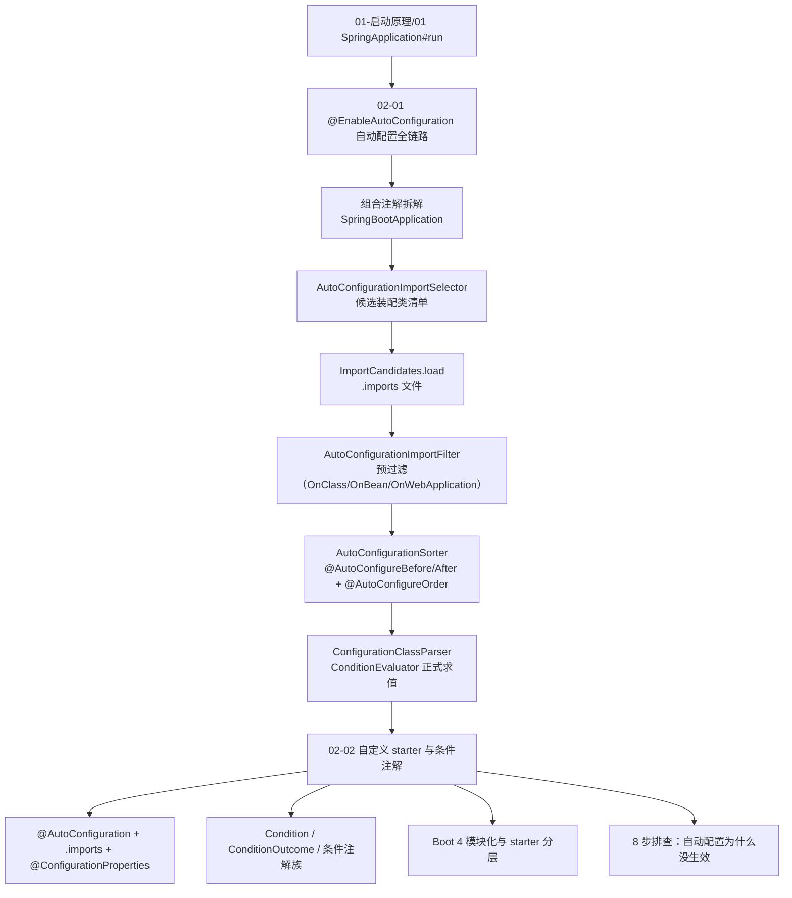

# 02 自动配置（`@EnableAutoConfiguration` / `AutoConfiguration.imports` / 条件装配）

> 一句话定位：本篇解决"**我的 `@Bean` 是怎么被 Boot 自动注册进来的，为什么有时候不注册**"这两个问题。
> 版本基线：`org.springframework.boot:spring-boot-autoconfigure:4.2.0`（依赖 `spring-framework:7.1.0`）
> 阅读前置：`02-SpringBoot/01-启动原理/01-springapplication-run-启动全流程.md`（自动配置发生在 `refreshContext` 内）

---

## 学习目标

学完这两篇，你应当能：

1. 一眼把 `@SpringBootApplication` 拆成三个注解，并说出 `@EnableAutoConfiguration` 上的 `@Import` 引入了谁。
2. 手画 `AutoConfigurationImportSelector#getAutoConfigurationEntry` 的 6 个步骤（取候选 → 去重 → 算排除 → 校验排除 → 过滤 → 发事件）。
3. 解释 `META-INF/spring/org.springframework.boot.autoconfigure.AutoConfiguration.imports` 文件是什么、谁读它、和 `spring.factories` 的关系。
4. 解释"两轮条件评估"：`AutoConfigurationImportFilter` 的**预过滤**（不读字节码）与 `ConditionEvaluator` 的**正式求值**（按 `ConfigurationPhase`）。
5. 说清 `@ConditionalOnMissingBean` 为什么只在**自动配置类**里可靠。
6. 从零写一个 starter（`@AutoConfiguration` + `.imports` + `@ConfigurationProperties` + 条件注解），并能按 8 步排查"没生效"。

## 文章顺序

**读图说明**：整条链路是"**先在 `prepareContext` 阶段用 `@Import` 挂上一个 `DeferredImportSelector`，再在 `refresh()` 的 `invokeBeanFactoryPostProcessors`（`ConfigurationClassPostProcessor`）里真正跑起来**"。图中 `A2 → A5` 都发生在 `ConfigurationClassParser#parse` 的"延迟导入处理"里：先收集候选、再排序，然后 `A6` 才逐个把自动配置类当作 `@Configuration` 解析，并执行 `REGISTER_BEAN` 阶段的条件。`B` 组是把 `A` 组的知识反过来用：自己当"自动配置提供方"。

## 文章摘要

| 文章 | 主线 | 关键源码 |
| --- | --- | --- |
| `01-enableautoconfiguration-自动配置全链路.md` | `@SpringBootApplication` → `@EnableAutoConfiguration` → `AutoConfigurationImportSelector#selectImports` → `getAutoConfigurationEntry` → `getCandidateConfigurations`（`ImportCandidates.load`）→ `AutoConfigurationImportFilter` 预过滤 → `AutoConfigurations` / `AutoConfigurationSorter` 排序 → `ConfigurationClassParser` / `ConditionEvaluator` 正式求值 | `SpringBootApplication.java`、`EnableAutoConfiguration.java`、`AutoConfigurationImportSelector.java`、`ImportCandidates.java`、`AutoConfigurationSorter.java`、`ConditionEvaluator.java`、`ConfigurationClassParser.java`、`OnBeanCondition.java` |
| `02-自定义starter与条件注解.md` | 手写 starter：`@AutoConfiguration` 类 + `.imports` 文件 + `@ConfigurationProperties` + 条件注解；条件注解内部实现（`Condition`/`ConditionOutcome`、`havingValue`/`matchIfMissing`、`search` 策略）；Boot 4 模块化（`spring-boot-*` vs `spring-boot-starter-*`）；8 步排查清单 | `AutoConfiguration.java`、`SpringBootCondition.java`、`FilteringSpringBootCondition.java`、`OnPropertyCondition.java`、`OnBeanCondition.java`、`AutoConfigurationImportSelector.java`、`ImportCandidates.java` |

## 前置知识自检

- 知道 `BeanFactoryPostProcessor` 与 `BeanPostProcessor` 的区别（前者改"定义"，后者改"实例"）。
- 知道 `@Configuration(proxyBeanMethods = false)` 的 `@Bean` 方法之间不再走 CGLIB 代理。
- 知道 `ImportSelector` 和 `ImportBeanDefinitionRegistrar` 都是 `@Import` 的变种。

## 学习检查点

- [ ] 不看源码，说出 `getAutoConfigurationEntry` 的 6 个步骤顺序。
- [ ] 说出 `.imports` 文件的完整路径，以及它是用 `classLoader.getResources(...)` 找的还是 `getResource(...)`。
- [ ] 解释为什么 `OnBeanCondition` 在预过滤阶段"只判断类的存在性"，真正的 Bean 判断要留到 `REGISTER_BEAN`。
- [ ] 解释 `@ConditionalOnMissingBean` 与用户配置类的**注册先后顺序**关系（用户类先被解析）。
- [ ] 写出一个最小 starter，并用 `--debug` 输出的 `ConditionEvaluationReport` 验证它生效了。
- [ ] 说出 `spring.autoconfigure.exclude` 与 `@SpringBootApplication(exclude = ...)` 最终都汇入哪个方法。

## 建议阅读方式

1. 第一遍只读"0 现象 / 1 地图 / 4 时序"，把整条链路串起来。
2. 第二遍跟着 `3.x` 的源码逐段读，**每一段都问自己"如果删掉这一行会怎样"**。
3. 第三遍做练习：写一个 `hello-spring-boot-starter`，故意制造"没生效"，再用第 6 节的手段排掉。
