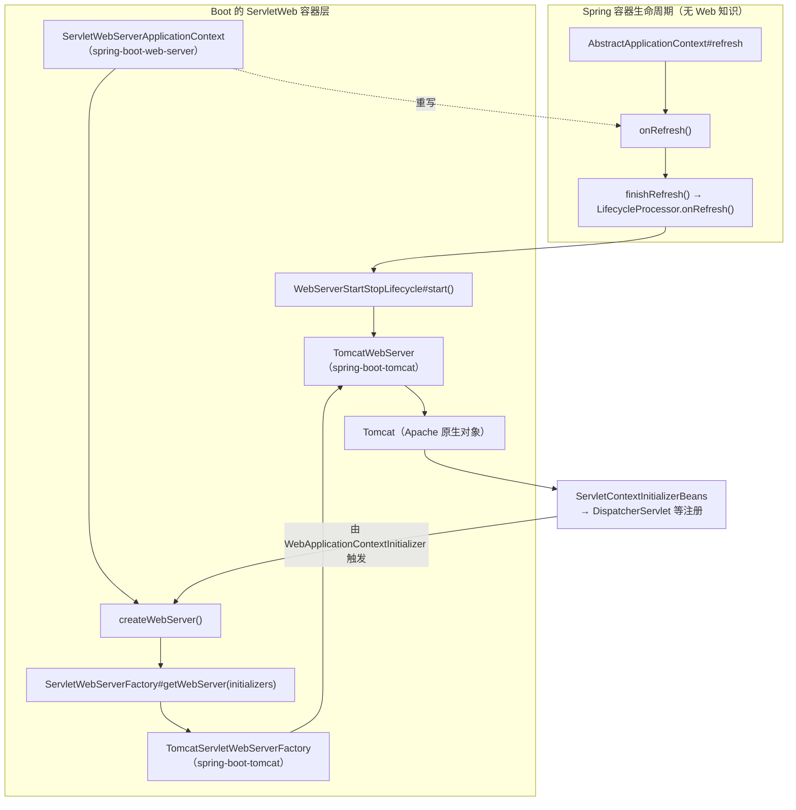
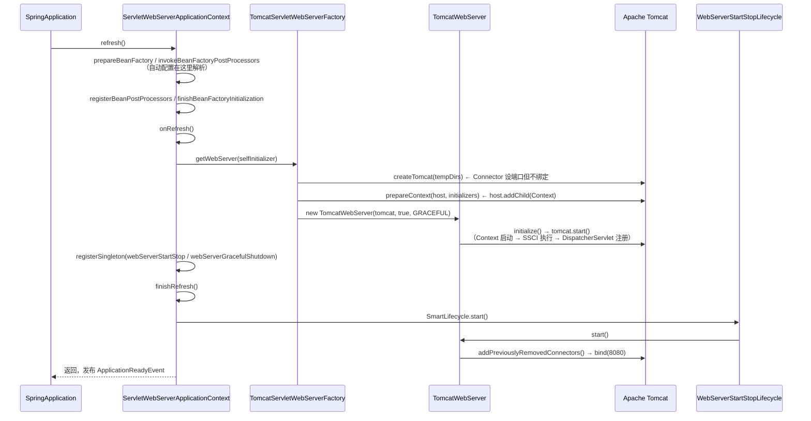

# 01 · 内嵌容器启动：Tomcat 与 ServletWeb 容器

> 版本基线：**Spring Boot 4.2.0** / **Spring Framework 7.1.0**
> 前置：`02-SpringBoot/01-启动原理/01-springapplication-run-启动全流程.md`（`refreshContext` 是本文的入口）、`02-SpringBoot/02-自动配置/01-enableautoconfiguration-自动配置全链路.md`（`ServletWebServerFactory` 是被自动配置出来的）

## 0. 现象：控制台那三行日志与一个反直觉的事实

### 0.1 你天天看到的日志

```text
Tomcat initialized with port 8080 (http)
Tomcat started on port 8080 (http) with context path '/'
Started DemoApplication in 1.532 seconds (process running for 1.874)
```

多数人以为"Tomcat 是 `main` 方法里启动的"。**不是**。`SpringApplication#run` 的代码里没有一行 `new Tomcat()`，也没有一行 `tomcat.start()`。Tomcat 是在 **`ApplicationContext.refresh()` 的 `onRefresh()` 阶段**被创建并启动的。

更反直觉的是：`new TomcatWebServer(...)` 的**构造函数里就调用了 `tomcat.start()`**，但此时端口并没有对外服务，浏览器也连不上。真正的"开始接客"是在稍后另一个生命周期回调里。这两个事实是本文要拆开讲的第一件事。

### 0.2 四个"我一改就报错"的现象

| 现象 | 真正的源码位置 |
| --- | --- |
| `java.lang.IllegalStateException: Unable to start ServletWebServerApplicationContext due to multiple ServletWebServerFactory beans` | `ServletWebServerApplicationContext#getWebServerFactory` |
| `java.lang.IllegalStateException: The host does not contain a Context` | `TomcatWebServer#findContext` |
| 启动不报错但访问 404，日志里 `with context path '/demo'` | `TomcatServletWebServerFactory#prepareContext` 把 `settings.getContextPath()` 设成 `context.setPath(...)` |
| 端口被占用时异常里出现 `Port 8080 is already in use` | `TomcatWebServer#start` 调 `PortInUseException.throwIfPortBindingException` |

### 0.3 一个"类找不到"的现象（Boot 4 特有）

把老项目从 Boot 3 升到 Boot 4，`import org.springframework.boot.web.servlet.context.ServletWebServerApplicationContext;` 编译不过；`org.springframework.boot.web.embedded.tomcat.TomcatServletWebServerFactory` 也编译不过。

这不是"类被删了"，而是**模块化拆分后搬了家**：

| 类 | Boot 3 坐标 | Boot 4 坐标 |
| --- | --- | --- |
| `ServletWebServerApplicationContext` | `org.springframework.boot:spring-boot`，包 `org.springframework.boot.web.servlet.context` | `org.springframework.boot:spring-boot-web-server`，包 `org.springframework.boot.web.server.servlet.context` |
| `TomcatServletWebServerFactory` | `org.springframework.boot:spring-boot`，包 `org.springframework.boot.web.embedded.tomcat` | `org.springframework.boot:spring-boot-tomcat`，包 `org.springframework.boot.tomcat.servlet` |
| `TomcatWebServer` | `org.springframework.boot:spring-boot`，包 `org.springframework.boot.web.embedded.tomcat` | `org.springframework.boot:spring-boot-tomcat`，包 `org.springframework.boot.tomcat` |
| `ServerProperties` | `org.springframework.boot.autoconfigure.web.ServerProperties` | `org.springframework.boot.web.server.autoconfigure.ServerProperties`（`spring-boot-web-server`） |

本文所有源码引用都来自真实的 `-sources.jar`，每一处都写明了 artifact 与路径。

## 1. 地图：内嵌容器的四层结构



**读图说明**：

- 上半部分是**通用 Spring 容器**的刷新流程（`refresh()` 里依次调 `onRefresh()`、`finishRefresh()`），它本身完全不知道 Web 是什么。
- 下半部分是 Boot 的 Servlet Web 容器层。`ServletWebServerApplicationContext` **重写了** `onRefresh()`，在 `super.onRefresh()` 之后插入 `createWebServer()`。
- 注意两条不同的箭头：`createWebServer()` 里创建的 `Tomcat` **已经 `start()`**（`TomcatWebServer#initialize`），但**连接器还没有绑定端口**；真正让连接器绑定端口的是 `finishRefresh()` 里 `WebServerStartStopLifecycle#start()` → `TomcatWebServer#start()`。这就是 0.1 节说的"反直觉事实"。
- 右侧 `ServletContextInitializerBeans` 是"注册 Servlet/Filter"的入口，带 `→ DispatcherServlet 等注册` 的前提：`Tomcat` 的 `Context` 启动时会回调 `WebApplicationContextInitializer`，后者才去 Spring 容器里捞出所有初始化器。

## 2. 关键类速查表

| 类 | artifact | 包 | 职责一句话 |
| --- | --- | --- | --- |
| `ServletWebServerApplicationContext` | `spring-boot-web-server` | `org.springframework.boot.web.server.servlet.context` | Web 版容器，`onRefresh` 里造 WebServer |
| `WebServerApplicationContext` | `spring-boot-web-server` | `org.springframework.boot.web.server.servlet.context` | 抽象出 `getWebServer()` 与两个 Lifecycle phase 常量 |
| `WebApplicationContextInitializer` | `spring-boot-web-server` | `org.springframework.boot.web.context.servlet` | 把 Spring 容器挂到 `ServletContext`，并执行所有 `ServletContextInitializer` |
| `ServletWebServerFactory` | `spring-boot-web-server` | `org.springframework.boot.web.server.servlet` | 工厂接口：`getWebServer(ServletContextInitializer...)` |
| `ServletContextInitializers` | `spring-boot-web-server` | `org.springframework.boot.web.server.servlet` | 把 settings 里的初始化器与外部传入的合并 |
| `ServerProperties` | `spring-boot-web-server` | `org.springframework.boot.web.server.autoconfigure` | `server.*`、`server.servlet.context-path` 等属性 |
| `WebServerStartStopLifecycle` | `spring-boot-web-server` | `org.springframework.boot.web.server.servlet.context` | `start()` → `webServer.start()` |
| `WebServerGracefulShutdownLifecycle` | `spring-boot-web-server` | `org.springframework.boot.web.server.servlet.context` | `stop(Runnable)` → `webServer.shutDownGracefully()` |
| `TomcatServletWebServerFactory` | `spring-boot-tomcat` | `org.springframework.boot.tomcat.servlet` | 造 `Tomcat` 对象 + `Context`，返回 `TomcatWebServer` |
| `TomcatWebServerFactory` | `spring-boot-tomcat` | `org.springframework.boot.tomcat` | `createTomcat`、`customizeConnector` 等公共逻辑 |
| `TomcatWebServer` | `spring-boot-tomcat` | `org.springframework.boot.tomcat` | 持有 `Tomcat`，负责 init/start/stop |
| `GracefulShutdown` | `spring-boot-tomcat` | `org.springframework.boot.tomcat` | 优雅停机：暂停连接器、等待在途请求 |
| `TomcatServletWebServerAutoConfiguration` | `spring-boot-tomcat` | `org.springframework.boot.tomcat.autoconfigure.servlet` | 提供 `ServletWebServerFactory` Bean |
| `ServletContextInitializerBeans` | `spring-boot` | `org.springframework.boot.web.servlet` | 从 BeanFactory 收集所有初始化器并排序 |

## 3. 源码逐段：从 refresh 到 Tomcat 接客

### 3.1 入口：`ServletWebServerApplicationContext#onRefresh`

```java (src: ServletWebServerApplicationContext.java#L148-L156)
	@Override
	protected void onRefresh() {
		super.onRefresh();
		try {
			createWebServer();
		}
		catch (Throwable ex) {
			throw new ApplicationContextException("Unable to start web server", ex);
		}
```

[[源码:ServletWebServerApplicationContext.java#L147-L157]]

- **在干什么**：先做普通容器该做的事（`super.onRefresh()` 会初始化 `ThemeSource`、`ApplicationEventMulticaster` 等），然后创建 Web 服务器。`Throwable` 全捕获是为了把 `ExceptionInInitializerError`、`NoClassDefFoundError` 也包成一条可读的 `ApplicationContextException`。
- **为什么放在 `onRefresh` 而不是 `refresh` 的开头**：`onRefresh()` 在 `finishBeanFactoryInitialization()`（所有单例实例化）**之后**调用。此时所有 Bean 都已创建，`ServletWebServerFactory` 一定在，条件注解也已经全部求值完毕。如果提前创建容器，`@ConditionalOnBean(DataSource.class)` 之类的判定会拿到不完整的结果。
- **如果改坏会怎样**：把 `createWebServer()` 挪到 `refresh()` 开头，最典型的症状是"自定义的 `ServletContextInitializer` Bean 没被注册"——因为 `ServletContextInitializerBeans` 是靠 `getBeanNamesForType` 现场捞的，那时 Bean 定义还没注册完。
- **坑**：`catch (Throwable)` 会把 `OutOfMemoryError` 也包成 `ApplicationContextException`，所以看到这个异常时**必须看 `Caused by`**。

### 3.2 `createWebServer`：工厂、WebServer、两个生命周期 Bean

```java (src: ServletWebServerApplicationContext.java#L171-L194)
	private void createWebServer() {
		WebServer webServer = this.webServer;
		ServletContext servletContext = getServletContext();
		if (webServer == null && servletContext == null) {
			StartupStep createWebServer = getApplicationStartup().start("spring.boot.webserver.create");
			ServletWebServerFactory factory = getWebServerFactory();
			createWebServer.tag("factory", factory.getClass().toString());
			webServer = factory.getWebServer(getSelfInitializer());
			this.webServer = webServer;
			createWebServer.end();
			getBeanFactory().registerSingleton("webServerGracefulShutdown",
					new WebServerGracefulShutdownLifecycle(webServer));
			getBeanFactory().registerSingleton("webServerStartStop", new WebServerStartStopLifecycle(this, webServer));
		}
		else if (servletContext != null) {
			try {
				getSelfInitializer().onStartup(servletContext);
			}
			catch (ServletException ex) {
				throw new ApplicationContextException("Cannot initialize servlet context", ex);
			}
		}
		initPropertySources();
	}
```

[[源码:ServletWebServerApplicationContext.java#L171-L194]]

- **三个分支的含义**：
  1. `webServer == null && servletContext == null`：标准内嵌场景（`java -jar`）。造一个全新的容器。
  2. `servletContext != null`：外置容器场景（打成 war 包丢进 Tomcat）。容器由外部提供，Spring 只负责往已有的 `ServletContext` 里注册 Servlet。
  3. `webServer != null`：重复调用，直接跳过。
- **`getSelfInitializer()` 是什么**：`new WebApplicationContextInitializer(this)::initialize`（见 [[源码:ServletWebServerApplicationContext.java#L222-L224]]）。它是一个 `ServletContextInitializer`，被交给 Tomcat，**在 Tomcat 的 `Context` 启动时才被回调**。这就是"Tomcat 先造好、Spring 的 Servlet 后注册"的连接点。
- **为什么用 `registerSingleton` 而不是 `@Bean`**：这两个 Lifecycle Bean 必须绑定到**刚刚造出来的那个** `webServer` 实例上。此时容器已经在刷新后半段，Bean 定义阶段早就结束了，只能直接登记单例。副作用：它们不会参与 `@Conditional`、不会出现在 `getBeanDefinitionNames()` 里，但会出现在 `getSingletonNames()` 里。
- **一个经典错误信息**在这段代码的调用方：

```java (src: ServletWebServerApplicationContext.java#L202-L215)
	protected ServletWebServerFactory getWebServerFactory() {
		// Use bean names so that we don't consider the hierarchy
		String[] beanNames = getBeanFactory().getBeanNamesForType(ServletWebServerFactory.class);
		if (beanNames.length == 0) {
			throw new MissingWebServerFactoryBeanException(getClass(), ServletWebServerFactory.class,
					WebApplicationType.SERVLET);
		}
		if (beanNames.length > 1) {
			throw new ApplicationContextException("Unable to start ServletWebServerApplicationContext due to multiple "
					+ "ServletWebServerFactory beans : " + StringUtils.arrayToCommaDelimitedString(beanNames));
		}
		return getBeanFactory().getBean(beanNames[0], ServletWebServerFactory.class);
	}

```

[[源码:ServletWebServerApplicationContext.java#L202-L214]]

- **注释里那句 `Use bean names so that we don't consider the hierarchy`** 很重要：只用 `getBeanNamesForType`（不查父容器 + 不提前实例化），所以**父容器里的工厂不会被算进来**。这也是为什么 `TomcatServletWebServerAutoConfiguration` 里 `@ConditionalOnMissingBean(value = ServletWebServerFactory.class, search = SearchStrategy.CURRENT)`（见 3.7）与之配套。
- **如果改坏会怎样**：自己同时引入 `spring-boot-starter-tomcat` 和 `spring-boot-starter-jetty`，且没有 `exclude`，启动就会撞上 `multiple ServletWebServerFactory beans`。Boot 4 里 Tomcat/Jetty/Undertow 各自是独立模块（`spring-boot-tomcat`、`spring-boot-jetty`、`spring-boot-undertow`），这类冲突比以前更容易发生，因为模块可以各自被直接依赖。

### 3.3 工厂接口：一个函数式接口

```java (src: ServletWebServerFactory.java#L18-L30)
@FunctionalInterface
public interface ServletWebServerFactory extends WebServerFactory {

	/**
	 * Gets a new fully configured but paused {@link WebServer} instance. Clients should
	 * not be able to connect to the returned server until {@link WebServer#start()} is
	 * called (which happens when the {@code ApplicationContext} has been fully
	 * refreshed).
	 * @param initializers {@link ServletContextInitializer}s that should be applied as
	 * the server starts
	 * @return a fully configured and started {@link WebServer}
	 * @see WebServer#stop()
	 */
```

[[源码:ServletWebServerFactory.java#L18-L31]]

- **javadoc 就是答案**：`fully configured but paused`。工厂返回的服务器是"配好了但还没开门"的状态，开门动作由 `WebServer#start()` 在容器刷新完成时执行。所以 0.1 节的反直觉事实不是"实现写错了"，而是**契约规定**。
- **`WebServer` 的默认实现**也很直白：

```java (src: WebServer.java#L48-L59)
	default void shutDownGracefully(GracefulShutdownCallback callback) {
		callback.shutdownComplete(GracefulShutdownResult.IMMEDIATE);
	}

	/**
	 * Destroys the web server such that it cannot be started again.
	 * @since 3.2.0
	 */
	default void destroy() {
		stop();
	}

```

[[源码:WebServer.java#L48-L58]]

- **默认实现给"不支持优雅停机"的容器兜底**：直接返回 `IMMEDIATE`（立即关）。

### 3.4 Tomcat 工厂：先造 `Tomcat`，再造 `Context`

```java (src: TomcatServletWebServerFactory.java#L150-L156)
	@Override
	public WebServer getWebServer(ServletContextInitializer... initializers) {
		TempDirs tempDirs = new TempDirs(getPort());
		Tomcat tomcat = createTomcat(tempDirs);
		prepareContext(tomcat.getHost(), initializers, tempDirs);
		return getTomcatWebServer(tomcat);
	}
```

[[源码:TomcatServletWebServerFactory.java#L150-L156]]

三步，非常清晰：

1. `TempDirs`：本次启动独占的临时目录（默认 `java.io.tmpdir/tomcat.<port>.<random>`），保证多次启动互不干扰。
2. `createTomcat(tempDirs)`（定义在父类 `TomcatWebServerFactory`）：`new Tomcat()`、设置 baseDir、造 `Connector` 并设端口、把 connector 挂到 service 上、`tomcat.getHost().setAutoDeploy(false)`。
3. `prepareContext(...)`：造一个 `Context`（即一个 Web 应用），把 `initializers` 塞进去，`host.addChild(context)`。
4. `getTomcatWebServer(tomcat)`：`new TomcatWebServer(tomcat, getPort() >= 0, getShutdown())`。第三步的 `getPort() >= 0` 很关键：端口为 `-1`（随机端口/不监听）时不自动 start 连接器。

`prepareContext` 里最值得看的是上下文路径与 docBase 的确定：

```java (src: TomcatServletWebServerFactory.java#L184-L196)
		ignoringNoSuchMethodError(() -> resourceRoot.setReadOnly(true));
		context.setResources(resourceRoot);
		String contextPath = this.settings.getContextPath().toString();
		context.setName(contextPath);
		context.setDisplayName(this.settings.getDisplayName());
		context.setPath(contextPath);
		File docBase = (documentRootFile != null) ? documentRootFile
				: tempDirs.createTempDir("tomcat-docbase").toFile();
		context.setDocBase(docBase.getAbsolutePath());
		context.addLifecycleListener(new FixContextListener());
		ClassLoader parentClassLoader = (this.resourceLoader != null) ? this.resourceLoader.getClassLoader()
				: ClassUtils.getDefaultClassLoader();
		context.setParentClassLoader(parentClassLoader);
```

[[源码:TomcatServletWebServerFactory.java#L184-L194]]

- **`contextPath` 从哪来**：`ServletWebServerSettings#getContextPath()`，由 `TomcatServletWebServerFactoryCustomizer` 从 `server.servlet.context-path` 绑定。默认空字符串 `""`，Tomcat 会显示成 `'/'`。
- **docBase 的用途**：Servlet 规范要求 Web 应用有文档根。内嵌场景通常没有 `webapp` 目录，于是**创建一个空的临时目录**，避免 Tomcat 报 `Document base ... does not exist`。这就是为什么日志临时目录里会多出一个 `tomcat-docbase.xxxx`。
- **如果想改**：`TomcatServletWebServerFactory#setDocumentRoot(File)`，或自定义 `TomcatContextCustomizer`。

最后一步是 `getTomcatWebServer`：

```java (src: TomcatServletWebServerFactory.java#L416-L418)
	protected TomcatWebServer getTomcatWebServer(Tomcat tomcat) {
		return new TomcatWebServer(tomcat, getPort() >= 0, getShutdown());
	}
```

[[源码:TomcatServletWebServerFactory.java#L416-L418]]

- **坑**：`getShutdown()` 来自 `AbstractConfigurableWebServerFactory`，值由 `server.shutdown` 绑定，默认 `GRACEFUL`（见 [[源码:ServerProperties.java#L100-L100]]）。把它设成 `immediate` 会走 `Shutdown.IMMEDIATE`，于是 `TomcatWebServer` 里 `gracefulShutdown` 字段为 `null`，停机时直接返回 `IMMEDIATE`。

### 3.5 `TomcatWebServer` 的构造：此 `start` 非彼 `start`

```java (src: TomcatWebServer.java#L93-L99)
	public TomcatWebServer(Tomcat tomcat, boolean autoStart, Shutdown shutdown) {
		Assert.notNull(tomcat, "'tomcat' must not be null");
		this.tomcat = tomcat;
		this.autoStart = autoStart;
		this.gracefulShutdown = (shutdown == Shutdown.GRACEFUL) ? new GracefulShutdown(tomcat) : null;
		initialize();
	}
```

[[源码:TomcatWebServer.java#L93-L99]]

构造里直接 `initialize()`，而 `initialize()` 里有 `this.tomcat.start()`：

```java (src: TomcatWebServer.java#L101-L122)
	private void initialize() throws WebServerException {
		logger.info("Tomcat initialized with " + getPortsDescription(false));
		synchronized (this.monitor) {
			try {
				addInstanceIdToEngineName();

				Context context = findContext();
				context.addLifecycleListener((event) -> {
					if (context.equals(event.getSource()) && Lifecycle.START_EVENT.equals(event.getType())) {
						// Remove service connectors so that protocol binding doesn't
						// happen when the service is started.
						removeServiceConnectors();
					}
				});

				disableBindOnInit();

				// Start the server to trigger initialization listeners
				this.tomcat.start();

				// We can re-throw failure exception directly in the main thread
				rethrowDeferredStartupExceptions();
```

[[源码:TomcatWebServer.java#L101-L124]]

- **关键设计**：`Context` 上挂了一个生命周期监听器，监听 `START_EVENT`，事件触发时调用 `removeServiceConnectors()` 把连接器从 service 上摘下来。于是 `tomcat.start()` 只启动了 **Engine/Host/Context** 这些"初始化容器"的部分（会触发 `Context` 的初始化监听器 → 也就是 Spring 的 `ServletContextInitializer` 执行），**不会绑定端口**。
- **`disableBindOnInit()`** 是第二道保险：`connector.setProperty("bindOnInit", "false")`，让连接器在初始化阶段也不绑端口。
- **`rethrowDeferredStartupExceptions()`**：把 Tomcat 异步启动过程中收集到的异常（典型是 Servlet 的 `load-on-startup` 失败，比如 `DispatcherServlet` 初始化时 Spring MVC 配错）在主线程重新抛出，否则会变成"启动成功但访问 500"。
- **`findContext()` 的失败信息**：

```java (src: TomcatWebServer.java#L143-L150)
	private Context findContext() {
		for (Container child : this.tomcat.getHost().findChildren()) {
			if (child instanceof Context context) {
				return context;
			}
		}
		throw new IllegalStateException("The host does not contain a Context");
	}
```

[[源码:TomcatWebServer.java#L143-L150]]

- **什么时候会碰到这个异常**：`Host` 下一个 `Context` 都没有。用 `TomcatServletWebServerFactory` 正常不会发生（`prepareContext` 必定 `host.addChild`）；自己手动拼 `Tomcat` 对象时容易忘。

### 3.6 第二个 `start()`：真正开端口

```java (src: TomcatWebServer.java#L214-L243)
	public void start() throws WebServerException {
		synchronized (this.monitor) {
			if (this.started) {
				return;
			}
			if (this.gracefulShutdown != null) {
				this.gracefulShutdown.reset();
			}

			try {
				addPreviouslyRemovedConnectors();
				Connector connector = this.tomcat.getConnector();
				if (connector != null && this.autoStart) {
					performDeferredLoadOnStartup();
				}
				checkThatConnectorsHaveStarted();
				this.started = true;
				logger.info(getStartedLogMessage());
			}
			catch (ConnectorStartFailedException ex) {
				stopSilently();
				throw ex;
			}
			catch (Exception ex) {
				PortInUseException.throwIfPortBindingException(ex, () -> this.tomcat.getConnector().getPort());
				throw new WebServerException("Unable to start embedded Tomcat server", ex);
			}
			finally {
				Context context = findContext();
				ContextBindings.unbindClassLoader(context, context.getNamingToken(), getClass().getClassLoader());
```

[[源码:TomcatWebServer.java#L214-L246]]

- **在干什么**：`addPreviouslyRemovedConnectors()` 把 3.5 节摘下来的连接器**装回去**，连接器这时才 `bind()` 端口 → 端口真正监听 → 打印 `Tomcat started on port 8080 (http)`。
- **谁调用它**：`WebServerStartStopLifecycle#start()`：

```java (src: WebServerStartStopLifecycle.java#L30-L35)
	@Override
	public void start() {
		this.webServer.start();
		this.running = true;
		this.applicationContext
			.publishEvent(new ServletWebServerInitializedEvent(this.webServer, this.applicationContext));
```

[[源码:WebServerStartStopLifecycle.java#L30-L36]]

- 而 `WebServerStartStopLifecycle` 是 **`SmartLifecycle`**，由 `finishRefresh()` 里的 `getLifecycleProcessor().onRefresh()` 统一启动。所以完整时序是：`onRefresh()` 造 Tomcat（**初始化**）→ 所有单例就绪 → `finishRefresh()` → `SmartLifecycle.start()` → **连接器绑端口** → `ApplicationReadyEvent`。
- **如果改坏会怎样**：`checkThatConnectorsHaveStarted()` 失败会抛 `ConnectorStartFailedException`，日志里通常伴随 `Failed to start connector [Connector[HTTP/1.1-8080]]`。最常见原因是端口被占用，此时 `PortInUseException.throwIfPortBindingException` 会把它翻译成 `Port 8080 is already in use`。
- **坑**：`autoStart` 为 `false`（即 `server.port=-1`）时不会 `performDeferredLoadOnStartup()`，`load-on-startup` 的 Servlet 不会立即初始化。测试里 `@SpringBootTest(webEnvironment = RANDOM_PORT)` 不受影响，因为随机端口仍是 `>= 0`。

### 3.7 工厂 Bean 是谁给的：`TomcatServletWebServerAutoConfiguration`

```java (src: TomcatServletWebServerAutoConfiguration.java#L56-L68)
	@Bean
	@ConditionalOnMissingBean(value = ServletWebServerFactory.class, search = SearchStrategy.CURRENT)
	TomcatServletWebServerFactory tomcatServletWebServerFactory(
			ObjectProvider<TomcatConnectorCustomizer> connectorCustomizers,
			ObjectProvider<TomcatContextCustomizer> contextCustomizers,
			ObjectProvider<TomcatProtocolHandlerCustomizer<?>> protocolHandlerCustomizers,
			ObjectProvider<TomcatServerCustomizer> serverCustomizers) {
		TomcatServletWebServerFactory factory = new TomcatServletWebServerFactory();
		factory.getConnectorCustomizers().addAll(connectorCustomizers.orderedStream().toList());
		factory.getContextCustomizers().addAll(contextCustomizers.orderedStream().toList());
		factory.getProtocolHandlerCustomizers().addAll(protocolHandlerCustomizers.orderedStream().toList());
		factory.getServerCustomizers().addAll(serverCustomizers.orderedStream().toList());
		return factory;
```

[[源码:TomcatServletWebServerAutoConfiguration.java#L56-L69]]

- **这是 02-01 讲的"自动配置"在这里的落地**：整个类挂在 `@ConditionalOnWebApplication(type = Type.SERVLET)` + `@ConditionalOnClass({ServletRequest.class, Tomcat.class, UpgradeProtocol.class, TomcatServletWebServerFactory.class})` 下（见 [[源码:TomcatServletWebServerAutoConfiguration.java#L43-L48]]）。换句话说：**只要 classpath 上有 `spring-boot-tomcat`，且是 Servlet Web 应用，就自动有了 `ServletWebServerFactory`**。
- **四个 `ObjectProvider` 是可扩展点**：你声明一个 `TomcatConnectorCustomizer` Bean，就会被自动收进来（`orderedStream()` 支持 `@Order`）。
- **`search = SearchStrategy.CURRENT`**：与 3.2 的 `getWebServerFactory()`（只看当前 BeanFactory）严格对称。如果你的工厂 Bean 在父容器里，Boot 找不到它，会抛 `MissingWebServerFactoryBeanException`。

### 3.8 初始化器如何被收集：`ServletContextInitializerBeans`

`Tomcat` 的 `Context` 启动时，会回调 3.2 节那个 `WebApplicationContextInitializer`：

```java (src: WebApplicationContextInitializer.java#L36-L44)
	public void initialize(ServletContext servletContext) throws ServletException {
		prepareWebApplicationContext(servletContext);
		registerApplicationScope(servletContext, this.context.getBeanFactory());
		WebApplicationContextUtils.registerEnvironmentBeans(this.context.getBeanFactory(), servletContext);
		for (ServletContextInitializer initializerBean : new ServletContextInitializerBeans(
				this.context.getBeanFactory())) {
			initializerBean.onStartup(servletContext);
		}
	}
```

[[源码:WebApplicationContextInitializer.java#L36-L44]]

- **顺序**：先把 Spring 容器挂进 `ServletContext`（`WebApplicationContext.ROOT_WEB_APPLICATION_CONTEXT_ATTRIBUTE`），再注册 `request/session` 作用域和环境变量，**最后**逐个执行初始化器。
- **`ServletContextInitializerBeans` 干两件事**：从 `BeanFactory` 里捞出初始化器（包括"能被适配的"裸 `Servlet`/`Filter`/`EventListener`），并**排序**：

```java (src: ServletContextInitializerBeans.java#L84-L93)
		addServletContextInitializerBeans(beanFactory);
		addAdaptableBeans(beanFactory);
		this.sortedList = this.initializers.values()
			.stream()
			.flatMap((value) -> value.stream().sorted(AnnotationAwareOrderComparator.INSTANCE))
			.toList();
		logMappings(this.initializers);
	}

	private void addServletContextInitializerBeans(ListableBeanFactory beanFactory) {
```

[[源码:ServletContextInitializerBeans.java#L84-L92]]

- **"适配"的含义**：你只要注册一个 `@Bean Filter`，不需要包成 `FilterRegistrationBean`，也会被自动适配（`addAdaptableBeans` → `addAsRegistrationBean`）。
- **日志**：`logMappings` 打出的 `Mapping servlets: dispatcherServlet urls=[/]` 就是 03-02 里 `DispatcherServlet` 被注册的直接证据。看到这行说明 `DispatcherServlet` 已经在 `ServletContext` 里了。

## 4. 时序图：一次 `java -jar` 的 Web 启动



**读图说明**：

- 注意 **`tomcat.start()` 出现了两次含义不同的动作**：`TomcatWebServer#initialize()` 里的 `tomcat.start()` 启动的是 Tomcat 内部容器结构（会执行 `ServletContextInitializer`），而 `TomcatWebServer#start()` 里的 `addPreviouslyRemovedConnectors()` 才让端口开始监听。
- 中间那步 `Context 启动 → SSCI 执行 → DispatcherServlet 注册` 说明：**Servlet 的注册发生在 `onRefresh()` 期间，而不是 `finishRefresh()` 之后**。所以任何"要在启动后立刻可访问的 Servlet"都必须在 `onRefresh()` 之前就以 Bean 形式存在——这就是为什么 `onRefresh()` 排在 `finishBeanFactoryInitialization()` 之后。
- 如果在 `webServer.start()` 之前就收到请求（比如某些手工 start 的场景），会得到连接被拒绝，而不是 404——端口根本没开。

## 5. 设计模式：这四层的分工

| 模式 | 体现 | 好处 |
| --- | --- | --- |
| 工厂方法 | `ServletWebServerFactory#getWebServer` | 换容器（Tomcat/Jetty/Undertow）不改上层代码 |
| 模板方法 | `ServletWebServerApplicationContext#onRefresh` 重写父类扩展点 | 通用刷新流程不变，只插入 Web 创建 |
| 适配器 | `ServletContextInitializerBeans#addAdaptableBeans` | 裸 `Servlet`/`Filter` 自动包装成 `RegistrationBean` |
| 生命周期回调（`SmartLifecycle`） | `WebServerStartStopLifecycle` | "端口开始监听"的时机精确绑定到容器刷新完成 |
| 两阶段构造 | `initialize()` 初始化 / `start()` 绑定端口 | 允许在端口对外前完成 Servlet 注册，避免"半成品"对外服务 |

**"两阶段构造"是这里最值得记住的设计**。如果 Tomcat 一造好就绑定端口，那么在 Spring 还没注册 `DispatcherServlet` 的一小段时间里，用户请求会打到空容器上得到 404，这种"启动瞬间的 404"极难排查。Boot 用 `bindOnInit=false` + 摘连接器的手段，把这段窗口彻底消除。

## 6. 踩坑与调试

### 6.1 端口/上下文路径到底从哪来

| 配置 | 绑定到 | 最终消费位置 |
| --- | --- | --- |
| `server.port` | `ServerProperties#port` | `TomcatWebServerFactory#customizeConnector`（`connector.setPort(port)`） |
| `server.address` | `ServerProperties#address` | `customizeConnector`（`setProperty("address", ...)`） |
| `server.servlet.context-path` | `ServerProperties.Servlet#contextPath` | `ServletWebServerFactoryCustomizer` → `factory.setContextPath(...)` → `TomcatServletWebServerFactory#prepareContext` 的 `context.setPath(...)` |
| `server.shutdown` | `ServerProperties#shutdown`（默认 `GRACEFUL`） | `TomcatServletWebServerFactory#getTomcatWebServer` 的 `getShutdown()` |

`ServerProperties` 对 `context-path` 做了清洗：

```java (src: ServerProperties.java#L246-L256)
		public void setContextPath(@Nullable String contextPath) {
			this.contextPath = cleanContextPath(contextPath);
		}

		private @Nullable String cleanContextPath(@Nullable String contextPath) {
			String candidate = null;
			if (StringUtils.hasLength(contextPath)) {
				candidate = contextPath.strip();
			}
			if (StringUtils.hasText(candidate) && candidate.endsWith("/")) {
				return candidate.substring(0, candidate.length() - 1);
```

[[源码:ServerProperties.java#L246-L259]]

- **行为**：`/api/` → `/api`；`/` → 空串（等于根路径）。所以"我写了 `/api/` 结果访问 `/api/xxx` 正常"不是 bug。
- **坑**：`server.servlet.context-path` 是**Servlet 容器层**的路径，`spring.mvc.servlet.path` 是**DispatcherServlet 映射**的路径（见 03-02）。两者不是一回事，同时配置会得到 `/{context-path}/{servlet-path}`。

### 6.2 优雅停机

默认 `server.shutdown=graceful`，停机走这条链：

```java (src: WebServerGracefulShutdownLifecycle.java#L57-L60)
	@Override
	public boolean isPauseable() {
		return false;
	}
```

[[源码:WebServerGracefulShutdownLifecycle.java#L56-L60]]

注意它同时重写了 `stop()` 让它**必须抛异常**：

```java (src: WebServerGracefulShutdownLifecycle.java#L50-L53)
	}

	@Override
	public int getPhase() {
```

[[源码:WebServerGracefulShutdownLifecycle.java#L50-L52]]

- **为什么必须炸**：优雅停机是**异步**的（要等在途请求结束），而 `stop()` 是无参同步方法，用它会导致容器以为"立刻停了"然后接着关 BeanFactory，此时请求还在用 Bean → `BeanCreationNotAllowedException`。强制走 `stop(Runnable)` 让调用方等回调。

真正等请求的地方在 `GracefulShutdown`：

```java (src: GracefulShutdown.java#L48-L58)
		catch (InterruptedException ex) {
			Thread.currentThread().interrupt();
		}
	}

	private void doShutdown(GracefulShutdownCallback callback, CountDownLatch shutdownUnderway) {
		try {
			List<Connector> connectors = getConnectors();
			connectors.forEach(this::close);
			GracefulShutdownResult result = awaitInactiveOrAborted(shutdownUnderway);
			if (result == GracefulShutdownResult.REQUESTS_ACTIVE) {
```

[[源码:GracefulShutdown.java#L48-L59]]

它先 `connector.pause()` + `closeServerSocketGraceful()`（拒绝新连接、保留已建立的），再轮询在途请求数直到为 0 或超时（`spring.lifecycle.timeout-per-shutdown-phase`，默认 30s）。

### 6.3 两个 phase 常量

```java (src: WebServerApplicationContext.java#L28-L34)
	int GRACEFUL_SHUTDOWN_PHASE = SmartLifecycle.DEFAULT_PHASE - 1024;

	/**
	 * {@link SmartLifecycle#getPhase() SmartLifecycle phase} in which starting and
	 * stopping of the web server is performed.
	 */
	int START_STOP_LIFECYCLE_PHASE = GRACEFUL_SHUTDOWN_PHASE - 1024;
```

[[源码:WebServerApplicationContext.java#L28-L34]]

- **停机顺序**：`Stop` 时 phase 大的先停 → 优雅停机（phase = DEFAULT-1024）先于 `WebServerStartStopLifecycle`（phase = DEFAULT-2048）执行。也就是"先停止接新流量、等在途请求，再真正 stop 容器"。如果顺序反了，请求会被瞬间切断。

### 6.4 调试清单

1. 看日志第一行 `Tomcat initialized with port 8080 (http)` 里的端口，确认不是被 `-1` 或随机端口覆盖。
2. 看 `Tomcat started on port 8080 (http) with context path '/api'`，`context path` 一定与你 `server.servlet.context-path` 一致；不一致就说明有自定义 `ServletWebServerFactory` 覆盖了它。
3. 打开 `logging.level.org.springframework.boot.web=TRACE`，能看到 `ServletWebServerApplicationContext` 创建工厂的全过程。
4. 启动加 `--debug`，在 `ConditionEvaluationReport` 里搜 `TomcatServletWebServerAutoConfiguration`：如果它在 `Negative matches` 里，会明确告诉你缺了哪个类。
5. `curl -v` 时看 `Server` 响应头：默认 `server.server-header` 为空（Tomcat 版本号不暴露）。

## 7. ⚠️ Boot 2.x / 3.x / 4.x 差异

| 维度 | Boot 2.x | Boot 3.x | Boot 4.x（本文基线） |
| --- | --- | --- | --- |
| `ServletWebServerApplicationContext` 所在模块 | `spring-boot`（`org.springframework.boot.web.servlet.context`） | 同 2.x | **`spring-boot-web-server`**，包 `org.springframework.boot.web.server.servlet.context` |
| `TomcatServletWebServerFactory` / `TomcatWebServer` | `spring-boot`（`org.springframework.boot.web.embedded.tomcat`） | 同 2.x | **`spring-boot-tomcat`**，包 `org.springframework.boot.tomcat.servlet` / `org.springframework.boot.tomcat` |
| Servlet API | `javax.servlet` | `jakarta.servlet` | `jakarta.servlet` |
| `ServerProperties` | `org.springframework.boot.autoconfigure.web.ServerProperties` | 同 2.x | `org.springframework.boot.web.server.autoconfigure.ServerProperties`（`spring-boot-web-server`） |
| 属性 `spring.mvc.pathmatch.matching-strategy` | 可切换 AntPathMatcher / PathPatternParser | 只能 `PATH_PATTERN_PARSER` | 属性已 `@Deprecated(since="4.2.0")`（见 `WebMvcProperties#MatchingStrategy`） |
| 自动配置注册方式 | `spring.factories` 的 `EnableAutoConfiguration=` | **`META-INF/spring/...AutoConfiguration.imports`**（`spring.factories` 方式废弃） | 同 3.x |
| 优雅停机 | 2.3 起支持 `server.shutdown=graceful` | 同 | 同，且 phase 常量被抽到 `WebServerApplicationContext` |

**Boot 4 拆模块的动机与证据**：

- 动机：让"只依赖 servlet 抽象"和"依赖具体 Tomcat"解耦。`spring-boot-web-server` 里没有任何 `org.apache.catalina` 的 import，只有 `jakarta.servlet` 与自己的抽象；Tomcat 相关的 `org.apache.catalina`、`org.apache.tomcat` import 全在 `spring-boot-tomcat` 里（可对照 `TomcatWebServer#initialize` 中 `ContextBindings`、`Lifecycle` 的使用）。
- 证据 1：`ServletWebServerApplicationContext.java.md` 头部元数据写明来源 `org.springframework.boot:spring-boot-web-server:4.2.0`，路径 `org/springframework/boot/web/server/servlet/context/...`，且类上标注 `@since 4.0.0`。
- 证据 2：`TomcatServletWebServerFactory.java.md` 头部元数据写明来源 `org.springframework.boot:spring-boot-tomcat:4.2.0`，路径 `org/springframework/boot/tomcat/servlet/...`，`@since 4.0.0`。
- 证据 3：这两个包路径在 `spring-boot:4.2.0` 的 jar 内**不存在**（用 `node tools/list-jar.mjs org.springframework.boot:spring-boot:4.2.0 "ServletWebServer"` 可验证为空）。

**一个容易忽略的 4.1/4.2 变化**：`TomcatServletWebServerFactory#prepareContext(Host, ServletContextInitializer[])` 已被标记 `@Deprecated(forRemoval = true, since = "4.1.0")`，新签名多了 `TempDirs` 参数（见 [[源码:TomcatServletWebServerFactory.java#L165-L168]]）。子类如果重写了旧签名，**在 4.2 上不会报错但也不会被调用**——这是重写私有扩展点最典型的静默失效。

## 8. 面试 10 问

**Q1：内嵌 Tomcat 是在 `main` 方法里启动的吗？**

不是。`SpringApplication#run` 只负责创建 `ApplicationContext` 并调用 `refresh()`。Tomcat 的创建发生在 `ServletWebServerApplicationContext#onRefresh()` 里（即 `refresh()` 内部），端口监听发生在 `finishRefresh()` → `WebServerStartStopLifecycle#start()` → `TomcatWebServer#start()`。

**Q2：为什么 `TomcatWebServer` 构造函数里就 `tomcat.start()` 了，端口却还没监听？**

因为 `tomcat.start()` 之前，`Context` 上挂了一个 `START_EVENT` 监听器会调用 `removeServiceConnectors()`，把连接器从 service 上摘掉；同时 `disableBindOnInit()` 设置了 `bindOnInit=false`。所以这次 `start()` 只启动 Engine/Host/Context（从而触发 `ServletContextInitializer` 执行），连接器不绑端口。端口在 `TomcatWebServer#start()` 的 `addPreviouslyRemovedConnectors()` 后才绑定。

**Q3：`ServletWebServerFactory` 的 javadoc 说返回 "paused" 的服务器，这个契约怎么被满足？**

靠上面那套两阶段机制：工厂返回时容器已初始化但连接器未绑定端口；`WebServer#start()` 时才绑定。这样保证端口开放时 `DispatcherServlet` 一定已经注册好。

**Q4：Boot 4 里 `TomcatServletWebServerFactory` 在哪个 jar？为什么这么拆？**

在 `org.springframework.boot:spring-boot-tomcat:4.2.0`，包 `org.springframework.boot.tomcat.servlet`。拆模块是为了让 Web 容器抽象（`spring-boot-web-server`）不依赖具体实现，用户换 Jetty 时不需要 Tomcat 的类在 classpath 上。

**Q5：`getWebServerFactory()` 为什么只用 `getBeanNamesForType` 而不用 `getBean`？**

方法注释写明 `Use bean names so that we don't consider the hierarchy`：只看当前 BeanFactory 的 Bean 定义并取名字，避免父容器里的工厂意外参与与提前实例化。对应地，自动配置里用 `@ConditionalOnMissingBean(..., search = SearchStrategy.CURRENT)`。

**Q6：`DispatcherServlet` 是什么时候被注册到 `ServletContext` 的？**

在 `TomcatWebServer#initialize()` 的 `tomcat.start()` 触发 `Context` 启动时。`Context` 启动会调用 `DeferredServletContainerInitializers`，最终回调 `ServletContextInitializerBeans` 中收集到的每个初始化器，其中包括 `DispatcherServletRegistrationBean`。

**Q7：为什么 `WebServerGracefulShutdownLifecycle#stop()` 要抛异常？**

优雅停机是异步的，需要等回调。无参 `stop()` 无法表达"还没停完"，如果允许调用，容器会立刻继续关闭 BeanFactory，导致在途请求访问已销毁的 Bean。强制走 `stop(Runnable)` 保证调用方等待。

**Q8：优雅停机的两个 phase 常量是多少，顺序如何？**

`GRACEFUL_SHUTDOWN_PHASE = SmartLifecycle.DEFAULT_PHASE - 1024`，`START_STOP_LIFECYCLE_PHASE = GRACEFUL_SHUTDOWN_PHASE - 1024`。停止时 phase 大的先停，所以先"停止接客 + 等在途请求"，再 stop 容器。

**Q9：`server.servlet.context-path=/api/` 会得到什么？**

`/api`。`ServerProperties.Servlet#cleanContextPath` 会 `strip()` 并 `replaceAll("/+$", "")`。根路径 `/` 会被清成空串。

**Q10：为什么 `onRefresh()` 排在 `finishBeanFactoryInitialization()` 之后？**

因为 `ServletContextInitializerBeans` 需要从 `BeanFactory` 里捞出所有 `Servlet`/`Filter`/初始化器 Bean，必须在单例实例化之后。提前创建容器会导致自定义 `Filter`/`Servlet` 没被注册。

**Q11：临时目录里为什么会有 `tomcat-docbase.xxx`？**

Servlet 规范要求 Web 应用有文档根（docBase），内嵌场景没有 `webapp` 目录，`TomcatServletWebServerFactory#prepareContext` 会 `tempDirs.createTempDir("tomcat-docbase")` 造一个空目录，避免 Tomcat 报错。

**Q12：多个 `ServletWebServerFactory` Bean 会怎样？**

`getWebServerFactory()` 抛 `IllegalStateException: Unable to start ServletWebServerApplicationContext due to multiple ServletWebServerFactory beans : ...`。Boot 4 里 Tomcat/Jetty/Undertow 是独立模块，更容易同时出现在 classpath 上，需要 `spring-boot-starter-web` 的 exclude 处理。

## 9. 练习

1. **验证两阶段启动**：写一个 `ServletContextInitializer` Bean，在 `onStartup` 里打印 `Thread.currentThread().getName()`；再写一个 `SmartLifecycle`（phase = `WebServerApplicationContext.START_STOP_LIFECYCLE_PHASE + 1`）打印一条日志。对比两条日志与 `Tomcat started on port` 的先后。
2. **复现 `multiple ServletWebServerFactory beans`**：同时引入 `spring-boot-starter-tomcat` 与 `spring-boot-starter-jetty`，观察异常文本；再用 `spring.autoconfigure.exclude` 排除其中一个自动配置类，恢复启动。
3. **自定义 docBase**：给 `TomcatServletWebServerFactory` 设置一个 `documentRoot`，在里面放一个 `index.html`，验证能通过 `/index.html` 访问（提示：需要 `server.servlet.register-default-servlet=true`）。
4. **观察优雅停机**：写一个 `@RestController`，方法里 `Thread.sleep(3000)`；用 `server.shutdown=graceful` + `spring.lifecycle.timeout-per-shutdown-phase=10s` 启动，请求发出后立刻 `Ctrl+C`，观察 `Commencing graceful shutdown` 与 `Graceful shutdown complete` 之间是否等了 3 秒；再把 `server.shutdown` 改成 `immediate` 对比。
5. **改用随机端口并验证 `autoStart`**：`server.port=0` 启动，从 `ServletWebServerInitializedEvent` 里取真实端口，确认 `getPort() >= 0` 使 `autoStart` 为 `true`。
6. **源码定位练习**：不查文档，直接 `grep` 出 `"Unable to start embedded Tomcat"` 与 `"The host does not contain a Context"` 分别在哪个文件的哪一行。

## 小结

1. Web 容器的创建时机是 `refresh()` 的 `onRefresh()` 阶段，触发链是 `SpringApplication#run → refreshContext → refresh → onRefresh → createWebServer`。
2. 四层对象：`ServletWebServerApplicationContext`（生命周期集成）→ `ServletWebServerFactory`（抽象工厂）→ `TomcatServletWebServerFactory`（造 Tomcat 对象）→ `TomcatWebServer`（维护 init/start/stop）。
3. **两阶段启动**：构造时 `tomcat.start()` 只做内部初始化（摘连接器 + `bindOnInit=false`），端口绑定发生在 `finishRefresh()` 触发的 `TomcatWebServer#start()`。这保证端口开放时 Servlet 已就绪。
4. `ServletContextInitializer` 由 `ServletContextInitializerBeans` 从 `BeanFactory` 收集并排序，由 `WebApplicationContextInitializer` 在 Tomcat `Context` 启动时逐个 `onStartup`。
5. 端口来自 `server.port`/`server.address`，上下文路径来自 `server.servlet.context-path`（会被清洗掉末尾 `/`）。
6. 优雅停机默认开启，靠 `GracefulShutdown` 暂停连接器 + 轮询在途请求；phase 常量保证"先停流量、再停容器"。
7. Boot 4 把 Web 相关能力拆到 `spring-boot-web-server`（抽象）与 `spring-boot-tomcat`（实现），包路径全部变了；老代码里的 import 必须同步迁移。

## 自测题

<details><summary>1. `ServletWebServerApplicationContext` 在 Boot 4 位于哪个 artifact 与包？</summary>

`org.springframework.boot:spring-boot-web-server:4.2.0`，包 `org.springframework.boot.web.server.servlet.context`。Boot 3 及以前在 `spring-boot` 的 `org.springframework.boot.web.servlet.context`。
</details>

<details><summary>2. 内嵌 Tomcat 的创建方法名是什么？它在哪个父类扩展点里被调用？</summary>

`private void createWebServer()`；在 `ServletWebServerApplicationContext#onRefresh()` 里被调用。
</details>

<details><summary>3. 为什么 `TomcatWebServer` 构造后端口还没监听？</summary>

构造里 `initialize()` 会 `tomcat.start()`，但 `Context` 上挂了 `START_EVENT` 监听器调用 `removeServiceConnectors()`，把连接器从 service 摘掉；并且 `disableBindOnInit()` 设了 `bindOnInit=false`。端口绑定要等 `TomcatWebServer#start()` 的 `addPreviouslyRemovedConnectors()`。
</details>

<details><summary>4. 谁调用 `TomcatWebServer#start()`？在 `refresh()` 的哪个阶段？</summary>

`WebServerStartStopLifecycle#start()`（`SmartLifecycle` 实现），在 `finishRefresh()` → `LifecycleProcessor#onRefresh()` 时被调用。
</details>

<details><summary>5. `ServletWebServerFactory#getWebServer` 的 javadoc 承诺返回什么状态的服务器？</summary>

`fully configured but paused`——已完全配置但未 start 的服务器，客户端在 `WebServer#start()` 之前无法连接。
</details>

<details><summary>6. `ServletContextInitializerBeans` 从哪里收集初始化器？</summary>

从 `ListableBeanFactory`：先 `addServletContextInitializerBeans`（按类型捞 `ServletContextInitializer` 及各种 `*RegistrationBean`），再 `addAdaptableBeans`（把裸 `Servlet`/`Filter`/`EventListener` 适配成 `RegistrationBean`），最后按 `AnnotationAwareOrderComparator` 排序。
</details>

<details><summary>7. `server.servlet.context-path=/api/` 最终生效的路径是什么？为什么？</summary>

`/api`。`ServerProperties.Servlet#cleanContextPath` 做 `strip()` 后 `replaceAll("/+$", "")` 去掉末尾斜杠。
</details>

<details><summary>8. `WebServerGracefulShutdownLifecycle#stop()` 为什么抛 `UnsupportedOperationException`？</summary>

优雅停机是异步的，必须通过 `stop(Runnable)` 等回调；无参 `stop()` 会让容器误以为已停完而提前关闭 BeanFactory，导致在途请求异常。
</details>

<details><summary>9. 两个 Lifecycle phase 常量是什么关系？停机顺序如何？</summary>

`GRACEFUL_SHUTDOWN_PHASE = DEFAULT_PHASE - 1024`；`START_STOP_LIFECYCLE_PHASE = GRACEFUL_SHUTDOWN_PHASE - 1024`。停机时 phase 大的先停，因此优雅停机先于容器真正 stop。
</details>

<details><summary>10. 启动时报 `multiple ServletWebServerFactory beans` 的原因与解法？</summary>

classpath 上同时存在多个容器实现（如 Tomcat + Jetty），各自动配置都提供了 `ServletWebServerFactory`。解法：排除不需要的 starter，或用 `spring.autoconfigure.exclude` 排除对应的自动配置类，或自己定义一个 `@Primary` 工厂。
</details>

<details><summary>11. `TomcatServletWebServerFactory#prepareContext` 里 docBase 不设置会怎样？Boot 怎么处理？</summary>

Servlet 规范要求 Web 应用有文档根，缺失时 Tomcat 会报 document base 不存在。Boot 在无 `documentRoot` 时用 `tempDirs.createTempDir("tomcat-docbase")` 建一个空临时目录作为 docBase。
</details>

<details><summary>12. 为什么 `getWebServerFactory()` 只看当前 BeanFactory 而不看父容器？</summary>

注释写明 `Use bean names so that we don't consider the hierarchy`：避免父容器里的工厂被误用或提前实例化。配合自动配置里的 `search = SearchStrategy.CURRENT` 保持一致。
</details>

<details><summary>13. Boot 4 中 `TomcatServletWebServerFactory#getTomcatWebServer` 传入的第二个参数是什么含义？</summary>

`getPort() >= 0`，即 `autoStart`。为 `false`（端口为 -1）时，`start()` 不执行 `performDeferredLoadOnStartup()`，`load-on-startup` 的 Servlet 不会立即初始化。
</details>

<details><summary>14. `prepareContext(Host, ServletContextInitializer[])` 在 Boot 4.1+ 有什么变化？</summary>

被标记 `@Deprecated(forRemoval = true, since = "4.1.0")`，新签名多一个 `TempDirs` 参数。子类重写旧签名在 4.2 上不会报错但不会被调用，属于静默失效。
</details>
