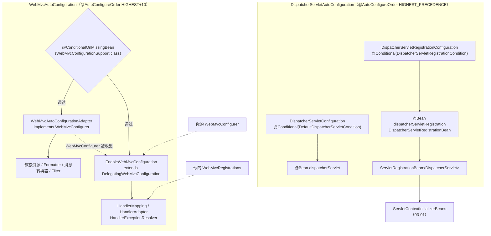
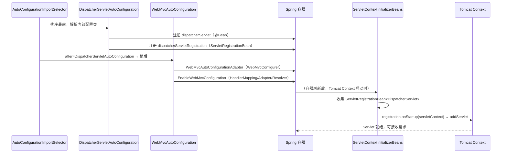

# 02 · WebMvc 自动配置与 DispatcherServlet 注册

> 版本基线：**Spring Boot 4.2.0** / **Spring Framework 7.1.0**
> 前置：本目录 `01-内嵌容器启动-tomcat与servletweb容器.md`（`ServletContextInitializerBeans` 在哪被调用）、`02-SpringBoot/02-自动配置`（条件注解与自动配置全链路）

## 0. 现象：三个"我明明写了却不生效"

### 0.1 加了一个 `@EnableWebMvc`，全站配置全丢了

```java
@Configuration
@EnableWebMvc          // ← 只为"开启 Web MVC"
public class WebConfig {
}
```

结果：`application.yml` 里的 `spring.mvc.static-path-pattern`、时间格式、静态资源、`MessageConverter` 的自动配置**全部失效**；`/static/a.png` 变成 404；`/actuator` 若依赖 MVC 定制也一起异常。

**这不是 bug**。`@EnableWebMvc` 会导入 `DelegatingWebMvcConfiguration`（它的父类是 `WebMvcConfigurationSupport`），而 `WebMvcAutoConfiguration` 的类上写着：

> `@ConditionalOnMissingBean(WebMvcConfigurationSupport.class)`

你自己"引入"了一个 `WebMvcConfigurationSupport` 子类 → 条件不满足 → **整个 `WebMvcAutoConfiguration` 都不生效**。

### 0.2 静态资源 404，但文件确实在 `src/main/resources/static/`

原因通常是三种之一：`spring.web.resources.add-mappings=false`；自己实现了 `WebMvcConfigurer#addResourceHandlers` 但没调 `super`（其实是覆盖了 `/**` 的映射）；或者加了 `@EnableWebMvc`。

### 0.3 `spring.mvc.servlet.path=/api` 之后接口全 404

`spring.mvc.servlet.path` 改的是 **`DispatcherServlet` 的映射路径**，不是 `server.servlet.context-path`。配置后所有 `@RequestMapping` 都会多一层前缀；而 `spring.mvc.static-path-pattern` 也要跟着一起改。两者混用是最高频的 404 原因（详见 6.3）。

### 0.4 一个 Boot 4 特有的现象：`extendMessageConverters` 找不到

Boot 3 里定制消息转换器最常用的写法是重写 `WebMvcConfigurer#extendMessageConverters(List<HttpMessageConverter<?>>)`。Boot 4 里很多教程照抄会**编译不过**——`WebMvcAutoConfigurationAdapter` 里已经不再用它，而是 `configureMessageConverters(ServerBuilder)`（见 3.4）。

## 1. 地图：WebMvc 自动配置的两个类



**读图说明**：

- 左边 `DispatcherServletAutoConfiguration` 负责**造 Servlet 并注册**，它的顺序是 `@AutoConfigureOrder(Ordered.HIGHEST_PRECEDENCE)`——**最先**。
- 右边 `WebMvcAutoConfiguration` 负责**MVC 的行为**，顺序是 `HIGHEST_PRECEDENCE + 10`，因此晚于左边（它需要在 `after = DispatcherServletAutoConfiguration.class` 之后）。
- 中间那个菱形 `@ConditionalOnMissingBean(WebMvcConfigurationSupport.class)` 是总开关。它位于 **`WebMvcAutoConfiguration` 类上**，所以一旦不满足，右边整个子图都不生效——包括 `WebMvcAutoConfigurationAdapter` 与 `EnableWebMvcConfiguration`。
- `EnableWebMvcConfiguration` 的 javadoc 原文就是 "Configuration equivalent to `@EnableWebMvc`"，也就是说：**Boot 自己也在用 `@EnableWebMvc` 的等价物**，只不过它加了一堆定制（`mvcRegistrations`、`ContentNegotiation`、`ProblemDetails` 等）。
- 虚线 `WebMvcConfigurer 被收集`：`DelegatingWebMvcConfiguration` 会把容器里所有 `WebMvcConfigurer` Bean 收集进来。这就是"写一个 `WebMvcConfigurer` 就能定制 MVC"的原理。

## 2. 关键类速查表

| 类 | 包（`spring-boot-webmvc:4.2.0`） | 职责 |
| --- | --- | --- |
| `DispatcherServletAutoConfiguration` | `org.springframework.boot.webmvc.autoconfigure` | 创建 `dispatcherServlet` 与 `dispatcherServletRegistration` |
| `DispatcherServletRegistrationBean` | `org.springframework.boot.webmvc.autoconfigure` | `ServletRegistrationBean<DispatcherServlet>` + `DispatcherServletPath` |
| `WebMvcAutoConfiguration` | `org.springframework.boot.webmvc.autoconfigure` | MVC 的总自动配置 |
| `WebMvcAutoConfiguration.WebMvcAutoConfigurationAdapter` | 同上（静态内部类） | 静态资源、Formatter、消息转换器、`FormContentFilter` |
| `WebMvcAutoConfiguration.EnableWebMvcConfiguration` | 同上（静态内部类） | `@EnableWebMvc` 等价物 + Boot 定制 |
| `WebMvcProperties` | `org.springframework.boot.webmvc.autoconfigure` | `spring.mvc.*` |
| `WebMvcRegistrations` | `org.springframework.boot.webmvc.autoconfigure` | 三个 Handler 组件的替换点 |

## 3. 源码逐段

### 3.1 `DispatcherServlet` 的创建：一个 `@Bean` 加一个自定义条件

```java (src: DispatcherServletAutoConfiguration.java#L54-L70)
@AutoConfigureOrder(Ordered.HIGHEST_PRECEDENCE)
@AutoConfiguration
@ConditionalOnWebApplication(type = Type.SERVLET)
@ConditionalOnClass(DispatcherServlet.class)
public final class DispatcherServletAutoConfiguration {

	/**
	 * The bean name for a DispatcherServlet that will be mapped to the root URL "/".
	 */
	public static final String DEFAULT_DISPATCHER_SERVLET_BEAN_NAME = "dispatcherServlet";

	/**
	 * The bean name for a ServletRegistrationBean for the DispatcherServlet "/".
	 */
	public static final String DEFAULT_DISPATCHER_SERVLET_REGISTRATION_BEAN_NAME = "dispatcherServletRegistration";

	@Configuration(proxyBeanMethods = false)
```

[[源码:DispatcherServletAutoConfiguration.java#L68-L81]]

- **`@AutoConfigureOrder(Ordered.HIGHEST_PRECEDENCE)`**：在 02-01 讲的 `AutoConfigurationSorter` 里，`@AutoConfigureOrder` 的权重最高（在 `@AutoConfigureBefore/After` 之后仍然参与最终排序）。这里声明"我要最先"，因为后面的 `WebMvcAutoConfiguration` 依赖 `DispatcherServletPath`。
- **两个 bean 名常量**：`dispatcherServlet` 与 `dispatcherServletRegistration` 是**稳定契约**。`ServletWebServerApplicationContext#DISPATCHER_SERVLET_NAME` 也是 `"dispatcherServlet"`（见 03-01），大量代码按名字查这两个 Bean。

内部配置类与 `@Bean`：

```java (src: DispatcherServletAutoConfiguration.java#L70-L84)
	@Configuration(proxyBeanMethods = false)
	@Conditional(DefaultDispatcherServletCondition.class)
	@ConditionalOnClass(ServletRegistration.class)
	@EnableConfigurationProperties(WebMvcProperties.class)
	protected static class DispatcherServletConfiguration {

		@Bean(name = DEFAULT_DISPATCHER_SERVLET_BEAN_NAME)
		DispatcherServlet dispatcherServlet(WebMvcProperties webMvcProperties) {
			DispatcherServlet dispatcherServlet = new DispatcherServlet();
			dispatcherServlet.setDispatchOptionsRequest(webMvcProperties.isDispatchOptionsRequest());
			dispatcherServlet.setDispatchTraceRequest(webMvcProperties.isDispatchTraceRequest());
			dispatcherServlet.setPublishEvents(webMvcProperties.isPublishRequestHandledEvents());
			dispatcherServlet.setEnableLoggingRequestDetails(webMvcProperties.isLogRequestDetails());
			return dispatcherServlet;
		}
```

[[源码:DispatcherServletAutoConfiguration.java#L90-L104]]

- **为什么用 `@Conditional(DefaultDispatcherServletCondition.class)` 而不是 `@ConditionalOnMissingBean`**：这里要判断的是"**有没有一个类型为 `DispatcherServlet` 的 Bean，且它的名字不是 `dispatcherServlet`**"。`@ConditionalOnMissingBean` 只能按类型/名字简单组合，表达不了"名字不符时给出专门提示"的需求。这个条件类会用 `ConditionMessage` 拼出人话（见 3.3）。
- **`DispatcherServlet` 是 `new` 出来的**，不是 `@Component` 扫描来的。所以你在 `@SpringBootApplication` 所在包下 `@ComponentScan` 到 `DispatcherServlet` 也没用，Bean 名一定是 `dispatcherServlet`，除非你自己定义同类型 Bean。

### 3.2 注册为 `ServletRegistrationBean`

```java (src: DispatcherServletAutoConfiguration.java#L103-L113)
		@Bean(name = DEFAULT_DISPATCHER_SERVLET_REGISTRATION_BEAN_NAME)
		@ConditionalOnBean(value = DispatcherServlet.class, name = DEFAULT_DISPATCHER_SERVLET_BEAN_NAME)
		DispatcherServletRegistrationBean dispatcherServletRegistration(DispatcherServlet dispatcherServlet,
				WebMvcProperties webMvcProperties, ObjectProvider<MultipartConfigElement> multipartConfig) {
			DispatcherServletRegistrationBean registration = new DispatcherServletRegistrationBean(dispatcherServlet,
					webMvcProperties.getServlet().getPath());
			registration.setName(DEFAULT_DISPATCHER_SERVLET_BEAN_NAME);
			registration.setLoadOnStartup(webMvcProperties.getServlet().getLoadOnStartup());
			multipartConfig.ifAvailable(registration::setMultipartConfig);
			return registration;
		}
```

[[源码:DispatcherServletAutoConfiguration.java#L116-L126]]

- **`@ConditionalOnBean(value = DispatcherServlet.class, name = "dispatcherServlet")`**：只有 3.1 那个 `@Bean` 真的创建了，才注册。这就是"用户自定义了 `DispatcherServlet` Bean 之后跳过注册"的机制之一。
- **路径来自 `webMvcProperties.getServlet().getPath()`**，即 `spring.mvc.servlet.path`，默认 `/`。
- **`setLoadOnStartup(...)`** 来自 `spring.mvc.servlet.load-on-startup`，默认 `-1`（懒加载）。设成 `1` 可以让 MVC 的初始化错误在启动时就暴露，而不是第一次请求时才 500。
- **`multipartConfig`** 从容器里找 `MultipartConfigElement`（`spring.servlet.multipart.*`），找到就挂到 registration 上。

`DispatcherServletRegistrationBean` 自己只是把"路径"翻译成"url mapping"：

```java (src: DispatcherServletRegistrationBean.java#L31-L36)
	public DispatcherServletRegistrationBean(DispatcherServlet servlet, String path) {
		super(servlet);
		Assert.notNull(path, "'path' must not be null");
		this.path = path;
		super.addUrlMappings(getServletUrlMapping());
	}
```

[[源码:DispatcherServletRegistrationBean.java#L31-L36]]

- **在干什么**：`addUrlMappings(getServletUrlMapping())`。`getServletUrlMapping()` 是接口 `DispatcherServletPath` 的 `default` 方法，负责把"路径"翻译成 Servlet 规范的 url mapping：

```java (src: DispatcherServletPath.java#L64-L75)
	default String getServletUrlMapping() {
		if (getPath().isEmpty() || getPath().equals("/")) {
			return "/";
		}
		if (getPath().contains("*")) {
			return getPath();
		}
		if (getPath().endsWith("/")) {
			return getPath() + "*";
		}
		return getPath() + "/*";
	}
```

[[源码:DispatcherServletPath.java#L64-L74]]

- 也就是说：默认 `/` 就是 `/`（根，接管一切未匹配的请求）；`/api` 变成 `/api/*`；已经带 `*` 的原样返回。这一步决定了"Servlet 容器把哪些 URL 交给 Spring MVC"。

### 3.3 两个自定义条件：把"为什么没注册"讲清楚

```java (src: DispatcherServletAutoConfiguration.java#L117-L132)
	@Order(Ordered.LOWEST_PRECEDENCE - 10)
	private static final class DefaultDispatcherServletCondition extends SpringBootCondition {

		@Override
		public ConditionOutcome getMatchOutcome(ConditionContext context, AnnotatedTypeMetadata metadata) {
			ConditionMessage.Builder message = ConditionMessage.forCondition("Default DispatcherServlet");
			ConfigurableListableBeanFactory beanFactory = context.getBeanFactory();
			Assert.state(beanFactory != null, "'beanFactory' must not be null");
			List<String> dispatchServletBeans = Arrays
				.asList(beanFactory.getBeanNamesForType(DispatcherServlet.class, false, false));
			if (dispatchServletBeans.contains(DEFAULT_DISPATCHER_SERVLET_BEAN_NAME)) {
				return ConditionOutcome
					.noMatch(message.found("dispatcher servlet bean").items(DEFAULT_DISPATCHER_SERVLET_BEAN_NAME));
			}
			if (beanFactory.containsBean(DEFAULT_DISPATCHER_SERVLET_BEAN_NAME)) {
				return ConditionOutcome
```

[[源码:DispatcherServletAutoConfiguration.java#L131-L148]]

- **看懂这段就读懂了"条件的语义"**：`getBeanNamesForType(DispatcherServlet.class, false, false)` 的第三个参数 `false` 表示"不提前实例化"，只查已注册的 Bean 定义。所以只要用户注册了任意 `DispatcherServlet` 类型的 Bean，这段就 `noMatch`，自动配置让位。
- **`message.found("dispatcher servlet bean")`** 是"人话生成器"，`--debug` 报告和 `ConditionEvaluationReport` 里看到的就是这几句话。写自定义条件时应该照抄这个风格（见 02-02 的 3.5）。

### 3.4 `WebMvcAutoConfiguration` 的总开关

```java (src: WebMvcAutoConfiguration.java#L142-L154)
@AutoConfiguration(after = { DispatcherServletAutoConfiguration.class, TaskExecutionAutoConfiguration.class },
		afterName = "org.springframework.boot.validation.autoconfigure.ValidationAutoConfiguration")
@ConditionalOnWebApplication(type = Type.SERVLET)
@ConditionalOnClass({ Servlet.class, DispatcherServlet.class, WebMvcConfigurer.class })
@ConditionalOnMissingBean(WebMvcConfigurationSupport.class)
@AutoConfigureOrder(Ordered.HIGHEST_PRECEDENCE + 10)
@ImportRuntimeHints(WebResourcesRuntimeHints.class)
public final class WebMvcAutoConfiguration {

	/**
	 * The default Spring MVC view prefix.
	 */
	public static final String DEFAULT_PREFIX = "";
```

[[源码:WebMvcAutoConfiguration.java#L140-L150]]

- **`after = { DispatcherServletAutoConfiguration.class, TaskExecutionAutoConfiguration.class }`**：`AutoConfigurationSorter` 会把它们排在自己前面。`TaskExecutionAutoConfiguration` 必须在前面，是因为 MVC 的异步请求需要 `applicationTaskExecutor`。
- **`afterName = "...ValidationAutoConfiguration"`**：用**字符串**而不是 Class 引用，避免 `spring-boot-webmvc` 对 `spring-boot-validation` 的编译期依赖。这就是**可选依赖的排序写法**——`@AutoConfigureAfter` + `name` 属性（2.7 起的 `@AutoConfiguration(afterName=...)`）。
- **`@ConditionalOnMissingBean(WebMvcConfigurationSupport.class)` 是那个总开关**。注意它检查的不是 `WebMvcConfigurer`，而是 `WebMvcConfigurationSupport`——因为后者是"完整 MVC 基础设施"的载体（`@EnableWebMvc` 的产物）。

内部的两个配置类：

```java (src: WebMvcAutoConfiguration.java#L177-L183)
	// Defined as a nested config to ensure WebMvcConfigurer is not read when not
	// on the classpath
	@Configuration(proxyBeanMethods = false)
	@Import(EnableWebMvcConfiguration.class)
	@EnableConfigurationProperties({ WebMvcProperties.class, WebProperties.class })
	@Order(0)
	static class WebMvcAutoConfigurationAdapter implements WebMvcConfigurer, ServletContextAware {
```

[[源码:WebMvcAutoConfiguration.java#L177-L183]]

- **注释里那句 `Defined as a nested config to ensure WebMvcConfigurer is not read when not on the classpath`** 是一个精妙设计：`implements WebMvcConfigurer` 写在**内部类**上，如果外部类被判不匹配（比如没有 `spring-webmvc`），Spring 就不会去解析这个内部类，也就不会因为 `WebMvcConfigurer` 类缺失而报 `NoClassDefFoundError`。这是 02-02 里讲的 `SpringBootCondition` 为什么专门 `catch NoClassDefFoundError` 的现实案例。
- **`@Order(0)`**：`WebMvcAutoConfigurationAdapter` 作为 `WebMvcConfigurer` 被收集时排在最前（用户自定义的 `WebMvcConfigurer` 默认 `Ordered.LOWEST_PRECEDENCE`），所以用户配置后生效、能覆盖默认。

```java (src: WebMvcAutoConfiguration.java#L398-L405)
	/**
	 * Configuration equivalent to {@code @EnableWebMvc}.
	 */
	@Configuration(proxyBeanMethods = false)
	@EnableConfigurationProperties(WebProperties.class)
	@ImportRuntimeHints(MvcValidatorRuntimeHints.class)
	static class EnableWebMvcConfiguration extends DelegatingWebMvcConfiguration
			implements ResourceLoaderAware, EmbeddedValueResolverAware {
```

[[源码:WebMvcAutoConfiguration.java#L398-L405]]

- **javadoc 原文 `Configuration equivalent to @EnableWebMvc`** 直接回答了 0.1 的疑问：Boot 自己也需要一份 `DelegatingWebMvcConfiguration`，否则没有 `RequestMappingHandlerMapping` 等核心 Bean。区别只在于 Boot 的版本额外注入了 `WebMvcRegistrations`、`ContentNegotiation` 等定制。

### 3.5 静态资源处理：`addResourceHandlers`

```java (src: WebMvcAutoConfiguration.java#L316-L331)
		@Override
		public void addResourceHandlers(ResourceHandlerRegistry registry) {
			if (!this.resourceProperties.isAddMappings()) {
				logger.debug("Default resource handling disabled");
				return;
			}
			addResourceHandler(registry, this.mvcProperties.getWebjarsPathPattern(),
					"classpath:/META-INF/resources/webjars/");
			addResourceHandler(registry, this.mvcProperties.getStaticPathPattern(), (registration) -> {
				registration.addResourceLocations(this.resourceProperties.getStaticLocations());
				if (this.servletContext != null) {
					ServletContextResource resource = new ServletContextResource(this.servletContext, SERVLET_LOCATION);
					registration.addResourceLocations(resource);
				}
			});
		}
```

[[源码:WebMvcAutoConfiguration.java#L316-L331]]

- **三个默认映射**：
  1. `/webjars/**` → `classpath:/META-INF/resources/webjars/`（来自 `spring.mvc.webjars-path-pattern`）。
  2. `/**` → `spring.web.resources.static-locations` 的四个默认位置：`classpath:/META-INF/resources/`、`classpath:/resources/`、`classpath:/static/`、`classpath:/public/`（来自 `WebProperties.Resources`）。
  3. `/**` 还会额外加 `ServletContext` 根（`/`），让外置容器 war 包里的资源也能访问。
- **`isAddMappings()`** 为 `false`（`spring.web.resources.add-mappings=false`）时**直接 return**，一条默认映射都不加。这就是 0.2 里 404 的第一个原因。注意日志是 `debug` 级别的，默认看不到——排查时记得开 `logging.level.org.springframework.boot.webmvc=DEBUG`。
- **`addResourceHandler` 内部的"已存在就不加"**：

```java (src: WebMvcAutoConfiguration.java#L337-L354)
		private void addResourceHandler(ResourceHandlerRegistry registry, String pattern,
				Consumer<ResourceHandlerRegistration> customizer) {
			if (registry.hasMappingForPattern(pattern)) {
				return;
			}
			ResourceHandlerRegistration registration = registry.addResourceHandler(pattern);
			customizer.accept(registration);
			Integer cachePeriod = getSeconds(this.resourceProperties.getCache().getPeriod());
			if (cachePeriod != null) {
				registration.setCachePeriod(cachePeriod);
			}
			CacheControl cacheControl = this.resourceProperties.getCache().getCachecontrol().toHttpCacheControl();
			if (cacheControl != null) {
				registration.setCacheControl(cacheControl);
			}
			registration.setUseLastModified(this.resourceProperties.getCache().isUseLastModified());
			customizeResourceHandlerRegistration(registration);
		}
```

[[源码:WebMvcAutoConfiguration.java#L337-L354]]

- **`hasMappingForPattern(pattern)` 是覆盖机制**：你写的 `WebMvcConfigurer#addResourceHandlers` 如果注册了 `/**`，Boot 这条就会跳过，**而且不会反过来覆盖你**。反过来说：如果你只写了 `/assets/**` 的映射，Boot 的 `/**` 仍然生效，两者是**叠加**关系。
- **坑**：一个 `WebMvcConfigurer` 里 `registry.addResourceHandler("/**")` 会把 Boot 的默认 `/**`（指向 `static/`）整体替换掉。此时 `classpath:/static/` 就 404 了——这是 0.2 的第二个原因。

### 3.6 消息转换器：Boot 4 换了写法

```java (src: WebMvcAutoConfiguration.java#L235-L239)
		@Override
		public void configureMessageConverters(ServerBuilder builder) {
			this.httpMessageConvertersCustomizerProvider.orderedStream()
				.forEach((customizer) -> customizer.customize(builder));
		}
```

[[源码:WebMvcAutoConfiguration.java#L233-L239]]

- **在干什么**：把所有 `ServerHttpMessageConvertersCustomizer` Bean 依次应用到 `ServerBuilder` 上。`ServerBuilder` 是 Framework 7 引入的消息转换器构建器（取代直接操作 `List<HttpMessageConverter>`）。
- **为什么这样更好**：老 API `extendMessageConverters(List<HttpMessageConverter<?>>)` 只能让你"加/删列表元素"，顺序和替换语义全靠约定；`ServerBuilder` 是声明式的，能表达"替换某种类型的转换器""仅在校验后处理"等语义，并且对 GraalVM AOT 更友好（不需要在运行时反射列表）。
- **想加自定义转换器**（推荐做法，Boot 3/4 都通用）：注册一个 `ServerHttpMessageConvertersCustomizer`（或 `HttpMessageConvertersCustomizer`）Bean，而不是去改 `List`。Boot 4 里 `WebMvcAutoConfigurationAdapter` 已经不再提供 `extendMessageConverters`，所以"重写 `extendMessageConverters`"在 Boot 4 上**可能编译不过**——这是 0.4 的答案。
- **`orderedStream()`**：支持 `@Order`，所以多个 customizer 的顺序是确定的。这一点比老的列表操作更可控。

### 3.7 三个扩展点：`WebMvcRegistrations`

`WebMvcRegistrations` 接口只有三个方法（全是 `default`，返回 `null` 表示"用默认的"）：

```java (src: WebMvcRegistrations.java#L30-L46)
public interface WebMvcRegistrations {

	/**
	 * Return the custom {@link RequestMappingHandlerMapping} that should be used and
	 * processed by the MVC configuration.
	 * @return the custom {@link RequestMappingHandlerMapping} instance
	 */
	default @Nullable RequestMappingHandlerMapping getRequestMappingHandlerMapping() {
		return null;
	}

	/**
	 * Return the custom {@link RequestMappingHandlerAdapter} that should be used and
	 * processed by the MVC configuration.
	 * @return the custom {@link RequestMappingHandlerAdapter} instance
	 */
	default @Nullable RequestMappingHandlerAdapter getRequestMappingHandlerAdapter() {
```

[[源码:WebMvcRegistrations.java#L30-L47]]

三个扩展点的调用位置都在 `EnableWebMvcConfiguration` 里，写法一模一样——**"有自定义就用自定义，否则 `super`"**：

```java (src: WebMvcAutoConfiguration.java#L561-L572)
		@Override
		protected RequestMappingHandlerMapping createRequestMappingHandlerMapping() {
			if (this.mvcRegistrations != null) {
				RequestMappingHandlerMapping mapping = this.mvcRegistrations.getRequestMappingHandlerMapping();
				if (mapping != null) {
					return mapping;
				}
			}
			return super.createRequestMappingHandlerMapping();
		}

		@Override
```

[[源码:WebMvcAutoConfiguration.java#L578-L588]]

- **三个扩展点**：`getRequestMappingHandlerMapping()`、`getRequestMappingHandlerAdapter()`、`getExceptionHandlerExceptionResolver()`。
- **`this.mvcRegistrations` 从哪来**：

```java (src: WebMvcAutoConfiguration.java#L422-L431)
		EnableWebMvcConfiguration(WebMvcProperties mvcProperties, WebProperties webProperties,
				ObjectProvider<WebMvcRegistrations> mvcRegistrationsProvider,
				ObjectProvider<ResourceHandlerRegistrationCustomizer> resourceHandlerRegistrationCustomizerProvider,
				ListableBeanFactory beanFactory) {
			this.resourceProperties = webProperties.getResources();
			this.mvcProperties = mvcProperties;
			this.webProperties = webProperties;
			this.mvcRegistrations = mvcRegistrationsProvider.getIfUnique();
			this.beanFactory = beanFactory;
		}
```

[[源码:WebMvcAutoConfiguration.java#L422-L431]]

- **`getIfUnique()`**：容器里有**且仅有一个** `WebMvcRegistrations` Bean 时才生效。注册两个 → 返回 `null` → 静默失效。`WebMvcRegistrations` 的 javadoc 也明确写了 `A single instance of this component should be registered`。
- **选哪个扩展点**：
  - 想改**行为**（拦截器、格式化器、静态资源、转换器）→ 用 `WebMvcConfigurer`。
  - 想换**组件实例**（比如给 `RequestMappingHandlerMapping` 加自定义的 `HandlerMethodArgumentResolver` 或改写路径匹配策略）→ 用 `WebMvcRegistrations`。

## 4. 时序图：`DispatcherServlet` 从 Bean 到可服务



**读图说明**：

- 上半段是**自动配置解析期**：`DispatcherServlet` 和它的 registration 只是两个普通的 `BeanDefinition`，此时还没有任何 `ServletContext`。
- 下半段是**容器启动期**（03-01 的 3.8 节）：`ServletContextInitializerBeans` 把 `ServletRegistrationBean` 捞出来并调用 `onStartup`，此时 `DispatcherServlet` 才真正被 `servletContext.addServlet(...)`。
- 两个阶段的"同一对象"：`dispatcherServlet` 这个 Bean 在自动配置期创建，在容器启动期被注册进 Tomcat。所以 `DispatcherServlet` 是**单例**，且它的 `init()`（创建 `WebApplicationContext`）发生在 `load-on-startup` 触发时（默认懒加载，第一次请求才 init）。

## 5. 设计模式

| 模式 | 体现 | 收益 |
| --- | --- | --- |
| 组合优于继承（`WebMvcConfigurer`） | `DelegatingWebMvcConfiguration` 收集所有 `WebMvcConfigurer` | 用户可以任意扩展，不用继承 Boot/Framework 的类 |
| 替换点接口（`WebMvcRegistrations`） | 三个 `default` 方法返回 `null` | 只关心自己需要的组件，接口不会随版本升级而破坏 |
| "缺省则让位"（`@ConditionalOnMissingBean`） | 类级别 `WebMvcConfigurationSupport`、`@Bean` 级别 `DispatcherServlet` | 用户配置永远优先，框架配置只做兜底 |
| 字符串解耦的排序（`afterName`） | `@AutoConfiguration(afterName = "...ValidationAutoConfiguration")` | 保持模块间零编译依赖 |
| 注册 bean 与注册 Servlet 分离 | `@Bean DispatcherServlet` + `ServletRegistrationBean` | Spring Bean 生命周期与 Servlet 生命周期解耦 |

**"注册 bean 与注册 Servlet 分离"是理解这段代码的关键**。如果 `DispatcherServlet` 直接 `extends HttpServlet` 并注册成 Bean，那就无法参与 Spring 的依赖注入、AOP、条件装配；Boot 用 `ServletRegistrationBean` 把"Spring 管理的实例"桥接成"Servlet 容器里的 Servlet"。

## 6. 踩坑与调试

### 6.1 `@EnableWebMvc` 为什么让自动配置失效（完整证据链）

1. `@EnableWebMvc` 的定义是 `@Import(DelegatingWebMvcConfiguration.class)`。
2. `DelegatingWebMvcConfiguration extends WebMvcConfigurationSupport`。
3. `WebMvcAutoConfiguration` 类上有 `@ConditionalOnMissingBean(WebMvcConfigurationSupport.class)`（[[源码:WebMvcAutoConfiguration.java#L140-L150]]）。
4. `OnBeanCondition` 在 `REGISTER_BEAN` 阶段求值（02-02 的 3.7），发现容器里已有一个 `WebMvcConfigurationSupport` 类型的 Bean → `noMatch` → 整个 `WebMvcAutoConfiguration` 不生效。
5. 现象：`WebMvcProperties`（`spring.mvc.*`）、`WebProperties`（`spring.web.resources.*`）、`WebMvcRegistrations`、`ProblemDetails` 定制、`FormContentFilter`、`HiddenHttpMethodFilter` 全部失去自动配置。

**正确做法**：不要加 `@EnableWebMvc`。想定制就实现 `WebMvcConfigurer`；想换组件就用 `WebMvcRegistrations`。

### 6.2 静态资源排查顺序

1. `spring.web.resources.add-mappings` 是不是 `false`？（看 debug 日志 `Default resource handling disabled`）
2. 自己有没有 `addResourceHandler("/**")`？（会整体替换默认映射）
3. 有没有 `@EnableWebMvc`？
4. 文件位置是不是在 `classpath:/static/`、`classpath:/public/`、`classpath:/resources/`、`classpath:/META-INF/resources/` 之一？
5. 开了 Spring Security 的话，静态资源路径是否被拦截？
6. 缓存问题：`spring.web.resources.cache.period` 设得太长，浏览器拿旧 404 缓存。

### 6.3 `spring.mvc.*` 与 `server.servlet.*` 的分工（3 个常用示例）

| 配置示例 | 绑定字段 | 作用 |
| --- | --- | --- |
| `spring.mvc.servlet.path=/api` | `WebMvcProperties.Servlet#path` | `DispatcherServlet` 的映射路径，所有 `@RequestMapping` 前多一层 `/api` |
| `spring.mvc.static-path-pattern=/assets/**` | `WebMvcProperties#staticPathPattern` | 静态资源的 URL 前缀（默认 `/**`） |
| `spring.mvc.servlet.load-on-startup=1` | `WebMvcProperties.Servlet#loadOnStartup` | 启动时就初始化 `DispatcherServlet`，把 MVC 配置错误提前暴露 |

第三组示例代码（可直接抄）：

```yaml
# 示例 1：DispatcherServlet 挂在 /api 下
spring:
  mvc:
    servlet:
      path: /api
      load-on-startup: 1
  web:
    resources:
      static-locations: classpath:/static/,file:/opt/assets/

# 示例 2：静态资源改走 /assets/**
spring:
  mvc:
    static-path-pattern: /assets/**
  web:
    resources:
      cache:
        period: 3600s

# 示例 3：关闭默认静态资源映射，完全自己接管
spring:
  web:
    resources:
      add-mappings: false
```

- **`static-path-pattern` 与 `static-locations` 的区别**：前者是 **URL 模式**，后者是 **文件位置**。只改前者不改后者，或者反过来，都会得到 404。
- **坑**：`spring.mvc.servlet.path` 改了以后，`spring.mvc.static-path-pattern` 的 URL 会变成 `/api` + `static-path-pattern`。很多人只改了前者，然后抱怨静态资源 404。

`WebMvcProperties` 里的路径校验也很直白：

```java (src: WebMvcProperties.java#L227-L231)
		public void setPath(String path) {
			Assert.notNull(path, "'path' must not be null");
			Assert.isTrue(!path.contains("*"), "'path' must not contain wildcards");
			this.path = path;
		}
```

[[源码:WebMvcProperties.java#L227-L231]]

- **`must not contain wildcards`**：`spring.mvc.servlet.path=/api/*` 会启动失败。因为这个值最终要变成 `ServletRegistrationBean` 的 url mapping，通配由 `getServletUrlMapping()` 统一补（`/api` → `/api/*`）。

### 6.4 排查工具

1. `--debug`：`ConditionEvaluationReport` 里搜 `WebMvcAutoConfiguration`，会看到是 `Positive matches` 还是被 `@ConditionalOnMissingBean` 否决（`Negative matches` 里会写 `@ConditionalOnMissingBean (types: org.springframework.web.servlet.config.annotation.WebMvcConfigurationSupport; ...) found bean ...`）。
2. `logging.level.org.springframework.web=TRACE`：能看到 `RequestMappingHandlerMapping` 注册了哪些 handler。
3. `GET /actuator/mappings`（需 `spring-boot-starter-actuator`）：直接列出所有 URL 与 handler，静态资源 `ResourceHttpRequestHandler` 也会出现。
4. 启动日志里搜 `Mapping servlets: dispatcherServlet urls=[/]`（来自 03-01 的 `ServletContextInitializerBeans#logMappings`），确认 Servlet 映射正确。

## 7. ⚠️ Boot 2.x / 3.x / 4.x 差异

| 维度 | Boot 2.x | Boot 3.x | Boot 4.x（本文基线） |
| --- | --- | --- | --- |
| `WebMvcAutoConfiguration` 所在模块/包 | `spring-boot-autoconfigure`，`org.springframework.boot.autoconfigure.web.servlet` | 同 2.x | **`spring-boot-webmvc`**，`org.springframework.boot.webmvc.autoconfigure` |
| `DispatcherServletAutoConfiguration` | `org.springframework.boot.autoconfigure.web.servlet` | 同 | **`org.springframework.boot.webmvc.autoconfigure`** |
| `WebMvcProperties` | `org.springframework.boot.autoconfigure.web.servlet.WebMvcProperties` | 同 | `org.springframework.boot.webmvc.autoconfigure.WebMvcProperties` |
| 自定义消息转换器 | `WebMvcConfigurer#extendMessageConverters(List<HttpMessageConverter<?>>)` | 同 | **`WebMvcAutoConfigurationAdapter#configureMessageConverters(ServerBuilder)`** + `ServerHttpMessageConvertersCustomizer` |
| 自动配置注册方式 | `spring.factories` | `META-INF/spring/...AutoConfiguration.imports` | 同 3.x |
| `spring.mvc.pathmatch.matching-strategy` | 可选 `ant-path-matcher` | 只能 `path-pattern-parser` | 属性 `@Deprecated(since="4.2.0")`（`WebMvcProperties.MatchingStrategy` 只剩一个枚举值） |
| Servlet API | `javax.servlet` | `jakarta.servlet` | `jakarta.servlet` |
| 父 POM 依赖 | `spring-boot-starter-web` 内含一切 | 同 | **`spring-boot-starter-web` 拆成 `spring-boot-webmvc` + `spring-boot-tomcat` 等模块** |

**证据**：

- `WebMvcAutoConfiguration.java.md` 头部元数据：来源 `org.springframework.boot:spring-boot-webmvc:4.2.0`，路径 `org/springframework/boot/webmvc/autoconfigure/WebMvcAutoConfiguration.java`；类上 `@since` 与 `@AutoConfiguration(after = ..., afterName = ...)` 都在 [[源码:WebMvcAutoConfiguration.java#L140-L150]]。
- `DispatcherServletAutoConfiguration.java.md` 头部元数据同样来自 `spring-boot-webmvc:4.2.0`，包 `org.springframework.boot.webmvc.autoconfigure`。
- `WebMvcProperties` 中 `MatchingStrategy` 只剩 `PATH_PATTERN_PARSER` 一个枚举值，且字段被 `@Deprecated(since = "4.2.0")` 标注——说明"可切换路径匹配策略"的时代结束了。
- `configureMessageConverters(ServerBuilder)` 的签名在 Boot 3 的 `WebMvcAutoConfigurationAdapter` 中不存在（Boot 3 用 `extendMessageConverters(List)`），见 [[源码:WebMvcAutoConfiguration.java#L233-L239]]。

## 8. 面试 10 问

**Q1：`DispatcherServlet` 是怎么被注册到 Tomcat 的？**

`DispatcherServletAutoConfiguration` 先注册一个 `@Bean DispatcherServlet dispatcherServlet`，再注册 `DispatcherServletRegistrationBean`（`ServletRegistrationBean<DispatcherServlet>`）。后者由 `ServletContextInitializerBeans` 在 Tomcat `Context` 启动时收集并 `onStartup`，最终调用 `servletContext.addServlet(...)`。

**Q2：为什么 `DispatcherServlet` 不直接做成 `@Component`？**

因为它需要被注册成 Servlet，而不是普通 Bean。用 `@Bean` + `ServletRegistrationBean` 的方式既能参与 Spring 的依赖注入与 AOP，又能被 Servlet 容器识别。而且 Bean 名 `dispatcherServlet` 是稳定契约，很多代码按名字查它。

**Q3：`@EnableWebMvc` 为什么会让 Boot 的 MVC 自动配置失效？**

因为 `@EnableWebMvc` 导入的 `DelegatingWebMvcConfiguration` 继承自 `WebMvcConfigurationSupport`，而 `WebMvcAutoConfiguration` 上有 `@ConditionalOnMissingBean(WebMvcConfigurationSupport.class)`。一旦有了这个类型的 Bean，整个自动配置类都不生效。

**Q4：想加一个自定义的 `HandlerInterceptor`，应该用哪个扩展点？**

实现 `WebMvcConfigurer#addInterceptors`，注册成 `@Bean` 即可。`DelegatingWebMvcConfiguration` 会自动收集所有 `WebMvcConfigurer`。不用 `@EnableWebMvc`。

**Q5：`WebMvcRegistrations` 和 `WebMvcConfigurer` 什么时候该用哪个？**

`WebMvcConfigurer` 是"改行为"（拦截器、格式化器、资源映射、参数解析器、消息转换器）；`WebMvcRegistrations` 是"换组件实例"（`RequestMappingHandlerMapping`、`RequestMappingHandlerAdapter`、`ExceptionHandlerExceptionResolver`），且只接受唯一一个 Bean（`getIfUnique()`）。

**Q6：静态资源的默认位置有哪几个？**

`classpath:/META-INF/resources/`、`classpath:/resources/`、`classpath:/static/`、`classpath:/public/`（`WebProperties.Resources` 的默认值），另外还会额外挂 `ServletContext` 根。

**Q7：为什么 `WebMvcAutoConfigurationAdapter` 要定义成嵌套类？**

源码注释写明：为了在 `WebMvcConfigurer` 不在 classpath 上时不去解析它，避免 `NoClassDefFoundError`。外层类用 `@ConditionalOnClass` 判定，不匹配时嵌套类不会被读取。

**Q8：`spring.mvc.servlet.path` 和 `server.servlet.context-path` 有什么区别？**

前者是 `DispatcherServlet` 的 URL 映射前缀（影响 Spring MVC 的 handler 路径），后者是 Servlet 容器的上下文路径（影响整个 Web 应用，包括静态资源和外置 Servlet）。同时配置会叠加成 `/{context-path}/{servlet-path}`。

**Q9：Boot 4 里怎么自定义消息转换器？**

注册 `ServerHttpMessageConvertersCustomizer`（或 `HttpMessageConvertersCustomizer`）Bean，`WebMvcAutoConfigurationAdapter#configureMessageConverters(ServerBuilder)` 会自动应用。老的 `extendMessageConverters(List)` 在 Boot 4 的 `WebMvcAutoConfigurationAdapter` 里已不再使用。

**Q10：`@AutoConfiguration(afterName = "...ValidationAutoConfiguration")` 里的 `afterName` 有什么用？**

用字符串指定排序依赖，避免 `spring-boot-webmvc` 对 `spring-boot-validation` 产生编译期依赖。`AutoConfigurationSorter` 会按名字找对应类并排在它后面。

**Q11：`DefaultDispatcherServletCondition` 到底判断了什么？**

用 `getBeanNamesForType(DispatcherServlet.class, false, false)` 查是否已有 `DispatcherServlet` 类型 Bean：没有就匹配（创建默认的）；只有一个且名字是 `dispatcherServlet` 就不匹配（说明默认的已经存在）；其它情况不匹配并给出"found non dispatcher servlet bean"之类的原因。

**Q12：`spring.mvc.servlet.path=/api/*` 为什么启动失败？**

`WebMvcProperties.Servlet#setPath` 有 `Assert.isTrue(!path.contains("*"), "'path' must not contain wildcards")`。通配由 `getServletUrlMapping()` 统一处理（`/api` → `/api/*`），不需要手写。

## 9. 练习

1. **复现 0.1**：给项目加上 `@EnableWebMvc`，观察启动日志里 `WebMvcAutoConfiguration` 进入 `Negative matches`，并验证 `spring.mvc.static-path-pattern` 不再生效；然后去掉它，改用一个 `WebMvcConfigurer` 实现同样的定制。
2. **静态资源替换**：写一个 `WebMvcConfigurer`，把 `/` 下的 `**` 映射到 `file:/tmp/mystatic/`，验证 Boot 的默认 `/**` 被跳过（`hasMappingForPattern` 返回 true）。再把它改成 `/extra/**`，确认默认映射仍生效。
3. **扩展点对比**：分别用 `WebMvcConfigurer#addInterceptors` 和 `WebMvcRegistrations#getRequestMappingHandlerMapping` 实现"给所有请求打日志"，对比两种方式能拿到的信息粒度。
4. **自定义消息转换器**：注册一个 `ServerHttpMessageConvertersCustomizer`，让 `text/foo` 也能被 Jackson 序列化，用 `curl -H "Accept: text/foo"` 验证。
5. **Servlet 路径实验**：设 `spring.mvc.servlet.path=/api` + `spring.mvc.static-path-pattern=/static/**`，分别访问 `/api/hello`、`/api/static/a.png`，从日志 `Mapping servlets: dispatcherServlet urls=[/api/*]` 理解映射。
6. **把 404 提前到启动**：设 `spring.mvc.servlet.load-on-startup=1`，故意写一个坏的 `HandlerInterceptor` 注册，观察错误在启动阶段就抛出（`rethrowDeferredStartupExceptions` 的价值，见 03-01）。

## 小结

1. `DispatcherServletAutoConfiguration` 排在自动配置最前（`HIGHEST_PRECEDENCE`），负责造 `dispatcherServlet` 与 `dispatcherServletRegistration`（`ServletRegistrationBean`）；真正的 Servlet 注册发生在 Tomcat `Context` 启动时（03-01）。
2. `WebMvcAutoConfiguration` 排在 `HIGHEST_PRECEDENCE + 10`，`after` 于 `DispatcherServletAutoConfiguration`；类上是"三重条件"：Servlet Web 应用、有 `spring-webmvc`、**没有 `WebMvcConfigurationSupport`**。
3. 内部两个类分工：`WebMvcAutoConfigurationAdapter`（`WebMvcConfigurer`，管静态资源 / Formatter / 消息转换器 / Filter）；`EnableWebMvcConfiguration`（`DelegatingWebMvcConfiguration`，管 `HandlerMapping` / `HandlerAdapter` / `ExceptionResolver`，并接入 `WebMvcRegistrations`）。
4. `@EnableWebMvc` 会引入 `WebMvcConfigurationSupport`，让 `WebMvcAutoConfiguration` 整个失效——这就是"加了注解反而丢配置"的根本原因。
5. 静态资源默认四个 locations，`hasMappingForPattern` 保证"用户写的 `/**` 覆盖默认，写别的模式则叠加"。
6. 三个扩展点 `WebMvcRegistrations` 用"返回 null 则用默认"的约定，且只接受唯一一个 Bean（`getIfUnique()`）。
7. Boot 4 把 `spring-boot-autoconfigure` 里的 Web 部分拆到 `spring-boot-webmvc`，包路径为 `org.springframework.boot.webmvc.autoconfigure`；消息转换器定制从 `extendMessageConverters(List)` 改为 `configureMessageConverters(ServerBuilder)`。

## 自测题

<details><summary>1. `WebMvcAutoConfiguration` 里的"总开关"条件注解是什么？在哪一行？</summary>

`@ConditionalOnMissingBean(WebMvcConfigurationSupport.class)`，位于类注解区域（[[源码:WebMvcAutoConfiguration.java#L140-L150]] 中的第 4 行）。
</details>

<details><summary>2. `@EnableWebMvc` 为什么会让 `WebMvcAutoConfiguration` 失效？</summary>

`@EnableWebMvc` 导入 `DelegatingWebMvcConfiguration`，它继承 `WebMvcConfigurationSupport`；于是 `@ConditionalOnMissingBean(WebMvcConfigurationSupport.class)` 不满足，整个自动配置类被跳过。
</details>

<details><summary>3. `DispatcherServlet` 的 Bean 名与 registration 的 Bean 名分别是什么？</summary>

`dispatcherServlet` 与 `dispatcherServletRegistration`（`DispatcherServletAutoConfiguration` 的两个常量）。
</details>

<details><summary>4. `DispatcherServlet` 是何时真正注册到 `ServletContext` 的？</summary>

在 Tomcat `Context` 启动时，由 `WebApplicationContextInitializer#initialize` 遍历 `ServletContextInitializerBeans` 并调用 `onStartup`，最终 `servletContext.addServlet(...)`。
</details>

<details><summary>5. `WebMvcAutoConfigurationAdapter` 为什么被定义成嵌套类？</summary>

源码注释：确保 `WebMvcConfigurer` 不在 classpath 时不会被读取，从而避免 `NoClassDefFoundError`。
</details>

<details><summary>6. `EnableWebMvcConfiguration` 的 javadoc 原文是什么？说明了什么？</summary>

`Configuration equivalent to {@code @EnableWebMvc}`。说明 Boot 自己也需要一份 `DelegatingWebMvcConfiguration` 等价物，只是额外注入了 `WebMvcRegistrations`、`ContentNegotiation` 等定制。
</details>

<details><summary>7. 静态资源的默认 locations 有哪四个？</summary>

`classpath:/META-INF/resources/`、`classpath:/resources/`、`classpath:/static/`、`classpath:/public/`；此外还会把 `ServletContext` 根（`/`）也加入。
</details>

<details><summary>8. `addResourceHandler` 里 `hasMappingForPattern(pattern)` 的作用？</summary>

如果用户已经注册了同名 pattern 的映射，就跳过 Boot 的默认映射，实现"用户配置覆盖默认"。
</details>

<details><summary>9. `WebMvcRegistrations` 的三个扩展点方法是什么？</summary>

`getRequestMappingHandlerMapping()`、`getRequestMappingHandlerAdapter()`、`getExceptionHandlerExceptionResolver()`，都是 `default` 返回 `null`。
</details>

<details><summary>10. 为什么注册两个 `WebMvcRegistrations` Bean 会导致定制失效？</summary>

`mvcRegistrationsProvider.getIfUnique()` 在候选不唯一时返回 `null`，于是所有定制被忽略。接口 javadoc 也要求只注册一个。
</details>

<details><summary>11. Boot 4 里 `WebMvcAutoConfigurationAdapter` 用什么方法处理消息转换器？</summary>

`configureMessageConverters(ServerBuilder builder)`，把 `ServerHttpMessageConvertersCustomizer` 依次应用；不再使用 `extendMessageConverters(List<HttpMessageConverter<?>>)`。
</details>

<details><summary>12. `spring.mvc.servlet.path` 与 `spring.mvc.static-path-pattern` 的区别？</summary>

前者是 `DispatcherServlet` 的 URL 映射前缀（影响所有 `@RequestMapping`），后者是静态资源的 URL 模式（默认 `/**`）。把前者改成 `/api` 后，静态资源 URL 会变成 `/api/` + 后者。
</details>

<details><summary>13. `spring.mvc.servlet.path=/api/*` 会怎样？</summary>

启动失败：`WebMvcProperties.Servlet#setPath` 断言 `'path' must not contain wildcards`。通配由 `getServletUrlMapping()` 自动补为 `/api/*`。
</details>

<details><summary>14. `@AutoConfiguration(afterName = "...ValidationAutoConfiguration")` 为什么要用字符串？</summary>

避免 `spring-boot-webmvc` 对 `spring-boot-validation` 的编译期依赖，`AutoConfigurationSorter` 会按类名解析排序关系。
</details>

<details><summary>15. 想让 MVC 的配置错误在启动时就暴露，应该配什么？</summary>

`spring.mvc.servlet.load-on-startup=1`（默认 `-1` 懒加载），让 `DispatcherServlet` 在启动时初始化；配合 `TomcatWebServer#rethrowDeferredStartupExceptions()` 把异常抛到主线程。
</details>
