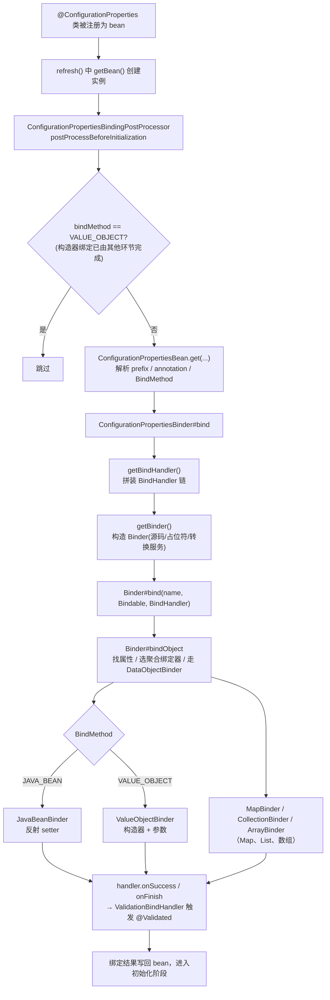
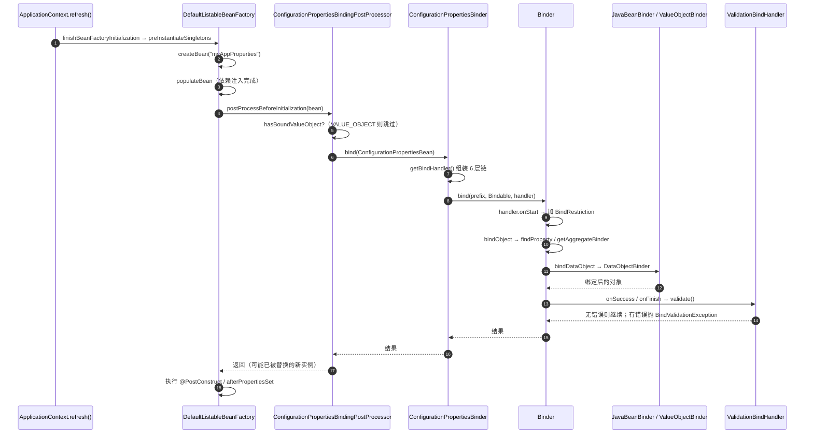

# @ConfigurationProperties 属性绑定原理

> 一句话结论：`@ConfigurationProperties` 本身**什么也不做**，它只是一张"说明书"；真正干活的是 `ConfigurationPropertiesBindingPostProcessor`（一个 `BeanPostProcessor`），它在 bean 初始化之前调用 `ConfigurationPropertiesBinder#bind`，最终落到 `Binder#bind`，由 `JavaBeanBinder` / `ValueObjectBinder` 两类 `DataObjectBinder` 之一完成"把字符串/层级属性写进对象字段"的工作。

- 阅读前置：读完本组 `README.md`；了解 `BeanPostProcessor` 在 `refresh()` 中的时机（见 `01-启动原理`）；知道 `Environment` 里有 `PropertySources`。
- 版本基线：Spring Boot **4.2.0**、Spring Framework **7.1.0**。
- 预计阅读：60 分钟｜源码：8 个类，约 1500 行（节选精读）

---

## 0. 先看现象：三个问题

**现象 1：属性写了却没绑定上**

```text
my-app.name=demo
```

```java
@ConfigurationProperties(prefix = "my-app")
public class MyAppProperties {
    private String name;   // 没有 getter/setter
}
```

启动后 `name` 依旧是 `null`。为什么？因为默认的绑定方式是 **JavaBean 绑定**——它必须有可用的 setter（或者可写的字段 + 特定的绑定方式）。`JavaBeanBinder` 发现没有 setter，且值发生了变化，会直接抛 `IllegalStateException: No setter found for property: name`。

**现象 2：加了 `@Component` 才有值**

同一个类，加上 `@Component` 就有值了，删掉就 `null`。这不是玄学：`@ConfigurationProperties` 只是元数据，必须是**容器里的 bean**才会被 `ConfigurationPropertiesBindingPostProcessor` 处理。让类进容器的方式至少有四种：`@Component`、`@EnableConfigurationProperties`、`@ConfigurationPropertiesScan`、`@Bean` 方法。

**现象 3：`spring.main.lazy-initialization` 放在 `application.yaml` 里"有时不生效"**

因为 `spring.main.*` 要绑定到 `SpringApplication.properties`，而它真正被读取的时机比 `application.yaml` 加载**更早**（在 `SpringApplicationRunListeners.environmentPrepared` 之前的 `prepareEnvironment` 里，`spring.main.*` 就已经被用于构建 `SpringApplication` 了）。这类"早绑定"属性和普通 `@ConfigurationProperties` 不是同一套时机。

这三个现象指向同一件事：**绑定是一个有明确时机的流程**。下面把它拆开。

---

## 1. 全局地图：一次绑定经过哪些站



**读图说明**

- 左侧一列是"入口"，纵深往下是"流程"。
- 关键分叉有两个：①`bindMethod` 是不是 `VALUE_OBJECT`（构造器绑定）；②最终用哪种 `DataObjectBinder`。
- 注意 `BindHandler` 不是装饰器随便套的，它是**校验、忽略错误、未知属性检查**的统一挂载点，所以 `@Validated` 的校验时机就在这条链上，而不是在 `InitializingBean` 之后。
- `Map`/`List`/数组走的是"聚合绑定器"，不经过上面两个 `DataObjectBinder`。

---

## 2. 关键类速查

| 类 | 模块 | 角色 |
| --- | --- | --- |
| `ConfigurationProperties` | spring-boot | 注解：`prefix`、`ignoreUnknownFields`、`ignoreInvalidFields` |
| `ConfigurationPropertiesBindingPostProcessor` | spring-boot | `BeanPostProcessor`，绑定的**唯一入口** |
| `ConfigurationPropertiesBean` | spring-boot | 描述"这个 bean 怎么绑"：prefix、annotation、`BindMethod` |
| `ConfigurationPropertiesBinder` | spring-boot | 包私有；组装 `BindHandler` 链和 `Binder` 实例 |
| `ConversionServiceDeducer` | spring-boot | 决定绑定用哪些 `ConversionService` / `Converter` |
| `Binder` | spring-boot | 绑定引擎本体（400+ 行） |
| `Bindable` / `BindHandler` / `ConfigurationPropertyName` | spring-boot | 绑定"三件套"：目标描述、拦截器、规范化属性名 |
| `JavaBeanBinder` / `ValueObjectBinder` | spring-boot | 两种 `DataObjectBinder` 实现 |
| `ValidationBindHandler` | spring-boot | 把 `Validator` 挂到绑定流程里（`@Validated`） |
| `ConfigurationPropertySources` | spring-boot | 把 `Environment` 的 `PropertySources` 适配为 `ConfigurationPropertySource` |

---

## 3. 源码逐段：从入口一路走到绑定引擎

### 3.1 入口：`postProcessBeforeInitialization`

```java
(src: ConfigurationPropertiesBindingPostProcessor.java#L70-L75)
```

这两件事必须说清楚：

1. **时机**是 `postProcessBeforeInitialization`，即依赖注入完成、`@PostConstruct` 与 `InitializingBean` **之前**。所以你在 `afterPropertiesSet()` 里读到的字段已经是绑定后的值。
2. **`hasBoundValueObject` 这个判断**是为了让"构造器绑定"不被重复绑定：如果一个 bean 的 `BindMethod` 是 `VALUE_OBJECT`，它的实例在更早的阶段（`ConfigurationPropertiesBeanFactory` 相关环节）就已经通过构造器 + 属性创建好了，这里直接跳过。

顺带看一眼它的优先级：

```java
(src: ConfigurationPropertiesBindingPostProcessor.java#L65-L67)
```

`HIGHEST_PRECEDENCE + 1`——几乎最靠前。为什么？因为其他 `BeanPostProcessor`（比如 `@Autowired` 之后的处理、AOP 代理创建）可能依赖"属性已经绑好"。`+1` 是给 `ApplicationContextAwareProcessor` 之类的极前置处理器让路。

再看它怎么拿到 `ApplicationContext`：

```java
(src: ConfigurationPropertiesBindingPostProcessor.java#L57-L62)
```

注释里那句"不能用构造器注入 `ApplicationContext`"很关键：这个类是通过 `BeanDefinitionRegistryPostProcessor` 以 `ROLE_INFRASTRUCTURE` 身份注册的（见同文件 `register` 方法），如果在构造期注入 `ApplicationContext`，会在 `BeanFactory` 还在装配的时候就要求拿到它，触发 `FactoryBean` 过早初始化。

### 3.2 描述 bean：`ConfigurationPropertiesBean#get`

```java
(src: ConfigurationPropertiesBean.java#L186-L201)
```

逐句翻译：

- `findFactoryMethod`：如果这个 bean 是 `@Bean` 方法产生的，优先用**方法上**的 `@ConfigurationProperties`。
- `createBindTarget(bean, bean.getClass(), factoryMethod)`：把"实例 + 类型 + 工厂方法"打包成可绑定目标；对 AOP 代理会回溯到 target class。
- `withBindMethod(BindMethodAttribute.get(registry, beanName))`：读取 bean 定义上的 `BindMethod` 属性。这个属性是 `@ConstructorBinding` 场景在注册 bean 定义时写进去的。
- 没有 `BindMethod` 且不是工厂方法 → 视为 `JAVA_BEAN`；`bindMethod != VALUE_OBJECT` 时把**已有实例**塞进 `Bindable`（`withExistingValue(bean)`）。

而 `VALUE_OBJECT` 是这么推断出来的：

```java
(src: ConfigurationPropertiesBean.java#L283-L298)
```

`BindConstructorProvider.DEFAULT.getBindConstructor(type, false)` 非空就意味着"这个类有一个可用的绑定构造器"，于是走 `VALUE_OBJECT`。哪些构造器算"可用"？看 `DefaultBindConstructorProvider`：

```java
(src: DefaultBindConstructorProvider.java#L169-L186)
```

规则总结成一句话：**record 或带 `@ConstructorBinding` 的构造器 → 值对象绑定；只有一个非私有、有参数的构造器 → 也走值对象绑定；否则走 JavaBean 绑定。** 这也解释了很多"我就一个全参构造器，为什么它不走 setter"的疑惑——它确实不用 setter 了。

### 3.3 组装绑定器：`ConfigurationPropertiesBinder#bind`

```java
(src: ConfigurationPropertiesBinder.java#L80-L85)
```

三行代码，信息量很大：

- `propertiesBean.asBindTarget()`：上一节算出的 `Bindable`。
- `getBindHandler()`：拦截器链。
- `getBinder()`：绑定引擎。

先看拦截器链（**这是理解 Boot 绑定行为的关键**）：

```java
(src: ConfigurationPropertiesBinder.java#L101-L119)
```

按代码顺序读：

1. `getHandler()` → `IgnoreTopLevelConverterNotFoundBindHandler`：**顶层**转换失败不报错，直接当作没绑定。这就是为什么"写错类型"往往不报错而是"没生效"。
2. `ConfigurationPropertiesBindHandler`：给带 `@ConfigurationProperties` 的类型加一条 `BindRestriction.NO_DIRECT_PROPERTY`——意思是**不能把整个对象当成一个字符串属性来绑**，只能逐字段绑。
3. `IgnoreErrorsBindHandler`：当 `ignoreInvalidFields = true` 时，字段级错误被吞掉。
4. `NoUnboundElementsBindHandler`：当 `ignoreUnknownFields = false` 时，检查"有没有多余的属性没被绑定"，有就报错。
5. `ValidationBindHandler`：校验。
6. 最后再套一层 `ConfigurationPropertiesBindHandlerAdvisor`（可扩展点，Boot 的第三方集成常用）。

校验器从哪儿来：

```java
(src: ConfigurationPropertiesBinder.java#L140-L155)
```

要点：**JSR-303（`@Validated` + `jakarta.validation`）校验器只在目标类上有 `@Validated` 时才加入**。所以"我加了 `@NotBlank` 但没生效"的头号原因是忘了 `@Validated`（还要有 `spring-boot-starter-validation` 依赖，否则 `jsr303Present` 为 false）。

最后看绑定引擎怎么被构造：

```java
(src: ConfigurationPropertiesBinder.java#L173-L181)
```

五个入参分别对应：

| 参数 | 来源 | 作用 |
| --- | --- | --- |
| `ConfigurationPropertySource` | `ConfigurationPropertySources.from(propertySources)` | 把 `Environment` 变成绑定可用的规范化属性源 |
| `PlaceholdersResolver` | `PropertySourcesPlaceholdersResolver` | 解析 `${...}` |
| `ConversionService` | `ConversionServiceDeducer` | 类型转换 |
| `propertyEditorInitializer` | `beanFactory::copyRegisteredEditorsTo` | 兼容 `PropertyEditor` |
| 后两个 `null` | — | `BindMethod` / 绑定构造器提供者用默认值 |

**自定义 `Converter` 怎么进去？** 看 `ConversionServiceDeducer`：

```java
(src: ConversionServiceDeducer.java#L46-L64)
```

三个层次要记牢：

1. 如果容器里你自己定义了名为 `conversionService` 的 bean → **只用它**，Boot 的内置转换器全不用（这是坑：很多人的自定义 `ConversionService` 少了默认转换）。
2. 否则自建 `FormattingConversionService`，把容器里所有标注 `@ConfigurationPropertiesBinding` 的 `Converter` bean 加进来，再把 `BeanFactory` 的 `ConversionService` 合进来，最后把 `ApplicationConversionService.getSharedInstance()` 作为兜底（注释说明这是历史兼容）。
3. 所以"自定义 `Converter` 不生效"最常见的原因是**没加 `@ConfigurationPropertiesBinding`**——加个 `@Component` 是不够的。

```java
(src: ConversionServiceDeducer.java#L66-L72)
```

### 3.4 绑定引擎：`Binder#bind`

```java
(src: Binder.java#L341-L367)
```

两层 `bind`：外层负责建 `Context`（一次绑定会话），内层负责 `onStart` 钩子 → 真正绑定 → `handleBindResult`。注意 `handler.onStart` 可以**替换目标**（返回新 `Bindable`），这是 `ConfigurationPropertiesBindHandler` 加 `BindRestriction` 的地方。

绑定对象的分派：

```java
(src: Binder.java#L409-L435)
```

阅读顺序很重要：

1. `findProperty(name)`：先看有没有"直接属性"（如 `my-app=xxx`）。如果被 `NO_DIRECT_PROPERTY` 限制则返回 null。
2. 如果没有直接属性、深度不为 0、且没有子属性 → 返回 null（不创建空对象）。
3. `getAggregateBinder`：Map / Collection / 数组优先。
4. 有直接属性 → `bindProperty`（字符串转对象）；转换器缺失时退化为 `bindDataObject`，并把"属性值为空"当作"用默认值"。
5. 没有直接属性 → `bindDataObject`。

其中 `bindDataObject` 就是选 `DataObjectBinder` 的地方：

```java
(src: Binder.java#L484-L513)
```

`fromDataObjectBinders` 的语义是"按 `BindMethod` 取出候选 binder 列表，第一个返回非 null 的胜出"。而 `Binder` 构造器里这样注册：

```java
(src: Binder.java#L188-L211)
```

也就是：`VALUE_OBJECT` → 只用 `ValueObjectBinder`；`JAVA_BEAN` → 只用 `JavaBeanBinder`；`null`（未指定）→ 先 `ValueObjectBinder` 再 `JavaBeanBinder`。

### 3.5 `JavaBeanBinder`：最常见的路径

```java
(src: JavaBeanBinder.java#L51-L61)
```

- `hasKnownBindableProperties`：如果目标是"已有实例"且存在子属性，即使一个都没绑成功，也要返回这个实例（不要返回 null）。
- `Bean.get(...)` 反射出所有可写属性；`context.withDataObject(...)` 记录"正在绑定的类型"，防止循环引用。

```java
(src: JavaBeanBinder.java#L109-L127)
```

**"No setter found for property" 就是从这抛出的**：属性没有 setter，而值又和当前值不同。这也是"字段私有 + 无 setter"类绑定失败的根因。

### 3.6 `ValueObjectBinder`：构造器 / record 路径

```java
(src: ValueObjectBinder.java#L66-L92)
```

三个细节值得记：

1. `@DefaultValue` 的解析在这里：参数没有对应的属性时，用注解给的默认值或"空实例"。
2. **所有参数都为 null 时不实例化**，返回 null——这样"完全没配置"的 `@ConfigurationProperties` 不会被创建一个全是 `null` 的对象（除非 `fallbackToDefaultValue`）。
3. `fallbackToDefaultValue` 时走 `getNewDefaultValueInstanceIfPossible`：`Optional.empty()`、空集合、空 Map、空数组有特殊处理。

### 3.7 松散绑定：`my-app` / `myApp` / `MY_APP`

```java
(src: ConfigurationPropertyName.java#L744-L782)
```

- `ORIGINAL`：原始形态。
- `DASHED`：只保留小写与 `-`、`.`，`fooBar` → `foobar`，下划线被去掉。
- `UNIFORM`：用作 `equals`/`hashCode` 的规范形态。

再配合 `ConfigurationPropertyName.adapt(name, separator, processor)`（宽松解析：允许大写与 `_`），以及 `SystemEnvironmentPropertyMapper`（把 `MY_APP_NAME` 映射成 `my-app.name`），就得到了"三种写法等价"的效果：

| 你写的 | 位置 | 能否绑定到 `my-app.name` |
| --- | --- | --- |
| `my-app.name` | application.yaml | ✅ 规范写法 |
| `myApp.name` | application.yaml | ✅ 松散匹配 |
| `MY_APP_NAME` | 环境变量 | ✅ 通过 `SystemEnvironmentPropertyMapper` |
| `myapp.name` | application.yaml | ✅ 规范化后一致 |

但注意边界：松散绑定**不会**把 `my_app_name` 当成 `my-app.name` 之外的语义，也不会做"模糊猜测"。名字里用 `_` 在配置文件里属于不规范写法，能工作但不要依赖。

---

## 4. 时序图：一次 `@ConfigurationProperties` bean 的诞生



**读图说明**

- 第 8 步的判断决定了"构造器绑定"的类在这里是"空跑"。
- 第 13~16 步是"两种绑定方式"的分叉点，也是排查时最该打日志的地方。
- **校验发生在绑定末尾**，因此 `@Validated` 的失败会以 `ConfigurationPropertiesBindException` 的形式在 `getBean` 期间抛出——启动就失败，而不是第一次使用时失败。

---

## 5. 设计模式与可扩展点

| 位置 | 模式 | 说明 |
| --- | --- | --- |
| `BindHandler` 链 | 责任链 / 装饰器 | 每个 handler 只关心一件事（忽略错误、未知属性、校验） |
| `DataObjectBinder` | 策略 | `JavaBeanBinder` 与 `ValueObjectBinder` 可互换 |
| `Bindable` | 建造者 + 值对象 | `Bindable.of(type).withSuppliedValue(...).withAnnotations(...)` |
| `ConfigurationPropertySource` | 适配器 | 把 `PropertySource` 适配成"可规范化名字查询"的接口 |
| `ConfigurationPropertiesBindHandlerAdvisor` | 观察者 / 扩展点 | 第三方可在链中插入自己的 handler |
| `@ConfigurationPropertiesBinding` | 标记 + 集合注入 | 把自定义 `Converter` 拉进绑定用 `ConversionService` |

可扩展点清单（按实用度）：

1. 自定义 `Converter` + `@ConfigurationPropertiesBinding` —— 最常用。
2. `ConfigurationPropertiesBindHandlerAdvisor` —— 需要"绑定时做额外处理"时用。
3. 自定义 `Validator` 并注册为 bean —— 会作为 `selfValidator`/额外校验器加入（见 `getValidators`）。
4. `@Name` —— 让字段名与属性名解耦（`JavaBeanBinder` 里的 `@Name` 优先）。

---

## 6. 踩坑与调试清单：为什么"改了属性没生效"

### 6.1 未注册为 bean

| 写法 | 是否进容器 | 说明 |
| --- | --- | --- |
| `@Component` + `@ConfigurationProperties` | ✅ | 需要组件扫描覆盖到 |
| `@EnableConfigurationProperties(MyProps.class)` | ✅ | 会注册 bean **并**注册绑定后处理器 |
| `@ConfigurationPropertiesScan` | ✅ | 按包扫描所有 `@ConfigurationProperties` 类型 |
| `@Bean` 方法返回 + `@ConfigurationProperties` | ✅ | 注解可写在方法上或类上 |
| 只有 `@ConfigurationProperties` | ❌ | **不会**被任何机制自动注册 |

`@ConfigurationPropertiesScan` 的注册逻辑在 `ConfigurationPropertiesScanRegistrar` 里（与 `@ComponentScan` 一样是 `ImportBeanDefinitionRegistrar`），因此它只扫**当前包及子包**；跨模块的 `@ConfigurationProperties` 必须显式 `@EnableConfigurationProperties` 或写进自动配置类。

### 6.2 `@Component` 与 `@EnableConfigurationProperties` 的区别

- `@Component` 只解决"bean 进容器"，绑定后处理器由自动配置 `ConfigurationPropertiesAutoConfiguration`（`@EnableConfigurationProperties` 的副作用）提供。若你**关掉了自动配置**（如 `@SpringBootApplication(exclude=...)` 或测试切片），`@Component` 的类会进容器但**不会绑定**。
- `@EnableConfigurationProperties(X.class)` 除了注册 `X`，还会 `import` `ConfigurationPropertiesBindingPostProcessor` 的注册器，是"自给自足"的写法，也是**写 starter / 自动配置时的推荐姿势**。
- 还有一点：`@EnableConfigurationProperties` 注册的 bean 名字是 `prefix-全限定类名`，与 `@Component` 的名字（类名首字母小写）不同，会**影响 `@ConditionalOnMissingBean` 的判断**和按名注入。

### 6.3 `proxyBeanMethods` 与绑定

`@Configuration(proxyBeanMethods = false)` 时，`@Bean` 方法不再被 CGLIB 代理，方法之间的直接调用不会返回容器里的单例。这与绑定本身无关，但会影响"我 `@Bean` 里 new 出来的 `@ConfigurationProperties` 对象"的可见性：**凡是 `@Bean` 方法，请让容器注入该 bean，而不要在别的 `@Bean` 方法里直接调用它**。

另外 `@ConfigurationProperties` 类上通常带 `@Component` 会造成"每次 `@Bean` 里又 new 一个"的双实例风险——要么用 `@EnableConfigurationProperties`，要么用 `@Bean`，别混着来。

### 6.4 `spring.main.*` 早绑定问题

`spring.main.*` 绑定的是 `SpringApplication.properties`（`SpringApplication#bindToSpringApplication`），发生在 `run()` 的**环境准备完成时**，而不是 `@ConfigurationProperties` bean 创建时。后果：

- 你在 `application.yaml` 里写 `spring.main.lazy-initialization=true`，**能生效**（因为 yaml 在 `environmentPrepared` 之前已加载）；
- 但你用 `@PropertySource` 或某个 `EnvironmentPostProcessor` 很晚才加进去，就可能**不生效**；
- 更典型的坑是 `spring.main.banner-mode`、`spring.main.allow-bean-definition-overriding` 在测试里通过 `@SpringBootTest(properties=...)` 注入，这些是"内联属性"，优先级在最前，一般没问题；但通过 `@TestPropertySource` 指向的**文件**则可能因为时机而失效。

判断原则：**`spring.main.*` 这类"框架自身启动参数"只能在 `Environment` 已就绪、`SpringApplication` 尚未 `prepareContext` 之前被读到**。任何"更晚"的来源都不可靠。

### 6.5 其他高频坑

| 现象 | 原因 | 解法 |
| --- | --- | --- |
| `@NotBlank` 不生效 | 缺 `@Validated` 或缺 validation 依赖 | 加 `@Validated` + `spring-boot-starter-validation` |
| 类型写错但启动成功 | `IgnoreTopLevelConverterNotFoundBindHandler` 吞掉顶层转换异常 | 打开 `spring.main.log-startup-info` 或临时设 `ignoreInvalidFields=false` 观察 |
| 未知属性没报错 | 默认 `ignoreUnknownFields = true` | 设 `ignoreUnknownFields = false` |
| 属性名带下划线不生效 | 松散绑定不做"翻译" | 统一用 kebab-case |
| `List<Foo>` 绑不上 | 缺少 setter / 用了不可变集合 | 用 `List<Foo> getFoos()` + setter，或用构造器绑定 |
| 环境变量不生效 | 名字没按 `MY_APP_NAME` 规范化 | 检查 `SystemEnvironmentPropertyMapper` 规则（`_` → `.`/`-`） |

### 6.6 调试手段

1. **看 `/actuator/env`**（见 `05-Actuator运维与测试`）：确认属性到底在哪个 `PropertySource`、值是什么。
2. **临时改成构造器绑定**：如果 setter 路径有疑问，改成 record + `@ConfigurationProperties`，报错会更明确。
3. **设置 `ignoreUnknownFields = false`**：让"属性名拼错"立刻暴露。
4. **打断点**：`Binder#bindObject`、`JavaBeanBinder#bindProperty`、`ValidationBindHandler#validate` 是最有价值的三处。
5. **开启绑定失败诊断**：Boot 的 `ConfigurationPropertiesReportEndpoint`（`/actuator/configprops`）能列出所有已绑定的 `@ConfigurationProperties` 及其值（默认脱敏）。

---

## 7. Boot 2.x / 3.x / 4.x 版本差异

| 主题 | Boot 2.x | Boot 3.x | Boot 4.x（本项目基线 4.2.0） |
| --- | --- | --- | --- |
| `javax.validation` | 用 `javax` | 迁移到 `jakarta.validation`（Boot 3.0 起） | 继续 `jakarta` |
| 构造器绑定 | 需要 `@ConstructorBinding`（2.2 引入，可放类或构造器上） | `@ConstructorBinding` 仍需，但 record 自动识别 | 由 `DefaultBindConstructorProvider` 推断：`@ConstructorBinding`、record、唯一全参构造器都能触发 `VALUE_OBJECT`；`@ConstructorBinding` 更多是"显式声明"的作用 |
| `@MockBean` | 存在（spring-boot-test） | 存在，3.4 起标记 deprecated | **已从 spring-boot-test 移除**；使用 `spring-test` 的 `@MockitoBean`（`org.springframework.test.context.bean.override.mockito`，`@since 6.2`） |
| 绑定实现类 | `JavaBeanBinder` / `ValueObjectBinder` | 同 | 同，但 `Binder` 增加了缓存与 `BindRestriction`（`@since 3.4`）等增强 |
| 属性源适配 | `ConfigurationPropertySources` | 同 | 同；`ConfigurationPropertyName.Form` 三态语义稳定 |
| 健康/端点模块 | 全在 `spring-boot-actuator` | 同 | health 拆到独立模块 `spring-boot-health`（详见 `05-Actuator运维与测试`） |

> 说明：上表 Boot 4 的结论来自本仓库 `assets/source` 中 4.2.0 的实际源码（例如 `MockitoBean` 的 `@since 6.2`、`spring-boot-test:4.2.0` 中已无 `mockito` 包）。Boot 2.x/3.x 的行为作为对照结论，未在本仓库版本验证，属于版本历史常识层面。

---

## 8. 面试题（12 问）

1. `@ConfigurationProperties` 是哪个 `BeanPostProcessor` 生效的？在什么时机？
2. 为什么 `@ConfigurationProperties` 类必须有 setter？什么情况下不需要？
3. `VALUE_OBJECT` 和 `JAVA_BEAN` 两种 `BindMethod` 是怎么推断出来的？
4. `@Validated` 的校验发生在绑定的哪个阶段？为什么没加 `@Validated` 就不校验？
5. 自定义 `Converter` 为什么必须加 `@ConfigurationPropertiesBinding`？
6. 松散绑定 `my-app` / `myApp` / `MY_APP` 的实现依赖哪两个类？
7. `ignoreUnknownFields=false` 时，谁负责报错？错误在什么阶段抛出？
8. 为什么"类型写错"往往不报错而是不生效？
9. `@Component` 与 `@EnableConfigurationProperties` 在"bean 名字"和"绑定能力"上分别有什么差别？
10. `spring.main.*` 为什么可能"写在 yaml 里生效、写在很晚的 PropertySource 里不生效"？
11. 一次 `@ConfigurationProperties` 绑定的 `BindHandler` 链有哪几层，顺序如何？
12. `@ConfigurationPropertiesScan` 的扫描范围，跨包/跨模块怎么处理？

---

## 9. 动手练习

1. 写一个 `record` 形式的 `@ConfigurationProperties`，用 `@DefaultValue` 给默认值，观察"完全没配置"时是否创建实例（对应 `ValueObjectBinder#bind` 里 `nonNullParameters == 0` 的分支）。
2. 写一个 `String` → 自定义类型的 `Converter`，分别测试"加/不加 `@ConfigurationPropertiesBinding`"和"容器里有没有名为 `conversionService` 的 bean"。
3. 给 `@ConfigurationProperties` 类加 `@Validated` + `@NotBlank`，故意留空触发失败，观察异常链路里 `BindValidationException` 的位置。
4. 把 `ignoreUnknownFields` 设为 `false`，在 yaml 里写一个不存在的属性，看启动报错信息。
5. 用 `/actuator/env` 定位一个环境变量属性，确认它被 `SystemEnvironmentPropertyMapper` 映射后的规范化名字。

---

## 小结

- `@ConfigurationProperties` 是元数据；绑定入口是 `ConfigurationPropertiesBindingPostProcessor#postProcessBeforeInitialization`，时机在**初始化之前**。
- 绑定分两条大路：`JAVA_BEAN`（`JavaBeanBinder`，要 setter）与 `VALUE_OBJECT`（`ValueObjectBinder`，走构造器/record）。选择由 `BindMethod` 决定，而 `BindMethod` 由 `DefaultBindConstructorProvider` 推断。
- `BindHandler` 链决定了"错误被吞还是被抛"、"未知属性是否报错"、"要不要校验"，是排查时的第一嫌疑对象。
- `@Validated` 校验挂在链尾，失败会以 `ConfigurationPropertiesBindException` 形式让启动失败。
- 松散绑定依赖 `ConfigurationPropertyName` 的 `Form` 规范化 + `SystemEnvironmentPropertyMapper`。
- "改了属性没生效"的绝大多数原因只有四类：**没进容器**、**没 setter 也没构造器绑定**、**没加 `@Validated`/`@ConfigurationPropertiesBinding`**、**属性源时机太晚（`spring.main.*`）**。

## 自测题

**1. `@ConfigurationProperties` 注解自身是否执行绑定？**

<details><summary>参考答案</summary>

不执行。它只是元数据，供 `ConfigurationPropertiesBean` 读取 `prefix` 等配置。真正绑定的是 `ConfigurationPropertiesBindingPostProcessor`（`BeanPostProcessor`）在 `postProcessBeforeInitialization` 中调用 `ConfigurationPropertiesBinder#bind`。
</details>

**2. 绑定发生在 `@PostConstruct` 之前还是之后？**

<details><summary>参考答案</summary>

之前。`postProcessBeforeInitialization` 在 `InitializingBean#afterPropertiesSet` 与 `@PostConstruct` 之前执行，所以初始化回调里能读到已绑定的值。
</details>

**3. 什么情况下 `postProcessBeforeInitialization` 会跳过绑定？**

<details><summary>参考答案</summary>

当 bean 定义上的 `BindMethod` 属性为 `VALUE_OBJECT` 时（`hasBoundValueObject` 为 true），因为该实例已经在更早阶段通过构造器绑定创建好了。
</details>

**4. `JavaBeanBinder` 抛 "No setter found for property" 的条件是什么？**

<details><summary>参考答案</summary>

属性没有对应的 setter，且将要绑定/计算出的值与当前值不同（值发生变化）时抛出；若值相同则不抛。
</details>

**5. `VALUE_OBJECT` 是怎么推断出来的？**

<details><summary>参考答案</summary>

`ConfigurationPropertiesBean#deduceBindMethod` 调用 `BindConstructorProvider.DEFAULT.getBindConstructor(type, false)`；返回非 null 即为 `VALUE_OBJECT`，否则 `JAVA_BEAN`。构造器候选规则见 `DefaultBindConstructorProvider#deduceBindConstructor`：带 `@ConstructorBinding`、record、或唯一非私有且带参构造器。
</details>

**6. 为什么不加 `@Validated` 时 `@NotBlank` 不生效？**

<details><summary>参考答案</summary>

`ConfigurationPropertiesBinder#getValidators` 中，JSR-303 校验器只在 `target.getAnnotation(Validated.class) != null` 时加入；否则链上没有 `ValidationBindHandler` 的 JSR-303 校验器。
</details>

**7. 自定义 `Converter` 注册进绑定用 `ConversionService` 的方式？**

<details><summary>参考答案</summary>

把 `Converter` 注册为 bean 并标注 `@ConfigurationPropertiesBinding`。`ConversionServiceDeducer` 会把所有带该标记的 `Converter` bean 加入自建的 `FormattingConversionService`。注意若容器里存在名为 `conversionService` 的 bean，则只用它，内置转换器不再生效。
</details>

**8. `ignoreUnknownFields = false` 的效果由哪个类实现？**

<details><summary>参考答案</summary>

`NoUnboundElementsBindHandler`（`ConfigurationPropertiesBinder#getBindHandler` 中当 `!ignoreUnknownFields` 时加入），它基于 `UnboundElementsSourceFilter` 检查未被消费的属性并报错。
</details>

**9. 松散绑定的两层实现分别是什么？**

<details><summary>参考答案</summary>

一是 `ConfigurationPropertyName` 的规范化（`Form.DASHED`/`UNIFORM`，`fooBar`→`foobar`、忽略 `-` 与 `.` 差异）；二是 `SystemEnvironmentPropertyMapper` 把环境变量名（`MY_APP_NAME`）映射为规范化属性名。
</details>

**10. `@Component` 与 `@EnableConfigurationProperties` 的两个关键差别？**

<details><summary>参考答案</summary>

1）bean 名字不同：`@Component` 用类名首字母小写，`@EnableConfigurationProperties` 用 `prefix-全限定类名`，影响 `@ConditionalOnMissingBean` 与按名注入；2）`@EnableConfigurationProperties` 同时注册绑定后处理器，即使自动配置被排除也能绑定，`@Component` 在自动配置被排除时可能"进容器但不绑定"。
</details>

**11. `Binder#bindObject` 在什么情况下返回 null 而不创建对象？**

<details><summary>参考答案</summary>

当 `findProperty(name)` 为 null、`context.depth != 0` 且 `containsNoDescendantOf(name)` 成立（没有子属性）时返回 null；另外 `bindDataObject` 中 `isUnbindableBean`（primitive、`NON_BEAN_CLASSES`、`java.*` 类型且无后代属性）也返回 null。`ValueObjectBinder` 中所有参数为 null 时同样不实例化。
</details>

**12. `spring.main.*` 为什么会"早绑定"？怎么避免踩坑？**

<details><summary>参考答案</summary>

`spring.main.*` 绑定的是 `SpringApplication` 自身的 `properties`，在环境准备完成时即被读取，早于任何 `@ConfigurationProperties` bean 创建。因此只有在 `environmentPrepared` 之前就存在的属性源（命令行、系统属性、`application.yaml`、`@SpringBootTest(properties=...)` 内联属性）才可靠。避免方式：不要依赖很晚才加入的自定义 `PropertySource` 提供 `spring.main.*`。
</details>
