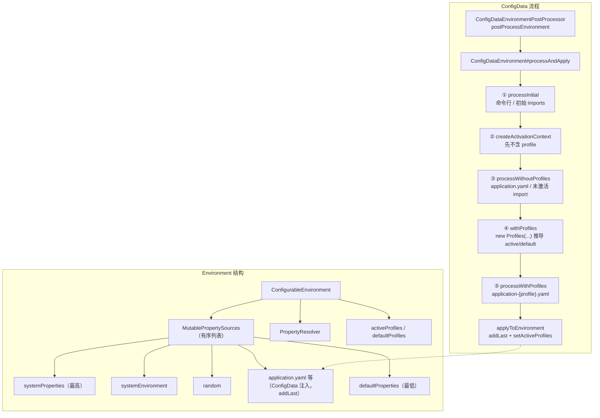
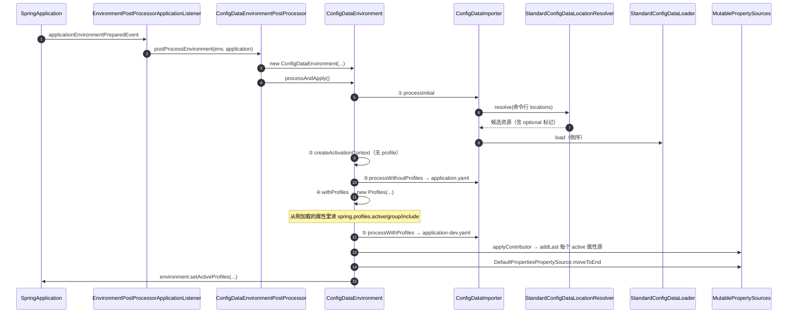

# 环境抽象与配置加载：Environment、ConfigData 与 Profile

> 一句话结论：Boot 的配置加载不是"读一个 application.yaml"，而是 `ConfigDataEnvironmentPostProcessor` 启动的一套**分四阶段**的流程——初始 → 无 profile → 推导 profile → 带 profile 再导入一次；每一阶段都可能因为 `spring.config.import` 引入新文件，新文件又可能激活新 profile，所以要"再跑一遍"。最终结果被 `addLast` 塞进 `Environment` 的 `MutablePropertySources` 尾部，因此**优先级低于系统属性与环境变量**。

- 阅读前置：`04-配置与属性绑定/01-configurationproperties-属性绑定原理.md`（知道 `Binder` 与 `ConfigurationPropertySource` 是什么）。
- 版本基线：Spring Boot **4.2.0**、Spring Framework **7.1.0**。
- 预计阅读：50 分钟｜源码：`ConfigDataEnvironment`、`ConfigDataImporter`、`Profiles`、`StandardConfigDataLocationResolver`、`AbstractEnvironment`、`StandardEnvironment`、`MutablePropertySources`。

---

## 0. 先看现象：四个"为什么"

**现象 1：`application.yaml` 覆盖不了环境变量里的值**

```java
// 启动时设置  MY_APP_NAME=from-env
```

```yaml
my-app:
  name: from-yaml
```

结果拿到 `from-env`。不是 bug——`ConfigData` 加载进来的属性源是 **`addLast`** 的，排在"系统属性 / 环境变量"之后。

**现象 2：在 `application.yaml` 里写 `spring.profiles.active` 有时"读不到"**

Boot 2.4 起 profile 激活分了两轮：第一轮（无 profile）已经把所有 `application.yaml` 读完，第二轮才去读 `application-{profile}.yaml`。所以 `application.yaml` 里的 `spring.profiles.active` **是能生效的**，但 `application-{profile}.yaml` 里的再套一层 `spring.profiles.active` 就不行（会报 profile 只能用一次之类的问题）。这是 2.4 之后最容易被误解的点。

**现象 3：`@PropertySource` 里配置的值覆盖不了 `application.yaml`**

`@PropertySource` 处理时机在 `ConfigurationClassPostProcessor` 解析配置类时，那时 `Environment` 里 `application.yaml` 对应的属性源**已经加进去了**，而 `@PropertySource` 默认是 `addLast`。所以它的优先级比 yaml **更低**。

**现象 4：`spring.config.import` 导入的文件里的 profile 配置"没生效"**

因为 `import` 有两种时机：一种在"无 profile 阶段"处理，一种要等 profile 推导完成后处理。写错位置就会得到"导入了但 profile 没激活"。

下面从数据结构开始，一路推到这四个现象的源码依据。

---

## 1. 全局地图：Environment 的层次与 ConfigData 四阶段



**读图说明**

- 上半部分是"数据结构"，下半部分是"加载流程"，虚线表示流程最终往结构里写。
- `MutablePropertySources` 是**有序列表**，索引越小优先级越高；`addFirst` 最高、`addLast` 最低。
- 流程里①②③④⑤的顺序是硬编码在 `processAndApply()` 里的，五个阶段不可调换——这是 Boot 2.4 之后"配置加载重构"的核心。
- 注意阶段④"推导 profile"发生在阶段③"读完 `application.yaml`"之后。这解释了现象 2。

---

## 2. 关键类速查

| 类 | 模块 | 角色 |
| --- | --- | --- |
| `Environment` / `ConfigurableEnvironment` | spring-core | 属性解析 + profile 管理的总接口 |
| `AbstractEnvironment` | spring-core | 模板方法：`customizePropertySources` 留给子类 |
| `StandardEnvironment` | spring-core | 加入 `systemProperties` / `systemEnvironment` |
| `MutablePropertySources` | spring-core | 有序属性源容器 |
| `PropertySource` | spring-core | 单个属性源；**身份由 name 决定** |
| `ConfigDataEnvironmentPostProcessor` | spring-boot | 入口 `EnvironmentPostProcessor`（order = `HIGHEST_PRECEDENCE + 10`） |
| `ConfigDataEnvironment` | spring-boot | 五阶段编排 |
| `ConfigDataImporter` | spring-boot | `resolve` + `load`，**倒序**加载候选资源 |
| `ConfigDataLocationResolver`（`StandardConfigDataLocationResolver`） | spring-boot | 把 `classpath:/` 之类的 location 解析成具体文件 |
| `ConfigDataLoader`（`StandardConfigDataLoader`） | spring-boot | 真正读文件成 `ConfigData` |
| `Profiles` | spring-boot | 推导 active/default/profile-group |
| `ConfigurationPropertySources` | spring-boot | 把 `PropertySources` 适配给 `Binder` |

---

## 3. 源码逐段

### 3.1 数据结构：`MutablePropertySources` 的顺序语义

```java
(src: MutablePropertySources.java#L100-L108)
```

```java
(src: MutablePropertySources.java#L110-L118)
```

只有两条规则要背：

- `addFirst` → 索引 0，**最高优先级**；
- `addLast` → 队尾，**最低优先级**。

`PropertySource` 的"身份"只看名字：

```java
(src: PropertySource.java#L41-L45)
```

因为身份是名字，所以 `removeIfPresent`/`replace` 都是按名字匹配的，这也意味着**同名属性源只可能有一个**——这是后面理解 `application.yaml` 只加载一次的前提。

### 3.2 `AbstractEnvironment`：模板方法

```java
(src: AbstractEnvironment.java#L135-L139)
```

一句话：`AbstractEnvironment` 构造时做三件事——存 `propertySources`、建 `PropertyResolver`、调 `customizePropertySources(propertySources)` 让子类往里塞东西。

子类 `StandardEnvironment` 就是这么做的：

```java
(src: StandardEnvironment.java#L95-L100)
```

注意 `addLast` 两次，所以列表是：

| 顺序 | 属性源 | 优先级 |
| --- | --- | --- |
| 1 | `systemProperties` | 高 |
| 2 | `systemEnvironment` | 中 |

**这就是"环境变量打不过 `-D` 系统属性"的源码依据。**

### 3.3 入口：`ConfigDataEnvironmentPostProcessor`

```java
(src: ConfigDataEnvironmentPostProcessor.java#L76-L86)
```

三个要点：

1. 它是 `EnvironmentPostProcessor`，由 `EnvironmentPostProcessorApplicationListener`（`spring.factories` 中注册）在 `applicationEnvironmentPreparedEvent` 时调用。
2. `ORDER = HIGHEST_PRECEDENCE + 10`：几乎最优先，其他 `EnvironmentPostProcessor` 能看到已经加载好的 `application.yaml`。
3. `application.getAdditionalProfiles()` 会透传下去——这是 `SpringApplication.setAdditionalProfiles(...)` 的来源。

### 3.4 五阶段：`ConfigDataEnvironment#processAndApply`

```java
(src: ConfigDataEnvironment.java#L224-L236)
```

**这 13 行是整个模块的心脏，逐行翻译：**

| 行 | 动作 | 说明 |
| --- | --- | --- |
| 225 | 建 `ConfigDataImporter` | 持有 resolver 与 loader 列表 |
| 227 | `registerBootstrapBinder(..., DENY_INACTIVE_BINDING)` | 给 `BootstrapContext` 注册一个 `Binder`，供 resolver 在"不知道 profile"时用 |
| 228 | `processInitial(...)` | 处理命令行 `spring.config.location` / `spring.config.additional-location` 等**最初**的 imports |
| 229-230 | `createActivationContext(...)` | 此刻还没有 profile，`FAIL_ON_BIND_TO_INACTIVE_SOURCE` 表示"如果绑定时碰到未激活的属性源就报错" |
| 231 | `processWithoutProfiles(...)` | 真正的 `application.yaml` 在这里被加载；此时 `application-{profile}.yaml` 还不加载 |
| 232 | `withProfiles(...)` | 用刚加载的属性推导 `spring.profiles.active/default/include/group` |
| 233 | `processWithProfiles(...)` | 带着 profile 再解析一遍，这次会加载 `application-{profile}.yaml` |
| 234-235 | `applyToEnvironment(...)` | 把结果写进 `Environment` |

接着看后面三个阶段的细节：

```java
(src: ConfigDataEnvironment.java#L259-L265)
```

`processWithoutProfiles` 与 `processWithProfiles` 的差别只有 `activationContext`（一个是不带 profile 的，一个是带了 profile 的）。同一个 `withProcessedImports` 调用，因为上下文不同，解析出的文件不同——这就是"profile-specific 文件在第二阶段才出现"的实现方式。

推导 profile：

```java
(src: ConfigDataEnvironment.java#L267-L285)
```

三点：

1. 收集 `additionalProfiles`（来自 `SpringApplication` 与 `spring.profiles.include`）。
2. `new Profiles(environment, binder, additionalProfiles)`——注意它同时也把 **`Environment` 里已有的值**（比如 `-Dspring.profiles.active=dev`）合并进来。
3. `activationContext.withProfiles(profiles)` 返回新的上下文，供阶段⑤使用。

```java
(src: ConfigDataEnvironment.java#L287-L309)
```

`getIncludedProfiles` 里有一个很值得注意的校验：**如果 `spring.profiles.include` 写在了"未激活"的属性源里，就直接抛 `InactiveConfigDataAccessException`**（见 `InactiveConfigDataAccessException.throwIfPropertyFound`）。这就是"在 `application-dev.yaml` 里写 `spring.profiles.include=foo` 报错"的根因。

最后写回 `Environment`：

```java
(src: ConfigDataEnvironment.java#L326-L341)
```

关键三句：

- `applyContributor(...)`：把 active 的属性源逐个 **`addLast`** 进 `MutablePropertySources`；
- `DefaultPropertiesPropertySource.moveToEnd(propertySources)`：`defaultProperties` 永居末尾；
- `setDefaultProfiles` / `setActiveProfiles`：把推导结果**反写**回 `Environment`，所以之后 `environment.getActiveProfiles()` 能拿到正确值。

### 3.5 默认搜索路径

```java
(src: ConfigDataEnvironment.java#L76-L85)
```

翻译成人类语言（**优先级从高到低**）：

1. `optional:classpath:/config/`
2. `optional:classpath:/`
3. `optional:file:./config/*/`（子目录）
4. `optional:file:./config/`
5. `optional:file:./`

一句话记法：**外部 config 目录 > 当前目录 > classpath**；`optional:` 表示文件不存在不报错。

### 3.6 resolver 与 loader

```java
(src: StandardConfigDataLocationResolver.java#L84-L90)
```

`spring.config.name`（默认 `application`）在这一步被读出来，决定文件名。

```java
(src: StandardConfigDataLocationResolver.java#L188-L201)
```

注意 `references.addFirst(reference)`：**后加入的排在前面**，所以最终顺序与 `PropertySourceLoader` 列表顺序相反。这解释了 properties 与 yaml 同时存在时谁赢的问题（由 `PropertySourceLoader` 的顺序 + 反转共同决定，不要凭直觉猜，用 `/actuator/env` 看实际顺序）。

如果 location 是目录，还会把 profile-specific 的候选一起生成出来：

```java
(src: StandardConfigDataLocationResolver.java#L136-L139)
```

loader 侧把"这个文件是否 profile-specific"标记出来：

```java
(src: StandardConfigDataLoader.java#L31-L46)
```

`PROFILE_SPECIFIC` / `NON_PROFILE_SPECIFIC` 这两个 `PropertySourceOptions` 决定了后续 `ConfigData.Option` 上挂什么标记，从而影响"阶段③还是阶段⑤能读到它"。

### 3.7 `ConfigDataImporter`：为什么是**倒序**加载

```java
(src: ConfigDataImporter.java#L103-L118)
```

`for (int i = candidates.size() - 1; i >= 0; i--)` 是故意的：候选列表是"由高到低优先级"排列的（`addFirst` 造成的），而加载时**先装低优先级的，最后装高优先级的**。后面 `applyToEnvironment` 再统一 `addLast`，于是"最后装进去的"变成"最先处理的"。一取一反，最终优先级与声明顺序一致。

同时注意：

- `resource.isOptional()` 记录到 `optionalLocations`，供最后 `checkMandatoryLocations` 使用；
- `this.loaded.contains(resource)` 去重，所以同名文件不会加载两次；
- 非 optional 的资源缺失时，走 `notFoundAction`（默认 `FAIL`，可用 `spring.config.on-not-found=ignore` 改）。

### 3.8 `Profiles`：active、default 与 group

```java
(src: Profiles.java#L70-L79)
```

三行三个信息：

1. `spring.profiles.group` 被绑成 `MultiValueMap`；
2. active = `spring.profiles.active` 的值 **+ `additionalProfiles`**，然后按 group 展开；
3. default = `spring.profiles.default`，没有则 `default`。

group 展开是栈式去重：

```java
(src: Profiles.java#L127-L138)
```

`spring.profiles.group.prod=prod-db,prod-mq` 的效果就是：激活 `prod` 时自动带上 `prod-db`、`prod-mq`，且**顺序稳定、不重复**。

一个容易忽略的优先级规则：`getProfiles` 里会先比较 `Environment` 里已有的值（程序化 `setActiveProfiles` 的优先级最高），再比较绑定结果。这解释了"代码里 `setActiveProfiles("test")` 为什么不生效"——因为它是**更低**优先级：`environment.getProperty("spring.profiles.active")` 有值时，以属性值为准。

### 3.9 `@PropertySource` 为什么优先级低

`@PropertySource` 由 `ConfigurationClassPostProcessor` 在处理配置类时读取，通过 `PropertySourceRegistry`/`addLast` 加入 `Environment`。此时的 `Environment` 已经经历了 `ConfigData` 四阶段（`EnvironmentPostProcessor` 在 `prepareContext` 之前就执行完了），`application.yaml` 的属性源已在列表中。`addLast` 的结果是：**`@PropertySource` 在 yaml 之后**，优先级更低。

结论排序（从高到低，典型 Servlet 应用）：

```text
命令行参数
- D 系统属性
环境变量
（ConfigData：file:./config/*/ → file:./config/ → file:./ → classpath:/config/ → classpath:/，每个位置内 profile-specific 优先）
@PropertySource（ConfigurationClassPostProcessor 阶段 addLast）
defaultProperties（最末）
```

> 注意：`@TestPropertySource` 与 `@SpringBootTest(properties=...)` 走的是**内联属性**，它们通过 `TestPropertySourceUtils.addInlinedPropertiesToEnvironment` 加在**最前面**，优先级比 yaml 高得多。这是测试里能覆盖配置的原因（详见 `05-Actuator运维与测试/02-测试切片与springboottest.md`）。

---

## 4. 时序图：一次带 profile 的启动



**读图说明**

- 阶段①～⑤的顺序即源码顺序，不可交换。
- `resolve` 与 `load` 是两次遍历：先全部解析成候选，再倒序加载。
- 最后两步（`addLast` 与 `setActiveProfiles`）是"写回"，写完之后 `SpringApplication` 继续 `prepareContext`。
- 图里"④ withProfiles"读的是**阶段③刚加载进来的属性**，所以 `application.yaml` 里的 `spring.profiles.active` 有效；而阶段⑤加载的 `application-dev.yaml` 里的 `spring.profiles.active` 已经太晚，会触发 `InactiveConfigDataAccessException` 一类的保护。

---

## 5. 设计模式与可扩展点

| 位置 | 模式 | 说明 |
| --- | --- | --- |
| `ConfigDataLocationResolver` / `ConfigDataLoader` | 策略 + SPI | 通过 `spring.factories` 注册，支持自定义协议（如 `configtree:`、Cloud 的 `configserver:`） |
| `ConfigDataEnvironmentContributor` | 组合 / 链表 | 每个"贡献者"携带自己的属性源与激活状态 |
| `Profiles` | 值对象 + 展开算法 | group 展开用栈去重保序 |
| `MutablePropertySources` | 有序集合 + 命名身份 | 顺序即优先级 |
| `EnvironmentPostProcessor` | 扩展点 | 在 ConfigData 之后继续修改 `Environment` |

常用扩展点：

1. **自定义 `EnvironmentPostProcessor`**：需要"在 yaml 之后再加一层属性"时用；记得在 `META-INF/spring.factories` 注册，并设置比 `HIGHEST_PRECEDENCE + 10` 更大的 order（即更晚执行）。
2. **`spring.config.import`**：Boot 2.4 引入的"组合配置文件"机制，适合把配置拆成 `application-db.yaml`、`application-mq.yaml` 再 import。
3. **自定义 `ConfigDataLocationResolver`**：给 `spring.config.import` 加新协议（比如从配置中心拉）。
4. **`spring.config.activate.on-profile`**：多文档 YAML 里的"条件块"，只在某 profile 下生效。

### 多文档 YAML 的坑

```yaml
# application.yaml
app:
  timeout: 1s
---
spring:
  config:
    activate:
      on-profile: dev
app:
  timeout: 10s
```

- 一个文件多个文档，`---` 分割；每个文档可以有独立的 `spring.config.activate.on-profile`。
- **`spring.profiles.active` 与 `spring.config.activate.on-profile` 不能放在同一个文档里"自我激活"**，会报 `InactiveConfigDataAccessException`（该属性所在的文档未激活，却要读它来激活 profile）。
- `spring.profiles.group` 同理，必须放在"无条件文档"里。

---

## 6. 踩坑与调试

### 6.1 优先级类

| 现象 | 原因 | 排查 |
| --- | --- | --- |
| 环境变量覆盖了 yaml | ConfigData 是 `addLast` | 看 `/actuator/env` 里属性源顺序 |
| `@PropertySource` 不生效 | 在 yaml 之后 `addLast` | 改用 `spring.config.import` 或 `EnvironmentPostProcessor` |
| 测试里配置覆盖成功 | `@SpringBootTest(properties=...)` 是内联属性，加在最前 | 见 05 篇 |
| 两个 yaml 顺序反了 | `addFirst` 与 `load` 倒序共同作用 | 用 `/actuator/env` 实际确认，不要凭直觉 |

### 6.2 profile 类

| 现象 | 原因 |
| --- | --- |
| `application-dev.yaml` 里的 `spring.profiles.active` 不生效/报错 | profile 属性只能在"无 profile 阶段可读"的属性源里 |
| 代码里 `setActiveProfiles` 没生效 | 属性 `spring.profiles.active` 有值时优先于程序设置（`Profiles#getProfiles` 的比较逻辑） |
| `spring.profiles.include` 报 `InactiveConfigDataAccessException` | 写在了未激活的文档/文件里 |
| group 里的 profile 没带上 | `spring.profiles.group` 名字写成了 `spring.profile.group`（少 s） |
| `default` profile 一直激活 | 没设置任何 active 时使用 `default`，这是 `AbstractEnvironment.RESERVED_DEFAULT_PROFILE_NAME` |

### 6.3 `spring.config.import` 类

| 现象 | 原因 |
| --- | --- |
| import 的文件不生效 | 路径少了 `optional:` 且文件不存在 → 默认 `FAIL`；或写的是相对路径但工作目录不对 |
| 同文件被加载两次 | 实际上 `ConfigDataImporter` 有 `loaded` 去重；若看到两次，通常是不同 location 指向同一 resource |
| import 里的 profile 配置无效 | import 在阶段③处理，profile 由阶段④推导；如果文件本身是 profile-specific 的，它根本还没被加载 |
| 通配符 `config/*/` 顺序不确定 | 文件系统遍历顺序；需要确定性请显式列举 |

### 6.4 调试手段

1. **`/actuator/env`**：看属性源名字与顺序，最直接。
2. **`--debug`**：Boot 的 `ConditionEvaluationReport` 会打印自动配置，同时能看到 `ConfigData` 相关日志（`TRACE` 级别有"Considering resource ..."、"Already loaded resource ..."）。
3. **`logging.level.org.springframework.boot.context.config=TRACE`**：`ConfigDataImporter` 的 trace 日志会逐个列出候选资源与加载决策。
4. **`spring.config.on-not-found=ignore`**：临时排查"是不是某个 location 找不到导致整个流程失败"。
5. **打印属性源**：`ApplicationReadyEvent` 里遍历 `((ConfigurableEnvironment) ctx.getEnvironment()).getPropertySources()`。

---

## 7. Boot 2.x / 3.x / 4.x 版本差异

| 主题 | Boot 2.x | Boot 3.x | Boot 4.x（基线 4.2.0） |
| --- | --- | --- | --- |
| 配置加载模型 | 2.4 之前是 `ConfigFileApplicationListener`；2.4 起改为 `ConfigDataEnvironment`（本文主线） | 沿用 `ConfigData` | 沿用 `ConfigData`，`processAndApply` 仍是五阶段（源码见 `ConfigDataEnvironment#processAndApply`） |
| `spring.config.import` | 2.4 引入 | 支持 | 支持；默认 location 仍是 `optional:classpath:/` 与 `optional:file:./` 家族（见 `DEFAULT_SEARCH_LOCATIONS`） |
| profile 激活顺序 | 2.4 起"先无 profile 再推导 profile"，`spring.profiles.active` 不能写在 profile-specific 文件中 | 同 | 同；`InactiveConfigDataAccessException` 保护仍在（`Profiles#getIncludedProfiles` 与 `withProfiles` 里可见） |
| `spring.profiles.group` | 2.4 引入 | 支持 | 支持（`Profiles` 构造器绑 `spring.profiles.group`） |
| `@PropertySource` 优先级 | 一直低于 ConfigData（2.4+） | 同 | 同 |
| 环境抽象 | `AbstractEnvironment#customizePropertySources` 模板方法 | 同 | 同（7.1.0 源码未变） |
| 多文档 YAML | 2.4 起用 `spring.config.activate.on-profile`（旧 `spring.profiles` 键不推荐） | 同 | 同 |

> Boot 4 是否有"进一步变化"：以本仓库 4.2.0 源码为准，`ConfigDataEnvironment` 仍是四阶段导入 + 一次写回（`processInitial` → `processWithoutProfiles` → `withProfiles` → `processWithProfiles` → `applyToEnvironment`），未见结构性变化。Boot 4 的主要变化在**模块拆分**（如 health 独立模块）与 AOT 增强，不在 ConfigData 主流程。

---

## 8. 面试题（12 问）

1. Boot 2.4 之后配置加载为什么不能在一条流程里完成？
2. `MutablePropertySources` 的顺序与优先级关系？
3. 为什么 `application.yaml` 覆盖不了系统属性/环境变量？
4. `spring.config.import` 与 `spring.config.additional-location` 的区别？
5. `application-{profile}.yaml` 是在哪个阶段被加载的？
6. 为什么 `spring.profiles.active` 不能写在 profile-specific 文件里？
7. `spring.profiles.group` 的展开算法？
8. `@PropertySource` 为什么优先级低？
9. `ConfigDataImporter` 为什么要倒序加载候选资源？
10. `optional:` 前缀的作用？`spring.config.on-not-found` 怎么配合？
11. `defaultProperties` 为什么总是最低？
12. 自定义 `EnvironmentPostProcessor` 要注意什么？

---

## 9. 动手练习

1. 写一个 `application.yaml` + `application-dev.yaml` + `spring.config.import` 组合，用 `/actuator/env` 打印属性源顺序，验证"谁覆盖谁"。
2. 用 `spring.profiles.group.dev=dev-db,dev-mq` 观察 `environment.getActiveProfiles()` 的结果顺序。
3. 故意把 `spring.profiles.active` 写进带 `spring.config.activate.on-profile` 的文档，看报错信息。
4. 写一个 `EnvironmentPostProcessor`，在 `HIGHEST_PRECEDENCE + 20` 处加一个高优先级属性源，观察它能否覆盖 yaml。
5. 把 `spring.config.on-not-found` 设为 `ignore`，验证缺失 location 不再导致启动失败。

---

## 小结

- `Environment` = 有序的 `PropertySources` + `PropertyResolver` + profile 管理；顺序即优先级。
- `StandardEnvironment` 把 `systemProperties`、`systemEnvironment` 放在最前，所以**它们几乎总能覆盖配置文件**。
- Boot 配置加载是 `ConfigDataEnvironment#processAndApply` 的五阶段流程：初始 → 无 profile → 推导 profile → 带 profile → 写回。
- ConfigData 加载的属性源一律 `addLast`；`defaultProperties` 永远在最后。
- profile 的 active/default/group 由 `Profiles` 推导，`spring.profiles.include` 只能在"已激活"的属性源里出现。
- `@PropertySource` 比 yaml 更晚加入且 `addLast`，所以优先级更低；测试里能覆盖配置靠的是"内联属性加在最前"。

## 自测题

**1. 为什么环境变量能覆盖 `application.yaml`？**

<details><summary>参考答案</summary>

因为 `StandardEnvironment#customizePropertySources` 在构造时把 `systemProperties` 与 `systemEnvironment` 声明为最先（`addLast` 到空列表，等价于占据前两位），而 ConfigData 加载的文件属性源是后来 `addLast` 到列表末尾，优先级更低。
</details>

**2. `MutablePropertySources` 中"最高优先级"的位置在哪？**

<details><summary>参考答案</summary>

索引 0，由 `addFirst` 放入；`addLast` 放入队尾即最低优先级（`defaultProperties` 永居末尾）。
</details>

**3. `ConfigDataEnvironment#processAndApply` 的五个阶段？**

<details><summary>参考答案</summary>

初始化 imports（`processInitial`）→ 创建不带 profile 的激活上下文（`createActivationContext`）→ 处理不带 profile 的导入（`processWithoutProfiles`）→ 推导 profile（`withProfiles`）→ 带 profile 再处理（`processWithProfiles`）→ 写回 `Environment`（`applyToEnvironment`）。
</details>

**4. `application-{profile}.yaml` 在哪个阶段加载？**

<details><summary>参考答案</summary>

在 `processWithProfiles`（第五阶段），因为此时 `activationContext` 才带上 `Profiles`，resolver 才会解析 profile-specific 候选。
</details>

**5. 为什么 `spring.profiles.active` 不能写在 `application-dev.yaml` 里？**

<details><summary>参考答案</summary>

`application-dev.yaml` 只有在 profile 已激活时才会被加载，而 profile 的推导发生在它被加载之前；若在未激活的属性源中读到 `spring.profiles.active`/`include`，会抛 `InactiveConfigDataAccessException`（见 `Profiles#getIncludedProfiles` 与 `withProfiles` 的捕获逻辑）。
</details>

**6. `ConfigDataImporter#load` 为什么倒序遍历？**

<details><summary>参考答案</summary>

候选列表是按 `addFirst` 生成的"高优先级在前"顺序；倒序加载使高优先级资源最后装载，配合后续统一的 `addLast` 写入，最终在 `PropertySources` 中呈现正确优先级。
</details>

**7. `spring.config.import` 与 `spring.config.additional-location` 的差别？**

<details><summary>参考答案</summary>

`additional-location` 在默认搜索路径之外**追加**搜索位置（仍按位置优先级处理）；`spring.config.import` 是"显式导入某个配置"，可在任意配置文件里出现，支持 `optional:` 前缀与自定义协议（由 `ConfigDataLocationResolver` 解析），导入的文件属性源优先级低于导入它的文件。
</details>

**8. `spring.profiles.group` 的展开是怎么做的？**

<details><summary>参考答案</summary>

`Profiles#expandProfiles` 用 `Deque` 栈：把原始 profile 列表逆序压栈，逐个弹出并加入结果集（`LinkedHashSet` 去重保序），若是某个 group 的名字则把其成员逆序压栈，广度优先地展开。
</details>

**9. `@PropertySource` 为什么覆盖不了 yaml？**

<details><summary>参考答案</summary>

`@PropertySource` 在配置类解析阶段（`ConfigurationClassPostProcessor`）才加入 `Environment`，此时 ConfigData 已把 yaml 属性源加入列表；`@PropertySource` 默认以更低优先级（`addLast`）加入，因此排在其后。
</details>

**10. `optional:` 与 `spring.config.on-not-found` 的关系？**

<details><summary>参考答案</summary>

`optional:` 标记单个 location"允许不存在"；`spring.config.on-not-found=ignore` 是全局策略，用于非 optional 资源缺失时改变 `ConfigDataNotFoundAction` 的行为（默认 `FAIL`）。两者作用于不同粒度。
</details>

**11. `defaultProperties` 为什么必须最低？**

<details><summary>参考答案</summary>

它承载"兜底默认值"，语义上必须被任何显式配置覆盖。`applyToEnvironment` 结束时显式调用 `DefaultPropertiesPropertySource.moveToEnd(propertySources)` 保证这一点。
</details>

**12. 自定义 `EnvironmentPostProcessor` 的注意事项？**

<details><summary>参考答案</summary>

在 `META-INF/spring.factories` 中用 `org.springframework.boot.env.EnvironmentPostProcessor` 注册；`getOrder()` 要大于 `ConfigDataEnvironmentPostProcessor.ORDER`（`HIGHEST_PRECEDENCE + 10`）才能看到已加载的 yaml；若要"覆盖"配置，应该 `addFirst` 而不是 `addLast`；注意在 AOT / native 场景下仍需保证可实例化。
</details>
