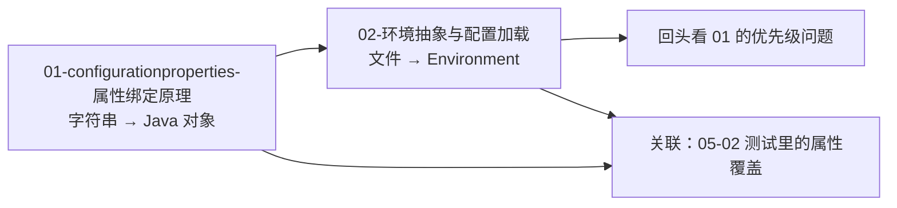

# 04 配置与属性绑定

> 一句话结论：Spring Boot 的"配置"分成两半——**把文件读进 `Environment`**（由 `ConfigDataEnvironmentPostProcessor` 负责）和**把 `Environment` 里的字符串变成 Java 对象**（由 `Binder` 负责）。前者讲"谁覆盖谁"，后者讲"怎么转换"。这两件事搞清楚了，配置问题 90% 都能自解。

## 学习目标

读完本组两篇，你应该能够：

1. 说清 `Environment` → `MutablePropertySources` → `PropertySource` 的**有序列表**结构，并说出"环境变量为什么能覆盖 yaml"。
2. 顺着 `@ConfigurationProperties` → `ConfigurationPropertiesBindingPostProcessor` → `ConfigurationPropertiesBinder` → `Binder#bind` 一路读出源码链路。
3. 解释 `Binder` 内部如何选择 `JavaBeanBinder` / `ValueObjectBinder`（构造器绑定），以及 `MapBinder` / `CollectionBinder` / `ArrayBinder` 这三种聚合绑定。
4. 说出松散绑定（`my-app` / `myApp` / `MY_APP`）的实现位置，并能预判哪些写法"看起来对但其实对不上"。
5. 讲出 `@Validated` 校验发生在绑定的**哪一步**、失败为什么被包成 `ConfigurationPropertiesBindException`。
6. 画出 Boot 2.4+ 的 ConfigData 加载四阶段，解释 `spring.config.import` 与 profile 激活顺序为什么被改写。
7. 面对"改了配置没生效"，能按 6 类常见原因逐条排除。

## 阅读顺序

**读图说明**

- 先读 01（绑定）：它是"后半段"，输入是 `Environment` 里已有的属性，输出是 Java 对象。这一篇能让初学者最快看到"配置生效"的完整链路。
- 再读 02（加载）：它是"前半段"，解释那些属性是怎么进 `Environment` 的、顺序如何。
- 两条箭头汇到 05-02：测试里的 `@SpringBootTest(properties=...)` 之所以能覆盖 `application.yaml`，同时用到"内联属性加在最前"（02 的知识）与"属性源交给 `Binder`"（01 的知识）。

## 每篇摘要

### 01-configurationproperties-属性绑定原理

- **主线**：`@ConfigurationProperties` → `ConfigurationPropertiesBindingPostProcessor#postProcessBeforeInitialization`（`BeanPostProcessor`，`getOrder()` = `HIGHEST_PRECEDENCE + 1`）→ `ConfigurationPropertiesBean#get` 推导 `BindMethod` → `ConfigurationPropertiesBinder#bind` → `Binder#bind(ConfigurationPropertyName, Bindable, BindHandler)` → `bindObject` → `bindDataObject` → `JavaBeanBinder` / `ValueObjectBinder`。
- **讲清**：`BindHandler` 责任链（`ConfigurationPropertiesBindHandler` → `IgnoreErrorsBindHandler` → `NoUnboundElementsBindHandler` → `ValidationBindHandler`）、`ConversionServiceDeducer` 如何收集自定义 `Converter`、`@DefaultValue` 在 `ValueObjectBinder#getDefaultValue` 里的处理、`@ConfigurationPropertiesScan` 与 `@EnableConfigurationProperties` 的差别。
- **坑集**：没有注册成 bean（只加注解不扫）、`@Component` 与 `@EnableConfigurationProperties` 的绑定入口不同、`proxyBeanMethods=true` 下的 `@Bean` 方法返回被 AOP 代理的对象、`spring.main.*` 这类"早期属性"在 `EnvironmentPostProcessor` 阶段就被读取所以 `@ConfigurationProperties` 管不了。

### 02-环境抽象与配置加载-configdata与profile

- **主线**：`AbstractEnvironment` / `StandardEnvironment` / `MutablePropertySources` 的顺序语义 → `ConfigDataEnvironmentPostProcessor#postProcessEnvironment` → `ConfigDataEnvironment#processAndApply`（五阶段：初始 → 无 profile → 推导 profile → 带 profile → 写回）→ `ConfigDataLocationResolver` / `ConfigDataLoader` / `ConfigDataImporter`。
- **讲清**：默认搜索路径与优先级、`spring.config.import` 的两种时机、`Profiles` 的 active/default/group 推导与 `spring.profiles.include` 的保护、多文档 YAML 的 `spring.config.activate.on-profile`、`@PropertySource` 为什么优先级低。
- **版本差异**：Boot 2.4 引入 ConfigData 是一次重写（替换 `ConfigFileApplicationListener`）；3.x 与 4.x 沿用同一模型，以 4.2.0 源码为准未见结构性变化。

## 检查点

读完本组后，请用下面的问题自检；任何一条答不上来，就回到对应篇的 §3。

| 检查点 | 归属 |
| --- | --- |
| `@ConfigurationProperties` 的绑定发生在 bean 生命周期的哪一步？早于还是晚于 `InitializingBean#afterPropertiesSet`？ | 01 |
| 为什么构造器绑定的类不会被 `ConfigurationPropertiesBindingPostProcessor` 再绑一次？ | 01 |
| `my.app-name`、`my.appName`、`MY_APPNAME` 哪个能绑到 `appName` 字段？ | 01 |
| `@Validated` 校验失败抛的是什么异常？外层又包了一层什么？ | 01 |
| 自定义 `Converter` 需要满足什么条件才会被 `Binder` 使用？ | 01 |
| `application.yaml`、`application-dev.yaml`、`spring.config.import` 三者的加载顺序？ | 02 |
| 为什么 `-Dspring.profiles.active=dev` 能生效，而代码里 `setActiveProfiles` 有时"不生效"？ | 02 |
| `@PropertySource` 加进来的属性为什么打不过 `application.yaml`？ | 02 |
| Boot 4.2.0 的 ConfigData 流程与 2.4 相比有没有结构性变化？结论依据是什么？ | 02 |

## 关联章节

- 上一篇：[`../03-内嵌容器与Web开发/`](../03-内嵌容器与Web开发/)（配置如何影响 Web 容器）。
- 下一篇：[`../05-Actuator运维与测试/README.md`](../05-Actuator运维与测试/README.md)（用 `/actuator/env` 直接观察本文讲的属性源顺序）。
- 环境抽象的前置知识（`BeanPostProcessor`、`BeanFactory`）：[`../01-启动原理/01-springapplication-run-启动全流程.md`](../01-启动原理/01-springapplication-run-启动全流程.md)。
