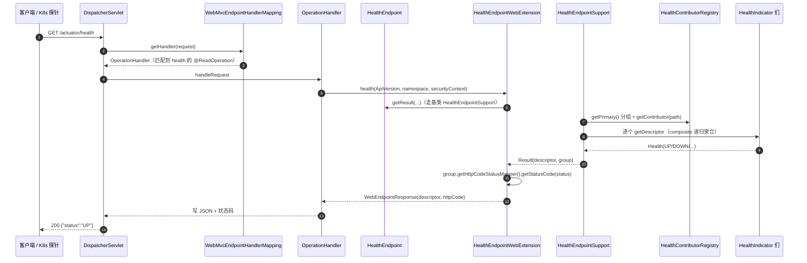

# Actuator 端点模型与健康检查原理

> 一句话结论：Actuator 的核心是"**一套端点定义，多个技术实现**"——你用 `@Endpoint(id="x")` + `@ReadOperation` 写一次，Boot 通过 `EndpointDiscoverer` 把它变成"端点 + 操作"的抽象模型，再分别交给 JMX、Spring MVC、WebFlux 三个 `EndpointDiscoverer` 子类去暴露。`/actuator/health` 多了一层：`HealthContributor` 树被 `HealthEndpointSupport` 递归聚合成一个 `Health` 对象，再由 `HealthEndpointWebExtension` 映射成 HTTP 状态码。

- 阅读前置：会用 `@RestController`；了解 `Environment`/`PropertySources`（见 [`../04-配置与属性绑定/02-环境抽象与配置加载-configdata与profile.md`](../04-配置与属性绑定/02-环境抽象与配置加载-configdata与profile.md)）。
- 版本基线：Spring Boot **4.2.0**（`spring-boot-actuator`、`spring-boot-health`、`spring-boot-webmvc`）、Spring Framework **7.1.0**。
- 预计阅读：55 分钟｜源码：`Endpoint`、`EndpointDiscoverer`、`WebMvcEndpointHandlerMapping`、`AbstractWebMvcEndpointHandlerMapping`、`HealthEndpoint`、`HealthEndpointSupport`、`HealthEndpointWebExtension`、`HealthEndpointConfiguration`、`EnvironmentEndpoint`、`BeansEndpoint`。

> **模块位置提醒（Boot 4 重要变化）**：本仓库验证发现，`org.springframework.boot:spring-boot-actuator:4.2.0` 里**没有 health 包**；健康检查相关类全部在独立模块 `org.springframework.boot:spring-boot-health:4.2.0`（包 `org.springframework.boot.health.*`），Spring MVC 的 HTTP 暴露层在 `org.springframework.boot:spring-boot-webmvc:4.2.0`（包 `org.springframework.boot.webmvc.actuate.*`）。所以本文会出现三个不同 jar 的类，这本身就是 Boot 4 的模块拆分结果。

---

## 0. 先看现象：五个真实困惑

**现象 1：只加了 `spring-boot-starter-actuator`，`/actuator/health` 能访问，`/actuator/beans` 却是 404**

因为 HTTP 暴露的端点默认只有 `health`（历史上还包含 `info`，2.x 之后 `info` 也不在默认暴露列表里）。要看到别的端点必须显式配置：

```properties
management.endpoints.web.exposure.include=health,info,beans,env,metrics
```

**现象 2：加了 `@Endpoint(id="custom")`，`@ReadOperation` 也有了，访问 `/actuator/custom` 还是 404**

三步都可能漏：① 类没注册成 bean（`@Component` 或 `@Bean`）；② 没在 `exposure.include` 里；③ 方法不是"可调用操作"（`isInvocable()` 为 false，比如所有 `@ReadOperation` 都是 `static` 或参数不合法）。

**现象 3：`/actuator/health` 里 `components` 全不见了**

Boot 2.0 之后默认 `management.endpoint.health.show-details=never`。想看细节要 `show-details=always`（生产环境请配合 `roles` 或 `show-components`）。

**现象 4：`/actuator/env` 已经把密码脱敏了，但自己写的端点照样泄露**

脱敏由 `SanitizingFunction` 完成，只对 `EnvironmentEndpoint` 生效。自己写的端点不会自动脱敏——这是安全边界的起点，详见 [`../../05-SpringSecurity/README.md`](../../05-SpringSecurity/README.md)。

**现象 5：`management.server.port=8081` 之后，`/actuator` 挪到了 8081，但业务接口还是在 8080**

这是设计如此：管理端口独立时，Boot 会创建一个**子上下文**（`ManagementContextAutoConfiguration`），只把端点暴露到这个端口的服务器上。好处是可以用防火墙把管理端口封住。

---

## 1. 全局地图：端点定义、发现、暴露三层

```mermaid
flowchart TD
    subgraph DEF["① 端点定义（开发者写的）"]
        A1["@Endpoint(id = \"custom\")"]
        A2["@ReadOperation / @WriteOperation / @DeleteOperation"]
        A3["@EndpointWebExtension / @EndpointExtension"]
        A4["内置端点：HealthEndpoint / EnvironmentEndpoint / BeansEndpoint ..."]
    end

    subgraph DISC["② 端点发现（EndpointDiscoverer 家族）"]
        D0["EndpointDiscoverer（抽象）<br/>discoverEndpoints()"]
        D1["beanNamesForAnnotationIncludingAncestors(ctx, Endpoint.class)"]
        D2["createEndpointBean → addExtensionBeans → convertToEndpoints"]
        D3["WebEndpointDiscoverer / JmxEndpointDiscoverer / ..."]
        D0 --> D1 --> D2 --> D3
    end

    subgraph EXP["③ 暴露层"]
        E1["WebMvcEndpointHandlerMapping<br/>extends AbstractWebMvcEndpointHandlerMapping"]
        E2["initHandlerMethods → registerMappingForOperation"]
        E3["RequestHandler（@RequestMapping）"]
        E4["/actuator/{id}、/actuator/{id}/{selector}、/actuator（_links）"]
        E1 --> E2 --> E3 --> E4
    end

    DEF --> DISC --> EXP
    E4 --> HTTP["HTTP 客户端"]

    subgraph HEALTH["健康检查专用链路"]
        H1["HealthContributor 树<br/>HealthIndicator / CompositeHealthContributor"]
        H2["HealthEndpoint（@Endpoint id=health）"]
        H3["HealthEndpointSupport#getResult"]
        H4["HealthEndpointWebExtension<br/>HTTP 状态码映射"]
        H1 --> H2 --> H3 --> H4
    end

    A4 -.-> H2
    H4 -.-> E4
```

**读图说明**

- 三层结构是理解 Actuator 的关键：**定义**只要写一遍，**发现**按技术栈各有一个 `EndpointDiscoverer` 子类，**暴露**按技术栈各有一个 `HandlerMapping`。
- 图左下"健康检查专用链路"不是独立体系，`HealthEndpoint` 本身就是一个普通 `@Endpoint`（`@Endpoint(id = "health")`），只是它的聚合逻辑被抽到了 `HealthEndpointSupport` 基类里，HTTP 状态码映射被抽到了 `HealthEndpointWebExtension`。
- 虚线表示"内置端点也走同一条发现路径"——所以"自定义端点不生效"和"内置端点不生效"的排查方法完全一样。

---

## 2. 关键类速查

| 类 | 所在模块 | 角色 |
| --- | --- | --- |
| `@Endpoint` / `@ReadOperation` | spring-boot-actuator | 标记端点与操作 |
| `EndpointDiscoverer` | spring-boot-actuator | 抽象发现器，把 bean 转成 `ExposableEndpoint` |
| `WebEndpointDiscoverer` | spring-boot-actuator | Web 侧发现器 |
| `OperationReflectiveProcessor` | spring-boot-actuator | AOT：为端点操作注册反射提示 |
| `AbstractWebMvcEndpointHandlerMapping` | spring-boot-webmvc | 把操作注册为 MVC handler |
| `WebMvcEndpointHandlerMapping` | spring-boot-webmvc | 具体 `HandlerMapping`，`order = -100` |
| `HealthContributor` | spring-boot-health | `sealed interface`，健康贡献者根类型 |
| `HealthEndpoint` | spring-boot-health | `@Endpoint(id = "health")` |
| `HealthEndpointSupport` | spring-boot-health | 聚合算法 + 分组 + 慢日志 |
| `HealthEndpointWebExtension` | spring-boot-health | 按 `HttpCodeStatusMapper` 出 HTTP 状态码 |
| `HealthEndpointConfiguration` | spring-boot-health | 自动配置：注册 `HealthEndpoint` 与策略 bean |
| `EnvironmentEndpoint` | spring-boot-actuator | `/actuator/env` |
| `BeansEndpoint` | spring-boot-actuator | `/actuator/beans` |

---

## 3. 源码逐段

### 3.1 `@Endpoint`：一个注解承载"多技术适配"

```java
(src: Endpoint.java#L41-L59)
```

要点：

- `@Reflective`（Spring Framework 6 引入的 AOT 注解）说明这个注解本身在 native 场景需要反射可达；
- `id()` 默认空，空则由 bean 名推导；
- `defaultAccess()` 是 Boot 3.4 新增（`@since 3.4.0`），默认 `Access.UNRESTRICTED`，可用 `management.endpoints.access.default=read-only` 之类的全局策略收紧；
- javadoc 里写得很清楚：`@ReadOperation` / `@WriteOperation` / `@DeleteOperation` 会自动适配 JMX、Spring MVC、Spring WebFlux、Jersey。

### 3.2 `EndpointDiscoverer`：发现流程

```java
(src: EndpointDiscoverer.java#L119-L132)
```

`getEndpoints()` 是**懒加载**（`volatile` + 同步），因为端点是在上下文 refresh 后按需构建的，避免提前初始化 bean 引发循环依赖。

```java
(src: EndpointDiscoverer.java#L134-L157)
```

四件事：

1. 用 `BeanFactoryUtils.beanNamesForAnnotationIncludingAncestors` —— **包含父上下文**，所以管理子上下文能看到主上下文的端点；
2. 跳过 `ScopedProxyUtils.isScopedTarget(beanName)` 的代理目标（避免重复）；
3. 用 `endpointIds` 集合做**重复 id 检测**，重复直接 `IllegalStateException`，消息里带上两个 bean 名——这是排错时最好用的信息；
4. `Supplier` 是 `() -> applicationContext.getBean(beanName)`，即**延迟实例化**，端点 bean 在真正被访问时才创建。

扩展（Web 版）在这里注入：

```java
(src: EndpointDiscoverer.java#L159-L171)
```

`@EndpointWebExtension` 必须能找到一个存在的 `@Endpoint`，否则启动失败。这条断言的价值在于：**你写了扩展却拼错 id 时，Boot 会直接告诉你**，而不是静默忽略。

```java
(src: EndpointDiscoverer.java#L190-L213)
```

两个过滤条件：

- `isEndpointExposed()`：`@Endpoint` 上 `enableByDefault` 与暴露配置共同决定；
- `isInvocable()`：`!getOperations().isEmpty()`，即至少有一个操作。

**"端点写了但 404"的第三个原因就在这里**：如果一个端点没有任何合法操作，它会被静默过滤掉，连日志都没有。

### 3.3 Web MVC 暴露：`WebMvcEndpointHandlerMapping`

```java
(src: WebMvcEndpointHandlerMapping.java#L38-L66)
```

要点：

- `@since 4.0.0`——**Boot 4 才把这个类从 actuator 迁到 `spring-boot-webmvc`**（见第 7 节）；
- `@ImportRuntimeHints(...)`：native 场景需要注册反射；
- `setOrder(-100)`：比普通 `@RequestMapping`（默认 `0`）更靠前，所以 `/actuator/**` 优先匹配；
- `getLinksHandler()` 返回 `/actuator` 的 `_links` 处理器。

`_links` 的实现只有几行：

```java
(src: WebMvcEndpointHandlerMapping.java#L71-L80)
```

`linksResolver.resolveLinks(url)` 会把所有暴露的端点拼成 `{ "_links": { "health": {"href": "...", "templated": false}, ... } }`，这就是访问 `/actuator` 看到的内容。

注册 handler：

```java
(src: AbstractWebMvcEndpointHandlerMapping.java#L158-L165)
```

```java
(src: AbstractWebMvcEndpointHandlerMapping.java#L185-L204)
```

`createRequestMappingInfo(predicate, path)` 把"HTTP 方法 + 路径"打包成 MVC 的 `RequestMappingInfo`，再挂一个 `OperationHandler`（`HttpRequestHandler` 的实现）作为真正的执行者。所以端点最终就是一个**动态注册的 `@RequestMapping`**。

### 3.4 健康检查：`HealthContributor` 是一棵树

```java
(src: HealthContributor.java#L16-L16)
```

`sealed interface`（Java 17 sealed）只允许两个实现：

- `HealthIndicator`：叶子，返回 `Health`；
- `CompositeHealthContributor`：节点，包含若干子 `HealthContributor`。

这就是"`db`、`diskSpace`、`ping`、`redis` 都能出现在同一个 `/actuator/health` 下"的数据结构基础。

`HealthEndpoint` 本身很短：

```java
(src: HealthEndpoint.java#L34-L54)
```

```java
(src: HealthEndpoint.java#L56-L76)
```

四点：

1. `@Endpoint(id = "health")`——普通端点，没有魔法；
2. 构造器把**阻塞 registry 与响应式 registry 合并**成 `Contributor.blocking(...)`，这是 Boot 3.x 引入的"同时支持阻塞与响应式 contributor"的实现；
3. `health()` 不带路径时返回根聚合结果，且 `null` 兜底为 `UP`（避免空响应导致 500）；
4. `healthForPath(...)` 用 `@Selector(match = Match.ALL_REMAINING)` ——这就是 `/{*path}` 的写法，支持 `/actuator/health/db`、`/actuator/health/readiness` 等。

聚合算法在基类：

```java
(src: HealthEndpointSupport.java#L94-L111)
```

关键判定：

- `showComponents = showAll || group.showComponents(context)`——决定是否暴露子组件；
- `if (!showComponents && !isRoot) return null`——所以未开启详情时，访问 `/actuator/health/db` 会得到 404；
- `getContributor(name)` 走树；`getDescriptor(...)` 递归聚合。

```java
(src: HealthEndpointSupport.java#L139-L169)
```

- 复合节点 → `getAggregateDescriptor`：遍历子节点，全空返回 `null`（进而 404），否则 `aggregateDescriptors(...)` 用 `StatusAggregator` 算出最差状态；
- 叶子节点 → `getDescriptorAndLogIfSlow`：**超过阈值就 warn**，这是排查"健康检查很慢"的入口（属性 `management.endpoint.health.logging.slow-indicator-threshold`）。

### 3.5 HTTP 状态码：`HealthEndpointWebExtension`

```java
(src: HealthEndpointWebExtension.java#L40-L41)
```

`@EndpointWebExtension(endpoint = HealthEndpoint.class)` —— 注意这是**扩展**，不是第二个端点；它给同一个 `health` 端点添加 Web 专属操作。

```java
(src: HealthEndpointWebExtension.java#L58-L83)
```

这里是最有价值的一段：

- `showAll = false`，所以 Web 侧默认不展示所有组件（和 `/actuator/health` 的行为一致）；
- `result == null` 且 path 非空 → `STATUS_NOT_FOUND`；
- 否则 `group.getHttpCodeStatusMapper().getStatusCode(descriptor.getStatus())` 把健康状态映射成 HTTP 码（默认 `UP→200`、`DOWN→503`，可通过 `management.endpoint.health.status.http-mapping.*` 覆盖）。

**这就是"K8s 探针为什么能用 `/actuator/health/readiness` 判断就绪"的原因**：状态 → HTTP 码的映射是显式的、可配置的。

### 3.6 自动配置：`HealthEndpointConfiguration`

```java
(src: HealthEndpointConfiguration.java#L30-L52)
```

```java
(src: HealthEndpointConfiguration.java#L74-L81)
```

三个"策略可替换"的点，全部 `@ConditionalOnMissingBean`：

1. `StatusAggregator`：决定多个组件如何聚合（默认取最差，顺序由 `management.endpoint.health.status.order` 控制）；
2. `HttpCodeStatusMapper`：状态 → HTTP 码；
3. `HealthEndpointGroups`：`/actuator/health/{group}` 的分组（readiness/liveness/custom）。

`AutoConfiguredHealthEndpointGroups` 根据 `management.endpoint.health.group.*` 构建分组，分组必须是 `HealthEndpoint` 的子路径，且要校验成员是否存在：

```java
(src: HealthEndpointConfiguration.java#L60-L72)
```

这解释了为什么写了 `management.endpoint.health.group.foo.include=db,redis` 却在启动时报错——成员名校验在启动期做（`validate-group-membership` 默认开启）。

### 3.7 `/actuator/env` 与 `/actuator/beans` 的实现要点

```java
(src: EnvironmentEndpoint.java#L57-L77)
```

```java
(src: EnvironmentEndpoint.java#L96-L107)
```

要点：

- `@ReadOperation` 带一个可选参数 `pattern`（正则），可过滤属性源；
- 只处理 `EnumerablePropertySource`（`systemEnvironment` 也是，`RandomValuePropertySource` 不是）；
- 返回值里包含 `activeProfiles` 与 `defaultProfiles`，所以 `/actuator/env` 也是"当前 profile 是什么"最快的答案；
- 脱敏由构造器里的 `Sanitizer` 完成，脱敏规则来自 `SanitizingFunction` bean。

```java
(src: BeansEndpoint.java#L46-L64)
```

`/actuator/beans` 沿 `parent` 链向上收集，每个上下文一份 `ContextBeansDescriptor`，所以你会看到 `application` 与 `management` 两个上下文。它**不会触发 bean 初始化**（只用 `BeanDefinition` 描述），这也是它安全的原因之一。

### 3.8 `/actuator/refresh` 说明

`refresh` 端点**不在 Spring Boot 本体**里，而是 Spring Cloud Commons 的 `RefreshEndpoint`（`spring-cloud-context`），依赖 `ContextRefresher` 重新绑定 `@ConfigurationProperties` 并发布 `EnvironmentChangeEvent`。本仓库未验证该模块路径，故不给出行号。要点：

- 它只在 Spring Cloud 环境下存在；
- 它的语义是"重新绑定 + 发事件"，不是"重启上下文"；
- 需要安全边界（否则任何人都能改配置）。

---

## 4. 时序图：一次 `/actuator/health` 请求



**读图说明**

- 第 2～3 步是 MVC 的正常流程：端点已被注册成普通的 handler，`DispatcherServlet` 并不知道它是 Actuator 端点。
- 第 5 步是关键：访问的是 `HealthEndpointWebExtension`（Web 扩展），而不是 `HealthEndpoint`；扩展再委托端点，端点再委托基类做聚合。
- 第 9～10 步是"状态 → HTTP 码"的映射点，K8s 探针依赖它。
- 注意 `HealthIndicator` 是**串行遍历**的（`getAggregateDescriptor` 逐个 `children.forEach`），所以一个慢 indicator 会拖慢整个响应；`slow-indicator-threshold` 的 warn 日志就是为此设计的。

---

## 5. 设计模式与可扩展点

| 位置 | 模式 | 说明 |
| --- | --- | --- |
| `EndpointDiscoverer` 家族 | 模板方法 + 工厂方法 | 抽象 `createEndpoint` / `createOperation` / `createOperationKey`，子类决定技术栈 |
| `@EndpointWebExtension` | 装饰 / 扩展 | 不修改端点本身，追加技术栈专属操作 |
| `HealthContributor` 树 | 组合模式 | 叶子 `HealthIndicator`、节点 `CompositeHealthContributor` |
| `StatusAggregator` / `HttpCodeStatusMapper` | 策略 | 均可通过 bean 替换 |
| `SanitizingFunction` | 责任链 | `/actuator/env` 的脱敏 |
| `HandlerMapping` | MVC 扩展点 | 端点本质是动态注册的 handler |
| `@Reflective` / `OperationReflectiveProcessor` | AOT | 端点方法的反射提示 |

常用扩展点与写法：

1. **自定义端点**：`@Endpoint(id="features")` + `@ReadOperation`，注册成 bean，加入 `exposure.include`。
2. **自定义健康指示器**：实现 `HealthIndicator`（同步）或 `ReactiveHealthIndicator`，bean 名即组件名（`db` → `dbHealthIndicator` 或 `@Component("db")`）。
3. **健康分组**：`management.endpoint.health.group.readiness.include=db,redis`，配合 K8s 探针。
4. **独立管理端口**：`management.server.port=8081`，配合网络策略。
5. **指标**：Boot 4 用 Micrometer 1.18；`Observation` API（`ObservationRegistry`、`@Observed`）统一了 metrics/tracing/logging，`/actuator/metrics` 与 `/actuator/prometheus`（需 `micrometer-registry-prometheus`）都从同一个 `MeterRegistry` 出。

### 安全边界（必读）

Actuator 端点是**高危面**：`/actuator/env` 泄露配置、`/actuator/heapdump` 泄露内存、`/actuator/shutdown` 能停服务、`/actuator/refresh` 能改运行时配置。

最小实践：

```yaml
management:
  endpoints:
    web:
      exposure:
        include: health,info        # 只暴露必要端点
  endpoint:
    health:
      show-details: when-authorized
  server:
    port: 8081                      # 独立管理端口
```

再用 Spring Security 加一层：`management` 端点走独立的 `SecurityFilterChain`，要求 `ACTUATOR` 角色。完整方案见 [`../../05-SpringSecurity/README.md`](../../05-SpringSecurity/README.md)。

### Micrometer 与 `Observation` 链路

```text
业务方法 @Observed / Observation.start(...)
   → ObservationHandler（TracingHandler、MeterHandler、LoggingHandler）
   → MeterRegistry（micrometer 1.18）
   → /actuator/metrics、/actuator/prometheus
```

要点：`Observation` 是**统一出口**，`Timer`/`Counter` 直接调用属于旧风格；Boot 4 的内置 instrumentation（HTTP server/client、JDBC、Kafka 等）都已迁移到 `Observation`。

---

## 6. 踩坑与调试

### 6.1 端点不生效排查表

| 现象 | 常见原因 | 排查 |
| --- | --- | --- |
| 内置端点 404 | 未在 `exposure.include` 中 | `management.endpoints.web.exposure.include`；或用 `include=*`（仅开发） |
| 自定义端点 404 | 类不是 bean | 加 `@Component` 或 `@Bean`；看 `/actuator` 的 `_links` |
| 自定义端点 404（bean 存在） | 无可调用操作（`isInvocable()` false） | 检查 `@ReadOperation` 方法签名：非 static、参数要么是 `@Selector` 要么可绑定 |
| 启动报 "Found two endpoints with the id" | 两个 bean 同 id | 改 `id` 或 bean 名；错误消息里有两个 bean 名 |
| 启动报 "Invalid extension ... no endpoint found with id" | 扩展 id 写错 | 对齐 `@Endpoint(id=...)` |
| `/actuator/health` 无 `components` | `show-details=never`（默认） | `management.endpoint.health.show-details=always` |
| `/actuator/health/db` 404 | 分组/组件未在 `show-components` 内 | 配置分组或 `show-components=always` |
| 健康检查慢 | 某个 indicator 阻塞 | `slow-indicator-threshold` 的 warn 日志定位 |
| `management.server.port` 后 404 | 访问了业务端口 | 管理端口是独立端口 |
| `/actuator/env` 看不到某个属性源 | 非 `EnumerablePropertySource` | 换用 `/actuator/configprops` 或看 `bean` 绑定结果 |

### 6.2 调试手段

1. **`/actuator`**：看 `_links`，确认端点是否被暴露（最省时的第一步）。
2. **`/actuator/health` + `show-details=always`**：看每个组件状态与异常信息。
3. **`logging.level.org.springframework.boot.actuate=DEBUG`**：看到端点发现与 handler 注册日志。
4. **`management.endpoint.health.group.<name>.show-components=always`**：分组内组件可见。
5. **`/actuator/mappings`**：确认端点 handler 真的注册进了 MVC（能直接看到 `/actuator/health` 的映射条目）。

### 6.3 生产环境注意事项

- `exposure.include` 用**白名单**，不要用 `*`；
- `show-details: never`（默认）或 `when-authorized`；
- 管理端口独立 + 网络隔离；
- `shutdown` 端点默认关闭，开启需谨慎；
- `/actuator/heapdump`、`/actuator/threaddump`、`/actuator/loggers` 是高危组合，需鉴权。

---

## 7. Boot 2.x / 3.x / 4.x 版本差异

| 主题 | Boot 2.x | Boot 3.x | Boot 4.x（基线 4.2.0） |
| --- | --- | --- | --- |
| actuator 模块 | `spring-boot-actuator` 含全部端点与 health | 同 | **拆分**：health 相关在独立模块 `spring-boot-health`（本仓库验证：actuator jar 内无 health 包） |
| MVC 暴露类 | `org.springframework.boot.actuate.endpoint.web.servlet.WebMvcEndpointHandlerMapping`（actuator 模块内） | 同 | 迁到 `spring-boot-webmvc`（`org.springframework.boot.webmvc.actuate.endpoint.web.servlet`），源码标 `@since 4.0.0` |
| Health 类型 | `HealthIndicator` 直接实现，`HealthContributor` 是普通接口 | 同 | `HealthContributor` 改为 **`sealed interface`**（`permits HealthIndicator, CompositeHealthContributor`，`@since 4.0.0`） |
| 阻塞 + 响应式 contributor | 3.x 起支持合并 | 支持 | `HealthEndpoint` 构造器接收 `HealthContributorRegistry` 与可选的 `ReactiveHealthContributorRegistry`，用 `Contributor.blocking(...)` 合并 |
| 端点访问控制 | 仅 `enabled` / `exposure` | 同 | 新增 `@Endpoint#defaultAccess`（`@since 3.4.0`，`Access.UNRESTRICTED` 默认），支持 `management.endpoints.access.default` |
| 指标 | Micrometer 1.x（2.x 为 1.7 左右） | Micrometer 1.11+，`Observation` 全面接入 | Micrometer **1.18**，`Observation` 为唯一推荐入口 |
| 测试注解 | `@MockBean`（Boot 版） | 3.4 起 `@MockitoBean`（Framework 版）取代 | `@MockitoBean`（`spring-test` 7.1.0）；**本仓库 `spring-boot-test:4.2.0` 中已无 `@MockBean`** |
| AOT | 3.0 起支持 native | 完善 | 端点操作通过 `OperationReflectiveProcessor` 注册反射提示；`WebMvcEndpointHandlerMapping` 上标 `@ImportRuntimeHints` |

> 结论依据：上述每一行都对应本仓库 `assets/source/` 已入库的 4.2.0 源码（`Endpoint#defaultAccess`、`HealthContributor` 的 `sealed`、`WebMvcEndpointHandlerMapping` 的 `@since 4.0.0`、`HealthEndpoint` 构造器签名等），以及 `list-jar` 对 `spring-boot-actuator:4.2.0` / `spring-boot-health:4.2.0` / `spring-boot-webmvc:4.2.0` 的目录验证。

---

## 8. 面试题（12 问）

1. Actuator 的"一套定义、多技术暴露"是怎么实现的？
2. `EndpointDiscoverer` 为什么懒加载端点？
3. `@EndpointWebExtension` 和 `@Endpoint` 的关系？扩展找不到端点会怎样？
4. 一个端点因为什么原因会被"静默过滤"掉？
5. `setOrder(-100)` 的意义？
6. `HealthContributor` 为什么被改成 `sealed`？
7. `/actuator/health` 的 `components` 默认为什么看不到？
8. 健康状态如何变成 HTTP 状态码？怎么改？
9. `management.server.port` 独立端口是怎么实现的？有什么好处？
10. `@ReadOperation` 的 `@Selector(match = ALL_REMAINING)` 是什么？
11. Actuator 的安全风险有哪些？如何收敛？
12. `Observation` 与 `MeterRegistry` 的关系？

---

## 9. 动手练习

1. 写一个 `@Endpoint(id="features")`，提供 `@ReadOperation` 返回当前启用的功能开关列表；验证 `/actuator` 的 `_links` 出现它。
2. 写一个 `HealthIndicator`，人为让它 `sleep(3s)` 并返回 `UP`，观察 `slow-indicator-threshold` 的 warn 日志。
3. 配置 `management.endpoint.health.group.readiness.include=db,ping`，访问 `/actuator/health/readiness`，确认 HTTP 码。
4. 把 `management.server.port` 设为 8081，确认 8080 上访问 `/actuator/health` 是 404。
5. 用自定义 `HttpCodeStatusMapper`（或 `management.endpoint.health.status.http-mapping.*`）把 `OUT_OF_SERVICE` 映射为 503。
6. 用 `SanitizingFunction` bean 把自己的密钥字段加入脱敏名单，验证 `/actuator/env` 已脱敏。

---

## 小结

- Actuator = **端点定义**（`@Endpoint` / `@ReadOperation`）+ **发现**（`EndpointDiscoverer` 家族）+ **暴露**（`HandlerMapping`）。
- `EndpointDiscoverer#getEndpoints` 懒加载、去重 id、跳过 scoped proxy、延迟实例化端点 bean。
- Web 暴露本质是**动态注册的 MVC handler**，`order = -100` 保证优先级；`/actuator` 的 `_links` 来自 `EndpointLinksResolver`。
- 健康检查是"树 + 递归聚合"：`HealthContributor` 树 → `HealthEndpointSupport` 聚合 → `HealthEndpointWebExtension` 映射 HTTP 码。
- 策略 bean（`StatusAggregator` / `HttpCodeStatusMapper` / `HealthEndpointGroups`）全部 `@ConditionalOnMissingBean`，可替换。
- Boot 4 把 health 拆到 `spring-boot-health`、把 MVC 暴露拆到 `spring-boot-webmvc`，并给 `HealthContributor` 加了 `sealed`。
- 安全上：暴露白名单 + 详情收敛 + 独立管理端口 + Security 鉴权。

## 自测题

**1. 端点三层模型分别是哪三层？**

<details><summary>参考答案</summary>

定义层（`@Endpoint` + 操作注解）、发现层（`EndpointDiscoverer` 及其子类 `WebEndpointDiscoverer` 等）、暴露层（`WebMvcEndpointHandlerMapping` / JMX / WebFlux 各自的 handler）。
</details>

**2. `EndpointDiscoverer#createEndpointBeans` 里为什么要跳过 `ScopedProxyUtils.isScopedTarget` 的 bean？**

<details><summary>参考答案</summary>

scoped proxy 的目标 bean 与代理 bean 都带 `@Endpoint`，若都处理会产生两个同 id 端点，触发重复 id 校验；跳过目标 bean 保证每个逻辑端点只有一个。
</details>

**3. 重复端点 id 会怎样？**

<details><summary>参考答案</summary>

启动失败，抛 `IllegalStateException`，消息为 `Found two endpoints with the id '<id>': '<bean1>' and '<bean2>'`。
</details>

**4. 一个定义了 `@Endpoint` 却没有暴露任何操作的类会怎样？**

<details><summary>参考答案</summary>

`convertToEndpoints` 阶段被 `isInvocable()`（`!getOperations().isEmpty()`）过滤，静默消失——不会注册 handler，访问即 404。
</details>

**5. `@EndpointWebExtension` 找不到对应端点时？**

<details><summary>参考答案</summary>

启动失败，抛异常 `Invalid extension '<bean>': no endpoint found with id '<id>'`。
</details>

**6. `/actuator` 返回的 `_links` 是怎么来的？**

<details><summary>参考答案</summary>

`WebMvcEndpointHandlerMapping` 的 `WebMvcLinksHandler` 调用 `EndpointLinksResolver#resolveLinks(url)`，把所有已暴露端点拼成 `{"_links": {...}}`。
</details>

**7. 为什么 `WebMvcEndpointHandlerMapping` 要 `setOrder(-100)`？**

<details><summary>参考答案</summary>

让它比默认 `HandlerMapping`（`RequestMappingHandlerMapping` order 为 0）优先匹配，保证 `/actuator/**` 先被 Actuator 处理，避免被业务映射误捕获。
</details>

**8. `HealthContributor` 的两个允许实现是什么？**

<details><summary>参考答案</summary>

`HealthIndicator`（叶子）与 `CompositeHealthContributor`（复合节点）；`HealthContributor` 在 Boot 4 中是 `sealed interface`。
</details>

**9. 健康状态如何映射成 HTTP 状态码？**

<details><summary>参考答案</summary>

`HealthEndpointWebExtension` 中 `group.getHttpCodeStatusMapper().getStatusCode(descriptor.getStatus())`；默认 `UP→200`、`DOWN→503`，可用 `management.endpoint.health.status.http-mapping.*` 或自定义 `HttpCodeStatusMapper` bean 覆盖。
</details>

**10. 为什么 `/actuator/health/db` 有时返回 404？**

<details><summary>参考答案</summary>

`HealthEndpointSupport#getResult` 中 `showComponents = showAll || group.showComponents(ctx)`，`!showComponents && !isRoot` 时返回 `null`，Web 扩展把 `null` 映射成 `STATUS_NOT_FOUND`；另外组件不在分组 `include` 列表内也会得到 404（`group.isMember`）。
</details>

**11. `management.server.port` 独立端口带来什么好处与什么坑？**

<details><summary>参考答案</summary>

好处：可用网络策略封住管理端口，业务端口对外不暴露运维面。坑：端点只在管理端口可访问（业务端口 404）；管理上下文是子上下文，部分配置需在 `management.*` 下重写；健康分组/端口配置写错容易造成探针失败。
</details>

**12. `Observation` 与 `MeterRegistry` 的关系？**

<details><summary>参考答案</summary>

`Observation` 是统一的观测入口（一个 `Observation` 可同时产出 metrics、traces、logs），`ObservationHandler` 把观测数据转成具体实现；Micrometer 的 `MeterRegistry` 是其中 metrics 的落地端。Boot 4 内置 instrumentation 走 `Observation`，因此 `/actuator/metrics` 与 tracing 数据同源。
</details>
