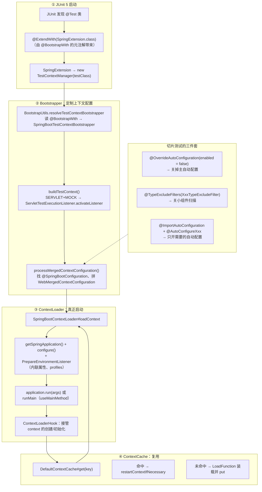
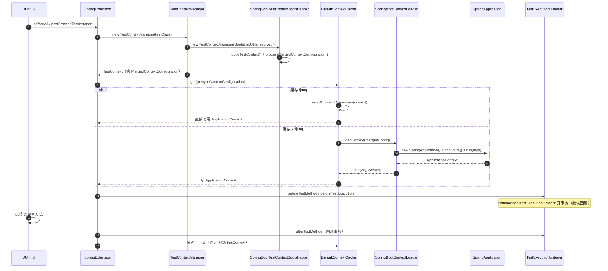

# 测试切片与 @SpringBootTest

> 一句话结论：`@SpringBootTest` 本身几乎"什么都不做"——它是一个元注解，把 `@BootstrapWith(SpringBootTestContextBootstrapper.class)` 与 `@ExtendWith(SpringExtension.class)` 叠在一起。真正的启动逻辑在 `SpringBootTestContextBootstrapper`（定制 `MergedContextConfiguration`、找 `@SpringBootConfiguration`）与 `SpringBootContextLoader`（用 `SpringApplication` 跑一次"测试专用的启动"）里。而"切片测试"则靠 `@OverrideAutoConfiguration(enabled=false)` + `TypeExcludeFilter` + `@ImportAutoConfiguration` 三件套，把自动配置与组件扫描同时"关小"。

- 阅读前置：读过 [`../01-启动原理/01-springapplication-run-启动全流程.md`](../01-启动原理/01-springapplication-run-启动全流程.md)（知道 `SpringApplication#run` 做了什么）。
- 版本基线：Spring Boot **4.2.0**（`spring-boot-test`、`spring-boot-test-autoconfigure`、`spring-boot-webmvc-test`）、Spring Framework **7.1.0**（`spring-test`）。
- 预计阅读：55 分钟｜源码：`SpringBootTest`、`SpringBootTestContextBootstrapper`、`SpringBootContextLoader`、`TestContextManager`、`DefaultContextCache`、`WebMvcTest`、`TestTypeExcludeFilter`、`OverrideAutoConfigurationContextCustomizerFactory`、`MockitoBean`、`TransactionalTestExecutionListener`。

> **模块位置提醒（Boot 4）**：`@WebMvcTest` / `@AutoConfigureMockMvc` 在 `org.springframework.boot:spring-boot-webmvc-test:4.2.0`；`@DataJpaTest` 在 `org.springframework.boot:spring-boot-data-jpa-test:4.2.0`；`@JsonTest` 仍在 `spring-boot-test-autoconfigure:4.2.0`。`@MockitoBean` 在 `org.springframework:spring-test:7.1.0`（不是 Boot 的包）。

---

## 0. 先看现象：五个真实困惑

**现象 1：两个测试类单独跑都很快，一起跑要几十秒**

因为 `@SpringBootTest` 的上下文被缓存，但**缓存 key 由 `MergedContextConfiguration` 决定**。只要 `classes`、`properties`、`profiles`、`contextCustomizers`、`webEnvironment` 中任意一项不同，就是不同 key，于是启动第二次、第三次上下文。

**现象 2：`@MockBean` 编译不过**

Boot 3.4 起推荐 `@MockitoBean`（`org.springframework.test.context.bean.override.mockito.MockitoBean`，`@since 6.2` 的 Framework 注解）。本仓库验证：`spring-boot-test:4.2.0` 中 `mock` 包只剩 `SpringBootMockServletContext`，**没有 `@MockBean`**。

**现象 3：`@WebMvcTest` 里 `@Service` 注入不进来**

因为切片测试的 `TypeExcludeFilter` 把"非 Web 相关组件"全部排除：只保留 `@Controller`、`@ControllerAdvice`、`WebMvcConfigurer` 等白名单类。`@Service` 被当普通类型过滤掉，自然没有 bean。

**现象 4：`@DataJpaTest` 里插入的数据在测试结束后"消失"**

因为 `@DataJpaTest` 自带 `@Transactional`，而 `TransactionalTestExecutionListener` 的默认行为是**回滚**。

**现象 5：`@WebMvcTest` 里 MockMvc 不打印请求详情**

`@AutoConfigureMockMvc#print` 默认 `DEFAULT`，`printOnlyOnFailure` 默认 `true`（`AutoConfigureMockMvc` 源码）。

---

## 1. 全局地图：测试的四个阶段



**读图说明**

- ①→②→③ 是一条直线：JUnit 委托 `SpringExtension`，`SpringExtension` 委托 `TestContextManager`，`TestContextManager` 委托 Bootstrapper 建 `TestContext`，`TestContext` 里的 `ContextLoader` 才是"启动 Spring"的人。
- ④ 缓存来自 `TestContext` 的 `ContextCache`，key 是 `MergedContextConfiguration`。
- 左下的"三件套"是切片测试能"只启动一小块"的原因，它作用在②阶段（修改合并后的配置），不改变③的启动方式。
- 也就是说：**切片测试和 `@SpringBootTest` 走的是同一套启动代码，区别只在配置清单**。理解这一点，"切片测试为什么也会启动上下文、也会被缓存"就不再奇怪。

---

## 2. 关键类速查

| 类 | 模块 | 角色 |
| --- | --- | --- |
| `@SpringBootTest` | spring-boot-test | 元注解：`@BootstrapWith` + `@ExtendWith` + 属性 |
| `SpringBootTestContextBootstrapper` | spring-boot-test | 定制 `MergedContextConfiguration`，查找 `@SpringBootConfiguration` |
| `SpringBootContextLoader` | spring-boot-test | 用 `SpringApplication` 启动测试上下文 |
| `TestContextManager` | spring-test | 测试上下文的门面：`buildTestContext()` + `TestExecutionListener` 注册 |
| `DefaultContextCache` | spring-test | 上下文缓存（LRU + 暂停/恢复） |
| `TestTypeExcludeFilter` | spring-boot-test | 排除 `@TestConfiguration` 等测试类 |
| `OverrideAutoConfigurationContextCustomizerFactory` | spring-boot-test-autoconfigure | 写入 `spring.boot.enableautoconfiguration=false` |
| `@WebMvcTest` / `@AutoConfigureMockMvc` | spring-boot-webmvc-test | MVC 切片 |
| `@DataJpaTest` | spring-boot-data-jpa-test | JPA 切片（自带 `@Transactional`） |
| `@JsonTest` | spring-boot-test-autoconfigure | JSON 序列化切片 |
| `@MockitoBean` | spring-test | 覆盖上下文中的 bean（`@BeanOverride`） |
| `TransactionalTestExecutionListener` | spring-test | 测试事务，默认回滚 |

---

## 3. 源码逐段

### 3.1 `@SpringBootTest`：一个"组合注解"

```java
(src: SpringBootTest.java#L58-L64)
```

```java
(src: SpringBootTest.java#L101-L116)
```

要点：

- `@BootstrapWith(SpringBootTestContextBootstrapper.class)` 决定"谁来定制配置"；
- `@ExtendWith(SpringExtension.class)` 决定"谁来接入 JUnit 5"；
- `classes()` 默认空 → 由 Bootstrapper 向上搜索 `@SpringBootConfiguration`；
- `webEnvironment()` 默认 `MOCK`：不启真实端口，用 mock servlet 环境；
- `useMainMethod()` 默认 `NEVER`，可设为 `ALWAYS` 让测试调用你的 `main` 方法（对 native/AOT 测试有用）。

```java
(src: SpringBootTest.java#L121-L152)
```

`RANDOM_PORT` / `DEFINED_PORT` 是"真实服务器"模式（`true` 表示 embedded），`MOCK` / `NONE` 不是。`RANDOM_PORT` 的本质是设置 `server.port=0` 并读取实际端口。

### 3.2 `SpringBootTestContextBootstrapper`：定制合并配置

```java
(src: SpringBootTestContextBootstrapper.java#L88-L100)
```

为什么 `MOCK` + Servlet 时要"激活" `ServletTestExecutionListener`？因为 `MOCK` 模式下没有真实容器，需要 `MockHttpServletRequest` 之类的 mock 支持；而 `@SpringBootTest(webEnvironment = NONE)` 时不该激活，否则 `@AutoConfigureMockMvc` 之类会误判。

```java
(src: SpringBootTestContextBootstrapper.java#L122-L145)
```

这是"Boot 的测试能按 web 类型自动选择上下文类"的关键：

- 默认 `ContextLoader` 是 `SpringBootContextLoader`；
- Servlet + embedded/MOCK → `WebMergedContextConfiguration`（带 `resourceBasePath`）；
- Reactive → `ReactiveWebMergedContextConfiguration`；
- 否则保持普通 `MergedContextConfiguration`。

`web-application-type` 怎么判断？用 `Binder` 绑属性：

```java
(src: SpringBootTestContextBootstrapper.java#L147-L153)
```

也就是说：`@SpringBootTest(properties="spring.main.web-application-type=none")` 会改变测试的上下文类型——这就是"测试里的属性影响测试装配"的一个具体例子。

再来看"找不到配置类"时的行为：

```java
(src: SpringBootTestContextBootstrapper.java#L203-L218)
```

结论：

1. `classes()` 为空、也没 `locations` 时，Boot **从测试类所在包向上搜索** `@SpringBootConfiguration`；
2. 搜索不到就 `Assert` 失败，错误消息明确提示"`@TestConfiguration` 不算"；
3. 有 `AotTestAttributes` 时会优先用 AOT 生成阶段记录的配置类名（native 测试）。

### 3.3 `SpringBootContextLoader`：用 `SpringApplication` 启动

```java
(src: SpringBootContextLoader.java#L117-L144)
```

要点：

- 有 `main` 且 `useMainMethod != NEVER` 时走 `ContextLoaderHook#runMain(...)`，**真的调用你的 `main`**；
- 否则 `new SpringApplication()` + `configure(...)` + `application.run(args)`；
- `ContextLoaderHook` 的职责是"拦下 `SpringApplication` 创建的上下文"，把它交给 `TestContext`，并注入测试的 `ApplicationContextInitializer`。

```java
(src: SpringBootContextLoader.java#L214-L217)
```

`addPrimarySources(mergedConfig.getClasses())`：把测试里声明的配置类塞进 `SpringApplication` 的 primary sources；`sources.addAll(locations)` 支持 XML/Groovy 位置。

```java
(src: SpringBootContextLoader.java#L268-L291)
```

这里解释了"`@SpringBootTest(properties=...)` 为什么优先级最高"：它通过 `TestPropertySourceUtils.addInlinedPropertiesToEnvironment` 把**内联属性**加在属性源列表**最前面**。

```java
(src: SpringBootContextLoader.java#L299-L319)
```

`getSpringApplication()` 是 `protected` 的，可被子类覆盖以定制 `SpringApplication`；`getInlinedProperties()` 第一条固定写 `spring.jmx.enabled=false`，避免测试时启动 JMX。

### 3.4 `TestContextManager`：spring-test 的门面

```java
(src: TestContextManager.java#L125-L127)
```

```java
(src: TestContextManager.java#L141-L145)
```

三件事：`buildTestContext()`、`ThreadLocal` 保存 `TestContext`（支持并行执行）、注册 `TestExecutionListener`。Boot 的所有"测试魔法"最终都挂在监听器上（`ServletTestExecutionListener`、`DirtiesContextTestExecutionListener`、`TransactionalTestExecutionListener`……）。

### 3.5 上下文缓存：`DefaultContextCache`

```java
(src: DefaultContextCache.java#L88-L101)
```

```java
(src: DefaultContextCache.java#L168-L194)
```

要点：

- 三个统计字段（`contextUsageMap`、`unusedContexts`、`failureCounts`）用于 LRU 淘汰与"失败上下文不再复用"；
- 命中时要 `restartContextIfNecessary`：因为 `@DirtiesContext` 或某些监听器会关掉上下文，但缓存项还在，需要 `context.restart()`；
- `PauseMode`（`AbstractTestContextBootstrapper` 的默认）在并行执行时会暂停/恢复上下文。

**缓存 key 的组成**（决定"要不要重启上下文"）：

`MergedContextConfiguration` 的比较项包含：`classes`、`locations`、`contextInitializerClasses`、`activeProfiles`、`propertySourceProperties`、`contextCustomizers`、`contextLoader`、`parent`，以及 Web 版本额外的 `resourceBasePath`。

实用结论：

| 你想复用上下文 | 做法 |
| --- | --- |
| 多个测试共享 | 相同的 `@SpringBootTest` 属性块（尤其别随意加 `properties`） |
| 强制隔离 | `@DirtiesContext`（会关掉，下次重建） |
| 避免污染 | 用 `@MockitoBean` 而不是改配置；用 `@TestConfiguration` 而不是 `@TestPropertySource` 抖动配置 |

### 3.6 切片测试三件套

```java
(src: WebMvcTest.java#L89-L95)
```

```java
(src: WebMvcTest.java#L29-L34)
```

逐项翻译：

| 注解 | 作用 |
| --- | --- |
| `@BootstrapWith(WebMvcTestContextBootstrapper.class)` | 切片专用 bootstrapper（配置 `TestTypeExcludeFilter` 等） |
| `@OverrideAutoConfiguration(enabled = false)` | **关掉**主自动配置（`@EnableAutoConfiguration`） |
| `@TypeExcludeFilters(WebMvcTypeExcludeFilter.class)` | 组件扫描时排除白名单外的类 |
| `@AutoConfigureWebMvc` / `@AutoConfigureMockMvc` | 打开 MVC 与 MockMvc 的自动配置 |
| `@ImportAutoConfiguration` | 导入切片需要的自动配置类（由 `@ImportAutoConfiguration` 的 `value` 决定，通常是 `@AutoConfigureXxx` 的元注解链） |

`@OverrideAutoConfiguration` 的实现：

```java
(src: OverrideAutoConfigurationContextCustomizerFactory.java#L30-L49)
```

它做的事只有一件：把 `spring.boot.enableautoconfiguration=false` 写进测试属性——`@EnableAutoConfiguration` 的条件（`@ConditionalOnProperty`）读这个属性，于是整块自动配置被关掉。**切片测试因此不会被 `@EnableAutoConfiguration` 拖进全量装配。**

组件扫描的排除：

```java
(src: TestTypeExcludeFilter.java#L28-L58)
```

`TestTypeExcludeFilter` 排除的是"测试专用类"（`@TestConfiguration`、`@TestComponent`、带 JUnit 注解的类），真正的切片白名单在 `WebMvcTypeExcludeFilter`（`AnnotationCustomizableTypeExcludeFilter` 的子类，本仓库已在 `spring-boot-webmvc-test:4.2.0` 中验证存在，未逐行入库）。两者分工：前者排除测试类，后者只放行 Web 相关类。

### 3.7 MockMvc 是怎么装配起来的

```java
(src: MockMvcAutoConfiguration.java#L30-L46)
```

三点：

- `@AutoConfiguration(after = WebMvcAutoConfiguration.class)`：必须等 MVC 装好；
- `@ConditionalOnWebApplication(type = SERVLET)`：只在 Servlet 应用生效；
- 同时导入 `MockMvcConfiguration`（`MockMvc` 构建器）与 `MockMvcTesterConfiguration`（Boot 3.4 新增的 AssertJ `MockMvcTester`）。

```java
(src: AutoConfigureMockMvc.java#L47-L60)
```

`addFilters()` 默认 `true`——意味着 Security 的 filter chain 会被应用（所以 `@WebMvcTest` 默认会启用 Spring Security 的自动配置，见 `WebMvcTest` javadoc）。`printOnlyOnFailure()` 默认 `true`，所以不失败不打印。

### 3.8 `@MockitoBean` 与测试事务

```java
(src: MockitoBean.java#L116-L126)
```

```java
(src: MockitoBean.java#L97-L112)
```

要点：

- 这是 **Spring Framework 6.2** 引入的通用 bean 覆盖机制（`@BeanOverride`），不是 Boot 专用；
- 可用于字段、构造参数、类型级；
- 类型级必须写 `types()`；
- 可作元注解、可重复（`@Repeatable(MockitoBeans.class)`）；
- 在 `@Nested` 里对外层测试类仍有效。

事务回滚：

```java
(src: TransactionalTestExecutionListener.java#L425-L441)
```

默认 `return true`（回滚），除非显式 `@Rollback(false)` 或 `@Commit`。`@DataJpaTest` 自带 `@Transactional`（见其注解栈），所以"数据消失"是预期的。

---

## 4. 时序图：一次 `@SpringBootTest` 的完整生命周期



**读图说明**

- 第 5～6 步发生在 **`beforeAll`**（首个测试方法之前），所以"上下文启动慢"发生在测试方法执行前，不在方法里。
- 第 9～14 步是缓存命中/未命中的分支；命中时**完全不启动 Spring**，只可能 `restart`。
- 第 16～17 步的事务由监听器负责，与 Spring 应用代码里的 `@Transactional` 无关（测试方法上的 `@Transactional` 才是它的输入）。
- 最后一步"保留上下文"是缓存的语义：测试类结束后上下文仍在缓存里，直到被 LRU 淘汰或 `@DirtiesContext` 关闭。

---

## 5. 设计模式与可扩展点

| 位置 | 模式 | 说明 |
| --- | --- | --- |
| `@SpringBootTest` | 组合注解 | 把 Bootstrapper + Extension + 属性包在一起 |
| `TestContextBootstrapper` | 建造者 / 策略 | 定制 `MergedContextConfiguration` |
| `ContextLoader` | 策略 | 决定"怎么启动上下文" |
| `ContextCustomizer` | 装饰 | 在不改注解的前提下修改合并配置（`@DynamicPropertySource`、`@MockitoBean` 等） |
| `@BeanOverride` | 拦截 / 替换 | 统一替代 `@MockBean`、`@SpyBean` |
| `TypeExcludeFilter` | 组合过滤器 | 切片测试的核心开关 |
| `ContextCache` | 缓存 + LRU | 复用上下文 |
| `TestExecutionListener` | 观察者 | 事务、Servlet、Dirty 等横切逻辑 |

常用扩展点：

1. **自定义 `@TestConfiguration`**：只给测试加 bean，不进主扫描。
2. **`@DynamicPropertySource`**：需要"运行时才知道的值"（Testcontainers 端口）时用。
3. **自定义 `@AutoConfigureXxx` + `@ImportAutoConfiguration`**：做团队内部的切片。
4. **`@DirtiesContext`**：需要干净上下文时用，代价是重建。
5. **`MockMvcTester`**（Boot 3.4+）：AssertJ 风格的 MockMvc 封装，比 `MockMvc` 更易读。

---

## 6. 踩坑与调试

### 6.1 上下文与缓存

| 现象 | 原因 | 处理 |
| --- | --- | --- |
| 上下文反复重启 | `MergedContextConfiguration` 不同（多写了一个 `properties`、profile 不同、`webEnvironment` 不同） | 统一测试基类；用 `/actuator/conditions` 或日志 `org.springframework.test.context.cache=DEBUG` 看缓存命中 |
| 缓存无上限导致 OOM | `spring.test.context.cache.maxSize` 默认 32 | 调小；减少不同配置组合 |
| 上下文被关掉后又复用报错 | `@DirtiesContext` 或监听器关闭 | `DefaultContextCache#restartContextIfNecessary` 会 `restart()`；不要手动 `close()` |
| 并行执行时上下文被暂停/恢复 | `PauseMode` | 了解 `AbstractTestContextBootstrapper` 的默认策略 |

### 6.2 切片测试

| 现象 | 原因 | 处理 |
| --- | --- | --- |
| `@WebMvcTest` 里 `@Service` 注入失败 | `TypeExcludeFilter` 排除了非 Web 类 | 用 `@MockitoBean` 提供依赖，或 `@Import(MyService.class)` |
| `@WebMvcTest` 里 Security 过滤链意外生效 | `@AutoConfigureMockMvc(addFilters=true)` + `WebMvcTest` 默认引入 Security 自动配置 | `addFilters=false` 或提供测试用 `SecurityFilterChain` |
| `@DataJpaTest` 数据消失 | 自带 `@Transactional`，默认回滚 | `@Rollback(false)` / `@Commit` |
| `@DataJpaTest` 连到了真实数据库 | 默认用内嵌库，但显式配置了 `spring.datasource.url` | `@AutoConfigureTestDatabase(replace = ANY)` |
| `@JsonTest` 里 Jackson 定制不生效 | 切片只装了 JSON 相关自动配置 | 用 `@Import` 引入你的 `Jackson2ObjectMapperBuilderCustomizer` |
| 切片测试之间互相影响 | 上下文被复用 | 用 `@DirtiesContext` 或让测试无状态 |

### 6.3 `@MockBean` → `@MockitoBean` 迁移

| 老写法 | 新写法 | 说明 |
| --- | --- | --- |
| `@MockBean Foo foo;` | `@MockitoBean Foo foo;` | 字段注入 |
| `@MockBean(classes = Bar.class)` | `@MockitoBean(types = Bar.class)` | 类型级必须写 `types` |
| `@SpyBean Foo foo;` | `@MockitoSpyBean Foo foo;` | 同属 `@BeanOverride` 家族 |
| `@MockBean` 在 `@Nested` 里对父类生效 | `@MockitoBean` 支持 `@NestedTestConfiguration` | 注意上下文层级 |

> 本仓库验证：`spring-boot-test:4.2.0` 中**已无 `@MockBean`**（`.*[Mm]ock.*` 只命中 `SpringBootMockServletContext`）。Boot 3.4 起官方迁移到 `spring-test` 的 `@MockitoBean`；**Boot 4 中 `@MockBean` 已被移除**，旧代码需迁移。

### 6.4 调试手段

1. **`logging.level.org.springframework.test.context.cache=DEBUG`**：打印缓存命中/未命中与 key。
2. **`logging.level.org.springframework.boot.test=DEBUG`**：打印 "Found @SpringBootConfiguration ... for test ..." 等定位信息。
3. **`ConditionEvaluationReport`（`--debug`）**：看切片测试到底启用了哪些自动配置。
4. **`@DirtiesContext(classMode = BEFORE_EACH_TEST_METHOD)`**：临时隔离以定位"污染源"。
5. **`MockMvc#print()`**：在断言失败时打印请求/响应详情。

---

## 7. Boot 2.x / 3.x / 4.x 版本差异

| 主题 | Boot 2.x | Boot 3.x | Boot 4.x（基线 4.2.0） |
| --- | --- | --- | --- |
| 测试注解 | `@SpringBootTest` + `@MockBean`（JUnit 5） | 3.4 起推荐 `@MockitoBean`（Framework 6.2），`@MockBean` 弃用 | **`@MockBean` 已移除**（本仓库 `spring-boot-test:4.2.0` 无该类），统一 `@MockitoBean` / `@MockitoSpyBean` |
| 切片注解包位置 | 全部在 `spring-boot-test-autoconfigure` | 同 | **拆分**：`@WebMvcTest`/`@AutoConfigureMockMvc` → `spring-boot-webmvc-test`；`@DataJpaTest` → `spring-boot-data-jpa-test`；`@JsonTest` 仍在 `spring-boot-test-autoconfigure` |
| MockMvc 断言 | `MockMvc` + `MockMvcResultMatchers` | 同；3.4 新增 `MockMvcTester` | `MockMvcAutoConfiguration` 同时导入 `MockMvcConfiguration` 与 `MockMvcTesterConfiguration` |
| 上下文缓存 | `DefaultContextCache` | 7.0 起 `put(key, LoadFunction)` 取代 `put(key, context)`（后者 `@Deprecated(since="7.0")`） | 同 7.1.0；新增 `PauseMode`、`unusedContexts` 统计 |
| 测试事务 | `TransactionalTestExecutionListener`，默认回滚 | 同 | 同（`isDefaultRollback` 返回 `true`） |
| AOT / native 测试 | 3.0 起支持 | `@SpringBootTest(useMainMethod=ALWAYS)` | 保留 `AotTestAttributes` 查找 `@SpringBootConfiguration` 的路径 |
| `@WebMvcTest` 默认安全 | 引入 Security 自动配置 | 同 | 同（`WebMvcTest` javadoc 说明默认自动配置 Spring Security） |

> 结论依据：`@since` 标注与源码事实均来自本仓库 `assets/source/` 中 4.2.0 / 7.1.0 的入库文件（`MockitoBean` 的 `@since 6.2`、`WebMvcTest` 的 `@since 4.0.0`、`DefaultContextCache#put` 的 `@Deprecated(since="7.0")`），以及 `list-jar` 对 `spring-boot-test:4.2.0`（无 `@MockBean`）、`spring-boot-webmvc-test:4.2.0`、`spring-boot-data-jpa-test:4.2.0` 的目录验证。

---

## 8. 面试题（12 问）

1. `@SpringBootTest` 为什么"看起来什么都没做"？它到底做了什么？
2. `SpringBootTestContextBootstrapper` 与 `SpringBootContextLoader` 的职责分工？
3. 测试里的 `@SpringBootConfiguration` 是怎么被找到的？找不到会怎样？
4. `webEnvironment` 四种取值分别意味着什么？
5. 上下文缓存的 key 由哪些部分组成？为什么多加一个 `properties` 就要重启？
6. 切片测试三件套分别解决什么问题？
7. `@OverrideAutoConfiguration(enabled=false)` 的机制？
8. `TypeExcludeFilter` 有两层（`TestTypeExcludeFilter` 与 `WebMvcTypeExcludeFilter`），各自做什么？
9. `@MockitoBean` 与 `@MockBean` 的本质区别？Boot 4 里还能用 `@MockBean` 吗？
10. 测试事务默认回滚在哪里实现？如何关闭？
11. `@WebMvcTest` 为什么默认会启用 Spring Security？怎么关？
12. `MockMvcTester` 是什么？比 `MockMvc` 好在哪？

---

## 9. 动手练习

1. 写两个 `@SpringBootTest` 类，一个加 `properties="foo=bar"`，观察 `org.springframework.test.context.cache=DEBUG` 日志里是否出现两次上下文创建。
2. 在 `@WebMvcTest` 里故意注入一个 `@Service`，看报错信息；再用 `@MockitoBean` 修好。
3. 把 `@DataJpaTest` 的方法上加 `@Commit`，观察数据是否保留（用内嵌库 + 事务外查询验证）。
4. 用 `@SpringBootTest(webEnvironment = RANDOM_PORT)` + `TestRestTemplate`/`WebTestClient` 调一个真实端口。
5. 写一个自定义 `@AutoConfigureXxx` 切片注解，只装配你自己的两个组件。
6. 用 `@MockitoSpyBean` 替换 `@SpyBean`，验证 `@Nested` 场景下仍然有效。

---

## 小结

- `@SpringBootTest` 是组合注解：`@BootstrapWith(SpringBootTestContextBootstrapper)` + `@ExtendWith(SpringExtension)`。
- `TestContextManager` → Bootstrapper 建 `TestContext` → `SpringBootContextLoader` 用 `SpringApplication` 启动，`ContextLoaderHook` 拦截上下文。
- `@SpringBootTest(properties=...)` 通过内联属性加在属性源**最前面**，因此优先于 `application.yaml`。
- 上下文缓存 key 是 `MergedContextConfiguration`；命中只可能 `restart`，不重新启动。
- 切片测试 = `@OverrideAutoConfiguration(enabled=false)`（关自动配置）+ `TypeExcludeFilter`（关组件扫描）+ `@ImportAutoConfiguration`（只开需要的）。
- `@MockitoBean`（Framework 6.2+）取代 `@MockBean`，Boot 4 中 `@MockBean` 已移除。
- 测试事务默认回滚由 `TransactionalTestExecutionListener#isDefaultRollback` 返回 `true` 实现；`@DataJpaTest` 自带 `@Transactional`。

## 自测题

**1. `@SpringBootTest` 的两个核心元注解是什么？**

<details><summary>参考答案</summary>

`@BootstrapWith(SpringBootTestContextBootstrapper.class)` 与 `@ExtendWith(SpringExtension.class)`。
</details>

**2. 默认的 `webEnvironment` 是什么？它意味着什么？**

<details><summary>参考答案</summary>

`WebEnvironment.MOCK`：不启动真实的嵌入式服务器，使用 mock 的 Servlet 环境（`WebMergedContextConfiguration` + 激活 `ServletTestExecutionListener`）。
</details>

**3. `SpringBootTestContextBootstrapper` 在什么情况下构造 `WebMergedContextConfiguration`？**

<details><summary>参考答案</summary>

当 `deduce()` 判定为 Servlet 应用且 `webEnvironment` 是 embedded（`RANDOM_PORT`/`DEFINED_PORT`）或 `MOCK` 时；Reactive 应用则构造 `ReactiveWebMergedContextConfiguration`。
</details>

**4. 测试类找不到 `@SpringBootConfiguration` 时会怎样？**

<details><summary>参考答案</summary>

`AnnotatedClassFinder` 从测试类所在包向上搜索失败后 `Assert` 报错，提示 "Unable to find a @SpringBootConfiguration by searching packages upwards from the test ..."，并注明 `@TestConfiguration` 不算。
</details>

**5. `@SpringBootTest(properties = "a=b")` 为什么能覆盖 `application.yaml`？**

<details><summary>参考答案</summary>

`SpringBootContextLoader#prepareEnvironment` 用 `TestPropertySourceUtils.addInlinedPropertiesToEnvironment` 把内联属性加在 `PropertySources` **最前面**（最高优先级）。
</details>

**6. 上下文缓存的 key 是什么？**

<details><summary>参考答案</summary>

`MergedContextConfiguration`，其判等包含 `classes`、`locations`、`contextInitializerClasses`、`activeProfiles`、`propertySourceProperties`、`contextCustomizers`、`contextLoader`、`parent`，以及 Web 版本的 `resourceBasePath`。
</details>

**7. 缓存命中时 `DefaultContextCache` 还会做什么？**

<details><summary>参考答案</summary>

`pauseOnContextSwitchIfNecessary`（并行执行时暂停其他上下文）与 `restartContextIfNecessary`（若上下文存在但不处于 running，则 `restart()`）。
</details>

**8. 切片测试的"三件套"是什么？**

<details><summary>参考答案</summary>

`@OverrideAutoConfiguration(enabled = false)`（关闭 `@EnableAutoConfiguration`）、`@TypeExcludeFilters(...)`（组件扫描白名单化）、`@ImportAutoConfiguration` + `@AutoConfigureXxx`（只导入需要的自动配置）。
</details>

**9. `@OverrideAutoConfiguration(enabled=false)` 的底层机制？**

<details><summary>参考答案</summary>

`OverrideAutoConfigurationContextCustomizerFactory` 把 `spring.boot.enableautoconfiguration=false` 写入测试属性，`@EnableAutoConfiguration` 上的 `@ConditionalOnProperty` 因此不满足，整块自动配置被跳过；AOT 模式（`AotDetector.useGeneratedArtifacts()`）下该 customizer 直接返回 `null`。
</details>

**10. `@WebMvcTest` 里 `@Service` 为什么不是 bean？**

<details><summary>参考答案</summary>

`WebMvcTypeExcludeFilter`（`AnnotationCustomizableTypeExcludeFilter` 子类）只放行 `@Controller`、`@ControllerAdvice`、`WebMvcConfigurer` 等白名单类型，`@Service` 被排除；`TestTypeExcludeFilter` 另外排除 `@TestConfiguration`/`@TestComponent` 等测试类。
</details>

**11. `@MockitoBean` 与 `@MockBean` 的区别？Boot 4 还能用 `@MockBean` 吗？**

<details><summary>参考答案</summary>

`@MockitoBean` 是 Spring Framework 6.2 引入的 `@BeanOverride` 注解（`org.springframework.test.context.bean.override.mockito`），支持字段、构造参数、类型级（类型级需 `types()`）、可重复、可作元注解；`@MockBean` 是 Boot 自己的旧注解。本仓库验证 `spring-boot-test:4.2.0` 中已无 `@MockBean`，**Boot 4 不能再用 `@MockBean`**，需迁移到 `@MockitoBean` / `@MockitoSpyBean`。
</details>

**12. 测试事务默认回滚的实现位置？如何改成不回滚？**

<details><summary>参考答案</summary>

`TransactionalTestExecutionListener#isDefaultRollback`：类级 `@Rollback` 存在则用它，否则返回 `true`（回滚）。用 `@Rollback(false)` 或 `@Commit` 可关闭回滚（`@DataJpaTest` 因为自带 `@Transactional` 也遵循此规则）。
</details>
