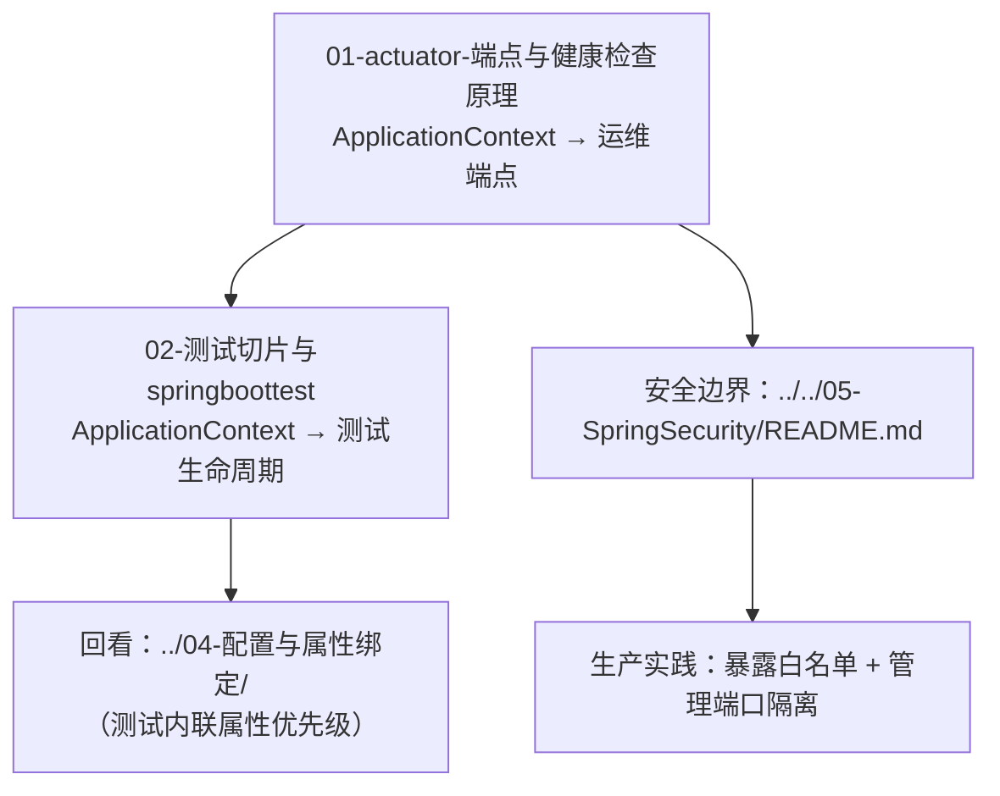

# 05 Actuator 运维与测试

> 一句话结论：Actuator 是"把 `ApplicationContext` 的内部状态变成可远程读取的端点"的一套机制；而测试框架是"把 `ApplicationContext` 装进测试生命周期"的一套机制。两者看着无关，其实是同一件事的两面——**都是 `ApplicationContext` 的消费者**，所以本组的两篇会反复出现同一个主题：上下文里有什么，怎么暴露/怎么组装。

## 学习目标

读完本组两篇，你应该能够：

1. 说清 Actuator 的"定义 / 发现 / 暴露"三层结构，并解释 `EndpointDiscoverer` 家族如何做到"一套端点定义、多技术暴露"。
2. 顺着 `@Endpoint` → `EndpointDiscoverer#discoverEndpoints` → `WebMvcEndpointHandlerMapping#initHandlerMethods` 读出端点变成 HTTP 接口的完整链路。
3. 解释 `/actuator/health` 的聚合算法（`HealthContributor` 树 + `HealthEndpointSupport` + `HttpCodeStatusMapper`），并说明 `show-details`、`show-components`、健康分组的区别。
4. 说出 `/actuator/env` 与 `/actuator/beans` 的实现要点与安全含义。
5. 说出 Actuator 的最小安全实践（暴露白名单、详情收敛、独立管理端口、Spring Security 鉴权），并能链接到安全章节。
6. 解释 `@SpringBootTest` 从 JUnit 5 到 `SpringApplication#run` 的完整路径。
7. 解释上下文缓存的 key 由什么决定，以及"为什么加了 `properties` 就要重启上下文"。
8. 说出切片测试三件套的作用，以及 Boot 4 中 `@MockBean` 已被移除的事实与迁移方式。

## 阅读顺序

**读图说明**

- 先读 01：它建立"上下文 → 端点"的映射，读者能立刻在浏览器里看到结果，反馈最快。
- 再读 02：它建立"上下文 → 测试"的映射，两篇有大量共用概念（`ApplicationContext`、`Environment`、bean 覆盖）。
- 两条虚线指向外部：安全章节负责"端点怎么不被人乱用"；04 章节负责"测试为什么能覆盖配置"。这两条链接是刻意加的，因为运维章节脱离安全与配置就会变成"能跑但危险"的教程。

## 每篇摘要

### 01-actuator-端点与健康检查原理

- **主线**：`@Endpoint` / `@ReadOperation` → `EndpointDiscoverer#discoverEndpoints`（`createEndpointBeans` + `addExtensionBeans` + `convertToEndpoints`）→ `WebMvcEndpointHandlerMapping`（`@since 4.0.0`，位于 `spring-boot-webmvc`）+ `AbstractWebMvcEndpointHandlerMapping#initHandlerMethods` → 动态注册的 MVC handler。
- **健康检查**：`HealthContributor`（Boot 4 中是 `sealed interface`）→ `HealthEndpoint`（`@Endpoint(id="health")`）→ `HealthEndpointSupport#getResult` 递归聚合 → `HealthEndpointWebExtension` 用 `HttpCodeStatusMapper` 映射 HTTP 码；`HealthEndpointConfiguration` 提供 `StatusAggregator` / `HttpCodeStatusMapper` / `HealthEndpointGroups` 三个可替换策略。
- **实现要点**：`/actuator/env`（`EnumerablePropertySource` + `SanitizingFunction`）、`/actuator/beans`（沿 parent 链收集上下文）、`/actuator/refresh`（属 Spring Cloud，不在 Boot 本体）。
- **运维与安全**：`management.endpoints.web.exposure.include` 白名单、`management.server.port` 独立管理端口、`show-details` 收敛、Micrometer 1.18 与 `Observation` 指标链路。
- **模块提醒**：`spring-boot-actuator:4.2.0` 内**无 health 包**，健康检查在 `spring-boot-health:4.2.0`。

### 02-测试切片与springboottest

- **主线**：`@SpringBootTest`（`@BootstrapWith` + `@ExtendWith`）→ `TestContextManager`（`BootstrapUtils.resolveTestContextBootstrapper`）→ `SpringBootTestContextBootstrapper#processMergedContextConfiguration` → `SpringBootContextLoader#loadContext`（`SpringApplication#run` 或 `ContextLoaderHook#runMain`）。
- **切片测试**：`@OverrideAutoConfiguration(enabled=false)`（写 `spring.boot.enableautoconfiguration=false`）+ `TypeExcludeFilter`（`TestTypeExcludeFilter` 排除测试类，`WebMvcTypeExcludeFilter` 做白名单）+ `@ImportAutoConfiguration`；`MockMvcAutoConfiguration` 装配 `MockMvc` 与 `MockMvcTester`。
- **缓存**：`DefaultContextCache` 的 key 为 `MergedContextConfiguration`，命中时可能 `restart()`；LRU 上限可配。
- **Bean 覆盖**：`@MockitoBean`（Framework 6.2+，`@BeanOverride`）取代 `@MockBean`；**Boot 4 中 `@MockBean` 已移除**（已用 `list-jar` 验证）。
- **事务**：`TransactionalTestExecutionListener#isDefaultRollback` 默认 `true`（回滚）；`@DataJpaTest` 自带 `@Transactional`。

## 检查点

| 检查点 | 归属 |
| --- | --- |
| 端点被"静默过滤"的两个条件分别是什么？ | 01 |
| `@EndpointWebExtension` 与 `@Endpoint` 的区别？扩展找不到端点会怎样？ | 01 |
| `/actuator/health` 看不到 `components` 的原因？怎么开？ | 01 |
| 健康状态怎么变成 HTTP 状态码？K8s 探针为什么依赖它？ | 01 |
| `management.server.port` 独立后，业务端口访问端点会怎样？ | 01 |
| 暴露哪些端点是安全的？`exposure.include=*` 有什么风险？ | 01 |
| `@SpringBootTest` 的两个核心元注解？ | 02 |
| 上下文缓存的 key 由什么组成？ | 02 |
| 切片测试三件套分别解决什么？ | 02 |
| Boot 4 还能用 `@MockBean` 吗？依据是什么？ | 02 |
| 测试事务默认回滚实现在哪个方法？ | 02 |

## 关联章节

- 上一篇：[`../04-配置与属性绑定/README.md`](../04-配置与属性绑定/README.md)（`/actuator/env` 展示的就是那里的属性源顺序）。
- 下一篇：[`../06-AOT与GraalVM/README.md`](../06-AOT与GraalVM/README.md)（Actuator 端点与测试在 native 下的反射提示）。
- 安全：[`../../05-SpringSecurity/README.md`](../../05-SpringSecurity/README.md)。
- 启动原理：[`../01-启动原理/01-springapplication-run-启动全流程.md`](../01-启动原理/01-springapplication-run-启动全流程.md)。
