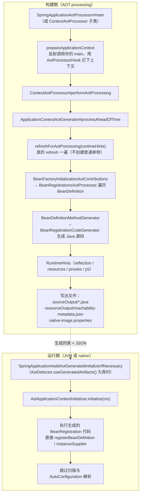
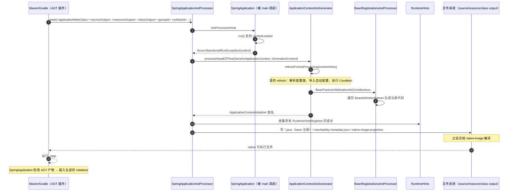

# AOT 与 Native Image：源码视角

> 一句话结论：JVM 上的 Spring 依赖"运行时反射/动态代理/扫描"来完成大量工作，而 GraalVM native-image 是**封闭世界**——编译期看不见的东西，运行时就一定不存在。所以 Spring 6 / Boot 3 引入 AOT：在**构建期**把 `ApplicationContext` 真的 refresh 一遍，把"该注册哪些 bean、怎么实例化、哪些类/方法/资源需要反射"全部**算出来并写成 Java 源码 + JSON 元数据**；运行时不再扫描，只执行生成的 `ApplicationContextInitializer`。

- 阅读前置：知道 `BeanFactory` / `BeanDefinition` 是什么；读过 [`../01-启动原理/01-springapplication-run-启动全流程.md`](../01-启动原理/01-springapplication-run-启动全流程.md)。
- 版本基线：Spring Framework **7.1.0**（`spring-context`、`spring-beans`、`spring-core`）、Spring Boot **4.2.0**。
- 预计阅读：60 分钟｜源码：`ApplicationContextAotGenerator`、`ContextAotProcessor`、`AbstractAotProcessor`、`SpringApplicationAotProcessor`、`BeanRegistrationCodeGenerator`、`BeanRegistrationsAotProcessor`、`BeanDefinitionMethodGenerator`、`AotServices`、`RuntimeHints`、`RuntimeHintsRegistrar`、`Reflective`、`RegisterReflectionForBinding`、`FileNativeConfigurationWriter`、`RuntimeHintsWriter`、`AotApplicationContextInitializer`、`AotInitializerNotFoundException`、`aot.factories`。

---

## 0. 先看现象：五个真实困惑

**现象 1：加了 `@EnableAspectJAutoProxy` 的代码在 native 下报 `ClassNotFoundException`**

CGLIB 代理类是在运行时**生成**的（`com.example.Foo$$SpringCGLIB$$0`），编译期不存在。AOT 阶段 `ApplicationContextAotGenerator` 用 `CglibClassHandler` 把生成的代理类**捕获下来并写成 `.class` 文件**放进产物，所以 native 才有它们。如果你的构建没走 AOT（或者代理是在 AOT 之后才创建），就会在运行期找不到。

**现象 2：native 启动报 `NoSuchMethodException` / `MissingReflectionRegistrationError`**

某个类的构造函数或方法需要反射调用，但 `reachability-metadata.json` 里没登记。典型来源：`@ConfigurationProperties` 类、Jackson DTO、`@Value` 绑定的类型。

**现象 3：native 启动报 `AotInitializerNotFoundException`**

消息原文是 `Startup with AOT mode enabled failed: AOT initializer <类名> could not be found`。意思是你开了 `spring.aot.enabled=true`（或运行在 native 里），但构建期没有生成 `<主类>__ApplicationContextInitializer`。

**现象 4：`ClassPathResource` 读不到文件**

`src/main/resources` 里的资源需要在 hint 里登记（`RuntimeHints#resources().registerPattern(...)`），否则 native-image 不会把它打进镜像。

**现象 5：写了 `RuntimeHintsRegistrar` 但没生效**

要么没在 `META-INF/spring/aot.factories` 注册（并且需要无参构造），要么类上没用 `@ImportRuntimeHints`。

---

## 1. 全局地图：构建期与运行期



**读图说明**

- 上半部分的每个节点都是"真跑一次 Spring"的一部分——AOT 不是静态分析，而是**构建期启动一次上下文**，把结果固化。
- `refreshForAotProcessing` 是关键：它 refresh 但不创建"非懒加载的普通单例"，只创建 AOT 需要的（`BeanFactoryInitializationAotProcessor`、`BeanRegistrationAotProcessor`、`RuntimeHintsRegistrar` 等）。
- `BeanRegistrationsAotProcessor` 遍历所有 `BeanDefinition`，为每个 bean 生成一个"注册方法"。
- 输出有两类：**Java 源码**（bean 注册代码）与 **JSON/metadata**（反射、资源等提示）。
- 下半部分：运行时 `SpringApplication` 检测到"有 AOT 产物"就插入生成的 `ApplicationContextInitializer` 到初始化器链首位，然后跳过 `load(...)` 的扫描。

---

## 2. 关键类速查

| 类 | 模块 | 角色 |
| --- | --- | --- |
| `AotDetector` | spring-core / boot | 判断是否使用 AOT 产物（`spring.aot.enabled` / native） |
| `ApplicationContextAotGenerator` | spring-context | **核心**：refresh 上下文并生成 `ApplicationContextInitializer` 入口代码 |
| `ContextAotProcessor` | spring-context | 处理器骨架：`performAotProcessing` 编排 |
| `AbstractAotProcessor` | spring-context | `process()` 模板方法 + 输出目录管理 + `writeHints` |
| `SpringApplicationAotProcessor` | spring-boot | Boot 的入口：反射调 `main` 拿上下文 |
| `BeanFactoryInitializationAotContributions` | spring-beans | 汇总所有 `BeanFactoryInitializationAotProcessor` |
| `BeanRegistrationsAotProcessor` | spring-beans | 遍历 `BeanDefinition` 生成注册代码 |
| `BeanDefinitionMethodGenerator` | spring-beans | 单个 bean 的注册方法生成器 |
| `BeanRegistrationCodeGenerator` | spring-beans | 拼装最终 Java 源码 |
| `AotServices` | spring-beans | 加载 `META-INF/spring/aot.factories` 里的服务 |
| `RuntimeHints` | spring-core | 反射/资源/代理/JNI 提示的容器 |
| `RuntimeHintsRegistrar` | spring-core | 注册提示的函数式接口 |
| `@Reflective` / `@RegisterReflectionForBinding` | spring-core | 声明式注册反射提示 |
| `FileNativeConfigurationWriter` / `RuntimeHintsWriter` | spring-core | 写 `reachability-metadata.json` |
| `AotApplicationContextInitializer` | spring-context | 运行期执行生成的初始化器 |
| `AotInitializerNotFoundException` | spring-boot | 找不到生成类时的明确报错 |

---

## 3. 源码逐段

### 3.1 为什么需要 AOT：三个"运行期才知道"的东西

| 运行期才知道的东西 | JVM 上怎么来 | native 上的问题 |
| --- | --- | --- |
| 扫描出的 `BeanDefinition` | `ClassPathScanningCandidateComponentProvider` 遍历 classpath | 编译期遍历不到（native-image 不打包"目录结构"的完整信息） |
| 反射调用的构造器/方法 | `ReflectionUtils` 运行时查找 | 未登记即不存在（`MissingReflectionRegistrationError`） |
| 动态代理类 | CGLIB/JDK 运行时生成 | 类在编译期不存在 |
| 资源文件 | `ClassLoader#getResource` | 未被 hint 登记的资源不打包 |
| 自动配置的取舍 | `Condition` 运行时判断 | 条件求值需要反射读取注解，同样受限 |

AOT 的解法就是：**在构建期把这些全部算准，然后写成代码 + 元数据**。这也解释了为什么 native 启动能快到百毫秒级——运行期几乎没有"扫描 + 条件求值 + 反射"。

### 3.2 入口：`SpringApplicationAotProcessor`

```java
(src: SpringApplicationAotProcessor.java#L70-L85)
```

要点：

- 这是 Boot 4 中负责 AOT 的类之一（`@since 3.0.0`，本仓库 `list-jar` 验证它就在 `spring-boot:4.2.0` 根包下）；
- 参数格式是 `<applicationMainClass> <sourceOutput> <resourceOutput> <classOutput> <groupId> <artifactId> [originalArgs...]`，其中 `groupId`/`artifactId` 为空时默认 `unspecified`——它决定 `reachability-metadata.json` 放在 `META-INF/native-image/<groupId>/<artifactId>/` 下；
- 它不自己"读配置"，而是**反射调用你的 `main`**，让真实启动流程跑起来。

怎么"拦下"上下文：

```java
(src: SpringApplicationAotProcessor.java#L91-L127)
```

`AotProcessorHook` 实现 `SpringApplicationHook`，在 `contextLoaded` 回调里**抛异常** `AbandonedRunException` 提前终止 `main`，同时把 `GenericApplicationContext` 带出来。两个断言很重要：

1. 上下文必须是 `GenericApplicationContext`（`SpringApplication` 创建的正是它）——否则报 `AOT processing requires a GenericApplicationContext but got a ...`；
2. 没拿到上下文 → `No application context available after calling main method of '%s'. Does it run a SpringApplication?`。

> 这也解释了为什么 AOT 阶段会**执行 `main` 方法里的代码**（`System.setProperty`、静态初始化等都会生效），构建日志里能看到 Spring 的 banner 与部分启动日志。

### 3.3 编排：`ContextAotProcessor`

```java
(src: ContextAotProcessor.java#L102-L113)
```

逐行翻译：

1. `createFileSystemGeneratedFiles()`：准备 `sourceOutput` / `resourceOutput` / `classOutput`（见 `AbstractAotProcessor#createFileSystemGeneratedFiles`）；
2. `DefaultGenerationContext(createNameGenerator(), generatedFiles)`：`GenerationContext` 是"AOT 生成的上下文"，`createNameGenerator()` 在 7.1 里以 `NameGenerator(ClassName.get(getApplicationClass()))` 命名，保证多个 AOT 处理器的产物命名一致（`@since 7.1`）；
3. `generator.processAheadOfTime(...)`：调 `ApplicationContextAotGenerator`；
4. `registerEntryPointHint(...)`：注册 `-H:Class` 入口；
5. `writeGeneratedContent()`：把生成的 `.java` 写盘；
6. `writeHints(runtimeHints)`：写 `reachability-metadata.json`；
7. `writeNativeImageProperties(...)`：写 `native-image.properties`（默认 `-H:Class=<主类>` 与 `--no-fallback`）。

```java
(src: AbstractAotProcessor.java#L124-L128)
```

`writeHints` 最终委托 `FileNativeConfigurationWriter(resourceOutput, groupId, artifactId).write(hints)`，输出路径规则由它决定：

```java
(src: FileNativeConfigurationWriter.java#L72-L81)
```

### 3.4 核心：`ApplicationContextAotGenerator`

```java
(src: ApplicationContextAotGenerator.java#L51-L62)
```

这是整个 AOT 的心脏，四步：

1. **`withCglibClassHandler(...)`**：设置 `ReflectUtils` 的全局 handler，把 CGLIB 生成类的字节码**捕获**下来写进 `classOutput`（否则 native 里没有代理类）；
2. **`applicationContext.refreshForAotProcessing(runtimeHints)`**：真的 refresh，但只创建 AOT 需要的 bean——这是"AOT 是构建期真启动"的直接证据；
3. **`ApplicationContextInitializationCodeGenerator`**：生成 `ApplicationContextInitializer` 的入口类（就是你常见到的 `<主类>__ApplicationContextInitializer`）；
4. **`BeanFactoryInitializationAotContributions(beanFactory).applyTo(...)`**：把每个 `BeanFactoryInitializationAotProcessor` 的贡献应用到 `BeanRegistrationCodeGenerator` 上。

```java
(src: ApplicationContextAotGenerator.java#L64-L74)
```

`finally` 里把两个静态 handler 清空——因为 `ReflectUtils` 的 handler 是全局状态，不清空会污染后续处理。

### 3.5 bean 注册代码怎么生成

```java
(src: BeanRegistrationsAotProcessor.java#L41-L59)
```

遍历 `beanFactory.getBeanDefinitionNames()`，为每个 bean 构造 `RegisteredBean`，再交给 `BeanDefinitionMethodGeneratorFactory` 生成方法。注意：**包含所有祖先上下文的 bean**（因为 `getBeanDefinitionNames()` 在合并后的工厂上调用）。

```java
(src: BeanDefinitionMethodGenerator.java#L81-L97)
```

这里的"包名判断"很有意思：如果目标类型的包不是 `java.*` / `javax.*`，就在**它自己的包里**生成一个 `public` 方法（便于访问包私有成员）；否则只能在 registrations 类里生成 `private` 方法。

```java
(src: BeanRegistrationCodeGenerator.java#L78-L91)
```

生成的代码结构固定五段：

1. `generateNewBeanDefinitionCode`：`BeanDefinition beanDefinition = new RootBeanDefinition(Xxx.class);`
2. `generateSetBeanDefinitionPropertiesCode(..., REJECT_ALL_ATTRIBUTES_FILTER)`：把解析好的属性写进去（`REJECT_ALL_ATTRIBUTES_FILTER` 表示不继承 `BeanDefinition` 上的任意属性）；
3. `generateInstanceSupplierCode(..., instancePostProcessors.isEmpty())`：生成 `Supplier`，直接 `new` 或调用工厂方法（**构造器绑定/工厂方法正是靠这段代码在 native 里可执行**）；
4. `generateSetBeanInstanceSupplierCode`：设置 `instanceSupplier`；
5. `generateReturnCode`：`return beanDefinition;`

### 3.6 `aot.factories`：AOT 阶段的服务发现

```java
(src: AotServices.java#L52-L52)
```

```java
(src: AotServices.java#L138-L142)
```

要点：AOT 阶段不用 `spring.factories` 里的 `EnableAutoConfiguration`（那是运行期自动配置），而是用**专门的** `META-INF/spring/aot.factories`，key 是三个接口：

- `org.springframework.aot.hint.RuntimeHintsRegistrar`
- `org.springframework.beans.factory.aot.BeanFactoryInitializationAotProcessor`
- `org.springframework.beans.factory.aot.BeanRegistrationAotProcessor`

Boot 4.2.0 的 `spring-boot:4.2.0` jar 里的 `aot.factories` 实际内容（本仓库已入库）：

```java
(src: aot.factories.md#L1-L22)
```

**读法**：`RuntimeHintsRegistrar` 一节登记了 Boot 自己的提示（配置文件位置、`WebApplicationType`、日志系统、结构化日志、Java 版本等）；`BeanFactoryInitializationAotProcessor` 一节登记了 `ConfigurationPropertiesBeanFactoryInitializationAotProcessor`（为 `@ConfigurationProperties` 类型注册反射提示）与 `EnvironmentPostProcessorApplicationListener` 的贡献；`BeanRegistrationAotProcessor` 一节登记了 `ConfigurationPropertiesBeanRegistrationAotProcessor`（**构造器绑定的 `@ConfigurationProperties` 在 native 里走 `ConstructorBound.from(...)`，而不是反射**）。

`.imports` 与 AOT 的关系：`META-INF/spring/org.springframework.boot.autoconfigure.AutoConfiguration.imports` 是**运行期**自动配置清单，AOT 阶段它会被正常读取一次（因为要真 refresh），然后**结果被固化进生成的注册代码**，所以运行期不再需要它——但它仍需保留在 jar 里（AOT 阶段可读、非 AOT 运行也需要）。

### 3.7 `RuntimeHints`：反射/资源/代理/JNI 四类提示

```java
(src: RuntimeHintsRegistrar.java#L36-L44)
```

```java
(src: RuntimeHints.java#L52-L87)
```

四类提示（`serialization()` 在 7.0.6 起被废弃，改用 `reflection()`）：

| 方法 | 内容 | 典型用途 |
| --- | --- | --- |
| `reflection()` | `TypeHint`（构造器/方法/字段/`MemberCategory`） | Jackson DTO、`@ConfigurationProperties`、`@Value` 目标类型 |
| `resources()` | 资源模式与 `ResourceBundle` | `application.yaml`、模板、`messages.properties` |
| `proxies()` | JDK 动态代理接口列表 | `@Transactional` 的 JDK 代理、Feign |
| `jni()` | JNI 可达类型 | 使用 native 库的库作者 |

```java
(src: RuntimeHintsWriter.java#L37-L57)
```

```java
(src: NativeConfigurationWriter.java#L39-L54)
```

`hasAnyHint` 为空时不写文件——所以"没生成 `reachability-metadata.json`"不等于出错，只是没有提示可写。

### 3.8 声明式注册：`@Reflective` 与 `@RegisterReflectionForBinding`

```java
(src: Reflective.java#L42-L58)
```

```java
(src: RegisterReflectionForBinding.java#L75-L80)
```

- `@Reflective` 是**元注解**，可以标在注解类型上（如 `@Endpoint` 就标了 `@Reflective`），也可以标在类型/构造器/字段/方法上；`processors()` 指定处理器（默认 `SimpleReflectiveProcessor`）。
- `@RegisterReflectionForBinding` 专为"数据绑定/序列化"设计：会为类（及其嵌套/泛型传递类型）注册构造器、字段、属性、record 组件。

三种注册方式对比：

| 方式 | 写法 | 适用 |
| --- | --- | --- |
| 动态（推荐用于库/自定义） | `@ImportRuntimeHints(MyHints.class)`，`MyHints implements RuntimeHintsRegistrar` | 需要编程控制 |
| 静态（库作者） | `META-INF/spring/aot.factories` 里注册 `RuntimeHintsRegistrar`（需无参构造） | 第三方库 |
| 声明式 | `@Reflective` / `@RegisterReflectionForBinding` | 业务代码里的 DTO / 绑定类型 |

### 3.9 运行期：怎么用上 AOT 产物

```java
(src: SpringApplication.java#L407-L425)
```

要点：

1. `AotDetector.useGeneratedArtifacts()` 为真（`spring.aot.enabled=true` 或 native 环境）时才走这段；
2. 如果用户已手动加过 `AotApplicationContextInitializer` 就跳过；
3. 否则按 `mainApplicationClass.getName() + "__ApplicationContextInitializer"` 找类，找不到抛 `AotInitializerNotFoundException`；
4. 找到就 `forInitializerClasses(...)` 并**插到 `initializers` 最前面**——保证在其他初始化器之前执行（生成的代码会注册全部 `BeanDefinition`）；
5. 最后在 native 下检查 `NativeImageRequirementsException`（比如必须无参 `main` 等约束）。

```java
(src: AotApplicationContextInitializer.java#L64-L74)
```

运行期只是"实例化生成的初始化器并调用 `initialize`"，没有任何扫描。

```java
(src: SpringApplication.java#L398-L403)
```

`if (!AotDetector.useGeneratedArtifacts())` —— 这行就是"有 AOT 产物就不扫描"的全部证据。

---

## 4. 时序图：从构建到 native 启动



**读图说明**

- 第 4 步"抛异常"是设计，不是 bug：用异常把控制流从 `main` 里"抢"回来。
- 第 6～8 步是真正的 AOT 计算，全部发生在**构建期**。
- 第 11～12 步落盘的两类产物是 native-image 的输入：`.java` 会在构建期被编译成 `.class`，JSON 会被 native-image 读取。
- 最后两步：运行期只做"执行生成的注册代码"，没有扫描，所以启动快。

---

## 5. 设计模式与可扩展点

| 位置 | 模式 | 说明 |
| --- | --- | --- |
| `AbstractAotProcessor#process` | 模板方法 | 固定 `process()` 骨架，子类实现 `doProcess` |
| `ContextAotProcessor` | 模板方法 + 抽象工厂 | `prepareApplicationContext` 由子类决定 |
| `*AotProcessor` 集合 | 策略 + SPI | 通过 `aot.factories` 注册，按 `Order` 排序 |
| `CodeFragments` / `BeanRegistrationCodeGenerator` | 建造者 | 分五段拼装源码 |
| `RuntimeHints` | 注册表 | 四类提示的集中容器 |
| `@Reflective` | 元注解 + 处理器 | 声明式反射提示 |

常用扩展点：

1. **自定义 `RuntimeHintsRegistrar`**：`@ImportRuntimeHints(MyHints.class)`。
2. **`@RegisterReflectionForBinding(MyDto.class)`**：业务 DTO 最省事的做法。
3. **`BeanRegistrationAotProcessor`**：需要"动态注册 bean 时也生成代码"（如自定义 `ImportBeanDefinitionRegistrar`）。
4. **`BeanFactoryInitializationAotProcessor`**：需要访问整个 `BeanFactory` 时（如 Boot 给 `@ConfigurationProperties` 注册提示就是用这个）。

---

## 6. 踩坑与调试

### 6.1 常见 native 失败原因

| 异常 | 根因 | 处理 |
| --- | --- | --- |
| `ClassNotFoundException: com.x.Foo$$SpringCGLIB$$0` | CGLIB 代理类未生成/未捕获 | 确保走 AOT（`process-aot`）；不要关 `spring.aot.enabled` |
| `NoSuchMethodException` / `MissingReflectionRegistrationError` | 反射目标未登记 | `@RegisterReflectionForBinding` / `RuntimeHints#reflection()` |
| `ClassNotFoundException`（业务类） | 该路径只在运行时动态拼接类名 | 用 `RuntimeHints#reflection().registerType(...)`，或避免动态类名 |
| 读资源返回 `null` | 资源未登记 | `RuntimeHints#resources().registerPattern("templates/*")` |
| `ClassInitializationError` | 类在构建期被初始化且结果不可移植 | `--initialize-at-build-time` / `--initialize-at-run-time` 调整 |
| `AotInitializerNotFoundException` | 有 `spring.aot.enabled=true` 但没生成初始化器 | 跑 `process-aot`；或去掉该开关 |
| `DataSource` / 网络在构建期被初始化 | AOT 真 refresh 会触发部分 bean | 把这类 bean 设为懒加载或用 `@ConditionalOnNotNativeImage` 之类隔离 |
| `Proxy class not found`（JDK 代理） | 未登记 `proxies()` | `RuntimeHints#proxies().registerJdkProxy(Foo.class)` |

### 6.2 排查手段

1. **`--trace-class-initialization=<类名>`**：GraalVM native-image 的构建参数，定位"哪个类在构建期被初始化了"，配合 `--initialize-at-run-time` 修。
2. **`-H:+TraceClassInitialization`**：同上，全局追踪。
3. **`reachability-metadata.json`**：打开 `target/classes/META-INF/native-image/.../reachability-metadata.json`，看是否包含你的类；`reflection` 里的 `allDeclaredConstructors`/`allDeclaredMethods` 是关键。
4. **`--report-unsupported-elements-at-runtime`**（调试用，不建议生产）：把"构建期失败"改成"运行时异常"，便于定位但会掩盖问题。
5. **`-H:ReportAnalysisForbiddenType`**（GraalVM 新版本改名为 `-H:+ReportAnalysisForbiddenType` 之类，版本相关）：找出使用了不允许的类型。
6. **Boot 侧定位**：`ContextAotProcessor#performAotProcessing` 里的 `writeHints` 与 `writeNativeImageProperties` 输出的目录就是"最终元数据"，先看这里有没有东西，再看 native-image 有没有读到。
7. **`--debug` 与 `ConditionEvaluationReport`**：AOT 阶段也会打印条件评估报告，可确认"构建期和运行期决策一致"。

### 6.3 迭代建议

- 先让 **JVM 模式 + `spring.aot.enabled=true`** 跑通（这一步只验 AOT 产物，不涉及 GraalVM），再上 native-image。
- native 构建参数收敛到 `native-image.properties` 或 `pom.xml`，别散落在命令行。
- 出现"运行时才失败"的反射问题，优先用 `-agentlib:native-image-agent` 在 JVM 上跑测试生成候选元数据，再人工筛。

---

## 7. Boot 2.x / 3.x / 4.x 版本差异

| 主题 | Boot 2.x | Boot 3.x | Boot 4.x（基线 4.2.0） |
| --- | --- | --- | --- |
| AOT 支持 | 无官方 AOT（需 `spring-native` 实验项目） | 3.0 起内置：`spring-boot-maven-plugin` 的 `process-aot` | 沿用并增强；`SpringApplicationAotProcessor`（`@since 3.0.0`）仍是入口 |
| AOT 入口类 | — | `SpringApplicationAotProcessor` | 同；本仓库 `list-jar spring-boot:4.2.0 ".*Aot.*"` 命中 6 类，`spring-boot-autoconfigure:4.2.0` 中为 **0 类** |
| 提示注册 | `@NativeHint` + `META-INF/native-image/*`（spring-native） | `RuntimeHints` API + `aot.factories` | 同；`RuntimeHints#serialization()` 自 7.0.6 起 `@Deprecated(forRemoval=true)` |
| CGLIB | — | AOT 用 `CglibClassHandler` 捕获生成类 | 同（`ApplicationContextAotGenerator#withCglibClassHandler`） |
| 命名 | — | `NameGenerator` 由 `AbstractAotProcessor` 提供 | 7.1 起 `ContextAotProcessor#createNameGenerator()` 以主类为基（`@since 7.1`） |
| `@ConfigurationProperties` native | — | 构造器绑定需 `ConstructorBound` | 专门的 `ConfigurationPropertiesBeanRegistrationAotProcessor`（生成 `ConstructorBound.from(...)` 的 `instanceSupplier`）与 `ConfigurationPropertiesBeanFactoryInitializationAotProcessor`（注册反射提示），二者均通过 `aot.factories` 注册 |
| 找不到生成类的报错 | — | 3.2.6 起 `AotInitializerNotFoundException` | 同（`@since 3.2.6`） |
| 模块位置 | — | `spring-boot` 内含 AOT 处理器 | 同，且 `spring-boot-autoconfigure` 不再含 AOT 类（已拆走/合并）；health 等模块独立成 jar |

> 结论依据：`@since` 标注、类所在 jar 均由本仓库 `assets/source/` 的 4.2.0 / 7.1.0 入库源码与 `list-jar` 结果核实（`SpringApplicationAotProcessor` 在 `spring-boot:4.2.0`；`ApplicationContextAotGenerator` 在 `spring-context:7.1.0`；`BeanRegistrationCodeGenerator` 在 `spring-beans:7.1.0`；`RuntimeHints*` 在 `spring-core:7.1.0`）。`spring-native` 项目（Boot 2.x 时代）不属于本仓库范围，故只作说明、不给路径。

---

## 8. 面试题（12 问）

1. 为什么 GraalVM native-image 需要 AOT？举三个"运行期才知道"的例子。
2. AOT 是静态分析还是"真启动一次上下文"？证据在哪？
3. `ApplicationContextAotGenerator#processAheadOfTime` 做了哪四件事？
4. `RefreshForAotProcessing` 与普通 `refresh()` 的差别？
5. CGLIB 代理类在 native 里怎么来的？
6. `RuntimeHints` 的四类提示分别是什么？
7. `@Reflective` 与 `@RegisterReflectionForBinding` 的区别与适用场景？
8. `aot.factories` 与 `AutoConfiguration.imports` 各自在什么阶段被消费？
9. `@ConfigurationProperties` 在 native 里为什么能不走反射？
10. `AotInitializerNotFoundException` 的成因？
11. `--trace-class-initialization` 解决什么问题？
12. 为什么建议先在 JVM 上开 `spring.aot.enabled=true` 再上 native？

---

## 9. 动手练习

1. 用 `mvn -Pnative package` 构建一个最小应用，检查 `target/classes/META-INF/native-image/*/*/reachability-metadata.json` 内容。
2. 写一个 `RuntimeHintsRegistrar`，为你的 DTO 注册 `allDeclaredConstructors`，用 `@ImportRuntimeHints` 引入，验证 JSON 里出现该类。
3. 故意把一个需要反射的类从 hint 里去掉，观察 native 启动报什么错（记录异常全文）。
4. 在 JVM 上设 `spring.aot.enabled=true` 但不生成 AOT 产物，验证 `AotInitializerNotFoundException` 的消息。
5. 用 `-agentlib:native-image-agent=config-output-dir=...` 跑一遍集成测试，比较生成的 metadata 与你手写 hint 的差异。
6. 观察 `aot.factories` 中 `RuntimeHintsRegistrar` 一节，找出 Boot 自己为"配置文件位置"注册了哪些提示。

---

## 小结

- AOT = **构建期真 refresh 一次上下文**，把 `BeanDefinition`、实例化方式、反射/资源需求**固化成代码 + 元数据**。
- 入口链路：`SpringApplicationAotProcessor#main`（反射调 `main` + `AotProcessorHook` 抢上下文）→ `ContextAotProcessor#performAotProcessing` → `ApplicationContextAotGenerator#processAheadOfTime`。
- bean 注册代码由 `BeanRegistrationsAotProcessor` 遍历 `BeanDefinition`、`BeanDefinitionMethodGenerator` 逐 bean 生成、`BeanRegistrationCodeGenerator` 五段拼装。
- 提示系统：`RuntimeHints`（reflection / resources / proxies / jni）+ `RuntimeHintsRegistrar`（`aot.factories` 或 `@ImportRuntimeHints`）+ `@Reflective` / `@RegisterReflectionForBinding`。
- 运行期：`AotDetector.useGeneratedArtifacts()` 为真 → 插入 `<主类>__ApplicationContextInitializer` → 跳过扫描；找不到就抛 `AotInitializerNotFoundException`。
- 排查：`reachability-metadata.json`、`--trace-class-initialization`、native-image agent。

## 自测题

**1. 为什么 native-image 需要 AOT？**

<details><summary>参考答案</summary>

native-image 是封闭世界假设：编译期不可达的类、方法、字段、资源不会被打进镜像。而 Spring 在运行期依赖 classpath 扫描、条件求值、反射、动态代理生成，这些都"编译期不可见"。AOT 在构建期把结果算出来并登记（代码 + 元数据），使运行期不再需要这些动态能力。
</details>

**2. AOT 阶段上下文是怎么被"拦下"的？**

<details><summary>参考答案</summary>

`SpringApplicationAotProcessor` 用 `AotProcessorHook`（实现 `SpringApplicationHook`）挂在 `contextLoaded` 回调上，在该回调里抛 `AbandonedRunException(context)` 提前终止 `main`，并把 `GenericApplicationContext` 带出。若上下文不是 `GenericApplicationContext` 或未拿到，会给出明确的 `Assert` 消息。
</details>

**3. `ApplicationContextAotGenerator#processAheadOfTime` 的四步？**

<details><summary>参考答案</summary>

① 设置 CGLIB class handler 捕获生成类；② `applicationContext.refreshForAotProcessing(runtimeHints)`；③ 创建 `ApplicationContextInitializationCodeGenerator` 生成入口 `ApplicationContextInitializer`；④ `BeanFactoryInitializationAotContributions(beanFactory).applyTo(generationContext, codeGenerator)` 生成 bean 注册代码；最后返回初始化器类名。
</details>

**4. `refreshForAotProcessing` 为什么不能等同于 `refresh`？**

<details><summary>参考答案</summary>

它只做 AOT 需要的工作（解析配置类、导入自动配置、执行条件、注册 `BeanDefinition`）并收集 hints，不会创建普通单例 bean（否则会把连接池、网络客户端等"活资源"在构建期初始化）。
</details>

**5. CGLIB 代理类在 native 里从哪里来？**

<details><summary>参考答案</summary>

AOT 阶段 `ApplicationContextAotGenerator#withCglibClassHandler` 安装 `CglibClassHandler`，通过 `ReflectUtils.setGeneratedClassHandler` 捕获运行时生成的代理类字节码，写入 `classOutput`，随后的 native-image 编译会把它当作普通 class 打包。
</details>

**6. `RuntimeHints` 的四类提示？**

<details><summary>参考答案</summary>

`reflection()`（类型/构造器/方法/字段）、`resources()`（资源模式与 ResourceBundle）、`proxies()`（JDK 动态代理）、`jni()`（JNI 可达类型）。`serialization()` 自 7.0.6 起废弃。
</details>

**7. `@Reflective` 与 `@RegisterReflectionForBinding` 的差别？**

<details><summary>参考答案</summary>

`@Reflective` 是通用元注解，可标在注解类型上（如 `@Endpoint`）或类型/成员上，通过 `processors()` 指定 `ReflectiveProcessor`；`@RegisterReflectionForBinding` 是专门针对数据绑定/序列化的组合注解（`@RegisterReflection` + `@Reflective(RegisterReflectionForBindingProcessor.class)`），自动为类及其泛型/嵌套类型注册构造器、字段、属性、record 组件。
</details>

**8. `aot.factories` 与 `AutoConfiguration.imports` 分别何时被消费？**

<details><summary>参考答案</summary>

`AutoConfiguration.imports` 在运行期（以及 AOT 阶段的真 refresh 时）被 `ImportCandidates`/自动配置导入机制读取；`aot.factories` 只在 AOT 阶段被 `AotServices`/`SpringFactoriesLoader.forResourceLocation("META-INF/spring/aot.factories")` 读取，用于收集 `RuntimeHintsRegistrar`、`BeanFactoryInitializationAotProcessor`、`BeanRegistrationAotProcessor`。
</details>

**9. `@ConfigurationProperties` 在 native 里为什么能避开反射？**

<details><summary>参考答案</summary>

构造器绑定（`BindMethod.VALUE_OBJECT`）的类由 `ConfigurationPropertiesBeanRegistrationAotProcessor` 生成 `getInstance(RegisteredBean)` 方法，方法体调用 `ConstructorBound.from(beanFactory, beanName, beanClass)` 作为 `instanceSupplier`；同时 `ConfigurationPropertiesBeanFactoryInitializationAotProcessor` 为这些类型注册反射提示作为兜底。因此实例化不依赖反射。
</details>

**10. `AotInitializerNotFoundException` 的成因与修法？**

<details><summary>参考答案</summary>

`AotDetector.useGeneratedArtifacts()` 为真（`spring.aot.enabled=true` 或 native 环境）但类路径上找不到 `<主类>__ApplicationContextInitializer`。修法：执行 `process-aot`（Maven `spring-boot-maven-plugin` 目标）生成产物；或若并不想用 AOT，去掉 `spring.aot.enabled`。
</details>

**11. `--trace-class-initialization` 用来干什么？**

<details><summary>参考答案</summary>

GraalVM native-image 构建参数，用于打印哪些类在构建期被初始化，配合 `--initialize-at-build-time` / `--initialize-at-run-time` 解决 `ClassInitializationError`（类初始化副作用不可移植）问题。
</details>

**12. 为什么建议先在 JVM 上开 `spring.aot.enabled=true`？**

<details><summary>参考答案</summary>

这一步只验证 AOT 产物（生成的注册代码是否完整、是否有缺失的反射提示），不涉及 GraalVM 的封闭世界分析，排错面更小；等 JVM 上 AOT 跑通，再上 native-image 时问题范围就只剩"真正的 native 限制"。
</details>
