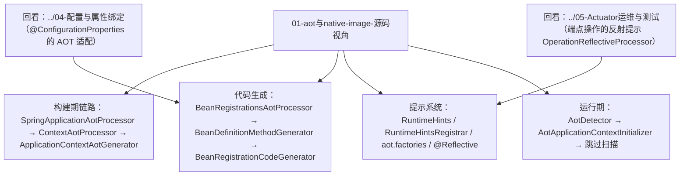

# 06 AOT 与 GraalVM

> 一句话结论：GraalVM native-image 是"封闭世界"编译器——**编译期不可达 = 运行期不存在**。Spring 大量依赖运行期扫描、反射、动态代理，所以要引入 AOT（Ahead-Of-Time）：在构建期把 `ApplicationContext` **真 refresh 一遍**，把"注册哪些 bean、怎么实例化、哪些反射/资源需要保留"全部算出来，写成 **Java 源码 + `reachability-metadata.json`**。运行期只执行生成的 `ApplicationContextInitializer`，不再扫描。

## 学习目标

读完本篇，你应该能够：

1. 说清 native-image 的封闭世界假设，并列举至少 4 类"运行期才知道、编译期不可见"的 Spring 能力。
2. 顺着 `SpringApplicationAotProcessor#main` → `AotProcessorHook` → `ContextAotProcessor#performAotProcessing` → `ApplicationContextAotGenerator#processAheadOfTime` 讲出完整构建期链路。
3. 解释 bean 注册代码是怎么生成的（`BeanRegistrationsAotProcessor` → `BeanDefinitionMethodGenerator` → `BeanRegistrationCodeGenerator` 的五段拼装）。
4. 解释 `RuntimeHints` 的四类提示，以及 `RuntimeHintsRegistrar` / `@ImportRuntimeHints` / `aot.factories` / `@Reflective` / `@RegisterReflectionForBinding` 五种注册路径的差异。
5. 说出运行期 `AotDetector.useGeneratedArtifacts()` 为真时 `SpringApplication` 的具体动作，以及 `AotInitializerNotFoundException` 的成因。
6. 面对 native 运行失败（`ClassNotFoundException`、`NoSuchMethodException`、资源缺失、CGLIB 代理缺失、类初始化错误）能按表和排查手段定位。
7. 说出 Boot 4 中 AOT 相关类的**实际位置**（哪些在 `spring-boot`、哪些在 Framework 模块），以及 Boot 2/3/4 的差异。

## 阅读顺序

**读图说明**

- 中间四个节点是同一篇的四个视角：**流程**（谁调谁）、**产物**（生成什么代码）、**元数据**（反射/资源提示）、**运行期**（怎么用上）。
- 两条"回看"虚线是刻意加的：`@Endpoint` 上的 `@Reflective` 与 `OperationReflectiveProcessor` 就是"提示系统"的真实用例；`ConfigurationPropertiesBeanRegistrationAotProcessor` 就是"代码生成"的真实用例。看完本篇回去看那两篇，收获会翻倍。
- 建议阅读顺序：先读全局地图 → 构建期链路 → 代码生成 → 提示系统 → 运行期 → 踩坑。

## 本篇摘要

### 01-aot与native-image-源码视角

- **为什么需要 AOT**：classpath 扫描、`Condition` 求值、反射构造/调用、CGLIB/JDK 动态代理、资源加载，这五类在 native 里都是"编译期必须知道"的东西。
- **构建期链路**：`SpringApplicationAotProcessor#main`（参数 `<applicationMainClass> <sourceOutput> <resourceOutput> <classOutput> <groupId> <artifactId> ...`）→ `AotProcessorHook` 在 `contextLoaded` 抛 `AbandonedRunException(context)` 抢出 `GenericApplicationContext` → `ContextAotProcessor#performAotProcessing`（`DefaultGenerationContext` + `processAheadOfTime` + `registerEntryPointHint` + `writeGeneratedContent` + `writeHints` + `writeNativeImageProperties`）→ `ApplicationContextAotGenerator#processAheadOfTime`（`withCglibClassHandler` + `refreshForAotProcessing` + `ApplicationContextInitializationCodeGenerator` + `BeanFactoryInitializationAotContributions`）。
- **代码生成**：`BeanRegistrationsAotProcessor` 遍历 `getBeanDefinitionNames()`，`BeanDefinitionMethodGenerator` 逐 bean 生成方法（在目标类包内 `public`，否则在 registrations 类里 `private`），`BeanRegistrationCodeGenerator#generateCode` 五段拼装（new BeanDefinition → set properties → instanceSupplier → set instanceSupplier → return）。
- **提示系统**：`RuntimeHints` 的 `reflection()` / `resources()` / `proxies()` / `jni()`（`serialization()` 自 7.0.6 废弃）；注册方式有 `@ImportRuntimeHints`（动态）、`aot.factories`（静态，需无参构造）、`@Reflective`（元注解 + `processors()`）、`@RegisterReflectionForBinding`（数据绑定专用）；`.imports` 是运行期自动配置清单、`aot.factories` 是 AOT 期服务清单。
- **产出与运行期**：`FileNativeConfigurationWriter` 把提示写到 `META-INF/native-image/[groupId/artifactId/]reachability-metadata.json`（`hasAnyHint` 为空则不写）；运行期 `SpringApplication#addAotGeneratedInitializerIfNecessary` 找 `<主类>__ApplicationContextInitializer`，找不到抛 `AotInitializerNotFoundException`，找到则插到初始化器链首位；`if (!AotDetector.useGeneratedArtifacts())` 时才 `load(context, sources)` 扫描。
- **踩坑**：CGLIB 类缺失、`NoSuchMethodException`、资源缺失、类初始化错误、`AotInitializerNotFoundException`、构建期误初始化资源（连接池/网络）；排查手段 `--trace-class-initialization`、`reachability-metadata.json`、native-image agent、JVM 上先开 `spring.aot.enabled=true`。

## 检查点

| 检查点 | 说明 |
| --- | --- |
| AOT 是静态分析还是"真刷新一次上下文"？证据是哪个方法？ | 见 §3.4 `refreshForAotProcessing` |
| 构建期参数里 `groupId`/`artifactId` 有什么用？ | 决定 `reachability-metadata.json` 的输出子目录 |
| CGLIB 代理类是怎么进到 native 镜像里的？ | `CglibClassHandler` 捕获 + `classOutput` |
| `aot.factories` 里有哪三个 key？ | `RuntimeHintsRegistrar`、`BeanFactoryInitializationAotProcessor`、`BeanRegistrationAotProcessor` |
| `@Reflective` 和 `@RegisterReflectionForBinding` 用哪个？ | 通用反射 vs 数据绑定/序列化 |
| 运行期怎么判断"有 AOT 产物"？ | `AotDetector.useGeneratedArtifacts()` |
| `AotInitializerNotFoundException` 的类名规则？ | `<mainApplicationClass>__ApplicationContextInitializer` |
| Boot 4 的 AOT 类都在哪些 jar？ | `spring-boot`（`SpringApplicationAotProcessor` 等）、Framework 的 `spring-context` / `spring-beans` / `spring-core`；`spring-boot-autoconfigure` 中已无 AOT 类（已验证 0 命中） |

## 关联章节

- 上一篇：[`../05-Actuator运维与测试/README.md`](../05-Actuator运维与测试/README.md)（`@Endpoint` 的 `@Reflective`、`OperationReflectiveProcessor`）。
- 配置与属性绑定：[`../04-配置与属性绑定/README.md`](../04-配置与属性绑定/README.md)（`@ConfigurationProperties` 的两个 AOT 处理器）。
- 启动原理：[`../01-启动原理/01-springapplication-run-启动全流程.md`](../01-启动原理/01-springapplication-run-启动全流程.md)（`SpringApplication#run` 中插入 AOT 初始化器的位置）。
