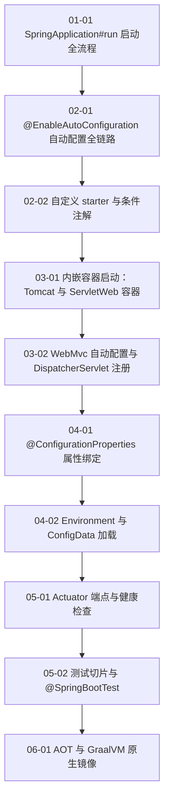

# 02 Spring Boot（启动 / 自动配置 / 容器 / 配置 / 运维 / AOT）

> 目标：把 Boot 从"会用注解"变成"知道每个注解最后落到哪个类"。
> 版本基线：`spring-boot@v4.2.0`（依赖 `spring-framework@v7.1.0`）
> ⚠️ Boot 4 的关键变化：模块从仓库根目录迁到 `core/`、`module/`；**starter 拆细**（`spring-boot-starter-web` 在 4.2.0 的 POM 里仍传递依赖 `spring-boot-webmvc`，但已标注 deprecated in favor of `spring-boot-starter-webmvc`，新工程建议直接用后者）；servlet 容器实现独立成模块（`spring-boot-tomcat` 等）。

## 学习目标

- 能逐行讲 `SpringApplication#run` 的四段式编排和 7 个事件时刻。
- 能说清 `@SpringBootApplication` → `AutoConfiguration.imports` → `@AutoConfiguration` 条件装配的完整链路。
- 知道内嵌 Tomcat 是在 `onRefresh()` 里被创建并 `start()` 的。
- 能解释 `application.yml` 的加载顺序（`ConfigData` 体系）与 `@ConfigurationProperties` 的松散绑定。
- 了解 GraalVM AOT 为什么要引入 `RuntimeHints`。

## 文章顺序

> 读图说明：自动配置（第二步）依赖第一步的 `prepareContext` 阶段注册的 `AutoConfigurationImportSelector`；内嵌容器在 `refresh()` 的 `onRefresh` 钩子里创建，是"Boot 与 Spring 框架的接缝"。04 组内先读绑定（04-01）再读加载（04-02）：绑定是"字符串 → Java 对象"的后半段，加载是"文件 → Environment"的前半段，配合 `/actuator/env` 观察属性源顺序效果最好。

## 子目录

| 目录 | 内容 | 学完能做到 |
| --- | --- | --- |
| `01-启动原理` | `run()` 编排、事件、`BootstrapContext` | 定位"启动到哪一步失败" |
| `02-自动配置` | `@EnableAutoConfiguration`、`AutoConfigurationImportSelector`、`AutoConfiguration.imports`、`@Conditional` | 自己写一个 starter 并解释为什么生效/不生效 |
| `03-内嵌容器与Web开发` | `ServletWebServerApplicationContext`、Tomcat 启动、`WebMvcAutoConfiguration`、`DispatcherServlet` 注册 | 解释端口/线程池/优雅停机参数最终设到哪 |
| `04-配置与属性绑定` | `ConfigDataEnvironmentPostProcessor`、`Binder`、松散绑定、优先级 | 排查"配置没生效"类问题 |
| `05-Actuator运维与测试` | endpoint 暴露模型、health 聚合、`@SpringBootTest` 上下文缓存 | 做线上健康检查与测试优化 |
| `06-AOT与GraalVM` | AOT 处理、`RuntimeHints`、`-Dspring.aot.enabled` | 理解反射为什么在原生镜像里会挂 |

## 依赖关系

- 前置：`01-Spring框架` 全部（尤其 `refresh()` 与 `BeanDefinition`）。
- 后续：`03-MyBatis` 的 Boot 自动配置、`04-SpringCloud` 的 starter 机制。

## 学习检查点

- [ ] 能说出 `SpringApplication` 构造器做的 5 件事。
- [ ] 能手写一个 `@AutoConfiguration` + `AutoConfiguration.imports` 的最小 starter。
- [ ] 能解释 `spring.factories`（Boot 2）→ `AutoConfiguration.imports`（Boot 3/4）的演进原因。
- [ ] 能说清一个配置项从 `application.yml` 到 `@ConfigurationProperties` 字段经过了哪些对象。
